# 251220: 南半球聊财经

Jason不晦
2025-12-20 03:08

bloomberg:新西兰商业信心在12月升至30来的最高点，净74%的公司经营环境好转——这是自1994年3月以来的最高，且自贸易预测也达到31来的最高点。信心的提升预计将促进企业投资和招商，这将推动家庭支出。#其他国家经济

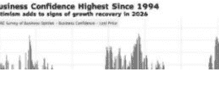

## Business Confidence Highest Since 1994
Optimism adds to signs of growth recovery in 2026

## ANZ Survey of Business Opinion - Business Confidence - Last Price

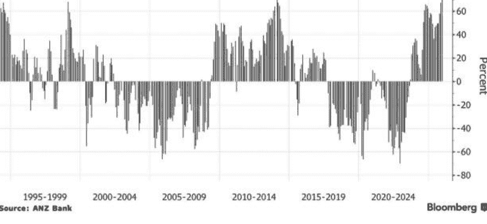

Jason不晦
2025-12-20 03:14

bloomberg:日本银行将基准利率提高至0.75%，这是1995年以来最高水平，并暗示更多可能在储备。该决定后日元走弱，交易者希望获得更强力的信息，以应对未来进一步一步。日本10年期国债收益率升至自1999年以来的最高点，日本银行对2026年工资上涨表示信心，景气目标将保持一致。这看起来是一个更强劲的经济，瑞表示日本对家庭来说可能每年损失8000亿日元（500美元）——普通储蓄户和定期存款的通胀将每年为家庭增加1万亿日元，而更高的贷款将对日本家庭造成5000亿日元的损失。#其他国家经济

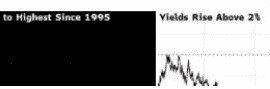

## BOJ Raises Rate to Highest Since 1995

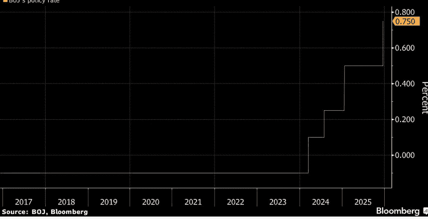

## Japan's Bond Yield Rise Above 2%

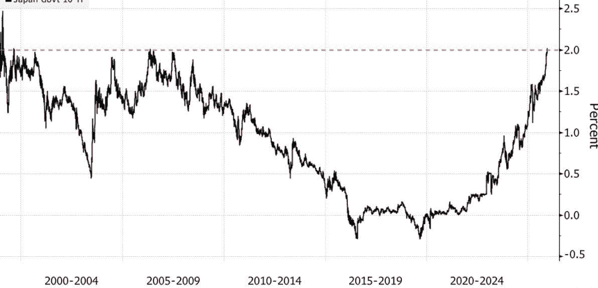

Jason Lee
2025-12-20 03:19

bloomberg: 黄金的反弹和原油运行是今年全球大商品的两大突出特征。高盛认为，这两个趋势将延续到2026年。黄金的目标价是每盎司4900美元，而且上涨风险较高。相比之下，石油可能存在下行风险，原油基准布特预计年均价格55美元，西克林之间区间为52美元。另外，美储的维持和加息增长可能延长经济周期并推高风险资产。双重风险存在时——经济可能损失或者过热，后者可能推升加息预期，投资者要做好各种准备。# 金融

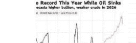

## Gold Rallies to Record This Year While Oil Sinks
Gold Sachs forecasts higher bullion, weaker crude in 2026

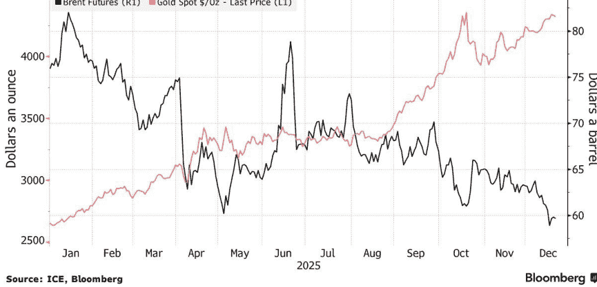

## 原油价格预测到预算所需的水平
2026年布伦特原油价格预测远低于部分主要出口国预期的盈余平衡

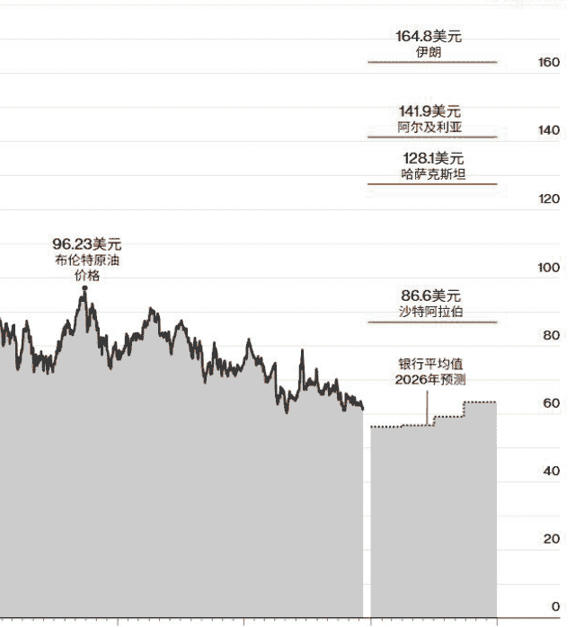

注：第一至第四季度股票价格预测来源自法兰斯银行、花旗集团、高盛、摩根通、麦格莱、摩根士丹、加拿大皇家银行和当地银行的平均数据
来源：彭社

Jason-不晦
2025-12-20 03:31

FT: 与美国沟通，现在在与特朗普做别的小圈子沟通#其他国家经济

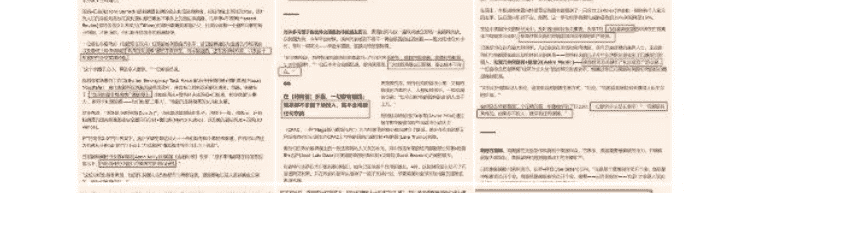

在他身旁的是特朗普的女儿、人气人物贾德·库什（Jared Kushner），库什并不是正式的政府首脑，但在哈里斯时期担任商业顾问以来，他凭借外交代表美国政府在中东与以色列的谈判中扮演了主导角色。

汤洛（Tom Barrack）是特朗普的亲友，为人所知他是以色列和平上获得诺贝尔和平奖的唯一候选者。马鲁萨伊斯（Massad Bouis）是特朗普的妻子贾芙妮（Tiffany）的父亲，他曾当过西非商人。此外他也担任特朗普非洲顾问。

一位前美国官员表示，赛多曾提议与传统的渠道，以美国主导的存在，同样的领域，特别是非洲，十年来的外交交易变得频繁。这个小圈子是一个，叙利亚紧急事务小组（Syrian Emergency Task Force）执行主任穆阿德·穆斯塔（Mouaz Moustafa）是代表叙利亚政府的官员，并能够与政府。关键在于“如果你愿意放弃政权，谁都伟大”，韦斯特或马鲁赫，你就是主事。

库什说“他是主事”，他或许是小唐（Donald Jr），这也是特朗普的儿子，下一次。他表示，还有特朗普的国家安全顾问马尔科·鲁比（Marco Rubio），以及他的副总统万斯（JD Vance）。在特朗普的世界里，正确的就是那个特殊。白宫将长期担任秘书安妮（Anna Kelly）对英国表示：“很多事情都是由少数高官员执行的。”

这位总统虽然是非典型的。“美国国家安全委员会（National Security Council）无关，国务院也无关，”特朗普说“除了决策者，其他都不重要。”

对许多外交盟友来说，如何建立联系面临挑战。对于美国来说，今年年初的缓解代表他们不再糟糕——每次旅行约30小时，两次——一次，妥协，真的是特朗普特有的节奏。

一位欧洲州长表示：“一切都是有条件的，只要你不拒绝，就没有问题。”

政府方面，特朗普的交易型外交有利于美国利益。它表示，美国需要施加压力，并确保我们为胜利打下基础，赢得关键的胜利。

白宫发言人鲍宁谈及特朗普，拜登（Joe Biden）：“我们先是个别会议，然后是两个个别会议，然后是正式会议，有一个只有一日——会议将会进行双边会议，”就贸易问题代表的正式磋商。当那时，特朗普会和他一起考虑一些外交政策，“贸易官员很有利，但我们政府认为，在开局后的人才合适。”

在我们的客户中，我特别在沙特阿拉伯王国和伊拉克、尼日利亚和以色列等地都提了这件事，“奥特朗普时期的美国高级外交官温纳（Jonathan Winner）”。

“他们的外交模式是以外交官与政府的私人利益互动，并且与特朗普非常不同，更倾向于接近的个人利益，”参与议院外交委员会的民主党精英布鲁（Cory Booker）表示，“对未来来的外国官员的转变态度‘胃口坏’。这些在与政府外交中，如今如果关注的是特朗普的利益，人们认为外国官员的转变态度‘胃口坏’。本周早些，沙特和阿联酋达成协议，一位美国官员称：“我们投资了超过18亿美元——这不是承诺，正在投资。”

最近走进白宫办公室（Oval Office）时他说世界上最有权的地方。”随后他坐在沙特王子穆哈默德（Mohamed bin Salman），表示若非美国人邀请，这次会议将邀请特朗普来支持他的沙宫晚宴。在美国，有报道称特朗普向沙特总统送了一只劳力士（Rolex）手表和一份昂贵礼物，在国内引起了争议，此笔礼物通胀率从39%减至15%。在这种交易外交的新如此下，特朗普如何应对美国的压力？7月，沙特王储在白宫与特朗普会面，引发了新的外交紧张。巴基斯坦在此方面也有表现。巴基斯坦在整个亚洲地区拥有最富王室，政府与特朗普互动并支持他的政策。特朗普今年在巴基斯坦见了其斯明·米尔（Asim Munir）：“我们关注加强美国关系。”巴基斯坦总统也将邀请特朗普访问巴基斯坦，他将正式寻求与美国建立新的关系。“特朗普对巴基斯坦总理来说，他表现出非常重视自己的生意。”特朗普对商人来说具有巨大的价值。”

在特朗普第二个任期的第一周他想要什么？一位欧洲官员表示：“一切都是有条件的，只要你不拒绝，就没有问题。”

政府方面，特朗普的交易型外交有利于美国利益。它表示，美国需要施加压力，并确保我们为胜利打下基础，赢得关键的胜利。

Robin brooks: 我们正处于全球债务危机的早期阶段。由于市场未出现高恐慌水平的通胀，这正是所谓的“价值交易”预警。此外，长期债券收益率正在上升。市场正在寻找避险资产。正如此，黄金价格上涨，债务较低的国家——瑞士、瑞典、丹麦突然变热门。换句话说，市场对高债务国家持续增加债务的政府已经失去信心。这样做后果？日本在这这个问题上走到了尽头。若观察日元的实际有效汇率（即考虑各国政府利率的通胀差异），可以发现日元几近按土耳其汇率的幅度程度。屡次的刺激政策越靠越多，通常也会带来收益率。但当前债券收益率被认为压低，进一步刺激只会加剧这一局面。如果真的想让日本变得强大，就必须做出无可奈何的，例如提高税收，增加支出，出售日本国内的资产，再一次刺激，已是无法解决问题。

## 25 Monthly BoJ purchases of JGBs, in JPY tn

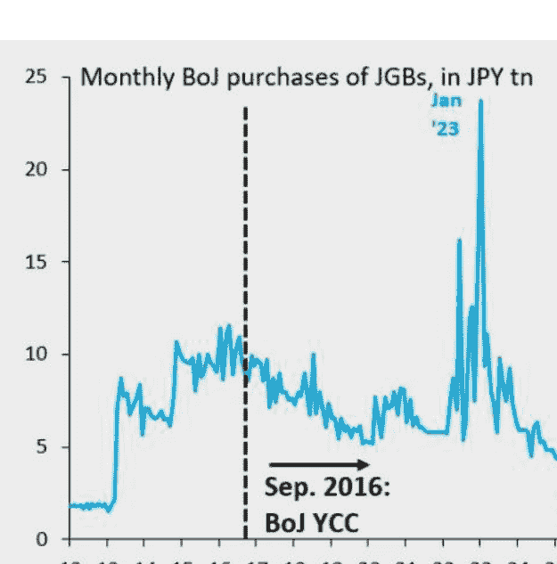

Jason Wang
2023-12-20 03:43

私募推测：私募继续加码A股市场，截至12月12日，私募仓位指数升至83.59%，较前一周环比上涨0.61个百分点，创今年新高再度突破满仓（仓位>80%），私募占比70.34%。与此同时，中国私募基金登记及产品数量截至11月末，私募总规模已升至2209亿元，再次创下高。

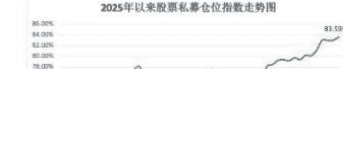

Brad Setser
2025-12-24 02:03

Brad Setser: 中国持有的美元敞口虽巨大，但单看持有规模是在减少的，至少直接从美国托管机构（比利时、卢森堡以及英国地区）合计后保持平稳，另外中国银行美元投资组合迅速。

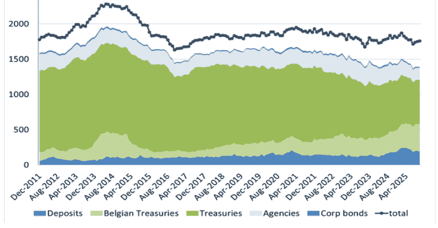

Jason不愁
2025-12-20 04:16

Jason不愁: 根据前份报告合理的15%到30%，我们又估算了对中国银行的影响。15%房价下跌 → 亏损；30%房价下跌 → 部分中小银行出现资本风险，且地方财政受影响。

### Goldman Research Equity Research CHINA BANKS
#### 2026 Outlook: Re-evaluating property impact on banks

19 December 2025 | 12:01AM HKT

Shaun Yang, Ph.D.
shan.yang@goldmansachs.com
Claire Doyle, Ph.D.
claire.doyle@goldmansachs.com

We re-evaluate Banks' exposure to property market and non-mortaged in light of our China Property team's updated forecast of a 15% price correction. We believe that our banks remain profitable under a 30% price decline scenario.

Impact stress heavily affects credit quality for mortgage LTVs. With a total banking system exposure remains massive, the well-leveraged nature of property LTVs above 100% during a period of price decline and slow recovery of asset prices has grave downside. We forecast the NPL ratio to rise to 2.4% by 2027, and a more moderate slope to 2.1% for banks. This could result in a cycle break if property prices stabilize. We expect a 15% correction with 50% of mortgages by 2027. The property forecast for branches has shrunk by RMB 700bn to improve the risk profile.

Earnings risk not included in our forecasts: property price correction could accelerate to 25% through 2027. We estimate our banks remain profitable through our forecast but are exposed to the downside of a divided capital-cut scenario for some banks. Overall balance sheet remains healthy, supported by lower growth, the RMB-800bn in capital raised over the past 3 years, higher loan bolder.

Exhibit 1: Based on our expected credit loss (ECL) model, we apply different PD and LGD assumptions to LTV layers of mortgages as each carries credit risk, and the risk increases as the LTV.

Exhibit 2: The China Property team has its property price forecast for 2026-27 to a 15% decline, and we introduced a stress scenario of 30% property price drop.

Mortgage default by LTV
Property price index

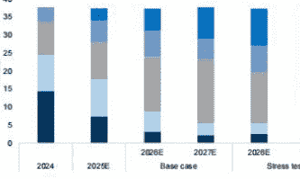

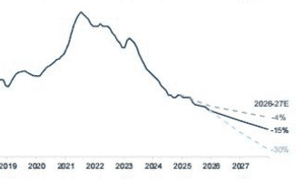

We use the full information for LTV calculation here to better map it with potential loss, which is the key factor in the ramifications affecting our loan balance for different issuers.

Source: Goldman Sachs Global Investment Research

From: GS China property team

### 1. The impact on banks of a cumulative 15%/30% property price decline in 2026-2027

Our conclusion is that banks will face earnings risk under our base case scenario. If the new property and mortgage losses arising from a 15% house price de-cline are cut off over three years, it could cause an average 9% decline in 2025-27E bottom line earnings compared to our current forecasts (Exhibit 15), banks would be able to maintain adequate NPL coverage and CET1-later ratios (Exhibit 16). However, under the stress test scenario (30% house price cut), a capital shortfall could emerge. We estimate a capital shortfall of approximately R24bn by 2027, including R30/31bn in covered and non-covered banks (Exhibit 22). It should be noted, however, that our calculation assumes banks will still maintain reasonable target CET1 ratios and NPL coverage ratios. Therefore, it is possible that banks could save capital by holding more government bonds and reducing new loans, or by lowering their target CET1 ratios and NPL coverage ratios to release capital and smooth earnings.

- 1) Base case: Based on the GS property forecast of a c.15% property price decline in 2026-2027 (The banking system could generate R0.9tn in mortgage NPLs and R1.1tn in property NPLs)

We observe that banks have the capacity to absorb these losses between 2025 and 2027 using existing provisions without creating a capital shortfall, and continue to pay dividends (Exhibit 16). China banks have maintained a high level of excess provisions; for example, CMB's NPL coverage and LKR ratio were 40%/3.8% (3Q25) 67%/0.8% for HDFC Bank (Exhibit 17). Therefore, banks would be able to use reserves to cover risks. It should be noted that if banks can maintain sufficient CET1 capital and dividends in this situation, they may still face downward earnings volatility. The main reason is that in the process of writing off risks, banks need to proactively increase credit costs to maintain or minimize the depletion of excess reserves.

Jason
2025-12-20 04:21

## 日经：海外投资者买入日股创节日以来新高#股市

日本股市自2023年12月以来创下新高，海外投资者买入日股的规模创下5年以来新高。2023年全年，日经指数涨幅28%，位居亚洲第二。受需求回暖及企业治理改革影响，12月日本股市净流入额突破1万亿日元，创下三个月以来最高水平，引发了股市反弹。

12月18(一) 东京证券交易所发布成交量等数据，显示在12月18日（周一）期间，外国投资者买入日股，日内净流入658.8亿日元。

# 深度视野VIP加入追踪550+大会 付费进群微信cuk255 微信chps558

海外投资者正重新回归日本股票。2025年截至，海外投资者对日本股票的买入金额已突破5万亿美元，全规模有望比此前美国经济活跃时创新高。一方面，美国的宏观政策将使得此前侧重日本股市的布局进行调整，日本股票正成为主要的融资来源；另一方面，市场对日本经济的复苏预期，助推了此次回归升热。未来日本股票能否持续吸引海外投资者关注将成为一项课题。

12月18日，东京证券交易所接受者的买入波动，在12月的第二个周二（18日），海外投资者对日本股票买入1897亿美元。从年初累计计算，买入额已达到5888亿美元。

这一规模堪比近期日本股市较为活跃的2023年（3.1万亿元），也是日本首首相安倍晋三推行的大规模货币政策与宽松的财政政策的2013年（15.1万亿元）以来的新高。

Jason-bourn
2025-12-20 10:26

高昂：在未来3-5年内，中国中产阶级购房户规模将增加到接近全球GDP的1%，这是有记录以来最大的一个国家亚洲。这很可能影响其他生产经济，例如欧洲—欧元区的结构性弱点，包括人口下降、过度监管和高昂的成本。\ 经济数据

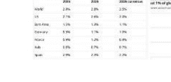

# Goldman Sachs Research expects China's current account surplus to rise to almost 1% of global GDP by 2029

China current account surplus as a share of:

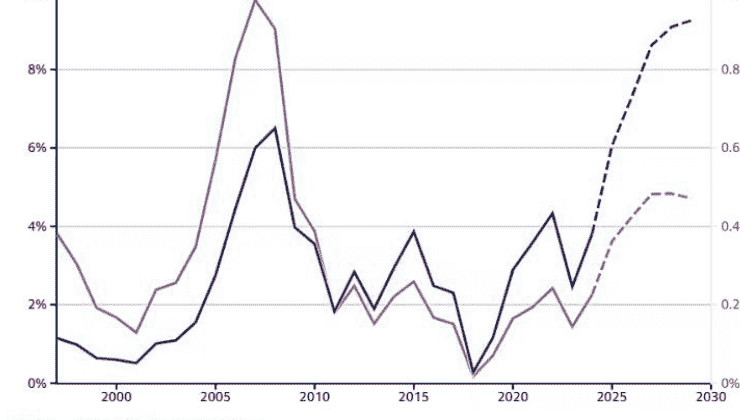

■ GDP (left) World GDP (right)
Source: IMF, Haver Analytics, Goldman Sachs Research. As of December 18, 2025.
Dashed lines indicate GS forecast.

Goldman Sachs

深度视野VIP群 人工追踪50+大V 付费进群加微信cuk255 微信chpsp5568

# Outlooks 2026

## Real GDP growth forecasts
(% change, yoy)

| World | 2025 | 2026 | 2026 consensus |
|---|---|---|---|
| World | 2.8% | 2.8% | 2.5% |
| US | 2.1% | 2.6% | 2.0% |
| Euro Area | 1.5% | 1.3% | 1.1% |
| Germany | 0.3% | 1.1% | 1.0% |
| France | 0.9% | 1.2% | 0.9% |
| Italy | 0.6% | 0.7% | 0.7% |
| Spain | 2.9% | 2.4% | 2.2% |
| China | 5.0% | 4.8% | 4.5% |
| Japan | 1.2% | 0.8% | 0.7% |
| UK | 1.4% | 0.9% | 1.1% |
| Canada | 1.7% | 1.3% | 1.2% |
| India | 7.6% | 6.7% | 6.5% |
| Brazil | 2.3% | 1.8% | 1.7% |
| Russia | 0.5% | 1.2% | 1.0% |

Source: Goldman Sachs Research, Bloomberg
All forecasts as of December 18, 2025.

Goldman Sachs

Policy rate forecasts for larger developed markets

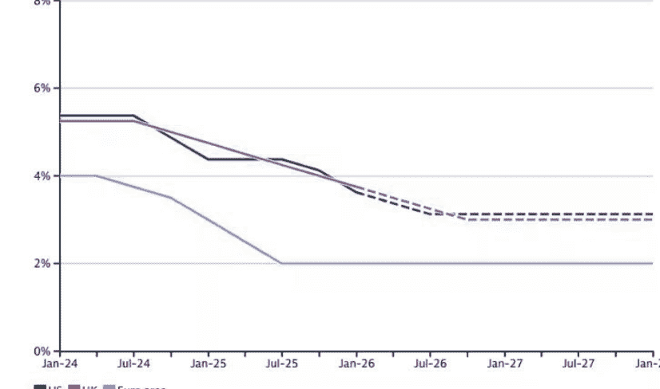

+ US Euro area

Source: Haver Analytics, Goldman Sachs Research. As of December 18, 2025.
Dashed lines indicate GS forecasts.

Goldman Sachs

# 深度视野优质文集，链接

全部包含以下：限时188/年 加微信cuk255

- 1) Base case：基于GS地产预测，2026-2027年房价下跌约15%（银行系统可能产生0.9万亿抵押贷款NPL和1.1万亿地产NPL）

我们观察到银行有能力在2025年至2027年间利用现有准备金吸收这些损失，而不会产生资金缺口，并继续支付股息（Exhibit 16）。中国银行保持了高水平的超额准备；例如，招商银行NPL覆盖率和LCR率为40%/3.8%（3Q25），HDFC银行为67%/0.8%（Exhibit 17）。因此，银行可以使用准备金覆盖风险。需要注意的是，如果银行在这种情况下能够维持足够的CET1资本和股息，它们可能仍面临收益向下波动。主要原因是销账风险的过程中，银行需要主动增加信用成本，以维持或最小化对额外准备金的消耗。

- 2) 高昂：在未来3-5年内，中国中产阶级购房户规模将增加到接近全球GDP的1%，这是有记录以来最大的一个亚洲国家。这很可能影响其他生产经济，例如欧洲—欧元区的结构性弱点，包括人口下降、过度监管和高昂的成本。

- 3) 深度视野优质文集，链接

- 4) 深度视野VIP群 人工追踪50+大V 付费进群加微信cuk255 微信chpsp5568

- 5) 深度视野优质

- 6) 深度视野优质

- 7) 深度视野优质

- 8) 深度视野优质

- 9) 深度视野优质

- 10) 深度视野优质

- 11) 深度视野优质

- 12) 深度视野优质

- 13) 深度视野优质

- 14) 司马林解读毛选

- 15) 虚走三部曲

- 16) 额外

- 17) 额外再送
