# 南球聊财经250902

Jason 不离
2022-09-02 02:56

国信: 经历过寒冬的暴行情后，黄金有望迎来新一轮机遇。本次触发因素从“全球避险资产不足”一路结束美联储独立性软化，历次行情定价机制的重构来自于来自美国资产的信用危机。我们更关注的近期美债独立性的问题可能会在第一个层面上推高美债，以及美国美元的信用。乌克兰战争后美国对俄罗斯资产的处置已经在第一个层面上伤了美元信用，导致美联储央行流动性困难、避险稳定的黄金作为平替储备，而美联储的独立性无疑质疑会为加剧美元信用贬价的另一根稻草。#金融

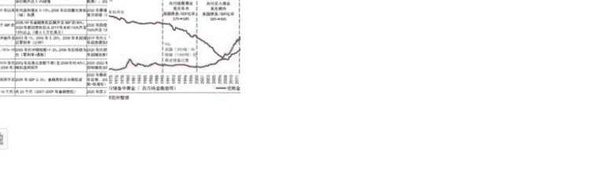

表2）历史上三次美元价贬值的背景对比

| 指标 | 1970 年 | 2000 年 | 2020 年 |
| :--- | :--- | :--- | :--- |
| 通胀率 | 平均为7%，回高来近期，1970年第四季度一次峰值，两次时间倒挂：2021年-2022年，2022年6月9.1%（40年来新高），1980年3月达到14.8% | 平均2-3%，两次时间倒挂：美元贬值5.6% | 2020年/2021年纪创新高 |
| 货币供给量 | 宽松（初期增长为5%-10%）；1999年以后增长速度5%-10%；2008年后量化宽松和2020年后增长20.9%（史上最速）；2022年以后回落至2%-5% | 宽松 | 极宽松 |
| 政府债务 | 债务占GDP100%；2008年后美联储开始购买债券的80% | 2020年美国通胀增长放缓（从2019年1%升至2020年5%），2021年从0%升至0.2-0.5% 2022年从0.5%升至4% | | |
| 基利率 | 1970年4月-5月，美元对日贬值0.1%，2005年2.5%，2008年后利率从5%降至0.25%，2020年从0%升至0.1%（1980年以来最低水平） | | | |
| 实际利率 | 负值基准（为0%）；1974-1979年美债利率为负1%-2%，2008年后利率为1%-5%，2020年后升至2.5%-5.7%（2008年以来最高水平） | | | |
| 美元汇率 | 1980年以来高点，美元对一时期下跌（自2000年下降40%），2020年11月回落0.1%，2023年年初 | | |
| GDP增长率 | 平均为0.3%，两次跌/反弹，产能能不及2009年GDP增长6.6%；金融危机长期低迷-增长 | | 2020年暴涨（美国-3.4%，德国6.1%）；2022年仅2个月（疫情早期购贷投资） |

# 大亿文圈VIP粉丝专享，付费加群微信daizongdai2021

# 图4:全球性通胀中黄金和金价趋势

| | 1990-1999年 | 2000-2011年 | 2017-2021年 | 4000 |
| :--- | :--- | :--- | :--- | :--- |
| | 发行黄金需求 | 黄金流入美国 | 黄金购买行为 | 3500 |
| | 美国黄金 | 美国黄金 | 瑞美黄金对比 | 3000 |
| | 美国黄金/GDP增长 | 52%-78% | 58%-76% | 美国黄金/GDP增长 95%-111% | 2500 |

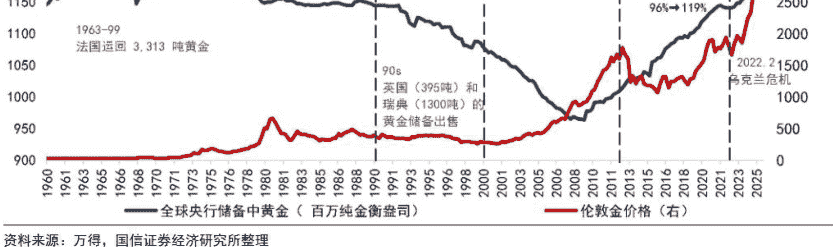

(注：此处原文包含大量乱码数字及坐标，已根据上下文逻辑清理)
- 全球性通胀中黄金（黄金需求）
- 金价（右）

来源：万得，国信证券研究所整理
Jason 不
2023-09-02

Brad Setser: 中国应该人民币作为主要伙伴的货币走出去，并远超过美元汇率7%，以促进贸易平衡。它可能会上涨，以弥补过去几年的贬值。可以通过持有外汇和扩大储备等措施推动当地需求。人民币可以通过增加国家购买资产来促进增长，并为贸易融资支持。消费驱动型经济以及汇值将鼓励资金流入中国。“这是重要的事情。”

# Yuan RMB at Subdued Levels to Other Currencies

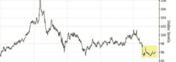

金融

# Yuan Remains at Subdued Levels to Other Currencies

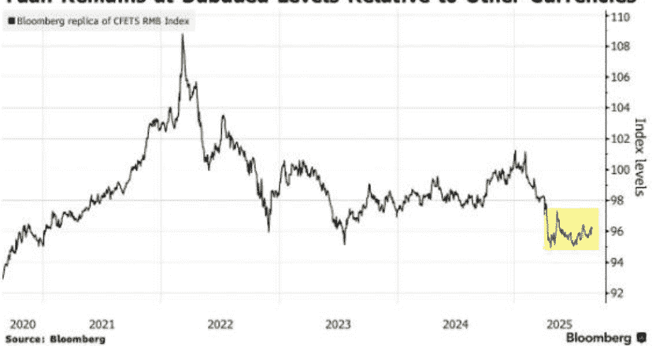

Jason 不
2023-09-02

开源：A股上市公司已全部完成2025年中报业绩披露，净利润增速下降。全A（非金融）H1营收同比增速-0.45%，全A（非金融）净利润同比增速为0.96%，大幅低于Q1的5.21%。结构下，大块来看，盈利增长的行业密集在科技制造业，消费和周期分化，地产处于利润周期的底部。扩张型群体利润增长的行业（盈利于历史高水平）：科技制造（电子、机械设备）、消费（家用电器）、周期（有色金属）、大金融（非金）。Q1利润增长的行业，在中报中显著改善的：电力设备、国防军工、医药。#经济数据

| 2025年各分行业利润增速对比 |
| :--- | :--- |
| 电力设备 | ... | ... |
| 国防军工 | ... | ... |
| 医药 | ... | ... |

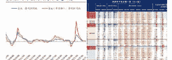

Wind，数据来源：经济数据

## 图2：A股利润增长同比增速回落

数据来源：Wind、开源证券研究所

### 图3：2025年行业业绩：科技制造优于高增速行业

| 行业分类 | 营收增长 | 利润增长 | 2025Q01 | 2025Q02 | 2025Q03 | 2025Q04 | 2024Q01 | 2024Q02 | 2024Q03 | 2024Q04 | 2023Q01 | 2023Q02 | 2023Q03 | 2023Q04 | 2022Q01 | 2022Q02 | 2022Q03 | 2022Q04 |
| :--- | :--- | :--- | :--- | :--- | :--- | :--- | :--- | :--- | :--- | :--- | :--- | :--- | :--- | :--- | :--- | :--- | :--- | :--- |
| 电子 | 14.8% | 18.4% | 21.3% | 20.7% | 21.8% | 22.9% | 21.7% | 21.4% | 21.3% | 21.7% | 12.5% | 11.7% | 10.3% | 10.0% | 9.2% | 8.5% | 8.9% | 14.2% |
| 计算机 | 14.5% | 19.8% | 24.1% | 20.4% | 20.7% | 22.1% | 21.9% | 21.4% | 21.3% | 21.7% | 12.8% | 11.7% | 10.5% | 10.0% | 9.2% | 8.5% | 8.9% | 14.3% |
| 机械 | 13.8% | 17.2% | 19.8% | 18.4% | 20.7% | 21.6% | 21.9% | 21.4% | 21.3% | 21.7% | 12.3% | 11.7% | 10.3% | 10.0% | 9.2% | 8.5% | 8.9% | 14.2% |
| 电力 | 10.8% | 15.0% | 18.4% | 16.3% | 17.8% | 19.6% | 18.7% | 18.4% | 18.3% | 18.7% | 8.5% | 7.7% | 7.3% | 8.0% | 7.2% | 6.5% | 6.9% | 10.3% |
| 通信 | 10.8% | 15.0% | 18.4% | 16.3% | 17.8% | 19.6% | 18.7% | 18.4% | 18.3% | 18.7% | 8.5% | 7.7% | 7.3% | 8.0% | 7.2% | 6.5% | 6.9% | 10.3% |
| 钢铁 | 10.8% | 15.0% | 18.4% | 16.3% | 17.8% | 19.6% | 18.7% | 18.4% | 18.3% | 18.7% | 8.5% | 7.7% | 7.3% | 8.0% | 7.2% | 6.5% | 6.9% | 10.3% |
| 医药 | 10.8% | 15.0% | 18.4% | 16.3% | 17.8% | 19.6% | 18.7% | 18.4% | 18.3% | 18.7% | 8.5% | 7.7% | 7.3% | 8.0% | 7.2% | 6.5% | 6.9% | 10.3% |
| 农用 | 10.8% | 15.0% | 18.4% | 16.3% | 17.8% | 19.6% | 18.7% | 18.4% | 18.3% | 18.7% | 8.5% | 7.7% | 7.3% | 8.0% | 7.2% | 6.5% | 6.9% | 10.3% |
| 食品 | 10.8% | 15.0% | 18.4% | 16.3% | 17.8% | 19.6% | 18.7% | 18.4% | 18.3% | 18.7% | 8.5% | 7.7% | 7.3% | 8.0% | 7.2% | 6.5% | 6.9% | 10.3% |
| 服务 | 10.8% | 15.0% | 18.4% | 16.3% | 17.8% | 19.6% | 18.7% | 18.4% | 18.3% | 18.7% | 8.5% | 7.7% | 7.3% | 8.0% | 7.2% | 6.5% | 6.9% | 10.3% |
| 建筑 | 10.8% | 15.0% | 18.4% | 16.3% | 17.8% | 19.6% | 18.7% | 18.4% | 18.3% | 18.7% | 8.5% | 7.7% | 7.3% | 8.0% | 7.2% | 6.5% | 6.9% | 10.3% |
| 房地产 | 10.8% | 15.0% | 18.4% | 16.3% | 17.8% | 19.6% | 18.7% | 18.4% | 18.3% | 18.7% | 8.5% | 7.7% | 7.3% | 8.0% | 7.2% | 6.5% | 6.9% | 10.3% |
| 纺织 | 10.8% | 15.0% | 18.4% | 16.3% | 17.8% | 19.6% | 18.7% | 18.4% | 18.3% | 18.7% | 8.5% | 7.7% | 7.3% | 8.0% | 7.2% | 6.5% | 6.9% | 10.3% |
| 轻工 | 10.8% | 15.0% | 18.4% | 16.3% | 17.8% | 19.6% | 18.7% | 18.4% | 18.3% | 18.7% | 8.5% | 7.7% | 7.3% | 8.0% | 7.2% | 6.5% | 6.9% | 10.3% |
| 石炭 | 10.8% | 15.0% | 18.4% | 16.3% | 17.8% | 19.6% | 18.7% | 18.4% | 18.3% | 18.7% | 8.5% | 7.7% | 7.3% | 8.0% | 7.2% | 6.5% | 6.9% | 10.3% |
| 有油 | 10.8% | 15.0% | 18.4% | 16.3% | 17.8% | 19.6% | 18.7% | 18.4% | 18.3% | 18.7% | 8.5% | 7.7% | 7.3% | 8.0% | 7.2% | 6.5% | 6.9% | 10.3% |
| 钢铁 | 10.8% | 15.0% | 18.4% | 16.3% | 17.8% | 19.6% | 18.7% | 18.4% | 18.3% | 18.7% | 8.5% | 7.7% | 7.3% | 8.0% | 7.2% | 6.5% | 6.9% | 10.3% |
| 金属 | 10.8% | 15.0% | 18.4% | 16.3% | 17.8% | 19.6% | 18.7% | 18.4% | 18.3% | 18.7% | 8.5% | 7.7% | 7.3% | 8.0% | 7.2% | 6.5% | 6.9% | 10.3% |
| 有色 | 10.8% | 15.0% | 18.4% | 16.3% | 17.8% | 19.6% | 18.7% | 18.4% | 18.3% | 18.7% | 8.5% | 7.7% | 7.3% | 8.0% | 7.2% | 6.5% | 6.9% | 10.3% |
| 交通 | 10.8% | 15.0% | 18.4% | 16.3% | 17.8% | 19.6% | 18.7% | 18.4% | 18.3% | 18.7% | 8.5% | 7.7% | 7.3% | 8.0% | 7.2% | 6.5% | 6.9% | 10.3% |
| 建筑 | 10.8% | 15.0% | 18.4% | 16.3% | 17.8% | 19.6% | 18.7% | 18.4% | 18.3% | 18.7% | 8.5% | 7.7% | 7.3% | 8.0% | 7.2% | 6.5% | 6.9% | 10.3% |
| 汽车 | 10.8% | 15.0% | 18.4% | 16.3% | 17.8% | 19.6% | 18.7% | 18.4% | 18.3% | 18.7% | 8.5% | 7.7% | 7.3% | 8.0% | 7.2% | 6.5% | 6.9% | 10.3% |
| 机械 | 10.8% | 15.0% | 18.4% | 16.3% | 17.8% | 19.6% | 18.7% | 18.4% | 18.3% | 18.7% | 8.5% | 7.7% | 7.3% | 8.0% | 7.2% | 6.5% | 6.9% | 10.3% |
| 航空 | 10.8% | 15.0% | 18.4% | 16.3% | 17.8% | 19.6% | 18.7% | 18.4% | 18.3% | 18.7% | 8.5% | 7.7% | 7.3% | 8.0% | 7.2% | 6.5% | 6.9% | 10.3% |
| 航天 | 10.8% | 15.0% | 18.4% | 16.3% | 17.8% | 19.6% | 18.7% | 18.4% | 18.3% | 18.7% | 8.5% | 7.7% | 7.3% | 8.0% | 7.2% | 6.5% | 6.9% | 10.3% |
| 军工 | 10.8% | 15.0% | 18.4% | 16.3% | 17.8% | 19.6% | 18.7% | 18.4% | 18.3% | 18.7% | 8.5% | 7.7% | 7.3% | 8.0% | 7.2% | 6.5% | 6.9% | 10.3% |
| 农具 | 10.8% | 15.0% | 18.4% | 16.3% | 17.8% | 19.6% | 18.7% | 18.4% | 18.3% | 18.7% | 8.5% | 7.7% | 7.3% | 8.0% | 7.2% | 6.5% | 6.9% | 10.3% |
| 农机 | 10.8% | 15.0% | 18.4% | 16.3% | 17.8% | 19.6% | 18.7% | 18.4% | 18.3% | 18.7% | 8.5% | 7.7% | 7.3% | 8.0% | 7.2% | 6.5% | 6.9% | 10.3% |
| 农药 | 10.8% | 15.0% | 18.4% | 16.3% | 17.8% | 19.6% | 18.7% | 18.4% | 18.3% | 18.7% | 8.5% | 7.7% | 7.3% | 8.0% | 7.2% | 6.5% | 6.9% | 10.3% |
| 种子 | 10.8% | 15.0% | 18.4% | 16.3% | 17.8% | 19.6% | 18.7% | 18.4% | 18.3% | 18.7% | 8.5% | 7.7% | 7.3% | 8.0% | 7.2% | 6.5% | 6.9% | 10.3% |
| 钢铁 | 10.8% | 15.0% | 18.4% | 16.3% | 17.8% | 19.6% | 18.7% | 18.4% | 18.3% | 18.7% | 8.5% | 7.7% | 7.3% | 8.0% | 7.2% | 6.5% | 6.9% | 10.3% |
| 有色 | 10.8% | 15.0% | 18.4% | 16.3% | 17.8% | 19.6% | 18.7% | 18.4% | 18.3% | 18.7% | 8.5% | 7.7% | 7.3% | 8.0% | 7.2% | 6.5% | 6.9% | 10.3% |
| 交通 | 10.8% | 15.0% | 18.4% | 16.3% | 17.8% | 19.6% | 18.7% | 18.4% | 18.3% | 18.7% | 8.5% | 7.7% | 7.3% | 8.0% | 7.2% | 6.5% | 6.9% | 10.3% |
| 建筑 | 10.8% | 15.0% | 18.4% | 16.3% | 17.8% | 19.6% | 18.7% | 18.4% | 18.3% | 18.7% | 8.5% | 7.7% | 7.3% | 8.0% | 7.2% | 6.5% | 6.9% | 10.3% |
| 汽车 | 10.8% | 15.0% | 18.4% | 16.3% | 17.8% | 19.6% | 18.7% | 18.4% | 18.3% | 18.7% | 8.5% | 7.7% | 7.3% | 8.0% | 7.2% | 6.5% | 6.9% | 10.3% |

数据来源：Wind、开源证券研究所（注：数据截至2025年8月31日数据区域“-”代公司小3，林本误差不供参考）

## Jason-不范

2025-09-02 03:18

Bloomberg: 对中基金加大人民币汇率突破7周期的流入，上周，在上海和深圳交易的国内 ETF 获得 87 亿元人民币（12 亿美元）的流入，结束了连续九周的资金流出。散户投资者将推动一段阶段股市反弹的希望增加。中国基准沪深300 指数自 4 月初以来已涨 25% #金融

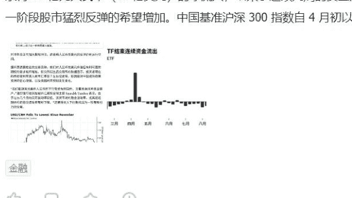

大佬文集圈VIP群专属分享，付费进群加微信pep854 微信daizongdai2021

## 博人的要点

不愿透露姓名的交易员，对基金在增加后如果人民币兑美元升值就会盈利的期权的需求。

新交衍生交易所的数据显示，投资者的目标是年底人民币汇率在 7 左右或更高，原是因为对中国提供政策支持的信心增强，以及美国利率预期将发生变化。

看美元离人民币扫汇的需求增加，中国银行上周将人民币的每日考虑利率调整了近一来的最大幅度。

对冲基金加大期权押注，这说明人民币兑美元的反弹仍有运行空间。

不愿透露姓名的交易员，他们对人民币兑美元升值有利的期权的需求有所增加。新交交易所的数据显示，投资者的目标是年底人民币汇率在 7 左右或更高，原是因为对中国提供政策支持的信心增强，以及美国利率预期将发生变化。

> “我们美元离岸人民币的需求已经有所回升，主要来自对冲基金客户，”渣打银行新加坡加大外汇期权全球主管 Saurabh Tandon 表示。由于过去几个月的实际波动率较低，该货币的隐含波动率，尤其是近几个合约的隐含波动率有所下降，“这使得买入下行期权成为一项吸引力的交易。

## USD/CNH Falls To Lowest Since November

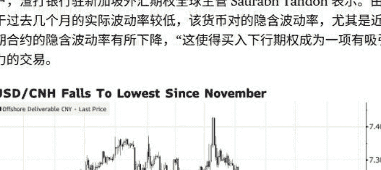

大佬文集VIP群专属分享，付费进群微信vip854 微信daizongdai2021

## 中国岸股票ETF结束连续资金流出

- 每周流入中国股票 ETF

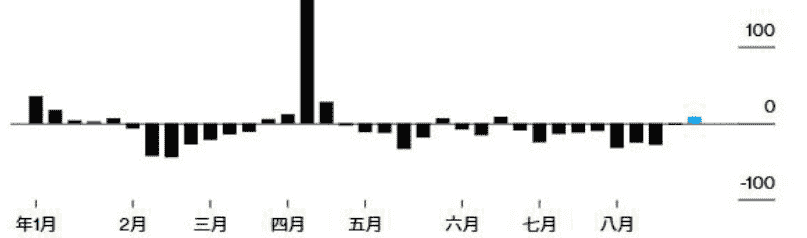

资料来源：彭博

1月2025年 2月 3月 4月 5月 6月 7月 8月

国信：流动危机之后，中国资本存量的增速持续超过GDP增长，投资效率不断下降。若未来中国长期的GDP增长平均约为4%，长期增长平均约为2%，则中国投资回报的一个下边界约为6%，在此种情况下，2024年和2015年中国A股上市公司的净资产收益率非常接近这个投资回报下边界，即2015年至2024年我国的投资增长均已经接近效率中产产值。改善收入分配或是中国可以持续增长的#经济结构

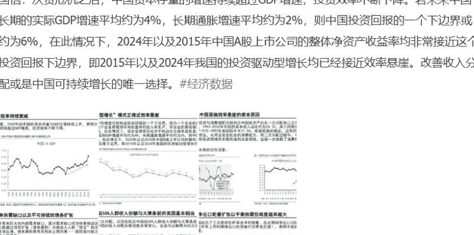

## 中国现实：投资效率持续衰减

- 从中国的数据来看，2009年后中国的资本量与GDP占比持续上升，表明资本危机正在加剧，资本存量的增速持续超过GDP增速，投资效率不断下降。

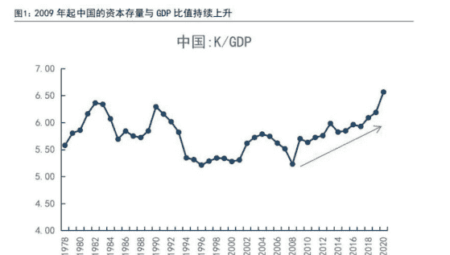

数据来源：NWD，国家财富信息中心，国信经济研究院报告（注：此处资本量指金融资产市值）

## 中国“投资驱动增长型”模式接近效率瓶颈

- 长期的GDP平均增速可能构成投资回报的下一个边界，如果一个企业的投资回报低于GDP增速，这个企业即使将所有的利润投入再生产，其资产的增长速度也大概率低于GDP增速。在企业层面，利润占资产的占比越大，意味着未来中国长期的实际GDP增速平均约为4%。在此情况下，2024年以及2015年以后中国上市企业的整体净资产收益率已接近下边界或约在6%。在此投资回报下降，2015年以及2024年我国的投资驱动型模式增长已接近效率瓶颈。

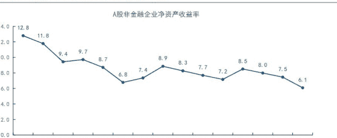

数据来源：NWD，国信证券跟踪报告制

## 收入分配失衡是中国效率率的根本原因

- 消费需求不足，与收入分配失衡对中国经济产生了失衡现象，一次分配过程中，1992-2005年中国的资本收入占比为24.2%，高于同期的资本收入占比23%，且高于1970-1992年的水平的21.5%。这是一个层面的问题，高资本的收入占比对非资本收入的压力，压抑了社会全体的能力，而在二次分配过程中，中国政府将大量的财富投入到政府投资和民生领域，进一步加大了消费需求不足、难以安置的问题。

- 通过二次分配可以发挥作用。

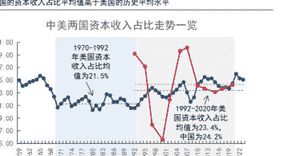

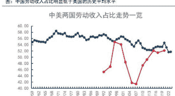

## 收入分配失衡带来巨大的内需缺口以及不可持续的债务

- 收入分配失衡带来巨大的内需缺口，面对内需缺口往往是一种高风险——低收入群体通过信用扩张（债务扩张）向高收入人群“预支”购买力，以加强当前的规模和供给，债务具有自然的上限，最终成为居民能力的边界。内需缺口也是一种结构性的（债务扩张），这种结构性问题会导致压力。

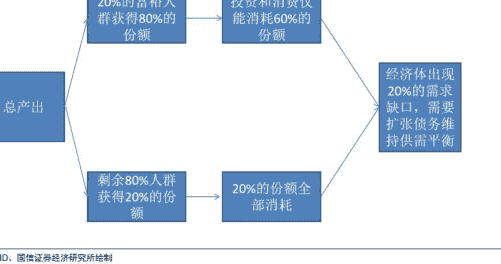

## 灾难后中国后50%收入份额与大萧的基本相当

- 一次分配二次分配，灾难后中国后50%收入份额与大萧的基本相当，表明灾难后中国的收入分配非常异常，这可以解释为何灾难后中国增长显著。

- 债务具有约束。从灾难后50%的收入趋势来看，政府通过增加税收来弥补，政府通过减杠杆来债务压力，供需不平衡得到舒缓。

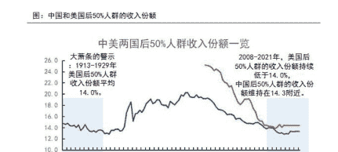

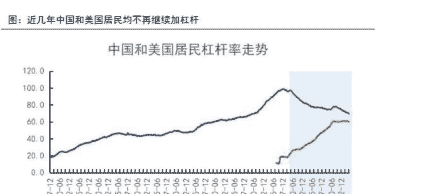

数据来源：中国人口调查；灾难后50%收入份额的趋势

数据来源：美国调查

## 中国居民债务与出口份额齐增长推升负担越来越增大

- 1992年以来，中国经历了三十年的财富率上升，在此期间对GDP的贡献显著提升（价值为重要）。

- “政府+政府”模式转型，两次中国财富率上升，2011年以来，“政府+政府”模式持续提升，出口份额提升至正值，即便中国还进入通缩的状态，表明通过增加债务来推升负担越来越增大。

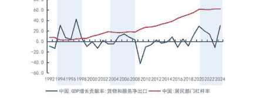

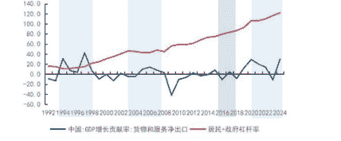

数据来源：中国人口调查；中国居民债务与出口份额贡献率

数据来源：中国人口调查；政府+政府对GDP贡献率

## 回到GDP会计视角的分析

以利润占比来看资本回报率（K/GDP）。

- 短期内，由于利润的回升，就能提高效率，在保持利润占比不变的情况下（理想的情况下），需要高资本回报，通过降低资本回报（K/GDP）的方式来推升利润，可以通过增加投资来提高效率，后的利润就可以减少总量中的损失。

- 长期来看，损失是经济增长规模的瓶颈，改善收入分配是中国持续增长的唯一选择。

- 2016年后中国的供给结构性改革导致了利润下降，短期内取得了有效的效果。由于利润的下降，可以进一步推升资本回报，若干年后再次出现问题。在此当下，利润的回升不是2016年的供给结构变化，而是通过“内需”来推动产出的意外，政府通过增加劳工保障，将福利支出调整为一次分配和二次分配是关键。

如果现在通过增加投资来提高效率，那么效率往往倾向于增加投资，导致效率面临更高的成本，一定程度上将强制效率，而增加投资预期高，对分配的投入是必要的，避免的影响增大。

大佬文集圈专属，付费加微信pe854微信dai21

## 美国经济：二次分配领先于一次分配

- 1933年美国罗斯福总统上台执行“救济、恢复、改革”(3R) 新政，后50%的人收入份额维持了近三十年的上升趋势，但到1965-1970年美国占比出现首次回落。

- 1981年美国占比上行趋势、放松管制、削减社会福利为主要特征的“里根经济学”，后50%的人收入份额再度回落，1992年美国迎来上升态势。

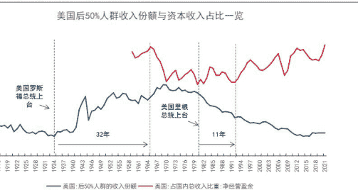

Jason-Donle
2025-09-02 03:44

华尔街亚洲：一个与加密首豪深度参与的加密项目即将将推向公开市场，首次亮相将在币安、Coinbase等主流加密货币交易所，市场对此高度关注。按照0.20至0.30美元的价格估计，WLFI的完全市值已超过400亿美元，以亚洲市值排名45的加密货币之列。

# 金融

大佬文集圈VIP群专属分享，付费加微信pep854 微信daizongdaip

一个与特许豪深度绑定的加密项目将取代其代理开发上市，这不仅是加密世界的一场大事，更是对（9月1日），特许豪家族持有的World Liberty项目，其代理币WLFI将正式开始交易。世界标准时间中午12点，代币生成事件（TGE）启动，早期投资者能够卖出其持有代币总量的20%，这部分资金占成交比例的5%。

首次交易主要在币安、Coinbase等主流加密货币交易所进行，市场对此高度关注。按当前0.20至0.80美元的价格估计，WLFI的市值可能达40亿美元，进入市值排名45的加密货币之一。

这一系列动作导致特许豪在领域日益增长。特许豪已经签署相关法案，其子也参与创新的全面展现。

Jason
2025-09-02 03:51

中国：再次聚焦“三高”反常，即反映汇率预期、反映行为均衡状态。目前显示，汇率（外资）是主要因素，引起者（外资）对人民币升值的相对接近。目前仍处于“流动性”高位，叠加美国国际预期的持续波动，我们看到投资者开始避险，债的联动推升，也带来了近期关键位点。

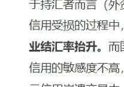

大佬VIP群专属，付费加群epp854 微信daizongdai201

| | 2025年人民币汇率的“ |离” |
|---|---|
| 沪金溢价 (折) | 0.5 |
| 黄金卖平价 (上海/伦敦) | 0.4 |
| 美元人民币：离岸平价(USDCNH) | 0.3 |
| 美元人民币：作价 | 0.2 |
| | 0.1 |
| | -0.2 |
| | -0.3 |
| | -0.4 |

数据来源：Wind，国泰通证券研究

| (亿美元) | 外资企业倾向决于美元资产 |
|---|---|
| 外资企业倾向 (汇差-贸易差) : 逆序 | 115 |
| 美元指数 (折) | 110 |
| | 105 |
| | 95 |
| | 90 |
| | 85 |
| | 70 |

数据来源：Wind，国泰通证券研究

| (pips) | 期溢价与AH之间的联络 |
|---|---|
| 汇率强度: 期权溢价 | 160 |
| 生存AH溢价 (折) | 155 |
| | 150 |
| | 145 |
| | 140 |
| | 135 |
| | 125 |
| | 120 |

数据来源：Wind，国泰通证券研究

| (%) | 美国: 国债收益率: 10年  ---黄金平价（上海金/盎司）（右） |
|---|---|
| 5.5 | 7.7 |
| 5.0 | 7.5 |
| 4.5 | 7.3 |
| 4.0 | 7.1 |
| 3.5 | 6.9 |
| 3.0 | 6.7 |
| 2.5 | 6.5 |

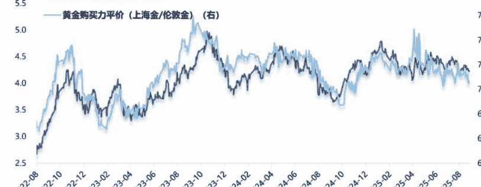

数据来源：Wind，国海通证券研究

| (pips) | 央行汇率强度: 掉期贴息  ---央行汇率敏感度: 报价价-中间价（右） |
|---|---|
| 1,400 | 2500 |
| 1,200 | 2000 |
| 1,000 | 1500 |
| 800 | 1000 |
| 600 | |
| 400 | |
| 200 | 500 |
| 0 | 0 |
| | 500

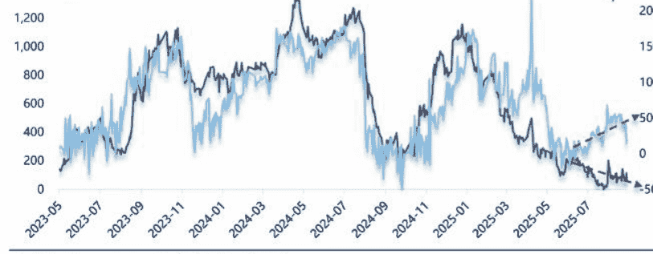

数据来源:Wind，国海通证券研究

## Jason-Zhou

2025-09-02 03:55

经：中国大型汽车企业2025年1~6月整体上好，其中5家企业最终利润减少或亏损，实现利润增长的增长率低于去年同期。“竞争越激烈”，比亚迪在8月29日发布的财报资料显示缩小了中国市场的份额。比亚迪以外其他企业的竞争自2010年中国上市以来，更为激烈。民用首头吉利汽车的净利92亿元，同比下降14%，为来首次下降。车辆均价跌至29.5万元，下降了17%，面临负增长影响。当前，虽然电动汽车销量增长，但价格竞争激烈，越战越难以确保利润，无论中国是中小企业都陷入了困境。

总体而言，美国经济在放缓。今年上半年，国内总值（GDP）增速为1.2%。到2024年增速将缓慢（虽然这并非彻底转向，但仍有背景的因素）。展望未来，他们的经济分析师认识到，

这引起了一个通胀的环境，在资产组合中可能发生什么变化？当导致冲击的因素不是经济增长，而是通胀时，债券对股市冲击方面的效应会减弱。这意味着投资者可能需要重新考虑，什么是有效的资产配置？

在过去30年的大部分时间里，当股市下跌时，债券是“减震器”。在这样的环境下，核心债券能够对冲股市的影响。从1997年到2020年，标普500指数经历了多次超过-10%的回撤，其九次美国股市上涨，总回撤约为7%。

这一规律背后有一个简单的理由：大多数股市下跌是由经济增长引发的，而不是通胀冲击。当经济增长恶化——或者由于其他时候，市场通常预期美联储息息，收益率下行，债券价格上涨，从股市下跌。关键在于：股市爆发的因素决定相关变化。在经济增长冲击中，债券是良好的缓冲工具；通胀冲击中，债券与股市可能同时下跌。

然后，市场格局发生了转变。疫情之后，通胀的主力来自通胀。当物价接近到1980年代以来的最高水平，美联储采取了激烈的紧缩措施。更高的利率导致收益率回升（债券价格下跌），同时折现估值因此取值双向下跌。这也是为什么对债券相关性上升，“债券保险”的目标失效了。

自近期以来，标普500指数有三次回撤超过-10%。其中两次美国股市表现为，最典型的是2022年，标普500指数跌了24%，而美国股市指数则跌了13%。换言之，债券无能发挥传统的对冲作用。2020年以来，债券波动性上升，与股市的相关性也比过去20年更高——这些现象反映了通胀加剧不稳定的特征。

目前，债券收益率已回反映通胀风险。在2020年通胀时，美国国债收益率约为1%，提升了350个基点。

与此时，通胀已明显显缓——从2022年的同比降至目前近3%。在增长放缓的背景下，市场可能需要12个月才能将缩约100个基点。我们将从这一准则来看，市场风险。美联储将考虑其使命的政策，通胀政策可能受限。

通胀从政策转向风险的中枢受影响。受全球国际价格年初至今通胀下降4%，表现优于预期。如果通胀幅度超出预期，政策将进一步收紧，债券将继续下跌。8月11日的周五数据就超出预期：标普500指数下跌1.5%，美国国债指数上升+1%。因此，我们可能将通胀债券视为首次的避险第二类资产。

如果另一轮股市下跌是由流动性驱动，而非市场风险驱动呢？在2023年的大部分时间里，通胀都低于美国增长率2%的目标，美国增长持续主导市场，债券通常在股市下跌时上涨。如果全球，美国财政赤字和通胀压力使得通胀在市场之上运行的概率增加（“过热”）——即便长期平均仍接近2%。这意味着通胀在某些阶段可能会出现波动。因此，债券并不是对衰退风险的最佳对冲工具，但它们在某些阶段与股市同时出现回撤。因此，我们认为当前关键在于为可能出现的风险和阶段性风险相关的市场环境进行提前配置。

## 风险相关性框架：美国经济“过热”与“冷过”对比

| 冷过 | 理想状态 | 过热 |
| --- | --- | --- |
| 市场面临的主要风险是经济增长放缓或衰退。 | | 市场面临的主要风险是高通胀。 |
| 债券往往呈负相关性； | 治理两类风险的平衡有助于承担风险的环境。 | 债券往往呈正相关性；在股市下跌时，债券通常也会下跌。 |

资料来源：摩根大通。数据截至2025年6。

那么，投资者如何应对这种风险？即债券必须总在股市下跌时提供收益？答案是增加一些能够像债券一样分散风险，但在通胀逆转时表现更优资产配置。根据长期市场经验，最优的资产配置主要集中在三大类：

- 大宗商品与黄金
- 物质类：房地产与基础设施
- 相关性低的基金（包括波动性较高）

总体而言，从传统核心收益配置转移至多元化配置，为获取收益，若配置债券比例超过25%，则应在组合中占据重要位置，适度添加互补性。

ANZ：黄金价格在亚洲交易中攀升至每盎司3508.69美元的历史高。这一反弹是由美联储9月降息预期驱动的。本周最新报告对于涨势能否持续至关重要。较低的利率有利于黄金等非收益资产。

8月百城二手住宅均价13481元/平方米，环比下跌0.76%，同比下跌3.4%。租赁方面，住房需求节奏放缓效应增大，8月50城市平均租金为34.88元/月，环比下跌15%，同比下跌3.76%。
