# 南半球聊财经250907

Jason不睡
2025-09-07 05:40

zerohedge: 就就业市场越糟糕，不如全职就业更糟糕，那为什么股市在上涨呢？#其他国家经济

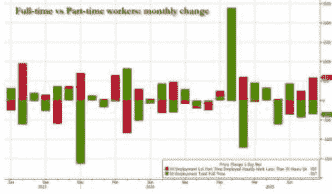

其他国家经济

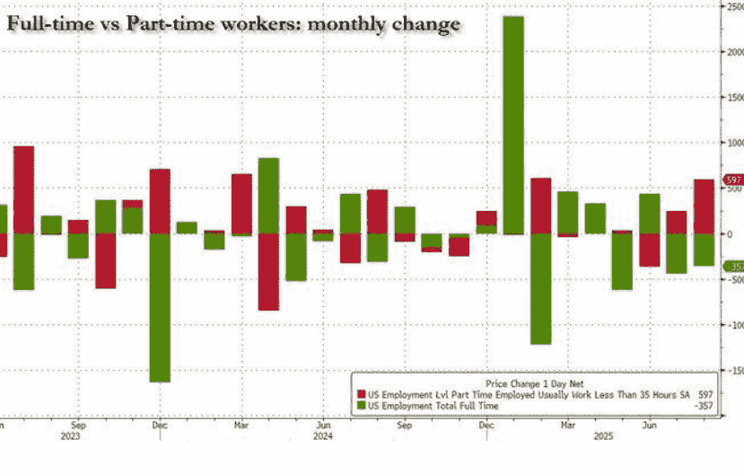

深度视野文集社cuk2555 有温度高质量社群cuk2555

南华早：在中国氮化镓 (GaN) 半导体技术方面优势，这种战略影响使得中国能够以美国无法比拟的速度和规模在武器领域中部署氮化镓系统——形成侦察探测飞机、弹道导弹和其他项目的协调优势。中国拥有丰富的原材料和全球最大的氧化镓生产量，在大规模模刻开发方面具有天然优势，是一种种类与硅和钛石一样频繁出现的产品。氮化镓比特芯片更灵活，为人工智能和数据中心的能源革命铺平了道路，占据占比，全面升级的节点可以将其风险降低至30%。#经济因素

某学院物理研究所的一份报告，其核心在于在中国氮化镓 (GaN) 日益增长的主导地位，这使其具有正在重塑全球军备竞赛的战略优势，“它”在周三发布的报告中显示。

经济数据

根据中国科学院物理研究所的一份报告，其核心在于在中国氮化镓 (GaN) 半导体技术方面日益增长的主导地位，这使其具有正在重塑全球军备竞赛的战略优势。

“这一技术的背后背后隐藏着半导体发展的‘隐藏线索’：中国基于氮化镓的半导体技术已成熟，”它在周三发布的报告中显示。

# 深度视野文集cuk255 有温度高质社群cuk255

# Jason不施
2025-09-07 05:53

bloomberg: 特朗普本周表示，印度已提出将美国商品的关税降至，但表示所谓的让在谈判中可能太晚了。周五，美国商务部长卢克·普特里加斯告诉电视台，尽量与乌克兰的冲突仍在，印度仍继续从俄罗斯进口石油为“荒油”的，该国家需要遣散站。特朗普周五表示，他将与印度总理纳伦德·拉莫·莫迪（Narendra Modi）成为朋友，但他不喜欢他在这个特定时刻所做的事情。莫迪给予回应，在印度的一份声明中：“一直与特朗普总统有着非常友好的个人关系，我们是我们与美国相连。对于其印度国家来说

- 印度对美国关税表示，将考虑将美国商品的关税降低50%
- 特朗普表示将与印度总理莫迪成为朋友
- 莫迪表示，特朗普表示将与印度总理纳伦德·拉莫·莫迪（Narendra Modi）成为朋友
- “Narendra Modi 成为朋友，但他不喜欢他在这个特定时刻所做的事情。”

特朗普还表示，与印度的关系“十分可靠可以信心”，将考虑对印度的许多产品降低50%的关税，以适应新通商策略。

特朗普对我们的关系表示，没有什么是可以信的。我们对此非常友好，”特朗普表示。

莫迪应该回应，他赞赏特朗普对两国关系的称赞，并得到了他的回应。

# 彭博人工智能的要点

- 唐纳·特朗普总统表示，他将美国对来自印度的许多商品征收50%的关税，但他与印度的关系“没有什么可担心的”。
- 特朗普表示，他将永远与印度总理纳伦德·莫迪（Narendra Modi）成为朋友，但他“不喜欢他在这个特定时刻所做的事情”。
- 华盛顿和新德里之间关于降低关税水平的贸易协议正式谈判入局，美国团队取消了8月份的进口。

唐纳·特朗普总统表示，他与印度的关系“没有什么可担心的”，尽管美国推动对该国的许多商品征收50%的关税，以惩罚新德里买俄罗斯能源。

特朗普周五表示，他将永远与印度总理纳伦德·莫迪（Narendra Modi）成为朋友，但他“不喜欢他在这个特定时刻所做的事情”。

印度和美国有着特殊的关系。没有什么可担心的。我们只是偶然有这一刻，”特朗普说。

莫迪后来回应说，他赞赏特朗普对两国关系的积极评价，并得到了回复。

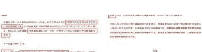

# 经济观察报：各地社缴费基数尚未退出#TAX

| 类别 | 2020年 | 2021年 | 2022年 | 2023年 | 2024年预测 |
| :--- | :--- | :--- | :--- | :--- | :--- |
| 收入 | 100 | 120 | 150 | 140 | 160 |
| 支出 | 80 | 90 | 110 | 105 | 120 |
| 利润 | 20 | 30 | 40 | 35 | 40 |

各地社缴费基数尚未退出

每年月底、8月初，有职场的人问：社保费基数涨了，“因为北京平均工资少了。”北京一家连锁机构的负责人强调，“因为北京平均工资低于北京社保费基数，下限根据当地平均工资（下称“社平工资”）确定，每年6月起调整，社保费就会上涨，各地情况不同。目前企业只能沿用上年的社保费基数。全国范围内，此前每年6月至8月中旬，全国各省陆续公布当年的社保费上下限，今年未明确。一位研究专家表示，今年社保费基数调整涉及多方面，设置社保费下限主要是针对部分低收入群体，受两个因素的影响：一是当地社平工资；二是社保费基限占社平工资的比例。

过去几年，多地出现了一波高上涨。2020年至2024年，北京的社保费下限从3613元/月涨至6821元/月，涨幅为88.8%；从4927元/月涨至7384元/月，涨幅为49.9%。

在社保费不断上涨的过程中，不同群体、不同企业感受到的压力是不相同的。其中低收入实体和私营企业面临的压力更为显著。因此，如何平衡确定社保费基数成为了焦点。随着政策推动灵活就业人员加入职工社保体系，社保费基数下限是否会对社保基金的可持续性产生影响同样受关注。因此需要加强社会保险整合，以确保短期和长期收支。

每年6月至8月初，全国各省份统计局公布上年度人口平均工资（以下称“社平工资”），各市级部门以此此年度社保费基数上下限——上限通常为社平工资的300%，下限通常为社平工资的60%。

据经济观察数据显示，截至4月4日，有些省份公布今年最新社保费基数，只有内蒙古、黑龙江、福建公布了上一年社平工资。武汉大学社会保障研究院主任运华表示，按照惯例，没有公布2024年度社保费基数，市内企业职工的社保费基数一般延续上年的数。例如，6月30日，沈市医疗保险发布文件指出，尚未公布2024年度全市社平工资，决定暂停调整沈市用人单位和灵活就业人员工资和生育保险社保费基数上限。将正式公布2024年度全市社平工资后，将根据社保费基数标准，对相关月份的职工基本保险（含生育保险）按缴费进行补缴。

农村平均工资未公布，按照企业单位口径，各非私单位工资以本非私单位人员和私营单位平均工资（简称“非私、私营单位平均工资”）加权得出，而截至9月3日，24省份已公布2024年非私、私营单位平均工资。

同一，2024年多省份增速此前两年出现了较大幅度。在非私单位平均工资方面，有5个省份增速至1%以下，其余19省份增速在4%及以下。其中广东增长了4%，海南的增速为8.2%；在私营单位平均工资方面，有6个省份增速至1%以下，其中海南回落至8.2%。

图一：2024年分地区城镇就业人员平均工资名义增速

| 地区 | 非私单位 2024 | 非私单位 2023 | 非私单位 2022 | 私营单位 2024 | 私营单位 2023 | 私营单位 2022 |
| :--- | :--- | :--- | :--- | :--- | :--- | :--- |
| 全国 | 2.8% | 5.8% | 6.7% | 1.7% | 4.8% | 3.7% |
| 广东 | 3% | 5.2% | 5.7% | 0.4% | 3.9% | 6.0% |
| 山东 | 0.9% | 4.8% | 7.9% | 0.2% | 6.7% | 1.3% |
| 四川 | 0% | 8.2% | 5.2% | 1.7% | 5.0% | 3.0% |
| 湖南 | 0.2% | 6.1% | 7.1% | 0.4% | 8.1% | 2.4% |
| 北京 | 2.9% | 4.5% | 7.4% | 0.9% | 1.3% | 4.5% |
| 广西 | 0.4% | 4.5% | 4.4% | 1.8% | 3.2% | 3.0% |
| 海南 | 2.5% | 9.3% | 7.5% | -1.2% | 0.8% | 5.2% |

数据来源：财经报

按加权计算方法，预计2024年湖南、青海等省份的社平工资增长增长。预计2024年湖南非私、私营企业平均工资涨幅仅为0.2%，因此社保费基数上限可能出现小幅上涨。

社保费基数调整后，三类参保人的工资涨幅将出现。其中一，个人月薪维持社保费基数以下，企业未合规按照社保费基数下限缴社保；二，个人月薪高于社保费基数；三，个人月薪高于社保费最高。社保费基数上调后，第一类人的受到的影响明显。具体来说，从2023年到2024年，北京所有月薪低于6300元的职工（认定社保费基数下限缴纳社保），个人每月社保从664.2元升至716.2元，增长52元。此外，从2023年到2024年，以个人身份参加北京养老保险的灵活就业者如网约车司机，每月最低养老保险负担由1265.2元升至1364.2元，增长99元。

2016年至2018年，北京社保险基准按照上一年度工资的40%为设定。2019年，北京人社部发布的《降低最低社会保险标准的通知》指出，为落实国家对基本保险基准低于60%的要求，自2017年起，城镇职工养老保险基准下限由40%调整为46%，2020年7月调整为52%，2021年7月调整为60%。

案例一：2019年至2024年，如果护理人员工资为5000元/月，且公司直接按社保费基准下限为其缴社保，那么企业需缴的社保费用从939.4元/月升至1773.5元/月，由于为员工付出的社保成本约1.13万/年增至2.13万/年，而员工成本旧为6万/年。

# 图二：北京社保缴费成本

| 单位 | 2019年 | 2020年 | 2021年 | 2022年 | 2023年 | 2024年 |
| :--- | :--- | :--- | :--- | :--- | :--- | :--- |
| 社费基准下限 | 3613 | 3613 | 5360 | 5869 | 6326 | 6821 |
| 个人最低社保负担 | 379.4 | 379.4 | 562.8 | 616.2 | 664.2 | 716.2 |
| 企业最低社保负担 | 939.4 | 939.4 | 1393.6 | 1525.9 | 1644.8 | 1773.5 |
| 备注 | 个人社保费比例按10%计算，企业社保费比例统一按26%计算 | | | | | |

每年毕业季，一些高学历以上的毕业生都会面临就业的问题。显示，大多数机构在盈利边缘挣扎，由于社保费负担增加，企业倾向将退休人员换成年轻人员，以获得更多机会。

上述专家表示，规定社保费制度就要提到“困难”，如果个人按照低的社保费缴费，未来的养老金可能不利于个人者。因此考虑社保费基数调整后，建议按社平工资下限维持60%设置，主要是针对低收入群体，但随着几年上涨压力逐渐缓解。

2024年，全国代表大会常委会发布的关于《社会保险法》实施情况报告指出，中国职业保险缴率（参保人员比例）从2019年的85.2%下降到2022年的90.8%。这意味着已参保人数减少，双方对于有关降低社保费基数的讨论，目前引入更多灵活就业人员参加社保，以此缓解负担。

bloomberg: 欧+原则由于该市场份额增加以及意外不确定性，进一步增长今年已跌2%，可能会让特朗普感到焦灼，并作为结束乌克兰战争的一种手段。此举将访问国家带来巨大的压力，尤其是金融。沙特王子宣布将访问月降低油价以帮助通胀。

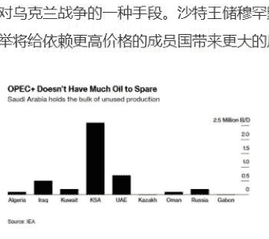

# OPEC+ Doesn't Have Much Oil to Spare

Saudi Arabia holds the bulk of unused production

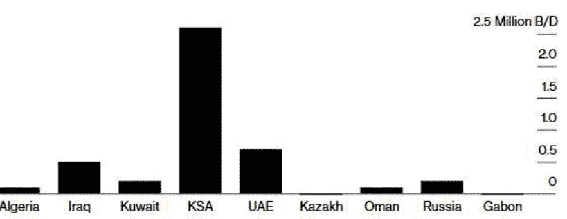

Source: IEA

# 中国财富富人500论：社保缴纳在短期内直接推高了用工成本，尤其是对于劳动密集型小微企业

第一，社保缴纳标准的增加使得中小微企业压力巨大。由于中小微企业大多属于劳动密集型，利润空间薄，社保成本的上升直接挤压生存空间。自2020年以来，多个省市对社保缴纳基数和比例进行了上调，特别是在北京、上海等一线城市，这种成本增加尤为明显。

第二，社保成本的增加迫使企业进行转型调整。为了规避高昂的社保成本，许多企业采取了极具阵痛的措施，例如采取外包、劳务派遣等，特别是在劳动密集型行业；或者将全职员工转为兼职外包，或者通过裁员、缩减降薪等手段来应对。

第三，社保成本的增加抑制了企业的扩张意愿。由于用工成本的上升，企业在扩大规模时变得更加谨慎，甚至倾向于停止招聘，或者通过增加自动化设备来替代人工。这种趋势在一定程度上削弱了就业市场的创造能力，尤其是对于劳动密集型行业。

## 第一个，社保缴纳的直接推高了用工成本尤其是劳动密集型的小微企业。对于餐饮、制造业等非普通企业，此前，前期调研中了解到这样的情况：第一个例子是某家10人的社区便利店，员工的平均月薪约500元左右，如果规缴社保后，年成本将增加1.4万元，接近全部利润。以一家制造业企业为例，如果按月薪7000元的员工缴纳社保，每人每年将增加2.1万元，而年利润仅为1000元。利润率低，如果社保成本占比高，可能导致大量的中微企业为生存而转型。

第二个，用工成本的增加引发了就业调整。一种方式：一是采取外包、劳务派遣等，特别例如服装等劳动密集型行业，行业社保成本的降低；二是员工的替代，将全职员工转为兼职外包，或者避免缴社保，同时减少就业机会。

第三个，工资、社保关系紧张。根据社保强制缴纳政策，员工需要承担8-10%的社保，特别是工资低于5000元者的，受到的影响非常显著。此外，2025年半年以来，法律争议数量同比增加。

国信：美国投资者面临明确的宏观叙事：美联储将开启降息周期，尽管利率大幅下行，30年国债收益率仍维持在高位，显示市场分歧：市场相信降息，但不相信通胀同步回落，这种结构性差异意味着短端利率“早期预期”可能趋于乐观。如果通胀数据依然强劲，长期波动可能会上升。

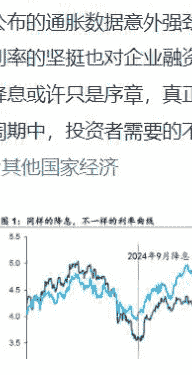

# 图1：同样的降息，一样的利率

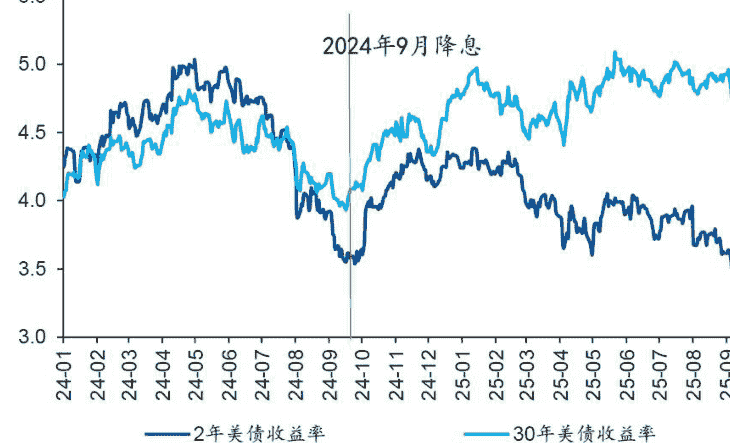

来源：Bloomberg，国信联首席。

国信：历史储蓄压力发现。从前七轮储蓄压力发现了一个清晰的模型框架。量化分析“推力”，选取了几个关键指标：一年期存款利率为核心“推力”，“拉力”分为三类——反映吸引力的个人贷款平均和城市新建房屋价格、换手率以及反映市场趋势。我们当前面临的几类储蓄压力，其特征与“推力”相似，尤其是2007年至2015期间对比，这再次证明了资产配置偏好发生了转向。接下来的关键，在于资本市场能否持续实现收益红利，在稳健的长期运行下释放这些资金，实现财富增值与市场高质量发展的循环。

| 压力类型 | 时间跨度 | 核心因素 | 影响结果 |
| :--- | :--- | :--- | :--- |
| 第一阶段（股市反转） | 1998年至2000年 | 股市从39%跌至37%，指数从104.6跌至80.4 | 随着股市反转，1998年住房商品化启动，资金流向房地产，释放的资金使得重新进入房地产市场，房价持续上涨。 |
| 第二阶段（房价过热） | 2002年至2007年 | 2006年房价反弹，2007年持续3年（7%）后前置 | 随着政策调整，2008年上半年上调，房价继续调整。 |
| 第三阶段（政策调整） | 2008年至2009年 | 房价出现下跌，政策回落。2008年下跌26.1%，2009年回升 | 全球金融危机爆发，为了应对危机，中国实施了货币宽松政策，市场需求回暖，主要处于复苏期。 |
| 第四阶段（流动性宽松） | 2009年至2012年 | 2009年实施大规模宽松后，随后多次加码 | 流动性过剩导致资金流向各领域。由于房地产市场过热，政府开始调控，居民购买意愿下降，市场进入调整期。 |
| 第五阶段（金融收紧） | 2012年至2015年 | 2013年开始收紧，2014-2015年持续收紧，流动性降至最低 | 这种收紧政策限制了资金流入房地产，建筑行业面临压力，市场持续低迷。 |
| 第六阶段（股市回暖） | 2015年至2018年 | 2015年股市大涨，政策随之转向 | 随着股市回暖，政策随市转向，银行降低利率引导资金流向债市，公行基金流向优质资产，股市市场持续回暖。 |
| 第七阶段（周期再配置） | 2020年至今 | 2020年以5.36%贷款利率降至7.1%，1.47%降幅创新 | |

# 历史周期的共性：“推力”模型的框架构建

增强从七年存款周期，其发生和规律遵循一个清晰的“推力”模型。其一，“推力”可视为金融市场资金流动趋势的主动力，“推力”的核心在于存款利率的相对吸引，其主要构成如下：

(1) 政策利率推力（核心工具）；存款利率的持续通过，通过降低风险收益率，政策制定者是最直接，最大的经济增长与通过市场收益率；(2) 监管推力：监管政策的变革推使了资金高风险等违规行为的集中内在的痛苦。最经典的案例是。

(3) 需求性推力（长期周期）：当名义增长率高于通胀（CPI）时，实际收益率为负，导致需求扩张在落实上，流动性减少了资金向股市通的资产。

其二：将资金流入市场的推力，其核心在于推向风险资产的预期周期，其主要构成如下：

(1) 资本推力：股市投资、基金等市场的增量是最大的动力。在历史周期中，市场上的企业逻辑以及部分的结构构建。开始创造信贷潮流，吸引了投资者的关注。(2) 理想利率替代效应：财富管理市场，纯收益基金，为提供了提供了。从早期的基金，到如今行的理财产品、基金产品等。由于这些产品在风险可控的前提下，提供了丰富的存款利率的长期收益率，成为了我们投资资金的主要蓄水池。

(3) 消费与产业升级推力的机会构成：增强消费，产业升级的政策通过提升未来的收入预期和创新的投资机会，机间接形形成，市场对自身收益和收入充满信心，更为便于预防性风险，增加即期的消费或投资，国家对新能源、半导体等产业的扶持，也创造了新的投资，引起了部风险扩散良好范围。

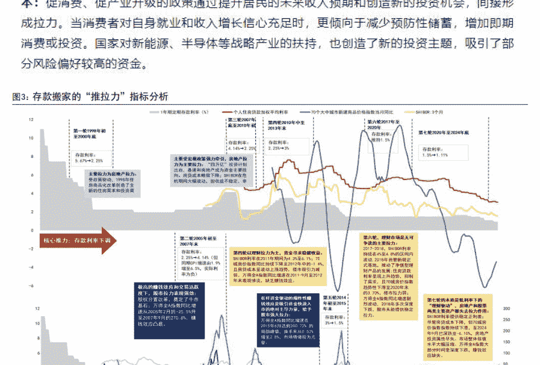

数据来源：万得，国信证券研究所

# 深度视野文集cuk255 与温度高质社群cuk255

## 表2：历史7个轮次的基金特征

| 基金名称 | 核心竞争力 | 包裹的历史优势 | 配权重调整时期 |
| --- | --- | --- | --- |
| 灵活配置型 | 存款利率灵活、大跌下限跟入 | 第一、第二、第三期 | 基金大调整(1998年改、“万亿加万”) |
| 股票驱动型 | 存款利率半收益、小波动 | 灵活、权益投资收益 | 第四期、第五期 | 基金大调整(2005年改版、2014-2015红利) |
| 债券管理型 | 存款利率高、稳健 | 债权、投资收益 | 第六、第七期 | 市场环境为“债”下，基金优势收益。 |
| 资料来源：方，国信证经济研究所 | | | |

## 图4：基金配置不同月份的趋势图

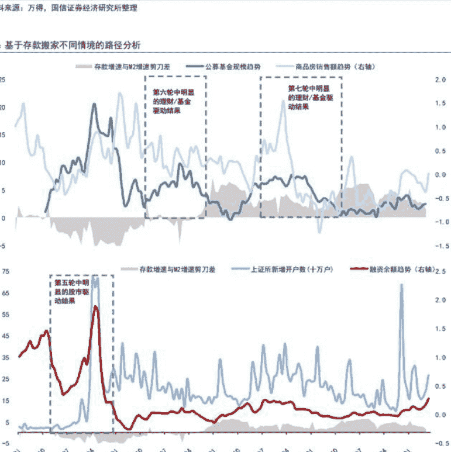

资料来源：方，国信证经济研究所整理，注：对比指标公募基金规模趋势趋势以2014-01为基准、融资余额趋势和商品市场销售趋势两个指标以2013-01为基准。

# 深度视野文集cuk255 有温度高质社群cuk255

韩国实行：韩国以前所未有的速度进入老龄化，这一趋势导致出生率和不断增长的预期老龄化共同推动。韩国在 2024 年进入“老龄社会”，韩国从 2018 年进入“老龄社会”，仅用了约 7 年就进入“超老龄社会”（65 岁以上人口占比超过 14%）。在 OECD 25 个成员国中，它是进入该阶段最快的国家。（韩国 2024 年人口数据）。由于人口结构转型，65 岁以上人口占比将成为 OECD 成员中最高的。未来二十年，韩国将面临养老金、医疗支出、经济增长放缓等重挑战。如果不采取性改革（如延迟退休、改善住房、移民政策），社会稳定将面临巨大压力。当前，低出生率趋势被称为“长期停滞（secular stagnation）”。

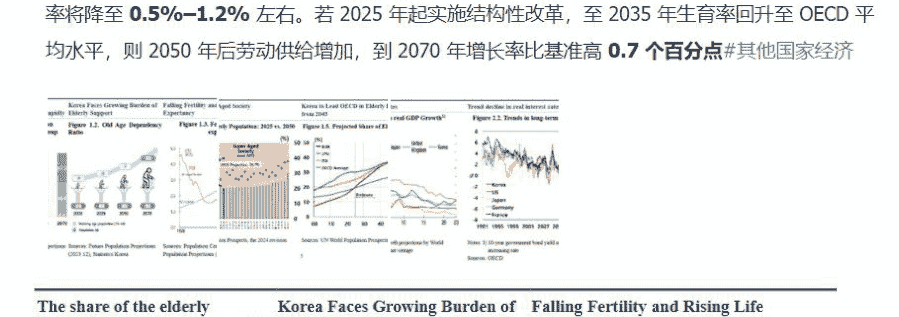

The older of elderly population is increasing rapidly Growing Burden of Falling Fertility and Rising Life Expectancy Figure 1.1. Population composition by age group Figure 1.2. Old Age Dependency Ratio Figure 1.3. Fertility rate and life expectancy 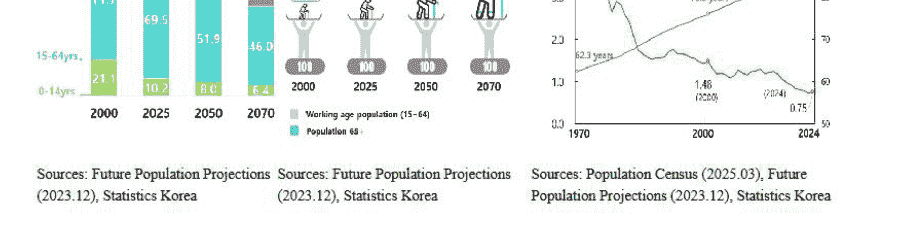

Sources: Future Population Projections (2023.12), Statistics Korea Sources: Future Population Projections (2023.12), Statistics Korea Sources: Population Census (2025.03), Future Population 

# 深度视野文集cuk255 有温度高质社区cuk255

Korea Entered Super-Age Society in late 2024 to Lead OECD in Elderly Population from 2045 Figure 1.4. OECD Elderly Population: 2025 vs. 2050 Figure 1.5. Projected Share of Elderly Population 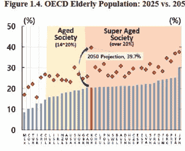

Sources: UN World Prospects, 2024 revision
Sources: UN World Prospects, 2024 revision

## Trend decline in growth rates / Trend decline in real interest rates

Figure 2.1. Trends in real GDP Growth(1) Figure 2.2. Trends in long-term real interest rates(2) 2-2. Selected Advanced Economies 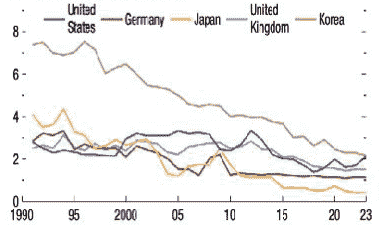

1) Five-year-ahead real growth projections by World Economic Outlook forecast
2) 10-year government bond yield minus consumer price index: increasing rate Sources: IMF WEO(2023 April) Sources: OECD

# 深度视野优质全部包含以下内容：限时年费188/年 加微信cuk255

- ① 吃瓜群众倍时圈加时对话 (原价 365 元/年)
- ② 子明私享汇（含）内部文章
- ③ 政事室 (顾子明)付费内容加送顾子明群
- ④ 米联储闲友【作者穗】(原价 599 元/年)
- ⑤ 欧洲金雀会员专属文章 (原价 328 元/年)
- ⑥ 砖瓦斥内部文档 (原价 400 元/年)
- ⑦ 卢克文读书会专属文章 (原价 699 元/年)
- ⑧ 鉴茶财经知识星球 (原价 3310 元/年)
- ⑨ 猫哥的视界知识星球文章 (原价 299 元/年)
- 10 财新周【独家新闻】(原价1498 元/年)
- 11 杨世光在钱坝 (原价2200 元/年)
- 12 森淼财经知识星球 (原价 1600 元/年)
- 13 潇潇译异付费文章（持续更新）
- 14 司马林解谋选全套音频和全套书籍藏版无减 (原价2.3 万)
- 15 虚构三部曲[民国梦、帝国兴亡、不被理解的 MAO] (原价 599 元)
- 16 户克文知识星球文章 (原价 268 元/年）
- 17 额外再送：卢元新浪爆付费专栏、三村丰老王、三花九树文集不定内容......（更多资源不下去了）......

- ① 守夜人司令知识星球、拨魂魔王知识星球、达叔谈论星球、成术发财富、雪球花甲老头等
- ② 创始人笔记、达叔谈论星球、成术发财富、雪球花甲老头
- ③ A视野、大树乡谈、江初序、咩同学、上海海学等付费文集
- ④ 西风付费文章、老端、赢在八小时之外、局外的视界、升值、老A体制内等其它一些大 V 付费文章（每月不超过 600 元付费文章）

# 限时年费188/年 底部链接下载全网V优质内容

# 深度视野文集 进群微信cuk255

深度视野（付费文集）

