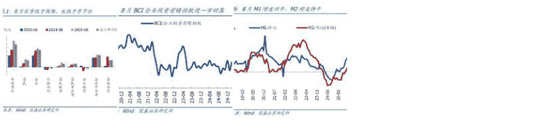
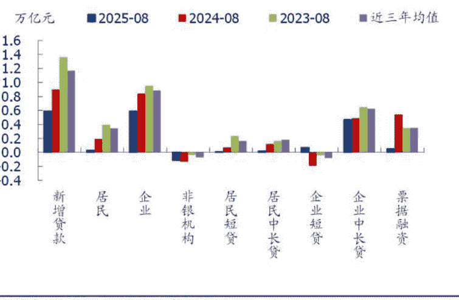
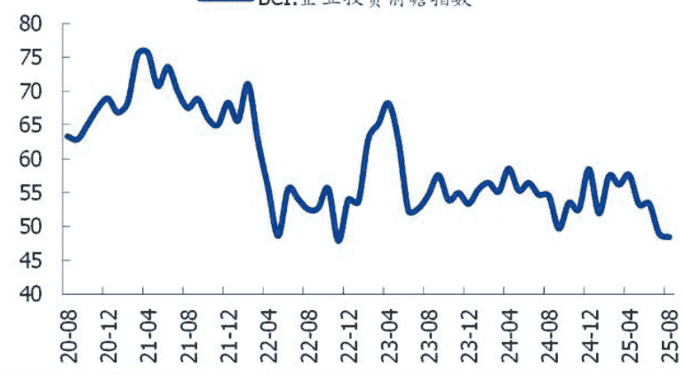
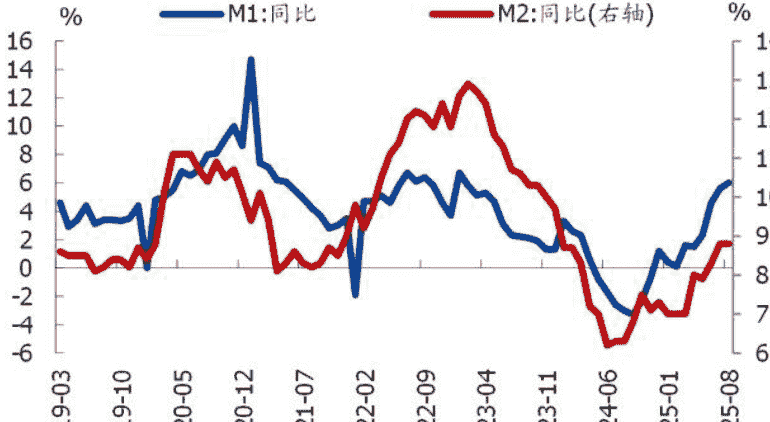

# 南半球聊财经250913

Jason不能
2025-09-13 13:22

国咨：8月新增信贷低于预期、也低于季节性，结构未好转。具体来看，居民端短贷、中长贷同比连续两个月减少，指向消费、地产仍弱。短期信贷同比多增，但距离中枢特征明显，长期贷款连续两个月少比，企业投资意愿减弱，8月M1同比回升，较上月一步步抬头0.4个百分点，一方面基础数一步步走低，另一方面居民存款活跃可能是主要拉动，同期非存款贷款增多。#金融

图表1：8月信贷低于预期、也低于季节性

资料来源：Wind，国盛证泰研究所

# 更多资源：加微信cuk255

# 图表3: 8 月 BCI企业投资前瞻指数一步回落

资料来源: Wind, 国泰证券研究所

# 图表6: 8 月 M1 增速回升, M2 增速持平

资料来源: Wind, 国泰证券研究所

# 更多资源：加微信cuk255

李迅嵩9月11日下午，在中国人民大学深圳研究院等主办的社会科学沙龙中对大类资产做下半年展望。#金融

1、美股发展至今，泡沫依然存在，美股何时破裂还是未知的之谜。

2、美股指数非常强劲，但（87.5%）大部分股票是不涨就是下跌的。所以，我们不能把股市表现就好当作整个市场都很好。

3、日本经济总量依然低迷，对日本股市并不好看。至于英国，目前更多跟随美国，经济之萧可怜。

4、从美元资产角度来看，当前要更重视成长性。不论美股还是A行情、科技股、创新医药都比较优，这是技术进步带来的成功。

5、2.5%的企业盈利尚足以支撑（A股）大市，目前还是结构性牛，更多由估值提升和科技板块最好时候。

6、无论结构性机会还是结构性风险，核心都在科技领域。

AI时代，如果现在鱼龙混汤，那么可能一段时间会有一次洗练。

正如2000年互联网泡沫破灭，洗牌之后会有新大厂起，那么优秀企业会在高科、AI相关领域诞生。

7、黄金一直是长期的看好品种。大宗商品在降息和AI驱动下，AI相关、新能源、汽车产业的铁、铜、镍、钛金属、稀土等上有空间。

8、虽然美储存在降息预期，但通胀压力依然显著，美收益率短期难回落。

9、依然看好中国债市，当前中国资产局面和利率大趋势均未改变。

10、大宗商品在降息和AI驱动下，AI相关、新能源、汽车产业的铜、铝、钛金属、稀土等上有空间。

# 更多资源：微信cuk255

## 2.5%的盈利增长不足以支撑A大市，目前还是结构性牛

近期债券价格回落与股市表现相关。以A股沪深300为例，市盈大约14倍，显著低于标普500的29倍或纳斯达克的41倍，显示我们在估值上有一定优势。

从股息率来看，沪300指数已从3%降至2.6%，但这一水平尚不糟糕。

唯一的短板是成长。估值提升一方面源自自由利率下驱动的投资资金整体下滑，使A股面临估值压力。

牛市的增长来源依赖于企业增长的提升。

2021年以来，企业盈利增长基本为，上半年表现优好，显示利润平均增长2.5%，但相比GDP增速5.5%。盈利增长还不到一半，说明中国企业质量发展还有提升。

## 2.5%的盈利增长不足以赢涨大市，目前还是结构性牛，更多由于盈利提升和科技板块美好预期驱动。

例如50ETF市盈率已提到170左右，这说明市场对科创非常乐观，按现实结果，是不两个“非常”？有一个“非常”已经不涨了，这引起大家的重视。

> Jason·嵩
> 2023-09-13 02:51
> Bloomberg: CBO预计，到2031年，美国将需要人口减少，届时死亡超过出生。2025年经济增长1.4%，低于2%，通胀率3.1%，比之前的估计。根据密根大学调查，9月份消费者信心是5月以来的最低，长期通胀预期连续两个月上涨4.8%，与上个月相比。他们预计未来成本每年9%，高于3.5%。

# 更多资源：加微信cuk255

## 数字工的要点

- 国会预算办公室在考虑特朗普总统税法、关税和净移民后，预计今年通胀和失业率上升，经济增长放缓。
- CBO预计，2025年经济增长1.4%，低于2%，通胀率至3.1%，比之前的估计高出一个百分点。
- CBO预测，到2031年，美国将需要人口减少，届时死亡超过出生人数。
- 考虑到特朗普总统税法、关税和净移民，国会预算办公室预计今年通胀和失业率上升，经济增长放缓。
- 国会预算办公室发布的经济预测显示，2025年经济增长1.4%，低于2%，根据美联储首选指标，通胀率回升至3.1%。
- 该报告还显示，失业率在今年年底达到4.5%。
- 私人预测者同样预测2025年的增长速度放缓，明年有所回升。
- 这些预测将持续到2028年，由于特朗普的新税法，明年的增长回升，失业率下降。
- 在早些时候发布的一份报告中，由于特朗普政策，CBO大幅降低了未来几年估计。它还调整了人口前景。

# 更多资源：加微信cuk255

## 人工智能的要点

- 摩根士丹和德意志银行的经济学家加快了美联储在未来几个月的降息，因为通胀放缓和劳动力市场衰退使美联储能够宽松步伐。
- 德意志经济学家对2025年剩余时间的预测中增加了美联储第三次降息，而摩根士丹经济学家现在预计1月份连续四次会议上降息。
- 摩根士丹经济学家预测，美联储将在1月后停止加息，随着劳动力市场恶化，预计4月和7月将进一步降息。

人们普遍预计美联储将在下周的会议上宣布一系列25个基点的降息。交易员押注，它将在10月和12月的会议上进一步降息。

德意志银行周五在对2025年剩余时间的预测中增加了美联储第三次降息。该银行此前预计，将以主席杰罗·鲍威尔为首的官员在本月降息，后等到12月再次放。与此同时，摩根士丹经济学家现在预计美联储将在1月份之前连续四次会议上降息。

市场定价显示，多数投资者预计美联储将在12月之后停止加息，2026年的首次降息将在4月到来。然而，摩根士丹利预计借贷成本将在9月、10月、12月和1月下降，届时目标上限将达到3.5%。

# 更多资源：加微信cuk255

## 深度视野优质集团（链接优质社群，助你成功）

全部包含以下内容：限时年费188/年 加微信cuk255

- 吃瓜群众帝文档时光群对话（原价365 元/年）
- 子明私享汇（内部）内部文章
- 政事室（顾子明）付费内容再送顾子明群聊
- 米联储闲间【作者米穗】(原价599 元/年)
- 欧洲金钻会员专属文章（原价328 元/年）
- 砖瓦斥内部文档（原价400 元/年）
- 卢克文青读书会专属文章（原价699 元/年）
- 鉴茶财经知识星球（原价3310 元/年）
- 猫哥的视界知识星球文章（原价299 元/年）
- **新周刊【独家新闻】(原价1498 元/年)
- 杨世光在钱榜 (原价2200 元/年)
- 森淼财经星球 (原价1600 元/年)

