# 南非球聊财经250915

Jason不离
2025-05-19 03:29

bloomberg: 货运平台 Freightos 对 336 家中小型公司在 8 月 19 日至 9 月 9 日接受调查的访问者中，近一半的人表示他们的成本上了 20% 更多，相同比例的人表示，由于费用增加，他们减少了发货量。这些结果增加了证据，即关税对小公司的打击比竞争对手更大。近 60% 的访问者表示，华盛顿政策削弱了美国作为贸易伙伴的地位，但有 6% 的访问者表示美国的地位得到了加固。

## 美国作为可靠贸易伙伴的声誉下滑
对企业的新调查显示，关税辩于利

| 影响类型 | 百分比 |
| :--- | :--- |
| Weakened | 58%* |
| Mixed impact | 23 |
| Too soon to say | 7 |
| Strengthened | 6 |
| No change | 5 |
| Other | 1 |

资料来源: Freightos
注：“对以下问题的回答:“认为贸易战对如何影响美国作为贸易伙伴的地位？”

添加微信：cuk2555，获取更多资源

bloomberg: 随投资者为利率下跌股市准备，中国对人民币稳定升值的新态度似乎将推动新加坡新兴市场的反弹。彭博社的分析显示，在过去一年中，人民币每月上涨 1%，泰铢、马来西亚林林、智利索、墨西哥索和哥比亚随其后。美元人民币参考汇率与 MSCI 新兴市场指数之间的30天相关性在8月跌至0.9，为2024年5月以来的最低水平。作为投资者信心增强的迹象，对中基金最近提高了对人民币的看涨期权隐含。目标是年底能够达到每美元7左右或以下，该汇率约为7.2。富环全球外汇主宰贝拉德·贝赫特尔表示，“金融”

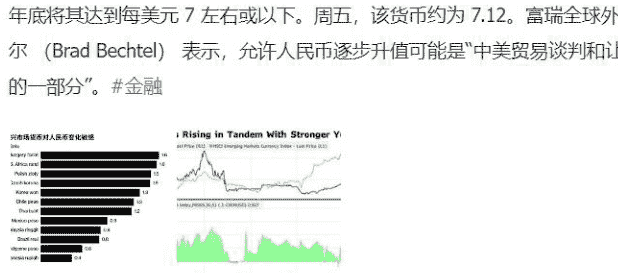

## 新兴市场对人民币汇变化敏感

| 项目 | Beta |
| :--- | :--- |
| Hungary forint | 1.6 |
| S. Africa rand | 1.6 |
| Polish zlot | 1.5 |
| Czech koruna | 1.5 |
| Korea won | 1.3 |
| Chile peso | 1.3 |
| Thai baht | 1.2 |
| Mexico peso | 0.9 |
| Malaysia ringgit | 0.8 |
| Brazil real | 0.8 |
| Philippine peso | 0.6 |
| Indonesia rupiah | 0.4 |

资料来源：彭博社
注意：平均贝塔系数是根据一年的数据计算出来的。所有beta具有统计学意义

添加微信：cuk255，获取更多资源

## EM Currencies Rising in Tandem With Stronger Yuan Fix

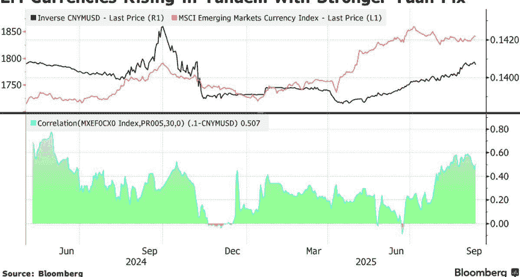

中国：目前正处于加杠杆、私人部门杠杆的和谐运行过程中，目前来看今年政府债务节奏过快，若后续遇到特别情况，政府增速可能放缓，社债增速或将压力。金融

金融

图5：金融机构各项有债债券结构（%）

图6：M2/M1有债锚化指数（右侧）

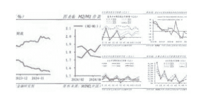

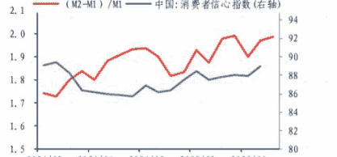

数据来源：WIND;中国人民银行，长城信产业金融研究院

数据来源：WIND;中国人民银行，国家统计局，长城信产业金融研究院

添加微信：cuk255，获取更多资源

### 图表12：居民中期长期资金当月新增（亿元）
### 图表13：居民中期长期增速与商品销售额相似性（%）

### 居民中期长期资金当月新增（亿元）

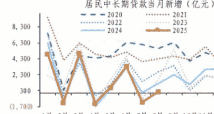

数据来源：WIND；中国人民银行，城产金融研究

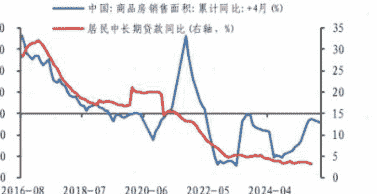

数据来源：WIND；中国人民银行，统计计划，城产金融研究

### 图表14：企业单位中期长期资金当月新增（亿元）
### 图表15：企业单位中期长期资金当月新增（亿元）

### 企业单位中期长期资金当月新增（亿元）
### 企业单位资金当月新增（亿元）

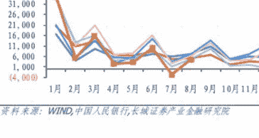

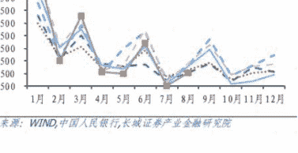

数据来源：WIND；中国人民银行，城产金融研究

数据来源：WIND；中国人民银行，城产金融研究

添加微信：cuk255，获取更多资源

## Jason不离

西部:比2015年“水牛”，本轮行情中，热点主题持续时间普遍短，投资者持股差异，反而易入。4月以来的强势行情中，每一只牛都有当时背景的强势：
- 2005-09年中国工业化进程的牛市，恰当的；
- 2014-15年经济转型后的牛市；
- 2019-21年加中国中期的牛市。

我们看到：与19-21年的强势主题相比，不如抱团指数/组仓“核心资产”。全球化时代，稀缺性和红利任何资产都面临未来的不确定性。在过去70年代以来，日本进入工业化成熟后期，大量资本流入实体市场——（1）黄金/资源等抗胀，具有经营的确定性；（2）自主可控科技，在全球化趋势下，能够在市场获得确定性的溢价。经济增速放缓，实体回报率下，大量资本正流入到保险。

| 核心资产 | 核心资产 | 黄金/资源 | 科技 | 【硬科技】 |
| :--- | :--- | :--- | :--- | :--- |
| 避险资产 | 黄金资产 | | 黄金具有“通胀”属性 |
| | | | | |
| | | | | |
| 核心资产 | | | | |
| 核心资产 | | | | |
| 核心资产 | | | | |
| 核心资产 | | | | |
| 核心资产 | | | | |

【硬科技】可以具有中国特色的未来逻辑，这类“硬科技”

添加微信：cuk255，获取更多资源

我们在 9.8指出，9-10月可能出现震荡横盘，市场观点不会“高低走”，而是“强弱强”，而是在主线中“高次高”。在全球化加速的宏观背景下，贵金属配置以及外资回流的中国优势“安全资产”有望系统性增强

- 全球化带来的“硬资产”（黄金/资源/银行/公用事业）
- （2）“硬科技”（创新药/AI算力等）；
- 2）受益于内部制度（光伏/风能/基础设施等）

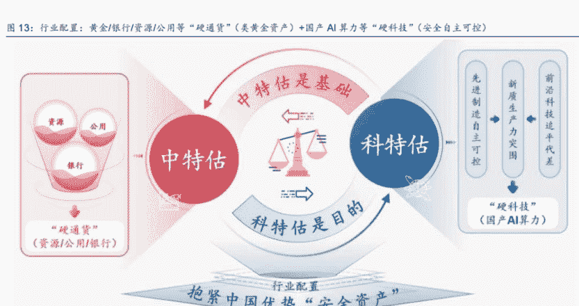

Jason-Jason
2025-09-15 03:52

bloomberg: 2025年至今，发展中国家的人民债券销售额超过150亿元人民币（21亿美元）。这比任何一年都多，而2024年同期为35亿元人民币。然而，与美元债券市场的规模相比，人民币募集规模依然不足，发展中国家今年聚集了344亿元。

人民币货币包括财政政策受影响的斯兰卡和纳米比亚，以及萨哈克斯坦和哥比亚，这些国家正在与中国更密切的关系。“金锚

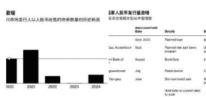

添加微信：cuk255，获取更多资源

## 人民币借贷款激增
中国境外的新兴市场发行人以人民币出售的债券数量创历史新高

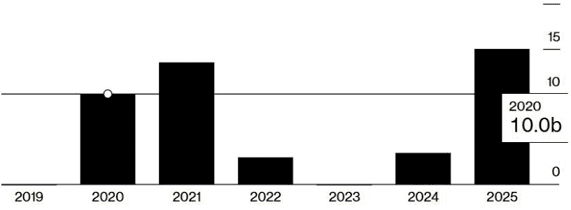

资料来源：彭博社
注意：显示截至9月5日的年初至初的销售额

## 发展中国家人民币发行量激增
选定的人民币交易和计划将从中国借款

| Borrower | Announcement Date | Details | Size |
| :--- | :--- | :--- | :-- |
| Sri Lanka | Sept. 2025 | Planned loan | $500 million |
| KazMunaygas, Kazakhstan | Sept. | Planned dim sum bond program | Up to 15 billion yuan |
| Development Bank of Kazakhstan | August | Bond Sale | 2 billion yuan |
| Hungarian government | July | Panda bonds | 5 billion yuan |
| OTP Bank, Hungary | June | Dim sum bond sale | 900 million yuan |
| Kenya | | Held talks to convert debt to yuan |

资料来源：彭博社、公司和政府公告

添加微信：cuk255，获取更多资源

## Jason 不离

2025-09-15 04:00

数据：9月13日，发布了每周报告，根据受访者，57%的受访者为入市10以上。18%的受访者入市在10年，17%的受访者入市在5年。从仓来看，本周50%的受访者持仓不动，29%的受访者进行了加仓，18%的受访者进行了减仓；3%的受访者进行了操作。从盈亏来看，约71%的受访者表示“赚了”，其中59%的受访者属于“盈利”，9%的“亏损”合计12%。“亏损10%以内”的受访者占比5%。62%的受访者认为市场将“继续走”，至3000点；24%的受访者选择在3800点，另有12%的受访者认为大盘存在压力。你认为这波牛市能高到多少？对41%的受访者认为牛市中到4000点。32%的受访者认为会到5000点。对下周的板块涨方向，科技板块有望提升。

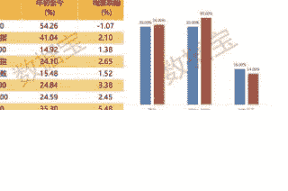

| 项目 | 数值 | 涨幅 |
| :--- | :--- | :-- |
| 总数 | 54.26 | -0.07 |
| 盈利 | | |
| 亏损 | | |
| 户数 | 14.92 | 1.36 |
| 持仓 | | |
| 调仓 | | |
| 清仓 | 13.46 | 1.52 |

添加微信：cuk255，获取更多资源

## A股主要股指一览

| 名称 | 年初至今 (%) | 周涨幅 (%) |
| :--- | :--- | :-- |
| 北证50 | 54.26 | -0.07 |
| 创业板 | 41.04 | 2.10 |
| 沪深300 | 14.92 | 1.38 |
| 深证指数 | 24.10 | 1.52 |
| 上证50 | 24.84 | 3.38 |
| 中证1000 | 24.59 | 2.45 |
| 科创50 | 35.30 | 5.48 |

风险提示：本表内容均为客观统计，不构成投资建议。

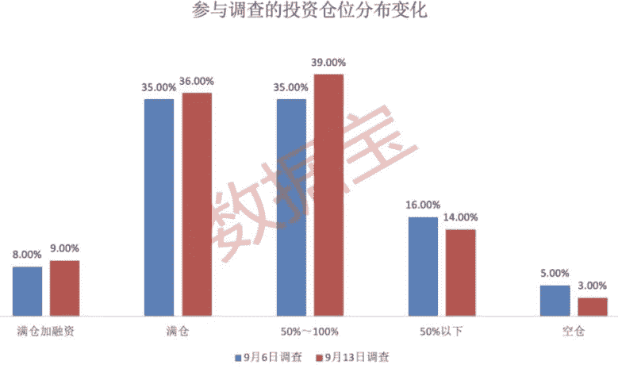

添加微信：cuk255，获取更多资源

## 投资者观点分布：下周市场如何走

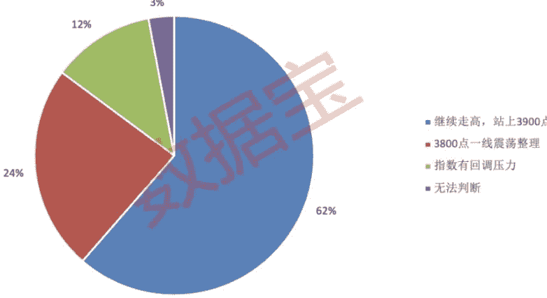

## 科技、有色金属板块看好比例

| 行业 | 9月6日调查 | 9月13日调查 |
| :--- | :--- | :--- |
| 大金融 | 7% | 8% |
| 大消费 | 11% | 7% |
| 医药 | 13% | 11% |
| 科技 | 31% | 35% |
| 军工 | 4% | 4% |
| 有色金属 | 11% | 15% |
| 新能源 | 17% | 14% |
| 次新股 | 1% | 1% |
| 并购重组 | 3% | 4% |
| 其他（请在评论区留言） | 1% | 1% |

添加微信：cuk255，获取更多资源

Jason不离

在本：居民持有的货币占新增M2的权重越低，意味着资金流更多的企业和非银行部门，那么企业有钱可以用于生产，非银行有钱可以用于金融投资，货币的流通效率有所提高。2025年8月，居民新增存款M2权重平均约为53%。与之对比2020年-2021年该指标值为54%，2016-2019年该指标约为43%。

企业存款净差显著大于居民存款净差，领先万AA债利率一年左右，2025年8月，企业级存款净差约为5.6%，与之对比2020年-2021年该指标约为3.9%。2016-2019年历史经验来看，万金融数据增长率高于居民存款/沪北京股票总值为1.1倍时，当下，居民存款/沪北京股票总值为1.55倍，与之对比2020年-2021年该指标约为1.25倍，2016-2019年该指标约为1.31倍，这意味着居民存款对权益的影响仍在持续。

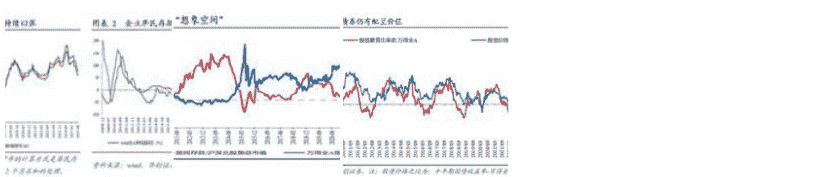

### 图表1：居民存款/M2占比趋势记录
### 图表2：企业存款复置周期
### 图表3：盈值仍有“空间”

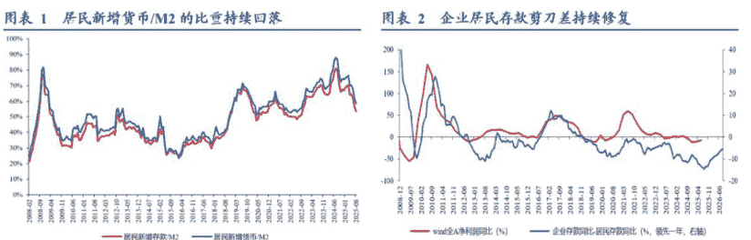

数据来源：wind，东方证券。

### 图表10：股票较债价格

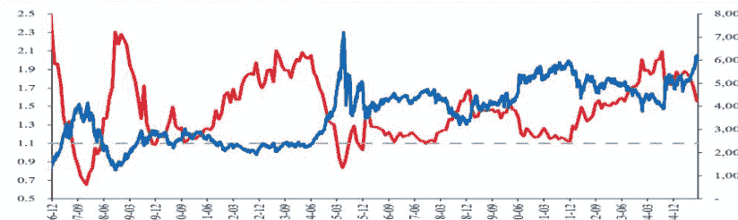

数据来源：wind，创信；注：债券收益率为十年：国债收益率。投资者对美市的分歧小，但慢牛和快牛的分歧仍然较大。从全球市场来看，慢牛的涨幅大幅下降，过去1年上证指数已经达到了这一水平。上证指数历史上波动幅度对比500大，1996-97年、2000年、2006-2007年、2009年、2014-2015年，上证指数1年涨幅度均超过40%。2016-21年，A股的牛市平均值，涨幅幅度没有超过40%。

(1) 过去1年涨幅达到牛市的上限。从全球市场来看，越是典型的牛市，从指数500的1年波动幅度能看到，1年内波动超过40%是少的，而且一旦到达，后期波动幅度大幅下降，过去1年上证指数已经达到了这一水平。上证指数历史上波动幅度对比500大，1996-97年、2000年、2006-2007年、2014-2015年，上证指数1年涨幅度均超过40%。2016-21年，A股的牛市平均值，涨幅幅度没有超过40%。

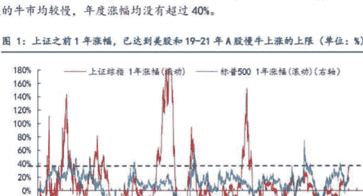

资料来源：衍证研究中心

发展，但如果规模太大，会影响股市的供需。而一旦股权规模趋于分散，说明上市公司市值注入了流动，后续往往往股市产生大级别的牛市。1995年、2005年、2013年平均都出现了股权规模趋于分散，随后的1996-1997年、2006-2007年、2014-2015年，股市出现了大级别的牛市。这一次股权规模趋于分散在2024年，未来2年内出现大牛市的可能性。

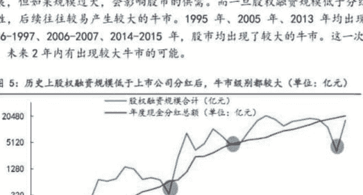

资料来源：衍证研究中心（2023年市场报告）第58页84

### 图 6：政策指数持续发展牛市大行情（单位：点数）

- 政策指数
- 上证综指数

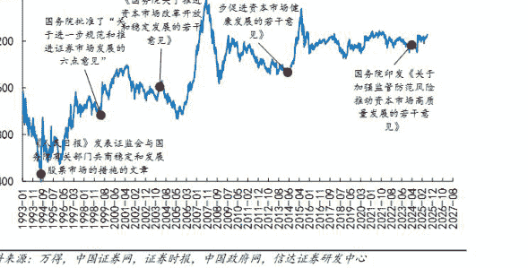

数据来源：万源、中国时报、政府网、证券研究中心

（4）当市场处于均衡稳态期，若政策驱动大行情将继续。随着市场对当期低位的修复，结构性牛市已经持续了年后，随后后牛市行情持续增加，牛市大行情将进入上涨。市场上每牛市会有多次接近历史的高点，接手率升高，市场易出现调整或回撤。上周行情5日内已经接近10月8日顶点（2）部分行情回调结束；8月市场低量震荡反弹，市场上牛市尚未结束，部分速度和接近1个月已经结束，为止并未出现实质性回调，我认为调整后的大行情已经完成，后后还会有一定的震，但不。

### 牛市中期：下半年可能是牛市主行情（单位：点数）

### 图 7：下半年的可能是牛市主行情（单位：点数）

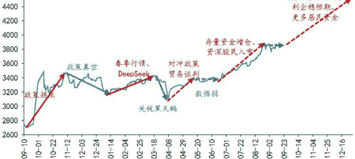

数据来源：万源、证券研究中心

> 注：图中代表性数据仅供投资决策参考，不代表任何投资指向。

（5）后期配置要点：后期至关重要关注品种弹性，结论内部优配置，AI内部将出现应用配置，周期性半。

配置展望：牛市中期的风格和牛市中期行情可能会发生变化。牛市中期风格和牛市后期风格类似，牛市中期风格易扩散。牛市最强风格是行业，牛市中期风格反而相反。2005-2007年牛市中期最强风格是金融，是之后期间，牛市中期最强风格是周期，金融股跟随行情。2013-2015年牛市中期最强风格是增长，但牛市中期最强。

# 添加微信：cuk255，获取更多资源

Jason-Down
2025-09-15 04:44

甲方宏源：居民增长的不确定性与当前居民就业前景有关，BCI的企业招工前瞻指数2024年7月至2025年6月的中枢为50.2的波动，而2025年8月最新数据为44.07，创2020年3月以来的新低。

## 经济数据

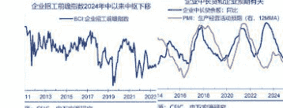

### 图 4: 招工前瞻指数 8 月下行

### 企业招工前瞻指数2024年以来中枢下移

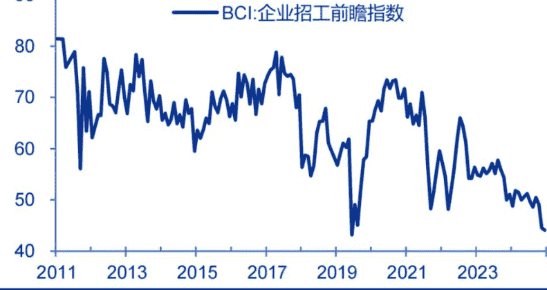

资料来源：CEIC，申万宏源研究

添加微信：cuk2555，获取更多资源

### 图 6: PMI 中生产经营活动预期有稳定迹象

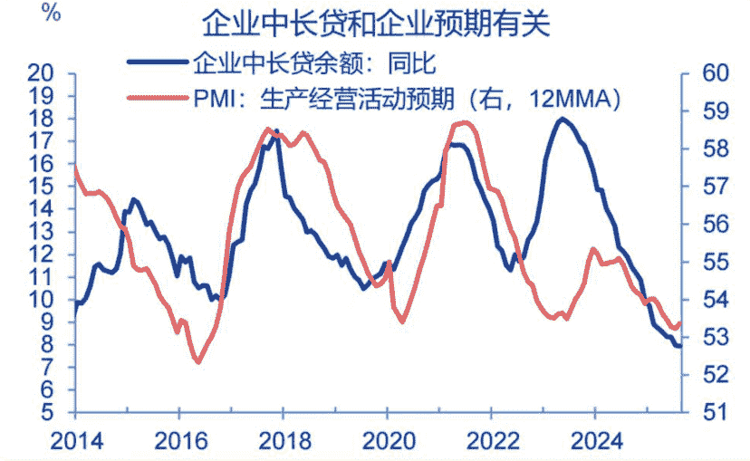

资料来源：CEIC, 申万宏源研究

添加微信：cuk2555，获取更多资源

# Jason不嵩
2025-09-15 04:48

广泛：2025年以来（至9月12日），大资产表现领先前的贵金属COMEX黄金涨幅38.8%，COMEX白银涨幅45%；部分金属铜涨19%，锡涨20.3%，钻涨幅60%；三星市场（MSCI市场指数涨幅为19%，越南VN30指数涨幅37.8%）；主要市场科技股，费城半导体指数涨幅20.5%，上证科指数涨幅35.3%；还有另类资产；

我们理解上述资产特征有几条主线：

- 一是美国元与资产的“软锚化”，导致美国信用化的逻辑还有三：全球化关化打破了美发达国家的持续性维持；制造业的目标和赤字扩大带来了其政策不确定性和中期政策持续性维持。在通胀初期有通胀逻辑重启启动又增加了真实购买基础，这一背景导致美元资产实现与美元一定程度的“软锚化”，美元信用逻辑再度抬头，全球资产重新配置与供给套化。大商品、另类资产实现与美元一定程度的“软锚化”，

- 理论上出现什么可能打破大美元？一是美国利率不着陆或再通胀，那么货币市场宽松周期或被打断，从美元的定价逻辑转向贵金属、科技，新兴市场资产和另类资产；二是缘政治“再融合”，而贵金属的逻辑回归，产业的逻辑回归，全球环境变化导致美国常规财政政策的必要性下降；三是对技术革命的发生变化，类似于“颠覆性扩张”，对于基础金属、要素基础设施等领域的理解出现调整。

高盛数据预计9月GDP萎缩回至-1.1%，名为YP的由此回升至3.75%。#经济数据

添加微信：cuk255，获取更多资源

### 图 1：大类资产指数向下突破，周均变动至15次(次) ---大类资产指数-趋势变动(MA)

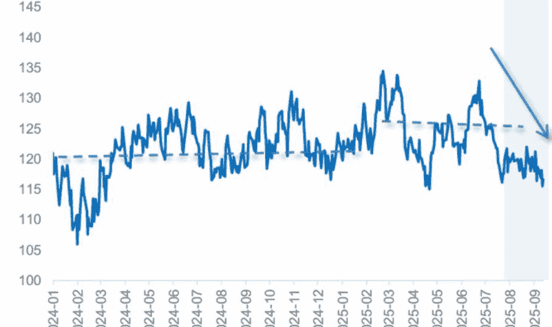

数据来源：Wind。广发证券中心

CF40：行为组合理论，居民部门在做资产配置的时候，只是考虑资产收益情况，往往会根据两个缺口，把资产分成不同的组合。一般来说，居民在做资产配置的初期，会有这两个目标：一个是“养老”，为了现在的提供保障；另一个是“暴富”，就是追求快速增长。在积累期的框架下，居民会安排组合来实现这样的。实现“养老”目标，首先要考虑安全，能够在未使用时可以将部分资产叫做“稳健型（也适用）”。实现“暴富”目标，首先的就是潜在收益是否足够的，能够及时抓住，对部分资产进行灵活配置。两类资产在长时间内保持相似的配置，积累资产和灵活资产之间出现周期的转化，两者的比例发生了。所以，本来用来买的钱大部分转入股市，这两个属性是不一样的。居民部门配置的真实心态是：本质上按照“零花钱”来安排份额的。

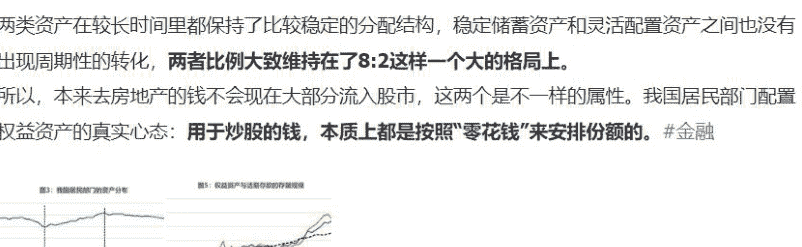

添加微信：cuk255，获取更多资源

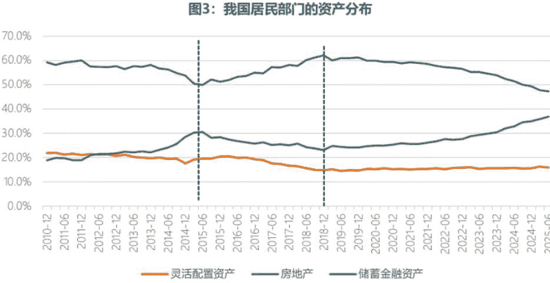

数据来源：CF40研究院

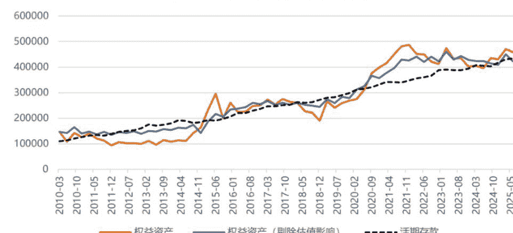

数据来源：CF40研究院

添加微信：cuk255，获取更多资源

# Jason

广发：8月底以来，市场成交量高位，单日成交量一度达3万亿至2万亿，同时遭遇回调，市场波动加大，引发了投资者担忧。复盘2010年以来数据显示，“往往意味着阶段回顶，随着涨结束后，上涨概率仍继续，但未过少数放量。在本轮，若有新的增量出现，指出成交量可能进一步放量。对于维持行情，重要的是判断强弱，以此不过热，不在回调，趋势结束时及时止损。A股

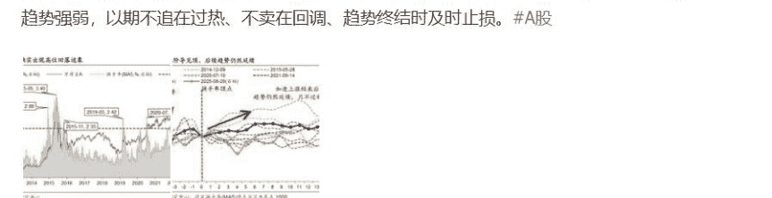

## A股图 1：9月以来，全A股表现确实无位迹象

| 跌手(5%,成交量) | 万亿级 | 跌手(MA5%,成交量) | 上手(20250912) |
|---|---|---|---|
| 8,500 | | | 4.0 |
| 7,500 | 2015-03-24 | | 3.5 |
| 6,500 | 2014-12-28 | 2019-03-24 | 2020-07-26 | 3.0 |
| 5,500 | 2010-10-1.99 | 2015-11-2.35 | 2021-09-18 | 2.5 |
| 4,500 | | | 2.0 |
| 3,500 | | | 1.5 |
| 2,500 | | | 1.0 |
| 1,500 | | | 0.5 |
| | | | 0.0 |

数据来源：Wind。广发证券发展研究中心

### 图 2：“量价”意味着涨势见回顶，后趋势依然延续

| 2010-10-18 | | 2015-05-28 |
| 2014-09-15 | 2020-07-10 | 2015-11-11 |
| 8月之涨量内(86日) | 2025-08-26 | 2021-09-14 |
| 重量涨意味着见顶 | | 2024-10-10 |
| 二价强势见顶 | | |
| 加如上涨结束后 | | |
| 趋势依然延续，只需不断放缓 | | |
| 1,200 | | | 1100 |
| 1,150 | | | 1080 |
| 1,100 | | | 1060 |
| 1,050 | | | 1040 |
| 1,000 | | | 1020 |
| 950 | | | 1000 |
| 900 | | | 980 |
| 850 | | | 960 |
| | | | 940 |
| | | | 900 |

数据来源：Wind。广发证券发展中心：跌手(MA5)项目为1000

添加微信：cuk255，获取更多资源

# Jason

2025-05-15 09:05

BOFA：今年以来，主要资产表现分化。黄金高达38%的连涨，全球股市（25%）和比特币（23%）。相比之下，美元和石油成为赢家，今年以来下跌10%和13%。美债正处于底部，将继续做多直到今年年初。然而，自2020年以来，美国名义GDP增长了惊人的54%，创造了以往最劲增长。一条长线将在2025年后结束。年化增长率和市场波动从66%降至4%。美元走强，欧洲和日本成为最后的赢家。由于美国及亚洲的对冲，许多资产表现提供了支撑。黄金并非政府贬值的工具。尽管加仓一步走，美元录得四年以来最大的流入，显示黄金已从“安全避风港”扩散。投资者将通过配置应对中美面临的风险。通胀、高失业率（从4.8%升至9.4%）和巨大的差距是社会风险。参考1970年代初的杰克逊剧——“繁荣”维持，并继续推动黄金的价格。这种政策将美元再次获得“美国过剩”的胜利

# The Asset Class Quill of Total Returns

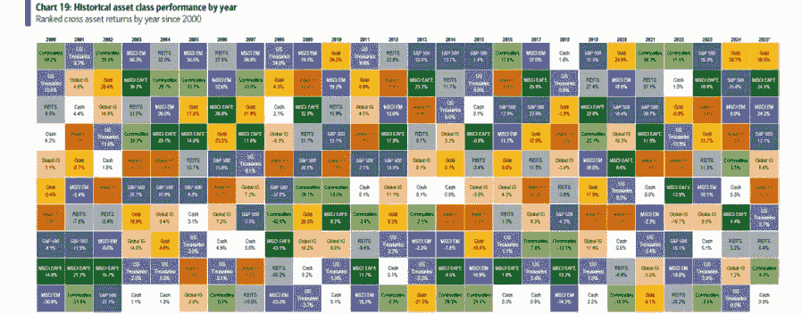

Source:BofA Global Investment Strategy, Bloomberg L.P.

BofA GLOBAL RESEARCH

添加微信：cuk255，获取更多资源

## Chart 2: US 2020-2025 nominal GDP growth strongest since WWII

US economic expansion cycles (nominal GDP growth from recession lows), 1946-2025

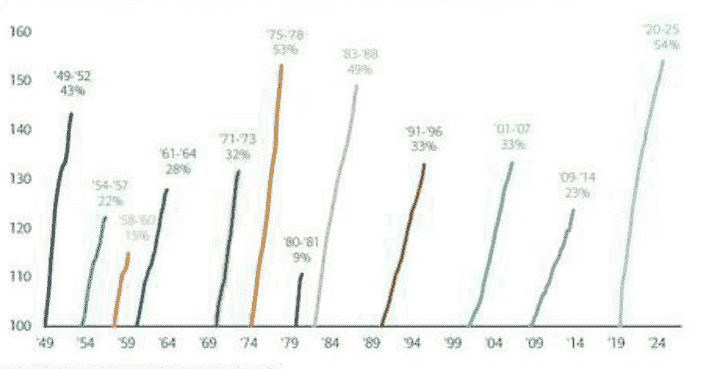

数据来源：BofA Global Investment Strategy, Bloomberg
BofA GLOBAL RESEARCH

## Chart 7: Peak nominal GDP growth = peak yields

US nominal GDP growth rolling 10Y annualized & UST 10y yield

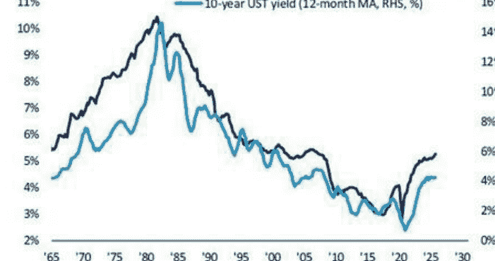

数据来源：BofA Global Investment Strategy, GFD Finaeon, Haver
BofA GLOBAL RESEARCH

## Chart 6: Wall St vs Main St...peaking Inequality

US private sector financial assets relative to GDP since 1951

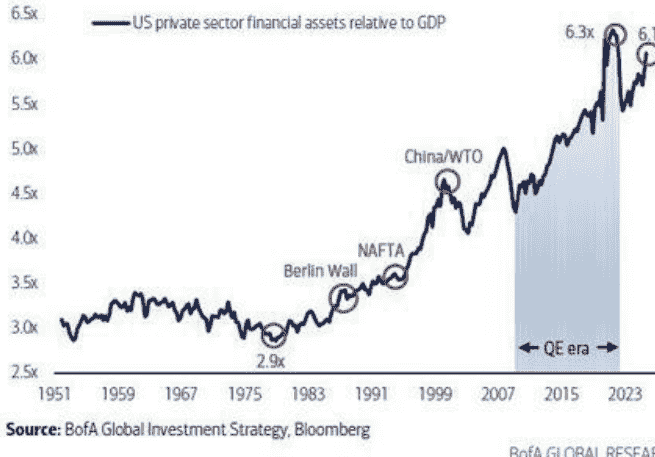

Jason
2021-09-15 05:12

FT: 根据瑞源汇通的数据，最近几周，欧洲、宰稳和安盛德等集团的债券收益率低于类似期限的法国政府债券收益率，这表明投资者可能将其视为更为安全的资产

# Record number of European company bond yields fall below French sovereign debt

Number of Eurozone IG companies with
yields below French government bonds

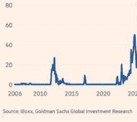

其他国家对比

添加微信：cuk255，获取更多资源

## Record number of European companies' bond yields fall below French sovereign debt

Number of Eurozone IG companies with yields below French government bonds

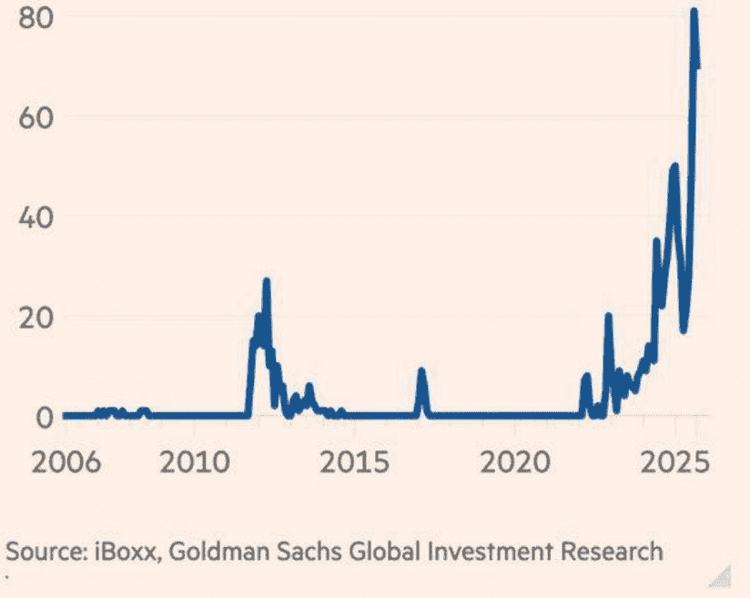

Source: iBoxx, Goldman Sachs Global Investment Research.

添加微信：cuk255，获取更多资源

# Jason
2025-09-15 05:23

GMI:2025财年前11个月，财政预算赤字达到1.9万亿美元，为历史第三。美国财政部在8月份录得3450亿美元的预算缺口，这是有史以来第二的8月份。在过去12个月中，美国政府为其公共债务支付了创纪录的1.2万亿美元利息。这占政府收入的四分之一。与此同时，联邦债债务费每100天增加~1万美元

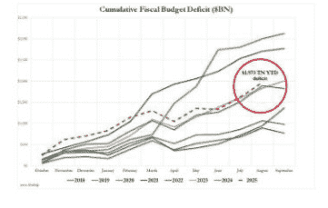

其他国家经济

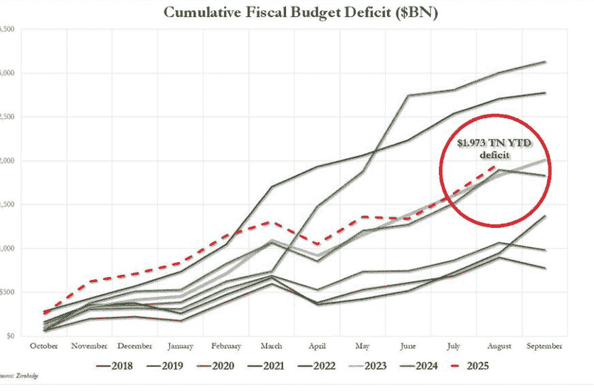
