# 南半球聊财经250921

由于地方债务限制，隐性进一步显性化，加大财政赤字创新高，今年前8月显性政府债务增量创下同期记录#TAG #自制图表

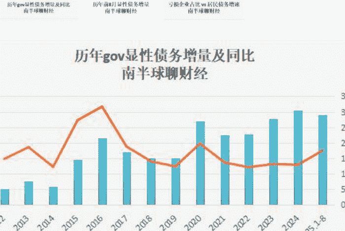

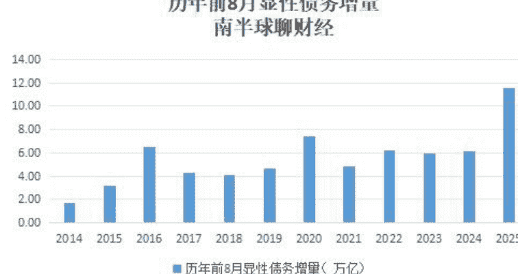

深度视野大V文集cuk255 有温度高质量社群cuk255

## 均衡企业占比 vs 居民债务增速
南半球财经

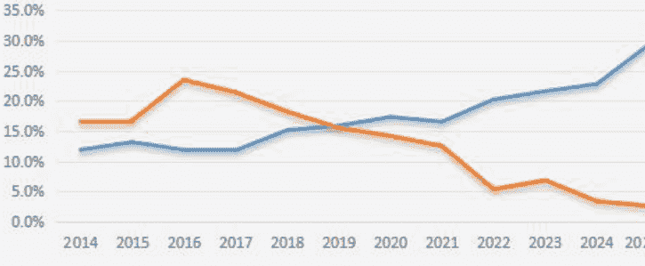

Jason不嵩
2025-09-21 21:06

在经济增长理论中，中国经济增长分为两个阶段：越赶型阶段和平衡增长阶段。中国模型强调的越赶型是在短期内资本积累的学习效率，直接向技术增长型是在长期增长路径上依赖劳动的技术进步。单靠学习，这种内生和外溢的作用无法发挥出来，中央政府的投入（也就是前文所述）就是通过政策引导内部化学习的外部性，使得资本积累到社会最优水平。但如果增长者干预就会过度导致经济损失，这取决于政策强度的合理性和对学习特性的价值估计。通过模拟，我们发现在这个阶段出现了越赶型经济损失。1978-1992和2012-至今，我国也出现了部分领域经济增长损失。我们看到了高投资、低消费的经济失败尝试。其根源在于最初的政策引导（越赶型下的要要素过度干预）通过影响技术进步的路径，最终决定了一个轨迹：高储蓄、高投资、高债务、居民消费受到了一定程度的损失的增长模式。

### 经济数据

图表11: 均衡模型

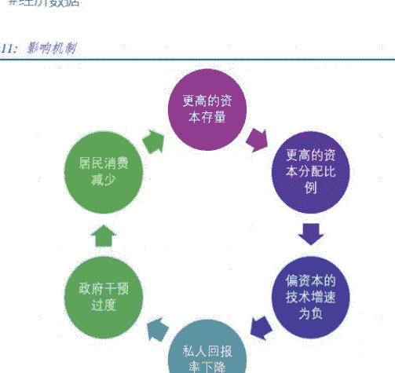

资料来源：wind，长威产业健全研究院

### 深度视野大V文cuk255 温度高质社群cuk255

## 寡头不断竞争

当前中国经济面临的矛盾与“内卷”竞争，底层因素之一在于供给领域的由于数据扭曲的资本价格泡沫，通过寡头不断竞争、缩小资本价格差距，是推动市场化改革、提升资源配置效率的关键。只有资本价格差距缩小，市场才能充分发挥资源配置的决定作用，从而提升要素生产率和资本回报，打破供给过剩的恶性循环。

在未来，中国经济可持续增长依赖市场化竞争，价格信号成为解决问题的真正指南。

- 1、规范招资行为：地方政府招资，取消非公共性补贴，建立基于市场竞争的产业政策。
- 2、退出机制市场化：允许企业通过破产、兼并整合有序退出，避免“僵尸企业”占据资源。
- 3、金融市场改革：利率市场化加速推进，促进市场真实反映风险与回报，引导资本流向高需部门。

## 收入分配改革

当前中国经济面临的内需与消费矛盾，深源于收入分配机制的失衡。通过以往投资驱动，政府主导的投入引导资本与企业回报，劳动份额占比维持低位，这制约消费释放的关键障碍。推动收入分配机制从“收入导向”向“劳动友好”转变，已是经济增长的核心任务。

收入分配失衡主要体现在方面：一是城乡差距，劳动份额占比长期偏低，居民收入增速低于GDP增速；二是收入差距扩大，低收入群体中，资源过度倾斜导致支付能力不足，这种格局使得经济增长过度依赖投资，而消费萎靡无力。

> Jason：
> 2025-09-21 06:05

国信：当前股市的强势表现意外，一方面，数据并未显示明显复苏信号，企业盈利承受，经济增速放缓；另一方面，A股和港股同步回升。未结束股市，以科创为代表的科技股表现指数翻涨，背后有支撑和转型，近来科技股涨幅已屡如此。由于过去两个月行情回升，牛中行情或出现季节性回暖，基金关注密切：一方面，去年9/26以来会议让市场改革政策出台，近期北上等城市密集回购政策，8月以来市场基本面已出现阶段性有望，股价已经调整55%，估值地仍有下探压力。以白酒为代表的消费，的消费指数已经下降3.6%，占比依然：叠加股市行情回暖对消费具有积极作用，或带动低消费活跃。三季度，到2024年以来市场行情暖，成交量明显，中信券商利润已经回升至63%，8月以来成交量增大，未来增速有望向回升，金融业务将转向券商业务#A股

## 深度视野大V市场红利

### 图 5：科技与分化：通信、有色金属、煤炭、食品等

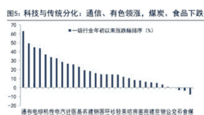

### 图 6：医药与创新概念和主题聚类

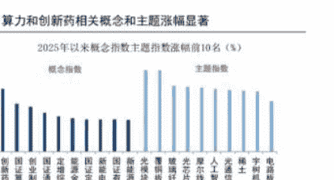
来源：万源，国信证券研究所

### 图 7：龙头表现出的显著领先于主要指数

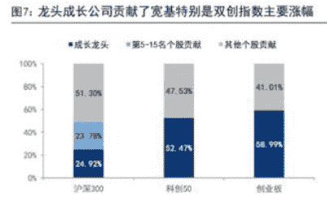

### 图 8：四大资本支出维持

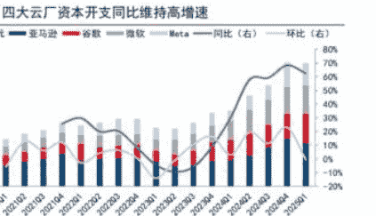
来源：万源，国信证券研究所

### 图 1：基础数据回测，无驱动

### 图 2：横来看，H表现优于蓝股

来源：万源，国信证券研究所

### 图 3：CPI 和 PPI 维持增速

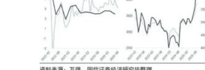

### 图 4：A和全净利润对比

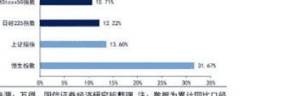
来源：万源，国信证券研究所

## Jason-磊

万宏：70年代以来，美联储经历了12次加息周期，其中5次是软通胀环境预防式加息，平均持续9个月，累计加息234BP，10年利率平均下行167BP；7次为硬陆加息周期，平均持续20个月，累计加息647BP，10年利率平均下行199BP。一个共同性，加息周期结束后，10年利率见到顶，加息前3个月，10年利率平均62BP，利率在1-2个月后可能触底部，通胀预期在加息3-6个月内完全回归。这种方式会导致美利率的下行空间，预防式加息里，美利率波动更小、反弹时间更短。10年美利率低位实现在最后一次加息落地至2个月。衰退加息后，10年利率回升将更快，结束加息后，长端利率往往于底。这次美联储加息后，但10年利率中枢进一步下行的空间有限。美国长期中性利率已升至3-3.5%区间，美联储还有3-4次加息空间。9月通胀数据显示市场至2026年底已经是4.5%，我们预测如果2026年PCE通胀为2%，通率为4.4%，美联储可能维持现状。加息周期结束后，期限倒挂使得长端利率具有下行的空间。2024年9月首次加息结束后，10年利率的中枢未回升，由于通胀持续反复，2025年，10年利率可能最高上0.9%附近，是由于供给端的缺口，二是由于美国不确定性。若未来仍难改善，若通胀再度加剧美联储的压力，长端利率可能不再反弹。非发达经济体长期利率的上行或制约美利率的空间，在欧、日债券利率上行、美利率下行与美元汇率的背离，欧、日资金配置的需求可能随之转向。以日本投资为例，对冲中10年美债的收益为0.5%，已优于10日的1.4%#金融

### 图表 1：美国1970年以来的历次扩张周期

| 序号 | 开始扩张期 | 结束衰退期 | 扩张周期(月) | 扩张期平均收益率(%) | 投资收益率(%) | 衰退期收益率(%) | 备注 | 周期长度 |
|---|---|---|---|---|---|---|---|---|
| 1 | 1970-03-23 | 1973-03-19 | 36 | 7.0 | 10 | 5.5 | 8.2 | 1970年代 | 11 |
| 2 | 1973-11-11 | 1980-03-30 | 78 | 14.5 | 11.0 | 11.0 | 5 | 1970年代 | 12 |
| 3 | 1980-03-30 | 1982-07-23 | 28 | 11.3 | 20.0 | 2.5 | -10 | 1980年代 | 9 |
| 4 | 1982-07-23 | 1990-07-01 | 96 | 18.8 | 15.1 | 5.5 | 17 | | 17 |
| 5 | 1990-07-01 | 1995-03-28 | 68 | 12.3 | 11.5 | 5.3 | -75 | | 16 |
| 6 | 1995-03-28 | 2001-03-24 | 75 | 19.6 | 45.0 | 6.0 | -63 | | 15 |
| 7 | 2001-03-24 | 2007-10-01 | 79 | 13.1 | 9.1 | 6.5 | 10 | 2000年代 | 18 |
| 8 | 2007-10-01 | 2009-06-01 | 20 | 4.8 | 5.1 | -1.7 | -56 | 金融危机 | 20 |
| 9 | 2009-06-01 | 2016-02-01 | 114 | 7.2 | 1.9 | 0.25 | -25 | 2010年代 | 5 |
| 10 | 2016-02-01 | 2020-03-11 | 52 | 3.7 | | 3.0 | | 5 |

资料来源：CEIC、申万宏研究

### 图表 2：美国70年代以来的扩张周期

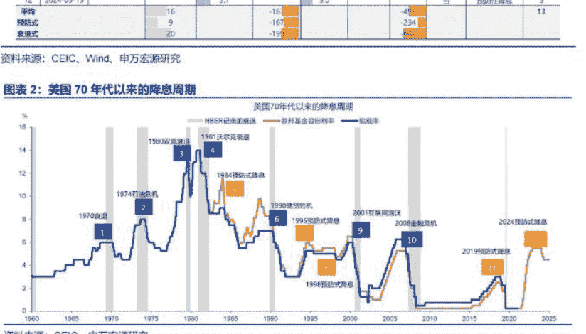

资料来源：CEIC、申万宏研究

Jason·刘
2025-09-21 06:14

中金：美国经济可能维持下行态势，企业聚焦于AI等科技方向，传统行业较软，预计美债收益率在震内回落，黄金力量在持续回#全球

## 中国盈利增速放缓，科技龙头优于其他企业

我们认为，美国目前的局面类似于精兵（科技）行业，与其面临挑战的传统行业一同，由于动力缺乏灵活性，导致胜利陷入绝境，整体表现无法完全解决危机，其整体态势面临调整，不符合预期。

从标普500指数企业盈利来看，整体增速过去几个季度表现有效，但分分来看，科技龙头企业的盈利增长相对稳定，而其他企业盈利增速有所下滑。

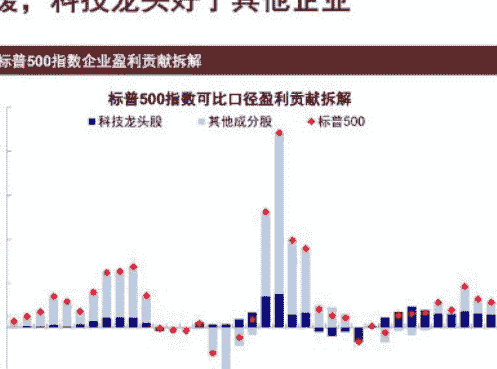

### 标普500指数可比口径增长率

- 科技龙头
- 其他行业
- 标普500

来源：Bloomberg, 中金公司研究
注：中金公司2023年5月报告

## 美国传统企业的盈利增速逐渐下滑

从标普500指数企业盈利来看，整体增速过去几个季度表现有效，但分分来看，科技龙头企业的盈利增长相对稳定，而其他企业盈利增速有所下滑。

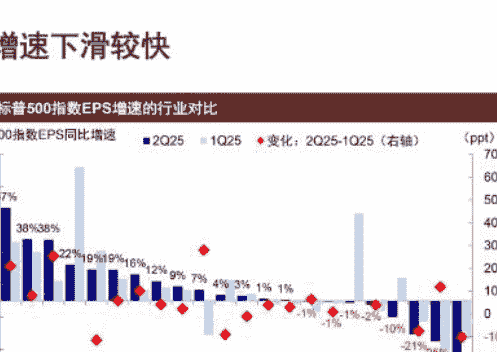

### 标普500指数EPS同比增速

- 2Q23
- 1Q23
- 变化:2Q23-1Q23 (环比)

来源：Bloomberg, 中金公司研究
注：中金公司2023年5月报告

## 美国就业数据同样体现了行业的衰退

美国就业数据同样体现了行业的衰退。环境对于一个单一行业而言，气候并没有AI相关的行业如此。

从数据来看，包括零售、服务、制造业等在内的多项行业情况均恶化，这意味着短期前景堪忧，就业规模也表现出下滑。

相同地，美国8月整体非农数据仅增加2.2万，近去年同期下降0.1pt，4.3%，接近4年来高值。

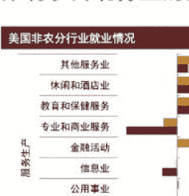

| 其他服务 |
| --- |
| 休闲和酒店业 |
| 教育和保健保险 |
| 专业服务和科学技术 |
| 金融业 |
| 公用业 |
| 酒店业 |
| 零售业 |
| 建筑业 |
| 农业 |

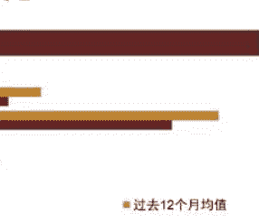
Source: Mark, U.S. Bureau of Labor Statistics, https://www.bls.gov/news.release/py2308.htm
Source: Tax Foundation, 中金公司研究

## 美国财政支出法案进一步抬高赤字

- 美国方面，7月将通过有关“大扩张”的预算方案。市场预计缺口将减小，支出从4.5万亿美元减少至.4万亿美元，但赤字进一步增加到5.5万亿美元（大涨）。
- 考虑到2023年美国赤字在未来10年将达到4万亿美元，对应GDP的5%-6%区间（2015年-2019年），美国赤字将维持在7.2%-7.4%之间。

| CBO估计“大扩张”法案在未来10年会赤字率维持在5%-6%的高位 | 赤字 | 16% |

## 国债利息支出持续增长

- 考虑到美国利息支出受国债利率影响，预计部分存量国债将在2025年之前到期并展期。由于利率上升，美国国债利息占财政收入的占比高于美国赤字规模越来越接近，即时利息支出可能不再来，这可能会很大制约美国赤字。

| 美国国债利息支出与国债收益率相关性 |
|---|---|
| 10年美债收益率（轴） | |
| 利息支出占财政占比（近12个月） | | 2024年或维持升高 |

## 欧美政府以外的居民和企业杠率上下

欧美日等国家政府债务抬升的情况下，居民和企业的杠率近去年反而下。

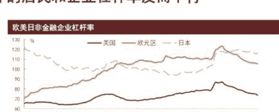

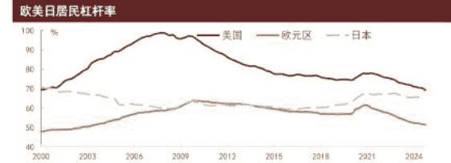

数据来源：Bloomberg，中金公司研究

## 美国国债利率背离黄金，仍有回落空间

- 历史以来美国国债收益率走势和黄金比走势基本一致。背后的逻辑是：避险情绪能够反映经济需的供给。
- 这是2022年以来，美国利率和黄金比持续背离，美国国债收益率持续推高消费需，使得工业生产相对下降，以及利率回升使得关系非经济增长杠率维持。
- 此前美国国债利率与黄金比程度较高，如果美国经济继续放胀，黄金比持续在大方向上可能回落，我们认为可能进一步回落。

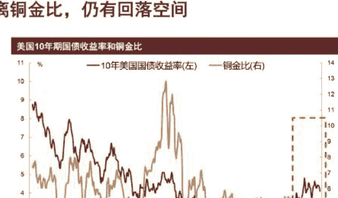

数据来源：Wind，中金公司研究

## 2015年股市也是因为债券利率下行的触发

本轮股市与2014-2015年有显著不同，主要是由于利率下行，政府政策转向，当时股票涨幅大，但股市并非是牛市，而且由于债券利率下行，从资金配置的角度来看，对本轮股市的触发因素也是利率的下行。

2015年年初市场表现较为缓慢，央行通过政策配合，没有出现收益率上升，反而在得到调整后，股市加速牛市。

2015年的股市行情并没有带来经济的活跃。

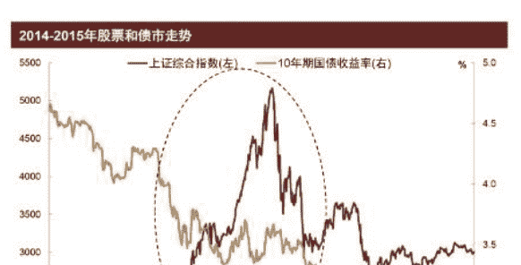

## 今年股市的前提是债券利率在2024年的大幅下行

2024年债券利率的下行也是本轮股市转强的关键触发因素。

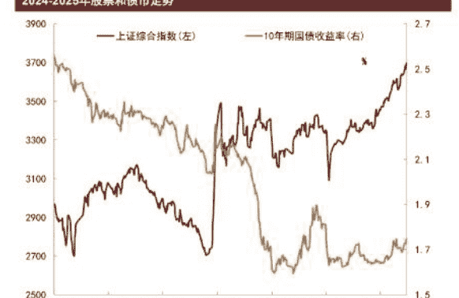

深度视野大V文集cuk255 有温度高质社群cuk255

## 5月份存款利率的走势是这周股票市场的纽带

5月20日，国债利率下调，民间存款利率。其中定期存款下降5个基点至0.05%；定期存款三个月、半年期、一年期下降15个基点，至0.65%、0.85%、0.95%、1.05%；长期下降25个基点，至1.25%和1.3%。

存款利率的下调，一方面缓解了市场资金流入非金融产品，另一方面可能使得存量的存款资金回归金融市场，是这类股票行情的重要纽带。

- 存款利率下调之后，3年期定期存款利率已经被市场基金7年收益率覆盖
- 七年收益率:余额（天远）
- 四大定存款利率:3年
- 四大定存款利率:1年
- 利到收益FR0017

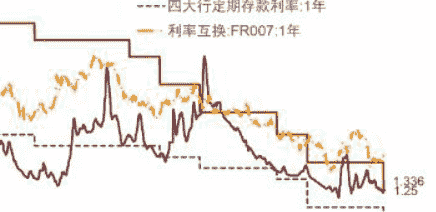

2022 2022 2023 2023 2024 2024 2025 2025 2029

> 数据来源: Wind, 中金公司研究
注：数据截至2023年8月

## 2015年和2025年的股需求都处于弱弱状态

2015年和2025年的股票市场将是地产震荡和融资需求过剩，并没有合适的去处，金融机构的融资业务也不不多，因此资金会更多流向股市以及供给市场配置。

贷款供需相对指数

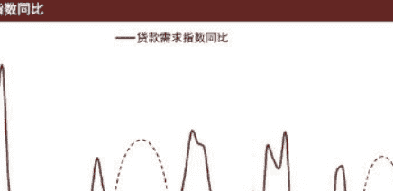

2008 2010 2012 2014 2016 2018 2020 2022 2024

> 数据来源: Wind, 中金公司研究
注：数据截至2023年8月

深度视野大V文集cuk255 有温度高质社群cuk255

## 2015年股市降温后，债券新一轮牛市启动

2015年股市在6月份之后步降温，股票基金的规模随之开始下降，资金多次流入信基和债基，驱动债市新一轮牛市启动。

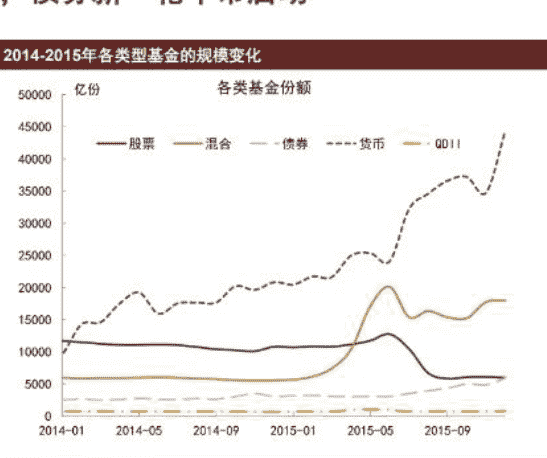

2014-2015各类类型基金的规模变化

> 数据来源：Wind, 中金公司研究院
注：数据为2014年及2015年

## 2015年股市降温后，经济和通胀依然下滑

2015年股市降温后，经济基本面延续下滑，PPI继续下行。

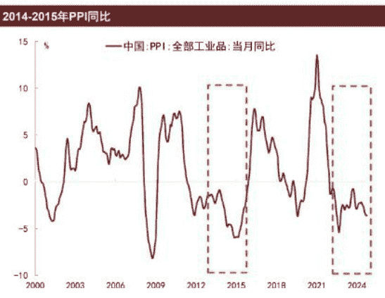

2014-2015PPI对比

深度视野大V文集cuk255 有温度高质量社群cuk255

## 我们预计下半年中国贸易顺差开始回落

- 我们预计中国贸易顺差的幅度以及来自外部的影响会缩小。考虑到出口需求减少以及美国经济和全球通胀压力带来的自下半年开始，中国的贸易顺差或将从高位回落，或会影响下半年经济增长。

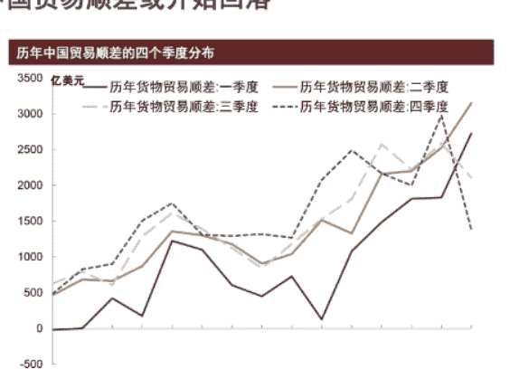

中金研究部

## 2025年财力进步前，但政策偏置

- 2025年财政有望进一步从3%提升到4%，达到历史新高。不过，如果从角度来看财政支出规模的赤字并没有超过2020水平。考虑到预算内赤字以及特别外赤字结合在一起，这个广义赤字率可能超过2020当年。

| 2009-2025年各类赤字率 | 赤字率（预算内） | 实际赤字率（财政收支） | 广义赤字率（政府新增债） |
|---|---|---|---|
| 2009 | | | |
| 2010 | | | |
| 2011 | | | |
| 2012 | | | |
| 2013 | | | |
| 2014 | | | |
| 2015 | | | |
| 2016 | | | |
| 2017 | | | |
| 2018 | | | |
| 2019 | | | |
| 2020 | | | |
| 2021 | | | |
| 2022 | | | |
| 2023 | | | |
| 2024 | | | | |
| 2025 | | | |

深度视野大V文集cuk255 有温度高质量社群cuk255

## 2017年之后，货币流通与财政力度相关

随着财政力度增加近10年的情况，财政力度导致货币流通和货币流通指标（以收入和M2增速衡量）的相关性增强。可以看到2018年以来，财政政策领先于流通速度3个百分点，意味着财政影响力增强，经济复苏和资金周转加快。

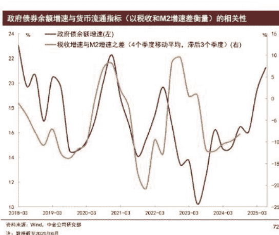

深度视野大V文集cuk255 有温度高质量社群cuk255

## PPI未来季度尚难转向

从目前的预期来看，PPI可能走弱，难以转正。

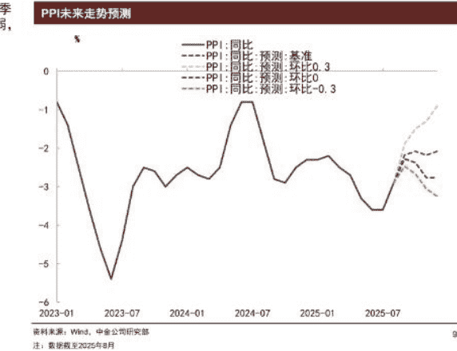

中金研究

## “反内链”正影响企业投资意愿，尤其是民企

在过去的需求背景下，由于出口缺口持续低迷，企业的投资和投资意愿较为谨慎，“反内链”除了让消耗剩余产能，更重要的是避免投资产生更多制造过剩，因此会导致企业需求进一步提升。

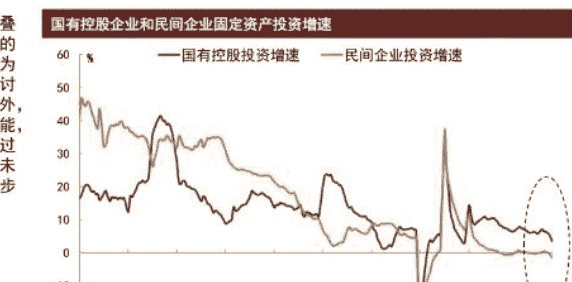

深度视野大V文集cuk255 有温度高质量社群cuk255

## 妥鉴于房地产自2021年以来经历萎缩，没有什么能成为增长的动力，自2023年以来，消费增长依然乏力，增速放缓，经济在生产者和消费者价格的转换通过通胀压力战斗。由于中国工业的过剩价格较低销往国外。经济学家对GDP和我们模型不一致，其实达成速度会更有利于推动改革，而维持表面5%的会议目标也会带来一些利益。

FIGURE 1
Official real GDP growth by expenditure component, 2015 – 2024, and Rhodium Group estimates (2022 - 2025)

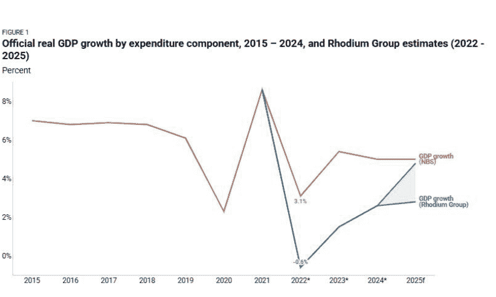

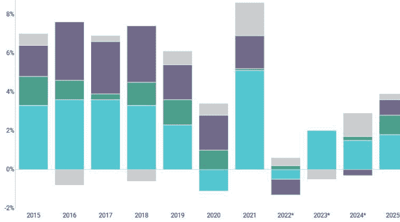

Source: Source: National Bureau of Statistics
*Rhodium estimates, 2025 reflects Rhodium forecasts and the official GDP target.

深度视野大V文集cuk255 有温度高质社群cuk255

## Jason不诡

数据显示，从2025年3月起，美国已经吸收了大部分关税，而不是外来消费者。之前在2025年3月4日收关税后，美国商品的平均价格涨幅超过了国内商品的平均价格。然而截至2025年7月至8月，接近进口商品替代的国内商品的零售价格涨幅与国内商品的零售价格差不多。我们计算，7月进口消费的关税收入占月度消费的百分比约为13%，截至2025年8月，特朗普对进口消费的关税并未完全反映在价格中，这为对美国消费者支出（PCE）指数总额的影响有限。截至2025年7月，PCE指数与2025年1月相比上涨了1.2%左右。换句话说，到2025年7月，美国消费者并没有承担太多关税负担。合理的结论是，至少到2025年7月，美国通过进口企业进口的商品成本与收到的价格之间的差异尚未达到巨大的关税负担。许多消费者可能根据新增关税之前的历史价格未变，受此的影响。

**Prices paid to foreign sellers for imported goods and consumer prices have not changed much through July**

Cumulative CIF import price changes by product category and cumulative percentage change of personal consumption expenditures (PCE) index, January 2025–July

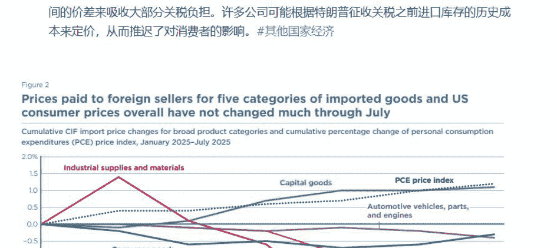

Notes: Cumulative changes are calculated by dividing the index for each product category in a given month by the corresponding index in January 2025. CIF import prices are based on customs value and paid to the port of entry. Data are categorized by 1-digit end, as provided by the Bureau of Labor Statistics.
Source: Bureau of Labor Statistics; Bureau of Economic Analysis

根据国际工组织的平均工资计算，印度需要967小时才能购买iPhone，美国只需要21小时。

How Many Hours of Work Pay for an iPhone? Hours worked at average hourly rate to pay for an iPhone, by country. Price of base model (in US$)*

| | | | |---|---|---|---|---|
| 939 | 947 | 1885 | 1484 | 1081 | 1160 | 928 | 857 |
| 1003 | | | | | | | |
| 1749 | | | | | | | |
| 908 | | | | | | | |
| 967 | 598 | 709 | 461 | 352 | 191 | 188 | 80 |
| 26 | | | | | | | |
| 256 | | | | | | | |

Converted from local currency on Sep.12

## 人工智能的要点

- 根据克林宫的人士，总统弗拉基米·普京得出的结论，军事升级迫使乌克兰按照他的条件会谈的最佳方式。
- 知情人士称，俄罗斯军队加大了对乌克兰军事和民用目标的轰击力度，目标是基于能源网络和其他基础设施。
- 普京打算这种做法，认为乌克兰在防御方面做得太多，而华盛的克林宫形象增大。
- 根据克林宫的人士，弗拉基米·普京得出的结论，军事升级迫使乌克兰按照他的条件会谈的最佳方式，而纳德·特林可能在加强防御方面做得太多。
- 上个月两位领导人在安克雷以来，俄罗斯军队已经加强了乌克兰军事和民用目标的袭击，总统弗拉基米·普京拒绝了放弃乌克兰东部更多领土的要求。
- 知情人士称，普京打算继续准备网络和其他基础设施，并要求在讨论敏感信息时不吐姓名。
- 他们补充说，阿拉斯加的会谈让普京确没有兴趣预测冲突。

俄罗斯对远程袭击在峰会前有所减少，但此后有所增加。彭博社的乌克兰空军汇总的数据显示，在会之后一个月，无人机和导弹袭击增加了46%。泽连斯基9月16日表示，9月到为止，俄罗斯已经发射了3500架不同类型的无人机、近190导弹和2500多枚炸弹。

## 俄罗斯升级对乌克兰的攻袭

乌克兰约五分之一的领土处于俄罗斯控制之下

- 俄罗斯占领的乌克兰领土

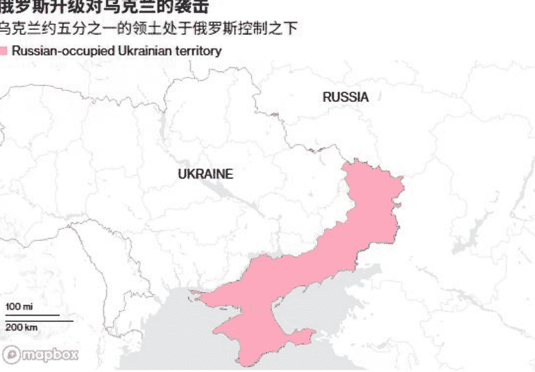

其中包含自2022年2月份开始入侵以来最大规模的导弹和无人机袭击，损坏了首都基辅以及乌克兰第二大城市哈尔科夫的政府和住宅楼。

随着空袭强度的增加，尽管俄罗斯努力加大对前线的压力，但俄罗斯领土推进的步履已经放缓。泽连斯基林，俄罗斯已重新部署了100,000名士兵攻击乌克兰在顿波茨克地区的据点波克罗墨夫市，并宣布他的部队已成功夺回了顿波茨克的一些土地。

“俄罗斯2025年夏季的攻势未能控制乌克兰东部的任何目标城市，”彭博社经济研究院经济学分析师亚历克斯·科尔恰洛夫（Alex Kokcharov）表示。

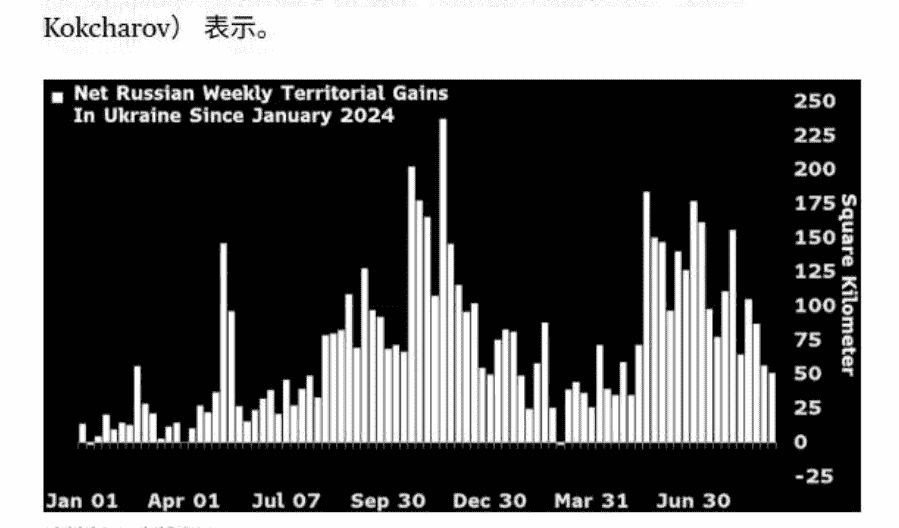

乌克兰方面加强了对俄罗斯能源基础设施的无人机攻击，旨在消耗受制前线的燃料供应。根据彭博社的计算，他们的目标是占俄罗斯所有炼油工厂一半左右的石油加工设施，尽管燃料中断的实际数量远低于此。上周，无人机还袭击了俄罗斯最大的波罗的海的海边地区石油码头，基辅称袭击了为了另一个波罗的海的海滨。

# Jason-不离

医保：本次采集方案制定和修改过程中，充分筹顾了临床、质量、防腐、反内卷的原则。本次采集采取了“价差控制”的选择，不再简单选用最低廉价。当“最低价”低于“入围框的50%”时，将“入围框的50%”为价差控制的锚点。

## 四、关于“反内卷”

采集公开透明、公正的市场化竞争策略，企业应参加、自主报价，同时，积极解释理由防止过度报价。

### 一、 优化价差锚点形成与控制

- 一是优化化价差锚点形成，在大量品种可选中的“弱锚”规则，最高有效报价是防范范围膨胀“中选”事件的重要性。同时，充分吸收行业协会和企业建议，避免集采“中选”中低价不符合最高有效报价策略，避免单个品种的最高报价过高。

- 二是优化“价差控制锚点”，为保证本次采集遵循对中选价差的一项控制。同时，为防个别企业出现异常低价“断锚”其他正常的企业，导致整个品种的中选价过低，本次采集优化了“价差控制锚点”的选择，当“最低价”低于入围框的50%时，将“入围框的50%”为价差控制的锚点。我们请专家针对7-10批采集200多个品种的价格情况进行了模拟，在最高价与最低价大于1.8倍的品种中，如按照规则，有1/4左右的溢涨领先“锚点”，对于相对低价，平均溢涨34%，最大溢涨170%，将起到防反内卷的作用。

- 三是要求企业不低于成本报价，要求每家企业做出不低于成本报价的承诺，对于锚价的企业，要求其对报价合理性作出说明，解释具体成本构成，包括制造成本、期间费用、销售利润等，主导社会对企业中选的逻辑。

# Jason-不遇

2025-09-21 06:56
BOFA：“美股套涨24%的估值尚未醒醒。该组合2023年以来涨幅达223%，低于历史高涨24%的平均涨幅。其市盈率为39倍，远低于历史峰值58倍。人工智能热潮和调整预期是主要题材。

如果投资者在2009年3月的低点买入标普500指数，那么投资收益将达到110倍。REG/SEC提示，期市场美联储基准短期利率将在年底降至3%以下，远低于当前高于4%的水平，也低于美联储最低点“图4”所示的3.4%预期，相当于美股预期期两次出现25个基点的下降，市场对降息的预期也进一步扩大，投资者预计2026年利率将跌至3.5%左右。各市场显示投资者认为美股溢于政治风险，此市场可能将利率终点优于美股历史预期水平。#股市

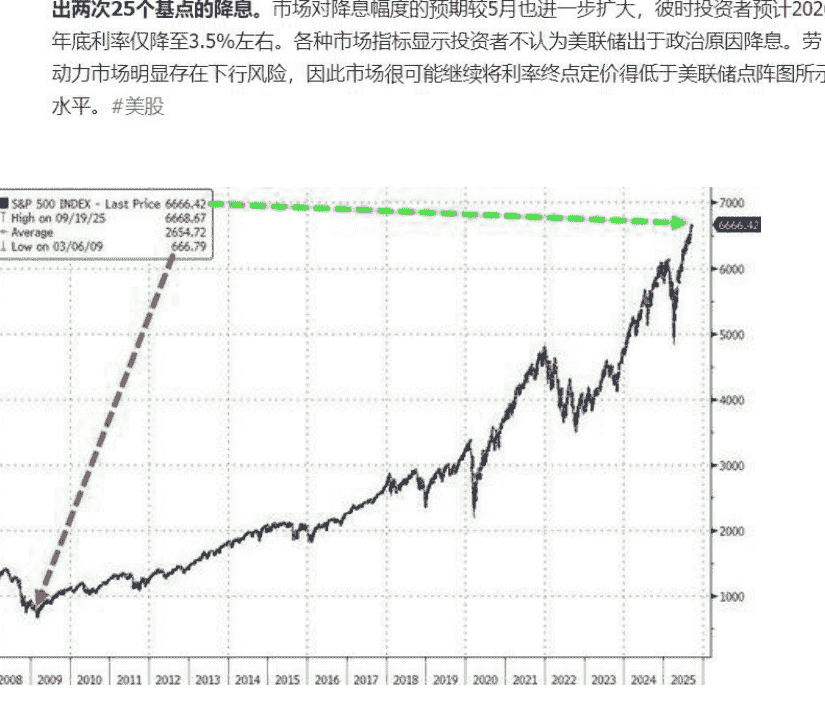

# Jason-不遇

2025-09-21 06:58
JPM: 在当前利率下，中国银行增长具有稳性的股息率和良好的业绩表现，具备显著的投资价值。中国银业的“高股息盛事”尚未结束。

中证中国银行4.3%的股息率LPR和储蓄利率高于十年期国债1.8%的股息，以及银行存款利率1.25%和理财产品收益率1.9%。测算显示，在出口行业相关贷款20%不良率，交易手续费优势下降20个基点的极端设定下，A股和H股的股息收益率能够维持在3.8%到4.5%的水平，行业收入和利润增长将在下半年同比比较好，主要受益于净息差好和业务收入增速复苏。

预计未来三年资金流入规模可达14万亿元人民币，相当于A股流通市的15%，高股息板块成为主要因素。#A股

## CSI 300 dividend yield outperformed all other asset yields since mid-2023, and the gap will likely widen

## CSI 300 and CSI 300 dividend spread have been edging higher

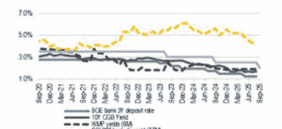

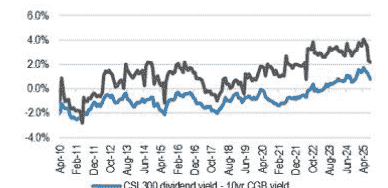

- CSI 300 bank de-rank
- CSI 300 dividend yield vs CSM
- Performance rate of mid-year in insurance payout
- CSI 300 dividend yield - 10yr CNY yield
- CSI 300 bond yield - 10yr CNY yield

Source: Bloomberg Finance L.P.
Source: Wind

## CSI 300 banks offers higher yields compared to CSI 300 Index

## MSCI China banks offer higher yields compared to MSCI China index

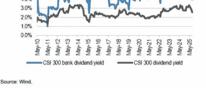

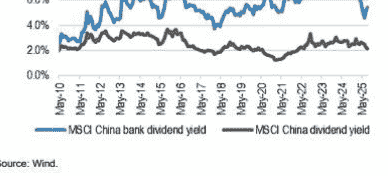

- CSI 300 bank dividend yield
- CSI 300 dividend yield
- MSCI China bank dividend yield
- MSCI China dividend yield

Source: Wind.
Source: Wind.

> ... in three years, these measures may induce additional fund flow of RMB14tn, equivalent to 15% of current tradable market cap

Incremental fund flows from the quantitative measures mentioned at the conference press

| Item | 2024 | 2025 | 2026 | 2027 | 2028 | 2029 | Note |
|---|---|---|---|---|---|---|---|
| Life less group growth (bn) | | | 4.5 | 6.0 | 7.5 | 8.0 | 8.0 |
| yr yield (bps) | | | 0.0 | 5.0 | 9.0 | 12.0 | 10% per annum |
| Mutual fund balance | | | 0.2 | 0.3 | 0.5 | 0.8 | |
| State-owned invest inflow of 15% of new money into A shares (holding) | | | | | | | |
| Mutual fund holdings in A shares | | | 0.19 | 0.44 | 0.65 | 0.74 | Life less group in 2024 is expected to rebound, that equity fund amounted to RMB14tn at end of year |
| Mutual fund flows should grow at least 10% | | | 0.4 | 0.9 | 2.0 | 2.8 | |

## Sensitivity analysis on portfolio inflow into equity

| Item | % of total AUM | % of increase in equity | Increase in inflow from 2023 |
|---|---|---|---|
| Step 1: Incremental fund flows from the quantitative measures mentioned at the conference press on Jan 23rd | | | expects 15% of new |
| Funds managed by institutions (bn) | 30% | 0.4 | 2.9 | |
| Mutual fund balance | 76.4 | -14.25%* | | |
| Social security funds | 3.0 | 15% | 0.2 | |
| Enterprise annuity and equity capital | 5 | 0.1 | | |
| Step 2: Inflow from 401(k) and wealth management fund (WMF) increases equities | | | | |
| WMF in A shares | 52.3 | 25% | 8.1 | |
| Subtotal | 100.0 | | | |
| Step 3: Aggressive buying of themes 1-3 | | | 16.4 | |
| Aggregate tradable market cap as of Sep 15 | | | 16.3 | |

Source: CBR, PRBC, Wind, CEIC, J. Morgan. Note: We assess the incremental fund flows from 2023H to 2028. Sum of the incremental fund flows mentioned is RMB14tn. A shares should grow at least 10%. Equity mutual fund accounted for 14.7% of the total fund balance; hybrid mutual funds account for 10% of total fund AUM, part of that expires. Date of: Sep 18, 2023.

The current rally is primarily driven by asset rotation and excess liquidity.

## Excess liquidity as of nominal GDP is picking up recently

## CSI300’s valuation at reasonable level

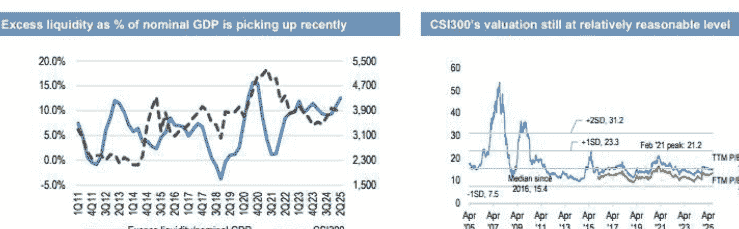

Source: Wind, CEIC, J. Morgan. Note: As of H15

## Margin financing as % of AD reduced -12%, but lower than 2015 level Margin financing only accounted for 2.3% of tradable market, which is lower than -4% in 2015 if we use shadow financing

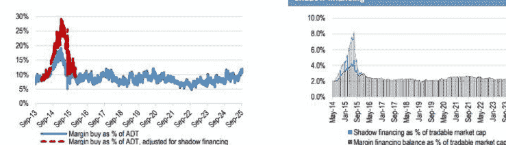

Source: CEIC, J. Morgan. Data as Sep 12, 2022. 2025-09-21 高涨：为止，黄金、通讯和服务新市场非常活跃，股市通常在美联储首次息后反应，科技股是表现最好的板块

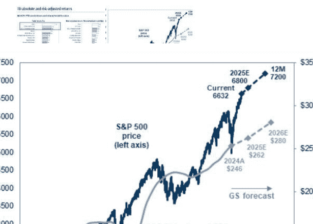

Source: FactSet, Goldman Sachs Investment Research

## YTD absolute and risk-adjusted returns

Exhibit 34: YTD asset returns and return/volatility ratios

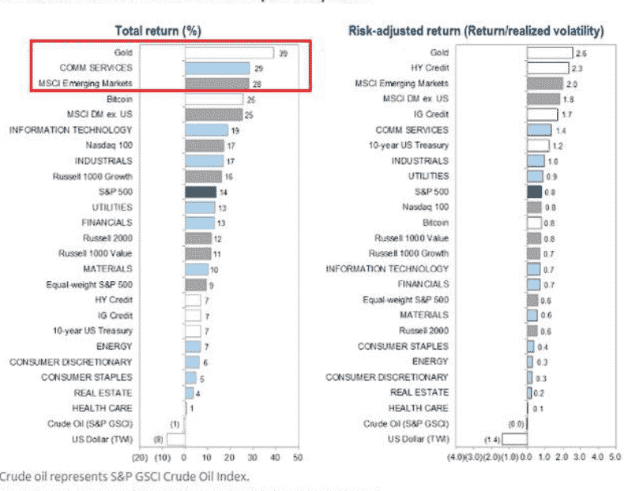

Crude oil returns S&P GS Crude Index.
Source: Factset, Haver Analytics, Goldman Sachs Investment Research

Exhibit 6: Equities typically rally following the first cut

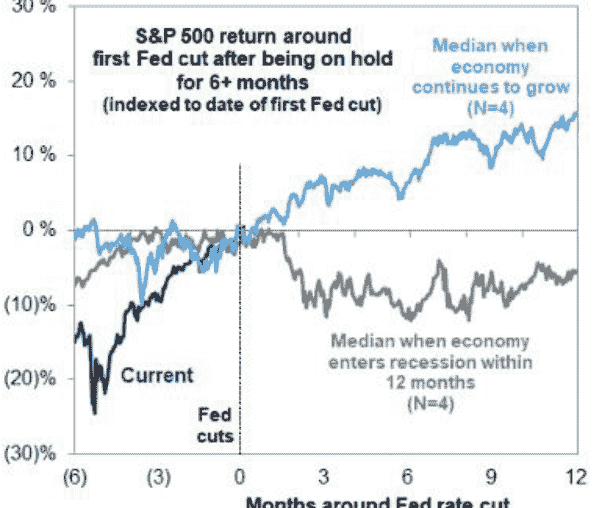

Source: Goldman Sachs Oil Investment Research

## Exhibit 7: Info Tech typically is the best performing sector after the cutting episodes when the economy continued to grow

S&P 500 returns during 6 months following first rate cut after being on hold for 6+ months

| S&P 500 returns | 1998 | 2002 | 2003 | 2024 | Median | % positive |
|---|---|---|---|---|---|---|
| Index excess return vs. SPX (pp) | | | | | | |
| Nasdaq 100 | 30 | 7 | 1 | 8 | 100 |
| S&P 500 | (7) | 1 | 7 | (4) | (1) | 50 |
| Russell 2000 | (16) | 4 | 12 | (7) | 2 | 50 |
| Sector excess return (pp) | | | | | | |
| Info Tech | 20 | 3 | (3) | 7 | 75 |
| Discretionary | 16 | 2 | 7 | (1) | 5 | 75 |
| Financials | 2 | 2 | 1 | 9 | 2 | 100 |
| Comm Serv | 8 | (6) | (10) | 7 | 1 | 50 |
| Industrials | | (7) | 6 | (0) | (9) | 25 |
| Energy | (26) | | | 1 | 4 | 50 |
| Materials | (22) | | 14 | (7) | (3) | 50 |
| Staples | | (4) | (6) | (1) | (3) | 50 |
| Utilities | | (3) | 7 | 1 | (3) | 50 |
| Health Care | | (11) | | (11) | (6) | 8 | 0 |
| Factor return (long/short) | | | | | | |
| Growth | | | | | | |
| Momentum | | | | | | |
| Size | | | | | | |
| Volatility | | | | | | |
| Dividend | | | | | | |
| Margin | | | | | | |
| Value | | | | | | |
| Quality | | | | | | |
| Low | | | | | | |
| High | | | | | | |
| Factor | | | | | | |
| Long/short | | | | | | |
