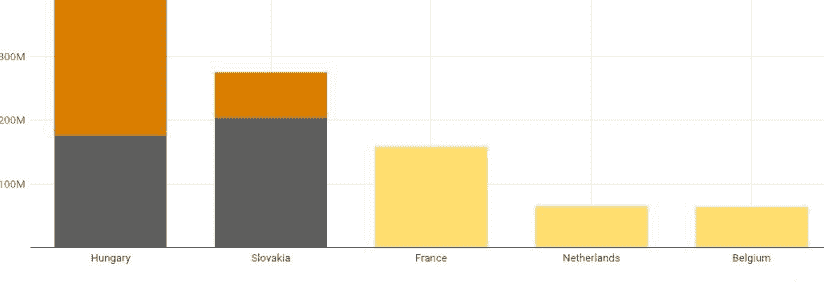
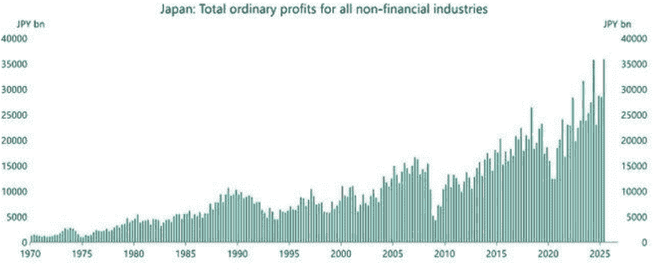
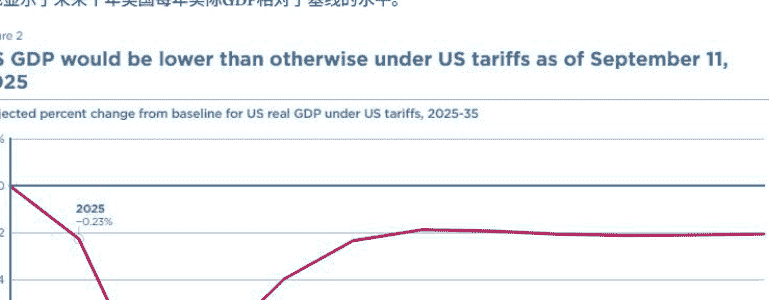
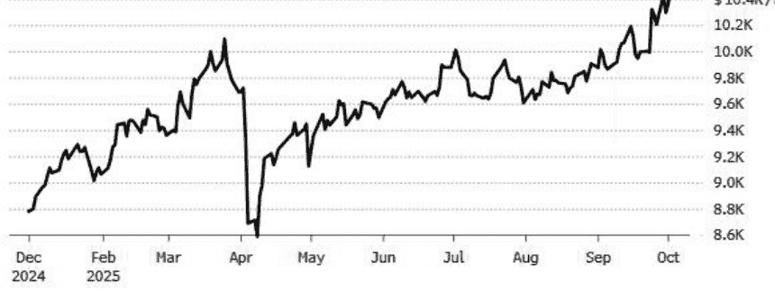
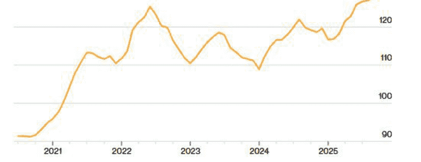
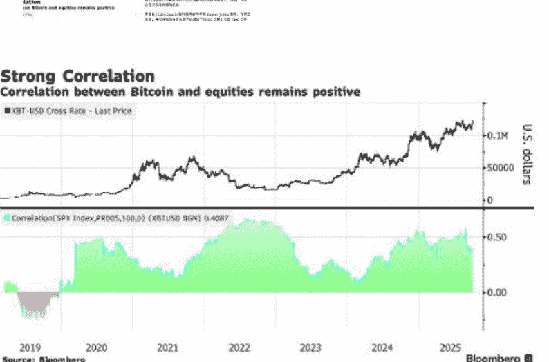
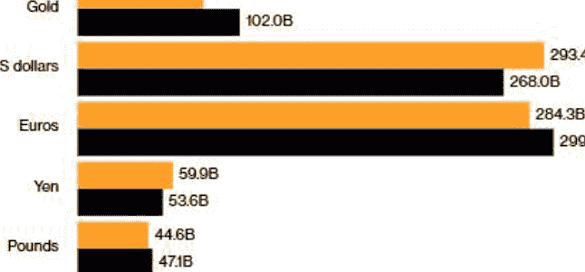

# 南半球聊财经251004

Jason不喻
2025-10-04 06:07

## CREA: 8月欧盟购买俄罗斯能源11.5亿欧元 #其他国家经济

Who are the top purchasers of Russian fossil fuels in the EU?

According to the Centre for Research on Energy and Clean Air, which tracks flows of fossil fuels, the EU spent 1.15 billion euros ($1.35bn) on Russian fossil fuels in August, and the five EU importers bought a combined 979 million euros ($1.15bn).

- Liquefied natural gas
- Pipeline gas

Source: Centre for Research on Energy and Clean Air (CREA) Data as of August 2025

Jason不喻
2025-10-04 06:15

Apollo: 我们看好日本。企业利润有望上升，预计未来 12 个月增长将加速，通胀预计从目前的低位抬头。

bloomberg: 日本正在走出“破产企业”的挣扎期。之前日本经济泡沫破裂的长期调整期间，产生了大量破产企业，到 2010 年，几乎五分之一的公司因为救助和其他金融救济而勉地持续经营，业务重心有意关注订单。2024 年，破产企业的数量开始缩小，这是七年来来的首次。在截至 3 月的一个月中，破产数量增长了 13%，达到了 10,070 家，为 2014 年以来最高水平。目前，大公司尚未破产，由于日本长期劳动力短缺，人们普通能够招到新劳工。 #其他国家经济

深度视野大文集cukk255 有温度高质量社群cukk255

## Japan: Corporate profits for all industries are rising

Jason不喻
2025-10-04 06:23

## BOFA: YTD资产回报率 #金融

## The Asset Class Quilt of Total Returns

Chart 20: Historical asset class performance by year ranked cross asset returns by year 2000

Asset performance table

Source: BlackRock Investment Strategy, Bloomberg 2023-YTD

## 深度视野大文集cuk255 有温度高质量社群cuk255

## Jason/不遇

PIE: 在9月的更新中，我们再次使用G-Cubed模型为美国和全球经济带来了未来几年采用关税的预测。我们发现，如果在未来十年内继续实施这些关税与不采用关税的情况相比，这些关税将导致经济减少，美国物价上涨和美国工资下降。具体来说，关税使美国增长率在2025年比基线低0.22百分点，在2026年降低0.62个百分点。

2025年9月1日起，通胀率比基线高1个百分点。随着时间的推移，通胀率将回基线，因为美联储采取行动平衡通胀与最初的增长平衡。尽管通胀是暂时的，但此后的美国物价仍然面临有关关税的风险。

仅此关税不足以削弱美国经济，但如果大规模关税遭遇的移民工人和美国损失失去独立性，美国经济将面临。 #其他国家经济

图2显示了未来十年美国每年GDP相对于基线的水平。

Figure 2

US GDP would be lower than under US tariffs as of September 11, 2025

Projected percent change from baseline for US real GDP under US tariffs, 2025

Source: Working Paper by Warwick Kibblom, Marcus Noel, and Geoffrey Shutrim. The global economic outlook of Trump's 2025

Downloaded image

## Jason/不遇

2025-10-04 06:38

特朗普表示他正在直接向国民发放现金。现金的来源，是关税的增量。此外，他也将部分资金用于优化美国经济。事实上，利用关税收入向移民退税的设法非首次提出。在今年7月，特朗普就曾向媒体透露类似设想。 #其他国家经济

## 深度视野大文集cuk255 有温度高社交群cuk255

## 收入预期难殊

特朗普全民花费计划的资金基础，建立在他对关税收入的乐观预测之上，但这一数字与官方估值相去去甚远。

特朗普在采访中声称，新关税的收入“刚开始”，但最终可能达到每年1万亿美元。然而，根据媒体此前披露的信息，财政部长贝森特下个月的预测，特朗普关税政策带来的年度关税收入可能超过5000亿美元。在今年7月，贝森特对媒体表示，预计年度关税收入可能增加到3000亿美元。这些数字远低于特朗普本人的目标，引发了市场对计划来源可持续性的质疑。

与此同时，特朗普也提到了这笔资金的另一个用途——偿还政府债务。他表示部分资金将用于高达3764亿美元的联邦债务。这一规模与美国财政部公布的数据基本一致。在接受采访时，特朗普明确指出，如果关税持续，可能会通胀，这是他的错。

> Jason不喻 2025-10-04 06:43

溢：黄金交易所价格飙至每盎司2500美元以上，为2024年5月以来的最高值，由于工业供应短缺与对人工智能的需求增长，黄金无疑是“能源供应安全的中心”。随着地缘政治局势冲突和战争的转变，导致供应链中短缺更加紧迫。随着人工智能和国防基础设施成为关键，铜是新的密集的种类。我们预计本世纪末，全球需求增加相当于60%，并预计到2027年10750美元/盎司。

 深度视野cuk255 有温度高质量社群

## Copper Has Gained 19% This Year

- LME copper futures, rolling

Source: Bloomberg, LME

全球肉类价格在9月份创历史新高，创自2021年以来最大的涨幅。欧洲央行指出，食品价格提升速度快于广泛的通胀，更大的动力是原材料成本将继续提高，许多农民的投入。

## 全球肉类价格创2021年以来长涨幅

资料来源：联合国粮食组织

## Jason不喻 2025-10-04 06:51

Bloomberg: 比特币近期记录，“加密风险反弹”，目前今年年初以来上涨30%以上。另一轮活动中，美国股市触及历史新高，与长期停滞的前景和美元下滑和通胀担忧的情况下，买入有望获得。

## Strong Correlation between Bitcoin and equities remains positive

深度视野文集cuk255 有温度高质量社群

## 瑞士要点

- 瑞士银行首席经济学家 Karsten Junius 相信，第三季度业绩将足够，向政府支付大幅增长，增加了约150亿法郎，这是2025年迄为止的最大涨幅。
- 莎莉J 瑞士银行首席经济学家 Karsten Junius 显示，金价上涨的影响几乎完全消除了上半年年的损失。在接受采访时说，“由于美元暴跌，美国股市表现良好，转化为盈。”

## 黄金上升

- Value of holdings in francs at end of 2024
- Estimate of value of holdings at end of 3Q/2025

资料来源：瑞士银行、格普特计算

注：“瑞士银行每季度末发布持有量，图表假设2025年第三季度与第二季度外持仓不变。”

## 深度视野文集cuk255 有温度高质量社群

## Jason不离

FT: 随美元强势，跨国企业和出口商的表现优于更依赖美国本土的公司。美元软弱成为水岭。许多投资者选择美元来对冲持有的美国资产，而利率下行进一步加大了对该货币的压力。美元走会在美元计价中增加美国公司的海外收益，同时也使得美国商品在海外变得便宜，而以国内市场为主的公司难以受益，而那些从海外购买商品的企业面临高额投资成本。 #美股

## Weak dollar boosts multinationals

Year to date performance of Goldman Sachs' international and domestic stock baskets %

Wait, I should check the text.
Year to date performance of Goldman Sachs' international and domestic stock baskets %

- GS international
- S&P 500
- GS domestic

## 深度视野优质集团（链接优质社群，助你成功）全部包含以下内容：限时年费188/年 加微信cuk255

- ① 吃瓜群众包全文加时群对话（原价365 元/年）
- ② 子明私享汇（含）内部文章（原价568 元/年）
- ③ 政事室（子明优）付费内容加送额外子明群聊
- ④ 米联诸闲【作者米穗】（原价599 元/年）
- ⑤ 欧洲金雀会员专属文章（原价328 元/年）
- ⑥ 砖万瓦内部文档（原价400 元/年）
- ⑦ 卢克文青读书会专属文章（原价699 元/年）
- ⑧ 鉴茶财经知识星球（原价3310 元/年）
- ⑨ 猫哥的视界知识星球文章（原价299 元/年）
- ⑩ 财新周【独家新闻】（原价1498 元/年）
- ⑪ 扬世光在金钱圈（原价2200 元/年）
- ⑫ 莱森亚财经知识星球（原价1600 元/年）
- ⑬ 激源异译付费文章（持续更新）
- ⑭ 司马林解读谋选全套音频和全套书籍收藏版无割减（原价2.3万）
- ⑮ 虚虔三部曲[民国梦、帝国争夺、不被理解的MAO]（原价599 元）
- ⑯ 克文知识星球（原价268 元/年）
- ⑰ 额外再送：卢薛元新微博滚费专栏、三村丰老王、三花九树文集

不定内容......（更多资源将去了......）

## 深度视野（文集（付费文集）

## 低成本链接全网V优质内容
