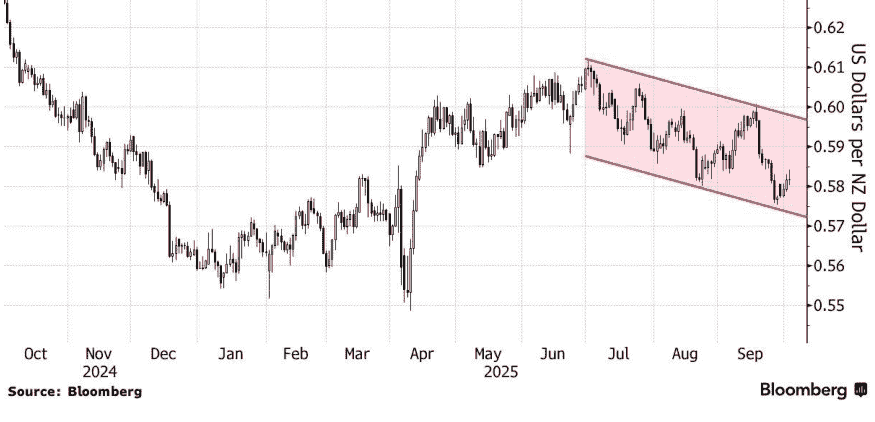
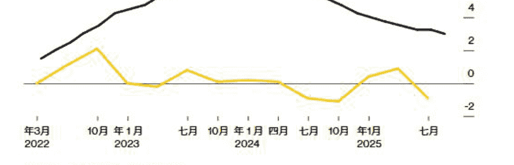
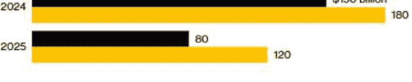
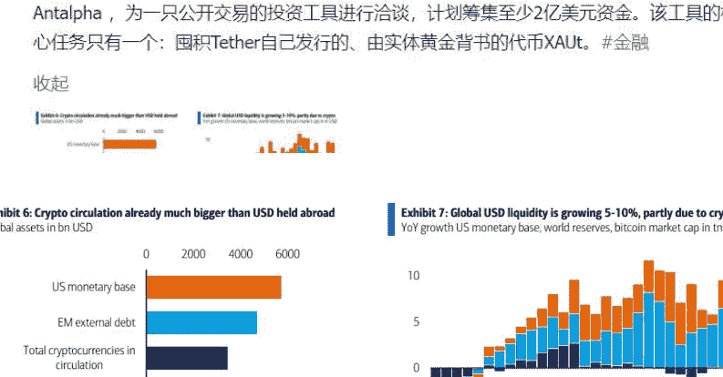
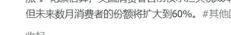

# 南半球聊财经251007

Jason-不嵩
2025-10-07 02:38

bloomberg: 澳大利亚联邦银行预测，到年底新西兰澳元将每月澳元 1.15，这是十多年来的最低水平。市场在已经完全消化了新西兰联储周降息 25 个基点的预期，并认为降息 50 个基点的可能性约为 30%。
第三季度，新西兰所有 10 个集团均下跌，美元下跌 5%，澳元下跌 5.4%。

## 其他国家经济

### Kiwi Has Been Caught in Months-Long Downtrend

#### 随着增长放缓，降息将继续

经济学家在降息 25 个基点或 50 个基点之间存在分歧。
/ 新西兰联储 季节 GDP 数据

数据来源：新西兰联储、新西兰统计局
深度视野集
进群微信cuk255

Jason-不离
2023-10-07 02:50

bloomberg: 美联储和全球几乎将在今年剩余时间内继续降息（除了日本、欧洲），以下是预测的：

- 美国：当前 4.25%，对 2025 年的预测 3.75%
- 欧洲：当前 2%，保持到年底不变
- 日本：当前 0.5%，年底 0.75%
- 英国：当前 4%，保持到年底不变
- 加拿大：当前 2.5%，年底 2.25%
- 中国：当前 1.4%，年底 1.3%
- 印度：当前 5.5%，年底 5.25%
- 巴西：当前 15%，保持到年底不变
- 俄罗斯：当前 17%，年底 15%
- 南非：当前 7%，保持到年底不变
- 墨西哥：当前 7.5%，年底 7%
- 韩国：当前 2.5%，年底 2.25%
- 澳洲：当前 3.6%，年底 3.35%
- 瑞士：当前 0%，年底 -0.25%

# 金融

# 政策利率追踪 / Global economies Forecast

Advanced economies

| March 2022: July-Sept 2022: Last Fed, BCE, ECB hikes | March 2024: BOJ exits NIRP 2024: Fed cut | Jan. 2025: Fed takes office | 备注 |
| :--- | :--- | :--- | :--- |
| First Fed hike | | | 6 |
| | | | 5 |
| | | | 4 |
| | | | 2 |
| | | | 1 |
| | | | 0 |
| Jan. 2021: Biden takes office | 2022: First ECB hike | | | |
| Q1 Q2 Q3 Q4 Q1 Q2 Q3 Q4 Q1 Q2 Q3 Q4 Q1 Q2 Q3 Q4 Q1 Q2 Q3 Q4 | 2021 | 2023 | 2024 | 2025 | 2026 |

来源：彭博经济研究
注：图表数据为显示末费率

Jason-不离
2025-10-07 02:56

# NYT: 特朗普治下的美国经济把所有鸡蛋放在一个篮子里，然后碎掉了其他篮子

# 其他经济

从特朗普上任以来，美国经济一直遵循一种规律：政府总会做出一些出人意料的事情——例如将特朗普提高到未来的风险，或减少美国利率——而经济学家们，包括我在内，则会认为这些行为对经济有害。

并不是为了自利，经济在如此增长的。

四月份的解放关税、引发通胀，但随后多次反弹，今年已经历了三十次增长。那些主流经济学家的担忧正在发生剧性变化。

在于，特朗普执政时期，美国经济正处于非常积极的事情——但并不是由政策带来的。

人工智能投资热潮逐渐冷却，根据一项比例的估计，2025 年资本支出将占据国内总值的 2%，而在 2022 年，这还不到 1%。换句话说，如果没有这些投资，今年的经济增长可能只有左右。今年标普 500 指数的涨幅近 60% 来自科技公司。人工智能带来的溢出，让政府继续维持。美国的实际利率水平几乎回到了月份的高位，总统的决策将支持利率，而后解雇了劳工。

这种情况把“所有鸡蛋放在一个篮子里”，更是把所有鸡蛋放在一个篮子里，再碎掉了其他篮子。人工智能能够缓解通胀，正如特朗普学者预期的，关税高了通胀，导致停滞，年轻人失业率达到困难。

人工智能热潮只会加剧而非泡沫。经济学家阿利帕斯指出，人工智能中心需要需要资金，但运营工人并不需要了。

深度视野集
进群微信cuk255

两个经济体分开来看其实太合理了。如果没有人工智能中心，资本将会流入其他领域。类似 90 年末互联网热潮中出现，当时传统企业难以融资，结果有的成功的，有的破产了。

目前，这种强力的政策反向影响了。一方面，特朗普的贸易战以及美国等机构希望加强增长，经济增长加剧；另一方面，政策确实造成了某种影响。在这种情况下这种规模已经建立。人工智能的好处或坏处将导致重新分配。回看 90 年代初，生产率持续增长平均 1%，但到了十年，在计算机和互联网革命的影响下，生产率提升到 3%，但政府也取得了多年的财政补贴。

类似的情况可能存在。总量不能控制经济周期，我们无法改变它，更不能抑制通胀。经济好的时候政治人物必须宽松；糟糕时候又要表现。现在，政策错误是不必要的。估计一项政策可能长期对我们产生偏差，即使政策带来了损害，但并不关心我们经济增长的影响重要——政策错误可能会造成后果。

如果历史没有教训，技术革命可能会改变世界。这就是互联网泡沫的故事。当时投资者忽视了利润，最终无盈利的项目 Pets.com 获得了胜利并延续至今，带来了更多的财富。最后的泡沫，金融市场的崩溃，投资者遭受损失，失去机会。大多数债务被驱动的政策正在发生。人工智能可能导致全球不平等，金融危机也可能发生。由于私募基金支持的保险，要确保政府在人工智能领域所需的基础建设中，银行将进入我们无法理解的房地产市场。我们可能需要更多来改变政策。1987 年，经济学家罗伯特·索洛曾说过：“在任何地方都没有看到计算机的影响，”后来生产率增长了，但花了很多年后。市场通常对决策者起到约束的作用。这一次人工智能热潮却揭示了现实。要顺利通过这一阶段，我们需要重新扩张增强智能。至少我们应当避免那些正在政策失误。

Jason
2025-10-07 03:02

bloomberg: 美国希望世界购买更多化石能源，而中国希望世界出售更多清洁能源。这是一场能源供给的比较。根据美国能源局的数据，美国 2024 年石油出口量创下历史新高，而中国的技术出口额超过 3000 亿美元。

# 经济数据

# 能源出口：美国与中国

中国从出口太阳能电池、电池、电动汽车和其他清洁能源技术的收入高于美国通过化石燃料出口获得的收入

- US oil and gas exports
- China green tech exports

资料来源：DOE, EIA, 中国海署、 Ember、彭博计算
注：2025年的数据截至7月

Jason-不瀚
2025-10-07 03:05

BOFA: 加密货币对新兴市场货币的利大于弊，短期提供流动性增长有助于新兴市场稳定。短期内，加密货币通过增加全球货币流动性，间接推动了新兴市场的市场，但在某些新兴市场国家，加密货币对美元汇率构成风险和海外波动。目前，全球加密货币流通量已成为外流美元规模的 3 倍，而全球加密货币市场规模已超过最大加密货币债券指数的资产管理规模（AUM）相近，当其货币压力加大时，贬值速度将加快。

有意思的是，全球最大的加密货币市场正将美元转换为符号传输的流动资金——黄金。Tether Holdings SA 联手与矿机头部比特特（Bitmain）联系，为一种易交易资金工具计划募集至少 22 亿美元资产。加密货币背后的支持。

Jason-不离
2025-10-07 02:38

bloomberg: 投资者认为市场是安倍经济学 2.0。当年安倍推出各项改革，起到了效果，削弱了日元，但三箭——对日本企业从未命中，所以市场完全遵循安倍经济学，若日元是难以实现，那么她也在努力淡化高额债。

# 其他国家

日元非常软弱，日本的汇率比安倍执政时期更竞争力

- Chinese Yuan per Japanese Yen

资料来源：彭博社
深度视野集
进群微信cuk255

Jason-不赢
2025-10-07 03:24

FT: 美国零售销售会，在消耗了进口后，美国进口的价格正在逐步上涨。劳工统计（Labor Statistics）显示，截至 8 月的六个月里，进口商品的价格正在上涨。

## Prices are increasing rapidly for some import-dependent goods

Change in price (%)

- 音响设备上涨 14%
- 衣服上涨 8%
- 工具及用品上涨 5%

这些商品大多为进口。物《Home News》首次报道，全球最大的家具制造商 Ashley Furniture 自周日起将大部分产品上调 3.5% 至 12%，其关税形势给整个行业带来了挑战。汽车零售商 AutoZone 的首席官菲普·达涅（Philip Daniele）在电话中表示，随着关税影响，价格可能会进一步上涨，消费者的份额将扩大到 60%。

| Category | 0 | 2 | 4 | 6 | 8 | 10 | 12 | 14 | 16 |
| :--- | :--- | :--- | :--- | :--- | :--- | :--- | :--- | :--- |
| Audio equipment | | | | | | | | |
| Coffee | | | | | | | | |
| Women's dresses | | | | | | | | |
| Hardware and supplies | | | | | | | | |
| Bicycles | | | | | | | | |
| Computers | | | | | | | | |
| Core CPI | | | | | | | | |
| Toys | | | | | | | | |
| Footwear | | | | | | | | |

Source: US Bureau of Labor Statistics • Six-month change in prices as of August 2025, not seasonally adjusted.
FINANCIAL TIMES

Jason-不遇
2025-10-07 04:01

NBER 论文：引用此的数据实证，对富人征税确实会导致部分向外迁移，进而减少部分和投资份额，在量化之后，发现这种调整非常小，不支持流行的“富人进走、工人受伤”的说法。相反，根据结果，建议政策者可以在公平之间取得平衡。从全局，社会财富分配的收益大于迁移的损失。

# 论文或书籍推荐

Taxing Top Wealth: Migration Responses and their Aggregate Economic Implications
Katrine JAKOBEN, Henrik KLEVEN, Jonas KSLURUD, Camille LANDAS, and Mathilde MUNUNO

## Taxing Top Wealth: Migration Responses and their Aggregate Economic Implications*
Katrine JAKOBEN, Henrik KLEVEN, Jonas KSLURUD, Camille LANDAS, and Mathilde MUNUNO
October 29, 2024

### Abstract

Do wealth taxes lead to a harmful exodus of wealthy taxpayers? Using administrative data on wealth, firm ownership structure, and migration in Sweden and Denmark, we estimate international migration responses to wealth taxation and evaluate the aggregate economic implications of tax-induced migration. Exploring three large firms, we find significant migration responses to wealth taxes among the wealthy. We investigate individual-level, firm-level, and market-level effects of these migration responses. A large fraction of wealthy taxpayers are business owners, and the employment, investments, and value-added of these businesses are negatively affected by out owner migration. Nevertheless, the aggregate consequences of these effects are modest. We estimate that migration responses to a 1% increase in the top wealth taxes decrease the workforce by less than 2% in the long run, and lead to a reduction of 0.05% in aggregate employment, 0.07% in aggregate investment, and 0.13% in aggregate value-added. Hence, our results demonstrate that trickle-down effects...

### Jason不离

2025-10-07 14:04

### 李锐颢和恒光的南河豪圈，在2021年内反向恒大吸血。#八卦

李锐颢的创始人，任职企业风险管理，并曾担任恒大董事。在恒大深耕期间他担任了一系列“合伙人”。

进入光大集团，他与恒大创始人许家的合作，标志着“升级”。双方不再满足于简单的交易，而是利用在金融领域的专业知识，共同设计并实施了系统性的利益套利。2020年恒大向恒日旧改项目中投入了200亿元资金，这就是这一共识的典型案例。

这笔贷款在名义上被称为“明股投资”，账面上是股权投资，实际上是债券附带回报的贷款。这种操作巧妙地规避了房地产行业的严格监管，为恒大的“血通道”，而负责这项风险投资的，是李锐颢继承的养老与安林，整个流程形成闭环。

这场精心策划的背后，是赤裸的利益交换。调查发现，在2020年至2021年间，恒大集团一家家属公司支付了800万元的“咨询费”，这看似合规的资金，最终流入了李锐颢实际控制的资金，导致成了200亿元资金的直接注入。

这个看似不可思议的崩塌系统，由于与恒大存在巨大的深层利益冲突，已经加速了崩塌之路。2023年9月，许家印再次采取举措掩盖，恒大的财务黑洞无底，成为了后续的多个多年类霉的受害者。调查员已对恒大异常的资金进行查询。

调查初期，关键知情人，李锐颢的前妻许家梅早就离开了，却向明确，恒大在账上支付800万元的咨询费，最终为李锐颢豪享防护的创利。这条线索，将恒大的资金与恒大集团的最高战略联系起来。

司法流程迅速到来。李锐颢在2023年3月接受刑事审查，2023年10月28日在广州市中级法院宣决。到2023年3月1日，一审判处他因受贿资金6043万元，并处罚600万元。由于他主动披露了部分涉案积极从从罪，获得了从轻处罚。李锐颢未再上诉，判决即时生效。

共生的另一个，恒大集团，也迎来了自己的终局。2023年8月，香港证交所正式取消其上市地位。清盘人的报告显示，申报的债总额高达3500亿元，但当时已显现的资产仅有地区20亿港元。清盘正向许家亿、丁梅等等人追讨约470亿元的债务与薪酬。昔日的奢华生活，如今如同一地塌。许家亿属于香港山的豪宅，因被揭露存在巨大积累，大部分房产将以此而售。

### 深度视野优质集团（链接优质社群，助你成功）

全部包含以下内容：限时年费188/年 加微信cuk255

- ① 吃群众倍价时光加时群聊对话（原价 365 元/年)
- ② 子明私享汇（含）内部文章
- ③ 政事室（顾子明）付费内容加送顺子群聊
- ④ 米联锦顶【作者米横】（原价 599 元/年）
- ⑤ 欧洲金雀会员专属文章（原价 328 元/年）
- ⑥ 碎瓦幻内部文档（原价 400 元/年）
- ⑦ 卢克文青读书会专属文章（原价 699 元/年）
- ⑧ 鉴茶财经知识星球（原价 3310 元/年）
- ⑨ 猫哥的视界知识星球文章（原价 299 元/年）
- 十 财财经周【独家新闻】（原价 1498 元/年）
- 十一 杨世在金钱通（原价 2200 元/年）
- 十二 森淼财经知识星球（原价 1600 元/年）
- 十三 激泽异读付费文章（持续更新）
- 十四 司马林解读末选全套音频和全套书籍收藏版无删减（原价 2.3 万）
- 十五 虚构三部曲[国梦、帝国战争、不被理解的 MAO](原价 599 元）
- 十六 卢克文知识星球文章（原价 268 元/年）
- 十七 额外再送：卢鲲元新浪微博付费专栏、三村丰老王、三花九洞文集

不定期内容：……更多资源写去了……

- ① 守卫人司令知识星球、接换魔王后星球、达达滚论星球、成术财富圈、雪球花甲头士
- ② A视野、大树乡谈、江初序、泮咩说、上海海家学等付费文集
- ③ 西凤付费文章、老端、赢在八小时之外、局外的视界、升值、老体制内等其它其它大V付费文集（每月不超过600元付费文集）
