# 南半球聊财经251008

Jason-不离
2025-10-08 02:47

高级董事 Robert Kaplan 展现出了金融顾问的担忧，就是美股吸引力下降。我们要明白，美股和美债的趋势，他们正在备筹的计划中（金融、资金不流入美债是危险信号）。Bloomberg：投资者正在向新兴市场注入资金，以分散投资，远离美国资产，并从风险较高的美国回报率正在衰减。

Dalio 表示现在像 1970 年代，人们应该配置 15% 的黄金。高盛报告 2026 年金价从 4300 提升到 9000。

Gold's rally to $4,000 is a red light investors should be paying attention to, according to Robert Kaplan, vice chairman at Goldman Sachs.

I would tell you Wall Street is rushing into bullion at a moment when there should be a bigger rally in the 10-year U.S. Treasury yield, historically the more attractive safe haven for investors during times of stress around the government, Kaplan said. However, concerns of a very large federal deficit is dissuading investors from of the bond market.

The 10-year Treasury is not behaving like a safe haven right now. Gold is acting like the safe haven. Normal, when there's stress in the government, there's geopolitical issues, you would see a bigger rally in the 10-year. We haven't seen that,” Kaplan said.

I would say there's concern with all the uncertainty —Sarah Min

深度视野文集 进群微信cuk255

## 2025 年 10 月 8 日 上午 5:56 GMT+13

跟着 翻译 听 2:51

### 彭博人工智能的要点

- 亿万富翁·达里豪：黄金“肯定”美元更像是一种避风港，而黄金创的纪录的反弹与 1970 年代相应。
- 达里豪表示，在政府负债上升、地缘政治加剧以及对本国稳定信心得到捍卫之时，他认为黄金是强大的价值储存手段。
- 他对股市近期上的涨维持保留态度，称圈内人工智能的具有泡沫的特征，并与过去的创新热潮相似其逻辑。

亿万富翁·达里豪 (Ray Dalio) 表示，黄金“肯定”比美元更是一种避风港，其金属记录的反弹与 1970 年代相应，当时它在高通胀和经济不稳定时期倾飙。

对冲基金桥柳水联合公司 (Bridgewater Associates) 的创始人达里豪在周二出席一次会议发表了上述言论，当时他被问及是否同意 Citadel 的肯·格里芬 (Ken Griffin) 的观点，即黄金的上涨反映了美国的焦虑。

> 黄金是投资组合中非常出色的多元化工具，”达里豪在康狄州格林威经济论坛上与彭博的丽逊·阿布拉莫维奇 (Lisa Abramowicz)的小组讨论中表示：“因此，如果你仅从战略资产配置的角度来看，你可能会大约 15% 的黄金投资组合作为最佳组合。

深度视野集 进群微信cuk255

*感兴趣

## 随着美元贬软，黄金今年昂升

年初至今的变化 / Bloomberg Dollar Index / Gold Spot Price

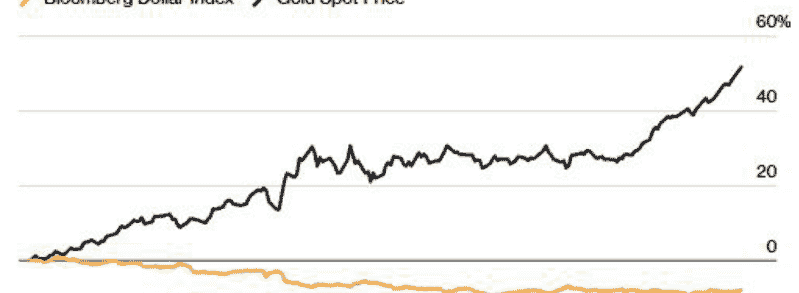

数据来源：财联社
注：数据下半一：20的星期二

达里莱表示，国人工智能的预测具有泡沫的特征，并与过去的创新热潮相提并论，从1920 年后的后的专利活动和技术突破助长了投机过去，到1990 年年代后期的互联网时代。

尽管如此，他表示，他仍然看到抓住人工智能优势的机遇，要是要通过使用它来提高效率的公司，要是那些将该技术提供平台的公司。他表示，尽管他对估值持保留态度，但他仍会谨慎对押注大型科技公司持谨慎态度。

“我不想做过大规模模型，”他说。

在国际上，达里莱表示他仍然喜欢中国。但他表示，他在美国的投资“金额更大”。

“认为，两者都有其挑战和好处，”他说。“如果我看着中国，它相对便宜——但与此同时，资本流动和其他问题使它成为一个问题。”

## 人工智能的要点

- 投资者持有新兴市场主美国债券而不是美国国债所需的额外收益率缩减至七年来的最低值。
- 全球投资者正在向新兴市场注入资金，以分散投资，远离美国资产，并从风险较高的证券中获得更高的收益率。
- 新兴市场主权债券在2025 年为投资者带来了接近 10% 的回报，这是自2019 年年初至初的最佳表现。

投资者持有新兴市场主权债券而不是美国国债所需的额外收益率已减至七年来的最低值——而且有望将进一步持续。

摩根大通的数据显示，周一，收益率购入者已将所谓的新兴市场风险溢价降至278 个基点。这是自2018 年美紧张荣发以来资产类别的风险溢险最低。

### EM Risk Premium Shrinks
Extra yield over Treasuries is toughest since February 2018

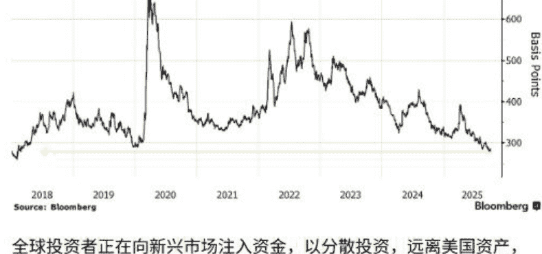

全球投资者正在向新兴市场注入资金，以分散投资，远离美国资产，并从风险较高的证券中获得更高的收益率。重点是在美联储的宽宽松政策降低全球收益率之前锁定当前的回报。

垃圾级借款人的劣优为盈、信用评级上调以及包括公共债务比率在内的基本面稳定也有助于新兴市场债券的反弹。

### Exhibit 1: We Raise Our Dec2006 Gold Price Forecast to $4,900/toz (vs. $4,300 Prior)

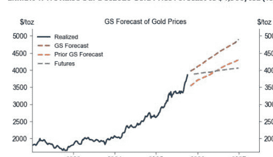

Source: Bloomberg, Goldman Sachs Global Investment Research

### Exhibit 2: Western ETF Inflows - A Key Driver Of the Rally Since Late August - Is a Stickier High-Conviction Holder In Our Pricing Framework

Source: Bloomberg, Goldman Sachs Global Investment Research

### Gold on track for strongest year in nearly a century

% change in gold price compared to every year since 1979

FINANCIAL TIMES

FT: 欧洲时尚行业表示，美国海关的效应正在削减欧洲来自 Temu 和 Shein 等线上卖者的包裹数量进展较缓。2025 年上半年，欧洲进口的服装和纺织品在价值和数量上同比增长 20%。中国对欧洲纺织品出口额约770 亿元，提供万岗位，或受到冲击。

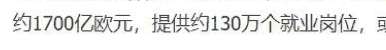

### EU imports from China grew 20% in the first half of 2025

compared with first half of 2024

- Imports in value terms (€)
- Import volume (by weight)

Top five trading partners ranked by size of trade
Source: Eurostat

EU trade in textiles and clothes 柱状图（百分比）：2025 年上半年与2024 年上半年对比，显示中国进口增长 20%。

南华：在美国更严苛的签证规定下，中国和印度的签证下降，导致前往美国的亚洲学生人数下降。

### International students in US drop 24%

中国是美国最大的国际学生来源，但数据显示 2024 年留学生人数减少了 44%。此外，2024 年期间，印度留学生人数减少了 57%。

中国和印度是最大的国际学生来源，分别有 86,000 人。与去年8 月相比，这两个国家都大幅下降——中国下降 2.4%，印度下降 44.5%。整体而言，与2024 年8 月相比，进入美国的学生人数下降 19.1%，从 387,000 人下降到 313,000 人。

非洲、南美和中东其他地区也下降了 7.7%。非洲是增长学生最多的地区，下降了三分之一。

大学接纳了超过 100 万国际学生，尤其是来自中国的学生。这是目前两个信号。马库奥（Marco Rubio）表示，他的签证可能会损害美国科学、技术、数字（STEM）领域的竞争力。根据华盛顿的非营利组织 NAFS 的数据，学生人数可能下降 30% 至 40%，从而导致当地经济损失 70 亿美元。支出的优化可以减少收入不平等...

同时 GDP 的 1% 用于人力资本投资，例如升级教育系统，重要的事，使公共薪酬保持与市场基准一致，尤其是在公共部门比市场经营部门工资高出 10% 或更多的发展中经济体。可以减少 60,000 个岗位。

Jason 不磊
2025-10-08 02:59

### 经济观察：今年二季度，中国跨境交易人民币占比超过美元。

国际货币基金（IMF）报告中显示，自2024 年以来，由于美元走强，中国在国际储备中的占比下降。2023 年，中国在全球国际储备中的占比为 2.3%，到2024 年下降至 2.1%。该报告称，中国正在进行“资产配置”以多元化储备，以应对国际风险，增加其国际化进程。该报告指出，人民币将不再减少。

### 活跃率的变化，关注二季度，中国跨境交易人民币占比超过美元。

IMF: 我们在最新的《财政监测》中对174 个经济体进行了分析，结果显示，如果能够通过优化支出更好地分配资源，新兴市场和发展中经济体可以将产出增加 1%，发达经济可以增加 4%。

什么是更好的支出？许多国家面临高昂的公共工资负担，占总支出的四分之一。这个就可以减少，使公共薪酬保持与市场基准一致，尤其是在公共部门比市场经营部门工资高出 10% 或更多的发展中经济体。同时 GDP 的 1% 用于人力资本投资，例如升级教育系统，重要的事，支持支出的优化可以减少收入不平等...

如此，折射出这个时代的内在。今年二季度，中国跨境交易人民币占比首次超过美元。

中国人民大学国际研究所（IMI）在交通银行、商务部的支持下，2024 年以来进行了四次企业跨境使用人民币的调查（每个季度收到的金额在 1090—1793 之间）。调查结果显示，越来越多的访企在第三国贸易伙伴交易中，主要要求人民币结算。其中，2024 年以来，68% 的访企使用人民币进行跨境结算，40% 的访企在第三国交易中使用人民币，71% 的访企将其作为首要考虑。

在美元、欧元、人民币跨境支付系统（CIPS）的竞争下，人民币国际化将迎来十年，人民币国际化进程可能从“被动多元货币”向“主动”向全球货币体系重构。中国人民大学对外金融学教授沈永红的研究以大量企业微观数据为基础，呈现了这一趋势的底层与制约因素。市场的选择是在资金流向上的，依靠制度层面的选择“铺路”，旨在构建“好用且有温度的金融生态。

Jason不错
2025-10-08 03:06

### 达里豪：黄金“肯定”美元更像是一种避风港，而黄金创的纪录的反弹与 1970 年代相应

达里豪表示，在政府负债上升、地缘政治加剧以及对本国稳定信心得到捍卫之时，他认为黄金是强大的价值储存手段。

他对股市近期上的涨维持保留态度，称圈内人工智能的具有泡沫的特征，并与过去的创新热潮相似其逻辑。

亿万富翁·达里豪 (Ray Dalio) 表示，黄金“肯定”比美元更是一种避风港，其金属记录的反弹与 1970 年代相应，当时它在高通胀和经济不稳定时期倾飙。

对冲基金桥柳水联合公司 (Bridgewater Associates) 的创始人达里豪在周二出席一次会议发表了上述言论，当时他被问及是否同意 Citadel 的肯·格里芬 (Ken Griffin) 的观点，即黄金的上涨反映了美国的焦虑。

> 黄金是投资组合中非常出色的多元化工具，”达里豪在康狄州格林威经济论坛上与彭博的丽逊·阿布拉莫维奇 (Lisa Abramowicz)的小组讨论中表示：“因此，如果你仅从战略资产配置的角度来看，你可能会大约 15% 的黄金投资组合作为最佳组合。

达里莱表示，国人工智能的预测具有泡沫的特征，并与过去的创新热潮相提并论，从1920 年代的后的专利活动和技术突破助长了投机过去，到1990 年代的后期的互联网时代。

尽管如此，他表示，他仍然看到抓住人工智能优势的机遇，要是要通过使用它来提高效率的公司，要是那些将该技术提供平台的公司。他表示，尽管他对估值持保留态度，但他仍会谨慎对押注大型科技公司持谨慎态度。

“我不想做过大规模模型，”他说。

在国际上，达里莱表示他仍然喜欢中国。但他表示，他在美国的投资“金额更大”。

“认为，两者都有其挑战和好处，”他说。“如果我看着中国，它相对便宜——但与此同时，资本流动和其他问题使它成为一个问题。”

## 人工智能的要点

数据来源：财联社
注：数据下半一：20的星期二

- 投资者持有新兴市场主美国债券而不是美国国债所需的额外收益率缩减至七年来的最低值
- 全球投资者正在向新兴市场注入资金，以分散投资，远离美国资产，并从风险较高的证券中获得更高的收益率。
- 新兴市场主权债券在2025 年为投资者带来了接近 10%的回报，这是自2019 年年初至初的最佳表现。

投资者持有新兴市场主权债券而不是美国国债所需的额外收益率已减至七年来的最低值——而且有望将进一步持续。

摩根大通的数据显示，周一，收益率购入者已将所谓的新兴市场风险溢价降至278 个基点。这是自2018 年美紧张罗荣发以来资产类别的风险溢险最低。

### EM Risk Premium Shrinks
Extra yield over Treasuries is toughest since February 2018

全球投资者正在向新兴市场注入资金，以分散投资，远离美国资产，并从风险较高的证券中获得更高的收益率。重点是在美联储的宽宽松政策降低全球收益率之前锁定当前的回报。

垃圾级借款人的劣优为盈、信用评级上调以及包括公共债务比率在内的基本面稳定也有助于新兴市场债券的反弹。

### Exhibit 1: We Raise Our Dec2006 Gold Price Forecast to $4,900/toz (vs. $4,300 Prior)

Source: Bloomberg, Goldman Sachs Global Investment Research

### Exhibit 2: Western ETF Inflows - A Key Driver Of the Rally Since Late August - Is a Stickier High-Conviction Holder In Our Pricing Framework

Source: Bloomberg, Goldman Sachs Global Investment Research

### Gold on track for strongest year in nearly half a century

% change in gold price compared to every year since 1979

FINANCIAL TIMES

Source: LSEG; FT calculations for each year runs to October

FT: 时尚行业表示，美国海关的效应正在削减欧洲来自 Temu 和 Shein 等线上卖者的包裹数量进展较缓。2025 年上半年，欧洲进口的服装和纺织品在价值和数量上同比增长 20%。中国对欧洲纺织品出口额约770 亿元，提供万岗位，或受到冲击。

### EU imports from China grew 20% in the first half of 2025

compared with first half of 2024

- Imports in value terms (€)
- Import volume (by weight)

Top five trading partners ranked by size of trade
Source: Eurostat

### 南华：在美国更严苛的签证规定下，中国和印度的签证下降，导致前往美国的亚洲学生人数下降。

中国是美国最大的国际学生来源，但数据显示 2024 年留学生人数减少了 44%。此外，2024 年期间，印度留学生人数减少了 57%。

### International students in US drop 24%

中国和印度是最大的国际学生来源，分别有 86,000 人。与去年8 月相比，这两个国家都大幅下降——中国下降 2.4%，印度下降 44.5%。整体而言，与2024 年8 月相比，进入美国的学生人数下降 19.1%，从 387,000 人下降到313,000 人。

非洲、南美和中东其他地区也下降了 7.7%。非洲是增长学生最多的地区，下降了三分之一。

大学接纳了超过 100 万国际学生，尤其是来自中国的学生。这是目前两个信号。马库奥（Marco Rubio）表示，他的签证可能会损害美国科学、技术、数字（STEM）领域的竞争力。根据华盛顿的非营利组织 NAFS 的数据，学生人数可能下降 30% 至 40%，从而导致当地经济损失 70 亿美元。

### 经济观察：今年二季度，中国跨境交易人民币占比超过美元。

国际货币基金（IMF）报告中显示，自2024 年以来，由于美元走强，中国在国际储备中的占比下降。2023 年，中国在全球国际储备中的占比为 2.3%，到2024 年下降至 2.1%。该报告称，中国正在进行“资产配置”以多元化储备，以应对国际风险，增加其国际化进程。该报告指出，人民币将不再减少。

### 活跃率的变化，关注二季度，中国跨境交易人民币占比超过美元。

IMF: 我们在最新的《财政监测》中对174 个经济体进行了分析，结果显示，如果能够通过优化支出更好地分配资源，新兴市场和发展中经济体可以将产出增加1%，发达经济可以增加4%。

什么是更好的支出？许多国家面临高昂的公共工资负担，占总支出的四分之一。这个就可以减少，使公共薪酬保持与市场基准一致，尤其是在公共部门比市场经营部门工资高出 10% 或更多的发展中经济体。同时 GDP 的 1% 用于人力资本投资，例如升级教育系统，重要的事，支持支出的优化可以减少收入不平等...

### Governments can substantially increase the efficiency of spending

Spending efficiency gaps, percent

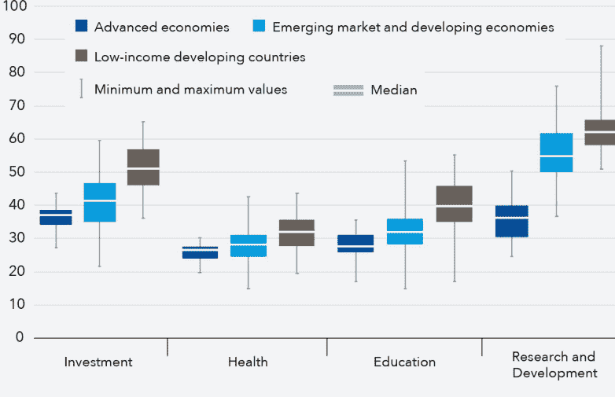

Source: IMF staff estimates. Note: The figure shows efficiency gaps, which are distances between the spending efficiency frontier. Efficiency gaps range from 0 (fully efficient) to 100 (fully inefficient). The figure shows averages from 1980 to 2023. The boxes indicate medians and interquartile ranges (25th–75th percentiles).

### Silver-to-Dow Ratio

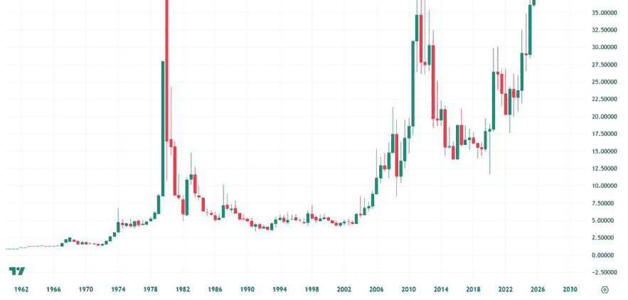

### Silver-to-Dow Ratio

### Silver-to-Dow Ratio

### Silver-to-Dow Ratio

### Silver-to-Dow Ratio

### Silver-to-Dow Ratio

### Silver-to-Dow Ratio

## J.P.Morgan

Asia Pacific Economic Research
07 October 2025

## China: FX reserves posted modest upside surprise favor CNY

Event month ahead to favor CNY

- FX reserves slightly exceeded expectations, rising US$16.5bn to US$3378bn, likely reflecting an elevated current account surplus or weaker imports than initially assumed.
- Assuming an elevated current account surplus of US$73.5bn, the capital outflow is estimated at US$33.2bn.
- An eventful October—including policy bank tools, 4th Plenary for interest, and a positive Trump-Xi sentiment in Korea—will favor CNY.
- Net settlement amount nearly dropped unexpectedly by $4.9bn, signaling a rebound in exporters' delollarization despite USD consolidation.

Emerging Markets Asia, Economic and Policy Research

Tington Ge
(852) 2900-2143
tington.ge@jpm.com

Tingliang Yuan
(852) 2500-8000
tingliang.yuan@jpm.com
JP Morgan Chase Bank, N.A., Hong Kong

Another month of modest upside in FX reserves was accompanied by continued gold purchases. In August, FX reserves rose to slightly above expected levels from US$3362bn to US$3378bn (versus JPM Morgan's forecast and market consensus of US$337bn). This outcome suggests either modest surprise for exporters or weaker imports than initially assumed. Assuming an elevated current account surplus along with a stronger valuation of yuan as the USD index remained range-bound, the preliminary estimate for implied capital outflow recorded a fourth consecutive month of net reduction in foreign holdings, with a decrease of US$19bn in August (versus US$42bn in June). Regarding gold reserves, the month saw an increase of 5.0bn in September, marking the 11th straight month of increases. Including price effects, gold reserves stood at US$283bn, at end-2022. In contrast, Treasury holdings continued to trend downward, reaching US$711bn, or 8.0% of total US foreign holdings (a peak of 22.3%).

Jason Chen
2022-10-04 01:05

花：黄金周期间（前6天）全国客运量同比+5%，高于预期。国期平均日客运量3.05亿人次，高于五一劳动的2.93亿人次。出游增长最快+5.8%，铁路/航班同比增长（+1.5%+3.7%）。长三角（上海、福建、重庆）表现强劲；南部、西部（广东、海南）的海口旺季和餐饮企业四天销售+3.3%。消费仍趋向理性，出游热门及入境，日均入境人数超过200万（+7% yoy），与五一期间平稳，香港/澳门游客入境增幅（+5.2% / +1.2%）。泰国亚游明显走弱，欧洲长线线路表现优。入境旅游趋势较劲，以上海为例，浦东机场入境外国游客客量同比+60%，主要来自美国、印度和俄罗斯。#经济数据

China Team
2022 National Year-End Report Travel Trends, Disaggregated

## China Tourism

2025 National Day Week: Resilient Travel Demand, Divergent Trend

CIT'S TAKE
We continue to see Chinese residents leisure demand during the National Day Week, nationwide passenger throughput up by 5% in the first six days of the holiday (1-6). We have mixed headway from regional data, with recent trend seen in Eastern China while Southern & Western China affected by unfavorable weather, which may translate into volatility across the nation. National retail and catering enterprises recorded sales growth of +3.3% in the first four days (1-4 Oct). Railbound spending is likely to persist, and within the sector, we see better performance at Aor Hotel.

Domestic: According to Ministry of Transportation, the nationwide throughput is expected to reach 18.3 million times during 1-6 Oct, up 5%, Ministry of Transportation estimated 23.5 million times during the holiday week, up 7.6% compared to the same period last year. The first six days of travel are already slightly ahead of the estimate, with average daily throughput at 30 million people, consequently up 29.3 million people per day. In transportation, the growth was mostly fueled by flight-driven (+5.8% while flight)/railway merely +1.9%. The higher domestic tourism looks short-haul or day trip driven. We see growth in Shanghai (+2.3% during 1-6 Oct), Beijing (+12.4% during 1-4 Oct), Nanjing & Hangzhou (+4.9% during 1-6 Oct), Guangdong & Shanghai (+3.1% during 1-6 Oct), while Sichuan (-4.8%) lagged due to adverse weather. The weather may also weigh on travel and day-trip demand. We see better performance in Hainan during the holiday.

Outbound: The recovery of outbound travel might come below investors high expectation. National Immigration Administration estimates the average daily cross-border passenger volume to exceed 2 million times during the holiday, up 76%, which looks unexpected to be ahead of 2.8 million peak times in HK-MAU (up 52% during 1-6 Oct), weak compared to Thailand and still cautious consumption sentiment. We expect better momentum in high-demand destinations like Thailand and Japan remains on top among short-haul destinations. National travel continues to emerge with hit destinations, inbound visitors via Shanghai Pudiao grew by -60% during 1-4 Oct, which come from South Korea, Japan and Russia.

> Jason Chen
2025-10-08

中国：十四五规划指标如预期，增速达成。预计十五五增长目标在4.5%~5.0%，以高质量发展为核心，增强协调与统一市场，并在政策上发力减税，消费更多转移至更广的领域。AI、先进制造、软件等领域将受益。需关注风险：经济数据

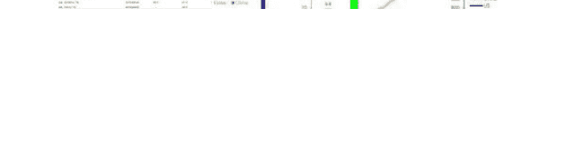

### Figure 1: Progress of 14th FYP and expected targets of 15th FYP

| Selected Indicator | Type | 14th FYP Target | 14th FYP Progress | 15th FYP Target |
| :--- | :--- | :--- | :--- | :--- |
| Economic Development | | (2025 to 2021) | (2024 to 2021) | (2026-30) |
| Average GDP growth (%) | Anticipated | (5.0-6.5 p.) | [5.5 p.] | (4.5-5.0 p.) |
| Share of total consumption in GDP (%) | Anticipated | 56.6 | 58.0 |
| Share of household consumption in GDP (%) | Anticipated | 39.9 | 43.0 |
| Urbanization rate, (%) | Anticipated | 65.0 | 70.0 |
| Urbanization rate (absolute) | Anticipated | 49.0 | |
| Innovation & Technology Development | | | | |
| R&D expenditures as % of GDP | Anticipated | 14th FYP > 13th FYP | 2.7 | 3.2 |
| Average R&D growth rate | Anticipated | [~X] | [10.3 b.] | [~X] |
| Authorized high-value patent per 10,000 population (unit) | Obligatory | 11.2 | 11.8 |
| Share of core industry in GDP (%) | Obligatory | 14.0 | 18.0 | |
| Environment & Resources | | | | |
| Non-fossil energy share in electricity generation (%) | Obligatory | 20.0 | 25.0 |
| Reduction of energy use per unit of GDP, (%) | Obligatory | 16.0 | [21.6] | [12.0] |
| Reduction of CO2 emission per unit of GDP, (%) | Obligatory | [13.5] | [11.8] | [~24.0] |
| Days with good air quality at preferable or above level, (%) | Obligatory | 87.5 | 67.2 | 90.0 |
| People's Welfare | | | | |
| Average growth of household income per capita, (%) | | At GDP growth | [5.5 p.] | At GDP growth |
| Surveyed unemployment rate (%) | | [~5] | [5.3] | [~5.5] |
| Increase of life expectancy (years, accumulated) | | [1.0] | [1.1] | [1.0] |
| Number of practicing physicians per 1,000 population | Obligatory | 3.2 | 3.6 | 4.0 |
| Participation rate of urban basic services (%) | Obligatory | 90.0 | 95.0 | >95.0 |

Source: CEIC, official documents, UBS estimates. Number in [ ] are average or actual readings during the corresponding period.

### Figure 2: China's GDP per capita is likely to reach $14,000 in 2025, with an ambitious goal of $25,000-30,000 by 2035

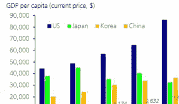

Source: CEIC, UBS estimates

### Figure 3: China may have an implicit GDP growth target at 4.5-5.0 during the 15th FYP (2026-30)

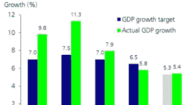

Source: CEIC, UBS estimates. China has no explicit growth target for the 14th FYE and the target number is the average of actual growth during 2021-25.

## 深度视野文集
进群微信cuk55

### Figure 4: China's R&D expenditure increased notably to 2.27% in 2024 and may rise further to 3.2% in 2030

R&D expenditure in GDP (%)

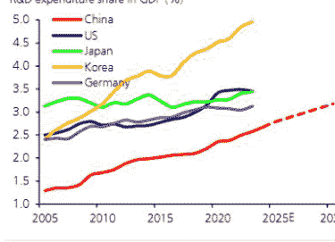

Source: CEIC, UBS estimates

### Figure 5: China's total scale of R&D expenditure is only below the US level

R&D expenditure ($Bn, PPP, 2020p)

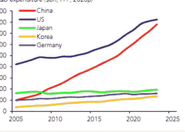

Source: CEIC, UBS estimates

### Figure 6: China's total consumption share may increase by another $3-4 by 2030 from 2025

Consumption (in GDP, $ current price)

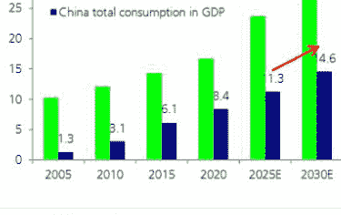

Source: CEIC, UBS estimates

### Figure 7: China's household consumption share in GDP is set to increase modestly during 2026-30

Share in GDP (%)

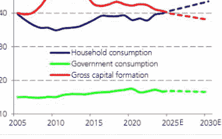

Source: CEIC, UBS estimates

### Figure 8: China's two basic pension programs covered 1 bn population

Coverage of basic pension (Person million)

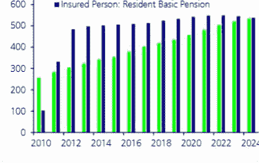

Source: CEIC, UBS estimates

### Figure 9: Payout of staff basic pension is 15 times greater than that of resident basic pension

Payout level of basic pension (RMB person per year)

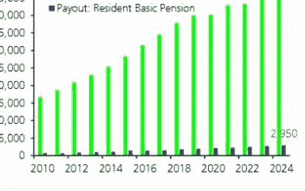

Source: CEIC, UBS estimates

### Figure 10: Anti-involution campaign amid lower capacity utilization rate and PPI deflation

### Figure 11: China's FDI notably declined in recent years and is expected to recover with further opening-up

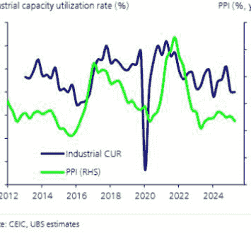

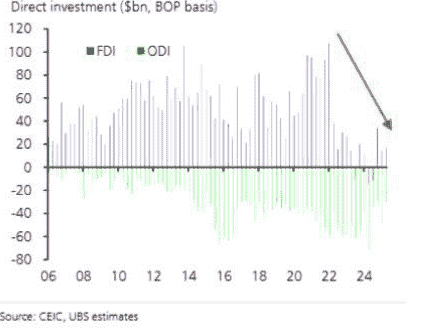

Source: CEIC, UBI estimates

Source: CEIC, UBI estimates

Jason-Bialn
2025-10-08

Bloomberg: 新西兰利率下调50个基点，并表示在经济增长的情况下，对新西兰实施严厉需求保持开放态度。宣布后，新西兰美元下降1%，对政策敏感的两年期债券收益率下降7个基点至2.65%。

新西兰元是过去10月中表现糟糕的G12货币美元，由于新西兰松宽松政策超过其市场，新西兰元下跌6.4%。去年8月以来，它已跌势积累125个基点。相比之下，澳大利亚储蓄银行仅将其基准下调了75个基点。#其他国家经济

## RBNZ Opts For Larger Rate Cut to Revive Economy
### Policymakers are open to further reductions

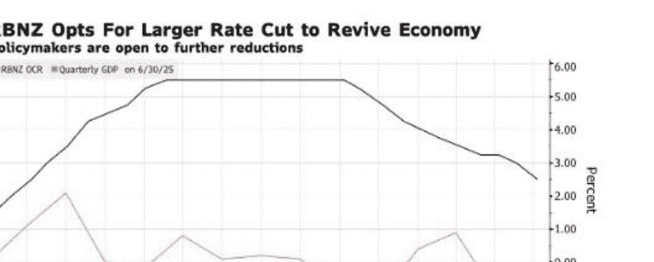

Source: RBNZ

Bloomberg

## 深度视野优质集圈（链接优质社群，助你成功）

全部包含以下内容：限时费188/年 加微信cuk255

- ① 吃瓜群众包帝微信加时群群对话（原价 365 元/年）
- ② 子明私享汇（含）内部文章
- ③ 政事室（顾子明）付费内容加送逐顺子明群
- ④ 米联诸闲闲【作者米横】（原价 599 元/年）
- ⑤ 欧洲金雀会员专属文章（原价 328 元/年）
- ⑥ 砖万瓦内部圈（原价 400 元/年）
- ⑦ 卢克文青读书会专属文章（原价 699 元/年）
- ⑧ 鉴茶财经知识星球（原价 3310 元/年）
- ⑨ 猫哥的视界知识星球文章（原价 299 元/年）
- 十 财经周刊【独家新闻】原价 1498 元/年）
- 十一 杨世在金钱圈（原价 2200 元/年）
- 十二 森淼财经知识星球（原价 1600 元/年）
- 十三 激泽异读付费文章（持续更新）
- 十四 司马林解读猛选全套音频和全套书籍收藏版无割（原价 2.3 万）
- 十五 虚走三部[民国梦、帝国战争、不被理解的 MAO]（原价 599 元）
- 十六 卢克文知识星球文章（原价 268 元/年）
- 十七 额外再送：卢祺元新浪微铂付费专栏、三村丰老王、三花九洞文集

不定内容：——（更多资源写下了......）

- ① 守夜人司令知识星球、接换魔王知识星球、成就术论星球、成就财富、雪花花甲老头等
- ② 创世佳人、达叔谈论星球、成术财富圈
- ③ A 视野、大树乡谈、江宁付后、泮咩说、财上海海家学等付费文集
- ④ 西凤付费文章、老端、赢在八小时之外、局外的视界、升值、老A制内等其它大 V 付费文集（每月不低于 600 元的付费文集）

限时费188/年 低成本链接全网V优质内容

## 深度视野文集
进群微信cuk255

深度视野（付费文集）

