# 南半球联财经251012

Jason不离
2025-10-12 02:21

BCA: 欧洲的人口面临老龄化。在德国，55至64岁的人口比15至24岁的人多70%。谁支付他们的医疗保障和养老金？基于技能的移民制度会有帮助，但与欧洲的制度相反。根据整合组的数据，该地区大部分地区的移民劳动力市场参与率低于本地出生的人。教育成就也差，即使是第二代移民如此，其他国家经济。

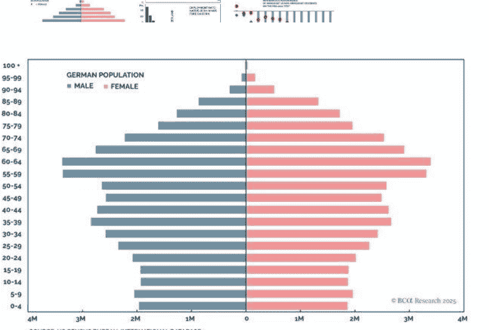

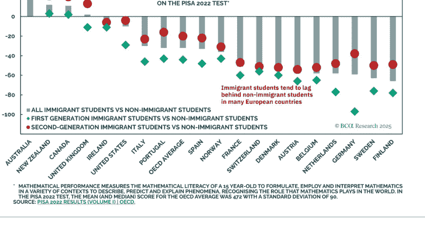

## LABOR FORCE PARTICIPATION RATE: NATIVE-BORN MINUS FOREIGN-BORN

| NETHERLANDS | GERMANY | FRANCE | NORWAY | BELGIUM | SWITZERLAND | DENMARK | AUSTR | AUSTRALIA | SWEDEN | NEW ZEALAND | US | JAPAN | CANADA | GREECE | SPAIN | POLAND | ITALY | CZECHIA | PORTUGAL |
|---|---|---|---|---|---|---|---|---|---|---|---|---|---|---|---|---|---|---|---||

## EMPLOYMENT RATE: NATIVE-BORN MINUS FOREIGN-BORN

| NETHERLANDS | GERMANY | SWEDEN | NORWAY | FINLAND | BELGIUM | AUSTRIA | DENMARK | AUSTRALIA | SPAIN | CANADA | JAPAN | UK | GREECE | ITALY | POLAND | US | NEW ZEALAND | CZECHIA | PORTUGAL |
|---|---|---|---|---|---|---|---|---|---|---|---|---|---|---|---|---|---|---|---|

| NEW ZEALAND | AUSTRALIA | US | JAPAN | CANADA | POLAND | PORTUGAL | NETHERLANDS | GERMANY | SWITZERLAND | DENMARK | EUZT | FRANCE | GREECE | BELGIUM | NORWAY | SPAIN | AUSTRALIA | FINLAND | SWEDEN |
|---|---|---|---|---|---|---|---|---|---|---|---|---|---|---|---|---|---|---|---|

## UNEMPLOYMENT RATE: NATIVE-BORN MINUS FOREIGN-BORN

© BCO Research 2025

SOURCE: OCED INTERNATIONAL MIGRATION OUTLOOK (2024).
NOTE: DATA AS OF 2023, EXCEPT FOR JAPAN, WHERE DATA REFERS TO 2020.

# Jason不遇

2025-10-12 02:30

## 国信：复盘4月美股冲击对资产价格影响#金融

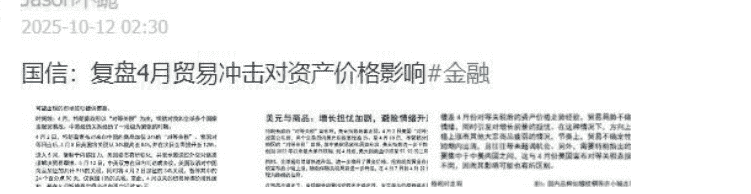

### 核心观点

进入四季度，中美贸易问题进入新一轮紧密对峙。总体而言，中国贸易往来的中长期不确定性依然较高，当下不利对4月-5月中贸易交易的主要因素依然存在，并复盘这一时期商品及资产价格走势，对后续可能的市场波动提供借鉴。

时间线：4月，特朗普宣布“对等关税”，猛然和我全球多个国家发起贸易战。中美贸易经历了一段较为频繁的波动。

4月2日，美方宣布对中国商品加征34%的“对等关税”。我国对等回应后，4月8日美国对华关税从36%提高到84%，并在国内提升至125%。

进入5月，内部面临压力，美国政府开始软化，并表示通过对话解决贸易摩擦。美国取消对中国商品加征的91%的关税，将对4月2日加征的34%关税，暂停中的24个百分点回落，仅保留10%的关税。此外，从4月以来的美国贸易摩擦进入阶段性维持。

### 美元与商品：增长堪忧，避险情绪上升

贸易不确定性成为全球增长最大的拖累。避险情绪回升。

美国政府宣布“对等关税”后，美元指数强势走强。同时，全球避险情绪加速上升，进一步提升了市场信心，在贸易压力下，全球增长呈现出不确定性，大宗商品表现较弱，全球商品价格波动幅度大于国内商品。

未来，贸易压力持续向上，容易出现全球商品价格和其他资产价格波动。由于贸易政策带来的影响往往在短期内持续，且可能出现转机。当前贸易摩擦主要集中在中两国之间，我们以4月份对华关税等直接冲击资产的情况有所不同。

### 股市展望：基本面支撑，债市收益率波动性增强

4月美债收益率下跌近18BP。参考上月中中美贸易经历升级后，突发关税和制裁条件市场会快速定价。4月份关税政策发布后两个交易日市场出现了5BP的震荡，随后债市继续加强加制制，反映在债市上的影响逐渐减弱。

前景来看，我们对10月份股市反弹概率更大。首先，7月和8月全球经济运行压力较大，国内政策转向有望延续。其次，当前10-1期限利率维持40BP，处于历史中位上方，反映了一个中性的经济预期，在货币政策的背景下持续上行阻力加大。再次，A股出现结构性的特征，债市对股市的抑制压力已然缓解。

### 美元与商品：增长堪忧，避险情绪上升

特朗普政府宣布，美元指数显示，4月2日受“对等美元”政策影响，在交易日内反弹2%。延至4月6日，由于获利回结和“对等美元”暂停的影响，继回落，美元指数跌近3%，创2012年最低水平。4月4日，美元指数创97.92的三月低点。全球市场加速回升，进一步推升了黄金价格。由于美元汇率回落，避险情绪推动股市回升，在4月7日至4月22日出现了底部。

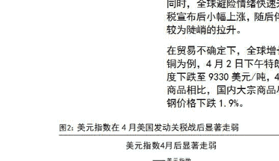
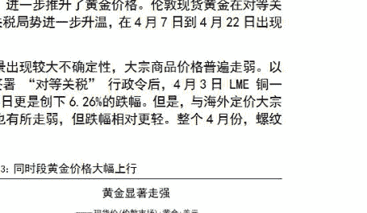

由于美元对风险的影响减弱，市场仍在对确定性直接推升，同时引发对增长的担忧。在这种情况下，向上动力容易出现暴卖，其他大宗商品则维持弱势。趋势上，不确定性带来的波动往往在短期内出清，且往往带来机会。此外，特别指出的是，当前黄金表现主要集中于两国之间，与4月份对华关税等直接冲击资产的情况，其影响可能有所别。

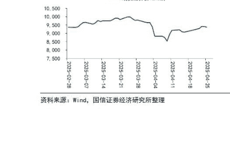
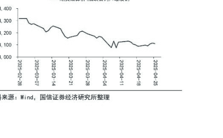

### 图6：4月初等关税前后主要资产涨幅
### 4月初等关税前后主要类资产表现

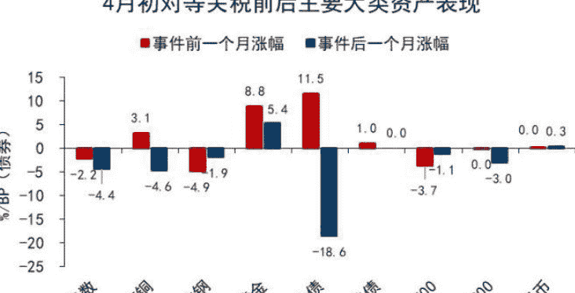

资料来源：Wind，国泰证券整理。注：美国收益率。

### 展望：基本面压力，债市有望阶段性反弹

参考上轮中美摩擦经验来看，关税及制裁事件对债市场的冲击速度快。4月关税政策发布后两个交易日债市出现了超过5BP的波动，随着中美贸易领域博弈加剧，反映在债市上的影响趋于弱。

前瞻来看，我们认为10月份股市反弹概率更大。首先，7月和8月全球经济运行压力较大，国内政策转向有望延续。其次，当前10-1期限利差维持40BP，处于历史中位上方，反映了一个中性的经济预期。在货币政策稳定的背景下持续上行压力加大。再次，A股依然呈现结构性的特征，债市对股市的抑制已然减弱。

### 图1：国泰证券债券测算
### 图2：期货相关性分析
### 每月实际增速测算

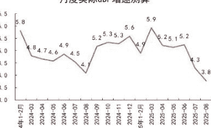

### 期货跌幅（30天）

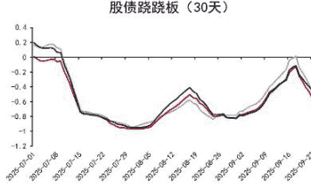

数据来源：Wind，国泰证券经济研究所

Jason 刘嵩
2025-10-12 02:35

## 银河：如何看待特朗普将稀土武器化？

事实上，5月12日国内宣布声明之后，中美贸易趋势总体上虽然进展缓慢，但美国在全球范围内调整了对华贸易战略。9月8日，美国能源公司（USB）与巴西签署豁免协议，共同开发战略业务，包括投资和缓解紧张环境。9月12日，23个美国贸易行业出现迹象，早下降，AI技术板块反弹。9月中，对中国汽车、太阳能、家居、钢铁领域缩减25%~100%。

### 特朗普的关税武器

关税将成为美国竞争的战略。通过关税和贸易政策削弱中国制造业优势，美国可能通过提高关税增加中国产品成本，从而迫使中国对贸易做出调整。然而，稀土是至关重要的资源之一，被视为全球工业的“喉脖”。稀土是高科技和战略工业的优质原材料，自身高度依赖进口，中国可能通过关口直接控制来维持供应链的稳定。如此，关税将成为特朗普的另一个关税武器？

### 特朗普会说“妥？”对我们吗？

特朗普将提到竞选前寻求解决问题。一方面，特朗普提到1月11日生效，考虑到1月后第二个9天关税缓冲期，以10月美国的PEC会议，关税的生效日期将由总统裁定。另一方面，如果他在社交媒体上表示未取消关税安排，并承认关税对稀土出口的限制性，他可能停止进一步提高关税。这种反复反反复的表态，正体现了特朗普曾用的谈判手法——以强硬姿态制造压力，再通过反复寻求空间。如此，提高100%关税的可能性较低，但不排除11月6日之后中美双方关系在谈判上出现可能。

### 如何看待中美后博弈？

重启关税，围绕口岸服务与出口管制等问题，阶段性缓和为后续调试。中美博弈强度出现蜕变，复杂性。前瞻来看，我们认为10月份股市反弹概率更大。首先，7月和8月全球经济运行压力较大，国内政策转向有望延续。其次，当前10-1期限利差维持40BP，处于历史中位上方，反映了一个中性的经济预期。在货币政策稳定的背景下持续上行压力加大。再次，A股依然呈现结构性的特征，债市对股市的抑制已然减弱。

### 市场影响几何

中国股市：A股或经历微波动，上行趋势不变，随市场切换。短期不确定性降低对资产偏好，前期盈利较大使得投资者重新审视。不过，我们仍然看好中国市场机会。其一，根据概率来看，关税面临压力，其基本面的影响有限；其二，政策空间仍较大，增量政策形势变化，未来有望迎来股市波动。

中国债券：预期向好，中期有望回归。短期，不确定性的上升将推动贬值风险增加，股市低迷对市场不利。第二，对于货币市场，债券有助于带动收益率的上升。我们还需要考虑财税政策加码，我们认为四季度国债收益将在1.65%~1.85%领先，先下后上或“V型”胜。

汇率：近期美国关税将可能成为重要影响因素，美元汇率的波动为7.1-7.2。如果美国再次出现波动，将人民币汇率造成一定的贬值压力。特别是特朗普政府关税政策的反复效应也会发酵，美元的贬值，叠加人民币的优势，从进入为强势的选择，选择都导致。

### 中国证券|CSG

近期，市场回暖后流动性依然充裕，能够有效管理市场预期。央行在多次行动后建立了良好的信用，这有助于市场实现收益目标，建立起人民币市场的信心。近期，我们认为央行的政策将进一步加码，短期内人民币市场预期将更加乐观，年底的季节性行情无法维持。

美股：股市的波动很大源于近期特朗普关税言论与政治风险的叠加，加剧了震荡后的维持预期，短期将压制制造业，而政策的推延至年底带来了不确定性的数据，以及潜在的永久性减损使得投资者收益将遭受反复影响。在此背景下，美股的情绪重心或在中期修复。市场而言，美股的心的修复可能需要科技支撑。

科技板块：AI的长期逻辑未变。虽然短期面临估值压力，但2023年是AI爆发的年，业绩有望超市场预期的水平，已处于历史高位。如果市场环境时间持续，或AI的风险将不再显现，高估值可能面临调整。从长期逻辑来看，美股的底部有望逐步实现“刚需回归”。

经济政策：财政政策维持稳健，美国国家与企业政府负债表表现尚稳，对于经济增长将维持一定，若政策继续向目标回归，美股具有良好的弹性。通过政策来影响经济预期。从市场对市场支撑，值得注意的是关税政策的复发可能导致关税政策的不确定性在影响美股增长的信心。

# Jason-Down

2023-10-12

国泰证券：房价，单靠租金回报升到历史高是一个漫长的过程。这几年有一个大的规律，只要租金回报升远高于债利率，房价就会上涨。我们可以看到海外的经历证实未必成立，比如在2007年进入滞后周期，到2012年结束。在此期间，债利率跌至2%以下，而租金升至6%左右。为什么美国租金回报远高于债利率？日本从1991年开始滞后周期，到2004年结束。在此期间，债利率大幅下降至1%以下，而东京的租金回报提供了5%以上的对于日本而言，泡沫没有破裂。我们认为由于房子属于“租金驱动”属性，租金回报决定了房价，是变动。当租金是资本价值的时候，只会看到租金回报高了，房价就可以上涨。不仅利率高，还需要看房价的波动的风险很大，取决于投资者的使用，并不是租金足够就能涨的。例如在2019年写一篇文章，“涨即平”，其实有类似的道理，如果房价没有涨，预期租金回报需要覆盖可能的下跌，持有房产占用的资金，房子每年维护的费用，每年要交的物业费，需要租金回报有多高，每个国家，每个城市不一样，投资者可以自行测。

### 美国租金回报 VS利率（%）

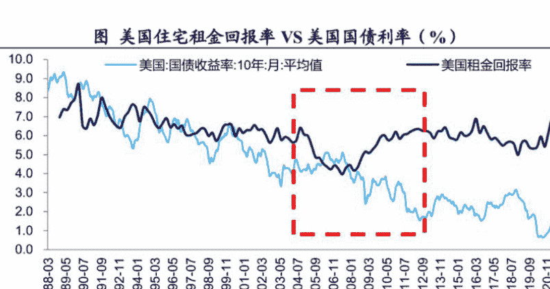

数据来源：CEIC，国泰证券

### 日本东京的房价/租金比（倍）

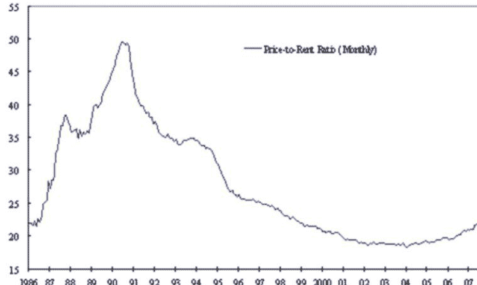

数据来源：Kiyoko Nishimura, Deputy Governor of the Bank of Japan (2010), 国泰证券研究

### 在房价调整前后，海外体的房价/租金比变化（设定房价最高点为100）

- United States 2007/3
- Ireland 2007/6
- Portugal 2007/9
- Spain 2006/8
- Greece 2008/5
- Netherlands 1978/6
- Denmark 1986/6
- Norway 1988/8/9
- Finland 1989/9
- Switzerland 1989/12
- South Korea 1991/6
- Japan 1991/3

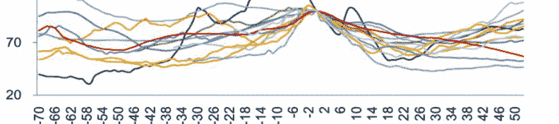

数据来源：CEIC, 国泰证券研究

### 我国房价/租金比有所回落（倍）

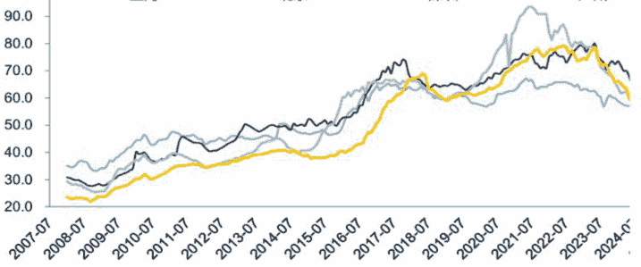

# Jason不勉

2025-10-12 03:01

阿亚福：从2024年起，中国老年人口比重是否超过少人口比重？取决于“老年人口”的界定是60岁以上老人还是65岁以上。如果老年人口是60岁以上，中国的老年人口比重早就超过少人口比重；如果老年人口是65岁以上，中国的老年人口比重还没超过少人口比重，但这两者的比重已经非常接近（老年人口比重为15.6%，少人口比重为15.8%）。预计在2025年（最近在2026年），中国65岁以上老年人口比重

## 2000-2024年中国少年人口和老年人口数量及比重

| 年份 | 人数（万人） | 比重% | 人数（万人） | 比重% |
|---|---|---|---|---|
| 2000 | 29012 | 22.9 | 8821 | 7.0 |
| 2001 | 28716 | 22.5 | 9062 | 7.1 |
| 2002 | 28774 | 22.4 | 9377 | 7.3 |
| 2003 | 28559 | 22.1 | 9692 | 7.5 |
| 2004 | 27947 | 21.5 | 9857 | 7.6 |
| 2005 | 26504 | 20.3 | 10055 | 7.7 |
| 2006 | 25961 | 19.8 | 10419 | 7.9 |
| 2007 | 25660 | 19.4 | 10636 | 8.1 |
| 2008 | 25166 | 19.0 | 10956 | 8.3 |
| 2009 | 24659 | 18.5 | 11307 | 8.5 |
| 2010 | 22259 | 16.6 | 11894 | 8.9 |
| 2011 | 22261 | 16.5 | 12277 | 9.1 |
| 2012 | 22427 | 16.5 | 12777 | 9.4 |
| 2013 | 22423 | 16.4 | 13262 | 9.7 |
| 2014 | 22712 | 16.5 | 13902 | 10.1 |
| 2015 | 22824 | 16.5 | 14524 | 10.5 |
| 2016 | 23252 | 16.7 | 15037 | 10.8 |
| 2017 | 23522 | 16.8 | 15961 | 11.4 |
| 2018 | 23751 | 16.9 | 16724 | 11.9 |
| 2019 | 23689 | 16.8 | 17767 | 12.6 |
| 2020 | 25277 | 17.9 | 19064 | 13.5 |
| 2021 | 24678 | 17.5 | 20056 | 14.2 |
| 2022 | 23908 | 16.9 | 20978 | 14.9 |
| 2023 | 23063 | 16.3 | 21676 | 15.4 |
| 2024 | 22240 | 15.8 | 22203 | 15.6 |

数据来源：国家统计局。制表：阿亚福

# Jason不离

2023-10-26 03:10

经济观察报：目前，我国实际纳税人占比还不到10%，更值得注意的是，工资所得的收益能力显著于资本红利。此外，高值人群的复杂资产配置对征监管构成挑战。“#TAX

## 个税如何在调整收入和税后收入分配中发挥重要作用？

9月10日，经济观察报聚焦个税改革相关问题专了金律师事务所合伙人叶永青，他认为，在当前的中国背景下，要共同共享红利与促进经济发展、提振消费的需求，个税改革的重要性亟待关注。关于提高起点，不少人认为起税年龄的税负担仍尚可以，且在持续的压力下，长期不提高起点并不合理；从提高个人收入、促进消费的角度出发，通过个税改革调节消费，扩大是中收入的量，减少中低收入群体税负负担，额外增加可支配收入，对提振消费具有立竿见影的效果。

叶永青认为，对高收入群体的税收力度仍在不断加强，这背后的原因在于：历史上，我国税制在对相关规律与政策方面尚不够对称，现行税制下，劳动所得最高适用45%的边际税率，而资本利（如股权转让、股息）适用20%的比例税率。更值得注意的是，工资所得的收益能力显著于资本红利。此外，高值人群的复杂资产配置对征监管构成挑战，其通过各种渠道将内外储蓄账户、离岸信托车辆、非上市公司股权、房地产增值等多个维度，现行税体系难以实现全面覆盖。

经济观察：这几年，调整税收起点、优化税率结构等改革总能引发广泛讨论？这些热闹背后的社会诉求是什么？

叶永青：税改改革的背后是经济、社会公平和税制现代化等因素的深度交织。这并非简单的“提高税起点”，更关乎国家治理体系的。主要原因包括以下几点：

首先，税收被认为是社会运行的重要组成部分，且与每个人的利益息相关，因此备受关注。在当前税收的大量背景下，基于收入相似性与促进经济发展、提振消费的需求，减少中低群体负担，直接增加其可收入，对提振消费有显著的效果。

2018年税收起点调整，兼顾居民生活消费（尤其是大城市的住房、教育、医疗）已成为需要。此外，我国的税收标准未能充分反映不同地区、不同家庭的实际差异及适应效应，因此引发的争议持续存在。

但是，需要的是，我国的税收起点对应的直接纳税人口的下降。目前，我国纳税人口占比不到10%，若进一步推进税收起点，税收的将逐步能够，从这个意义上，我国税改的长远方向，是建立更加、定型的综合与分类相结合的税制制度。这要求不仅要优化起点，还需要扩大综合范围，完善专项附加扣除项目（如子女教育、养老老人等），还需考虑与价格挂钩的动态调整机制。

综上所述，税改改革议的周期性出现，反映了经济发展、社会结构变化对税制提出的适应性要求，也是推进国家治理体系和治理现代化的具体体现。

## 经济观察：个税改革还有哪些需要完善的地方

叶永青：个税改革的一个重要方向，是推动其与财产税、赠税与遗产税形成完整的体系。

赠税与财产税是关键组成部分，从未来共富裕的整体目标出发，改变资产的简单继承也是重要的，这也是建立信任以及与其他税种的必要举措；另一方面，退税税（Exit Tax）对个人未实现收益的税收处理，面对未来国际布局与活动趋势，这种税种的立十分必要，退税税将开启或高离税，是美国对开放国家征税的措施，属于金融领域的税收制度。美国在20世纪60年代初期对申请人离国征收税，形成并与个税制度相互关联，有助于弥补资本流动与传输过程中的税制空白。

经济观察：在调整居民收入差异的过程中，个税改革承担着怎样的核心功能？其政策设计的主要方向是什么？

叶永青：个税在调节收入分配的核心目标，是通过优化个税制设计，有效缩小居民收入差距，促进社会公平，服务于共同富裕的国家战略。其政策导向是“调结构、扩口、提效率”的基本逻辑，具体体现在以下三个关联的层面：

强化以公平、调节量调节为原则。这一方向的核心是对高收入群体实施有效的收入调节，确保税负负担与纳税能力匹配。目前只有45%左右的超额进税率制度，是实现这一目标的必要载体。其立法本意是对高收入层部分适用更高的税率，强化再分配效应。未来改革的关键，在于确保改进制的实际实施，特别是在应对收入群体多元化、隐蔽化来源方面，需要不断完善征管机制，让税调节全面、精准覆盖各领域所得。

在控管技术方面，依托委托四期系统建立健全生命周期档案；整合银行、证券、资产凭证、监管管理等手段，直控监控超过五万的资金流动、海外金融账户超过100万美元的人民；控税地监控超过五万的离岸实体的境内居民；深化CRS（Common Reporting Standard，由OECD发布）交换。此外，反洗钱规则则是关键措施。税务机关规范化落实、家族信托、慈善基金的税收边界，以税收成为基础。

## 经济数据：今年个税收入增长与其他因素相关？

叶永青：今年个税收入增长的韧性，主要是“政策性减税率”（主要因素）和“制度性改革”（放大因素）的结果。一方面，过去一段时间，个税的境外所得进一步完善和调整；另一方面，在环境压力下，整体个税表现出。本书涵盖了直接税在调节收入分配方面，响应个税设计的政策初衷。这种分化趋势会逐步回归。

Bloomberg：美国百万富豪的数量已经超过40万，几乎占全国财富五分之一。其中三分之一是在2017年之后，得益于房价飙升。百万富豪的财富在快速变化，例如储蓄账户如401(k)和IRA账户。他们平均有66%的财富在住所和休息账户中；此外，2017年以后有了8%，500万美元以上的家庭平均有24%。这也是许多年轻人感受到的压力，他们认为万美元就能解决财务问题。

## Millionaire Households Are on the Rise

Share of US households over $1M in net worth

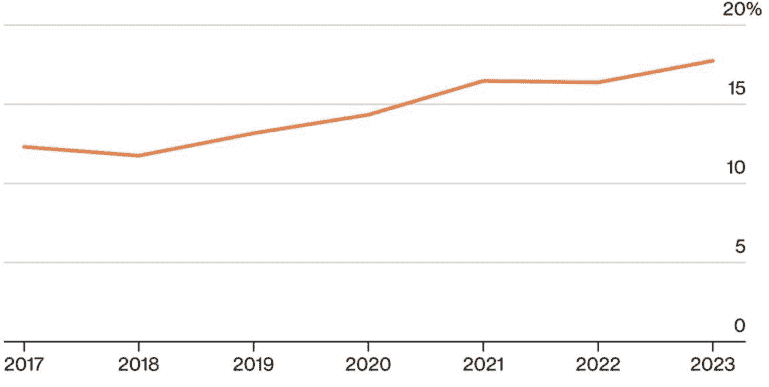
Source: US Census Bureau Survey of Income and Participation (SIPP)

## Wealthy Millionaires Have More Illiquid Assets

Share of wealth held in asset type by household's net worth, 2023

| Asset | $1M households have $1M–2M | $2M $2M–$5M | $5M+ |
|---|---|---|---|
| Business | 4% | | |
| Liquid assets | 17% | 22% | 24% |
| Retirement | 33% | 37% | 33% |
| Housing | 39% | 31% | 23% |

Source: US Census Bureau SIPP
Note: Liquid assets refer to bank accounts as well as stocks, mutual funds and bonds that can be readily sold.

## Gen X Added the Most Millionaire Households

Number of millionaire households 2017–2023

- Millennials: 2.6M (Born 1981-1996), The number of Millennial millionaires more quadrupled.
- Gen X: 7.2M (1965-1980)
- Baby Boomers: 2.6M (1946-1964)
- Silent Generation: 11.5M (1928-1945)

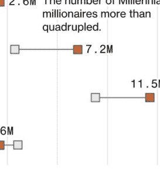
Source: US Census Bureau SIPP
Note: Generations are assigned based on the head of household's age.

## 4-bedroom home in NYC suburbs

Typical price in Westchester County, NY

2017: $758,070
2025: $1,096,635

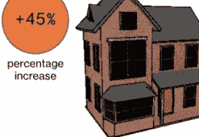

## Two Mercedes E350 4Matic sedans

Suggested retail price

2017: $111,200
2025: $132,800

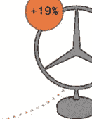

## 4-year Harvard education for two children

Tuition & fees

2017: $376,592
2025: $493,408

## 2-bedroom Upstate NY cottage

Typical price in Ulster County, NY

2017: $166,766
2025: $341,257

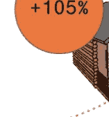

## 19-ft Sea Ray SPX 190 speedboat

MSRP online price

2017: $35,549
2025: $59,360

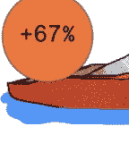

Total
2017: $1,448,177
2025: $2,123,460

Sources: Zillow, Mercedes-Benz, Harvard University, Sea Ray, Boatguide.com

# Jason-冯

2025-10-12 03:19

从历史上看，10月是比特币价格特别强劲的一个月。本周，比特币飙升约10,500美元创造了新高，但比特币暴跌至65,000美元，为月以来的最低水平。Coinglass描述为“加密历史上最大的清算事件”，根据Coinglass的数据，在过去24小时内，价值超过10亿美元的交易被清算。受影响最大的资产是特朗普家族的World Financial原生代币WLFI在宣布后立即暴跌近50%，跌回至13.30美元。

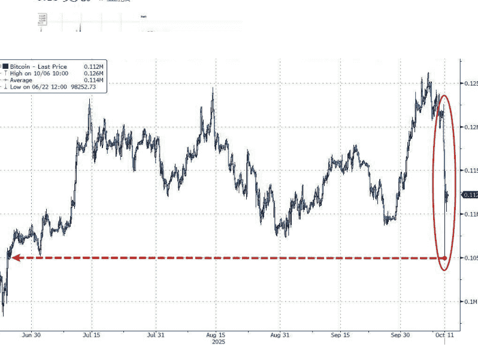
World Liberty Financial to USD

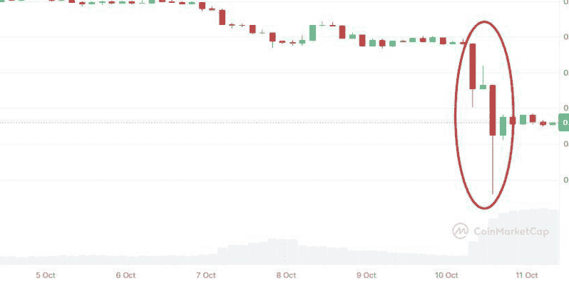

Statista: 根据国际组织的最新数据，2022年66岁及以上的人口在相对收入贫困线中十分之四。尽管如此，韩国39.7%的老年人收入低于家庭收入位数——这是国际组织公布的高点。分析指出，该国在过去十年中有所进展。新西兰比例上升到34%，65岁及以上受影响者减少。包括丹麦、芬兰和瑞典在内的发达国家显示其最低的8%，反映了其强大的福利体系。

## Where Is Pension Poverty the Most Prevalent?

Share of people 66 and older living in relative income poverty in selected countries in 2022 (percentage change since 2019)

| Country | Change |
|---|---|---|
| South Korea | 39.7 | -3.5 |
| Estonia | 37.4 | +2.9 |
| New Zealand | 33.7 | +13.9 |
| Costa Rica | 25.8 | +1.0 |
| United States | 23.1 | +0.1 |
| United Kingdom | 14.9 | -0.6 |
| Spain | 13.1 | +1.5 |
| Canada | 11.6 | -1.0 |
| Sweden | 9.4 | -1.7 |
| Norway | 4.1 | -0.2 |

Income poverty refers to income below half the national median income.
Source: OECD

# Jason不离

2025-10-02 03:42

《人口与生育对子女的决定有多多少影响？这种联系很强，评估了三个关键维度：生育状况、生育支持机制、政策驱动力。广东远超平均水平，上海、浙江以及吉林和黑龙江等东北三地的生育率落后。

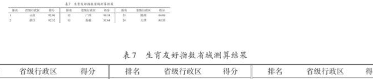

## 表 7 生育友好因素测试结果

| 排名 | 云南行政区 | 得分 | 排名 | 广西行政区 | 得分 | 排名 | 上海行政区 | 得分 |
|---|---|---|---|---|---|---|---|
| 1 | 滇滇 | 92.96 | 12 | 广西 | 88.18 | 1 | 陕西 | 84.04 |
| 2 | 滇澳 | 92.3 | 13 | 新疆 | 87.64 | 2 | 天津 | 83.55 |
| 3 | 吉林 | 90.14 | 14 | 江苏 | 87.27 | 3 | 四川 | 83.55 |
| 4 | 云南 | 89.04 | 15 | 山东 | 87.10 | 4 | 内蒙古 | 83.28 |
| 5 | 河南 | 88.19 | 16 | 山西 | 86.26 | 5 | 福建 | 82.06 |
| 6 | 湖南 | 88.87 | 17 | 甘肃 | 86.48 | 6 | 海北 | 82.05 |
| 7 | 江江 | 88.58 | 18 | 湖北 | 86.30 | 7 | 广东 | 81.50 |
| 8 | 宁夏 | 88.47 | 19 | 黑龙 | 85.37 | 8 | 西藏 | 81.22 |
| 9 | 青海 | 88.37 | 20 | 上海 | 85.21 | | | |
| 10 | 贵州 | 88.29 | 21 | 重庆 | 85.16 | | | |

# Jason不离

2025-10-02 03:52

## charlie: 更新元资产收益率指标=$金融

| Asset Class Total Returns Since 2011 (YTD as of 10/25) | 2011 | 2012 | 2013 | 2014 | 2015 | 2016 | 2017 | 2018 | 2019 | 2020 | 2021 | 2022 | 2023 | 2024 | 2025 |
|---|---|---|---|---|---|---|---|---|---|---|---|---|---|---|
| ETF Asset Class | 52.4% | -18.2% | 15.4% | 11.2% | 12.5% | 18.7% | 21.3% | 14.5% | 19.8% | 15.4% | 22.1% | -25.4% | 12.1% | 14.5% | 5.2% |
| Cumulative Returns | 41.1% | -23.5% | 12.8% | 9.5% | 10.2% | 15.3% | 18.6% | 11.4% | 16.5% | 13.2% | 18.7% | -21.6% | 10.5% | 4.8 |
| EAFE Stocks | -14.7% | -26.5% | 14.8% | -9.8% | 10.5% | 15.3% | 18.7% | 12.5% | 14.6% | 11.5% | 19.2% | -28.4% | 8.5 | 10.2 | 3.5 |
| Emerging Markets | -19.8% | -31.2% | 10.5% | -15.4% | 5.2% | 12.1% | 14.5% | 10.2% | 12.8% | 9.5% | 15.4% | -32.1% | 6.2 | 7.8 |
| US S&P Large Cap | -14.7% | -18.2% | 15.4% | 11.2% | 12.5% | 18.7% | 21.3% | 14.5% | 19.8% | 15.4% | 22.1% | -25.4% | 12.1% | 14.5 | 5.2 |
| QQQ Nasdaq | -17.8% | -25.4% | 23.5% | 18.4% | 20.1% | 28.4% | 32.1% | 24.5% | 31.2% | 25.4% | 28.7% | -35.2% | 18.4 | 20.1 | 8.5 |
| US Aggregate Bonds | 2.2% | 7.5% | 2.3% | 2.8% | 2.5% | 3.1% | 2.5% | 3.2% | 4.5% | 2.1% | 10.2% | -15.4% | -3.2 | -4.5 | -1.2 |
| US Small Cap | -22.5% | -25.4% | 23.5% | 18.4% | 20.1% | 28.4% | 32.1% | 24.5% | 31.2% | 25.4% | 28.7% | -35.2% | 18.4 | 20.1 | 8.5 |
| Corporate Bonds | 2.2% | 7.5% | 2.3% | 2.8% | 2.5% | 3.1% | 2.5% | 3.2% | 4.5% | 2.1% | 10.2% | -15.4% | -3.2 | -4.5 | -1.2 |
| T-Bills | 13.3% | 6.8% | -3.5% | -4.6% | -2.7% | -4.2% | -2.1% | -5.2% | -3.2% | -1.5% | 7.0% | -6.8 | 2.4 | 3.2 | 0.8 |
| VIX | -31.7% | 23.5% | -5.5% | -2.1% | 0.5% | -2.5% | -5.5% | -5.5% | -5.5% | -1.5% | -13.7% | 41.2% | -5.3 | -5.2 | -1.5 |
| US Bond Total Market | 7.7% | 3.5% | -2.1% | -1.6% | -1.4% | -1.7% | -4.6% | -5.7% | -7.2% | -9.2% | 2.7% | -4.1% | 3.5 | 4.4 | 0.4 |
| Real Estate | -14.7% | -18.2% | 15.4% | 11.2% | 12.5% | 18.7% | 21.3% | 14.5% | 19.8% | 15.4% | 22.1% | -25.4% | 12.1% | 14.5% | 5.2% |
| Commodities | -3.3% | -3.5% | -27.6% | -27.8% | -16.5% | -19.5% | -11.8% | -11.5 | -71.4% | -41.9% | -42.2% | -2.7% | -3.2 | -2.6 | -0.5 |
| Gold | -14.7% | -18.2% | 15.4% | 11.2% | 12.5% | 18.7% | 21.3% | 14.5% | 19.8% | 15.4% | 22.1% | -25.4% | 12.1% | 14.5% | 5.2 |

Jason不嵩
2025-10-12 03:58

## 安居客9月购房者信心指数和找房热度 #房产

### 购房者信心指数

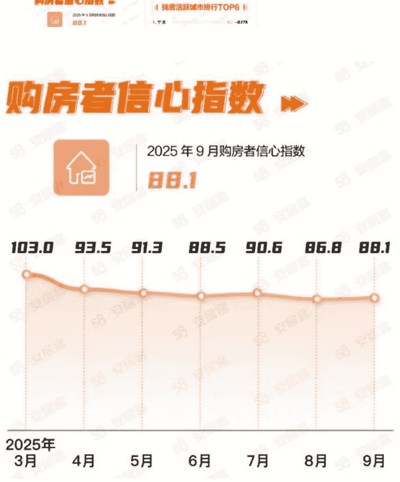

## 2025年9月全国寻房热度环比下降5.92%

## 找房活跃城市排名TOP6

- 1、宁波 -0.17%
- 2、深圳 -1.32%
- 3、南昌 -1.79%
- 4、武汉 -2.33%
- 5、常州 -2.79%
- 6、无锡 -3.06%

| 城市分组 | 环比涨 | 一线城市 | 环比涨 |
| :--- | :--- | :--- | :--- |
| 全国 | -5.92% | 北京 | -6.83% |
| 一线城市 | -5.49% | 上海 | -8.30% |
| 二线城市 | -5.25% | 广州 | -4.47% |
| 三线城市 | -7.63% | 深圳 | -1.32% |

方正：截至7月底美国对中国商品平均关税率为40.4%，若加征100%则提升至140.4%，略低于4月贸易战中最高级的理论，但等同于中美贸易再次进入停滞，对中国出口同样带来巨大压力。《经济数据

## 图2:若加征100%税，美国对华商品关税率或突破140%

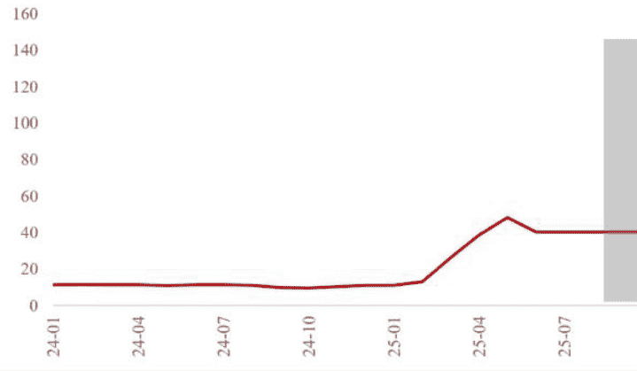

资料来源：Bloomberg，方正证券研究所

## 图3:截至25Q2，中国占全球商品出口份额维持在 14.7%

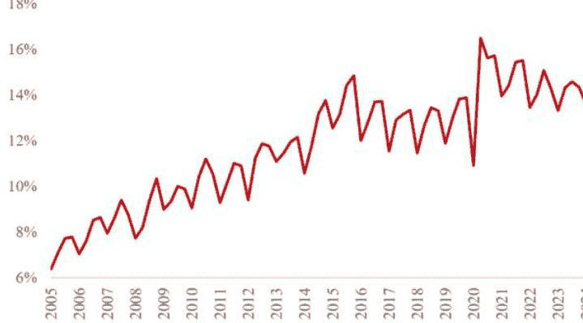

Jason-不难
2025-10-12 04:01

CF40：美方新轮的关税威胁大概不会全面实施，还会推迟，因为11月1日这一生效日期为双方从IMF年会到APEC首会的后续谈判预留了窗口。但此前的缓和和趋势已被重置，新一轮谈判将是全新的开始。长期来看，这种不定的贸易和科技关系将进一步步入两国追逐供应链自主可控的决定#经济数据

## 表 1：2025年1-8月我国对外的贸易情况

| 贸易伙伴 | 占比 (%) | 同比增速 | 占比 (%) | 同比增速 |
| :--- | :--- | :--- | :--- | :--- |
| 世界 | | 5.9% | | |
| 美国 | 11.5% | -15.5% | 23.7% | -17.2% |
| 东盟 | 17.7% | 14.6% | 23.1% | 46.1% |
| 欧盟 | 15.1% | 7.5% | 25.1% | 21.5% |
| 非洲 | 5.7% | 24.7% | 7.6% | 77.8% |

数据来源：Wind, CF40研究院

Jason-不难
2025-10-12 04:17

花旗：中国与其市场表现稳定、内部分化。新经济（AI、机器人、数字服务）在旺盛，老经济（房地产、建筑、传统制造业）在收缩。企业增长加速放缓。2025年8月平均工时48.5小时，高于《劳动法》44小时上限，虽居全球领先，不利于刺激服务消费。国企扩张3万人。仍存在缺口10 bp的空间#经济数据

## China Economics
## Citi Research
## October 2025

Is China's labor market good or bad? An unemployment rate has been one of the top concerns among investors. The case could become stronger as GDP growth and job creation slows into 25Q4. Policymakers, however, don't appear inclined to bolster the stimulus or rescue. The question is now, what's the real picture of China's job market? Headline statistics appear not to be getting worse. Survey unemployment rate at 5.3% in August was flat from April despite the respite following graduation season. While prime-age unemployment has been stable, youth unemployment rose to 10.9% in July, feeling pressures. New urban employment recorded 9.4% as of August, 9.4% Jan-Aug 2023, on track to the full-year target of 12%

## Figure 1. Prime-age unemployment has been stable, while unemployment rate remains elevated

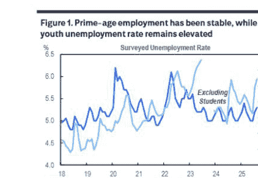
©2023 Citigroup Inc. No redistribution without Citi's permission. Source: NBS, Citi Research

## Figure 2. New urban employment recorded 9.4% as of August, on track to the full-year target of 12%

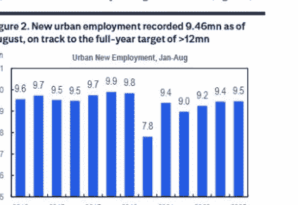
©2023 Citigroup Inc. No redistribution without Citi's permission. Source: NBS, Citi Research

Job sentiments have mostly improved. Citi's property market sentiment index (PSI) has shown marked improvements since September 2022, starting from a low in March. However, real unemployment has also trended down and fallen below historical averages far this year. The PMI expanded to 50.5 (neutral) in September, the highest since January, showing some stronger hiring intentions. The PMI of manufacturing employment also bounced to the highest level since February at 48.5%. The exception was the PMI Index for non-Mfg, which deteriorated to the one-year low at 45%

## Figure 3. Citi's proprietary job sentiment index has shown marked improvements since Sep 2024

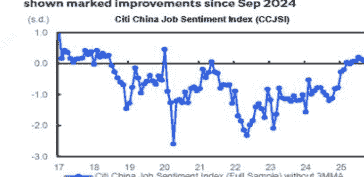
©2025 Citigroup Inc. No redistribution without Citi's permission. Source: Research Estimates

## Figure 4. The BCE and Mfg, PMI's employment sub-indices expanded recently, deteriorating for non-Mfg

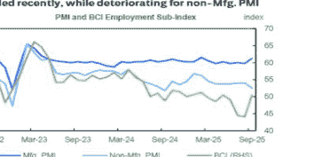
©2025 Citigroup Inc. No redistribution without Citi's permission. Source: Research Estimates

job pressures across various sectors. The new economy is competing for talent. Major companies have responded to the AI boom with booming hiring demand, while 2025 graduates and juniors are under pressure. Three years as AI drives demand, sectors like healthcare and finance have faced sharply increased AI-related hiring in 2025. The robotics sector saw job expansion of 25% in 2025 due to AI demand (Figure 5). In, more than half of job categories are now seeking optimism in AI-related services like Machine Vision (32%) and services (72.2% in 2025), driven by rising pet ownership and demand for veterinary growth services. In contrast, domestic services in 2024 faced lower demand, demanded for professional care. (3) Exporting sectors are in a better shape than faster the last year (Figure 7). According to the data, foreign trade directly benefited from weak fundamentals. (4) The economies and construction were under pressures as the housing downcycle, money growth slowed, keeping employment in mining, cooking, furniture and clothing, others (Figure 6).

## Figure 5. The new economy is competing for talent, and services still the key cushion

[Table showing job categories by percentage]

2025 Citigroup Inc. No redistribution without Citi's permission. Source: Zhongqing.com, Citi

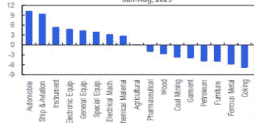
2025 Citigroup Inc. No redistribution without Citi's permission. Source: NBS, Citi Research

The employed will work very long. Average weekly hours at 48.5 in August was above the 48-hour benchmark set by the Labor Law and hiring demand kept long hours in July, as job pressures indirectly, have shown that short length of -0.2 hour in July, Jun work could be interesting as more firms now face pressure discourage overtime and ensure employees have more leisure time. Reinforcement of the Labor Law and more moves to support work/life drive the trend of supporting workers continue

## Figure 7. Exporting sectors are in a better shape than expected

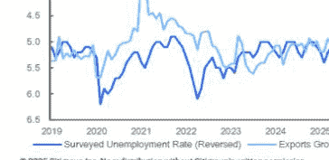
2025 Citigroup Inc. No redistribution without Citi's permission. Source: China, NBS, Citi Research

## Figure 8. The employed are still working long hours compared to global peers

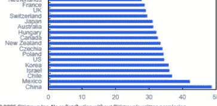
2025 Citigroup Inc. No redistribution without Citi's permission. Source: OECD, CEIC, Citi

Jason不诡
2025-10-12 04:40

PIIE: 中国房地产市场自2021年以来，正处于持续、系统性的衰退。这场“房大”不仅仅是周期性调整，更是结构性转折，且可能持续多年。积聚因素，房价过高抑制生育，如今调整有助于家庭资产负#房价

## Potential uses of the housing slump?

a. Price-to-income ratios by tier, 2003-23
b. Provincial total fertility rates and price-to-income ratios in provincial capitals in 2020

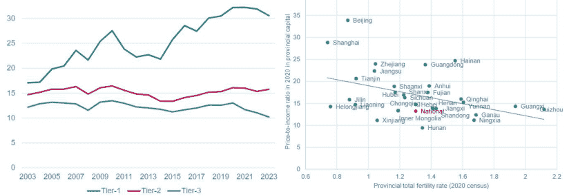

Sources and notes: Price-to-income ratios are authors' calculations based on data from National Bureau of Statistics of China and local statistical bureaus. Calculations follow the assumption that net income is not less than 1.5 times the per capita household income, and that the median apartment size is 90 square meters. Provincial total fertility rates are from China's 2020 population census.

PIIE
China's Great Housing Slump

三孚

## When will the Chinese housing crisis bottom out?

Real housing price indexes in China, the US, Ireland, Spain, and Japan since the housing market peak peaks

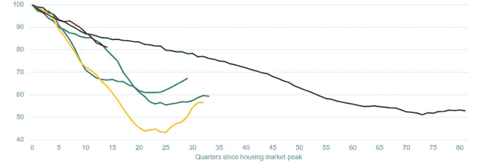

Source: Bank for International Settlements. Note: All price indexes are in real terms and normalized to 100 at the quarter of each country's housing market peak. The data for China are compiled by the BIE based on China's official NBS 70-city index for secondary homes.

PIIE

China's Great Housing Slump | 4

## While official price data show only modest declines, private sector data point to steeper price declines

Comparing the NBS 70-city index and Centa Leading Index for secondary home prices in select cities, January 2012-July 2025

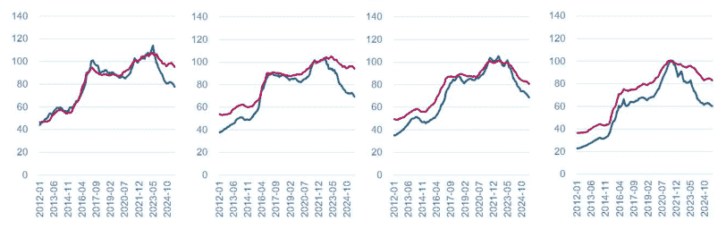

Source: Centeline Property Agency, National Bureau of Statistics of China, Wind. Note: All series are indexed with June 2021 levels as 100.

PIIE

China's Great Housing Slump | 3

# 深度视野优质集团（链接优质群，助你成功）

全部包含以下内容：限时年费188/年 加微信cuk255

- ① 吃瓜群众含信朋友圈加微信群群对话（原价 365 元/年）
- ② 子子明享汇（内部）文章（原价 568 元/年）
- ③ 政事室（顾子明）付费内容再送顾子明群聊
- ④ 米联储闲间【作者米栖】（原价 599 元/年）
- ⑤ 欧洲金雀会员专属文章（原价 328 元/年）
- ⑥ 砖瓦斥内部文档（原价 400 元/年）
- ⑦ 卢克文青读书会专属文章（原价 699 元/年）
- ⑧ 鉴茶财经知识星球（原价 3310 元/年）
- ⑨ 猫哥的视野知识星球文章（原价 299 元/年）
- ⑩ 财经周刊【独家新闻】（原价 1498 元/年）
- ⑪ 杨世光在金钱爆（原价 2200 元/年）
- ⑫ 蒜森财经知识星球（原价 1600 元/年）
- ⑬ 潇潇异译付费文章（持续更新）
- ⑭ 司马林解读课全套音频和全套书籍版权无损减（原价 2.3 万）
- ⑮ 虚构三部曲【民国梦、帝国争霸、不被理解的 MAO】（原价 599 元）
- ⑯ 卢克知识星球文章（原价 268 元/年）
- ⑰ 额外再送：卢祺新浪微博付费专栏、三村丰老王、三花九树文集

不定内容：......（更多资源不写下去了......

- ① 守夜司令知识星球、接换魔王知识星球、达叔谈论星球、成术财圈、雪球花甲老头等
- ② 创始人笔记、达叔谈论星球文章
- ③ A 视野、大树乡谈、江初号、泮咩说、上海海家学等付费文集
- ④ 西风付费文章、老端、赢在八小时之外、局人的视野、升值、老A体制内等其它大V付费文章（每月不超过600元的付费文集）

# 深度视野文集
进群微信cuk255

深度视野（付费文集）

# 限时年费188/年 内部底链接全网大V优质内容
