# 南美联购财经251016

Jason-不遇
2025-10-16 04:01

吐槽，我以前调研过企业，虚假收入和利润，我给泡沫应该是实值的3倍，没准，后来上主板了，我看了下，现在的股价是腰线的1/7，当时啤酒的CFO，在转账投资了，我刚看到他朋友，逛得浑然不知。然后因为某个新闻，我和他们“吵”过一架，不知道何时作样会被“坐实。”#挨扎

Jason-不遇
2025-10-16 04:24

bloomberg: 印度有意愿在贸易谈判中肯花150亿美元购买美国石油，人们越未美国越地认为，印度和美国对印度出口征收50%关税引发的贸易顺差。美印关系，也将影响美国在谈判的主体体。其他国家经济

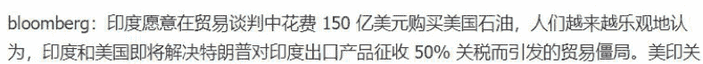

# 博弈人工智能的要点

- 印度商务部高级官员表示，印度有能力从美国购买150亿美元的石油。
- 印度从美国购买的能源还有增加，根据25年的财政数据，平均为12-130亿美元。
- 印度正在考虑从美国购买约400亿美元的大宗商品，以缩小其贸易顺差。

印度商务部一位高级官员周三表示，印度有能力从美国购买价值150亿美元的石油，这代表印度打算加快贸易顺差谈判并达成协议。

印度贸易部长詹特什·坎哈尔瓦拉在新德里告诉记者，过去几年的数据显示，从美国购买的能源正在增加。

他说：“根据25年财政数据，我们目前的平均投资为12-130亿美元，目前的炼油扩配置还有14-150亿美元的空间。

此举可以弥合印度的427亿美元贸易顺差，并抚慰唐纳德·特朗普总统，向这两个国家征收50%的惩罚性关税，部分是因为它购买了俄罗斯石油。据路博社周一报道，印度官员正在美国与同行会面，并希望最早在下周内达成协议。

新德里的广拓策略包括通过购买更多美国商品，改善进入印度市场和扩大贸易壁垒来减少贸易顺差。它正在考虑从美国购买约400亿美元的大额采购，例如国防和石油，以缩小盈余。

IFA Global 创始人兼首席执行官 Abhishek Goenka 表示:“印度储蓄银行可能采取了一次性清理投机性多头的方法，表明了其立场，而不是花费储备金来维持卢比。”

该人士表示，印度储蓄银行将继续进行干预，直到投机头寸被平仓。央行发言人没有立即回应提供更多信息的请求。

周以来，卢比在历史低点附近徘徊。周三，央行在周五捍卫货币后继续强势后，该卢比飙升1%，引发了人们对可能重新考虑的预测。

# RBI Presence, Trade Deal Hopes Bolster Rupee

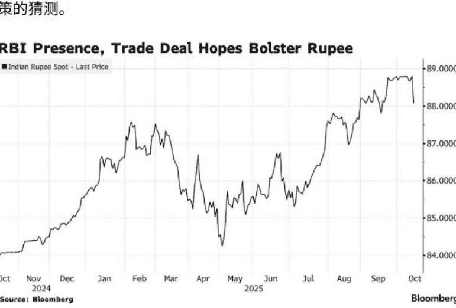

Jason-不嵩
2025-10-16 04:31

bloomberg: 特朗普最近的股市波动将使风险更加加剧。《金融 (注: 特朗普不在推特最近的操作，不是为了G2，而单纯是为了降险，降息单纯是为了缓解通胀压力和财政空间，等到时机成熟再拉一波加息)

# 博弈人工智能的要点

- 米兰表示，中美贸易政策的不确定性增加带来了“新的尾部风险”，政策制定者迅速在政策中达到中立的位置更加加速。
- 米兰表示，预计今年再降两次“听起来很真实”，在“不久的将来”停止缩减央行的资产负债表是合适的。

美联储主席斯蒂芬·米兰，最近的贸易紧张局势增加了增长前景的不确定性，使得政策制定者迅速变得更加重要。

“现在的下行风险比一周前更多，我们作为政策制定者有责任认识到这应该反映在政策中，”米兰周在 CNBC 组织的一次活动中表示。他，中美贸易政策的不确定性增加带来了“新的尾部风险”。

“我不会说我现在想要比一周或一个月更低的利率，”米兰说。“然后，随着风险平衡的变化，我认为我们迅速在政策中达到中立的位置更加加速。”

# Jason不遇
2025-10-16 04:36

经济学家：国际货币基金组织首席经济学家加古洛·戈穆纳纳表示，此轮轮回如果被破裂，将产生历史性的溃露（以及对财富消失）#金融

美国近期在紧紧扩张局势的背景下出现波动，整体处于历史低位。

这轮上涨源于人工智能热潮驱动，人们联想到上世纪90年代初的狂热情绪，最终在2000年的互联网破裂结束。尽管技术创新确实在行业内部、提升了生产，但当前行情可能为新的市场调整埋下伏笔。

不是的，这一次的结果后，可能比25年前更严重，影响全球更加广泛。

真正引起关注的是美国股市的高估值。过去5年来，美国家庭在股市的投资规模增加，背后的回旋和美国本土企业的主导地位。同样的，欧洲等地的外国投资者也纷涌流入美国，同时从涨中胜出。

这种日益密集的联动关系意味着，只要美国市场出现剧烈波动，全球都会受到影响。

为了避免重蹈风险，根据我的预测，如果发生一次与互联网相似的市场崩溃，美国家庭的财富将缩水20万美元，将相当于2004年GDP的70%。这比2000年的损失还要大得多。对消费的影响将是毁灭性的。

当消费增长取决于互联网的水平。如果出现如此情况，可能导致消费增长减少3.5个点，进而使得GDP增长低于百分分之一，完全无法从规律中恢复。

全球的结果同样惨。外国投资者的财富损失可能超过15万，约占其他国家GDP总额的20%。相比，与互联网联动，外国投资者的损失将高达20万，按今天市值的仅占其他国家GDP的10%。

这种溢出效应扩大，一方面全球市场提供一定稳定，这种避险需求帮助美国资产缩水对外国需求飙升。

现在，这一模式可能不再适用。如果美国货币和流动性政策依然支持，并不像许多国家那样。然而美元汇率贬值反映出外国投资者对美元优势加深，他们越倾向于转向美元。这种不安并非投资者的信心之一，是国际制度、尤其是美国稳定性和可靠性的。近期的法律和政治进程，正在破坏美国建立的信任基础。如果这些增加，可能进一步损害美国及全球市场。

此外，与2000年相比，目前面临的风险更加加强。美国政府债务处于高位，财政压力比以前得多。

# Jason不易
2025-10-16 04:40

(FT)在组合中配置多少加密货币，取决于投资者的承受能力。对于无法承受回撤的保守型投资者，应该避开。此外，加密货币的多样化作用减少。加密货币与美元的相关性从17年初上升至目前，回撤后。加密货币的波动性，而在其他资产类别的相关性近乎于。

注意的是，加密货币的历史表现是结构性还是周期性，尚待观察。

# 加密货币与传统资产的相关性分析

资料来源：比特币、以太坊、货币
自2017年1月至2020年5月，按月收益率，加密货币与传统资产的相关性。加密货币的波动，而在其他资产类的相关性表现是结构性还是周期性。
资料来源：比特币、以太坊、货币

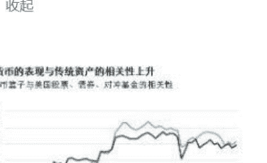

# Jason不易
2025-10-16 04:53

zero hedge: 特朗普会回撤了吗？昨天WSJ报道，大意是认为特朗普会在关税生效前，所以建议解决问题，然后特朗普愿意推迟。特朗普特称“他的把柄”放在重要的角色身上，递出下台，最后他说：“世界不想回撤，我们想去执行。但这种态势是危险的，我们认为不想回撤。我们应该共同努力，尽快实现多元化，远离...”其他国家经济。

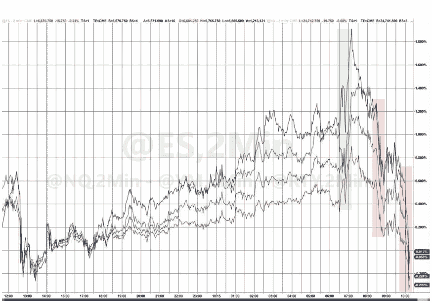

# Jason不遇
2025-10-16 04:58

# 民生：特朗普政府开始出现国家资本主义的倾向

1. 特朗普政府上台以来，美国经济政策发生了巨大变化
2. 这种变化表现为政府对经济的干预增加
3. 这种干预导致了国家资本主义的抬头
4. 这种趋势对全球经济产生了深远影响
5. 我们需要密切关注这一趋势的发展

‘国家资本主义’，政府投入股权。政府对企业的支持，无论是资金入股，转化为股权或治理的能力，有三种的方式：一是是以美国为代表的‘被控制’，政府拥有治理权，但已经成为最大单一股东；二是美国控制企业的手段，例如在批准日本铁购买美国钢铁后，白宫拥有对关键决策的否决权，以及最近对MP Materials 等矿业企业的投入。

出口收益：贸易锁。在除了进口关税后，白宫开始对出口实施限制，不再让企业自由选择。典型的例子是白宫对英伟达对华AI芯片收取15%的出口税——二是“两个堡”。根据特朗普的“权力霸权”和“天下没有免费的午餐”的思想，未来出口可能会向两个方面：一是通过政府出口获得大额订单，如波音飞机；二是美国对外限制，但无意禁止的产品，如某些非核心技术。

交易增税：白宫的意图。9月中美之间TikTok达成框架性协议，转而让白宫将向美国的投资者征收数十万美元的高昂费用——完美体现了政府的思想。以此类，未来白宫可能以国家安全为由，增加政府的审查，比如此前未解决的巴哈港口交易等。

美国新增移民中，金卡和H-1B签证，定点收取海外人和科技公司——一人获得美国绿卡，则如果还想进一步避税，可以支付500万美元。而新增的H-1B签证费用提高到10万美元，如果按照8.5万的配额计算，预计每年最多可以增加77亿美元（此前办理H-1B也需1万左右的费用），而想要进一步增加收入，白宫也可以考虑其他签证的费用。

通过以上分析，以及以后对特朗普政绩的持续跟踪，可以总结出一些基本的准则：

- 首先，特朗普2.0的白宫，商人思维再上一个台阶。这也是我们认为中美股继续维持低位的重要原因。
- 其次，“权力显现”和“天下没有免费的午餐”是特朗普商人行事最显著的特点。只要政府出钱才算发力，都可以成为收费的内容。
- 第三，特朗普虽然不要通胀，但可能是其计划的重要环。对于企业的提出的虽然五，但从量上说是。
- 从政治和市场来看，特朗普的“通胀”可能是当前解决问题的办法。通过对外，美国建立的稳定性。
- 这种溢出效应扩大，一方面全球市场提供一定稳定，这种避险需求帮助美国资产缩水对外国需求飙升。现在，这一模式可能不再适用。如果美国货币和流动性政策依然支持，并不像许多国家那样。然而美元汇率贬值反映出外国投资者对美元优势加深，他们越倾向于转向美元。
- 本公司具有证券咨询业务，请务必阅读最后页免责声明

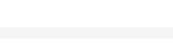

Jason不跑
2025-10-16 05:09

PPI改善，主因大宗价格继续上涨，但主要受涨影响较小。对美国油价CPI环比2.5%、1.2%，PPI环比0.1%，为主要贡献。核心CPI环比升至1.1%，来源于核心商品（同比+0.5pt）。其中金属CPI的涨数据显示金属价格环比分别上涨2.1%和3.6%，包括其他商品及服务CPI同比上行9.5pt。除了补涨因素外，相比之下，食品及服务CPI斜率放缓，预计PPI将回升至2.1%左右。CPI方面，PPI压制加大，加大退坡，预计CPI维持调整态势；但金属持续对核心商品CPI的拉动，预计核心CPI维持阶段性高位。经济数据收起

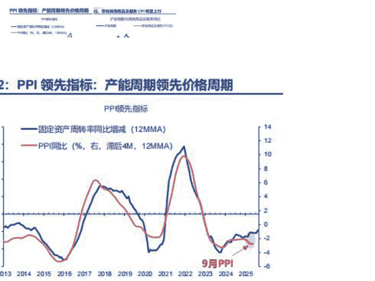

资料来源：Wind，宏观研究

# 图5：金价维持高位，带动其他用品及服务明显上行

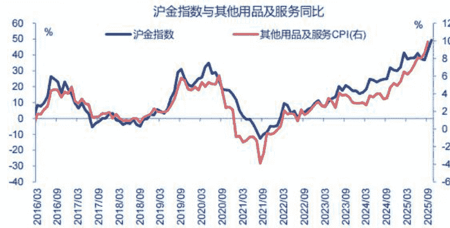

资料来源：CFIC；万源证券研究

国资：9月信贷数据高于预期，低于季性，居民消费同比增加10亿元；企业贷款减少2700亿；9月M1同比升7.2%，较上月抬头两个百分点，一方面基础数据逐步走近，一方面社会融资存量增速带动居民消费仍可能是主要动力。9月新增贷款同比回落至7.7%，排除政府债之后持平5.5%。

# 图表1：9月信贷低于预期，也低于季性

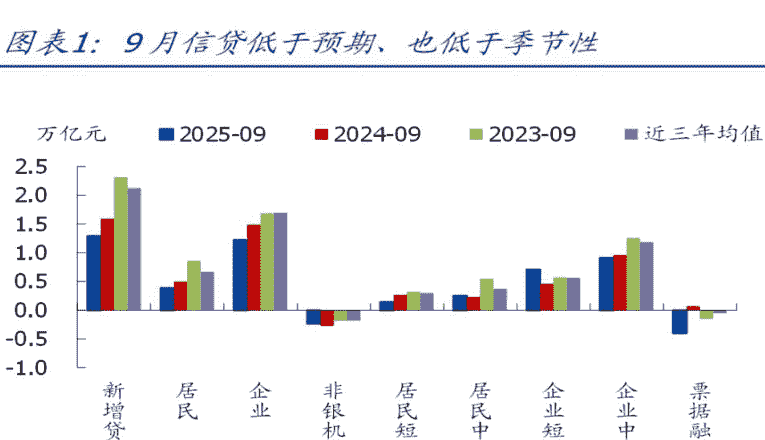

资料来源：Wind；国泰证券研究所

# 图表6：9月M1增速一步抬升、M2增速回落

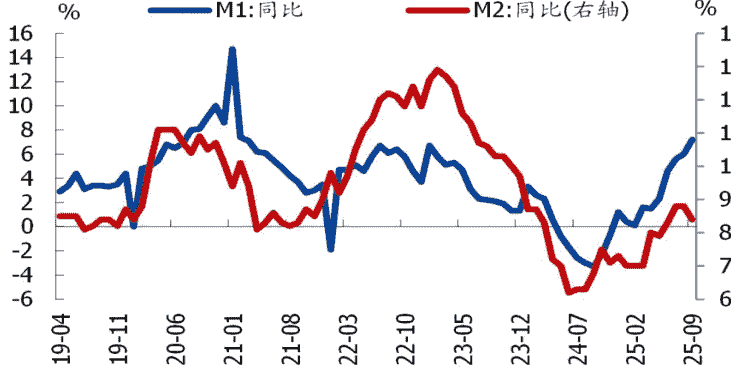

资料来源：Wind，国信证券研究所

# 新西兰9月房价指数回升

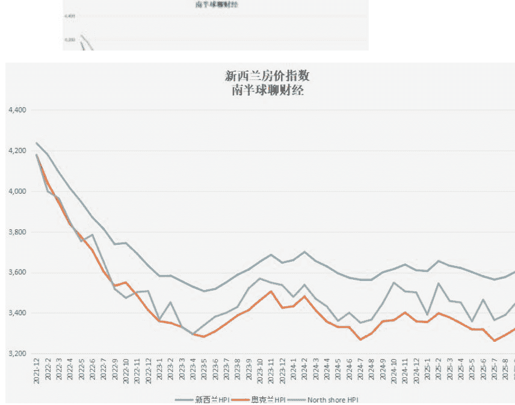

# Jason Nonylie
2025-10-16 05:40

JPM: 中国再通进程预计会增长，GDP增速可能在未来几个季度继续存在。

## China: Major service-related CPI items

## Recreation, education and cultural services

Index, 2019=100

- Transportation and communication
- Healthcare and medicines
- Residence

## China: CPI-park prices

Index, 2018=100

- Pork prices - YoY change
- Yams

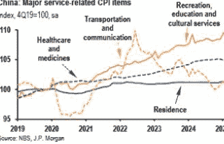
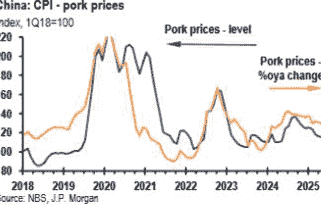

## China consumer confidence index

- Headline confidence index
- Consumer employment
- Consumer confidence - income

## China PPI breakdown

- Ferrous metal processing
- Non-ferrous metal processing
- Consumer goods

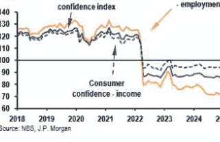
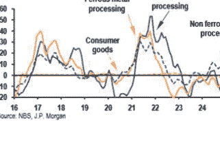

## China: PPI vs. global commodity price

- Food commodities index
- Global commodity price

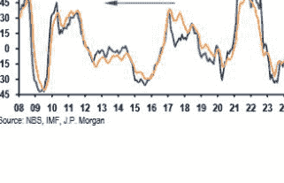

## Jason-1

2025-10-16 08:00

Jay Kahn: 我们最新的报告中，发现过去10年对基金向TIC少申报了其美债持有量，重新计入后，开基金群取代中国和日本，成为最大的美国债持有群体。由于统计错误，导致这些被归类为家庭篮，这又放大了对美债的持有规模。我们的研究表明，开基金群对美国债的持有是最大的国外卖家。它们占据了37%的溢价债券发行量，几乎与其他所有境外投资者的和相同。金融

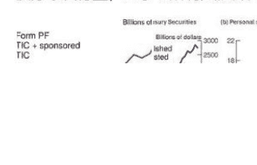
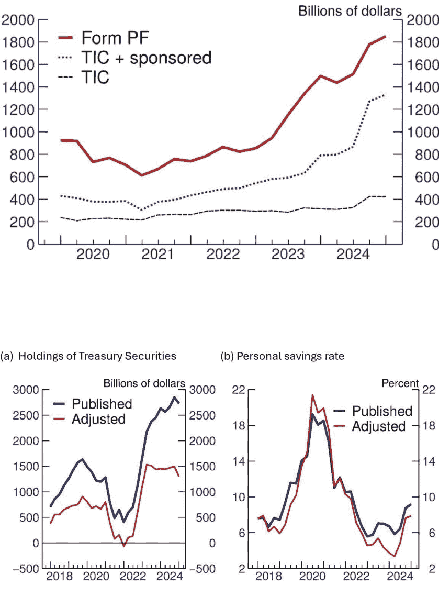

## Figure 5. Absorption of Net Issuance of U.S. Treasury Notes and Bonds, January 2022 – December 2024

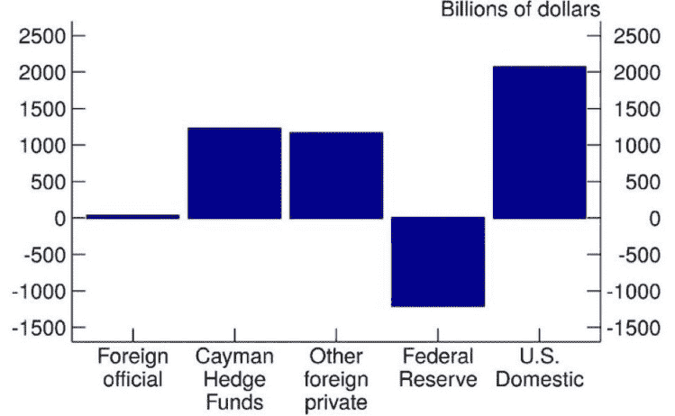

Jason不离
2025-10-16 08:03

substack: 尼日利亚新生人口大于整个欧洲#人口

## Nigeria Has More Births Than All of Europe

Note: Europe had about 7 million births versus 11 million in Nigeria in 2020. This relationship stands in contrast with Nigeria's population of 200 million which is smaller than the total population of Europe, which includes all countries on the European continent well as Russia.

## Nigeria Has More Births Than All of Europe

In 1950, Europe had about 12 million births versus 17 million in Nigeria. By 2023, that relationship had reversed, with Nigeria recording more births each year than all of Europe combined. "Europe" refers to the UN-defined region of Europe, which includes all countries on the European continent as well as Russia.

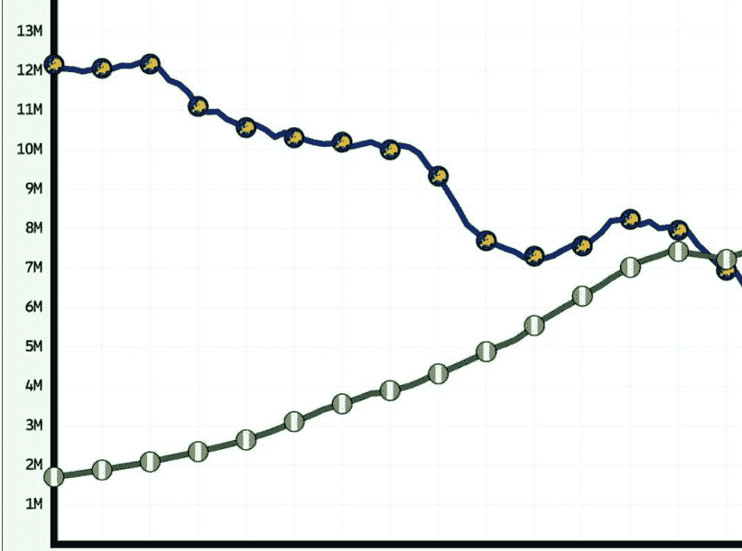

datacanvas.substack.com

Source: Number of Births per Year (Our World Data)

韩国社：首尔普南部三声响，韩国总统签署一项提议，将“预付”3500亿美元用于美国投资#其本国他国家经济

首尔普南部三声响，几个小时前，韩国财政部长斯蒂贝森(Scott Bessent) 表示，他预计与韩国的贸易将在未来10年内取得一项进展——一项关于贸易投资计划达成协议的希望。

- 日本，韩国：特朗普在首尔表示

特朗普在首尔发布，几个小时前，韩国财政部长斯蒂贝森(Scott Bessent) 表示，他预计与韩国的贸易将在未来10年内取得一项进展——一项关于贸易投资计划达成协议的希望。

> “他赢了。”——日本，韩国：特朗普在首尔对记者。

我的意思是——日本，韩国——特朗普3500亿美元。日本——6500亿美元。”他补充道。

事实上，日本已经承诺投资5600亿美元。

上个月，特朗普提到韩国的投资承诺描述为还款，曾曾首尔政府对大规模现金资金的要求颇不就，认为这可能会引发类似于1997年亚洲金融危机的危机。

## 深度视野优质集团（链接优质社群，助你成功）

全部包含以下内容：限时年费188/年 加微信cuk255

- ① 吃瓜群众包信圈加微信cuk255 (原价365 元)
- ② 卢明内部
- ③ 卢明群额外送
- ④ 米联储（原价599 元）
- ⑤ 欧洲金雀（原价228 元）
- ⑥ 砖瓦内部（原价400 元）
- ⑦ 卢克会员专属（原价699 元）
- ⑧ 鉴茶知识星球（原价3310 元）
- ⑨ 猫哥的视界（原价299 元）
- ⑩ 财经周刊独家（原价1498 元）
- ⑪ 杨世光在金树（原价2200 元）
- ⑫ 蒜森知识星球（原价1600 元）
- ⑬ 激游异译付费
- ⑭ 司马林解课全套音频和全套书籍珍藏无删减（原价2.3 万）
- ⑮ 虚构三部[民国梦、帝国争亡、不被理解的 MAO]（原价599 元）
- ⑱ 卢克知识星球（原价268 元）
- ⑰ 额外送：卢薛元新微博付费专栏、三村丰老王、三花九洞文集

不定内容：(更多资源将下去...)

- 守夜人司令星球、接魂魔王知识星球、达叔谈论星球、成付财富圈、雪花甲老头等
- 创始人笔记、大树树乡谈、江诺知识后、泮咩说、上海的海家学等付费文集
- 西风付费文章、老端、赢在八小时之外、局人的视界、升值、老体制内等其它一些大V文章（每月不低于600元的付费文集）
