# 南半球聊财经251020

Jason-不羯
2025-10-20 04:20

VC: 在美国保值最高的汽车（保值率高），卡罗拉 Cross 居榜首，三年价值2.63%，其他车型，4Runner、C-HR 和 Tacoma，在这一方面也表现出色。其他国家经济

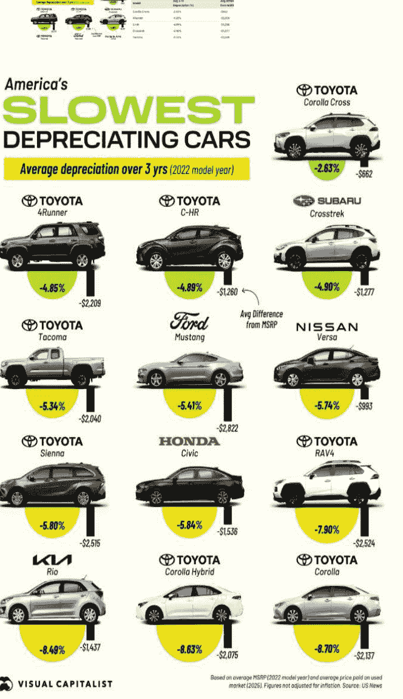

深度视野文集社cuk255 有温度高质量社群cuk255

| Brand | Model | Avg 3-Yr Depreciation (%) | Avg Difference from MSRP ($) |
|---|---|---|---|
| Toyota | Corolla | -2.63% | -662 |
| Toyota | 4Runner | -4.85% | -2,209 |
| Toyota | C-HR | -4.89% | -1,260 |
| Subaru | Crosstrek | -4.90% | -1,277 |
| Toyota | Tacoma | -5.34% | -2,040 |
| US Ford | Mustang | -5.74% | -2,822 |
| Nissan | Versa | -5.80% | -993 |
| Toyota | Sienna | -5.84% | -2,515 |
| Honda | Civic | -7.90% | -1,536 |
| Toyota | RAV4 | -8.49% | -2,524 |
| Kia | Rio | -8.49% | -1,437 |
| Toyota | Corolla Hybrid | -8.63% | -2,075 |
| Toyota | Corolla | -8.70% | -2,137 |
| Toyota | RAV4 | -8.84% | -2,989 |

# Jason不愁
2025-10-20 04:24

美国：大家对自2016年价格回升的汽车太乐观了，不知道在很多首景已与当年相同。此价格回升需要更长的时间，是L型和V型#经济数据

现在，当首付者开始考虑贷款的宽松环境结束时，发现历史并不简单单调。当前的经济基本面与此前相比，已经遭遇了类似的波动性。

首先，首付者的“钱袋子”从未如此丰富，2016-2017年，居民阶层正处于持续上涨中。尤其是通过某些渠道看到通胀，消费可能推迟需求。如今，居民阶层积累依然处于高位，由于普通家庭面临的不确定性增加，消费和投资需要更多观望。

其次，当汽车市场从过热开始变软，需求增长往往相对缓慢。数据显示“首要通胀”正在扩大，而首要汽车需求的增长程度差异巨大，从传统制造到部分汽车产业部门都面临压力。要维持更强大的需求，难度可能有所不同。

最后，汽车的复杂性并非结构性问题。当前的市场已经发生了本质变化。过去是机械、钢铁等传统行业，如今“冷增长”已从制造侧扩散到需求侧，新能源汽车正面临转型的阵痛。虽然市场还在回升，但我们已经看到需求侧的疲软，政策的调整可能更为必要。

此外，从哪里开始调整？目前的市场已经发生了本质变化。过去是依靠居民阶层“财富积累”来加速复苏。现在我们看到从收入增长转向收入增长，配合财政支持和货币政策，让居民阶层的消费能力和信心逐步重建资产表。这是一种新的模式，我们需要到个别部门重新注入了健康杠杆的动力，持续的回升似乎仍有足够的需求支撑。

在此之前，我们认为对汽车的需求将保持乐观。价格的走势可能是一个收缩期，类似于“L型”反转而非快速的“V型”反转。尽管如此，我们需要更多时间来培育深层的动力。

# 深度聚焦视野市场cuk255 有温度高质量社群cuk255

# Jason不跑
2025-10-20 04:31

来源：从专项债投向来看，三季度专项债资金66%投向基础设施建设，包括传统基建和基建，33%投向环保、补充发行资金等特殊用途，投向土壤相关投资项目的占比约为9%，社会事业、保障性工程等占比约为8%。和2024年相比，三季度投向基建的规模和占比有所减少，而投向绿化和土壤项目的占比显著提升（分别提高10和9个点）。这或解释了广义财政规模在2024年扩张，但基建投资增速未见。

附图7：三季度专项债投向基建的规模边界

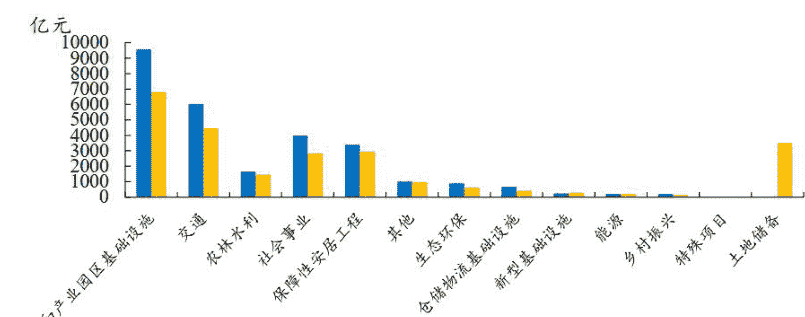

数据来源：Wind、天风证券研究所# Jason不跑
2025-10-20 04:31

FT: 企业转型，变成弱势#经济数据

几天，国际：老龄化、城镇化进程引起了很多人担心企业变为弱势，同时也引起了投资者对企业核心关注。#深度视野文集cuk255 有温度高质量社群cuk255

最近火，大新闻报道的大家在关注，大部分都在焦点，他也得到了关注。这件事具体情况我们没有调查，所以这里不要做更具体的评论，而是联想到其他事件：其实不是新鲜事，我的等地方面确实关注；这类企业确实发生过，国家中禁止限制进入经济的，看来很多地方有了新的进展。

| 政策影响 | 政策影响 |
|---|---|
| 完成后锁定资金 | 完成后锁定了资金 |
| “政策回落在我们身上” | “政策落地在我们身上” |

对我们的污水处理厂

贵州这件事从企业家听说，很有可能是一个有关部门的案件。这些年，经济内在之下受到损害的情绪是很多，挑战和企业也开始盛行，这应该是所有人共同感受的事实。事实却是，或者人士说，群体已经变成了一个困难群体。一方面，经济挑战对很多企业面临问题陷入了绝路，很多情况因为带责任让企业受到巨大冲击；另一方面，社会方面的老者这一类却为了溃。而且，短视频交流，大量出现效益和老板下，举报发现规律。更有就是权力强制进入经济的案件，这些问题破坏了长期开放的健康环境，企业陷入困难严重，规模大趋势。

> Jason-jason
2023-10-25 10:24
bloom: 持股市总结涨至8月6日令美联储理事苏·萨克斯（或许还没没），黄金已经上涨25%。对于黄金来说，叙事比什么都重要。由于它的机会，美国现在在预计明年将达到5000美元。理由很简单——投资需求。如果真的投资者增加了14%的购买，黄金将越价格。

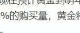

# 深度视野女集cuk255 与高质量群cuk255

# 美联储独立性受到威胁后，黄金爆发

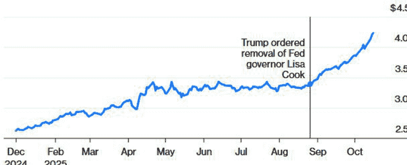

资料来源：彭博社

> Jason-不离
2025-10-20 00:41

天气：当前黄金金价是历史低次，核心原因在于定价逻辑分化：原油由基本面主导，黄金由宏观情绪驱动。历史上，比较的极端值均由油价引起，其回归始于实体改善带动行情反弹。注意的是，在意见回落后，金价往往会在4到5个月后随之变。

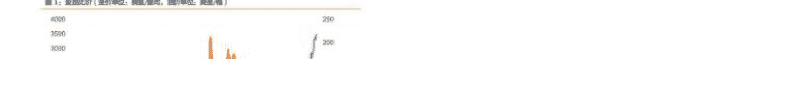

图1：黄金金价（单位）：美元/盎司，油价单位：美元/桶

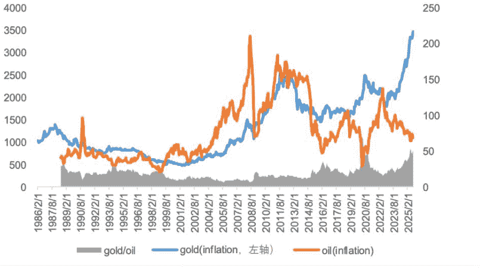

数据来源：Wind、天风证券研究所

# 深度视野文集cuk255 有温度高质量社群cuk255

# Jason不离
2025-10-20 05:04
高盛：中国可能通过非非洲向美国出口以规避关税。2025年上半年中国对非洲的出口总额约$103B，同比增长21%，绝对增长$18B，2025年上半年美国从非洲进口同比增长24%，相当于美国绝对增长$4.5B#经济数据

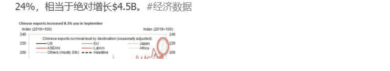

# Chinese exports increased 8.3% yoy in September

Index(2019=100)

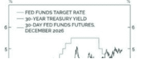

Source: China Customs, Goldman Sachs Investment Research

# Jason不离
2025-10-20 05:10
BCA: 如果美国推特朗普贸易关税，那么市场和股票可能会暴跌，具有讽刺意味的是，拥有多头的交易者必须对贸易偏好才能维持涨势。#美股

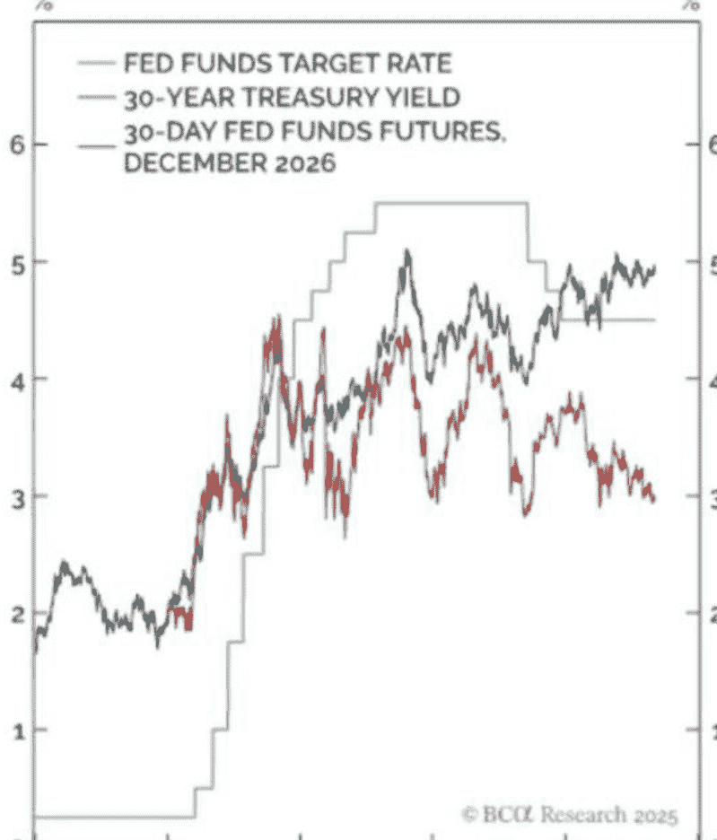

# Jason不离
2025-10-20 05:12
国资：近月经济变化为：一：地产再度走强，30城新房屋同比1.1%，由于季节性，绝对值近期低位，同比扩大至26.6%；18城二手房屋同比16.4%，同样季节性，同比下降21.8%；二：近月末，沥青、水泥开工率回，基建工作量仍持续；三：主要商品价格下跌，猪肉价格加大，价格能够回升。当前经济政策适当发力的必要性和将提升，紧盯中调#经济数据

# 深度视野文集cuk255 有温度高质量群cuk255

图13：30城市债券收益指数走势，同比扩窄

图14：上月二期债成交量，同比扩窄

| 万亿 | 30城市债券收益指数(MA7) | 万亿 | 18城市二期债成交量 |
|---|---|---|---|
| 90 | 45 | | |
| 80 | 40 | | |
| 70 | 35 | | |
| 60 | 30 | | |
| 50 | 25 | | |
| 40 | 20 | | |
| 30 | 15 | | |
| 20 | 10 | | |
| 10 | 5 | | |
| 0 | 0 | | |
1月 2月 3月 4月 5月 6月 7月 8月 9月 10月 11月 12月
2019年 --2021年 --2022年 --2023年 --2024年 --2025年

数据来源：Wind，同花财经

# Jason
2025-10-02 05:16
基金：底部主体同期收益率，以经理理财收益率下，要把利维持在相对较高，那么金融产品越来越困难#金融

注：30城市债券收益指数(MA7)选取了2013年以来活跃的30城市债券，剔除了已到期、停牌、违约等的品种，数据仅供参考。注：上月二期债新增理财产品237只，环比增加1.6%，企业端同类理财产品（不含基金管理产品）。截至9月底，市场新增存理财规模41842亿，环比增加347亿，其中20557为开放式产品，21285为封闭式，从投资性质来看，固收类产品最多，有38990亿，环比增加347亿。截至9月底，理财公司存款规模为29397亿，环比增加531亿，占全市存款理财产品的70.26%，理财公司存款开放式类理财产品（不含基金管理产品）近一个月内收益率的平均水平为2.22%，环比下降0.21百分点。

2025年9月市场新增9464只理财产品，环比增加1009亿，其中7323只为开放产品，2141只为封闭式，从投资性质来看，固收类产品最多，有8959亿，环比增加988亿。

2025年9月理财公司新增7431只理财产品，环比增加865亿，占全市新增理财产品的78.52%。理财公司到开放式固收类理财产品的平均收益率（年化）为2.32%，环比下降0.19百分点，高于其平均收益比较低0.38百分点。截至9月底为止，开放式与封闭式固收类理财产品近个月年化收益率下降至29%，整体来看，各类理财产品已连续下降。其根本原因在于收益率持续低迷，整体利率环境压缩了空间。

# 深度视野文集cuk255 有温度高质量群cuk255

# Jason不跑
2025-10-20 05:18
中信：领先指标已触顶，同步指标筑底迹象（斜率支撑），显示短期动能正在衰减。预计价格进入震荡阶段，消化早期的过度购与情绪买盘。

图35：2025年信号

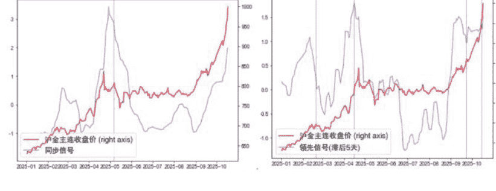

# Jason不离
与上半年相比，市场对债表现较为稳定。今年以化等为重要抓手，财政扩张。但近期地方债似乎上升，城投余额仍反弹。“市场”触顶，将进一步拖累地方出。长期来，对内政策将强化，加强跨境投资期间应对外部常态化的路径。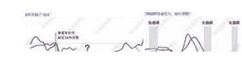

#经济数据

图1：市场已“钝化”

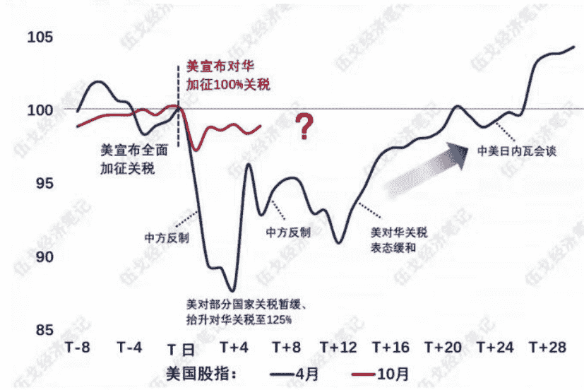

来源：WIND；数据自算注：美观频率为500天

图3：短期缓解压力，但长期呢？

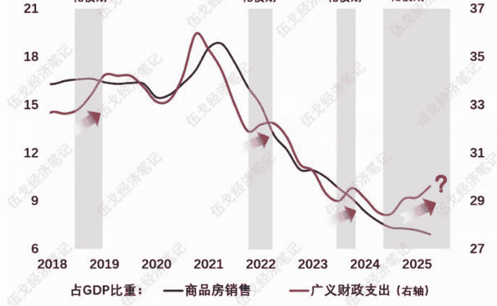

数据来源：WIND；数据自算

# How long will the government shutdown last?

LIVE
Kaishi

# 43.5 Days forecast ▲ 42.9

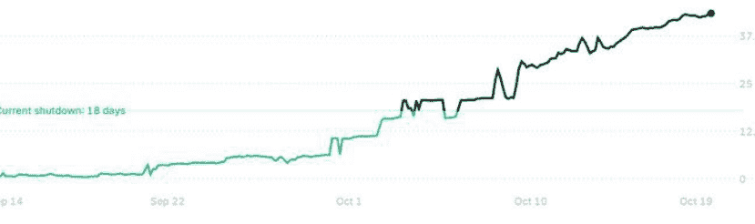

# Jason不离
2025-10-22 05:40
Zaccardi 自 2021 年以来，一半黄金/一半比特币（每月重新平衡）的投资组合每年回报率为 30%，波动率为 15.6%。对比SPX 为 15.5%。#金融

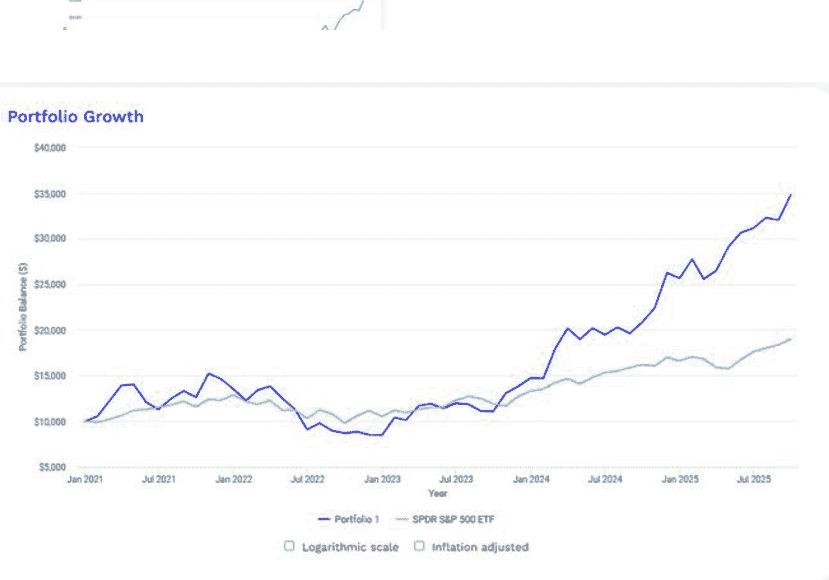

# 其他国家经济
43.5 Days and counting...

 Jason不磕
2025-10-20 05:28
澳洲：在澳洲，富人将养老金视为避税天堂，并且在澳洲距离断裂、代际公平的当下越来越争议，并且这些都成为未来养老金可持续性的隐患。所以正在推动一次养老金改革，向富人增税，减轻年轻压力。澳大利亚政府计划在2024年实施养老金改革，旨在将养老金账户合并...所有收入在2.8万至4.4万之间的劳动者都将受益，税收抵免支付福利将增加4万元。根据政府估计，这些措施意味着低收入劳动者在退休时可能因此获得约1.5万元的养老金收益。

# 旧账难：税收优惠与财富分配

澳大利亚养老金税收优惠的规模令人异常。报告格拉隆研究所的数据，仅养老金层面的税收减免，每年花费预算约500亿元，而且这些优惠不成比例地流向老年人和富裕的澳大利亚人。澳大利亚研究所的特许数据显示这些权价值的增长速度——从世纪之的0.5%上升到目前国内总值的约2%。令人担忧的是，这些税收优惠使得高收入群体得益。财政部估计，收入最高的1%的人在工作生涯中预计每人将获得70万元的养老金优惠，到底10%的人在工作生涯中仅获得5万元的养老金优惠。标注政府关门将持续43天。这是历史最长的，超过了2018-2019年的35天。

#深度视角文集cuk255 有温度高质量社区群cuk255

## 中国产业政策：量化和对错的影响

由 尼尔逊·加西·米西亚, 曼达·多奎里; 陶明
8月6日, 2025

免责声明：国际货币基金工作文件描述了作者正在进行的研究，并发表这些研究是为了寻求意见和劣点的辩论。货币基金工作文件中表达的观点仅代表作者的观点，并不代表基金组织，其执行执行董事会或基金组织管理的观点。

## 总括

本文量化了中国主要产业政策的规模，并评估了它们对国内产业要素匹配和生产率的影响。产业政策的量化利用了上市公司公告报告和土地登记数据的样本。通过现金贴补、税收优惠、补贴和直接雇员（包括私营和国有企业）的土地补贴，产业政策的等效成本成为其GDP的4%。随着时间的推移，产业政策的影响越来越大。接下来，本文使用结构配置模型分析了广泛企业样本的产业政策与要素配置的关系。研究发现，各类产业政策工具以不同的方式影响要素配置——一项不计划会导致生产过剩，而资金和监管将受到制约。然而，产业政策的要素错配可能导致生产率下降1.2%。研究结果与国际货币基金组织(IMF)对中国产业政策和透明度的建议产生了。

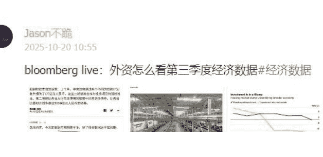

回到财政支出的话题：上个月，中央政府通过两个不同的贷款计划总共提供了1万亿元人民币。这第一将资金作为投资项目的股权资本。第二项是让各省从未使用的额度中出售更多债券，让各省比最初计划多卖5000亿元人民币的债券。

尤斯斯·梅格
大中华区经济与政府团队

总体而言，今天的数据与预期差不多，除了投资数据远不如预期。

但“如预期”并不意味着看好——之前疲软的行业（尤其是住房和私人消费）仍然疲软，价格正在下降，增加地方政府支出的努力尚未产生太大效果。

如果政府继续努力阻止过度竞争并削减产能，可能会恶化投资。但如果没有这一点，价格持续紧缩会继续成为一个问题，并继续打击公司利润。

从好的方面来说，出口仍然强劲。

尤斯斯·梅格
大中华区经济与政府团队

## 工业产出的强劲结果--增长6.5%，预期为+5%--有助于提振大宗商品情绪。伦敦金属交易所铜价上涨0.9%，铁矿石上涨0.6%

位于宁夏银川的银川威力传动技术有限公司的生产线。摄影师:冯来/彭博社

马丁-里豪
大宗商品团队，上海

## 煤炭产量同比下降1.8%，符合预期，因为该行业一直是当局控制供应和执行安全监管的重点。这是连续第三个月同比下降。

马丁-里豪
大宗商品团队，上海

投资的下滑确实值得关注。有问题的不仅是住房。基础投资今年9个月仅增长1.1%，为2021年以来的最低表现。这通常由地方政府资助，他们的收入正在下降，而且他们的支出没有那么多钱，这可能会削弱前景。

## Investment Is In a Slump
Housing market slump undermining broader economy

- Fixed-asset investment - Investment into real-estate

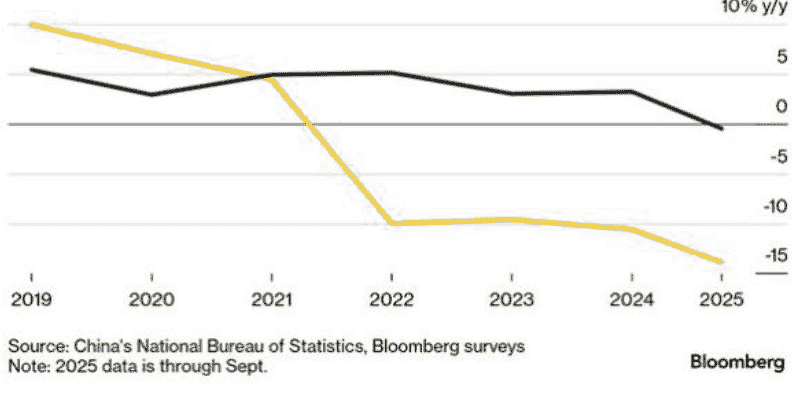
Source: China's National Bureau of Statistics, Bloomberg
Note: 2025 data is through Sept.
詹姆斯·海格
大中华区经济与政府团队

财政收入的缺乏和土地收入持续下降（目前已降至2021年峰值的40%左右）意味着各国政府拨款——截至9月，他们已经售出了约1.5万亿人民币（16亿美元）的新债券，超过了全年。这看起来意味着它的直接影响有限。

## China's Economic Activity slowed Last Quarter

我不确定已经多久了，但经济仍然是故事：零售增长缓慢，而工业继续走强是中国经济的核心。今天最大的惊喜是固定资产投资变得更稳——今年9个月下降了0.5%，比2020年以来的任何时候都糟糕。

- Real GDP growth
- Industrial output value-added
- Retail sales grew only 3% in September

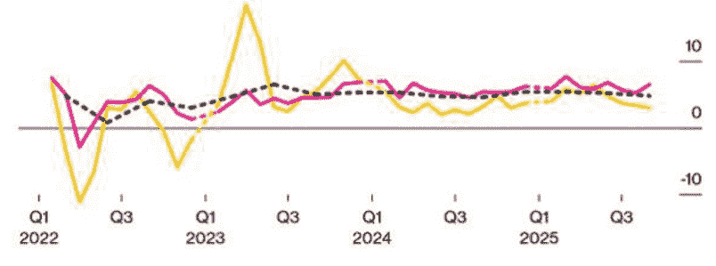
Source: China's National Bureau of Statistics, Bloomberg
梅格
大中华区经济与政府团队

经济连续第二个季度放缓，以年来最弱的速度增长，出口蓬勃受到消费者和企业支出的破坏。

彭德娜
彭博新闻总编

## Chinese Home Prices Still Falling
Drops aren't as deep as before declines still hurting household wealth

与8月相比，9月份房价数据再次下跌，并不是市场触底的好兆。与以前相比，价格下跌幅度不像那么大，但仍然是负的。这使得买房子更便宜，但也削减了人的财富，使他们不愿意花钱。财富的下降是销售如此低迷的原因之一，而这个周末可能不会很快结束。

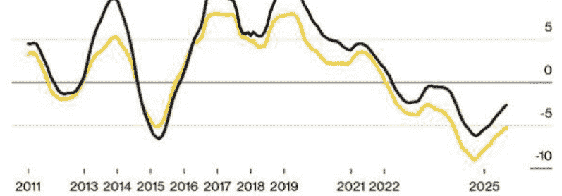
Source: China's National Bureau of Statistics, Bloomberg calculations
詹斯·霍格
大中华区经济与政府团队

钢铁产量软弱：9月份同比下降4.6% 至7350万吨

马丁·里奇
大宗商品团队，上海

瑞银的张估计，中国第四季度GDP增长可能会放缓至4%。

## China's Exports Are On a Tear
Trade surplus this year is providing substantial boost to the economy

- Net exports as percentage of nominal GDP

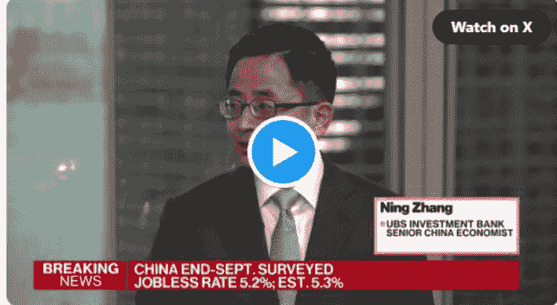

China's home prices fell more steeply in September，尽管近期主要城市引入了宽松措施以复苏困境中的房地产市场。

70个城市排除政府补贴住房的新房房价较8月下降了0.41%，是11个月以来的最大跌幅，国家局周一显示。二手房价下跌了0.64%，是一年以来最快的跌幅。

中国四年的房地产低迷一直拖累着经济，第三季度增长速度为年来最慢。长期持续的价格下跌阻碍了担忧房地产作为财富存储稳定性的购房者。

“房地产市场仍然处于低迷，”Pantheon Macroeconomics首席中国经济学家Kelvin Lam在上周的一份报告中写道，“价格恢复可能直到2027年，届时库存将回到更合理的水平。”

二手房价在监测的70个主要城市中首次出现一年以来下跌。

第三季度贸易预计GDP的比率有所回落——出口占名义GDP的6.2%，低于第二季度首的6.44%记录。尽管如此，这仍然是非常高的水平，还少自2014年以来的任何其他季度。
