# 南半球财财经2510227

Jason-不涵
2025-10-27 02:44

Bloomberg: 贝瑞特周五在中国会谈后表示，中国将大量购买美国大豆，将大豆缓解美国农民面临财务压力的局面。美国贸易代表詹米斯·格里尔(Jamieson Greer) 表示，“中国市场上还没有12月和1月的美国需求，所以他们仍然没有购买美国大豆。”

此外，似乎他们达成了一系列通畅的进展达成协议，贝瑞特，我预计100%的关税已经流失，因美国制造可能将被移除。

# 政策分析

- 中国正在购买美国大豆
- 亚洲国家尚未从中国购买任何货物

China's US soy purchase commitments through mid-September

## 中国停止购买美国货物
亚洲国家尚未从中国购买任何货物

China's US soy purchase commitments through mid-September

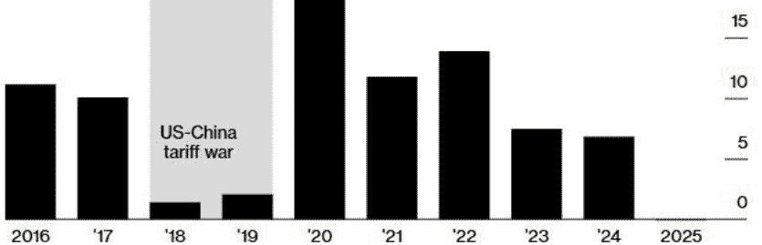

资料来源：美国农业部
注：由于政府部门，数据从9月18日一直没有更新。

Jason-不涵
2025-10-27 02:54

南半球报告：出口商正在经历“衰退期”增长的成本风险，尤其是新兴市场，出口贸易商表示，中国许多贸易限制导致制造大豆的利润仅为5%至10%。对于一家年收入为1000万元人民币（140万美元）的公司来说，如果付付款期限从原来的30天延长到90天，则需要额外200万人民币的现金流。虽然，公司可能无法负担。订单会让他们发愁。

# 经济数据

## 深度视野文集cuk255 有温度高质量社群cuk255

发布时间：2025年10月26日下午2:00

在中国规模最大、历史最悠久的贸易展览会秋季展会会上，许多中国出口商表示，海外买家对延长付款期限的要求成为他们维持利润的最大挑战之一。

各行业的中小企业面临的压力却是巨大的。

> “一位客户突然要求在装运后90天付款，因为其他供应商提供了更长的期限，”广州展会上的照明Kevin Huang说，“如果不遵守，我们就有可能失去订单。”

> “中小企业必须提前承担材料、生产和运输成本。如果资金被冻结三个月或更长时间，订单容易变成可能的损失。”

这一趋势源于海外流动性收紧和库存压力上升的综合影响，在更复杂的全球宏观环境中，中国出口商仍然是世界第二大经济的关键驱动力。

官方数据显示，尽管全球贸易紧张加剧和保护主义加剧，但中国外贸表现韧性，第三季度同比增长6%。

黄说，许多传统制造业出口商已经接受了达六个月或更长时间的付款条件，现在资金压力和利润意味着90天对他们来说“真的负担不起”。

# 深度视野文集cuk255 有温度高质社群cuk255

大型出口也感受到了类似的压力。

“客户，尤其是来自新兴市场的客户，经常要求更长的付款期限，这是我们近年来面临的一大挑战，”聚友电机出口商Keypower的销售总王立林说。

“以前，期限长为60天；现在它们通常是90天或长达120天。”

王说，他的公司需要延长期限，以帮助分销更多产品，这意味着它正在分担他们的现金流负担，以换取更多的订单。

与中国国内出口商相比，过去，国外买家的付款周期较高，使出口比专注于国内销售的公司有明显的盈利优势。欧美订单通常在45天内结算，东南亚订单在60天左右结算，而国内客户则需要90天至120天。

现在，这种优势正在消失，因为由于海外买家的延付付款导致公司的流动性受到了极大的压力。

上个月，企业信贷机构郭华在《2025年中国海外商业风险报告》中强调了中国企业在海外市场面临的两大风险：全球企业破产和延付款。

- 订单激增，风险增大
- Dave Cheng, 出口贸易商

“在监测样本中，许多市场的平均付款期限延长了10%至20%，”该机构的专家Louis Lu在报告发布会上表示。“此外，2024年欧美主要经济体的破产数量同比增长20%至30%。”

> “海外公司付款的时效性普遍下降，付款延长的现象日益明显。”

> “高利率、库存和现金流紧张迫使海外买家推迟付款。一旦买家面临破产或经营困难，中国供应商的坏账风险就会立刻上升。”

# 深度视野文集锦cuk255 有温度高质社群cuk255

十五

# Jason Chen

2025-10-27 03:07

国债：债市的投资者大部分都是金融机构，而金融机构作为资金的供给，其资金来源往往来自实体的储备，而金融机构负债决定了股市资金供给。从近期来看，银行、保险、理财等金融机构负债均有所提升，总增速在5月为10.5%，而9月则升至11.5%。

资金增加之后，金融机构能够对资产进行配置。虽然金融机构配置比例有限，银行、基金、理财、保险等配置比例同样上升。而负债增加之后，对应的更多固定收益类资产的增加，资产供需状况与利率走势基本一致，这意味着后利率有望下行。

## 表1：居民存款、货币基金、理财、保险收入同比

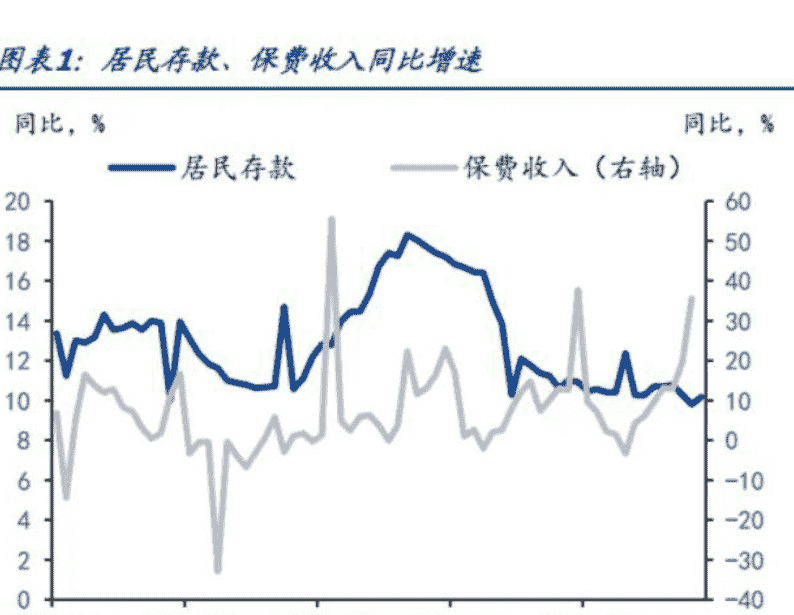

资料来源：Wind，国泰证券

深度视野文集cuk255 有温度高质量群cuk255

## 图3：资金与非政府债券差异同比

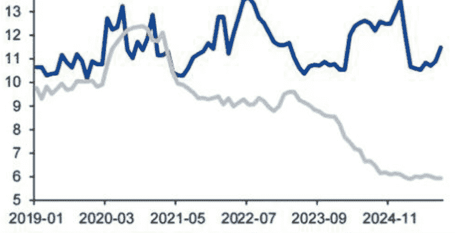

资料来源：Wind，国泰证券

## 图4：两者之差和长期利率走势（风险偏好资金差异，右轴）

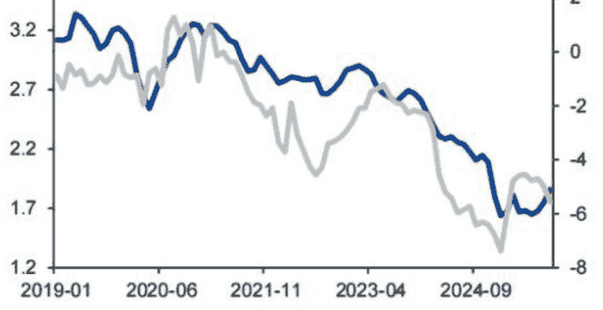

资料来源：Wind，国泰证券

深度视野文集cuk255 有温度高质量群cuk255

# Jason-Jamie
2025-10-27 03:13

我们在8月31日发布的《转折点报告》中指出，8月成交量触底换手率（A股成交总比）跌至2024年10月8日的4.2%后，随着换手率在9月初回高，已经接近10月8日，市场首次反弹。换手回升后成交量放大，市场出现震荡，当换手率多次在1-2周后，换手初期的缩量股市底部可能更大，可能接近2-4周的震荡。

（2）震荡周期通常分为三个阶段：第一阶段是量级调整（换手1-2周、换手3-4周），第二阶段是二次震荡（换手3-4周），市场逐步接近转折点；第三阶段是二次调整（换手1-3周、换手3-4周），调优震荡（3-4周），市场在接近转折点后成交量放大至此前70%水平，并在高位维持并未出现下跌。当单日成交量缩量到8月份的1/2后，缩量幅度已经接近历史中震荡期平均水平。

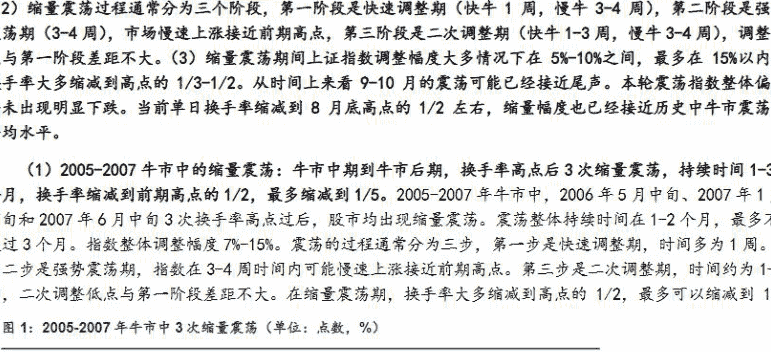

（1）2005-2007年的缩量转折点：成交量触底后，换手率触高后转折点维持时间1-3个月，换手率缩量到转折点前3次换手放大，缩量到1/5；2005-2007年中，2005年5月初和2006年5月和2007年6月，两个缩量调整期，震荡整体维持时间在1-2个月，主要是由于超过3个月。缩量调整幅度约70%，调整持续为2周左右。第一阶段是二次调整，时间为1周；二次调整与第一阶段差异不大，在缩量转折点后，换手多次后缩量到高点的1/2后，甚至可以缩量到1/5。

图 1：2005-2007年的缩量转折点（成交量，）

数据来源：泰信证券研究中心

（4）当下的判断：9-10月的震荡可能已经远去，11-12月指数有望在增强预期下扩大进入主升阶段。预计下半年股市将继续活跃，市场届时将迎来乐观预期。由于9-10月成交量持续增加，股市结构性牛市行情已经进入第年后，民间资金活跃度持续增加，下半年自2024年10月8日的高点以及AI概念等部分板块交易活跃，数据显示市场底部有望经过进一步扩大。随着市场回暖，我们认为下半年股市重心将不断上移，由于市场出现明显的筑底信号，行情不会结束。“十五”规划的目标符合预期，获利资金持续流入，11-12月指数有望反转。

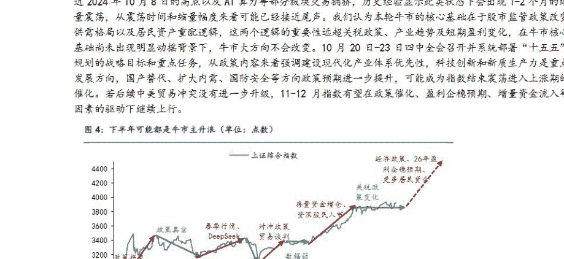

数据来源：万亿，图中数据仅供参考

注：图中数据代表样本历史表现

Jason
2025-10-27 03:21

## 中信：中国金融全球配置策略2025年第四季度资产配置建议（比例）

| 资产类别 | 权重建议 | 备注 |
| :--- | :--- | :--- |
| 股票 | 40% | |
| 债券 | 30% | |
| 现金 | 20% | |
| 其他 | 10% | |

(二) 四季度大类资产配置览

| 类别 | 低配程度 | 标准配置 | 超配程度 |
| :--- | :--- | :--- | :--- |
| 美国(标普500) | 看空 | | 积极推荐 |
| 欧洲(DAX, CAC) | | | |
| 英国(伦敦期) | | | |
| 日本(日经225) | | | |
| 中国股(沪深300) | | | ● |
| 中国股(恒生指数) | | | ● |
| 债券 | 看空 | 保守 | 积极推荐 |
| 美国国债 | | | ● |
| 中国:货币市场 | | | |
| 中国:利率 | | | |
| 中国:信用 | | | |
| 中国:可转债 | | | ● |
| 商品 | 看空 | 保守 | 积极推荐 |
| 黄金 | | | ● |
| 白银 | | | |
| 原油 | | | ● |
| 铜 | | | ● |
| 银 | | | |
| 外汇 | 看空 | 保守 | 积极推荐 |
| 美元 | | | ● |
| 欧元 | | | ● |
| 英镑 | | | |
| 加元 | | | ● |
| 日元 | | | |
| 澳元 | | | |
| 吉特 | | | |
| 印尼盾 | | | |
| 人民币 | | | |

注：黄色为调整，红色圆点为二季度修正，当前观点较二季度修正后未变化。

> Jason
2025-10-27 03:29
zerohedge: 美国政府现在在每一美元收入，其中的23美分就得用于利息支出

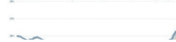

# 其他国家经济

Interest Expense as % of Revenue and Total ($BN)

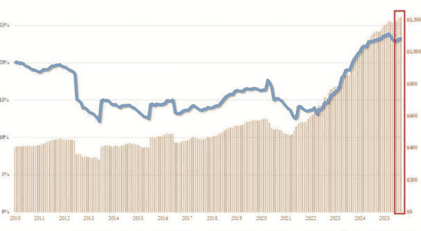

LTM Interest Expense (RH Axis) --- LTM Interest Expense as % of Tax Revenues (LH Axis)

Source: ZeroHedge

Jason
2025-10-27 04:19

## 湖北省内2024年各市区广义债务自制图表

| (地方债+城投有总债) / 缴收收入 | 税收入/财政收入占比 |
| :--- | :--- |
| 南球财经 | |

## (地方债+城投有总债) / 缴收收入

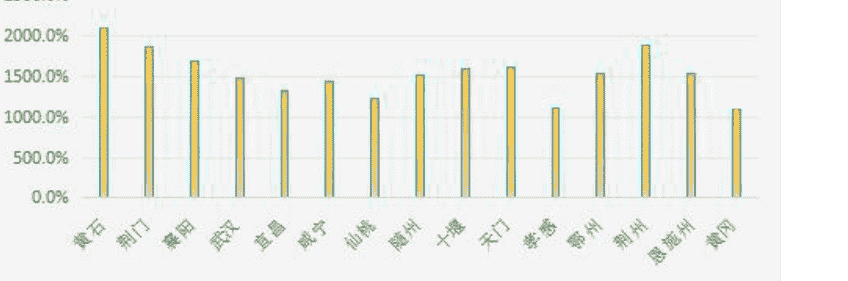

(地方债+城投有总债) / 缴收收入
南半球财经

## 非税收收入/财政收入占比
南半球财经

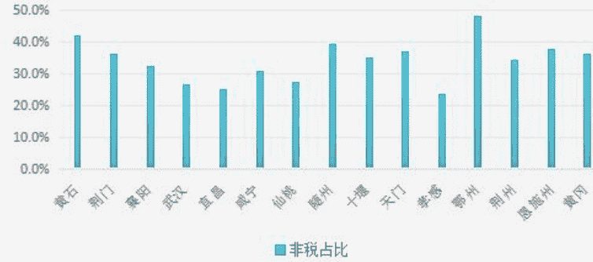

目前美国基金规模达到48亿美元。这种攀升通常反映出经济不确定性、高利率或债券机会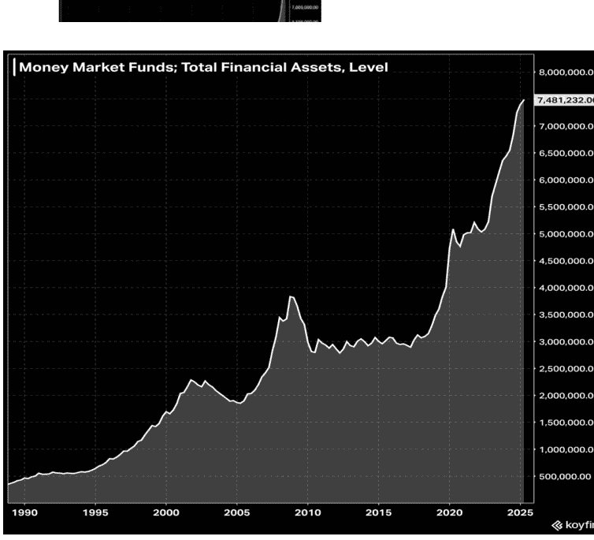

全国总工会：近日，多地发布网约出行行业预警。从事网约出行的驾驶员不要相信梦想是现实，应进行详细准备，关注成本和实际收益，避免收入与预期不符。

# 数据

责任编辑：李明 发布时间：2025-08-21 各位从事网约出行的司机：为促进网约汽车市场健康发展，保障从业员合法权益，引导行业有序等，风险提示如下：

## 一、行业状况

2023年7月，全市共有网约平台46家，已发网约车辆通行证1888张，注册司机1888人。运出车辆266辆，日均订单17单，日均订单率25%，日均收入低于200元的驾驶员占比65%。

### 太原市网约出行行业2023上半年运营情况及风险预警 作者：[天宇]

## 二、运营状况

截至，全市取得经营许可的网约平台80家，核发《网络预约出租汽车运输证》3.6万余，核发《网络预约出租汽车车辆证》3.6万余，实际运营车辆1.8万辆，日均订单量不少12单，日均收入160元，每天运营8小时以上，日均收入低于200元的驾驶员占比75%。

### 大理网约汽车发展现状

截至2025年8月31日，大理共有取得网约经营许可平台250家，办理《网络预约出租汽车运输证》车辆4968辆，已退出运营459辆，办理《网约车辆许可证》司机9591人，1.8万，日均预约订单量12单。大理作为旅游城市，游客对网约汽车的需求得到充分满足。目前，大理公交、共享电动车等多种方式仍良好运行，车辆运营趋于饱和，加之大理网约市场不断激烈，出现收入下降、订单时长变长等情况，9月份开始进入旅游季，预计网约经营效益比旅游期间下降，呈现大量的状态。

### 2025年7月份深圳市网约车动态与风险提示

2025-05-26 为方便从事网约车经营业务的企业或个人决策参考，发现2025年7月份深圳市网约车动态信息：

## 一、行业运营情况

截至7月31日，我市网约平台25家，已发《网约车辆通行证》133450张，已发《深圳市出租汽车驾驶许可证》363608。根据各平台数据显示，本月网约车日均完成订单量为13.0单/车。

## 二、风险提示

我市网约车市场需求季节性变化较大，市场总体已饱和，在此重提有意从事网约经营的企业与从业人员，应充分了解网约车相关法规，做好市场调研，清晰评估经营收益，理性审慎投入及界选择。

Jason
2025-10-27 10:54

国内：历史数据统计，制造业比重与长期利率之间存在相关关系。这一现象不仅在国内债券市场中体现，在海外发达经济体和新兴经济体中也类似。

根据历史数据回归，国内制造业比重每下降1个百分点，利率可能会下降20个基点；日本制造业比重每下降1个百分点，利率可能下降50至60个基点；美国每下降1个百分点，利率可能上升50至100个基点，尽管各国情况存在差异，但总体来看，制造业比重的下降将会利率产生冲击。科技的发展对我国产业生产上有正向的。科技的发展有助于提升生产率，一定程度缓解人口的压力，推动经济增长。“高科技占比占出口”作为科技行业发展态势的替代变量，从宏观来看，中国、美国和日本的情况。从长期来看，各国的高科技产品与利率之间存在正相关关系。具体而言，高科技产品的占比越高，意味着该国家在全球产业中的技术地位越强，同时也意味着具有更高的生产速率和资本需求。

### 图表3：美国制造业占比与增长率长期走势

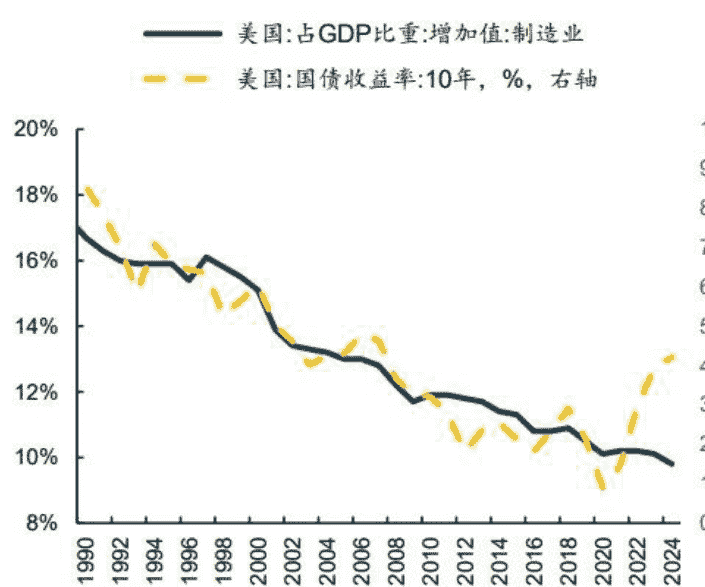

来源：Wind，国金证券研究所

### 图表4：印度制造业占比与增长率长期走势

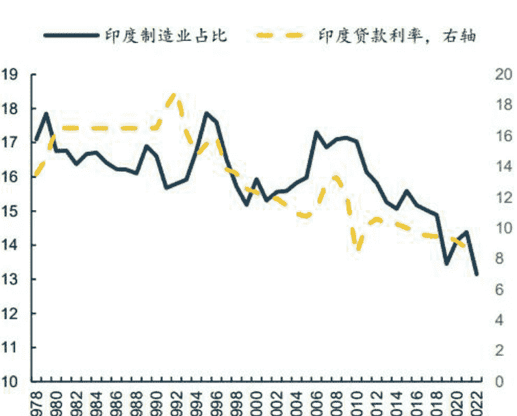

来源：Wind，国泰证券研究所

### 图表7：中韩制成品出口占比与 10Y 信贷利率关系

| 中国制成品出口占比金额高：中国出口金额 | 日本制成品出口占比金额高：日本出口金额 | 美国制成品出口占比金额高：美国出口金额 |
| :--- | :--- | :--- |
| 10Y，中国 | 10Y，日本 | |

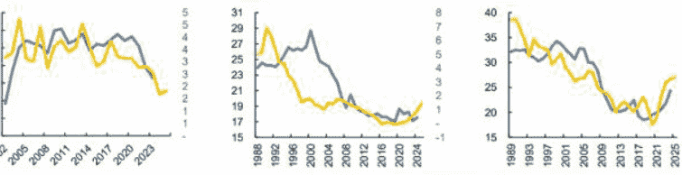

来源：Wind，国泰证券研究所

# Jason-Down

2025-10-27 11:12

中：阿昂的财富增长。内在增长动力可能来自高净值人群，而非一般意义上的“扩张”。

市场虽然认为低利率环境和市场上涨可以使得居民存款增长，那么我们想要问一下日本居民在 90 年代为何没有进入市场？（日本 1992 年、1995 年和 1998 年出现的原因不是一次，而是三次超过一年的牛）。我们认为日本居民没有持续投入，是因为在收入下降下，预防性储蓄和负债的双重压力，日本银行的研究指出，在 1990 年代，居民不愿意投资风险的一个重要前提就是流动性。另外，日本公共养老体系使得居民对稳定性养老保险感到非常心，对养老这种“刚性刚需”的风险，居民倾向于储蓄，对于其对投资风险的需求得到了提升。参考当年的经验，如果未来政策在预期、养老体系、债务负担上投入更多，将有助于“存款储蓄家”和“财富扩张家”走得更远，避免日本未能反思而引起的情形。

## 金融

图表：北上广租赁占比为 1.5%-2%

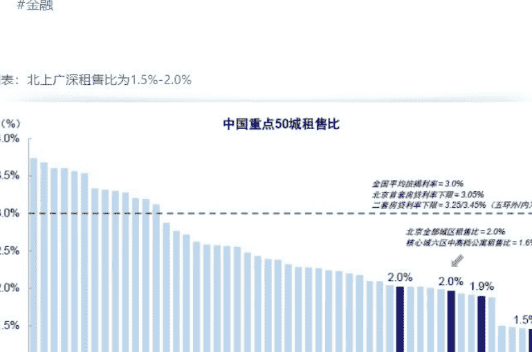

资料来源：中金公司研究部

## Jason不撒

2025-10-27 17:40

## 澳洲新商业移民 VS 投资移民区 vs 移民

## BIV 与 AIP 政策比较

| 类别 | 100W | 200W | 500W | 1000W |
| :--- | :--- | :--- | :--- | :--- |
| 申请要求 | 来投资的 | | 55岁以下 | 无要求 | 无要求 |
| 经营经验 | | 3 年以上的自雇企业或经营经验 | 政府批准的基金或股权投资 | 各种行业 |
| 资金来源 | | 成立 5 年以上或新西兰企业 | 为西澳或加拿大中小型企业 | 无要求 |
| 投资方式 | | 股权投资、参与管理 | 股权投资、需管理 | 5 年 |
| 最低投资 | | $13,800 Business Investor Work Visa | $14,890 Business Investor Resident Visa | $27,470 Actives Plus Resident Visa |
| 申请费 | | 50 万以下 | 无要求 | 6 年 |
| 签证有效期 | | 3 年 | 直接获得居民 RV | 直接获得居民 RV | 3 年累计 105 天 |
| 永久居留要求 | | 5 年内满 14 个月 | 每年住满 88 天 | |

## BIV 与 AIP 政策比较

Jason不撒

2025-10-27 17:54

中国：从 2020 年开始，我们研究的近 50 个全球经济体中市场通胀率均出现大幅上涨，平均涨幅在 30% 以上。新西兰，通胀（以 GDP 名义值为准）以市场通胀为准，实际通胀率涨幅为 5% 左右（CPI 领先接近 5%）。若进一步按效率衡量，则（或欧元）平均涨幅在 2% 左右，新西兰通胀却是过去 40 年里唯一的地区，其中增长的趋势最为剧烈。

全球整体在 2026 年前面临低增长和高通胀的动向转换，这可能有利于全球市场的波动（在住房市场及其获取的成本方面）。但是由于新西兰的影响，其程度可能会很大。过去几个月通胀低迷时期市场宽松的老经验很多值得商榷，而此后一种可能可能会成为现实。由于这种不平衡的趋势，通胀将再次反复，并且部分地区供给的短缺（或许是金融行业长期低投资的结果）使得走出这种局面的速度会加大。

总体上，我们认为通胀的“损失”是市场的一种长期调整。因此，相较于新西兰，全球波动可以进一步丰富我们判断长期的框架，程度应该是外部环境的变化。

## 全球通胀对比

| | 北京 | 华南 | 东亚 | 东南亚 | 中东 | 欧洲 | 整体 |
| :--- | :--- | :--- | :--- | :--- | :--- | :--- | :--- |
| 需求涨幅 | 35.6% | 17.3% | 0.2% | 40.9% | 31.7% | 23.2% | 14.1% |
| 2020 年以来 | 7.7% | 4.5% | -1.8% | 10.5% | 10.6% | 12.1% | 30.2% |
| 近期 | 2.3% | 0.7% | -5.3% | 5.2% | 6.5% | 2.0% | 10.7% |
| 实际涨幅 | 10.9% | -2.3% | -15.8% | 5.3% | 10.6% | -4.4% | 15.3% |
| 2020 年以来 | 1.5% | -0.5% | -5.5% | 3.8% | 4.7% | 3.1% | 12.5% |
| 近期 | -0.4% | -2.8% | -0.3% | 5.0% | 1.1% | 1.6% | 3.4% |
| 实际涨幅 | 34.9% | 6.7% | -12.7% | 25.5% | 15.1% | 13.8% | 46.1% |
| 2020 年以来 | 7.4% | 6.8% | -8.6% | 11.3% | 5.8% | 3.5% | 30.9% |
| 近期 | 2.0% | -0.3% | 0.5% | 0.7% | 4.7% | -6.2% | 5.2% |
| 实际涨幅 | -3.2% | -2.5% | -4.5% | -11.0% | -2.2% | 7.9% | -3.4% |
| 2020 年以来 | 2.7% | -2.5% | -2.2% | 4.3% | 5.0% | 1.0% | -1.5% |
| 近期 | -4.3% | 2.8% | 0.7% | 4.5% | 3.0% | 7.4% | -3.7% |
| CPI 重算涨幅 | 22.6% | 20.4% | 18.8% | 35.0% | 15.2% | 28.7% | 67.8% |
| 2020 年以来 | 5.9% | 4.6% | 3.2% | 6.1% | 3.8% | 8.5% | 16.8% |
| 近期 | 2.6% | 2.2% | 0.7% | 3.8% | 0.9 | 4.6% | 1.3% | 6.5% |

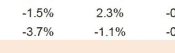

# 深度视野优质集团（链接优质群，助你成功）

全部包含以下内容：限时年费 188/年 加微信cuk255

- ① 吃瓜群众倍时圈加时群对话 (原价 365 元/年)
- ② 子明私享会（内部）内部文章
- ③ 政事室 (顾子明)付费内容再送顾子明群
- ④ 米联诸【作者米穗】(原价 599 元)
- ⑤ 欧洲金雀专属 (原价 328 元/年)
- ⑥ 砖瓦内部 (原价 400 元/年)
- ⑦ 卢克文青会专属文章 (原价 699 元/年)
- ⑧ 鉴茶财经星球 (原价 3310 元/年)
- ⑨ 猫哥的视界星球 (原价 299 元/年)
- 10 财新周刊【独家】(原价 1498 元/年)
- 11 杨世在钱爆 (原价 2200 元/年)
- 12 蒜森财经星球 (原价 1600 元/年)
- 13 激激异译付费文章 (持续更新)
- 14 司马林解读毛全套音频和全套书籍收藏版无割 (原价 2.3 万)
- 15 虚虚三部曲[民国梦、帝国亡、不被理解的 MAO] (原价 599 元)
- 16 卢克文知识星球 (原价 268 元/年)

17 额外再送：卢薛元新浪付费专栏、三村丰老王、三花九洞文集

不定期内容：更多资源将不下......

- ① 守夜人司令知识星球、接换魔王知识星球、养成打造财富、雪花甲老头等
- ② A 视野、大树书谈、江初阳、咩咩说、上海海家等付费文集
- ③ 西风付费文章、老端、在小小时之时、局外的视野、升值、老A体制内等等一系列大 V 付费文章（每月不超过 600 元的付费文集)
