# 南半球联财财经251031

Jason不遇
2023-10-30 15:44

赢译居住数据研究院：10月全国40个大城市租金均价为34.01元/m²/月，环比下降0.08%，同比下降2.49%，今年1-10月2024年租金水平下降1.71%，为近三年租金下跌以来的跌幅最大，从当前基本面看，租金下跌趋势短期难以扭逆，一方面，保租供应仍在释放量，二手房由购售转租的压力缓解；另一方面，人口增长缓慢，经济预期调整需要时间，需求难以快速反弹。房价

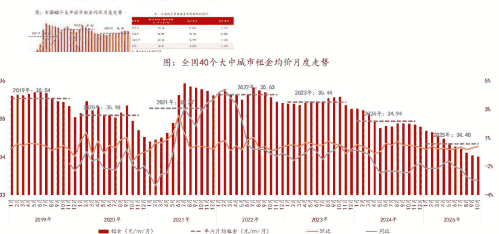

数据来源：赢译居住数据研究院

| 城市等级 | 2023年10月均租金(元/平方米/月) | 环比 | 同比 |
|---|---|---|---|
| 一线城市 | 83.34 | 0.32% | -2.35% |
| 二线城市 | 29.89 | -0.14% | -2.80% |
| 三线城市 | 24.45 | -0.49% | -1.52% |
| 四线城市 | 34.01 | -0.08% | -2.49% |

数据来源：赢译居住数据研究院

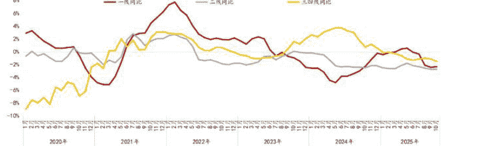

数据来源：赢译居住数据研究院

深度视野VIP群 人工追踪50+大V 付费加微信cuk255 微信chp5568

## Jason不遇

2025-10-31 02:13

bloomberg: 美国将中国在2028年之前购买870万吨大豆，中国将暂停许可出口至美国一年，美国将降低对中国商品的20%的关税，11/1后100%也取消，除外在软件出口，船运费上上涨。政策分析

美国表示，中国在2028年之前购买数百万吨大豆，这为焦急等美国农民扩大对中国的大豆市场提供了一个缓冲。

更新于 2025年10月31日午后6:26 GMT+13

美国表示，中国已同意在2028年之前购买数百万吨大豆，这为焦急等恢复向这个亚洲国家出口的美国农民提供了一些缓解。

美国农业部部长鲁克·罗斯林（Brooke Rollins）在X上的一篇帖子中表示，中国已同意本季至少购买1200万美国大豆，未来三年每年至少购买2500万吨。她补充说，中国将取消对包括大豆在内的多数美国农产品的“无关税”。

这些细节证实了财政部长长斯·贝·辛特早时候访问了福克斯商业频道的评论，这导致大豆期货价格高达2.2%的跌幅。截至芝加哥中午12点23分，期货上上涨1.2%，每满口耳11.0725美元。

## Jason不遇

2025-10-31 02:19

bloomberg: 在美元贬值和威尔·鲍威尔的推动下，美元将升至三个月来的最高水平，新资产受到风险。金融

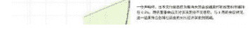

## 深度视野VIP群 人工追踪50+大V 付费群微信cuk2556 微信chp5568

## Dollar Rallies After Powell Casts Doubts Over December Cut

Bloomberg Dollar Spot Index Close on 10/27... 1212

日本央行政策委员会维持利率不变，推动日元走低，尽管行长植田和微妙地表示即将临近。自货币宽松者自春任职以来，首次决定表明日央行试图在下一步行动的时机必须保持平衡，而不受货币政策或国内因素的影响。一份声明，日本央行周四在为期两天的会议结束时政策利率维持在0.5%。两位成员对该决定持意见，与9月的会议相同。这一结果符合市场大多数学家的预期。

BOJ Stays Cautious as Fed's Cut Narrows Gap

BOJ policy rate | Federal Funds Target | Upper Bound | ECB Deposit Facility Announcement | Last Price

植田在决定后的新闻发布会上：“今天举行会议，因为我们希望看到更多关于国内的数据，而海外经济的不确定性仍然高。如果我们不信赖，无论政治局势如何，我们调整利率。”

## 深度视野VIP群 人工追踪50+大V 付费群微信cuk255 微信chp5568

## 微博人工智能的要点

- 日本银行长植田东彦表示，日元汇率可能走至120至130左右。
- 日本银行长植田东彦表示，日元汇率过于疲软，日元汇率将回升至120或130。
- 日本银行长植田东彦表示，条件已经具备，指出2%的通胀目标已经实现，经济有望在增长。
- 日本银行长植田东彦表示，日元汇率可能会走强至120至130，因为预计美利差将会缩小。
- “目前的日元汇率，如果153日元或类似货币——这太弱，”植田在新加坡参加亚洲论坛期间接受采访时表示。“在某个阶段，日元汇率将回升，”他说。”
-植田东彦补充说，美国降息和日本银行的措施自然缩小两个经济体之间的差距，将日元回到两年前的水平。

- 周四，由于美联储主席杰罗·鲍威尔（Jerome Powell）抑制12月降息预期的言论继续在全球市场引起反响，新兴市场下降。
- 中美方达成了一年的贸易协议，美国削减了关税豁免期，中国恢复了大豆销售和肉进口。
- 追踪主要国家股市多数跌0.5%，住了周日的颓势，韩胜利。
- 周四，由于美联储主席杰罗·鲍威尔（Jerome Powell）抑制12月降息预期的言论继续在全球市场引起反响，新兴市场下降。这些言论导致风险资产在前交易暴跌，抵消了备受期待的休战。

## 深度视野VIP群 人工识别50+V 付费进群加微信cuk255 微信chp5568

各国央行在第三季度加速了黄金购买，一些回头冒着创纪录的高价抬升金价值以对冲削弱的美元。

根据世界黄金协会的报告，7月到9月期间购买了220吨，比上季度增长28%，扭转了年初的增长趋势。哈萨克斯国家银行是最大的单一买家，而巴西中央是年来首次购买黄金。

截至9月，各国央行增加了634吨黄金储备，低于过去三年的同期，但远高于俄罗斯银行入侵乌克兰之前的2022年之前的平均水平。

WGC预测2025年全年采购量在750到900吨之间。

## 央行黄金购买在开局缓慢回升

- Gold purchase volume in tons

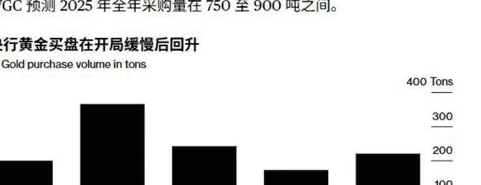

> “地缘政治紧张局势、顽固的通胀压力和全球性贸易政策的不确定性都刺激了人们对避险资产的兴趣，”WGC 高级市场分析师 Louise Street 在周四报告发布时的一明确指出。

Total quarterly demand by sector in tonnes and US$

- Jewellery fabrication
- Central banks and other inst.
- Technology
- OTC and other
- Total bar and corn
- LBMA Gold Price (fhs)
- ETFs and similar products

Jason 不遇
2025-10-31 02:35

据报道：中国老龄化通常发生在发达阶段。与许多发达国家不同，中国进入初老龄化阶段时人均GDP仅959美元（发达国家在2000美元以上），进入老龄化阶段时人均GDP仅为2万美元（发达国家在3万美元以上）。中国15-64岁人口占比2010年达到峰值74.5%，此时中国人均GDP为5647美元，低于美国、英国等发达国家。未来需要应对老龄化带来的养老金、医疗保障、劳动力短缺等压力。

人口占比高峰时人均GDP比较（美元）

| | 60000 | 53596 | 44525 | 28100 | 5647 |
|---|---|---|---|---|---|
| 50000 | | | | | |
| 40000 | | | | | |
| 30000 | | | | | |
| 20000 | | | | | |
| 10000 | | | | | |
| 0 | | | | | |
| 美国 | | | | | |
| 英国 | | | | | |
| 日本 | | | | | |
| 韩国 | | | | | |
| 中国 | | | | | |

（注：商品房销售由商品房销售除以面积统计所得）

数据来源：Wind、中银研究院

## 深度视野VIP群 人工追踪50+大V 付费群微信cuk255 微信chp5568

图22：部分国家18岁以上成年率与人均GDP比

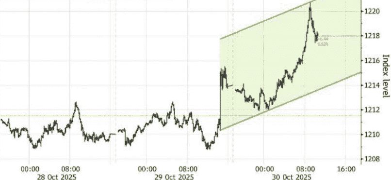

图23：日本、韩国货币存款增长率低于水平（%）

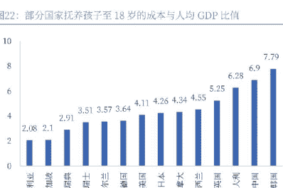数据来源：世界，中银研究院

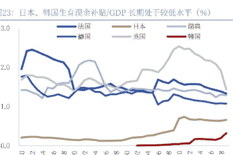数据来源：OECD，中银研究院

图28：中国平均年龄与房价变化趋势（万/平方米）

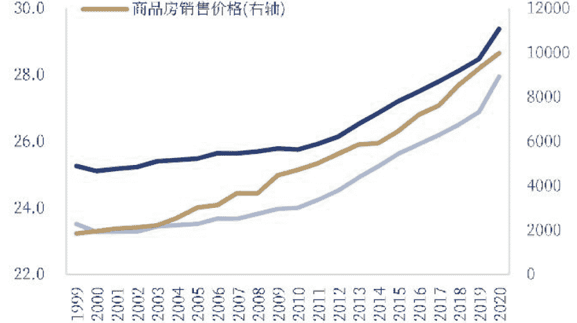数据来源：Wind，中银研究院

图30：部分国家和地区15岁以上劳动参与率（%）

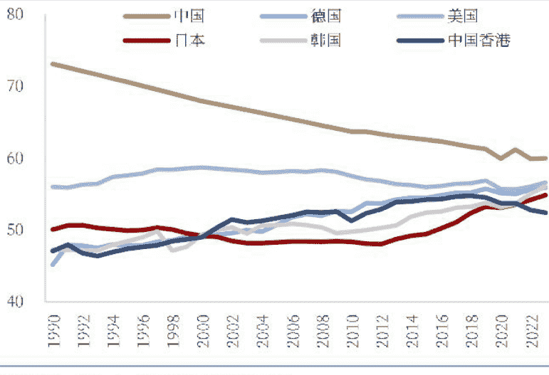数据来源：Wind，中银研究院

Jason不遇
2025-10-31 02:37

政策分析：在本轮谈判中，涵盖了更多的筹码

| 1. 某某政策... | 2. 某某政策... | 3. 某某政策... |

具体来说，美方的核心举措在于缓和关税压力，并暂停部分非关税压力措施。

- 1. 美方将取消对中国产品加征的10%的所谓“亚太关税”。
- 2. 美方对中国产品加征的24%的等关税将继续暂停执行，并继续延长部分关税排除措施。4月2日，特朗普将对华发动“关税审查”，其中，对华美国加征34%的等关税，5月12日，美方宣布（中美经贸工作小组联合声明），美方将34%的等关税中的24%暂停执行90天，仍保留10%继续执行。
- 3. 美方将暂停执行9月29日的出口关税50%选择性规则一项。此前美方宣布的出口关税50%选择性规则，对被列美国“实体清单”等的企业超过50%的出口加征控制，美方是借此发“长臂审查”，对中国企业实施无理由监管的典型做法。
- 4. 美方将暂停实施对华物资、物流和船舶301调查暂停一年。此前美方宣布，2025年10月14日，对中国企业或经营的船舶、中国籍船舶及中国船舶加收进口服务费。

作为对称安排，中方也调整了反关税措施，并暂停实施出口控制新规。

- 1、中方相应调整对方“亚太迷你关税”的反制措施。当时反制措施包括农产品、能源产品加征10%或15%的关税，对华美国企业列入实体清单等。
- 2、中方对美国产品加征的24%的反关税将继续暂停执行，并继续延长部分关税排除措施。
- 3、中方将暂停实施9月9日公布的“301许可证”稀土材料出口控制措施暂停一年。
- 4、美方暂停实施对华“301调查”后，中方也将相应实施针对美国的反制措施。2025年10月14日起，对美国的企业、其他组织和个人拥有25%以上的船舶加收进口服务费。此外，双方还取消亚太迷你关税，扩大农产品、相关企业个案处理，双方进一步确认了签署在领域取得积极进展。

（二）还有哪些问题没有

- 1. 美国以芬尼为借口，对华累计加征20%，只降了10%。
- 2. 尽管美国方24%等关税将延续一年，期间仍保留了10%。
- 3. 特朗普时代对华加征“301”，前三轮分别加征25%，第四轮加征7.5%，据美国彼得国际（PIE）计算，2024年底对华平均加率为19.3%，但伴随中国出口结构调整，平均加率为10.7%。
- 4. 芯片、新能源汽车、光伏等行业的封锁和限制。例如，美国停止了芯片设计软件（EDA）销售，在24%等关税暂停一年内，美对华平均加税率为10%~30%。隆继建结束后，特朗普届任期内，美国累计加征20%，与美国持平，高于其他国家，平均加税率为10%~28%。南亚地区整体15%，低于日本和巴西35%、墨西哥25%。在24%“反制税”暂停一年内，中国对美平均加税率为15%。

免责声明：www.ykqz

Jason 不跑
2023-10-02

二手房价格加速上涨

## 其他国家经济北京的二手房价格加速上涨

## 东京二手房价加速上涨

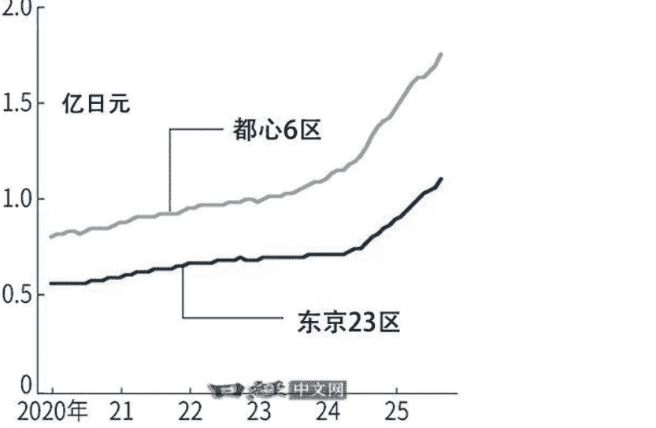 (出处)东京KANTE、每70平方米的期望出售价格

Jason不易
2025-10-31 02:45

指标：对40个行业近400样本企业开展业务头部渗透，通过构建“利润-债务增速”四象限，通过分析各行业盈利能力与财务杠杆的动态平衡和发展状态，揭示不同行业的稳定性与周期性。我们认为，处于第一象限的行业导致债务上升，但若利润与债务增速能够良好平衡，则仍是健康的行业。例如，这类行业在周期中表现相对稳健，中波动多于第一象限，但我们认为它们是更具稳健性的行业。

分为以下三类：
第一类：“周期稳定-增长型”象限。典型行业包括涵盖的公共事业、环境服务、基础设施等。此类行业在周期中表现相对稳健，中波动多于第一象限，我们认为是更具稳健性的行业。

第二类：“需求驱动型”象限。典型行业包括服务业、资本品、技术硬件与半导体、耐用消费品。此类行业具有明显的周期性或竞争压力，其特征是在需求景气衰退阶段处于第一象限，信用表现良好；而在需求低迷或技术更替时则转向第二象限，开始面临盈利与债务的压力。我们认为此类行业的长期稳定性虽然全行业中较好，但隐含属于一中的行业。部分行业对消费的敏感度更多取决于补贴政策，其可持续性存在很大不确定性。

第三类：行业的利润修复主要由于其他因素，头部价格的加速导致。典型的行业是建筑材料和金属行业。我们认为这两个行业利润改善更多受益于上游成本下行，供给受波动影响，修复的持续性有待观察。

在第二类中的行业表现为重大转变，属于典型的“危机并存”。若长期留于此，往往意味着财务风险不断增加，甚至可能引发行业性衰退。

从债务和利润的动态变化来看，我们认为相比2023-10-02二手房正在加速流动，平均购房占比9%，越来越多观点在新房供应减少的情况下，刚需群体正在流向二手市场，再加上房价上涨的背景下，刚需群体在提高。

## 深度视野VIP群 内追踪50+AV 付费群加微信cuk2555 微信chp5568

## 变形

- Jewellery fabrication
- Central banks and other inst.
- Technology
- OTC and other
- Total bar and corn
- LBMA Gold Price (fhs)
- ETFs and similar products

# Jason不遇

2025-10-31 02:48

中信建投：可以结合预期利率对未来中期的国债利率点位进行估计。当前7日OMO利率为1.4%，如收益率2026年10BP、10Y国债长期中枢在1.68%一线，即1.65%~1.70%区间；降至20BP，10Y国债长期中枢回到1.52%一线，即1.50%~1.55%区间。就基本面而言，预计11月基本位置将回到1.82%。考虑到市场的联动调整后，1.86%~11月是概率较大的值。

表1：不调整系数后的OMO利率基枢（单位：%）

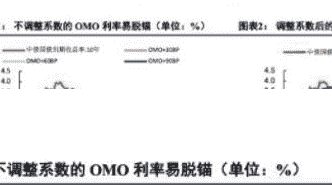
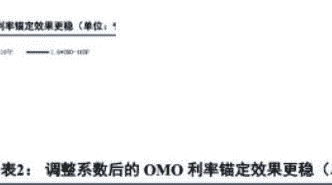

表2：调整系数后的OMO利率锚定效果（单位：%）

# Jason不遇

2025-10-31 02:51

## Dalio：你应该将黄金视为一种基本货币 #金融

达利欧：在过去的几十年里，由于全球货币的贬值和债务规模的扩张，黄金作为一种基本货币的表现是非常成功的。黄金不仅是通胀对冲工具，更是信用货币风险的对冲工具。当货币体系出现不确定性时，我们应该更加关注黄金。

## 黄金是最安全的货币

最近很多人来问我很多关于黄金的问题，所以我邀请关心我问我关于黄金的问题的人，我回答了大部分。然后我把它们放在了两个常见问题解答组——关于黄金和我的数字孪生（数字字体），以便数字字体可以尽可能多的个人进行完整的关于黄金的对话，只要想进行关于黄金的对话（您可以注册数字字体测试这里）。

我也想简言之分享我对于黄金的看法，这就是本文的目的。

在我看来，黄金是一种货币，而且是被贬值和或没收风险最小的货币，这无可争辩。

这就是为什么我相信我是真的。

几年来，在几乎所有国家，黄金被视为货币，而所有其他货币都用来过去。

这是它过去和现在的工作原理。

纵视历史，所有货币（即货币）都是：

- 1) “挂钩/硬资产支持”货币，即与黄金挂钩或与供给类似具有全球价值的东西，如白银。这些货币是承诺允许个人或政府以固定汇率将他们的“纸币”兑换黄金（或其他“硬”东西，如白银），或
- 2) “法定”货币，不受任何联系/支持的货币，它们的供应不受限制。

纵观各国的历史，存在与黄金挂钩/支持的货币，并且相对于现有的黄金数量而言，债务过过多（即交付黄金货币的承诺太太多）时，货币体系就会崩溃。

发生这种情况是因为这些国家的领导人要么a)坚持黄金货币的承诺，导致了债务对通货紧缩条例，要么b)违背了价格承诺的黄金，这使得他们能够创造大额货币和信用，这通常会导致通货膨胀和价格上涨。

在引入中央银行之前（1913年在美国），通常遵循a) 通货紧缩路径，但在中央银行成立后，遵循b) 通货膨胀路径。在这两种情况下，大额债务/货币崩溃/危机债务随之而来，对于还债债务的收入减少了债务，从而使事情变成新的、更高的价格上涨（这就是价格随着时间的推移而上涨的原因）。

与黄金挂钩/支持的货币体系崩溃的例子发生在1933年和1971年。

1971年，我们停止了挂钩/支持的货币体系，转而采用法定货币体系。因为这就是我们所拥有的，所以研究过去法定系统发生的教训，当债务对于支付所需的金额而言，债务过多时，与现在发生的事情更为相关。在这种情况下，央行是创造大额货币和信用，这通常会导致通货膨胀和价格上涨。

在所有情况下，黄金作为“纸质货币”的替代货币都良好。在很长一段时间内，它是持有其购买力的最佳货币。这就是为什么它现在是第二大储备。并不意味着随着时间的推移，其他货币储备比黄金差。这是因为“纸质货币”提供利息，而黄金不提供。因此，当利率相对于纸质债务下降速度快时，纸质货币会产生更高的回报。

如果人们选择市场游戏（建议不要这样做），如果利率足够高以补偿货币的违约和贬值风险，持有黄金是明智的。或者人们可以选择始终持一些黄金。黄金与现金一样，实际回报较低并且与现金相关。由于这个原因，人们可以将黄金和现金认为是任何类型环境的好选择。

黄金也是一种特殊的资产，因为它比其他货币和其它资产具有更低的投入风险。因为它从某那里得到钱，而且某个政府无法从你那里拿钱。这是最难抓住的，因为它可以自己安全。由于这个原因，当a) 金融危机导致极高通胀或 b) 国家的经济和货币战争（例如制裁）存在巨大的货币风险时，黄金的价值大幅上涨（或者更准确地说，是货币贬值）。这就是为什么随着时间的推移，黄金仍然是基本的货币，其价值在很一段时间内与生活成本保持同步。这就是债务/货币/黄金动态的运作，并且仍然有效，这相对于还债所需的金额上存在债务风险时，它值得注意。

## 黄金作为投资

作为一种投资资产，我在整理组合时像看待所有资产一样看待黄金，通过查看其预期回报、风险、相关性与其他资产的流动性，以制定战略资产配置。然后我根据正在发生的事情，从这种组合中做出战术偏差，影响市场。所以我认为黄金作为一个组合的一部分，即使拥有一定数量的黄金，也有独特的特征。

这种观点与大多数人对黄金的看法非常不同，人们可能会错。我将黄金视为货币对我帮助很大，所以如果你同意我的想法，请告诉我，我们可以一起尝试找出一些真实的。

当我考虑一个人问他们在组合中拥有多少黄金时，我认为这是最重要的战略配置，而不是市场时机。我认为每个人的出发点应该是理解并置于最好的组合中，而不受市场的战术倾向的影响。只有当投资者认为他们有足够的能力预测投资比黄金更好时，才与组合的任何偏差。多数投资者不具备这种能力，因此他们应该理解自己的战略配置。

由于这个原因，当投资者问我是否应该根据我认为黄金上涨了来买入或卖黄金时，我们告诉他们这是一个战术性的问题，因为他们应该先在自己的战略配置中拥有多少黄金。当我在自己的分析中看到这一时刻，这在5%到15%之间，具体取决于组合中的其他资产和投资者的风险因素。

至于战性市场时机在组合中过度和减持黄金，如所述，在货币体系崩溃、货币没收和经济/货币战争（例如制裁）的高风险下，黄金应该增强，在其他时候减持，因为在长时间内一直是一种表现相对稳定的资产（如现金），因为它不是一种生产性资产。

# Jason不遇

2025-10-31 02:56

看了G2坐在在一桌的Dot曲线视频，记者“突然”对特储首席提问：你为什么改变了计划，为什么要进行更多实验。
特储结论回应：谢谢。
中方表情有些诡斥。

# Jason不遇

2025-10-31 03:05

BIS：全球流动性指标显示，今年上半年，在美元贬值的情况下，以美元计价的外币信贷增长领先6%#金融

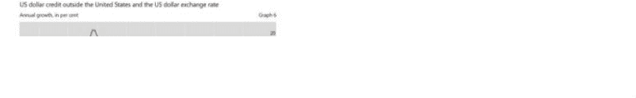

# US dollar credit outside the United States and the US dollar exchange rate
Annual growth, in per cent

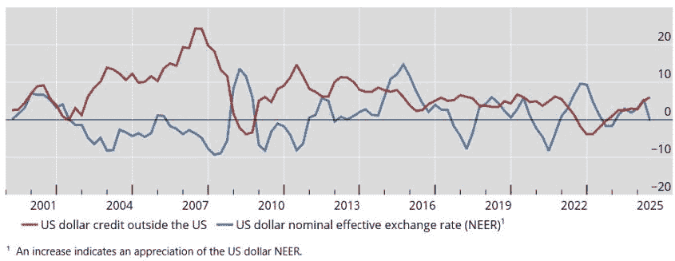

> 1 An increase indicates an appreciation of the
Sources: BIS effective exchange rate statistics; BIS global liquidity indicators; BIS calculations.
© Bank for International Settlements

# Jason不遇

2025-10-31 03:15

JPM：中国反内险政策可能还会调整房地产政策，不能通过行政手段限制企业之间的激烈市场竞争，还要寻求结构性绩效行动，不将导致价格下降但量合理的（如房地产长期低位），并将持续再平衡。“新经济”进入房地产路径——依赖政府扶持资产，建议增加增值税征收为消费端，促使生产而非经济增长。

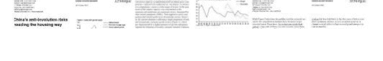

# J.P. Morgan

Global Economic Research
Jahang Ali (+44) jahang@jpmorgan.com
J.P. Morgan Securities LLC Team: Sanjeev Gupta, Rahul Singh, New York; Hong Kong
30 October 2025

# China's anti-inflation risks heading the housing

* Today's inflationary concerns are more widespread than in the past
* The Chinese economy is undoubtedly challenged: excess capacity now impacting the housing market
* Anti-inflation policy exercise focus on limiting property prices and adjusting programs as seen in the case of housing market
* Recovering excess capacity stems from weak incentives in policy, but thus could remain ineffective
* Shifting vast capacity from production to meet consumer demand

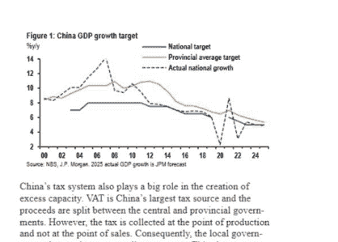

很容易理解中国“社会主义命令经济”的结构。一个关键区别是，中国共产党（CPC）的办法更加去中心化，被称为“命令经济”。The Party does not use direct commands instead of allocating resources, it uses market mechanisms to allocate resources and market benchmark, in line with priorities.

Actual investment and consumption not driven by demand, but by excess expectations at the level, fueled by government-led incentives.

另一个不同是，过产能主要被广泛部门的激烈竞争吸收。在中国经济的部分，国家拥有的上游和中游原材料部门占据了有限供应，下游消费品部门（图3）导致了持续的价格竞争，其低利润率。这种局面在很大程度上无法改善投资的激励。

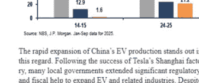

电动汽车生产的快速扩张是由于特斯拉的突破这一战略驱动的；许多地方政府使用了补贴，投资和生产导致了快速增长（图4）。

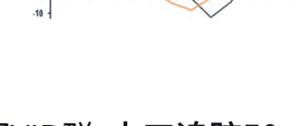

这次的问题比以前更严重。在煤、钢和水泥等行业，2015-16年的价格调整和需求减少并不有效。现在，过产能跨越汽车、电池、电子商务等部门。过产能更加压倒性。各种反垄断政策导致了过剩（图5）。这意味着“过剩”是系统性的。

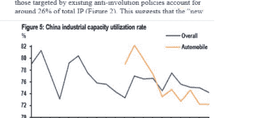
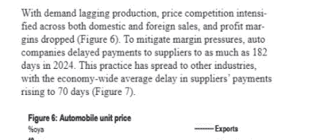
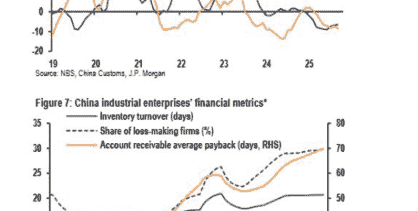

... and systemic

Jahang Aziz (1-212) 834-4328
jahang.x@jpmorgan.com
JP Morgan Chase & LLC
Telegraph: (052) 2800-0143
telingling@morgan.com
JP Morgan Chase Bank, N.A. Hong Kong Branch

# Global Economic Research
30 October 2025

# J.P.Morgan

虽然8简要地阐述了问题（以及解决方案），但忽略了中国面临的更深层次的结构性问题。正如我们之前提到的，中国恢复的很大一部分源于新结构转型的进展，这种转型始于2013年的《工作报告》，并在2017年中国转向寻求高质量增长的目标变更中继续。而更重要的是，中国增长动力从信贷密集型房地产向高增值制造业和高端服务的结构性转变进展并不顺利。

工人受到增长速度缓慢（户籍制度）的限制，以及农村土地所有权变更和省际竞争的进展有限。

尽管“新经济”显示出强劲增长，但其扩张并没有中国当局希望的那么快。这是因为西方国家不断增加对中国出口的贸易限制和障碍。例如，荷兰禁止向中国出口先进设备，而欧盟和美国对电动汽车分别征收45%和100%的关税。

2010年至2021

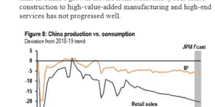
Source: NES, J.P. Morgan

图9描绘了问题。

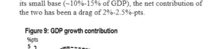

至于术性市场时机在组合中过度和减持黄金，如所述，在货币体系崩溃、货币没收和经济/货币战争（例如制裁）的高风险下，黄金应该增强，在其他时候减持，因为在长时间内一直是一种表现相对稳定的资产（如现金），因为它不是一种生产性资产。

然而，这种方法面临重大挑战。过产能已经影响了新经济的大部分——导致价格削减并降低利润。这将导致增长下降和经济扩张缩小。随着预期，房地产再平衡可能会继续收缩，但以就业下降为代价，即使在最近。如果新经济的生产持续维持或增加，过产能将在其他政策领域出现。

bloomberg:10月 PMI有点热，中股可能获得支撑自4个月来的首次周末暴跌#经济数据

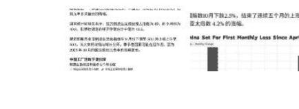

随着下一个季度经济放缓的加大，中国工厂活动在10月份恶化，达到九年来最长的降幅。

国家统计局周表示，制造业采购经理指数为49，而10月份为49.8。彭博调查的经济学家估计中值为49.6。

建筑和服务业活动在9 月份下降至50.1后小幅回升至50.1，这将是收缩与扩大的开始。季节因素可能在起作用，因为2025年10月的假期比去年的假期更长。

## 中国工厂活动持续下滑

- 制造业指标显示连续七个月收缩
- 制造业采购经理指数 / 制造业采购经理指数

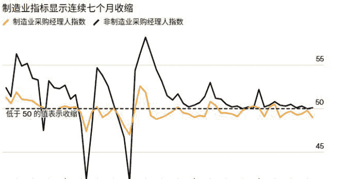

资料来源：中国物资与采购协会、彭博社

MSCI中国指数10月下跌2.5%，结束了连续五个月的上涨。这远远落后于MSCI亚太指数4.2%的涨幅。

## MSCI China Set For First Monthly Loss Since April

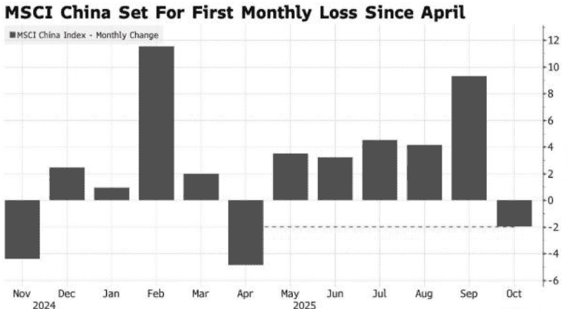

# 深度视野VIP群 人工追踪50+V 付费进群加微信chuk255 微信ch5568

## Jason-不诡2025-10-31 11:41

bloomberg: 日本感受到了汇率的压力，对冲基金预计日元在年底前跌至 160。其他国家经济

- 日本政府正在对强烈的紧迫监控日元，财务大臣片山周称。
- 片山表示，日本政府正在密切关注外市场的过度或无序走势，包括那些由投机驱动的走势。
- 在日本央行决定维持利率不变后，片山发出警告后，日元美元汇率升至 153.65。

日本政府正在对强烈的紧迫监控日元，财务大臣片山周称。

片山表示，日本政府正在密切关注外市场的过度或无序走势，包括那些由投机驱动的走势。

日本财务大臣片山周，日本政府正在对强烈的紧迫监控日元，这是他以来首次就货币走势发表明确警告。

“我们最近看到到非常片面和快速的货币走势，”片山周告诉记者。她说：“日本政府正在密切关注外市场的过度或无序的走势，包括那些由投机驱动的走势，”她说。

## Currency Moves
Katayama gives warning after yen weakens post-BOJ

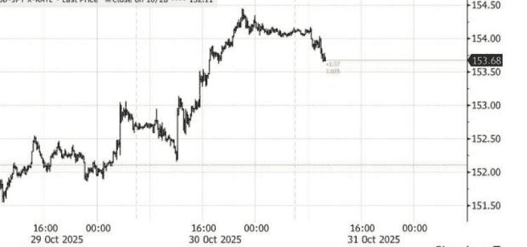

她补充，货币以稳定的方式走势非常重要，这反映了经济基本面。在片山发出警告后，日元美元汇率在上午早些时候接触 154.17 后升至 153.65。

片山发表上述言论之时，日本央行决定维持利率不变，日元抛于八个月低点附近。尽管植田和男在决定后的新闻发布会上微妙暗示加息即将临近，但市场并不信任，日元走低。

# 深度视野VIP 内部追踪50+大 付费进群加微信cuk2255 微信ch5568

## Jason-不离2025-10-31 11:46

bloomberg: 关税和有利于中国的出口，他们的产业供应链会轻松一些，但从长远来看，也要为未来的波动的做好准备。每个人都在多元化。#经济数据

周四，美国同意将中国进口商品的关税从之前的57%降至47%，远低于威胁中国的100%的利润。

美方关税调整将对中国征收20%的关税，中国出口

周四，美国同意将中国进口商品的关税从之前的57%降至47%，远低于威胁中国的100%的利润。

美方关税调整将对中国征收20%的关税。

周四，美国同意将中国进口商品的关税从之前的57%降至47%，远低于威胁中国的100%的利润。

美方关税调整将对中国征收20%的关税。

## 关税和有利于中国的出口，他们的产业供应链会轻松一些，但从长远来看，也要为未来的波动的做好准备。每个人都在多元化。

周四，美国同意将中国进口商品的关税从之前的57%降至47%，远低于威胁中国的100%的利润。

美方关税调整将对中国征收20%的关税。

周四，美国同意将中国进口商品的关税从之前的57%降至47%，远低于威胁中国的100%的利润。

美方关税调整将对中国征收20%的关税。

# 经济数据

周四，美国同意将中国进口商品的关税从之前的57%降至47%，远低于威胁中国的100%的利润。

... 

## Jason-不离2025-10-31 11:46

bloomberg: 关税和有利于中国的出口...
