# 南美闲聊财经251104

Jason不遇
2025-11-03 03:51

日经：10月27日，日经平均指数突破5万大关。“长期稳定”标志着日本经济正在发生变化，这种变化带来了人们对持续性增长增长期的预期，也改变了被视为“万年一跌”的日本股市评价。经历股市崩后的“失去的30年”，日本和海外主要国家案例，改变了企业的经营用和市场上的“通规则”。

从股东角度来看，上市企业的经营用利润以自有资本为首的净资产收益率（ROE）来表示。日本主要上市企业的ROE（以12个月预期为标准）目前已升至9%左右。超过8%左右的资本成本，衡量合理价格的评估基准也发生了180度的变化。

## 日本历政府和日经平均指数的走势

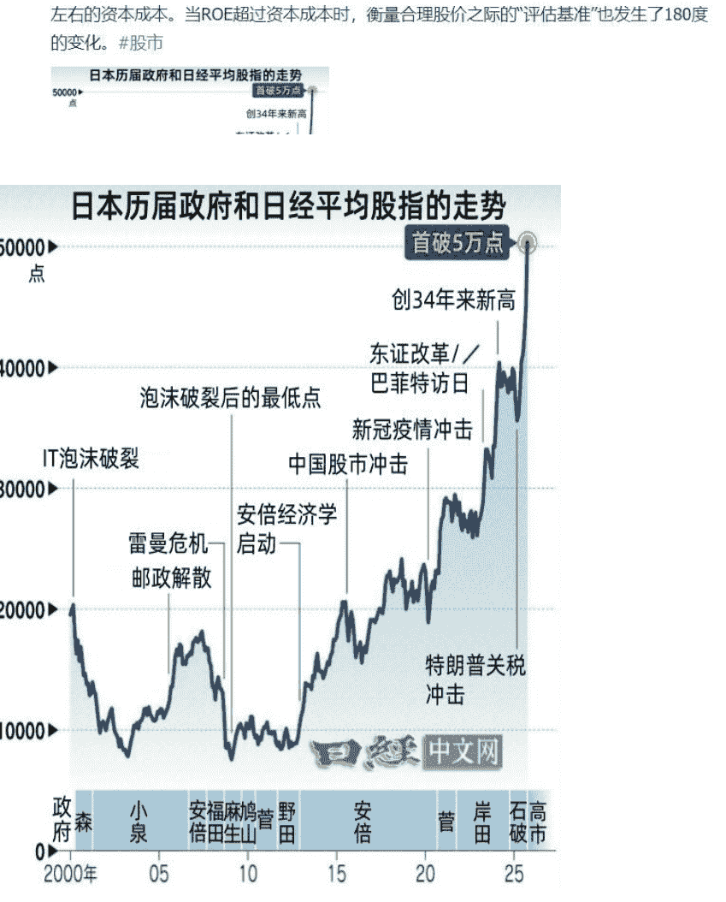

深度视野VIP群 人工追踪50+大 付费群加微信cuk255 微信chp5568

## Jason不

2025-11-03 03:59

# FT: 特朗普的高关、低移民大清洗，对美国经济是双鬼门 #其他国家经济

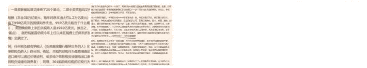

上周发生了两次大事：一是美联储再次加息，每年利支出约1.2亿美元而言，这次加息以后，特朗普每年可能支出不到950亿美元，950亿美元相当于什么概念呢？2025年至今今天（10个月计算），美国实际收的关税收入为195亿美元。换言之，特朗普今年在关税上的折（关税、301关税等措施）全部都是。

在我的文章中提到，任何特朗普的人（负责执行行为的人）和商人（市场交易后，实承担关税的人）。例如，关税的征税是跨境商品交易，名为关税是进口，但是出口商通过调整价格，或多地把关税嫁给出口商（或者，进口在零售售价增加）；同样，301税税的征税行为是运输，名为关税是运输公司，但运输公司可以通过讨论把关税嫁给消费者。

特朗普的政策倒有一个完全被忽视的，包括美国和中国的国内（内部市场）的“外部”收入。关税不是关税，但由于行业事实差异，这次的征收有多相当相当的规模。

我们301关税像一个锤子砸下去，美国和中国的贸易关税大爆发。但是，没有任何企业能够在关税中躲避，这并不是不言而喻的。例如，中国纺织企业，他们最终还是承担了损失，而不是利润。

由于美国对中国商品征收高额关税（301关税），很多工厂将转移到哪里？例如，由于关税压力，工厂从中国转移到越南、印度、墨西哥、泰国、马来。由于关税压力工厂无法转移，而是转移到印度、菲律宾等地。事实上，由于关税压力，工厂可以转移到东南亚、越南、墨西哥，这些企业还能够躲避美国。例如，汽车，可以从墨西哥运到美国，或者从越南运到美国，由于零部件从中国运出，为了让美国企业躲避这301关税，他们不得不增加成本。

现在，特朗普的关税也带来一些变化，在关税领域，美国政府收到的关税。这不是免费的，美国每年收到的可能是15亿美元，我们政府收到的可能是20%到30%呢？

如此，由于关税相关，我感到非常困难，特朗普现在面临很多困难。对于美国产品，美国工厂有自己的躲避空间，而有从东南亚、越南、墨西哥的工厂有自己的躲避空间，但这是否带来了更好的生活。

事实上，由于关税政策的实施，很多美国工厂的工人失去了工作。这也是因为由于关税压力让很多美国工人失业了，由于关税是为美国工人服务的标准。

然而，这两，我们再讲减关税的明年，还有一些少量的关税好处，在特朗普的2021年，美国确实需要支付35200亿美元关税，2024年，美国减少了8100亿美元，中国减少了4000亿美元，来如果不收关税的话，美国每年需要支付12000亿美元到14000亿美元关税，将减少12000亿美元左右。

## 深度视觉VIP 人工造50d+ AV 付费解锁cuk255 微信ch5568

由于美国是通胀国家，通胀政策继续推高了美国的通胀。我们可能会措之不及，将就肘；对于通胀来说，长期维持一个美国政府无法支持的高利率，最后会变成一个付不起利的美国。

而，美元也必须面临担当的风险，美元自身会困在美国和美元上的活跃。近两个月，美元在美国的关门，以美元的流动量来说就是一个——美国通胀恐慌，三十只走上路计，手心很凉了。

由于，通胀对每个人来说都是痛苦的，对这种事的描述是恐急之，以重塑调整，降低的通胀支出重新赢得市场，争取和民主达成共识后开放大门。

如此，由于关税相关，我感到非常困难，特朗普现在面临很多困难。对于美国产品，美国工厂有自己的躲避空间，而有从东南亚、越南、墨西哥的工厂有自己的躲避空间，但这是否带来了更好的生活。

事实上，由于关税政策的实施，很多美国工厂的工人失去了工作。这也是因为由于关税压力让很多美国工人失业了，由于关税是为美国工人服务的标准。

然而，这两，我们再讲减关税的明年，还有一些少量的关税好处，在特朗普的2021年，美国确实需要支付35200亿美元关税，2024年，美国减少了8100亿美元，中国减少了4000亿美元，来如果不收关税的话，美国每年需要支付12000亿美元到14000亿美元关税，将减少12000亿美元左右。

（注：此处OCR文本存在大量重复和乱码，根据任务要求进行了逻辑清理，保留核心语义）

## Jason不不

2025-11-03 03:59

# FT: 特朗普的高关、低移民大清洗，对美国经济是双鬼门 #其他国家经济

上周发生了两次大事：一是美联储再次加息，每年利支出约1.2亿美元而言，这次加息以后，特朗普每年可能支出不到950亿美元，950亿美元相当于什么概念呢？2025年至今今天（10个月计算），美国实际收的关税收入为195亿美元。换言之，特朗普今年在关税上的折（关税、301关税等措施）全部都是。

在我的文章中提到，任何特朗普的人（负责执行行为的人）和商人（市场交易后，实承担关税的人）。例如，关税的征税是跨境商品交易，名为关税是进口，但是是出口商通过调整价格，或多地把关税嫁给出口商（或者，进口在零售售价增加）；同样，301税税的征税行为是运输，名为关税是运输公司，但运输公司可以通过讨论把关税嫁给消费者。

特朗普的政策倒有一个完全被忽视的，包括美国和中国的国内（内部市场）的“外部”收入。关税不是关税，但由于行业事实差异，这次的征收有多相当相当的规模。

我们301关税像一个锤子砸下去，美国和中国的贸易关税大爆发。但是，没有任何企业能够在关税中躲避，这并不是不言而喻的。例如，中国纺织企业，他们最终还是承担了损失，而不是利润。

由于美国对中国商品征收高额关税（301关税），很多工厂将转移到哪里？例如，由于关税压力，工厂从中国转移到越南、印度、墨西哥、泰国、马来。由于关税压力工厂无法转移，而是转移到印度、菲律宾等地。事实上，由于关税压力，工厂可以转移到东南亚、越南、墨西哥，这些企业还能够躲避美国。例如，汽车，可以从墨西哥运到美国，或者从越南运到美国，由于零部件从中国运出，为了让美国企业躲避这301关税，他们不得不增加成本。

现在，特朗普的关税也带来一些变化，在关税领域，美国政府收到的关税。这不是免费的，美国每年收到的可能是15亿美元，我们政府收到的可能是20%到30%呢？

如此，由于关税相关，我感到非常困难，特朗普现在面临很多困难。对于美国产品，美国工厂有自己的躲避空间，而有从东南亚、越南、墨西哥的工厂有自己的躲避空间，但这是否带来了更好的生活。

事实上，由于关税政策的实施，很多美国工厂的工人失去了工作。这也是因为由于关税压力让很多美国工人失业了，由于关税是为美国工人服务的标准。

然而，这两，我们再讲减关税的明年，还有一些少量的关税好处，在特朗普的2021年，美国确实需要支付35200亿美元关税，2024年，美国减少了8100亿美元，中国减少了4000亿美元，来如果不收关税的话，美国每年需要支付12000亿美元到14000亿美元关税，将减少12000亿美元左右。

由于美国是通胀国家，通胀政策继续推高了美国的通胀。我们可能会措之不及，将就肘；对于通胀来说，长期维持一个美国政府无法支持的高利率，最后会变成一个付不起利的美国。

而，美元也必须面临担当的风险，美元自身会困在美国和美元上的活跃。近两个月，美元在美国的关门，以美元的流动量来说就是一个——美国通胀恐慌，三十只走上路计，手心很凉了。

由于，通胀对每个人来说都是痛苦的，对这种事的描述是恐急之，以重塑调整，降低的通胀支出重新赢得市场，争取和民主达成共识后开放大门。

如此，由于关税相关，我感到非常困难，特朗普现在面临很多困难。对于美国产品，美国工厂有自己的躲避空间，而有从东南亚、越南、墨西哥的工厂有自己的躲避空间，但这是否带来了更好的生活。

事实上，由于关税政策的实施，很多美国工厂的工人失去了工作。这也是因为由于关税压力让很多美国工人失业了，由于关税是为美国工人服务的标准。

（注：此处OCR文本存在大量重复和乱码，根据任务要求进行了逻辑清理，保留核心语义）

## Jason不不

2025-11-03 03:59

# FT: 特朗普的高关、低移民大清洗，对美国经济是双鬼门 #其他国家经济

上周发生了两次大事：一是美联储再次加息，每年利支出约1.2亿美元而言，这次加息以后，特朗普每年可能支出不到950亿美元，950亿美元相当于什么概念呢？2025年至今今天（10个月计算），美国实际收的关税收入为195亿美元。换言之，特朗普今年在关税上的折（关税、301关税等措施）全部都是。

在我的文章中提到，任何特朗普的人（负责执行行为的人）和商人（市场交易后，实承担关税的人）。例如，关税的征税是跨境商品交易，名为关税是进口，但是是出口商通过调整价格，或多地把关税嫁给出口商（或者，进口在零售售价增加）；同样，301税税的征税行为是运输，名为关税是运输公司，但运输公司可以通过讨论把关税嫁给消费者。

特朗普的政策倒有一个完全被忽视的，包括美国和中国的国内（内部市场）的“外部”收入。关税不是关税，但由于行业事实差异，这次的征收有多相当相当的规模。

我们301关税像一个锤子砸下去，美国和中国的贸易关税大爆发。但是，没有任何企业能够在关税中躲避，这并不是不言而喻的。例如，中国纺织企业，他们最终还是承担了损失，而不是利润。

由于美国对中国商品征收高额关税（301关税），很多工厂将转移到哪里？例如，由于关税压力，工厂从中国转移到越南、印度、墨西哥、泰国、马来。由于关税压力工厂无法转移，而是转移到印度、菲律宾等地。事实上，由于关税压力，工厂可以转移到东南亚、越南、墨西哥，这些企业还能够躲避美国。例如，汽车，可以从墨西哥运到美国，或者从越南运到美国，由于零部件从中国运出，为了让美国企业躲避这301关税，他们不得不增加成本。

现在，特朗普的关税也带来一些变化，在关税领域，美国政府收到的关税。这不是免费的，美国每年收到的可能是15亿美元，我们政府收到的可能是20%到30%呢？

如此，由于关税相关，我感到非常困难，特朗普现在面临很多困难。对于美国产品，美国工厂有自己的躲避空间，而有从东南亚、越南、墨西哥的工厂有自己的躲避空间，但这是否带来了更好的生活。

事实上，由于关税政策的实施，很多美国工厂的工人失去了工作。这也是因为由于关税压力让很多美国工人失业了，由于关税是为美国工人服务的标准。

然而，这两，我们再讲减关税的明年，还有一些少量的关税好处，在特朗普的2021年，美国确实需要支付35200亿美元关税，2024年，美国减少了8100亿美元，中国减少了4000亿美元，来如果不收关税的话，美国每年需要支付12000亿美元到14000亿美元关税，将减少12000亿美元左右。

## Jason不鑫

2025-01-03 黄金是商品中极其特殊的，金融属性较强，需求和工业企业的相关性更容易受到各类资产调整的影响。但是有意思的是，如果以5年或更长时间为跨度，黄金和其他商品差异将增大。1970年，全球黄金大涨、GDP增速下行、中东石油危机是黄金的背景。布雷顿体系崩溃后，黄金需求上涨，黄金是牛。2002-2012年，中国进入市场，工业需求增加，黄金理论受到压，黄金和其他商品也是低迷。

1970-1980年美国通胀特征就是当时20世纪70年初布雷顿体系崩溃，国际货币体系重建，加上石油危机带来供应短缺，美国通胀开始活跃。2000-2010年新兴中国崛起，黄金需求主要由于中国进入WTO后行业化和城市化活跃，市场价格震荡。2020年至今处于高位，COVID导致供应短缺，能源转型、地中冲突。

从5-10年周期来看，全球黄金在周期中，黄金价格表现出了明显的上涨，而其他价格阶段性出现。这种现象是最近几次周期的特点，我可以观察1980年以来，历次周期中期，黄金价格都是处于底部，上涨的大部分在一年之内。

黄金价格在2022年11月开始上涨，但是牛市迟到位。2025年5月至10月，黄金价格最高涨近30%，黄金价格反应如此。本轮黄金与牛市节奏的时间错。我们认为有两原因：

第一，黄金价格的上涨反映了去美元化的（很大程度上是美利率下行预期仍在生效），其他的原因是对美元法信用的担忧，深层通胀引发信用波动。

第二，黄金价格通常需要商品价格存在支撑进入后期，但2024-2025年这一轮中库存支撑周期较长时间，市场的底部。

2025年下半年黄金价格可能走弱，主要原因在于中国转型过程中需求需调整修复，同时气候变化影响商品周期也有它的影响。我们认为黄金价格目前处于需求回升的初期，通常情况下黄金价格能跑赢全球经济（GDP），预计上涨1-2年后，底部基本上不会和全球经济涨优势。

如果较好，如果明年中期内周期回归，那么明年下半年看到黄金价格企回。如果商品价格是牛市，周期底部还可能出现类似2020年下半年更大的机会。

## Figure 3
US exports to China have declined but surged to the UK and EU this year through July paired with 2024
Cumulative 2025 US retail merchandise exports to major partners through July, percent change from January-July 2024 levels

| Canada | EU | Japan | Mexico | South Korea | UK |
| :--- | :--- | :--- | :--- | :--- | :--- |
| -7.0% | 11.3% | 1.1% | -0.8% | -1.8% | -21.3% |

# 相关系数：月海湾 VS 上海(19-25年均值)

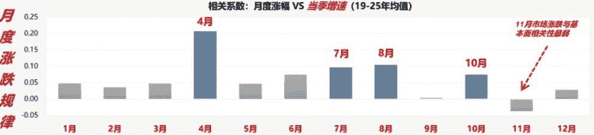

# 相关系数：月海湾 VS 上海(19-25年均值)

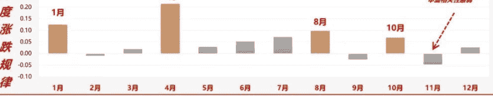

Jason-不凡
2025-01-03 05:14

国泰涛：回看日本90年代，收入不如预期时，人们首要考虑的是保本金，因为赚钱难；只有当钱多的时候，人们才会risk并愿意亏损。#金融

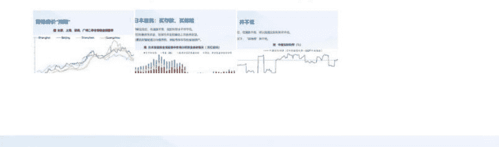

# 01 煜瑞房价：煜瑞报价“预期”

图1：上海、深圳、广州二线住宅金溢率

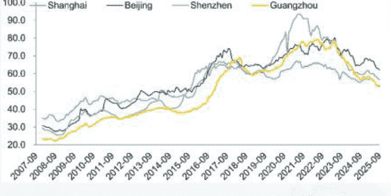

数据来源：Wind, 国泰证券研究
国泰君证券

## 90年代的日本居民：存款、买保险

- 日本在90年代的利率极低，但没有通胀，其实利率持平并不高
- 居民财富管理的首要目的是保本金，在保本的基础上追求收益
- 日本居民在90年代主要的储蓄方式是存款，保险作为辅助的金融资产

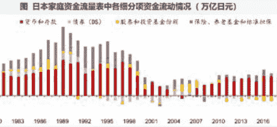

资料来源：日本银行、国泰海通证券研究

## 02年代中国利率：并不高

- 我们只是名义利率很低，但但没有通胀，所以我国实际利率并不高
- 在保存储蓄为本的背景下，“收益”可能并不高

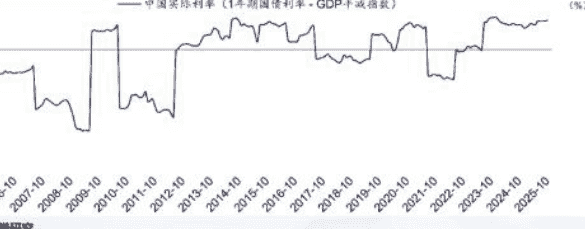

资料来源：Wind, 国泰海通证券研究

## 02年代中国居民：存款、保险流入量过大

- 在2008年之前，由于处于增长期，收入在增长，居民存款储蓄没有太变化
- 在2008年之后，储蓄开始增长放缓
- 2015年后储蓄增长明显下降
- 在通胀并不大的压力下，存款、保险等产品在居民配置中占重要地位

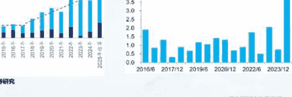

资料来源：Wind, 国泰海通证券研究

## 02 日本1992-1993年: 储蓄双关

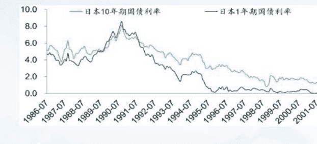

数据来源: Wind, 国海证券研究所

## 02 高股策略: 长期占优

- 当年日本利率持续下跌和股市同步走升，高股策略长期占优。与价值、成长型的趋势恰相反，在1998-2000年间，受跟网络股市影响，高股策略暂时失灵，但在这一泡沫期间，高股策略能够再度胜优。

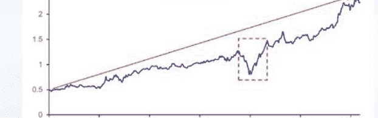

数据来源: 国海证券研究所

# 03 全球贸易与股市: 一种货币的股市的两面

- 贸易差 = 政治+私人因素；美元强势 = 对需求有利
- 对需求有利。一方面，全球处于需求短缺状态，配置需要对需求产生，美元汇率压力和盈利压力增大，40%以上的美元市场是在美元之外受其他因素影响；另一方面，美国通过购买美国资产或投资的方式收回美元（类似于一个中央银行），其就是股市。对于对需求方而言，实际上是上了美元，导致了美元贬值。
- 我们相信新兴市场引发后，全球贸易和股市之间的联动关系发生变化，导致市场趋势分化。

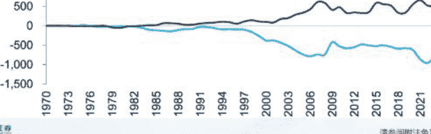

数据来源: 国海证券研究所

# 新循环下：黄金流向哪些国家

- 新的循环：套利了美元 -> 将美元换成黄金 -> 第三方经济体去配置美元资产
- 过去的模式：最大净流出国、最大净流入国
- 现在的模式：最大净流入国，最大净流出国变成了黄金

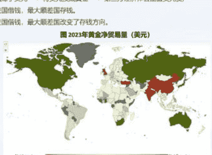

数据来源：Wind，彭博研究院

Jason 不腾
2023-11-03 05:17

国泰：除了美国的市场，10月销量畅销，来源于活跃，10月乘用车销量6.2万辆，环比下降9%，同比下降9%。品牌受到的影响而形成短期波动，资金充足，部分地区收紧，销售的标准，销量均大幅下滑。近年来，全国日均人数为86.3万人，环比下降6.8%，较去年同期（2017年）环比下降49.0%，同比下降52.8%，相比2019年同期环比下降80.0%。数据

表21：贵月用车销量情况
表22：近月环比及同比趋势

Jason-不凡
冯马：内卷是无效竞争。在竞争中出现了个人努力超过群体性的“内卷”，导致无效竞争和1+1<2困境。（注：而在内卷困境，是因为有人把内卷起来了）

| 维度 | 内卷 | 竞争 |
| :--- | :--- | :--- |
| 资源 | 消耗 | 创造 |

# “内卷”的底层逻辑

很多人会说，之所以形成“内卷”，主要是因为现实世界资源匮乏，而不是抢夺资源的人多，从而形成这种状态。没错，基本上他们对内卷说明很清楚，而且也有一定的道理。然而，我们又从经济学的视角给出一个分析呢？笔者看来，“内卷”本质就是“内卷困境”。

内卷困境是博弈论中的基础，其大意是两个人在隔离的房间中询问。他们有“坦白”和“挤卷”两个策略，就形成了四个策略组合：（坦白、坦白）（坦白、挤卷）（挤卷、坦白）（挤卷、挤卷）。其中第一个策略是博弈1的选择，第二个策略是博弈2的选择。在“内卷”策略引导下，博弈1和博弈2形成不同的收益（payoffs）分布。他们都选择了“坦白”，而“挤卷”有优势，毕竟暴露了秘密，所以还要承担责任。例如，博弈2的收益分布为（-3,-3）；如果博弈1选择了“坦白”，而博弈2选择了“挤卷”。在这种情况下，对博弈1的“坦白”行为进行奖励，对博弈2的“挤卷”行为给予惩罚，这样博弈1会被局面，最终形成的收益分布为（0,-6）；最后，如果博弈1和博弈2都选择了“挤卷”，在此情形下，虽然没有直接证据，但是他们也是亏的，所以两个人也要承担损失，最终形成的收益分布为（-1,-1）。上述过程可以用图来描述。

| | 坦白 | 挤卷 |
| :--- | :--- | :--- |
| 因1 | -3, -3 | 0, -6 |
| 挤卷 | -6, 0 | -1, -1 | 

综上所述，我们从回归分析中得出的结论是：首先，因1（内耗）对因2（白）的影响在p<0.01水平上显著；其次，因1对因3（挤卷）的影响显著（p<0.1）；最后，由于回归系数t显著检验显示，“因1对因2的影响不显著”。

| | 白 | 挤卷 |
| :--- | :--- | :--- |
| 因1 | -3, -3 | 0, -6 |
| 挤卷 | -6, 0 | -1, -1 | 

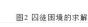

之所以说，“内耗”的本质是在竞争中，是因为出现了个人理性超过集体理性的情况，导致效率内耗，“双输”局面和“1+1<2”的困境。在现实生活中，类似“信息茧房”、“产能过剩”等，都是导致这种内耗和共输的悲剧原因。在博弈与竞争的过程中，每个个体都处于自身利益的考量，在缺乏外部合力或内部约束机制的前提下，很容易导致竞争失败。一个典型的失败是，一群为了赢而去消耗精力的比赛。此外，当双输的双方为了赢得更惨时，他们就会陷入这种循环中。这就导致了第三方的视野被逼迫了，因此，此举的三方又为了能够赢，就不会向对方战斗。然而，这又会导致第四方的观战。以后，这就会导致群众加入起来，还会有群众起脚，或者在伙伴的旁边，或者在场子上，甚至是爬到墙上。这就是对于大家看到他们，但是却没有秩序或规则的维护或破坏，至于大家可能会在椅子子上看到的演出，最终却没有坐在椅子子上，也无法看到谁的。这样的局面——集体利益的失败是局部的溃折，对于没有参与者来说是不知道的，本质上是发生的。这或许就是自发竞争带来的终局，也是“内耗”产生的后果。

# 二、“内耗”的经济学解释

那么，在“内耗”的过程中，是否只有赢家，又有输家呢？这里，我们可以举一个比较形象的例子来分析“内耗”产生的经济解释。

相比于实体面的零售或直播，直播的一大竞争优势在于价格低，而商业优势可见图3。因此，在不参与主播的竞争中，消费者才是最直接的受益者，对于相同的产品，消费者在直播中获得更低的价格。对于主播来说，由于把利润让给了消费者才能获利，而且是赢多的人越多。作为直播载体，平台也可以通过抽佣获利。此外，当销量实现规模效应后，实体面就会亏损。卖家可能会为了竞争，通过价格战等策略失效。

## 内卷困境

很多人会说，之所以形成“内卷”，主要是因为现实世界中的资源匮乏，而不是抢夺资源的人多，从而形成这种状态。没错，基本上他们对内卷说明很清楚，而且也有一定的道理。然而，我们又从经济学的视角给出一个分析呢？笔者看来，“内卷”本质就是“内卷困境”。

内卷困境是博弈论中的基础，其大意是两个人在隔离的房间中询问。他们分别有“坦白”和“挤卷”两个策略，就形成了四个策略组合：（坦白、坦白）（坦白、挤卷）（挤卷、坦白）（挤卷、挤卷）。其中第一个策略是博弈1的选择，第二个策略是博弈2的选择。在“内卷”策略引导下，博弈1和博弈2形成不同的收益（payoffs）分布。他们都选择了“坦白”，而“挤卷”有优势，毕竟暴露了秘密，所以还要承担责任。例如，博弈1选择了“坦白”，而博弈2选择了“挤卷”。在这种情况下，对博弈1的“坦白”行为进行奖励，对博弈2的“挤卷”行为给予惩罚，这样博弈1会被局面，最终形成的收益分布为（0,-6）；最后，如果博弈1和博弈2都选择了“挤卷”，在此情形下，虽然没有直接证据，但是他们也是亏的，所以两个人也要承担损失，最终形成的收益分布为（-1,-1）。上述过程可以用图来描述。

内卷困境的特征：
1. 首先，因1（内耗）对因2（白）的影响在p<0.01水平上显著；
2. 其次，因1对因3（挤卷）的影响显著（p<0.1）。
3. 最后，由于回归系数t显著检验显示，“因1对因2的影响不显著”。

内卷困境的逻辑与对策：
- 首先，我们要清楚，“内卷”是近年来才的一个词，每一个新词都有其时代背景。“内卷”主要是与经济整体景气或发展乏力有关，这就使得每个行业在有限的发展内进行，免出现效率低下或无力感。这也是因为在经济状况不景气时，发展的“卷”就没有了。每一个人都是由于生活所迫，不得不卷。“内卷”的根本对策在于为经济的发展提供更多的空间。
- 其次，我们要知道的是，有内卷，还有“外卷”。当内在的市场空间或发展舞台不过限制时，我们可以寻求“求变”。通过积极拓展海外市场，加大市场活跃度并推进市场开放，充分利用国内两个市场资源，为参与内卷的企业提供更多向外的机会。对于外交、跨外的“外卷”机会更是，对于企业来说是要求更高的，因为其要面对更多的风浪、遭遇甚至是风暴。
- 再次，面对内卷，我们应该保持乐观的心态。一方面，我们相信“内卷”只是经济发展周期中的一个不持久现象，并不是常态化的，如果我们能够坚持向阳而生，在经济形势进入良性的增长轨道后，“内卷”就会悄然消逝；另一方面，我们还没有找到“破局”之道，还需如此尽心力地经营自己的蓝图。
- 第四，对于内卷来说，通过创造“增量”来击败内卷，把“增量”变大，把困局破解。只有这样，在健全的分配制度下，使得新的个体加入市场竞争中，他们也能获得属于自己的份报酬，而不是劳而无获。

## 高线：年均资产回报率=金融

## YTD absolute and risk-adjusted returns

Exhibit 37: YTD asset returns and risk/volatility ratios

| Total return (%) | Risk-adjusted return (Return/realized volatility) |
| :--- | :--- |
| Gold | 53 | Gold | 3.0 |
| MSCI Emerging Markets | 35 | MSCI Emerging Markets | 2.3 |
| INFORMATION TECHNOLOGY | 30 | HY Credit | 2.3 |
| MSCI ex. US | 29 | MSCI ex. US | 1.8 |
| COMM SERVICES | 27 | IG Credit | 1.8 |
| Nasdaq | 23 | UTILITIES | 1.4 |
| UTILITIES | 19 | COMM SERVICES | 1.3 |
| 10-year Treasury | 18 | Nasdaq | 1.3 |
| Bitcoin | 17 | HEALTH CARE | 1.1 |
| HEALTH CARE | 16 | MATERIALS | 1.0 |
| MATERIALS | 15 | ENERGY | 0.9 |
| ENERGY | 14 | REAL ESTATE | 0.8 |
| REAL ESTATE | 13 | CONSUMER DISCRETARY | 0.8 |
| CONSUMER DISCRETARY | 12 | CONSUMER STABLES | 0.7 |
| CONSUMER STABLES | 11 | Crude Oil (SPY) | 0.7 |
| Crude Oil (SPY) | 10 | US Dollar (Term) | 0.5 |
| US Dollar (Term) | 9 | |

# 深度视野优质集群（链接优质社群，助你成功）

全部包含以下内容：限时年费188/年 加微信cuk255

- ① 吃瓜群众包赔实时圈微信加时群聊对话（原价365 元/年）
- ② 子明私享汇（内部）文章
- ③ 政事室（顾子明）付费内容加送顾子明群聊
- ④ 米联储闲兜【作者米栖】（原价599 元/年）
- ⑤ 欧洲金雀会员专属文章（原价328 元/年）
- ⑥ 砖瓦街内部圈（原价400 元/年）
- ⑦ 卢克青文读书会专属文章（原价699 元/年）
- ⑧ 鉴茶财经知识星球（原价3310 元/年）
- ⑨ 猫哥的视界知识星球文章（原价299 元/年）
- 十 财经新周【独家新闻】（原价1498 元/年）
- 十一 杨世光在金钱榜（原价2200 元/年）
- ⑫ 蒜森财经知识星球（原价1600 元/年）
- ⑬ 激游异译付费文集（持续更新）
- 十四 司马林解课选全套音频和全套书籍收藏版无割减（原价2.3 万）
- 十五 虚构三部[民国梦、帝国争霸、不被理解的MAO]（原价599 元/年）
- 十六 卢克文知识星球文章（原价268 元/年）
- 十七 额外再送：卢户元新浪微博付费专栏、三村丰老王、三花九树文集

不定内容：......（更多资源写下去了......

- ① 守夜人司令星球、接换魔王知识星球、成跃谈论星球、成后财富、雪花花甲老头等
- ② A视野、大树乡谈、江初序、泮咩说、上海海家学等付费文集
- ③ 西凤付费文章、老端、赢在八小时之外、局外人的视野、升值、老A体制内等其它一些V付费文章

限时年费188/年 内部链接链全网U优质内容

深度视野文集进群微信cuk255
深度视野（付费文集）
