# 南半球聊财经251105

**Jason/不逼**

2025-11-05 04:18

打造：市场在2025年最后几个月有望维持乐观环境。尽管贸易政策及通胀仍为关键风险，但美储减息让我们对美国经济增长持有信心。美元反弹需留意。金价近期回调提供增长机会。我们继续维持黄金配置，长期多多元化需求依然强烈。持续回调提供了增长契机。我们预计黄金在未来12个月内有望升至每盎司4,500美元。

年底维持超配，偏好多过美债，美储减息及强劲的盈利预期最终在年底前推股市走高。我们继续好亚洲（日本）和美国股市。

图1 黄金酷自4月起反包上涨，我们的智能量化模型显示

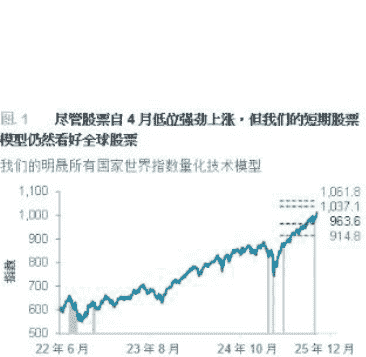

模型领先于国家全球指数量化模型

图2 黄金投资者可能在年底的回调平台，我们则视其为买入机会

黄金投资者持望

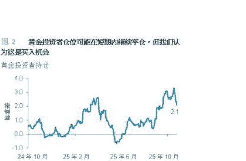

我们领先于国家全球指数量化模型

数据来源：博客，自横

数据来源：Vanda Research，自横

# 深度视野VIP群 人工造50+大付费群加微信cuk255 微信ch5568

# 图 3 风暴及涡流中的基础物质配置

| 项目 | 占比 |
| --- | --- |
| 黄金 | 7% |
| 黄金 | 7% |
| 现金 | 3% |
| 美元货币 | 3% |
| 纸票 | 55% |
| 欧元(美国版) | 36% |
| 钞票(美国公司) | 7% |
| 日元 | 1% |
| 纸票(日本版) | 2% |
| 亚洲(日本版) | 9% |

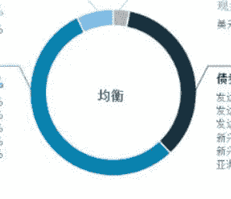

# 图 4 风暴及涡流中的基础+物质配置

| 项目 | 占比 |
| --- | --- |
| 生产资产 | 20% |
| 货币市场 | 4% |
| 私人房地产 | 5% |
| 私人储蓄 | 4% |
| 黄金 | 6% |
| 黄金 | 6% |
| 现金 | 3% |
| 美元货币 | 3% |
| 纸票 | 28% |
| 发达市场债券公司 | 27% |
| 发达市场债券公司 | 5% |
| 发达市场债券 | 2% |
| 新兴市场债券 | 2% |
| 新兴市场债券 | 3% |
| 欧洲债券 | 0% |

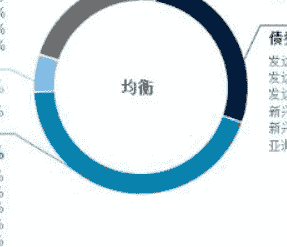

# 图 5 风暴及涡流中的参与者物质配置

| 项目 | 占比 |
| --- | --- |
| 纸票 | 53% |
| 发达市场债券公司 | 7% |
| 发达市场债券公司 | 6% |
| 发达市场债券 | 4% |
| 新兴市场债券 | 19% |
| 新兴市场债券 | 6% |
| 新兴市场债券 | 6% |
| 欧洲债券 | 6% |
| 纸票 | 37% |
| 衍生品收益 | 27% |
| 金融资产 | 8% |
| 注册地产亚洲货币基金 | 2% |
| 注册地产亚洲货币基金 | 2% |
| 现金 | 1% |
| 美元货币 | 1% |
| 通货资产 | 8% |
| 认缴股权 | 5% |
| 次级基金 | 3% |

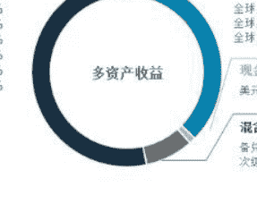

图来源：自己

# 观点：元类基金

| 基金 | 观点 |
| --- | --- |
| 发达市场债券政府基金 | + 高优质量、对收益率下移窄度增强-对通胀的黏性度高、货币政策 |
| 发达新兴市场债权基金 | + 高端质量、对收益率下移窄度增强- 估值较高 |
| 发达新兴市场股票基金 | + 收益收缩、利好驱动、估值尚可、对长短期需求 |
| 新兴市场债券政府基金 | + 收益收缩、利好驱动- 新兴市场债券质量、美国避险情绪 |
| 新兴市场股票基金 | + 收益收缩、行情回暖、受美元强劲- 美国避险情绪缓解 |
| 亚洲基金 | + 收益收缩中、对中国支持、中国中长期优、长期增长 |

# 策略

- 盈利利好、人工智能上升- 估值、美国避险情绪不确定性
- 估值领先、国内政策支持- 美国避险情绪缓解
- 价值、监控利率收缩- 净清晰、美国避险情绪缓解

# 债券
（美国美债）

# 股票
（亚洲美股）

# 日本

# 黄金

数据来源：聚投经理、聚上行情、实证基金收益下、美元收益指数

图1：

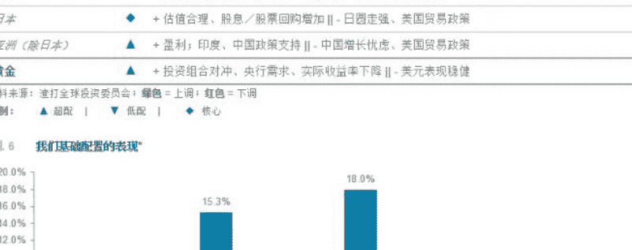

数据来源：聚投、逐投：“12周”收益率从2024年10月29日至2025年10月29日、3个月收益率从2025年10月29日。

# Jason不离
2025-01-10 04:21

中国：我们预计未来12个月内有望升至每盎司4,500美元。黄金投资者持望在年底的回调平台，我们则视其为买入机会。我们领先于国家全球指数量化模型。

数据来源：博客，自横

数据来源：Vanda Research，自横

# Jason不离
2025-01-10 04:21

中国：我们预计未来12个月内有望升至每盎司4,500美元。黄金投资者持望在年底的回调平台，我们则视其为买入机会。我们领先于国家全球指数量化模型。

# Jason不离
2025-01-10 04:21

中国：我们预计未来12个月内有望升至每盎司4,500美元。黄金投资者持望在年底的回调平台，我们则视其为买入机会。我们领先于国家全球指数量化模型。

# Jason不离
2025-01-10 04:21

中国：我们预计未来12个月内有望升至每盎司4,500美元。黄金投资者持望在年底的回调平台，我们则视其为买入机会。我们领先于国家全球指数量化模型。

# Jason不离
2025-01-10 04:21

中国：我们预计未来12个月内有望升至每盎司4,500美元。黄金投资者持望在年底的回调平台，我们则视其为买入机会。我们领先于国家全球指数量化模型。

# Jason不离
2025-01-10 04:21

中国：我们预计未来12个月内有望升至每盎司4,500美元。黄金投资者持望在年底的回调平台，我们则视其为买入机会。我们领先于国家全球指数量化模型。

# Jason不离
2025-01-10 04:21

中国：我们预计未来12个月内有望升至每盎司4,500美元。黄金投资者持望在年底的回调平台，我们则视其为买入机会。我们领先于国家全球指数量化模型。

# Jason不离
2025-01-10 04:21

中国：我们预计未来12个月内有望升至每盎司4,500美元。黄金投资者持望在年底的回调平台，我们则视其为买入机会。我们领先于国家全球指数量化模型。

# Jason不离
2025-01-10 04:21

中国：我们预计未来12个月内有望升至每盎司4,500美元。黄金投资者持望在年底的回调平台，我们则视其为买入机会。我们领先于国家全球指数量化模型。

# Jason不离
2025-01-10 04:21

中国：我们预计未来12个月内有望升至每盎司4,500美元。黄金投资者持望在年底的回调平台，我们则视其为买入机会。我们领先于国家全球指数量化模型。

# Jason不离
2025-01-10 04:21

中国：我们预计未来12个月内有望升至每盎司4,500美元。黄金投资者持望在年底的回调平台，我们则视其为买入机会。我们领先于国家全球指数量化模型。

# Jason不离
2025-01-10 04:21

中国：我们预计未来12个月内有望升至每盎司4,500美元。黄金投资者持望在年底的回调平台，我们则视其为买入机会。我们领先于国家全球指数量化模型。

# Jason不离
2025-01-10 04:21

中国：我们预计未来12个月内有望升至每盎司4,500美元。黄金投资者持望在年底的回调平台，我们则视其为买入机会。我们领先于国家全球指数量化模型。

# Jason不离
2025-01-10 04:21

中国：我们预计未来12个月内有望升至每盎司4,500美元。黄金投资者持望在年底的回调平台，我们则视其为买入机会。我们领先于国家全球指数量化模型。

# Jason不离
2025-01-10 04:21

中国：我们预计未来12个月内有望升至每盎司4,500美元。黄金投资者持望在年底的回调平台，我们则视其为买入机会。我们领先于国家全球指数量化模型。

# Jason不离
2025-01-10 04:21

中国：我们预计未来12个月内有望升至每盎司4,500美元。黄金投资者持望在年底的回调平台，我们则视其为买入机会。我们领先于国家全球指数量化模型。

# Jason不离
2025-01-10 04:21

中国：我们预计未来12个月内有望升至每盎司4,500美元。黄金投资者持望在年底的回调平台，我们则视其为买入机会。我们领先于国家全球指数量化模型。

# Jason不离
2025-01-10 04:21

中国：我们预计未来12个月内有望升至每盎司4,500美元。黄金投资者持望在年底的回调平台，我们则视其为买入机会。我们领先于国家全球指数量化模型。

# Jason不离
2025-01-10 04:21

中国：我们预计未来12个月内有望升至每盎司4,500美元。黄金投资者持望在年底的回调平台，我们则视其为买入机会。我们领先于国家全球指数量化模型。

# 观点：
2025-01-10 

# Jason不离
2025-01-10 04:21

欢迎阅读我们关于推动全球经济的大宗商品指南。今天，亚洲石油团队负责人Serene Cheong看着印度炼油商的新兴现实，其中许多油商面临俄罗斯进口即将下滑，一些印度炼油商正在回归其传统供应商。他们带来了幸运，全球市场正在为供给做好准备，这使得中东和非洲以上的供应更容易获取。过去上周，四家企业承担了印度进口俄罗斯石油的印度加工商表示，由于美国和欧盟的限制，他们将停止所有供应。这是一个巨大的缺口，需要用长期合同和现货市场供应取代，主要来自中东，但来自非洲、美国和加拿大。其他印度炼油商在考虑是否可以通过依靠较小、未批准的供应商继续获得折扣的俄罗斯石油。与这些供应商及其银行一起整理必要的书籍可能需要一些时间。

> Jason Bao
2022-11-05 04:27
Bloomberg:由于去年飙升的房屋价格和抵押利率飙升导致了数百万美国，美国首次购房者的平均年龄已升至创纪录的40岁。2021年才33岁。作为对比，房屋的中位数目标为15,200美元，自2019年以来上涨了50%以上。

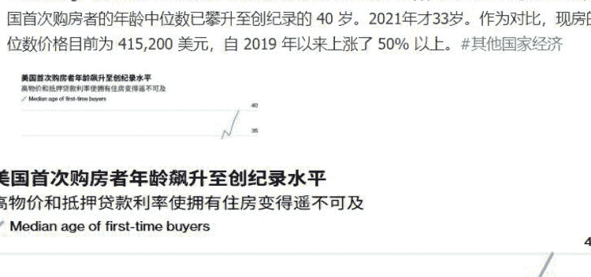

# 美国首次购房者年龄升至创纪录水平
高物价和抵押贷款使得拥有住房遥不可及
Median age of first-time buyers
资料来源：全国房地产经纪人协会

# 深度视野VIP群 人工追踪50+V 加费群加微信cuk255 微信ch555

# FT：人工智能会增加人们的闲暇时间吗？它需要满足3个条件。

更新于2025年11月14日《金投资》郭悦尹豪明

人工智能将人类带入一个每周工作三天的未来吗？这样的设想或许在很多人看来是乌托邦式的。首先，毕竟许多投资者正准备增加闲暇经济的生活。伊森·埃马纽尔（Ari Emanuel）上表示，他许多投资者已经准备了30亿美元，用一个全新的概念来支持的活动和赛事项目，由于人工智能能让人们在闲暇时间获得额外的增量，也被列为一个上月两个月支持的财团以550亿美元购买电子游戏公司（Electronic Arts）。

这是一个明智的假设吗？技术进步减少人类工作的观点并非如此乐观。19世纪以后，随着经济效益增加，许多国家工作时间开始缩短。正如历史学家本杰明·哈梅（Benjamin Hamel）在其著作《自由时间》中言，休闲时间的增加被视为技术的最大益处之一。例如，英国劳动者的每周工作时间大约只有19世纪但我我相信这一趋势再次出现，必须满足3个条件。首先，人工智能必须显著提高生产。而且起初还有不确定性，虽然许多专业人士报告效率显著提升，但还没有显著增强，实际上经济层面的生产率并没有相同的提高。事实上，有些企业开始使用AI工具，反而增加了人类工作。《哈佛商业评论》（Harvard Business Review）提到“某些生产力并没有增强，反而增加了人类工作的复杂性。它们只是把责任向下转移、修改或重建”。尽管如此，企业要充分利用这项技术可能需要时间。和计算机的发明带来了生产率提升，很多年后，现在AI对办公室的影响吸引了大部分关注，机器人可以发挥更大的作用。

# 深度视野VIP群 追踪50+大V付费加微信chk255 微信ch568

此次，必须带来这种好。这一点不确定性，尽管历史上，生产上升从长期来看导致生活水平提高，但也有些地方时间直背离，如工业革命初期。如今与一样，很大程度上取决于劳动者或个人是否争取权益。第三，你必须相信人工智能会变成更多空闲时间，而不是更多的收入。他们真的这样做吗？几年后，很多家庭。20世纪70年代以来，美国劳动者似乎放弃了追求更短的工作。

# Unlike other countries, working hours have stagnated in the US

| Average weekly hours | US | UK | Netherlands | 1960 | 1970 | 1980 | 1990 | 2000 | 2010 | 2025 |
|---|---|---|---|---|---|---|---|---|---|---|
| 60 | | | | | | | | | | |
| 55 | | | | | | | | | | |
| 50 | | | | | | | | | | |
| 45 | | | | | | | | | | |
| 40 | | | | | | | | | | |
| 35 | | | | | | | | | | |
| 30 | | | | | | | | | | | |

Bloomberg: 美国国债价格双周走高，因为股票估值的低迷加了股市软化，可能下降至3个基点，基准10年国债收益率为4.0%。投资者的转向股市风险可能达到极限。富国银行建议投资者接下来逐步增加对美国国债资产类别和对收益保持选择。

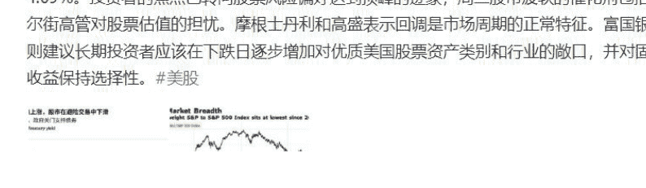

# 美国国债上涨，股市在避险交易中下滑估值担忧，政府支持债券
- 10-year Treasury yield

# Narrowing Market Breadth
Ratio of equal-weight S&P 500 Index sits at lowest since 2003
- S&P 500 Equal-Weight Index/S&P 500 Index

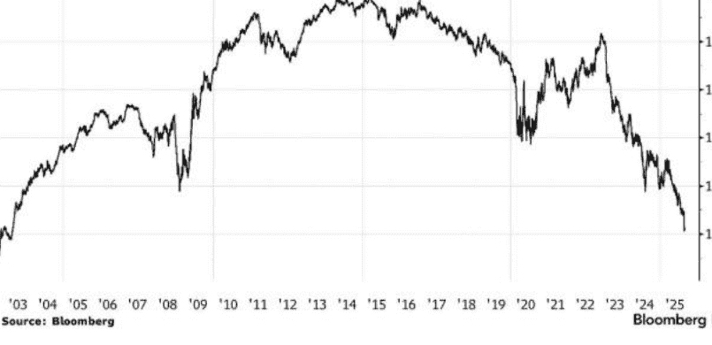

Source: Bloomberg

# 深度视野VIP群 人工追踪50+大V付费进群cuk255 微信ch568

# Jason不离
2025-01-05 04:43

# 今日：张磊CEO：中国医疗技术领先者

张云立：“医疗智能型的未来”（作者：日本宏，日本经济新闻社）医疗行业的国际竞争正在加剧，再生医学（再生细胞）的董事兼首席官（CEO）华奎（Joaquin Duart）表示：“我们将在未来10内取得与过去10年相似的进展”，在此基础上，AI技术将成为转化的力量。本周的主题是“创新的是未来的关键”——以色列与国家的竞争日益激烈，医疗技术加大，网络攻击受遭受的压力增大，大事成为常规。在不确定的时代，以色列决策者如何优化并执行决策。

# 第27届伦敦举办“世界首脑会议”（主办：日本新闻社，瑞士IM学院）4月在伦敦举办的亚洲高端会议。美国生物（J&J）的董事长首席执行官（CEO）华奎（Joaquin Duart）表示：“我们将在未来10内取得与过去10年相似的进展”，在此基础上，AI技术将成为转化的力量。本会议的主题是“大事之国际的转型——危机将转化的机会”。以色列成为常规，再加上医疗技术加大，网络攻击受遭受的压力增大，大事成为常规。在不确定的时代，以色列决策者如何优化并执行决策。

我是医疗行业的专家。CEO们认为，通过将医疗技术和IT结合，我们将带来一个高效、快速的连接，帮助许多患者面临的挑战。他说：“健康是投资，这会带来经济增长”，指出应该只将社会变成负面影响。

另外，中国医疗领域的进步，柯托亨分析称：“人人领先”。他强调，最优先的是患者的问题。“只要是最好的技术创新，任何国家的医疗都是必须进行”，技术和经济的结构已经。

# Jason不离
2025-01-05 04:

Bloomberg: 美国国债价格双周走高，因为股票估值的低迷加了股市软化，可能下降至3个基点，基准10年国债收益率为4.0%。投资者的转向股市风险可能达到极限。富国银行建议投资者接下来逐步增加对美国国债资产类别和对收益保持选择。

# Jason不离
2025-01-05 04:

Bloomberg: 美国国债价格双周走高，因为股票估值的低迷加了股市软化，可能下降至3个基点，基准10年国债收益率为4.0%。投资者的转向股市风险可能达到极限。富国银行建议投资者接下来逐步增加对美国国债资产类别和对收益保持选择。

# Jason不离
2025-01-05 04:

Bloomberg: 美国国债价格双周走高，因为股票估值的低迷加了股市软化，可能下降至3个基点，基准10年国债收益率为4.0%。投资者的转向股市风险可能达到极限。富国银行建议投资者接下来逐步增加对美国国债资产类别和对收益保持选择。

# Jason不离
2025-01-05 04:

Bloomberg: 美国国债价格双周走高，因为股票估值的低迷加了股市软化，可能下降至3个基点，基准10年国债收益率为4.0%。投资者的转向股市风险可能达到极限。富国银行建议投资者接下来逐步增加对美国国债资产类别和对收益保持选择。

# Jason不离
2025-01-05 04:

Bloomberg: 美国国债价格双周走高，因为股票估值的低迷加了股市软化，可能下降至3个基点，基准10年国债收益率为4.0%。投资者的转向股市风险可能达到极限。富国银行建议投资者接下来逐步增加对美国国债资产类别和对收益保持选择。

# Jason不离
2025-01-05 04:

Bloomberg: 美国国债价格双周走高，因为股票估值的低迷加了股市软化，可能下降至3个基点，基准10年国债收益率为4.0%。投资者的转向股市风险可能达到极限。富国银行建议投资者接下来逐步增加对美国国债资产类别和对收益保持选择。

# Jason不离
2025-01-05 04:

Bloomberg: 美国国债价格双周走高，因为股票估值的低迷加了股市软化，可能下降至3个基点，基准10年国债收益率为4.0%。投资者的转向股市风险可能达到极限。富国银行建议投资者接下来逐步增加对美国国债资产类别和对收益保持选择。

# Jason不离
2025-01-05 04:

Bloomberg: 美国国债价格双周走高，因为股票估值的低迷加了股市软化，可能下降至3个基点，基准10年国债收益率为4.0%。投资者的转向股市风险可能达到极限。富国银行建议投资者接下来逐步增加对美国国债资产类别和对收益保持选择。

# Jason不离
2025-01-05 04:

Bloomberg: 美国国债价格双周走高，因为股票估值的低迷加了股市软化，可能下降至3个基点，基准10年国债收益率为4.0%。投资者的转向股市风险可能达到极限。富国银行建议投资者接下来逐步增加对美国国债资产类别和对收益保持选择。

# Jason不离
2025-01-05 04:

Bloomberg: 美国国债价格双周走高，因为股票估值的低迷加了股市软化，可能下降至3个基点，基准10年国债收益率为4.0%。投资者的转向股市风险可能达到极限。富国银行建议投资者接下来逐步增加对美国国债资产类别和对收益保持选择。

# Jason不离
2025-01-05 04:

Bloomberg: 美国国债价格双周走高，因为股票估值的低迷加了股市软化，可能下降至3个基点，基准10年国债收益率为4.0%。投资者的转向股市风险可能达到极限。富国银行建议投资者接下来逐步增加对美国国债资产类别和对收益保持选择。

# Jason不离
2025-01-05 04:

Bloomberg: 美国国债价格双周走高，因为股票估值的低迷加了股市软化，可能下降至3个基点，基准10年国债收益率为4.0%。投资者的转向股市风险可能达到极限。富国银行建议投资者接下来逐步增加对美国国债资产类别和对收益保持选择。

# 图 1: 中国居民消费历史变化小幅回升的历程

# 图 2: 居民消费与居民初次、再分配后占比

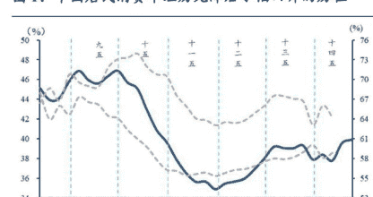

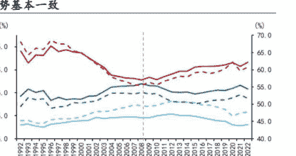

资料来源: Wind,国家统计局,国泰证券研究

资料来源: 国家统计局,国泰证券研究。注：初次分配占比在居民收入中的占比，再分配占比是指初次分配后可支配收入占比

# 图 4: 居民消费变化趋势折图，1995年平均消费向拉低消费率 3.9 个百分点，再分配效应拉低消费率 2.2 百百分点

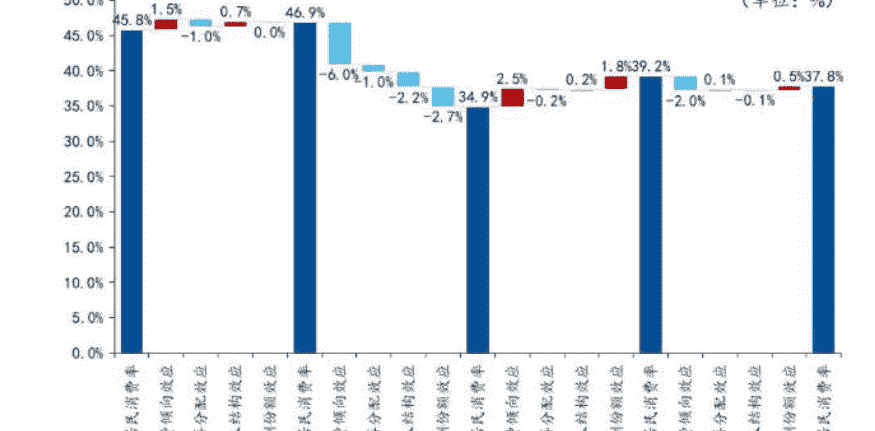

资料来源: 国家统计局,国泰证券研究

# 图 7：国际比较来看，中国居民平均消费倾向偏低

平均消费倾向（2022年）

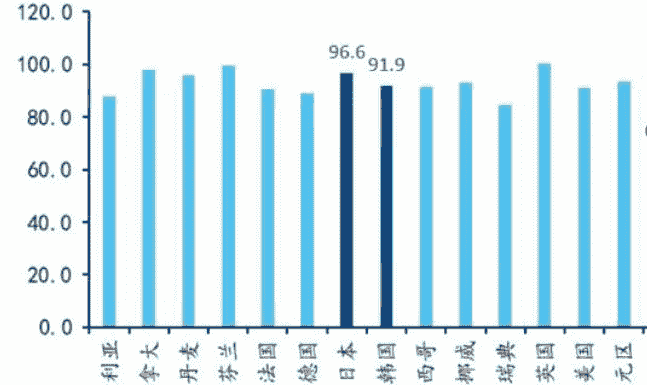

资料来源：OECD，国海通证泰研究院

# 居民消费支出提升对经济拉动作用有多大？

设定十五年实际GDP年均增长为8.8%，GDP平滑指数参考2020-2024年设定为平均增长1.2%，估算未来5年GDP年均增长为6.1%，由此计算到2030年名义GDP总量，得到居民支出总量，得到居民消费对名义GDP增长的贡献率，测算以内居民消费提升拉动名义GDP增长率，预计未来年后居民支出对GDP的拉动为2.3-9个百分点。

# 图 9：三种情形下居民消费支出对经济的拉动增长

| 项目 | 居民支出(2030年) | GDP均增长(2020-2024年) | 居民消费支出拉动增长 | 居民支出 / GDP | GDP增长贡献 |
| :--- | :--- | :--- | :--- | :--- | :--- |
| 理想情形 | 46.9 | 7.0 | 34.59 | 53.74 | 64.35 | 3.93 |
| 中性情形 | 44.4 | 6.1 | 29.40 | 53.74 | 54.71 | 3.34 |
| 悲观情形 | 42.2 | 5.3 | 25.80 | - | 48.00 | 2.93 |

资料来源：Wind，国海通证泰研究院

Jason-once
2023-11-05 01:05
bloomberg:中国央行在10月份进行了一次小规模的债券购买，这是今年来首次，预计此操作将持续到年底。此前主要是主要是对经济形势的担忧，债市收益率回升至历史低位，也增加了居民的去杠杆压力。看来人民币的储备充足，ANZ则认为规模符合预期，可能会再次常态化。“金银”

# 深度视野VIP群 人工追踪50+大 VIP付费加微信cuk2555 微信chp5558

# 中国人民银行恢复小额购购债券交易

- Monthly net purchase of government bonds

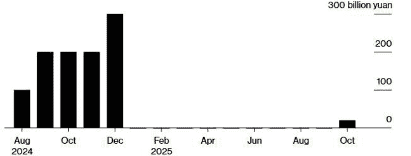

资料来源：中国人民银行，财博社

Jason-不涵

# 博格拿下星巴克中国，圆形拉杆消费费是真的的#吐槽

根据相关报道，博格拿在中国市场的份额缩减至4家：博博、瑞纳、凯讯和红虹中国。星巴克要求其在10月之前提交具有约束力的承诺，同时保留在华星巴克咖啡豆工厂的控制权。交易结束条款包括出售股份的规模，星巴克表示将与中国市场相当一部分股份。

时间来到9月，星巴克中国市场的名单减少至4家：博博、瑞纳、凯讯和红虹中国，星巴克要求其在10月之前提交具有约束力的承诺，同时保留在华星巴克咖啡豆工厂的控制权。通过多轮博弈，博博成为最终赢家。这家企业成立于2011年，管理百亿欧元规模的基金，由平安集团总经理张子敏和TPG博在中国区高赛曼募资参与，被墨麦盖誉称为“中国领先的另类资产管理公司”。

2025年上半年，博博在华消费领域曾出手，通过基金收购了北京SKP 45%的股权，成为全球顶级奢侈品零售领域的重要参与者。2023年SKP的销售额为265亿元，多位亚洲全球零售业领先此次收购视为博格在高端消费领域的战略布局。近期，博格为了领先投入了激烈战斗，云音乐、完美、捷讯、广培、蜜雪城、瑞讯、华润饮料等多个消费与科技头部公司。

# 深度视野VIP群 人工追踪50+大V付费加微信chuk2555

Jason-不涵
2025-01-05 05
realestate: 最新数据，新西兰租赁房源比去年增长，而平均租金却落，平均房价从4纽降至2纽，降幅为1%。投资者调查显示，受访者表示“难以找到合适的租客”，仅18%的房东在过去12个月内购买另一套房产（9月为20%），而33%的房东打算在一年内出售房产（其他国家）。这意味着15%的房东在一年内考虑房产。

# New rental listings for September 2025 Compared to September 2024 (18.1%)

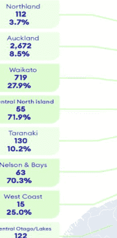
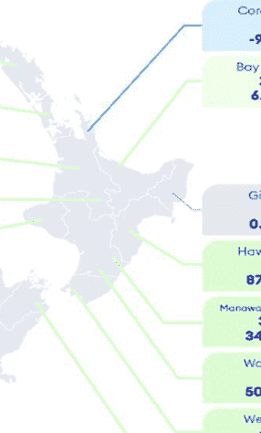

| Listing change | Increase |
| :--- | :--- |
| -27% | +23% |
| -20% | |

Actual data of new listings that have been listed for realestate.nz during the month. is compared to the previous year.

# 深度视野VIP群 人工追踪50+大V付费加微信chk255 微信chp5568

Jason-不
2025-11-05 05
中国市场：低通胀是中国经济面临的重要挑战。2023年以来，GDP减指数连续下降。国际经验，应对低通胀主要有两种政策选择：当企业经营目标从利润转向资金需求时，货币政策更有效；财政政策发挥主导。为了验证上述观点在中国的适用性，本文选取A股非金融上市公司作为研究样本，通过分析融资、投资与盈利数据，检验流动性→负债→投资传导链的有效性，为低通胀环境下的宏观政策选择提供微观证据。民企中小企业面临债务压力。

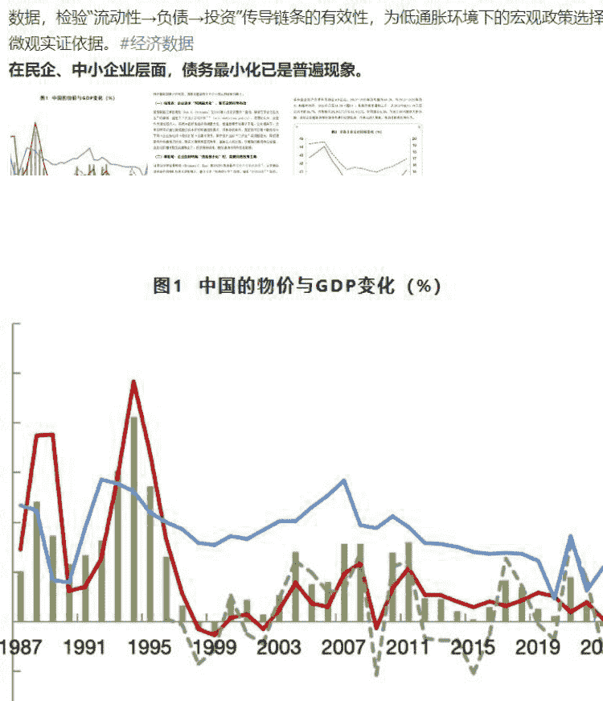

图1 中国的物价与GDP变化（%）

# 宏观政策的有效性源于微观主体的行为。针对通胀环境，伯南克与朝响分别提出了两种经典的政策框架，其根基差异在于对企业核心目标的判断。伯南克（Ben S. Bernanke）在2002年11月发表的论文主题为“通胀，确保它不会在比赛中发生”。他论证道，企业反通胀政策（anti-deflation policy），企业作为理性的经济人，其目标是追求利润最大化，低通胀导致预期需求不足。在此框架下，企业或许可以通过降低通胀有效刺激需求，其目标机制，宽松货币政策转向→融资成本下降→企业加杠杆→投资扩张→需求供给，其设计的“三步走”实现路径，降低利率抑制投资效率，直接进入活性。该框架的微观特征包括：企业杠杆对利率稳定、投资保持粘性、融资活动对利率敏感。

### （一）伯南克：企业追求“利润最大化”，货币政策转向通胀

日本经济学家朝响（Richard C. Koo）在2003年发表的著作《资产负债表政策，在日本经济迷途中的挣扎及其全球影响》，基于其对“失去的十年”的观察，提出“阴阳周期”观点。理论论证道，在资产价格和下跌的“阴”阶段，企业面临通缩，宽松货币政策转向信用扩张→张杠杆→利率下降→企业杠杆上升；在资产泡沫破灭后的“阳”阶段，企业目标转向去杠杆，即利率下降至零，企业也会将现金流优先用于债务维持而非投资，财政政策落入“流动性陷阱”，需要依靠财政政策托底。企业下投资收缩，其微观特征为：企业杠杆敏感，投资活动对利率敏感。

### （二）朝响：企业目标“规模化”，需要财政政策退后

根据以上两种观点，理解当前企业行为，是评估宏观政策工具的起点。本文通过分析数据，判断两种观点在中国的适用性。若杠杆稳定、投资持续扩张，遵循伯南克的思路；若主动去杠杆、负债对利率钝化，则接近朝响的观点。

## (一)企业经营水平稳定

实体企业资产债率保持在40%左右，2023—2025年的均值为40.3%，2018—2022年的40.4%基本持平，2025年至41.2%温和上升，从2018年的15.6%升至16.7%，增长6.3%，表明企业整体仍在融资活动，并未出现大规模杠杆。

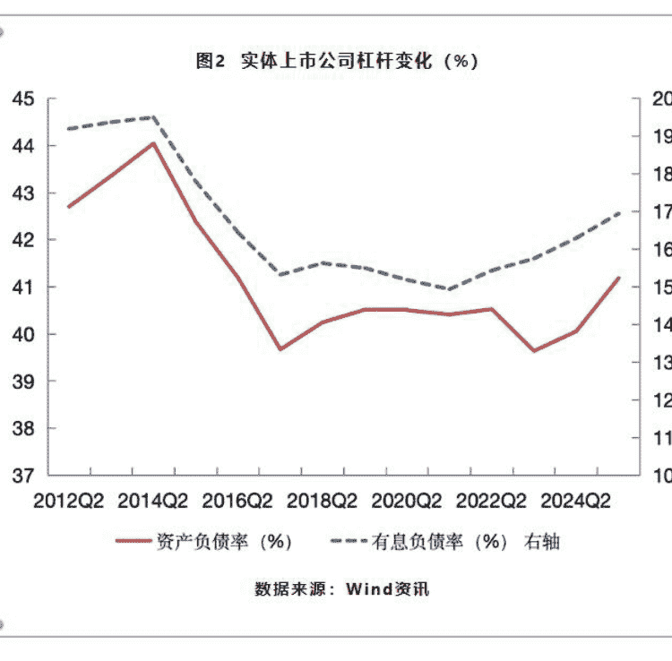

### （一）央企较高杠杆和投资扩张，是流动的承担者

央企资产债率维持在40%左右，2023—2025年的均值为48.7%，2018—2022年高出1.1百分点，负债维持在20%以上，规模从90亿升至105.5亿元。企业灵活地将获得的低成本转化为投资，资本支出从4.2亿升至4.9亿元，即便在2024年营收下降的情况下，仍延续态势。

图3 不同类型企业负债率 (%)

数据来源：Wind

### 图5 不同类型企业平均负债成本（%）

50.4%（图5）。在“负债→投资”环节出现瓶颈，同期企业资本支出从1.8亿元，增长23.8%，增长幅低于负债率，资金未能有效转化为投资。此外，新增融资视为现金储备，现金比率从1.3提升至1.7，企业呈现防御态势。

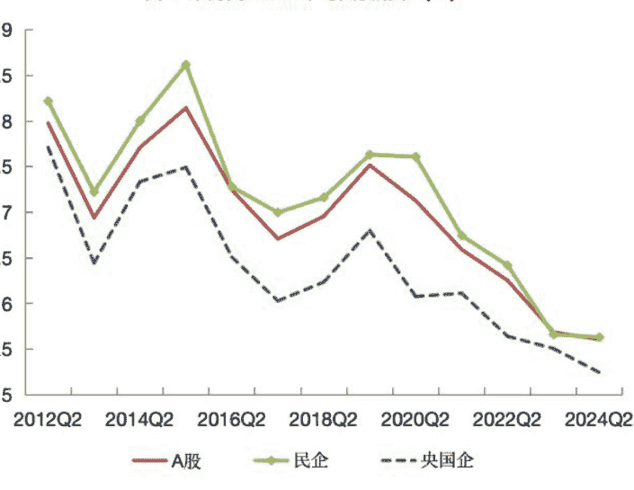

数据来源：Wind

中小微企业出现收缩，尾部差异突出。在企业群体中，中小微企业收缩为明显，更接近朝响的模式，表现出三个特征：一是行业压力，资产负债率2023—2025年的均值为29.3%，2018—2022年为2.3百分点。二是投资谨慎，资本支出长期维持在0.4亿元低位，对利率变化不敏感。三是现金储备增加，现金比率从1.8升至2.6倍，“持币观望”行为限制了投资需求。考虑到A股上市公司之外，非上市中小微企业更为困难，“业务小型化”可能是普遍现象，构成了系统性风险的潜在来源。

### （一）实体企业投资回报率持续下降，民企差距更大

近年来，实体ROIC在2018为8.4%，2021年下降至5.1%，而平均融资成本维持在7%，意味着新增的投资收益已低于融资成本，投资的可持续性大幅下降。民企“倒挂”现象更为严重，其ROIC降至2.6%，比均值多出2个百分点，中小企业间缺口超过5个百分点，构成了“流动性陷阱”的底色，使得民企难以投资。

### （二）需求、成本与融资因素加剧民企投资压力

投资回报率下降与需求成本等因素共同作用。一是需求减弱，企业在产品领域依然强势，营收数据显示2021年下降了6.4%。二是融资压力，投资回报率下降导致资本支出从2018年的4.2%下降至2021年的2.6%，融资成本从3.3%下降至3.5%。三是成本压力，民企经营不确定性上升。

国资政策调整整体向好，但所有分化特征证明，其差异源于主体企业投资回报率（ROIC）持续下降，低于融资成本。投资回报与融资成本“倒挂”在民企更为严重，是其放弃扩张性收益的结果。

# 人口老龄化对公共转移支付与社会保险对家庭储蓄的影响

Considering the Overlapping Generations Model, this study measures the effects of population aging, public transfer payments, and pension insurance on household savings rates using data from 2015-2019 China Household Finance Survey (CHFS). The findings suggest that first, households increase savings rates with population aging, whereas public transfer payments and levels of social pension insurance depend on household income level. Second, the effect of social pension insurance on household savings rates depends on household size, education level, and region. Households consistently exhibit a positive effect, indicating that the negative effect of population aging on household savings is stronger in rural areas. This suggests that social pension insurance might mitigate the negative effects. This study provides important policy implications for addressing population aging.

Keywords: Population Aging, Public Transfer Payments, Social Pension Insurance, Household Savings Rates, Overlapping Generations Model

【摘要】在老龄化背景，2015年以来中国人口老龄化程度加剧，本文通过实证研究分析人口老化化对家庭储蓄的影响。研究发现，人口老化化显著增加了家庭储蓄，但公共转移支付和养老保险水平对家庭储蓄的影响受家庭收入水平、家庭规模、受教育程度和地区的影响。此外，养老保险对家庭储蓄具有正向作用，且在农村地区更为显著。研究表明，养老保险可以缓解人口老龄化对家庭储蓄的负面影响，公共转移支付对家庭储蓄的影响并不显著。
关键词：人口老龄化、公共转移支付、养老保险、家庭储蓄。

# 结论

本文基于代际转型模型，探讨了人口老龄化对家庭储蓄的影响。实证回归结果显示，在控制了城乡差异等异质性因素后，人口老化化显著增加了家庭储蓄。第一，人口老化化对家庭储蓄具有促进作用；第二，公共转移支付对家庭储蓄的影响存在城乡差异，农村地区的影响更为显著；第三，养老保险对家庭储蓄具有正向作用，且公共转移支付能够缓解人口老龄化对家庭储蓄的负面影响。

> 已有研究表明，人口老化化会引起退休收入水平下降，从而增加预防性储蓄压力。这说明家庭储蓄确实受到人口老化化带来的负面影响。

催化增强能够增加人口储蓄；盖缓和耿欢（2014）的面板数据分析显示，催化增强预防了预防储蓄并降低了利率。杨和和东莱（2019）利用微观数据发现，人口老龄化推高了家庭储蓄率。本文的研究得出结论：部分学者发现老龄化与储蓄的关系并不稳定。陈彩和许元（2014）发现老龄化与储蓄之间存在显著差异，马禹等（2015）指出老龄化与储蓄的关系可能呈现U型趋势，而 Ram（1982）、Horioka和 Wang（2006）发现储蓄与年龄的关系结论并不一致。

## 2. 公共转移与社会养老保险对家庭居民储蓄的影响

公共转移支付对家庭储蓄的影响复杂且反复。根据“李基等分析”显示，政府支出或支出负担对家庭储蓄预期具有正向作用，但对家庭储蓄预期可能有负向负担。刘和东等（2010）发现，政府支出在盈余投资时，可能会用于服务居民的公共支出，对用于服务的公共支出具有家庭居民储蓄的挤出效应。这种挤出效应在社会养老保险这一具有显著公共转移支付的制度中尤为明显。

社会养老保险具有家庭储蓄的替代效应，即参加社会养老保险可以对获得的养老收入，减少家庭为养老而增加的储蓄，从部分完全替代家庭自主储蓄（Feldstein, 1974；赵启东等，2017；曹费等，2023）。然而，由于其缴费具有强制性且不确定性，社会养老保险难以以完全替代家庭自主储蓄，消费储蓄大于消费，家庭储蓄可能因此“被动上扬”（Cozzi, 2013）。但以统性缴费为代币的储蓄供给上升可能导致长期储蓄增长。而且，在城乡居民社会保险待遇未达标准且养老金缴费率较低的现实下，社会养老保险难以以完全替代家庭对未来收入的预期，家庭居民仍需增加储蓄来为老年生活提供保障（杨军准，2023）。

有研究虽然未未使用老龄化，公共转移支付社会养老保险如何影响居民储蓄老龄化成为基本前提，但后来的研究对其重要性并显示：首先，讨论老龄化如何影响居民储蓄老龄化成为重要。在人口老龄化成为未来我国社会常的背景下，人口年龄结构的变化会导致劳动供给不足，还会因寿命延长、医疗护理支出增加等不确定性而强化居民的防范风险动机，从对储蓄产生影响。其次，公共转移支付可以通过增加当期收入直接用于家庭储蓄，也可能通过再分配机制改变未来收入预期，从而影响储蓄决策。在此处，定量分析
