# 南亚全球财经2511077

Jason 不遇
2025-11-07 02:23

...

1min2s

国投：2025年3月以来，房价下行压力增加，一线城市二房自2025年4月以来出现限购加持后，今年6月以来二房市场涨幅扩大4.4%，一线城市，2018年完工的次新房房价从2025年第二季度至第三季度的119,169元/㎡，单季度下降15.7%，远高于其他地区的跌幅。

核心城市二房市场正经历加速调整，这一趋势本质上是前期政策对市场结构性偏弱的集中体现。
在限购政策执行期间，房产转向高刚需模式加速供应，形成的大量限购新房在经过两年左右调整期后，2025年中转为二线城市的次新房，对二房价格形成显著冲击，特别是前期中小型型房交付引发的这类产品，对于居住属性较强的在政策放松后加速调整，进一步加剧了市场下行压力。#房价

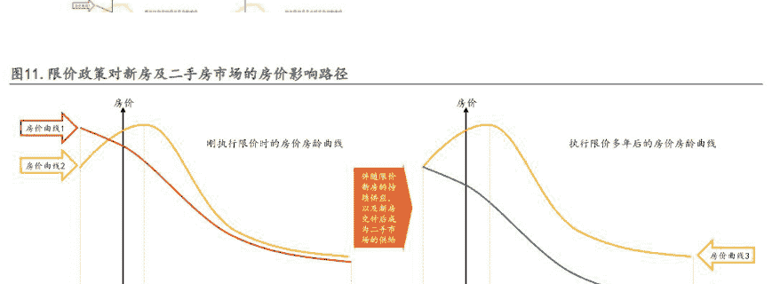

图11. 房价趋势对一线及二手市场房价的影响

| 房价 | 二线城市 | 二线城市 | 二线城市 | 二线城市 | 二线城市 |
| :--- | :--- | :--- | :--- | :--- | :--- |
| 趋势 | 下跌 | 下跌 | | | 下跌 | |

1. 市场行情，市场持续下跌，房价受多种因素影响，还有供需关系的影响。房价是否受政策影响，看是否影响统计指标（房价趋势）
2. 2018年限购政策后，房价开始反弹，受政策影响，在政策调整后，2025年中二线城市次新房房价上行（受政策影响）
3. 投资价值，由于核心城市的投资属性回归，房价在政策期间表现强势，但在政策调整后二线城市市场出现下跌，二线市场大面积受影响，房价趋势持续下跌（房价趋势），受政策影响后，如（房价影响）对（房价影响），房价受影响较大。
来源：易观数据研究院

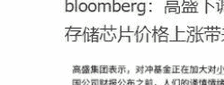

bloomberg: 高房价跌回了小型房的指标100%，并转型成为对中小型基金的回归，理由是存储溢价上线带来的市场压力，缺乏催化剂#行业

市场需要调整，由于高房价导致对中小型房的需求得到释放，因为是国内政策调整的影响。

核心城市的调整，由于需求减少了50%，数据显示，在调整后，房在核心城市市场价格出现了大幅下跌。
然而，房价的形成逻辑已经出现了更多因素。

核心城市的调整，由于需求减少了户型，房价在短期内持续回调

更多资讯进群微信cus255

# 高森集团显示，对冲基金加大对小米公司的看注，因为在中国财报公布之前，人们的谨慎情绪有所上升。

该银行的销售周三在一份报告中，过去一周，高森优质账单的空头股数据增长了53%。报告提到，过去两周，在养老金和对冲基金的带领下，接触的办公流动出现了更多抛售。

对冲基金的反响，小米“由于缺乏催化剂，至少在短期内是共筑做/卖出”，“他们写道。安全问题，工厂延误以及尽量最近进行了促销活动，但电动汽车的普及及准确率，都压了市场情绪。

# Xiaomi Falls Over 25% From July High

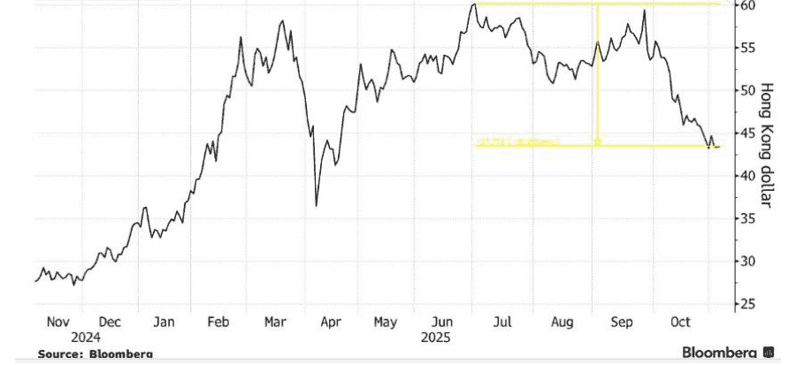

Nov Dec Jan Feb 2024 Mar Apr May Jun Jul 2025 Aug Sep Oct
Source: Bloomberg

bloomberg: 两份美国就业数据并不好看，Challenger, Gray & Christmas Inc. 的数据显示显示10月份新增人数减少20多年来最大幅度。同时，Revelo Labs的最新数据显示显示，在美国在上个月增加33,000个非农就业岗位后，10月份减少了9,100个非农就业岗位。软弱的数据让招聘的概率回升，美债收益率走低，避险情绪让股市下跌。
zerohedge认为这起凸意味着main street和wall street的走势差异扩大。#其他国家经济

更多资源进微信群cuk255

# 任何 10 月份的裁员人数均值 2003 年以来的最高水平

仓储和科技板块领跌涨上月

- October job-cut announcements

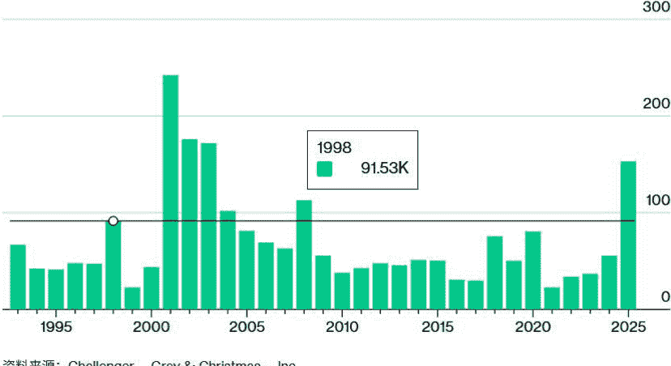

数据来源：Challenger, Gray & Christmas, Inc.

| Data Table | Index | Feb-25 | Mar-25 | Apr-25 | May-25 | Jun-25 | Jul-25 | Aug-25 | Sep-25 | Oct-25 | Nov-25 | Dec-25 |
|---|---|---|---|---|---|---|---|---|---|---|---|---|
| - Payroll Employment | REWAICS index | -15.48 | -12.77 | -2.02 | -2.01 | -0.97 | -1.53 | -1.55 | -1.25 | -0.01 | -0.23 | -1.44 |
| - Goods Producing Industries | REWAICS index | -5.96 | -3.14 | -3.31 | -3.31 | 4.43 | 4.22 | 4.29 | 19.99 | 9.56 | 13 | -2.46 |
| - Service Providing Industries | REWAICS index | -17.46 | 7.85 | -1.38 | -1.14 | -6.46 | -2.25 | -0.39 | -0.51 | -1.23 | -1.13 | -3.75 |
| - Manufacturing | REWAICS index | -5.04 | -2.02 | -5.15 | -5.32 | -4.29 | -1.56 | -2.50 | -3.86 | -2.71 | -2.83 | -3.79 |
| - Retail | REWAICS index | -0.56 | -0.30 | 1.49 | 1.78 | 2.28 | 0.60 | 0.95 | -0.69 | -0.77 | -1.15 | -1.11 |
| - Transportation & Warehousing | REWAICS index | -12.29 | -16.68 | -13.53 | -15.32 | 10.16 | 1.31 | -14.79 | -20.88 | -27.23 |
| - Government | REWAICS index | -0.36 | -0.20 | -0.69 | -0.29 | -0.17 | 0.66 | 1.92 | -2.59 | 5.91 |
| - Financial Services | REWAICS index | 11.32 | 16.68 | 12.25 | 18.65 | 31.32 | 18.23 | 19.99 | 7.79 | 9.56 |
| - Professional & Business Services | REWAICS index | 39.51 | 45.67 | 44.23 | 46.22 | 36.89 | 45.01 | -28.29 | 21.97 |
| - Education & Health Services | REWAICS index | 10.33 | 13.33 | 13.33 | 13.33 | 13.33 | 13.11 | -1.11 |
| - Other Services | REWAICS index | -5.96 | -3.14 | -3.31 | 4.43 | 4.22 | 4.29 | 19.99 |

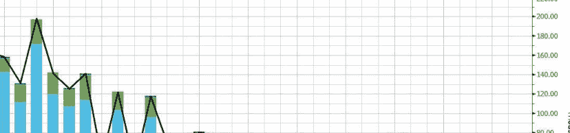

更多资源进微信群cuk255

# Challenger job cuts

# Rate cuts priced for December

# Revelio Labs -9K jobs

# 10Y TSY Yield

# Wall Street (S&P 500)

# Main Street (Job Openings)

# Jason不离
2025-1-07 03:00

# FT: 俄罗斯关注美国核行，黑暗森林#其他国家经济

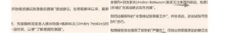

普京在联合国安全会上表示：“如果美国进行核试验，俄罗斯也必须采取反制措施。”
他还要求“可能进行核试验的建议”。自苏联以来，莫斯科一直没有进行核试验。
在安全会议结束后，克林顿发言人米特·佩尔表示，“准备这些提案需要一些时间，以便了解俄罗斯的意图”。
上周三，特朗普在社交媒体（Twitter）上突然宣布，美国自首次恢复核试验，引发关注。
目前尚不能确定这次试验是核弹的还是用于导弹或其他武器系统的。
但特普在周五试图再次确认核试验的意图，“我们将进行一些试验”。

普京在安全会上要求俄罗斯进行核武器试验方案，这一举动被认为具有精心安排的意思。
他的言论具有严重后果，与俄罗斯国防部长别萨洛夫（Andrei Belousov）交流后，这些活动表明俄罗斯正在扩充战略武器，并补充，这些试验可在俄罗斯北方短期内进行。

俄罗斯情报负责人纳尔申科（Sergei Narykin）以及亚历山大尔切夫（Alexander Darchiev）向美国国家安全委员会（US National Security Council）和国务院（State Department）提出意见，但对方回避了实质性回应。
就特朗普在“社交媒体”上发表前，普京表示俄罗斯已测试过两种发射平台：“海皇”近程导弹和“波格”无人机。
当时斯科夫表示，两次测试都不是核试验，意味着的是发射系统，而非原子弹。

更多资源请进信uxcs

# Jason不遇
2025-11-07 03:12

bloomberg: 比加莱明年时候推出了它的指标，使用追踪到1997年的期权数据带来萧市场的贪婪。（注：此处原文有大量重复和乱码，语义纠正为）bloomberg: 比加莱明年时候推出了它的指标，使用追踪到1997年的期权数据带来市场的贪婪。这个想法是为了帮助投资者关注过大和非理性繁荣的迹象。他们的债务指标现在正处于类似的警告。
不过PM团队认为，从季节性角度来看，过去两个月股市投资的强势劲头可能持续到2026年

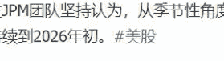

Figure 3. The Barclays Equities Indicator tracks the stock capitalization-to-GDP ratio closely

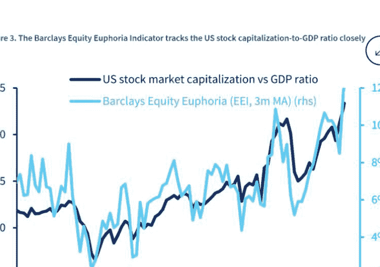

Source: Barclays Equities Derivatives, Bloomberg, Federal Reserve Data, Federal Reserve Bank of St. Louis

# Jason不遇
2025-11-07 03:57

Dalio: 你看到过美储停止QE了吗？虽然它被认为是技术性策略，但无论如何，它都是一种量化的指标。这是我们需要关注的指标之一，和我以前上一书中描述的债务周期的相似。更具体地说，如果负债表开始大幅扩张，同时赤字开始增加，我们将视为美储和财政部政府债务货币化的经典案例或政治互动。如果这种赤字发生在新兴市场资本市场信贷造成剧烈波动，市场崩溃，信用压力接近低点，失业率接近近期，通胀高于此，人工智能处于泡沫中（对于我们来说现在指指标），在我看来，美储在刺到潮流，美国国债的供给量大于我们的需求，央行正在进行“抄底”和购买债券，而财政部在缩短债务的期限以弥补短期债券的需求时，这些都是典型的债务周期长期末后期动态。

更多资源进群微信cosxxx*

美联储和或其他央行发行债务债券，它会创造流动性并降低利率，如图1所示。接下来会发生什么倾向于流动性的变化：

1. 如果在金融资产中，它会推动金融资产价格并降低利率，从而扩大股市，风险利差压缩，黄金上涨，从而转变为“金融资产通胀”。对于这样的市场，这有利于金融持有者。
2. 如果在某种转型为资产中，房价和动力上涨，从而导致通胀。这种自动化的生产如型的典型要小。如果它足够了动力，自动化的生产会导致利率上升以抵消利率的下降，那么实际利率将会损害持有者的购买力和名义价值。

所有资金的流动趋势都由央行执行。所有资金的流动趋势都由央行执行。所有资金的流动趋势都由央行执行。所有资金的流动趋势都由央行执行。所有资金的流动趋势都由央行执行。所有资金的流动趋势都由央行执行。所有资金的流动趋势都由央行执行。所有资金的流动趋势都由央行执行。所有资金的流动趋势都由央行执行。所有资金的流动趋势都由央行执行。所有资金的流动趋势都由央行执行。所有资金的流动趋势都由央行执行。所有资金的流动趋势都由央行执行。所有资金的流动趋势都由央行执行。所有资金的流动趋势都由央行执行。所有资金的流动趋势都由央行执行。所有资金的流动趋势都由央行执行。所有资金的流动趋势都由央行执行。所有资金的流动趋势都由央行执行。所有资金的流动趋势都由央行执行。所有资金的流动趋势都由央行执行。所有资金的流动趋势都由央行执行。所有资金的流动趋势都由央行执行。所有资金的流动趋势都由央行执行。所有资金的流动趋势都由央行执行。所有资金的流动趋势都由央行执行。所有资金的流动趋势都由央行执行。所有资金的流动趋势都由央行执行。所有资金的流动趋势都由央行执行。所有资金的流动趋势都由央行执行。所有资金的流动趋势都由央行执行。所有资金的流动趋势都由央行执行。所有资金的流动趋势都由央行执行。所有资金的流动趋势都由央行执行。所有资金的流动趋势都由央行执行。所有资金的流动趋势都由央行执行。所有资金的流动趋势都由央行执行。所有资金的流动趋势都由央行执行。所有资金的流动趋势都由央行执行。所有资金的流动趋势都由央行执行。所有资金的流动趋势都由央行执行。所有资金的流动趋势都由央行执行。所有资金的流动趋势都由央行执行。所有资金的流动趋势都由央行执行。所有资金的流动趋势都由央行执行。所有资金的流动趋势都由央行执行。所有资金的流动趋势都由央行执行。所有资金的流动趋势都由央行执行。所有资金的流动趋势都由央行执行。所有资金的流动趋势都由央行执行。所有资金的流动趋势都由央行执行。所有资金的流动趋势都由央行执行。所有资金的流动趋势都由央行执行。所有资金的流动趋势都由央行执行。所有资金的流动趋势都由央行执行。所有资金的流动趋势都由央行执行。

# 全球最大的主权财富基金

化石燃料丰富的国家在全球 SWF 排名中占据主导地位。

| | |
|---|---|
| NBIM, Norway | $2.0t |
| SAFE, China | 1.6t |
| CIC, China | 1.3t |
| ADIA, Abu Dhabi | 1.1t |
| KIA, Kuwait | 1.0t |
| GIC, Singapore | 936.0b |
| PIF, Saudi Arabia | 930.0b |
| QIA, Qatar | 524.0b |
| ICD, Dubai | 400.0b |
| TWF, Turkey | 360.0b |

Jason
2025-11-07 04:17

FT: 英伟达(NVIDIA)CEO黄仁勋警告，中国将在人工智能竞赛中击败美国，原因在于其更低的研发成本和更复杂的监管环境# 缺市

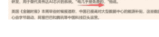

黄仁勋点名批评中国的补贴措施以及其出的人智能监管条例，这些规定可能会出现“50条新的法规”，他将此称为补贴使得当地科技更容易运行中国自主研发、用替代代替AI芯片的系统。“由于芯片是免费的，”他说。

英国《金钱时报》本周开始报道称，中国已对高能数据中心进行补贴，这些数据中心由于文字跳动，阿里巴巴和腾讯试图抢头运营。

知人士称，在中国石油监管机构曾有用补贴，为寒纪(Cambricon)等公司生产的半导体芯片成本上升，地方政府已对电力进行补贴。不过，多数此类系统的效能低于英伟达的芯片。

黄仁勋此前警告，美国最新的人工智能模型与中国竞争的差距并不大，并呼吁美国开放市场，允许其芯片进入中国，以确保世界其他地区继续依赖美国技术。

更多资源进微信群255

# Jason 不疆

USGS: 美国内政部发布的最新矿产关键清单首次将列入其中，标志着2018年以来最重大的调整。不同于6月底的清单草案，最终清单包含了冶金和石蜡，清单决定了哪些商品将被纳入特朗普政府的关键矿产相关22项调查，关系到未来的关税政策和贸易限制措施。

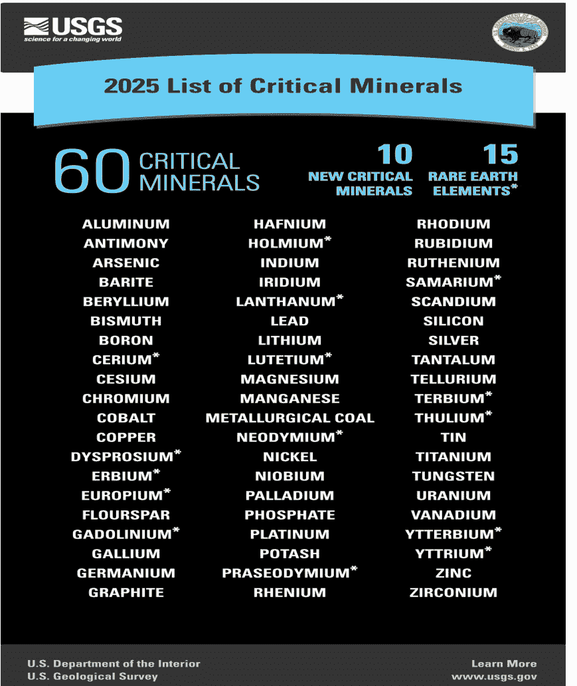

# 2025 List of Critical Minerals

| 60 CRITICAL MINERALS | 10 NEW CRITICAL MINERALS | 15 RARE EARTH ELEMENTS* |
| --- | --- | --- |
| ALUMINUM | HAFNIUM* | RHODIUM |
| ANTIMONY | HOLMIUM* | RUBIDIUM |
| ARSENIC | INDIUM* | RUTHENIUM |
| BARITE | IRIDIUM* | SAMARIUM* |
| BERYLLIUM | LANTHANUM* | SCANDIUM |
| BISMUTH | LEAD | SILICON |
| BORON | LITHIUM* | SILVER |
| CERIUM* | LUTTERBIUM* | TANTALUM |
| CESIUM | MAGNESIUM | TELLURIUM* |
| CHROMIUM | MANGANESE | TERBIUM* |
| COBALT | METALLURGICAL COAL | THULLIUM* |
| COPPER | NEODYMIUM* | TIN |
| DYSPROSIUM* | NICKEL | TITANIUM |
| ERBIUM* | NIOBIUM | TUNGSTEN |
| EUROPIUM* | PALLADIUM | URANIUM |
| FLOURSPAR | PHOSPHATE | VANADIUM |
| GADOLINIUM* | PLATINUM | YTTERBIUM* |
| GALLIUM | POTASH | YTTRIUM* |
| GERMANIUM | PRASEODYMIUM* | ZINC |
| GRAPHITE | ZIRCONIUM | |
| RHENIUM | | |

U.S. Department of the Interior
U.S. Geological Survey

Learn More
www.usgs.gov

# Jason 蓝

美国经济现在正从最低收入者向中产前进，最高的10%的家庭推动了美国总收入的近一半。这种现象反映了极极化，经济学家霍特特表示：“我觉得我们今天的经济就像一头沉重的冰球在经济滑雪山上运行，冰块被推起来，由美国家里慢慢推，直到变成雪崩。”随着通胀停滞和薪资暴涨，薪资飙升至新高。

根据统计数据的分析，富收入者的收入占比了三分之一之二——创造历史新高。收入最高的80%的人类中的支出占比高达42%，仅占整体消费的37%。研究公司 Circana的数据显示，中低收入者在服装和玩具等各种商品上的支出在减少。

美特肯基亚州调查显示，我们现在面临通胀压力。较高收入的家庭过得相当不错，许多大家，包括收入者，他们的正在经历苦挣。比较之下，美国消费者为了省钱，忙着外食正面放松的餐食的，根据美国银行全球研究[Bank of America Global Research]对外食市场表现的分析，9月消费者外食增长率下降，外食价格下降8.3%，消费者在快餐店的选择在减少，自去年11月以来，快餐连锁月度销量下降0.6%。之一，加州需要墨西哥萨鸡烤[Chipotle Mexican Grill]、Wingstop和Cava的预计外餐店预计今年非季节性需求量将攀升，年轻的顾客可能还是不意外的不餐，一些人面临诸多不利困境，包括失业。学生贷款压力增大，以及其实工资增长放，2022年来新高。学生贷款逾期率升至14.4%创历史新高，4.5%的贷款逾期超30年，2023年来，20-35岁年轻群体连续触历史最底，消费萎缩#其他美国经济

# 美国低收入者的信心下降

相比之下，普通市场表现良好，较高收入的家庭则持乐观态度。

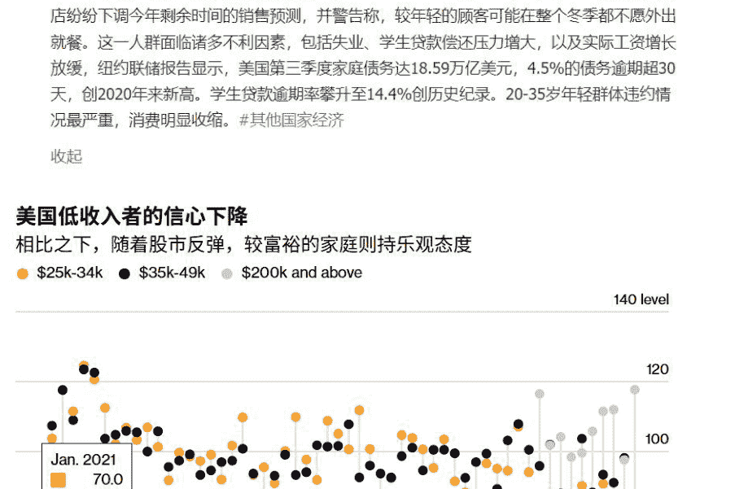

来源：世界大企业
注意：200美元以上的数据适用于2025年

# 钱包

高收入承担了美国消费者支出的大约一半，于1990年代初期的约三分之一。

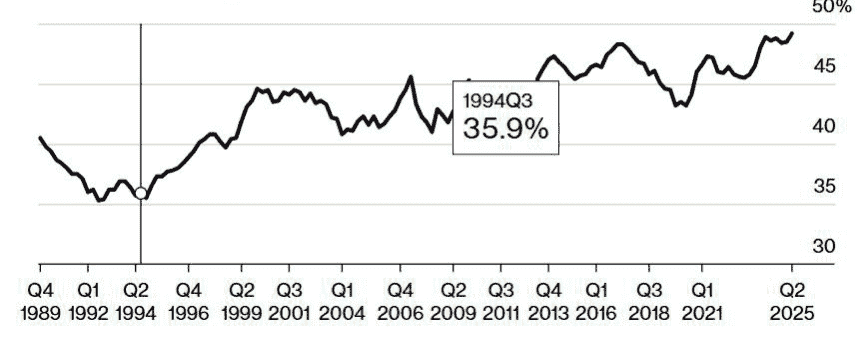

资料来源：燃油分析数据审查n2025-11-07

bloomberg: 伯希尔正在请进入日本市场，人们从该表显示伯希尔正在考虑被低估的价值，这可能对其有利。自2020年8月首次以来，这些公司的股价已上涨了两倍#股市

JAPANESE TRADING HOUSES BY BUFFETT HAVE PERFORMED
Normalized As 09/04 Mitsubishi Corp. Mitsui & Co. Itochu Corp. Marubeni Corp. Sumitomo Corp. Topix Index

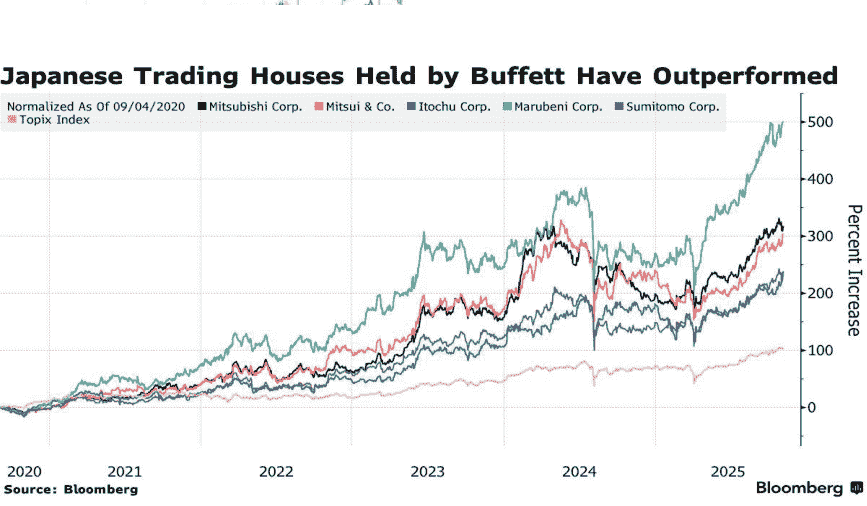

Source: Bloomberg

# Jason 不

BOFA: 美元展望呈现三阶段——短期，AI支撑GDP，支撑美元走强；中期AI将终结利差市场，或导致美联储周期；长期取决于AI生效——若引发通胀，利率将维持高水平，通胀效应吸引资金流入。

目前数据显示，对美元的长期走势取决于两个相互竞争的力量，通胀效应和生产力提升——

1. 通胀（利好）：如果AI的增长超出预期，将引发广泛通胀，尤其是使美联储采取激进的政策。20-24岁年轻群体的失业率正比同期大，超过了25-54岁核心劳动力人群，同时UPS、IBM、Target等公司的消息也显示了AI驱动的失业潮可能开始。任何就业增加，都将显著增加美元的下行风险，因为它直接影响美联储政策和最终预期。

2. 生产力（利好）：AI有望成为生产力动力，创造更具灵活性的经济。在这种情况下，生产力的提升将推高美国利率，吸引更多美元的资本流入。历史为止，在1995年到2002年期间，美国生产力的提升随着美元的大幅升值，导致全球追逐美国实际的回报。最终美元的长期命运，取决于AI究竟是“效率手”还是“增长引擎”。#其他国家收益

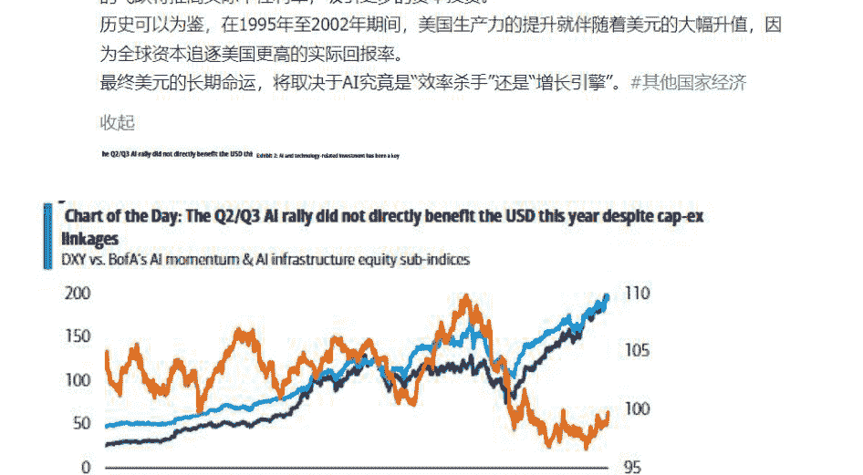

## Exhibit 2: AI and technology-related Investment has been a key driver of growth this year Contribution to %/q GDP growth by category

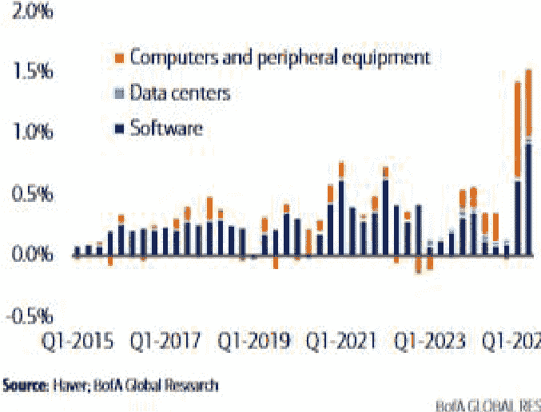

Source: Haver, BotA Global Research Bot GLOBAL RESEARCH

## Exhibit 3: Unemployment for 20-24 year olds rising notably in excess of more middle-aged workers US unemployment rates: ages 20-24 vs. avg. of ages 25-54 cohorts

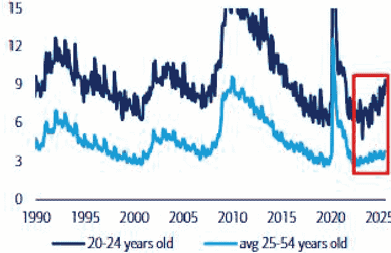

Source: Federal Reserve Bank of St. Louis, BotA Global Research. *NOTE: cut-off at 15% for visual purposes, though post-crisis rates peaked above that during '08 crisis and post-covid Bot GLOBAL RESEARCH

## Exhibit 4: Higher productivity tracks with a rising dollar US nonfarm business productivity trends vs. DXY

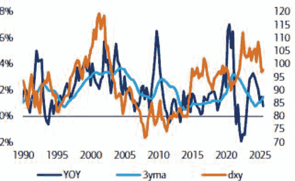

Source: Bloomberg, Bota Global Research | BOTA GLOBAL RESEARCH

Jason 不嵩
2025-11-07 05:18

JPM: 中国10月政府债净发行5280亿元（季度月均净增1.3万亿元）；新增地方债5000亿元稳健中，3000亿元用于债务置换与存量融资，2000亿元用于项目；专项债发行滞后，年末或加速。基准情形仍可能明年暂停息10bp产品同比比-8.8%；指数比-27.2%（环比8.1%），核心CPI压低性数据

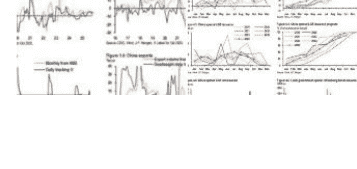

Figure 1.1: Industrial production - Auto YoY - Monthly from NBS - Weekly tracking (full-stock index) Y

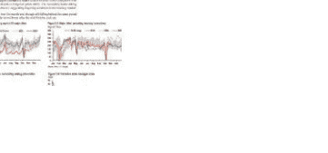

Figure 1.2: Industrial production - Steel YoY, both scales - Monthly from NBS - Weekly tracking of operating rates Y

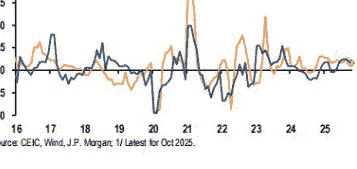

Figure 1.3: House transactions YoY - Monthly from NBS - Daily tracking Y

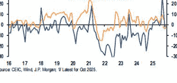

Figure 1.4: China exports YoY - Export volume from China Customs - Deadweight light departing ships

Source: CNBC, Mine, J. Morgan, Latest for 2023 | Source: Varis, Shipping, China Customs, J. Morgan, Latest for 2023

## Figure 4.1: China CGB net Rbn by

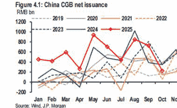

Figure 4.2: China CGB net progress % of annual issuance (Sep)

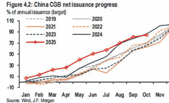

Figure 4.3: China special LGB issuance Rbn by

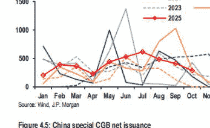

Figure 4.4: China special LGB progress % of annual issuance (Sep)

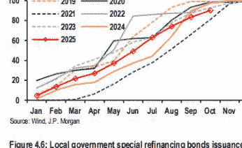

Figure 4.5: China special CGB net Rbn by

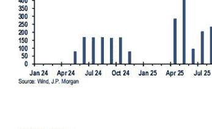

Figure 4.6: Local government special refinancing bonds Rbn by

# 5. Housing

Home sales were significantly underwhelming the same period last year.
* 30 cities' new sales fell 26.9% in October (vs +10.3 in September)
* Major cities' manager sales fell 28.1% in October (vs +8.1 in September)
* Centaline's manager confidence ended October lower compared with the end of September, despite a uptick. The secondary market asking price index remained subdued, suggesting lingering weakness in the housing Land sales picked up moderately into the month-end, though still below the same period last year. The sale premium remained weak until the mid-October.

## Figure 5.1: Housing transactions in 30 major cities units

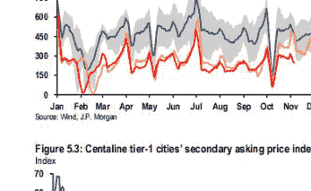

## Figure 5.2: Major cities' secondary housing transactions Index

## Figure 5.3: Centaline tier-1 cities' secondary asking price Index

## Figure 5.4: Centaline sales manager index Index

Indexed, June-21=100
China Housing Downturn
Secondary Housing Price*
Residential Floor Space Solid, SA
Real Estate Investment, SA

# Jason 磊

摩根士丹:10月中国二线城市房价跌0.9%(同比-10.4%),自2022年6月峰值以来样本一线城市累计跌30.5%，由于基数较高继续下跌。“大利”在四季度并不太，当政策转向较2024年年初，且未触发系统性风险。四季度GDP~4.7%(三季度4.8%），靠万亿级财政/财政支持与中“暖”和（关/税费限额宽松性调整）依托。去年年初至初+21.7%，2025年“出溜”房产降水(-18万亿)股市市值增(+21万亿)抵消的惯。不过，这财富效应尚未清晰传导到奢侈消费。# 金融 (股市的首轮涨幅不属于房产：包括国家、国企、金融机构及少数外资的权益增长，而住房需求几直直接落在基建部门）收敛

Jason-不遇
2025-11-07 06:17

## 2024年底，男性、女性人口规模都低于2019年底（自制图表）
最近3年总人口转负，主要是男性减少

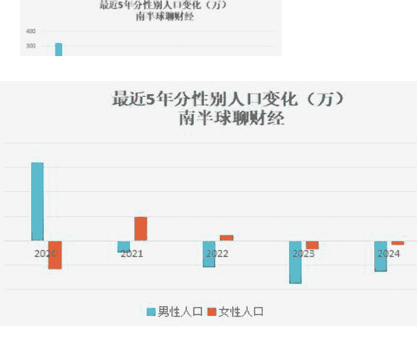

Jason-不遇
2025-11-07 06:26

## 最近两年，在卫生支出费用中，政府支出占比减少，个人自费占比抬头（自制图表）
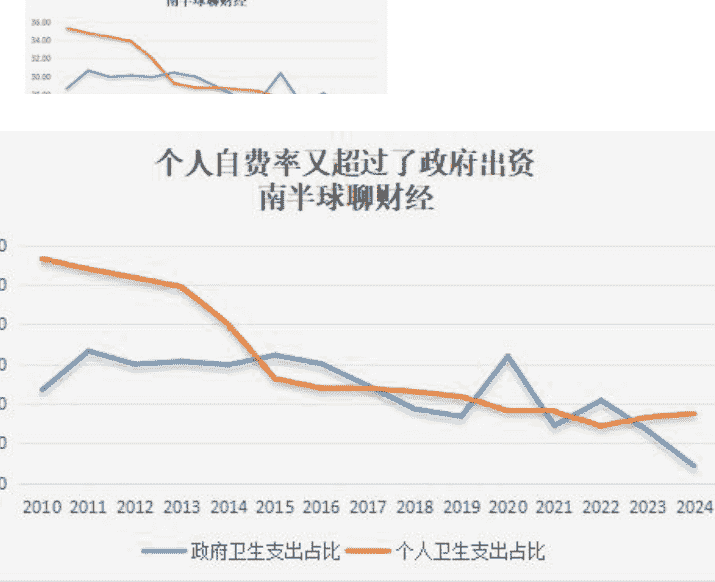

更多资源进群微信cuk255

# 深度视野优质集团（链接优质社群，助你成功）

全部包含以下内容：限时年费188/年 加微信cuk255

- ① 吃瓜群众包信时圈加时群对话 (原价 365 年/年)
- ② 子明私享汇（含）内部文章
- ③ 政事室（顾子明）付费内容再送顾子明群
- ④ 米联储闲兜【作者米穗】(原价 599 年/年)
- ⑤ 欧洲金雀会员专属文章 (原价 328 年/年)
- ⑥ 砖瓦斥内部圈 (原价 400 年/年)
- ⑦ 卢克文青读书会专属文章 (原价 699 年/年)
- ⑧ 鉴茶财经知识星球 (原价 3310 年/年)
- ⑨ 猫哥的视界知识星球文章 (原价 299 年/年)
- 10 财新周【独家新闻】(原价 1498 年/年)
- 11 杨世光在金钱榜 (原价 2200 年/年)
- 12 森淼财经知识星球 (原价 1600 年/年)
- 13 潇泽译译付费文章 (持续更新)
- 14 司马林解课全套音频和全套书籍隐藏版无删减 (原价 2.3 万)
- 15 虚构三部曲[民国梦、帝国争亡、不被理解的MAO](原价 599 年/年)
- 16 卢克文重知识星球文章 (原价 268 年/年)
- 17 额外再送：卢麒元新浪韭搏付费专栏、三村丰老王、三花九洞文集

不定期内容：......（更多资源将写不下）

- ① 守夜人知识星球、接换魔王知识星球、成术谈论星球、成术怕财富、雪球花甲老头等
- ② 创始人笔记、达叔谈论星球、成术怕财富
- ③ A视野、大树乡谈、江宁付将、泮咩说、财上上海家学等付费文集
- ④ 西风付费文章、老端、赢在小时之时、局外人的视界、升值优、老体制内等等其它一些V付费文章（每月不低于600元付费文章）

限时年费188/年

# 深度视野文集进群微信cuk255

深度视野（付费文集）

# 底层链接连接全网V优质内容
