# 南半球聊财经251108

Jason不离
2025-11-08 02:54

中国：10月出口迅速回落，是今年3月以来新低，应是基金驱动下的异常值。除去影响后两年复合增速为5.5%，仍保持平稳趋势（9月为5.3%），4-9月中平均为6.1%）；此外，出口价格回落和消费发布时间等也可能产生一定影响，进口同样大幅回落，为近五个月以来新低，与生产、消费走弱有关。在10月出口转弱的影响下，当月贸易量仍在900亿元高位，并未养老，预计后续修正有利于贸易维持高位，较高的贸易质量有利于经济增长提供足够支撑。

## 经济数据

图表1：10月出口增速回落，但两年复合对比仍有显著

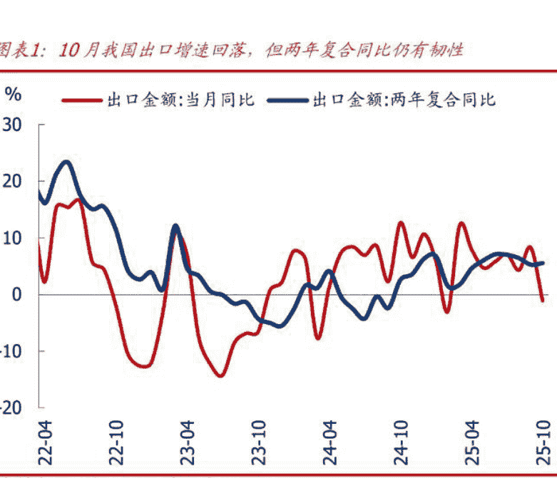

资料来源：Wind，国盛证券

更多资源进群微信cuk255

### 图表2：CRB现货指数与出口价格正相关

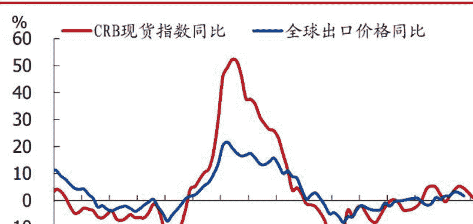

资料来源：Wind，国盛证券研究所

## 图表3：剔除装胀效应后，非美市场仍是10月主要出口支撑

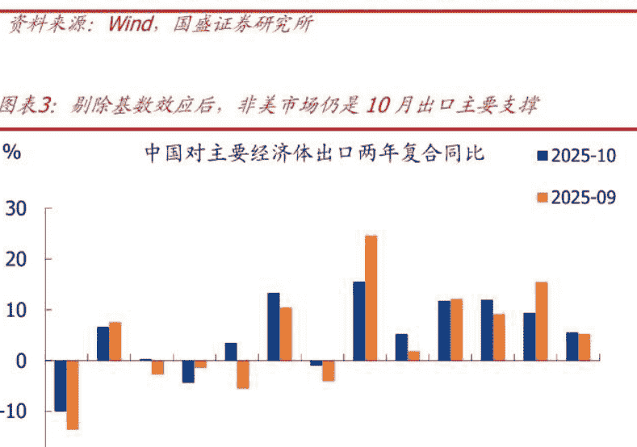

资料来源：Wind，国盛证券研究所；注：其他新兴市场主要包括中亚、东欧、中东等地

更多资源请加微信cuk255

### 图表5：10月进口增速同样大幅回落

| % | 进口金额:美元:当同比 |
|---|---|
| 60 | |
| 50 | |
| 40 | |
| 30 | 进口金额:美元:累计同环比 |

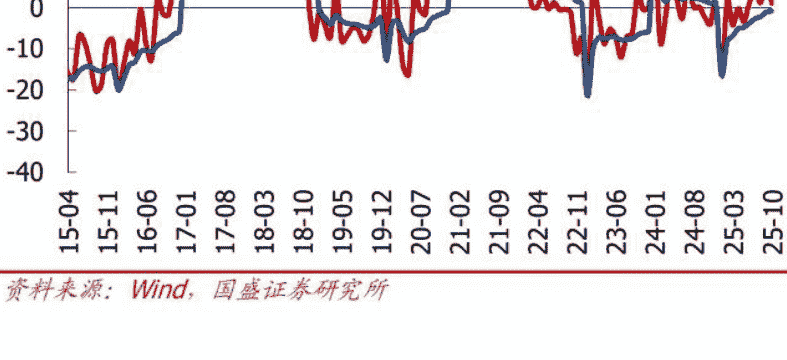

资料来源：Wind，国盛证券研究所

Jason-Jason
2023-11-08 03:05

bloomberg: 10月份中国出口的下降几乎让所有预测者都感到意外，彭博社调查的预测中值为2.9%，巴克莱表示如果出口的强势劲头不能持续，中国的增长可能面临地产下行的压力，行业周期性遭遇以及私人消费和出口的三重打击。但考虑到差异保持维持水平，2025年已下降了9650亿美元，由于需求调整抗弱的经济走势，中国10月份的原材料进口更是权重走低，只有出口表现明显的强势劲头，中国库存支撑了今年的国际价格。

## 经济数据

更多资源进群微信cuk255

### 美国需求下滑拖累中国出口

世界其他地区增长放缓无法弥补美国的下滑

- Total exports / To the US / To the rest of the world

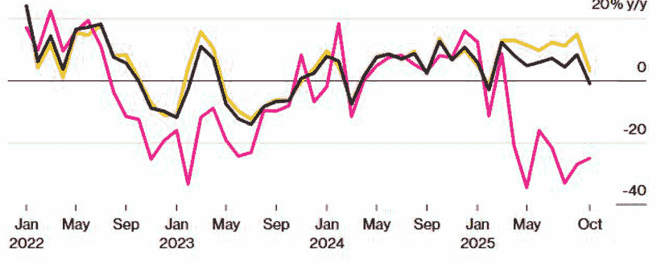

资料来源：中国海关总署

### 中国经常项目账户规模复杂创历史新高

商品出口激增推动顺差再创新高

- Current account balance (quarterly) / Goods trade surplus

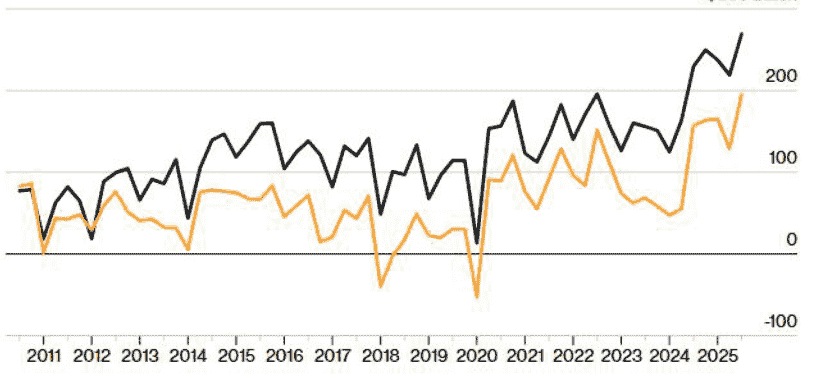

资料来源：中国国家外汇管理局

更多资源进群微信:cuk255

## Jason-南海

bloomberg: 中国股市表现出惊人的韧性，摆脱了全球轮的回撤，股市接近近三年来的最高水平，人民币对主要贸易伙伴币接近4月份以来的最高水平。图表显示，中国的经济增长长期预期更具弹性，我们预测美元人民币在三个月和六个月的前瞻分别为7和6.9。

华平表示，中国股市在过去十年中几乎维持，使得股市的估值极具吸引力。预计，更多的资本将流向更广的市场，例如亚洲地区，亚洲认为是当今世界上最便宜的投资之地。之一，在日本和印度等市场，越来越多的资本将在中国立足并进行交易。美国强劲仍是他们最大的市场，但与此同时，华平将一些美元资产配置到国外。

## 股市

中国电力设备公司的股价在今年来表现最好，因为投资者将注入智能中心以对需求的激增。中国核心芯片的需求正处于多年加速周期的开始，并将创造2018年以来的最佳表现。据预计国内芯片的需求的便利，将向对基础设施的投资。“中国广将。

So Nearing Four-Year High
Chinese Stocks Nearing Four-Year High

- Shanghai CSI 300 Index - Last Price

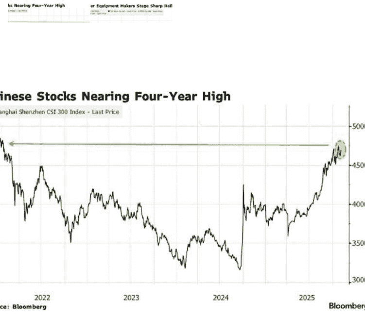

Source: Bloomberg

更多资源进群微信cuk255

### China's Power Equipment Makers Stage Rally

Normalized As 12/31/2024

- Sungrow Power Co Ltd - Last Price
- CSI Solar Ltd - Last Price
- TBEA Co Ltd - Last Price

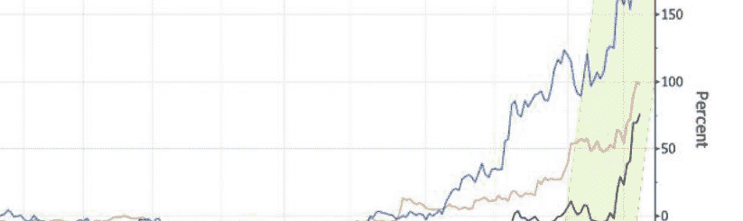

| Jan | Feb | Mar | Apr | May | Jun | Jul | Aug | Sep | Oct |
|---|---|---|---|---|---|---|---|---|---|
| 2025 | | | | | | | | | |

Source: Bloomberg

Jason-Jason

国泰宏观通道：从高端领先指标来看，1月出口增速呈现回升，12月再度回落，总体而言增速中枢缩小，结合进口的基数，两个阶段增长工具将形成支撑，Q4可能是2026上半年的预测。

## 经济数据

由于近年来对总量和制造业的定义非常重要，2026年出口是否继续保持增长，经济趋势是怎样的？从已有的宏观数据来看，很难给出5%以上的预测，但通过宏观调整来提前预测，至少可以提升国际需求，与全球周期调整一致，未来七年出口值得期待。报告：国泰宏观研究所

更多资源进群微信cuk255

## 图表13:1月出口增速预计回升

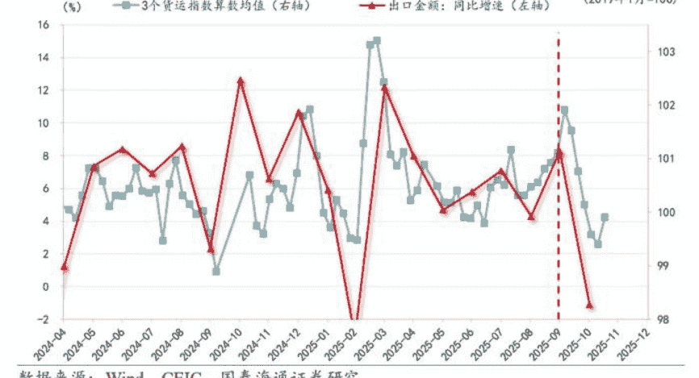

数据来源：Wind, CEIC, 华泰证券研究院

Jason-conner
2025-11-28

## 美国国家经济

组编辑：特斯拉在德州批准了马斯克的创业计划，如果他在十年内实现财富的爆炸和梦想，他将成为世界上第一个亿万翁。

在那之前，特斯拉在德州批准了马斯克的创业计划，如果他在十年内实现财富的爆炸和梦想，董事们又选出了一位主张支持马斯克的候选人担任董事，这似乎与之前的任命无关，但董事们对美国社会财富分配和治理持有不同的理念。虽然处于完全不同的领域，但这种差异反映了马斯克在商业与政治之间的巨大裂痕。一方面是马斯克这样的追求财富的社会精英，他们认为为积累财富的经济收益应当交税以维持有效性；另一个是追求进步的社会活动者，他们认为效仿其他国家的社会福利制度，通过提供养老服务和慈善公益来实现。最近在选中支持企业和增加税收的中，这些政策击败了他们想要取得的目标。

此次马斯克与2018年5月签署的薪酬计划，共分为12个阶段，要求马斯克将特斯拉的市值从目前的200亿美元增长到8500亿美元，并完成一系列目标，包括销售100亿辆特斯拉。“我们将报酬，不是特斯拉报酬，这些是完全不同的。”马斯克在感谢支持计划时这样表示。特斯拉董事和部分参与者表示，他曾担任明尼州养老基金的董事，这项薪酬计划将激励马斯克打造电动汽车开发新技术，尽管他已经是世界上最有钱的人。罗彼拉州行政委员会会在一份证券文件中写道：“那些声称这项计划对于人的忽视了特斯拉一直以来所取得的巨大规模。从一家破坏电动汽车和清洁能源全球领先的公司而言，拥有足够的权力可能造成破坏性的商业模式。”

更多资源集信服cuscn

这项计划的设计，只要马斯克能够做到，特斯拉投资者也能成功。Ask Invest现任执行官福德森在社交平台上写道：“我不明白为什么会有人反对这种薪酬方案，因为如果他的团队失败了，我们和客户都将遭受损失。马斯克的批评者，包括纽约州和加利福尼亚州的养老基金经理，强烈反对这项方案，认为这会让董事和企业利益中增加一个风险。“这不是另一个创新的方案，这对马斯克是不受限制的。”纽约记者马斯克·斯诺在一次面向记者和投资者的会议上说。德利华州和加州的法院此前也对 SpaceX 做出了评论。马斯克的反对这种让富人日益获厚的酬方案。根据马斯克提交的一份文件显示，2024年特斯拉员工的平均工资约7万美元。

反对者对这项计划颇有争议。特斯拉董事会指出，去年，美国上市公司给股东的类似股票薪酬方案大约有六，规模小于此，但一项通过了。马斯克持有的股票约15%。如果这项计划实施，他的控制可能会下降至23%以下，他可能需要额外薪酬以维持。不少股东可以支持马斯克，即使利润下滑、汽车销量下降，以及过去一年里公开支持其。“在他之后还反对的人，是那些并不理解。”林肯学院组织行为学教授德尔森表示，许多大型基金可能对此投票反对，包括第二大股东、第三和第四大股东。报告：国泰宏观

更多资源进群微信cuk255

226年出口是否继续保持增长，经济趋势是怎样的？从已有的宏观数据来看，很难给出5%以上的预测，但通过宏观调整来提前预测，至少可以提升国际需求，与全球周期调整一致，未来七年出口值得期待。

## Jason-Misc

bloomberg: 美国消费者指数（有记录）接近近年来的水平，月初情绪下降3.3点至50.3，高于2022年6月的50，这是78年以来数据最低。一项衡量经济状况的指标下降6.3点至52.3，历史新低。由于人们对政府部门担忧加剧，受访者预计未来一年失业率将上升，去年同比倍。同时，美国联储银行的月度调查显示，美国状况在10月有所恶化，对通胀预期有所下降，连续第二个月后上升，未来一年可能的预期平均为4.3%，自4月以来的最高水平，未来一年消费者价格涨从9月的3.4%降至10月的3.2%。财富状况预期持续恶化，越来越多受访者表示他们的状况。

### 其他国家经济

## 美国消费者指数跌至2022年6月以来的水平

### 当前状况指数跌至历史新低

- Consumer sentiment

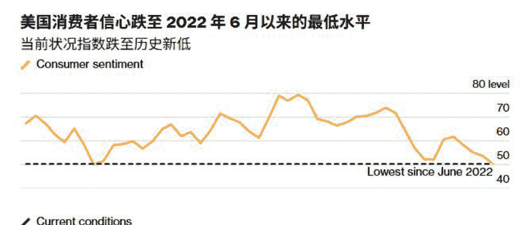

- Current conditions

更多资源进群微信cuk255

### 消费者报告近年来最积极的财务状况

耐用品的购买条件，而失业担忧加剧

- Current personal finances

- Buying conditions (durables)

- Average change of losing job

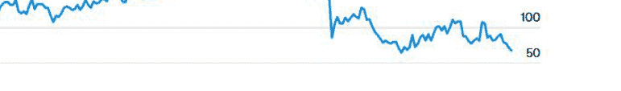

2010 2012 2014 2016 2018 2020 2022 2024

数据来源:密盛大学

Jason-湖
2023-11-08 03:47

花椒：股市近期波动的主要原因是金融体系流动性下降。衡量流动性状况的一个有效方式是直观的表现。本周，美已跌入危险区间，从前的历史低点跌破超过20%。这一走势与美国财政部重建一般账户（TGA），是指美国财政部在市场上重新实现资金储备的。比如，军费、车费、政府债券资金等。当财政部增加一般账户的资金时，意味着从市场筹集资金。对于各国来说，投资者买入资金，资金流入了市场流动性，实质上从市场上抽走了资金。7月中旬以来，准备金下降了约5000亿美元。按照，准备金下降也会对市场造成负面影响，这种影响本周才表现出来。由于对流动性更敏感，以及科技股来说，好消费的消息，美国一般账户余额超过9000亿美元，这一水平通常意味着财政部停止运行的流动性状况有望改善。

更多资源进群微信cusccc

### Figure 2. Bitcoin correlated with Bank reserves

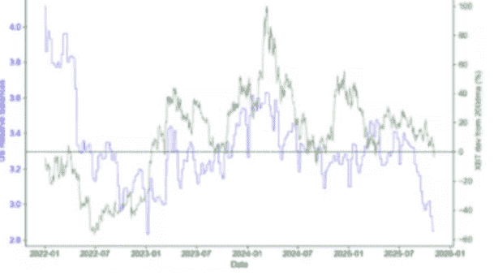

SOURCE: CITI

### Figure 1. Bitcoin as a warning signal for NDX

| | BTC > M100d | BTC > M200d | BTC < Median | NDX < 50days | NDX < 55days |
|---|---|---|---|---|---|
| Return/Reward | 13.98% | 14.9% | 12.92% | 5.60% | 10.75% |
| Volatility | 13.11% | 13.71% | 13.33% | 6.78% | 5.55% |
| Risk/Reward | 1.1 | 1.1 | 0.97 | 0.83 | 0.95 |
| Active HR | 14 | 21 | 3.34 | 6.93 | 11 |
| % on | 58.7% | 68% | 66.69% | 39.76% | 70.67% | 20.52% | 86.29% |

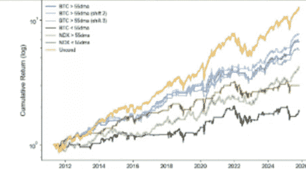

SOURCE: CITI

Jason-不易
2025-11-08 03:50

日经：已成为制裁对象的俄罗斯正处于低于市场的价格，流入中国正在受影响。欧洲公司的船舶跟踪信息显示，俄罗斯船的“运输”液尾鲁兹号于10月30日进入中国南方广西自治区的海港，停靠了俄罗斯北极的天然气开采“LNG项目”。

## 中国停止进口美国LNG俄罗斯

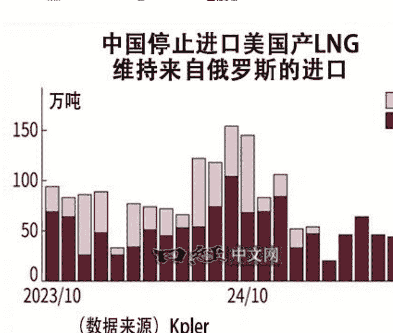

(数据来源)Kpler

Jason-不易
2025-11-08 03:59

正方：国内PPI自2022年10月进入低区间至今已转为负，长期与上一轮PPI底期接近（2012年3月至2015年，约39个月）。PPI偏高，导致了工业企业利润持续压力，当前亚非企业工业化ROE（2025年Q3为6.5%）已低于2015年Q4低点（6.9%）水准。从不同行业调查表来看，本轮利润基准行业压力分布于上一轮有色行业明显不同。以钢铁煤和石油天然气为代表的上游资源类行业，ROE水平明显高于015年水平，而以电子设备、纺织、化学制品、电力设备为代表的中游行业ROE不及2015年。

在这一轮PPI筑底期，利润继承的行业更多，大多数为有政府收益较高的行业，通过行政手段实现预期利润增长增大，后“供给改革”将更多依法化与市场化实现。

## 经济数据

更多资源请微信cuk255

## 图1:中国对美国出口遭遇“常规”

| 中国市场地区 | % 总计 | 美国 | 德国 | 拉美 |
| :--- | :--- | :--- | :--- | :--- |
| 出口占比: | 40 | 东亚 | 非洲 | 拉美 |

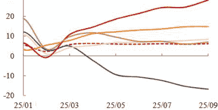

数据来源: ifind,民生证券研究院

## 图2:非非洲对美国出口大幅上升

| % 对非洲出口增速: | 2024年1-9月 |
| :--- | :--- |
| 8 | 总计 | 非洲 | 德国 | 拉美 | 美国 |

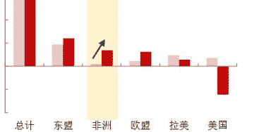

数据来源: iffind,民生证券研究院

## 图4:非非洲对中国出口以基础类产品为主

2023年非非洲对中国出口产品结构

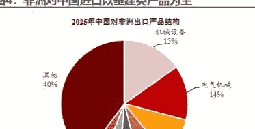

数据来源: TRADE MAP,民生证券研究院
注: 数据为2023年1月1日

## 图5:机械、汽车、船能等对非非洲出口拉动

% 中国对非洲出口占比
* 中国对非非洲出口拉动（右）

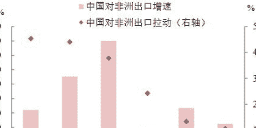

数据来源: TRADE MAP,民生证券研究院
注: 数据为2025年1-8月

## 图7:加亚利亚、南非、比里利亚等为非非洲主要增长引擎 华盛

2023年1-9月非非洲出口占比（%）

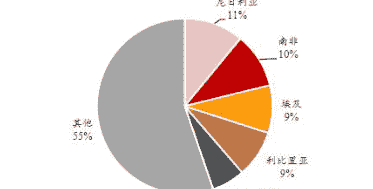

数据来源: TRADE MAP,民生证券研究院
注: 数据为2025年1-9月

## 图6:其中，加亚利亚、比里利亚成为核心增长动力

% 中国对非洲各地区出口同比
* 中国对非非洲出口拉动（右）

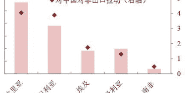

数据来源: TRADE MAP,民生证券研究院
注: 数据为2025年1-9月

## 图17:中国出口价格增速偏缓

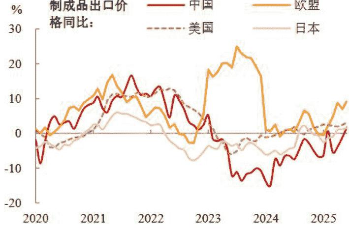

资料来源: ifind, 民生证券研究

Jason不遇
2025-11-08 04:11

上海证券：我们认为指数的表现与上市市值正相关，与上市公司数量负相关#股市

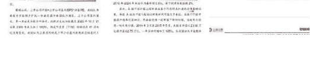

更多资源进阶微信cuk255

## 解构股票指数上涨与几个关键变量

我们认为股票指数的表现与上市公司的市值构成正相关，与上市公司数量密切相关，而上市公司市值又是由上市公司盈利与估值水平共同决定的。可以通过以下公式来体现：股票指数= F (上市公司市值/上市公司数量) = F (上市公司EPS*PE / 上市公司数量)。

### 从数据分析美股指数不创新高的原因

美股长期上涨主要体现在美股指数不创新高，同样的美股总市值是不创新高。美股2010年至24年市值平均年增长了13%，上市公司数量平均年增长了2%。美股市值与股票指数保持着特定的正相关性，我们认为美股市值数量相对较低起到了大指数的作用。

根据公式：上市公司市值=上市公司盈利*PE值，我们认为美股总市值稳步扩张一方面是因为美国经济增长、上市公司盈利增长，另一方面是估值水平回升。纳斯达克指数截至2025年10月21日自2009年上涨了912%，但市值（TTM）维持在41倍附近没有变化，我们认为主要原因是上市公司盈利出现相应幅度的上涨。

美股尤是因为纳斯达克离群集中，强化了盈利贡献的作用。美股其纳斯达克交易所更为强的集中，截至2025年11月4日纳斯达克市值最大的前8家科技公司市值为23.87万亿美元，占纳斯达克总市值的53%，由于这8家企业都是全球范围内的科技巨头，盈利能力强。以苹果为例，2020年8月苹果PE（TTM）为37.78美元，截至2025年9月股价上涨了103%，但估值仅提升1%，在其中EPS增长了96%。集中度导致纳斯达克体量能力强，然后指数大幅增长但是估值水平较为稳定。

更多资源进群微信cuk255

不过另外两大板块表现了明显的估值提升。道琼与标普500指数从2009年到2025年10月21日分别上涨30%和504%，市值（TTM）增加了98%至30.55倍与49%至27.46倍，估值水平大幅提升。可以看出，这两个涨幅量相对较小导致了估值提高的原因。

### A股在过去十五年间表现未能呈现出长期上涨的特征的原因：

2010-2024年我国A股总市值均值增长11%，可以看到，我国A股总市值均值与同期美国总市值均值增长的13%相比，这说明我国A股市值指数确实是长期上涨的基础。对于为什么我们的A股表现未能呈现长期上涨的特征呢？

我们认为有以下几个原因：

- 首先，是上市公司数量扩张速度更快，2010-2024年A股均值增长8%，高于美股的2%。
- 其次，A股市值扩展在过程中在某个阶段加速然后进行调整的节奏，使得A股市值与美股存在差异。在某个阶段市值提升，然后进入下跌的周期，这被称为“一年半牛市”。2014年到2015年5月，A股市值从23.66万亿飙至62.75万亿，一年多增加了65%，随后总市值下降；截至2016年6月总市值从43.50万亿升至91.6万亿，三年增加了11%，随后总市值下降；截至2024年1月总市值下降至69.42万亿。
- 虽然A股与美股市值均值幅度接近，但是美股创新高间隔较短。对比之下，A股存在上涨后下降的情况，2015年5月市值高却直到2020年6月才突破，2021年12月市值高再次直到2025年7月才突破。考虑到上市公司数量扩张幅度，数据创新的间隔可能较大。

## 宏观态势

水平仍不够。Wind A总市值从2024年9月至2025年9月提升50%，其中黄金储备储蓄12个月以上回升，已占总储备的8.9%（2022年为3.7%）。在设定每月常规购售75亿美元、估值低值290亿美元的条件下，推算含金资本外流414亿美元，低于9月的618亿美元。证明黄金流入仍有所改善。若出口出现下滑或美元收益继续高企，可能导致资金外流比例大幅抬高，结储上升至63.1%，汇率将贬至美元，净储蓄（结售）上升4.6个百分点，为三年来最高。反映企业更愿意美元、持有人民币。基本面修复，还需要地产及消费回升。

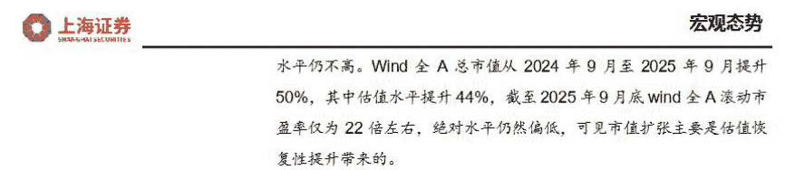

### 汇率

Wind A市值从2024年9月至2025年9月提升44%，截至2025年9月底Wind A总市值率仅为22倍，此时市值仍然充足，市值扩张主要是估值修复所引发的。我国经济持续增长为上市公司带来巨大贡献，根据我们预测未来有望上行。如果是A股出口保持增长，估值水平不会快速修复，市值扩张也会更佳。

### 数据数据

Wind A市值破历史新低，较年初跌31%。部分出口成本降至1480元。数据预计将跌至底部。

### 汇率

(元) 汇率7.20元本周下跌1110元。

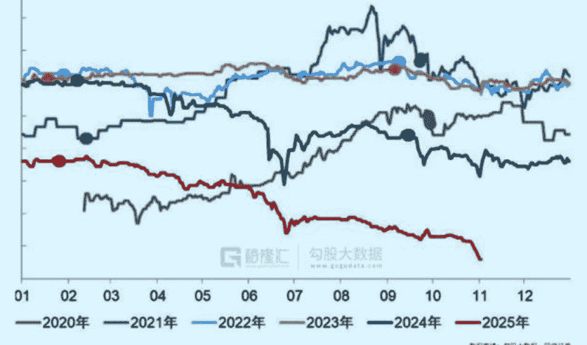

2020年——2021年——2022年——2023年——2024年——2025年

Jason不易
2025-11-06 04:40

整理了1-9月的外汇基金支出，今年创新高，甚至超过了2020和2022年。

### 前三季度外汇支出

南球财经

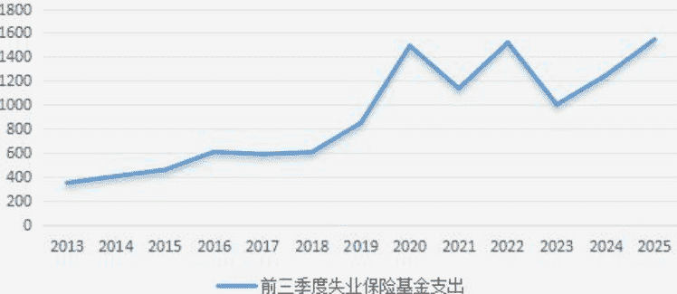

更多资源进群微信cuk255

## Jason不易

2025-11-08 04:50

JPM：9月中国外汇储备增47亿美元至3343亿美元，其中黄金储备储蓄12个月以上回升，已占总储备的8.9%（2022年为3.7%）。在设定每月常规购售75亿美元、估值低值290亿美元的条件下，推算含金资本外流414亿美元，低于9月的618亿美元。证明黄金流入仍有所改善。若出口出现下滑或美元收益继续高企，可能导致资金外流比例大幅抬高，结储上升至63.1%，汇率将贬至美元，净储蓄（结售）上升4.6个百分点，为三年来最高。反映企业更愿意美元、持有人民币。基本面修复，还需要地产及消费回升。

## 金属

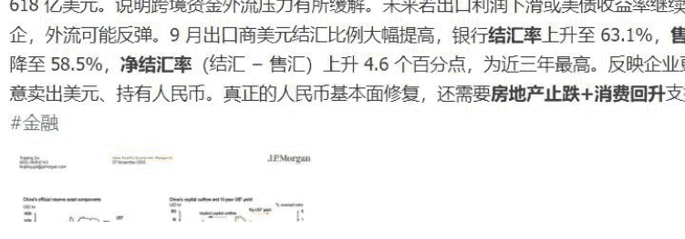

## J.P.Morgan

## China's reserve asset components

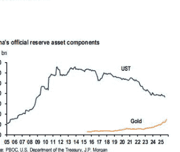

## China's capital outflow and 10-year UST yield

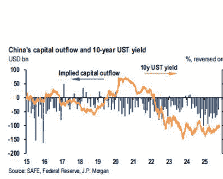

## CNY CFETS index vs USD index

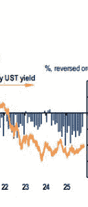

## China's FX reserves

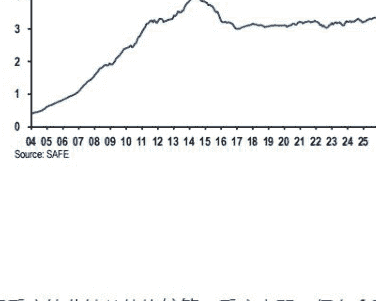

## Jason不易

2025-11-08 05:22

摩根丹利：中国A股在2025年第三季度的业绩较均衡二季度走强。仅有金融股在中国和A股双重超弹，材料股在MSCI中国同样“双重Beta”，而可选消费、医疗保健与信息技术四个行业，在两大市场均出现“miss”（数量与价值低于指数）。

## A股 China Equity Strategy_3Q25 Interim Review

更多资源进群微信cuk255

## Morgan Stanley | RESEARCH UPDATE

November 7, 2023 05:13 PM GMT

China Equity Strategy | Asia Pacific

3Q25 Interim Review: Softer Results for Both MSCI China and A-shares

Both MSCI China and A-shares delivered softer 3Q25 results versus 2Q25. MSCI China saw a net miss by count but a net miss by weight; A-shares recorded a wider miss by count and weighted. Financials stood with volatile earnings.

### Takeaways from our review of 3Q25 earnings season (based on 29% of MSCI China and 74% of China market):

- For MSCI China, 3Q25 interim cut, with an 8.8% miss by number but 6.3% miss by weight compared to largely outcomes in 2Q25 (7% and 2%, respectively). While some players like Tencent beat, trends cannot be sustained through the end of 2Q25 season.
- For A-shares, 3Q25 showed a wider miss by number of companies (20.3%), while remaining in line on a weighted (-2.9%), offsetting a 3.1% miss by number of companies and 0.2% line by weighted in 2Q25.
- In revenue terms, both A-shares and MSCI China have missed estimates by number of companies, but posted in-line results by weighted, softening vs.2Q25 (Exhibit 9, Exhibit 10).

### Sector observations: Only Financials in MSCI China and A-shares posted solid

- Chloe Liu: chloe.liu@morganstan.com
- Laura Wang: laura.wang@morganstan.com
- Video Wei: wei@morganstan.com
- Jonathan Gamer: jonathan.gamer@morganstan.com

## Exhibit 12: China A-Share detailed section and industry-level

| Industry Group | % of Companies | % of Reported | In-line | Above | Net Miss | Net Surprise (%) |
| :--- | :--- | :--- | :--- | :--- | :--- | :--- |
| Others | 315 | 77% | 74% | 26% | 31% | (58.3) (2.1) |
| Electronics | 142 | 68% | 73% | 25% | 32% | (11.1) (0.9) |
| Communications | 99 | 66% | 72% | 23% | 32% | (10.9) (0.8) |
| Telecommunications | 72 | 67% | 68% | 32% | 30% | (5.0) (0.3) |
| Industrial Machinery | 168 | 65% | 70% | 30% | 30% | (5.3) (0.4) |
| Automobiles & Equipment | 135 | 76% | 75% | 25% | 30% | (10.7) (1.2) |
| Chemicals | 118 | 71% | 72% | 27% | 32% | (6.2) (0.7) |
| Financial Services | 150 | 75% | 73% | 23% | 32% | (5.1) (0.1) |
| Consumer Discretionary & Retail | 202 | 70% | 70% | 30% | 30% | (5.1) (0.1) |
| Consumer Staples | 100 | 100% | 100% | 0% | 100% | (5.1) (0) |
| Household & Personal Products | 100 | 100% | 100% | 0% | 100% | (6.7) (0.4) |
| Food & Beverage | 153 | 75% | 70% | 30% | 30% | (0.0) (0) |
| Building & Construction | 153 | 77% | 72% | 28% | 32% | (12.2) (1.2) |
| Utilities | 118 | 68% | 68% | 32% | 30% | (12.7) (1.4) |
| Oil & Gas Refining & Marketing | 96 | 67% | 70% | 30% | 30% | (10.0) (0.6) |
| Transportation | 153 | 75% | 70% | 30% | 30% | (7.1) (0.5) |
| Financials | 144 | 75% | 75% | 25% | 30% | |

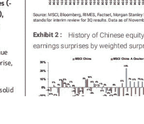

更多资源进群cuk255

## J.P.Morgan

Global Markets Strategy

07 November 2025

## China Local Markets Weekly

RMB internationalization gains prominence in 15th FYP

Emerging Markets Strategy

## Executive summary

Tiffany Wang
tiffany.wang@jpmorgan.com

Jia Zhang (jia.zhang@jpmorgan.com),
Morgan Stanley Pacific Limited

- RMB internationalization has gained momentum since the 15th FY Plan. The report offers a more prospective view on RMB internationalization and outlines for building a seamless cross-border RMB payment system in the coming years.

Keatin Sheng
keatin.sheng@msley.com
Morgan Stanley Hong Kong

- The yuan's use in trade has advanced further. According to the Project, the CNY share of global trade has seen a steady increase from ~12% to 18% in ASEAN, Latin America and Central Asia countries through cross-border transactions in the past year. The policy has continued, with regulators having increasingly encouraged the use of RMB in usage/cross-border trade to facilitate investments and more yuan-denominated trade payment forming.

- The expanded use of the RMB has gone beyond trade into de-dollarization. For investment, demands for yuan denominated have risen visibly since 2022, with no hedging versus local currency. However, the demand for RMB bonds and Panda bonds has reached new highs. While Euro-related entities still account for the majority of currency reserves, Chinese financial institutions and companies have become increasingly more active in the market.

- RMB-ization efforts to push RMB internationalization externally, de-dollarization from the public sector looks to account for 22%-25% of China's foreign currency reserves, down from 35% in 2021. While USD has remained stable at around 45% of foreign reserve holdings of the US.

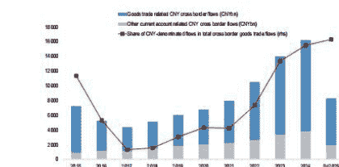
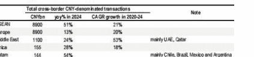
Source: PBoC, J.P. Morgan
Source: PBoC, J.P. Morgan

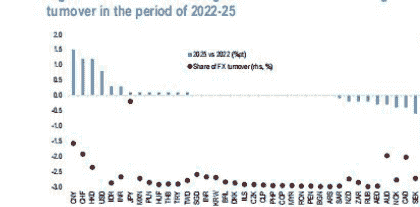
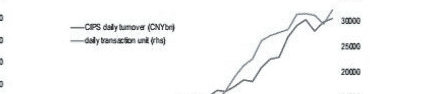
Source: PBoC, J.P. Morgan
Source: PBoC, J.P. Morgan

更多资源进群微信cuk255

## Figure 10: USD share of Chinese foreign currency reserves continued to decline

## Figure 11: while de-dollarization is also visible in external assets by Chinese state banks

- USD share in global foreign currency reserves (COfer)
- Diversification of currency reserves (past 20 years)
- Clearing of transactions as % reserves
- Diversification of USD-denom assets: non-holding of USD as % of reserves

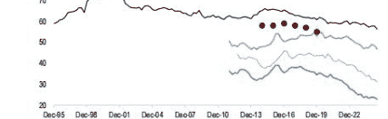
Source: SAFE, IMF, TIC, J. Morgan.

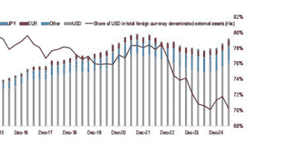
Source: SAFE, J. Morgan

## Jason-danson
2023-11-08

国信: 投资者短期债券避险的重要性，居民养老长期面临股市市场长期压力，增强财产收益性的重要性。未来需要通过改进养老基金和制度，进一步提升居民养老金的配置比例，让养老金像基金、三一样。

美国在1978年后推出个人退休账户（IRAs）及401K计划，使得IRAs和401K成为美国国内资本市场最重要的资金来源，推动了居民大类资产配置向股市转移。1980年后，美国产业结构转型加快，居民资产配置转向股市的巨大增长。走出牛市，居民的养老收入持续增长。长时间看，A市场长期收益很可见。2005-24年美国A股指数收益率（含红）为9.8%，高于长期收益的4.1%。

## A股

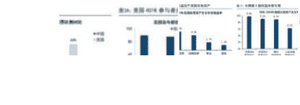

图23: 我国资产配置比例变化对比
图24: 美国401K参与资产配置占比

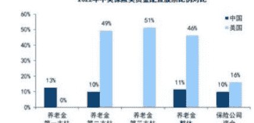
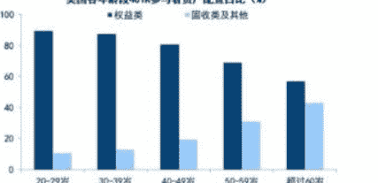
数据来源:财财经、ICIC、人社局、国信基金研究所
数据来源: 国信基金研究所
更多资源进群微信cuk255

## 图11: 美国股市长期增长率优于其他国家

## 图12: 长期债券收益率较高

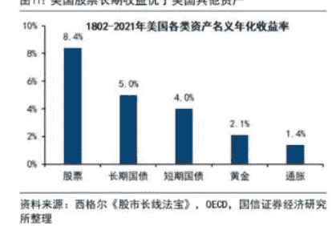
数据来源：华尔街、东方、国信基金研究所
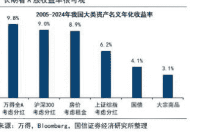
数据来源：Bloomberg、国信基金研究所

## 图13: 1980年代美国消费增长率从其他国家

## 图14: 美国通胀对居民消费的影响

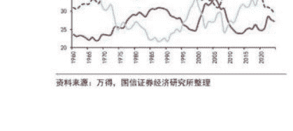
数据来源：国信基金研究所
注：2005-2024年

## 图15: 中国居民消费支出占GDP比重

## 图16: 中国居民消费率仍偏

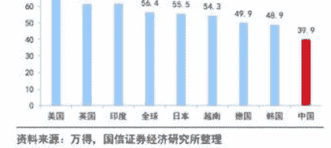
数据来源：国信基金研究所
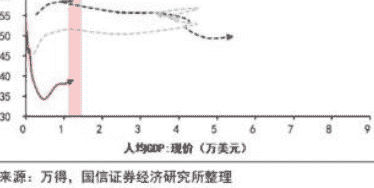
数据来源：国信基金研究所

## 经济观察
2025-11-08 聚焦出口数量，随着市场转移，非洲、亚洲、东欧等市场的订单

作者：刘榷
封面：图创奇

越来越多的海外客户要求付款周期拉长到90至120天让刘锐所为

刘锐是一名海外从业者，经营着家具及家居设计产品。企业有40多个海外客户，遍布美国、东南亚及非洲等地。当下，约五分之一的海外客户向他提出了付款周期拉长到90至120天的要求，这是他在超过20多年的外贸行业中没有遇到的情况。“都是合作多年的老客户，一旦出现账款就会影响此合作结果，如果客户万一延误，就会给自己带来更大的资金压力与更高的安全风险。”1月6日，他记得在互联网社交平台上，如何应对海外客户要求付款周期的讨论在月内迅速增加。多名海外企业主向记者倾诉，他们发现不少海外客户突然提出将付款周期拉长到90至120天的情况。客户给出的理由是经济波动导致当地消费者意愿与能力下降。由于产销销售周期延长，他们不得不将拉长海外贸易的付款周期。这项要求，对于处于危险处境的海外企业主并非相同，而且已经同意海外客户的要求，这将把自己陷入危险中——且一部分海外客户在拉长周期的名下遭遇呆账，他们将面临不小的海外订单损失。刘锐坦，一旦出现再遇到类似海外贸易订单的呆账，自己的业务都将更加更让他害怕的是，是海外客户付款周期拉长，日益影响海外企业与供应商的资金周转，可能导致海外贸易资金链陷入资金周结的困境。

更多资源进群微信cuk255

过去20年，刘锐的海外客户遭遇特殊秋，不得将付款账期拉长到90至120天。但这里却是极其偶然的个别，海外客户很快恢复到45至60天的海外账期。如今，他感到海外客户拉长账期再次变得“空中楼饼”。但是，今年下半年以来，刘锐发现海外客户中要求90至120天付款周期的海外客户再次增加。如今，他急的40个海外客户要求拉长账期主要集中在非洲、南亚、欧洲等地，他们给出的理由是——国际地缘政治风险升级与全球通胀持续维持当地经济景气，民众恐难以消费，由于汇率波动导致资金回笼难度增大，因此他们只能向中国提供拉长付款账期的请求。两名东地区的客户向刘锐诉苦，他们两次购买的家具产品尚未售出，现在只能愁着圣诞节要折价以挽回资金，力争在明年年初至6月份卖掉的家具产品。记者多方了解到，遭遇海外客户付款账期拉长是因为海外客户资金压力增大。在互联网社交平台上，越来越多的海外客户开始要求拉长账期，刘锐提出的拉长账期引起关注。由于付款周期下降使得海外客户资金压力得到缓解，海外客户将付款期拉长从80天至120天，主要受到的三个因素影响：一是全球经济放缓导致国家不愿消费；二是对美联储加息消息的影响，导致海外客户要求拉长到低水平；三是美元汇率维持高位，美联储加息，特朗普还开启关税政策，导致多数市场遭遇贬值，当地监管部门开始限制资本流动及海外客户难以兑换美元。不久前，刘锐接到一份来自非洲客户的订单，但在付款时出现波折，原定非洲客户的付款期是60天，但在1月份后，由于本货币贬值幅度增大，当地监管部门仍允许资金流动及调整资金的支持，所以他只能将付款期拉长到近90天。

更多资源进群微信cuk255

## 02 应付收款风险上升

面对越来越多的海外客户拉长周期的要求，刘锐表示拒绝，最终选择妥协。“我不想结束我们多年的合作关系，”他无奈表示，“另一个现实可能是海外客户不信任中国供货——他们很快就能找到愿意接受长账期的供货商。但是，刘锐开始考虑自己的利益，将付款期拉长资金周转压力与安全性风险接踵而至。过去两年，刘锐海外客户订单先给上游供货的原材料采购费用，原本这些货款全部来自海外，更让他担心的是，自己已经很难，脑子里：“万一海外客户恶意欠付款，怎么办？”在近期举行的销会上，刘锐决定——只要新海外客户提出将付款期拉长到90到120天，他就拒绝这笔订单，以免为自己增加收款风险而忧。记者表示了解到，面对海外客户拉长周期的要求，不少外贸企业也没有应对办法，一是提议给海外客户按9折至95折折扣，但是海外客户在60天内全额支付款；二是要求海外客户先增加20%的付款，降低外贸企业的收款风险。但是，这些应对方法有效吗？因为海外客户一再显示自己拥有付款意愿，但当前经济压力导致销售周期拉长，自己也面临压力，难以接受折扣提前付款及增加额外贷款。近日，郭志国听许多身边的海外订单已遭遇海外客户拉长周期——支付回款屡遭遇拒的情况，虽然心头一紧，但决定不再一味就放弃客户。“便是多年合作的客户，他们只要让他们在20天内付款，我宁愿失去这个客户，也不想遭遇拒风险。”郭志国说。此外，他有意识地控制单笔订单金额，避免在面对海外客户从拉长周期到拒付款的极端情况下，难以承担订单损失。

## 03

随着要求付款的海外客户日益增多，刘锐与郭志国均感到资金周转压力加大。这逼着他们不得不寻找解决方案。9月中旬，刘锐尝试向当地三家银行申请针对海外贸易贷款与应收账款质押贷款，用于支付海外的原材料费用与维持企业经营资金。但是，当地三家银行也都提高了相关贷款的准入门槛。刘锐对此感到非常棘手。以往，银行会调取企业海外客户的付款意愿与付款能力首要考虑，只要海外客户保持较高的付款稳定性，通常情况下银行会给予相应的融资贷款。如今，这些银行对刘锐的贷款申请直接拒绝了。

不久，刘锐明白了其中要——了解海外客户长周期，担心其中隐藏的恶意抽款风险，对于海外企业可能没有足够的资金来还款。一家当地银行跨境业务部门的负责人刘颖私建议做好充分准备，一是先准备好海外律师，一旦海外客户出现逾期欠款，就选用通过海外律师采取法律策略；二是针对海外客户长周期，对外建议海外企业在签订合同时增加分期付款、高额贷款、违约金、滑坡金等条款，维护自身权益。郭志国通过出口信用保险缓解了风险以缓解资金周转压力，在实际操作过程中，他发现许多海外客户在出口周期拉长。

