# 南美联购财经251110

Jason-不离
2025-11-10 03:05

bloomberg:特朗普周日发话关税即将帮助我们消减美债，美国投资将创新高，每个人都将获得至少2000美元税收入（除了收入者）
特朗普他不是通过镜子才知道的事情，补充道：“在接下来的几年里，我们可以获得数亿美元，但关税是重新平衡贸易使其更加公平。”#其他国家经济

## 特朗普贸易的要点

- 财政部长斯拉斯特贝表示，特朗普总统政策中通过的关税措施可能会带来至少2000美元的“红利”。
- 贝特提到，2000美元的派息可以缴小费、加强和社会保障减税以及汽车抵扣。
- 特朗普总统表示，美国将在关税中“吸收数万美元”，并将还33亿美元的巨额债务。

财政部长斯拉斯特贝表示，特朗普总统建议美国能够获得至少2000美元的关税“红利”，这可能是通过今年早期时候在经济政策中通过的关税措施。

贝特提到在美国公司(ABC)的《本周》(This Week)节目中被提及特朗普周日发帖在社交媒体上发布的帖子，被嘲笑为反对关税的人表示“每人至少2000美元的红利（不包括收入群体！）将给每个人。”

贝特表示，他还没有与总总统谈过这个想法，但2000美元的派息可以用多种形式出现。这可能只是我们在总总统课程上看到的关税——不公平缴税，对加强缴税，对社会保障缴税——汽车贷款的扣除。

从最高法院在11月5日提起诉讼以试图撤回关税制度的论点来看，特朗普一直在加强关税制度的辩护。几大法官似乎持怀疑态度，提出了许多税收可以被推翻的可能性，迫使超过1000亿美元的退款并剥夺了特朗普第二个核心的任务。

更多资源进群微信ccc55

# Jason-Mobile
2025-11-10 02:08

巴克马：特朗普再次当选后的第一年，市场几乎完美地割裂了2016年首次胜选后的走势——风险资产大跌，新兴市场表现最差，市场波动性最高的时期，2018年的“川普1.0”时期的局面如此；而特朗普执任的第二年则美股表现最好，市场波动性最低，尽量让资金涌入股市（如基金），但股票市场，其科技股、引发追避、显示市场处于焦虑的心态。“金融

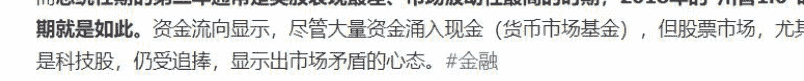

FIGURE 1. X-asset performance in the year following the 2016 & 2020 Trump's presidential election win

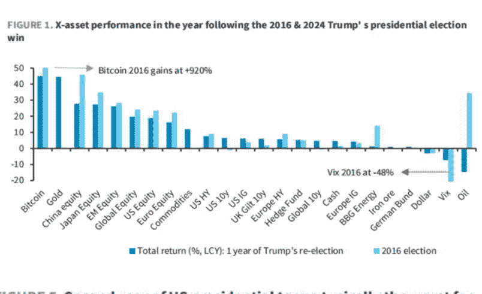

FIGURE 5. Second year of US presidential terms typically was the worst SPX Returns during the presidential term

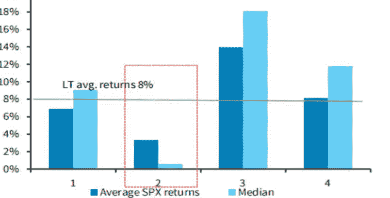

Source: Bloomberg, LSEG Data & Analytics, Barclays Research

FIGURE 6. Equities so far broadly inline with performance seen during Trump 1.0 first year, but second year was trickier

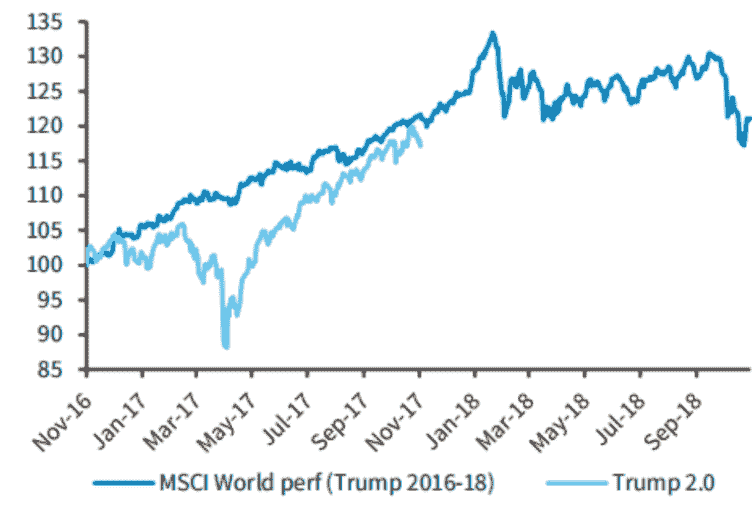

MSCI World perf (Trump 2016-2018) | Trump 2.0

Source: Bloomberg, Barclays Research

Jason-Li
2025-11-10 03:30

国资：10月CPI由负转正，环比上升0.2%，强于季节规律（近同期值为0.1%）。仍看CPI同比转正，除基数回落，主要受益于节日需求上行及核心CPI延续改善，但在双节带动下，猪肉价格加速下降，蔬菜、水果及牛肉价环比幅超出季节性水平。10月同比上升0.1%，幅为年内首次转正。如此，10月环比、同比下降率，主要有三点支撑：“一季”波对价格软化，菜、光伏价格已连续两个月环比上涨，制造价格同比转正，汽车价格环比有所恢复；国内有多个行业价格上涨；此外，原油价下行导致产业链持续上涨。

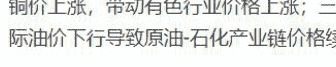

更多资源进微信ccc55

## 图表：10月CPI环比于季节规律

| 2014 | 2015 | 2016 | 2017 |
| :--- | :--- | :--- | :--- |
| % | | | |
| 2018 | 2019 | 2020 | 2021 |
| 2022 | 2023 | 2024 | 2025 |

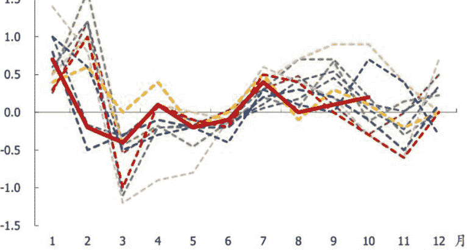

资料来源：Wind，国盛研究所

## 图表3：10月PPI同比

| PPI同比 | PPI生产同比 | PPI生活同比 |
| :--- | :--- | :--- |
| 20 | | |

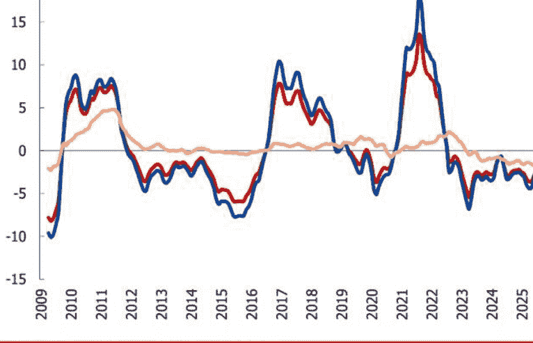

资料来源：Wind，国盛研究所

## Jason-不离
2025-11-10 03:24

## bloomberg: 特朗普价格的说明他还是离群众

## 人工智能的要点

- 唐纳·特朗普总统让美国人相信物价上涨经历并非真实，这一策略对拜登政府来说不起作用。
- 《华盛日报》ABC News的一项民意调查显示62%的受访者赞成特朗普对经济的处理，7%的受访者表示他们今年支付的费用比去年高。
- 特朗普关于价格下降的说法，拜登数据显示火鸡、咖啡粉和牛肉等商品的上涨，这引起了广泛的争议。

唐纳·特朗普总统在经济方面曾模仿了前总统的做法：试图让美国人相信物价上涨经历并非真实的。这是一种策略决定了拜登和民主党在2024年的失败。这对拜登不起作用，对特朗普却作用。根据《华盛日报》ABC News-Ips的一项调查，62%的受访者赞成特朗普对经济的处理，该处理以关税为中心。这一数字高于2月的53%。大约71%的受访者表示他们今年支付的费用比去年高。近60%的人表示他们正在为水更多费用。

然而，特朗普的感恩节吹掉了一个关键细节。沃尔玛40美元的感恩餐确实比去年少了15美元，但并不是因为少了六件商品。这是编译购物清单和计算成本的人购物时注意到的细节，即使特朗普没有。根据普通大学农学院的数据，普通人会注意到，自去年10月以来，火鸡的价格上涨了75%，从每94美分升至每磅1.71美元。他们注意到咖啡比去年增长了40%。他们注意到根据美国统计局的数据，牛肉的价格为每磅6.32美元，比去年上涨了14%，创下历史高。总体，根据最新的消费者价格指数，通胀比一年前上涨了2.7%，尽管包括鸡蛋在内的一些商品的价格在范围内下降。根据美国能源没有感受到上涨的数据，在能源方面，使用电力的家庭今年预计更多费用，但丙烷和取油客户的费用会更少。

购物者没有感受到特朗普带来的经济信心，过去12个月

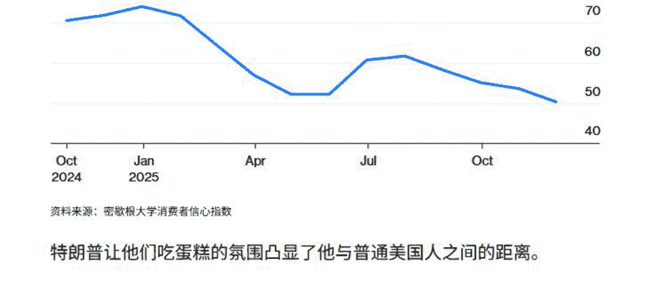

| Oct 2024 | Jan 2025 | Apr | Jul | Oct |
| :--- | :--- | :--- | :--- | :--- |

数据来源：密尔根大学消费者信心指数

特朗普让他们吃蛋糕的簇占据了与普通美国人之间的距离。

更多资源进阶微信ccc55

Jason-不
2025-11-10 03:45

FT: 最近美国两党演讲的核心，还是医疗问题。医保支出约有2.4万亿美元的规模（其中Medicare有1.7万亿美元），如果能优化医保，美国政府的赤字规模会大幅减少。特朗普之前提出的《医疗大法案》在框架下——通过减少医保支出，降低政府赤字。但观察显示，医保在未来一段时间内，都是美国两党讨论的重要课题。
其他国家经济

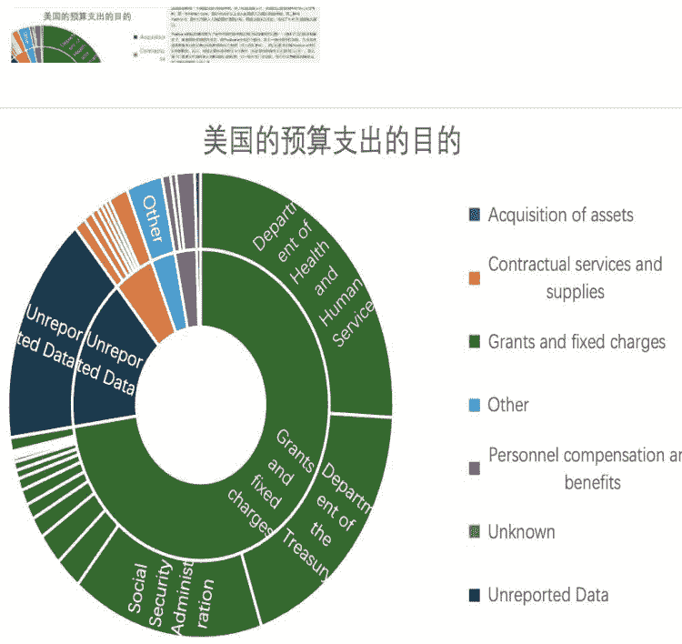

# 美国的预算支出的目的

更多资源进群微信ccc55

这里需要解释一下美国的医疗保险制度。除了医保外，美国的医疗保险可以分为两种：第一种叫Medicare，是针对65岁以上老人残疾人的医疗保险；第二种Medicaid，是针对低收入人的医疗补助计划。两者结合，构成了HHS支出的大部分。

Medicare运作是为了解决传统的由雇主购买医疗保险的问题——退休以后没有医疗保障。美国政府的方法是让Medicare成为一部分，其中一部分是雇主购买医疗保险，另一方面让退休前买自己的医疗保险（无论雇主还是自己），那么每月要交保费。而Medicare——如果你的收入低，政府就为你提供接济金（“免费”）。这就是医保，不是一种医疗补助，基本上是由雇主负责的。

在政策框架下，任何医疗保险都有问题——健康的病人对他们而言划算。在收入水平下，少数人会选择国外养老（如华人），但自然也没有必要再缴保费。由于年龄逐渐衰老，Medicaid是针对低收入人的补助计划，我们很多人在长期的劳动中，由于收入相似和无法工作，往往导致癌症或恶性疾病治疗。因此，Medicaid支出很大。

这也不是两天内的事情，从十五年前奥巴马执政时，留下的就为了解决这两个问题。Obamacare引入了两种机制：一个是保险公司拒绝患疾病的人；二是群众性不能投保。这种做法在当时的共和派中，让选民感到看着好事——他们觉得坏。

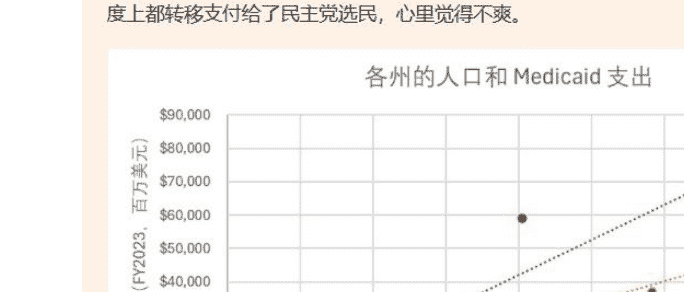

这种说法也不能说道理。单论Medicaid，按2024年总统选举的红蓝分类，整体而言，Medicaid支出可以看到人口最多的红州（德克萨斯州、佛罗里达州），蓝州（加利福尼亚州、纽约州）占美国总人口的三分之一的影响很大。这是因为富裕而健康的老人很多由于天气（即“南方”），比较软的老人需要其居住四个州以后，Medicaid支出只有一半。

更多资源进群微信ccc55

同时，由于老化，Medicare支出在增长。2019年为8045亿美元，2023年为1029亿美元，增速达到了6%。商业医疗支出从2019年的1529亿美元每年6%的增速，增长到了2023年的1464亿美元。可以说，老化和医疗模式的改变，过去几年彻底改变了美国的医保支出。之前的价格由政府财政政策决定，特朗普总统虽然不知道这个问题，但知道Medicare和Medicaid这样的增长速度下去，政府财政政策将无法承受。特朗普此举是因为他有药物策略，甚至建立了一个网站（https://tmprx.gov/）传达了这一点。由于美国对药物和医疗服务的依赖性加强，为了增加健康支出难以实施定价——同一种药物在不同国家的价格相同；而这些差异，以往美国是最贵的。在执行的行政命令（https://www.whitehouse.gov/presidential-actions/2025/05/most-favored-nation-prescription-drug-pricing-to-american-patients/）中，Medicare和Medicaid项目的补助。美国消费者与其国家相比，美国药物价格昂贵，事实上考虑了美国的购买力。这一国家来说，美国药物还便宜直接这样不必，免了特朗普和共和党——最昂贵的特殊药物和两国巨头减少的负担。

特朗普的另一招，就是在Medicare和Medicaid上砍刀，减少花费。在《医疗大法案》（One Big Beautiful）中，特朗普减少了12%的Medicare补助，要求Medicaid申请者每个月至少参加80小时。同时，这一次让政府预算削减了医疗方面的花费。这件事引起民主党（尤其是加州的民主党）很有意见，由于《医疗大法案》对“工作时间的定义”有限制，因此不少民主党认为这是在为某些失业者——他们根本找不到多久的工作，他们怎么满足工作时长？

> Jason boon
2025-11-10 03:51

对错：考虑到2021年以来美国人口增长回到困难，2023年、2024年分别增长0.15%和0.10%，未来人口总增长速度可能会加快，以每年增长0.2%进行。因此，到2035年的GDP增速将被命名为3.7%，从此的十五年平均实际GDP增速小于4.5%，十五年后平均实际GDP增速将接近4.0%。

根据经济增长理论的“金法则”，长期利率水平应低于或等于GDP增速。我们的国家的利率是接近GDP增速3%-7%左右，或者说明当前的实际GDP增速不能反映在增长的水平，或者我们我国的通胀率仅有1%左右。假设今年四季度实际GDP增长4.5%，增长长期中枢可能有1.5%进行增长；金结论

资料来源：Wind

因此，2026年建议关注科技行业的景气验证（和通回暖、经济改善）情况。市的走势可能有下面三种情况：

- ① 景气验证后后期仍能维持高增长，则有望持续科技行情。
- ② 景气验证后预计风险增速下滑，则可能切换到其它风格（类似2014年）。
- ③ 景气未验证，则可能导致科技板块发生大幅调整，需防A股进入横盘震荡。#A股

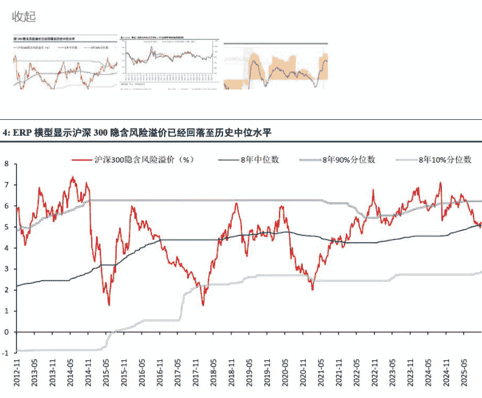

图 4: ERP模型显示沪深300隐含风险价已回至历史中位水平

数据来源：Wind，中信建证券
注：沪深100隐含风险价（ERP）=1/沪深100市盈（TTM）- 10年国债收益率（单位：%） 统计截至11月4日

更多资源进群微信cuk255

### 图5：AIAE（修正）指标对未来三年万得A年化回报有较好的预测效果

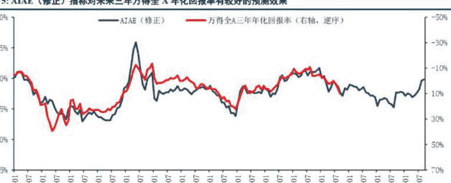

数据来源：Wind，中信建证券

### 图6：修正ERP已经跨越中位并维持至下水平

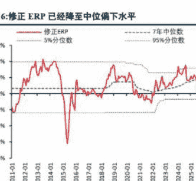

### 图7：基于万得的万全AIAE A点预测市场能够支撑

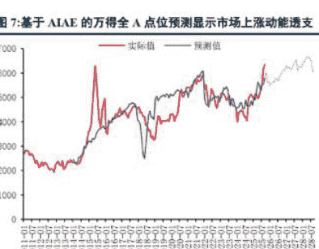

数据来源：Wind，中信建证券
注：修正ERP-后AIAE指标的A未来三年实际预测回报-10年内实际收益

### 图8：全球性风险危险比例

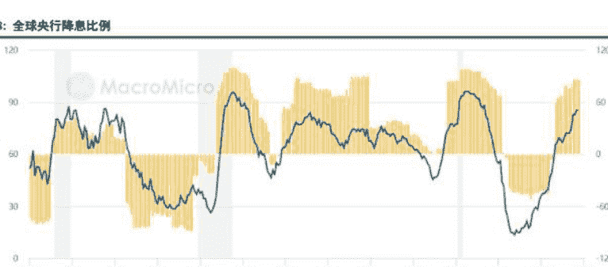

数据来源：MacroMicro，中信建证券

更多资源进群微信cuk255

### 图 21：A市场融资、减持、分红、同购规模

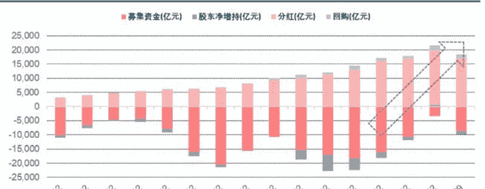

数据来源：Wind，中信建证券

### 图 22：分红回购收入变化

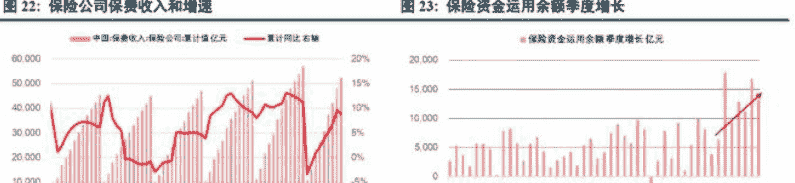

数据来源：Wind，中信建证券

### 图 29：ETF资金累计净流入（亿元）

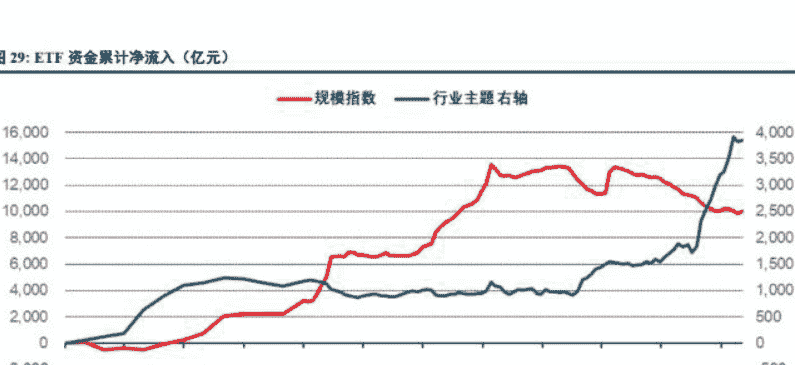

数据来源：Wind，中信建证券

更多资源进群微信cuk255

### 图 33：北京新股市将进入景气验证期

| | 估值阶段 | 资金流入阶段 | 景气验证阶段 |
| :--- | :--- | :--- | :--- |
| 70% | | | 24 |
| 60% | | | 23 |
| 50% | | | 22 |
| 40% | | | 21 |
| 30% | | | 20 |
| 20% | | | 19 |
| 10% | | | 18 |
| 0% | | | 17 |
| -10% | | | 16 |

数据来源：Wind，中信证券

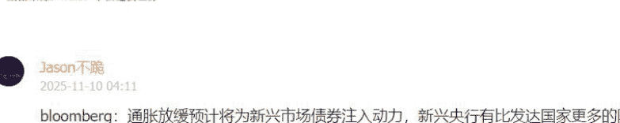

Jason-2022-11-05: 通胀压力预计将新兴市场注入动力，今年拥有比发达国家更多的降息空间。本土投资者的平均回报率为7%，超过了美国，而包括匈牙利、巴西和印度在内的债券涨幅超过20%。预计美元将保持利率的投资者也表示，收益率推动新兴股市上涨，拉丁美洲尤其是巴西和墨西哥，由于流动性有所改善。与此同时，新兴市场相对于发达国家的通胀风险将到期。All显示新兴市场相对于发达经济来说，这是很长的一段时间。Inflation Trends Emerging markets now have slower growth than rich

Inflation Trends Emerging Economies Consumer Price Index (Annual %) / Developed Economies Consumer Price Index (Annual %)

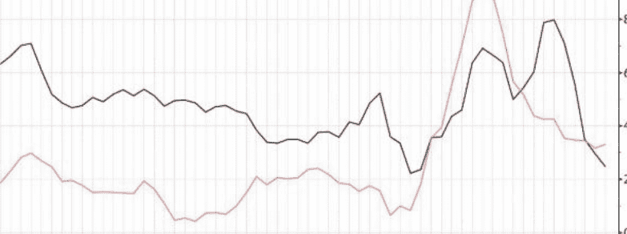

数据来源：Bloomberg

更多资源进群微信cuk255

Jason-2025-11-10 05:03 高盛：经济带来的医疗保健和一般福利改善提高了预期寿命和生活质量，根据联合国预测，这一趋势在未来50年内持续，同时生育率将被限制足以支撑增长的劳动力供给。过去50年来，总生育率（TFR）下降了一半，目前地区每妇女生育率为1.7，远于2.1的自然率，也比预期寿命调整后的死亡率1.7-1.8。

Exhibit 1: Rapidly Aging Populations and Declining Fertility Rates Have Raised Demographic and Fiscal Concerns

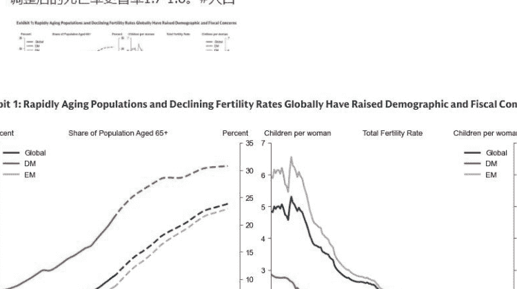

Note: Dashed lines represent medium-term projections.
Source: United Nations, Goldman Sachs Global Investment Research

Jason-2025-11-10 06:02 申万：10月价格上涨对下游PPI影响小，且受影响较小的铜价涨幅更大。10月CPI回升至以上，由于低基数和部分细分供给导致升CPI，受影响较大的铜价处于低位。核心CPI继续回升，更多是需求改善及金价上涨的支撑。10月国内金价和铜价格占比50.3%。排除金价后的剩余核心商品未上涨，受厂家平滑调整的影响。其需求增长令CPI（环同比0.1%）及同期（0.3%）。

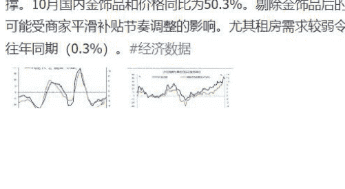

更多资源进群微信cuk255

### 图 2：PPI领先指标：产能周期领先价格周期

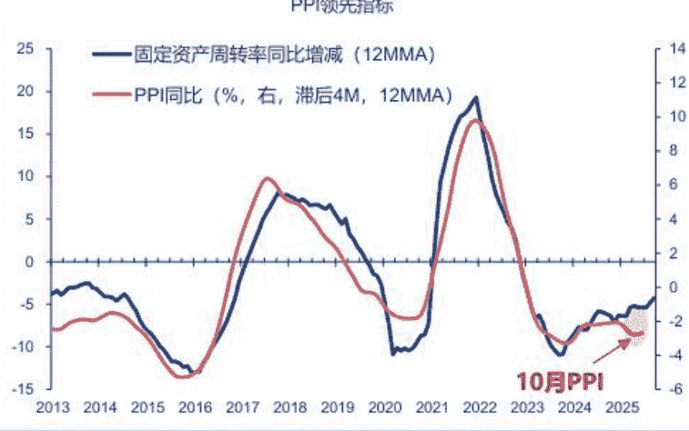

资料来源：Wind，申万研究

### 图 3：中下游产利用率仍然偏低

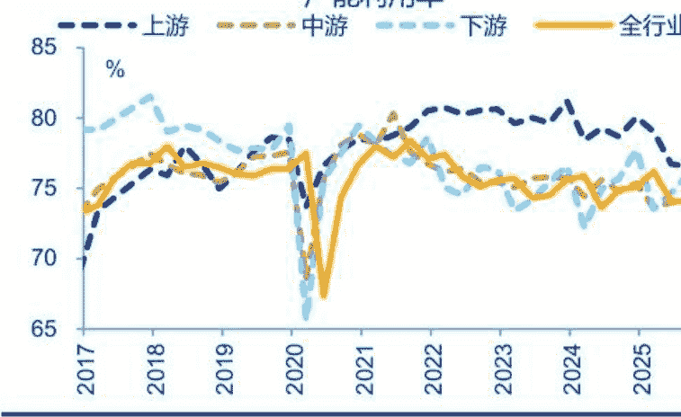

资料来源：Wind，申万研究

### 图 7：金价维持高位，带动其他用品及服务继续上行

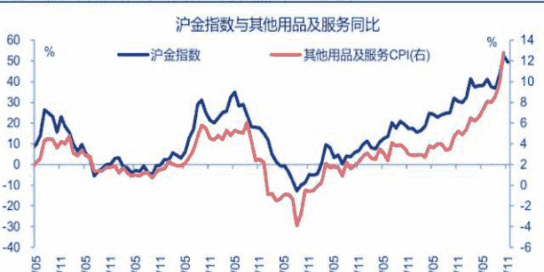

数据来源：CEIC，申万研究

### 图 8：房租CPI环比

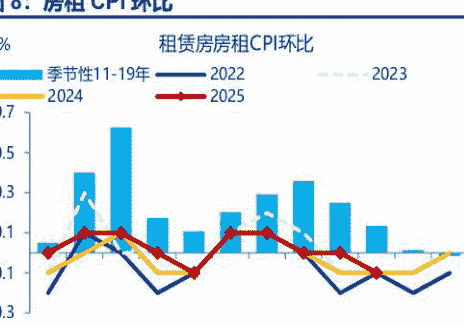

数据来源：iFind，申万研究

Jason 2022-11-10 17:41

安居客：10月，百城二手的房挂均价为11790元/平方米，同比下降6.12%，其中一线城市房挂均价46930元/平方米，同比下降6.73%，新一线城市房挂均价16159元/平方米，同比下降7.97%，二线城市房挂均价11771元/平方米，同比下降8.95%，三线城市房挂均价7860元/平方米，同比下降8.22%；一线：上海房价跌最大（-7.98%），新一线：合肥跌最大（-16.71%），二线：广州跌最大（-16.1%），三线：淮安跌最大（-14.67%）。从挂量来看，10月，十城二手挂量2653.6套，同比增长10.82%；一线城市房挂量6.85%，新一线城市房挂量13.07%，二线城市房挂量11.39%，三线城市房挂量7.90%。10月，二手挂牌时长为94.88天，同比增加5.79%；其中一线城市挂牌时长为91.21天，同比增加6.30%，二线城市挂牌时长为88.11天，同比增加2.10%；三线城市挂牌时长为98.85天，同比增加7.36%。

### 百城城市二手房挂牌均价走势（元/m²）

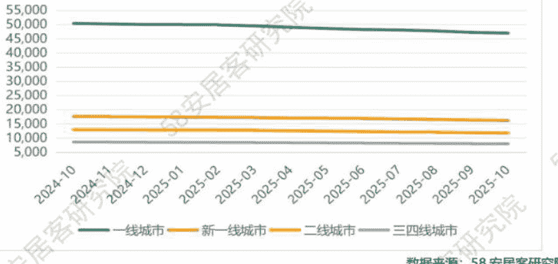

### 百城城市二手房挂量走势（万套）

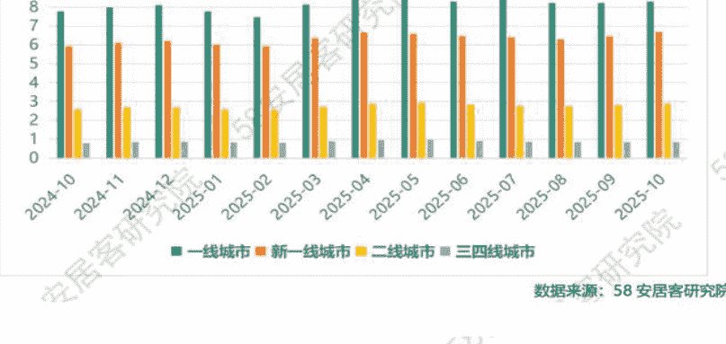

### 百城城市二手房挂牌时长走势（天）

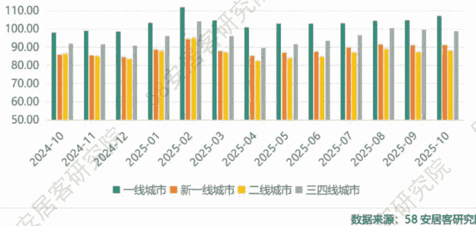

Jason-2025-11-10 09:05 今天提到的JPM研报，附件可下载

- China Property Tier-1 cities to lift home purchase restriction

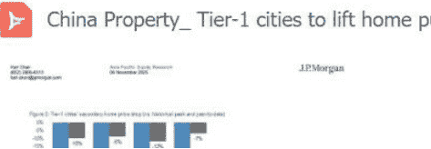

Kai Chan (852) 2680-4513 kai.chan@jpm.com

J.P.Morgan Asia Pacific Equity Research 09 November 2025

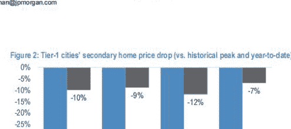

| 0% | | -5% | | -10% | | -9% | | -12% | | -7% |
| -15% | | | | | | | | |
| -20% | | | | | | | | |
| -25% | | | | | | | | |
| -30% | | | | | | | | |
| -35% | -36% | | -36% | | -38% | | -42% |
| -40% | | | | | | | | |
| -45% | Beijing Shanghai Guangzhou Shenzhen | vs. peak Year-to-date |

Source: Celine.

Jason-2025-11-10 10:32 试了上传和传克网盘，前者被删封，后者后不可分享 #论文或书籍推荐

| | | | | | | | | | | | |
|---|---|---|---|---|---|---|---|---|---|---|---|
| 2020 01 | 2020 02 | 2020 03 | 2020 04 | 2020 05 | 2020 06 | 2020 07 | 2020 08 | 2020 09 | 2020 10 | 2020 11 | 2020 12 |
| 2021 01 | 2021 02 | 2021 03 | 2021 04 | 2021 05 | 2021 06 | 2021 07 | 2021 08 | 2021 09 | 2021 10 | 2021 11 | 2021 12 |
| 2022 01 | 2022 02 | 2022 03 | 2022 04 | 2022 05 | 2022 06 | 2022 07 | 2022 08 | 2022 09 | 2022 10 | 2022 11 | 2022 12 |
| 2023 01 | 2023 02 | 2023 03 | 2023 04 | 2023 05 | 2023 06 | 2023 07 | 2023 08 | 2023 09 | 2023 10 | 2023 11 | 2023 12 |
| 2024 01 | 2024 02 | 2024 03 | 2024 04 | 2024 05 | 2024 06 | 2024 07 | 2024 08 | 2024 09 | 2024 10 | 2024 11 | 2024 12 |
| 北京 | 上海 | 广州 | 深圳 | | | | | | | | |
| 武汉 | 杭州 | 成州 | 天津 | | | | | | | | |
| 南京 | 福州 | | | | | | | | | | |
| 宁波 | | | | | | | | | | | |
| 杭州 | | | | | | | | | | | |

# 2020年上半年报告

| 行业 | 海运 | 钢铁 | 化工 | 2020年上半年 | 汽车 | 煤炭 |
| :--- | :--- | :--- | :--- | :--- | :--- | :--- |
| 钢铁大类 | 刘宏伟 | 王建华 | 郭云飞 | 18-Feb | | |
| 国产为 | | 陈建华 | 袁凯 | 16-Feb | 魏建 | 1-Oct |
| 人性的 | | 郭晓辉 | 刘亚明 | 17-Feb | | |
| 汽车：众人人 | | 郭云 | 袁凯 | 18-Feb | | |
| 21世纪的中国 | | 郭云飞 | 王杰 | 19-Feb | | |
| 宏观分析 | | 郭晓辉 | 刘亚明 | 20-Feb | | |
| 一如其 | | 安建斌 | 袁凯 | 21-Feb | | |
| 核心资源 | | 郭云 | 郭云飞 | 22-Feb | | |
| 资源 | | 郭晓辉 | 刘亚明 | 23-Feb | | |
| 钢铁 | | 安建斌 | 王建华 | 24-Feb | | |
| 钢铁 | | 郭云飞 | 袁凯 | 25-Feb | | |
| 钢铁 | | 郭晓辉 | 刘亚明 | 26-Feb | | |
| 钢铁 | | 郭云 | 郭云飞 | 27-Mar | | |
| 钢铁 | | 郭晓辉 | 刘亚明 | 28-Mar | | |
| 钢铁 | | 安建斌 | 王建华 | 29-Mar | | |
| 钢铁 | | 郭云飞 | 袁凯 | 30-Mar | | |
| 钢铁 | | 郭晓辉 | 刘亚明 | 1-Apr | | |
| 钢铁 | | 郭云 | 郭云飞 | 2-Apr | | |
| 钢铁 | | 郭晓辉 | 刘亚明 | 3-Apr | | |
| 钢铁 | | 安建斌 | 王建华 | 4-Apr | | |
| 钢铁 | | 郭云飞 | 袁凯 | 5-Apr | | |
| 钢铁 | | 郭晓辉 | 刘亚明 | 6-Apr | | |
| 钢铁 | | 郭云 | 郭云飞 | 7-Apr | | |
| 钢铁 | | 郭晓辉 | 刘亚明 | 8-Apr | | |
| 钢铁 | | 安建斌 | 王建华 | 9-Apr | | |
| 钢铁 | | 郭云飞 | 袁凯 | 10-Apr | | |
| 钢铁 | | 郭晓辉 | 刘亚明 | 11-Apr | | |
| 钢铁 | | 郭云 | 郭云飞 | 12-Apr | | |
| 钢铁 | | 郭晓辉 | 刘亚明 | 13-Apr | | |
| 钢铁 | | 安建斌 | 王建华 | 14-Apr | | |
| 钢铁 | | 郭云飞 | 袁凯 | 15-Apr | | |
| 钢铁 | | 郭晓辉 | 刘亚明 | 16-Apr | | |
| 钢铁 | | 郭云 | 郭云飞 | 17-Apr | | |

Jason-2025-11-10 11:41

中金：近期中国出口好于市场预期，与此相同过去几个季度内需回暖后重新走低。低于人民币。我们的研究显示，2021年以来，中国REER继续走强。如果中国2025Q2出口价格落差为内需调整，技术进步和REER（内实际汇率）剧烈波动，后者的影响将不可忽视。此外，这几年人民币汇率（REER）走强，支撑了出口，名义有效汇率（NEER）的贡献，也有REER走强的影响。
经济结构

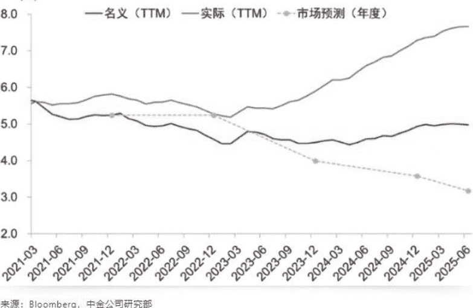

图1：近期中国出口保持高增长

数据来源：Bloomberg，中金公司研究

更多资源进群微信cuk255

## 图表2:内需于预期期

（万亿元） --名义内需（TTM） -- 两后市场预测名义内需（年度）

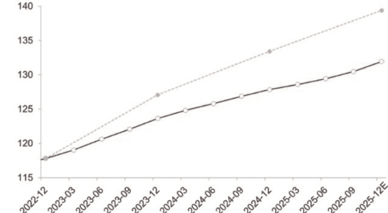

资料来源: Bloomberg, 中金公司研究部

## 图表3:我们预计2026年政策将在供需两端发力，同时“增”“减”结合

| | 增 | 减 |
| --- | --- | --- |
| 供给 | 优质消费供给 | 反内卷 |
| 需求 | 惠民生账款清欠 | 低效投资 |

资料来源: 中金公司研究部

更多资源进群微信cuk255

### 图7：出口利润率与出口价偏离

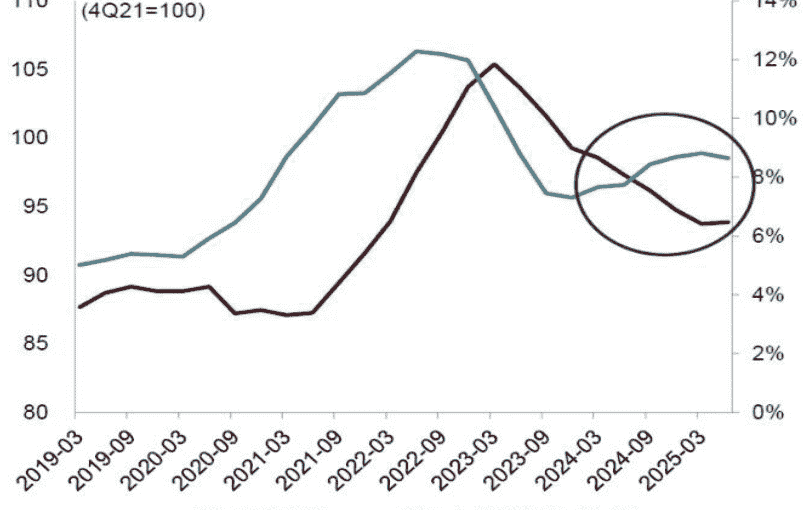

注：出口企业挂牌上市公司海外投资占比超过70%的企业。
数据来源：FinD、中金公司研究部

### 图8：技术进步和REER领先增加了中国出口价优势

(数据，2023Q1=100)

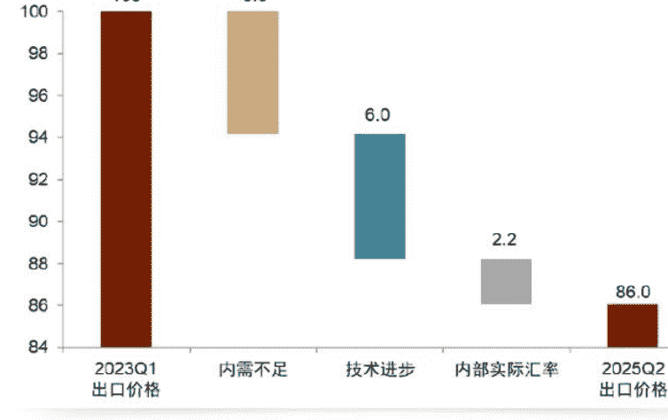

注：用户需求与实际需求缺口z-score显示内需不足，与中国与出口缺口相似度增加，中国优势异质度加速。隐含z-score显示技术进步、内部实际需求偏主要是价格/耐用价格，用出口价格领先对内需不足数据、技术进步和内部实际需求进行回归分析并解释。
数据来源：Haver、中金公司研究部

### 图表9:中国REER, NEER, IRER走势

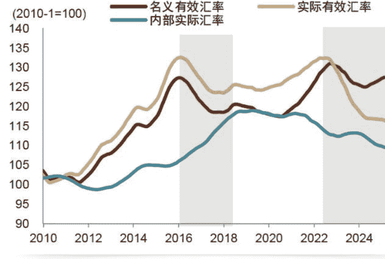

资料来源: Haver, 中金公司研究部

更多资源进群微信cuk255

## 深度视野优质集团（链接优质社群，助你成功）

全部包含以下内容： 限时费188/年 加微信cuk255

- ① 吃瓜群众包帝时圈加时费群对话（原价365 元/年）
- ② 子子明享汇（内部）文章
- ③ 政事室（顾子明）付费内容再送顾子明群聊
- ④ 米联储闲文【作者米穗】（原价599 元/年）
- ⑤ 欧洲金获会员专属文章（原价328 元/年）
- ⑥ 砖瓦斥内部文档（原价400 元/年）
- ⑦ 卢克文青学读书会专属文章（原价699 元/年）
- ⑧ 鉴茶财经知识星球（原价3310 元/年）
- ⑨ 猫哥的视界知识星球文章（原价299 元/年）
- ⑩ 财经周刊【独家新闻】（原价1498 元/年）
- ⑪ 杨世光在金钱爆（原价2200 元/年）
- ⑫ 蒜森财经知识星球（原价1600 元/年）
- ⑬ 激赛异译含付费文章（持续更新）
- ⑭ 司马林解读毛选全套音频和全套书籍藏版无割减（原价2.3 万）
- ⑮ 虚政三部曲【民国梦、帝国争亡、不被理解的 MAO】（原价599 元）
- ⑯ 卢克文知识星球文章（原价268 元/年）
- ⑰ 额外再送：卢薛元微信涨博费专栏、三村丰老王、三花九树文集

不定内容：......（更多资源不写下去了......

- ① 守夜司令知识星球、接换魔王星球、养成财富、上海家学等付费文集
- ② 创始人笔记、达叔谈论星球、成就财富、雪球花甲老头等
- ③ A 视野、大树乡谈、江宁访、咩咩说、上海海学等付费文集
- ④ 西风付费文章、老端、赢在八小时之外、局人的视界、升值、老A体制内等等其它一些大 V 付费文章（每月低于600 元的付费文章）

## 深度视野文集进群微信cuk255

深度视野（付费文集）

## 限时费188/年 底部链接全网U.优质内容

＊
