# 南半球财经251111

Jason 不
2025-11-11 02:27

蓝牙：我们预计美元将在未来6-12个月内跌至96。商品货币将出现回调。我们认为，受到离岸人民币和金额的支持，澳元将稳定在0.66附近，而新西兰美元将稳定在0.57附近。

我们将未来3个月及12个月的黄金目标上调至每盎司4300美元及4500美元。维持超配。我们预计在未来3个月及12个月内，国际原油价格将维持在每桶60美元及63美元。

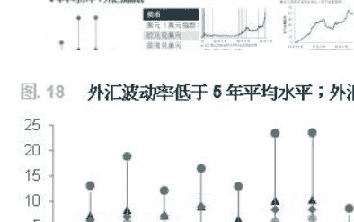

图 18 外汇汇率离5年平均均值：汇率预测表

| | 3个月预测 | 12个月预测 |
|---|---|---|
| 美元(美元指数) | 100 | 96.0 |
| 欧元美元 | 1.15 | 1.20 |
| 英镑美元 | 1.31 | 1.35 |
| 美元兑日圆 | 149 | 142 |
| 澳美元 | 0.66 | 0.63 |
| 新西兰美元 | 0.57 | 0.55 |
| 加元美元 | 1.42 | 1.42 |
| 美元兑瑞郎 | 0.81 | 0.84 |
| 美元兑新西兰加元 | 1.32 | 1.32 |

* 最大值 * 最小值 * 平均均值 当值
来源：莱孚、彭博特

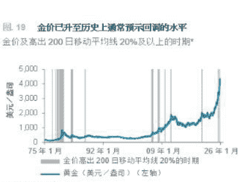

图 19 金融资产历史回撤深度可触的水平
金及超出200日移动平均线跌20%以上的时间占比

来源：莱孚、彭博特

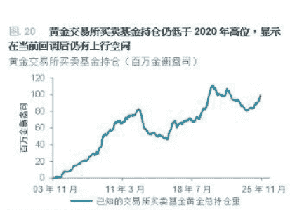

图 20 金融市场亚洲配置基金表现优于2020年以来。显示在加高亚洲及非亚洲市场内外的表现

*1987年以来的回撤。来源：莱孚、彭博

图 21 资产配置策略，首期原油的产量维持在相对水平

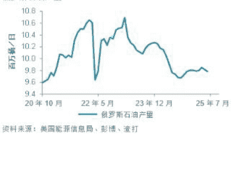

来源：莱孚、彭博、曼特

图 22 石油产的预测值，从美国能源预测

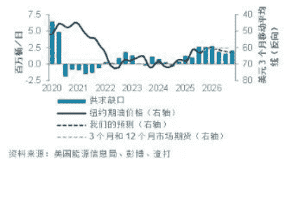

来源：美国能源信息署、彭博、曼特

更多优质内容：点击财富2555

# Jason不离

2025-11-11 02:30

中指院：10月，全国市场拍挂各类法拍源成交均价4193元/㎡，平均折价率74.8%。#房价

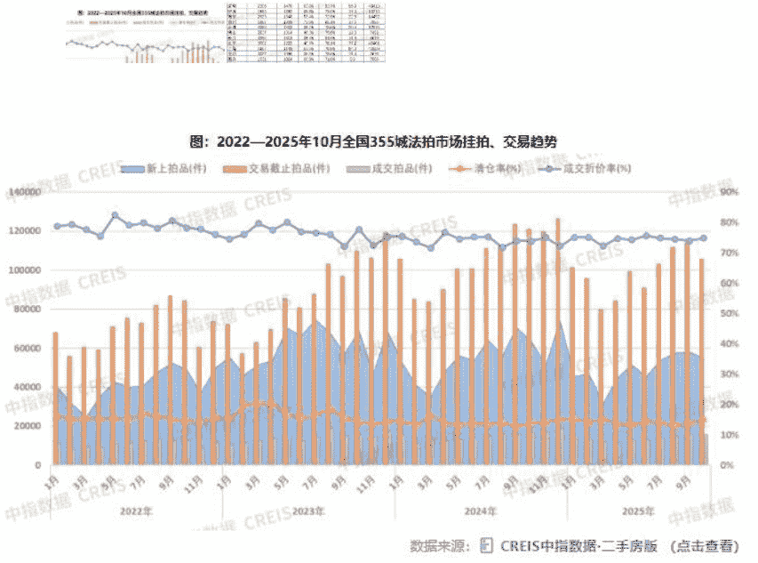

更多优质内容：微信cukzuk255

| 城市 | 交易挂拍（件） | 成交拍（件） | 清仓率（%） | 成交率 | 成交金额（亿元） | 成交均价（元/吨） |
|---|---|---|---|---|---|---|
| 重庆 | 9717 | 5546 | 57.1 | 67.3 | 38.9 | 5920 |
| 成都 | 6020 | 3124 | 51.9 | 79.3 | 40.7 | 10269 |
| 温州 | 2891 | 2181 | 75.4 | 85.1 | 21.8 | 6447 |
| 南宁 | 4391 | 2030 | 46.2 | 84.1 | 16.2 | 5671 |
| 杭州 | 3167 | 1996 | 63.0 | 76.5 | 53.2 | 18905 |
| 广州 | 4551 | 1950 | 42.9 | 75.6 | 45.9 | 18605 |
| 郑州 | 7477 | 1944 | 26.0 | 75.8 | 16.8 | 7041 |
| 上海 | 3666 | 1461 | 44.7 | 73.0 | 20.2 | 9600 |
| 苏州 | 2973 | 1527 | 51.4 | 73.5 | 21.5 | 10321 |
| 深圳 | 2306 | 1470 | 63.8 | 93.7 | 45.9 | 4841 |
| 宁波 | 1915 | 1392 | 69.8 | 73.0 | 17.4 | 10210 |
| 南京 | 2523 | 1348 | 53.4 | 75.2 | 22.5 | 14492 |
| 台州 | 1888 | 1339 | 71.0 | 85.1 | 17.5 | 7825 |
| 台南 | 3386 | 1333 | 39.4 | 78.6 | 20.3 | 12076 |
| 湘阳 | 2837 | 1431 | 46.3 | 75.6 | 12.8 | 7492 |
| 长沙 | 3396 | 1313 | 38.7 | 81.0 | 11.9 | 6619 |
| 泉州 | 3002 | 1222 | 40.7 | 76.1 | 7.2 | 43491 |
| 阳平 | 3169 | 1419 | 61.5 | 76.9 | 4.3 | 84659 |
| 星明 | 3022 | 1096 | 36.3 | 78.5 | 11.4 | 7676 |
| 嘉兴 | 1531 | 1024 | 66.6 | 71.9 | 8.0 | 7006 |
| 武汉 | 2393 | 989 | 41.3 | 68.2 | 11.9 | 9569 |
| 无锡 | 2182 | 980 | 44.9 | 70.5 | 11.1 | 8772 |
| 金华 | 1483 | 978 | 66.0 | 74.5 | 14.8 | 9103 |
| 芜尔 | 2672 | 922 | 38.8 | 74.1 | 6.4 | 5437 |
| 佛山 | 1847 | 865 | 46.8 | 81.5 | 7.0 | 6174 |
| 南通 | 1727 | 829 | 48.0 | 74.0 | 7.2 | 5846 |
| 沧阳 | 2061 | 806 | 39.1 | 69.2 | 4.1 | 5388 |
| 滚庆 | 1652 | 804 | 48.7 | 82.3 | 4.2 | 3672 |
| 江门 | 1290 | 795 | 61.6 | 71.8 | 11.4 | 8552 |
| 芜源 | 2095 | 390 | 37.7 | 77.6 | 4.6 | 4530 |
| 阜庆 | 1738 | 710 | 40.9 | 71.9 | 2.4 | 3127 |
| 惠州 | 3064 | 698 | 22.8 | 80.5 | 5.2 | 5842 |
| 潮德 | 4105 | 691 | 16.8 | 69.7 | 4.9 | 5179 |
| 合肥 | 2698 | 691 | 25.6 | 75.4 | 10.6 | 8478 |
| 乐州 | 1232 | 661 | 53.7 | 72.0 | 7.2 | 8238 |
| 济南 | 1686 | 623 | 37.4 | 76.5 | 7.5 | 8853 |
| 信丰 | 1567 | 581 | 37.1 | 71.7 | 4.3 | 4743 |
| 青岛 | 1773 | 577 | 32.5 | 82.7 | 7.1 | 10074 |
| 州州 | 1333 | 576 | 43.2 | 83.1 | 3.2 | 4455 |
| 洛阳 | 1950 | 549 | 28.2 | 83.9 | 5.0 | 6228 |
| 厦门 | 1142 | 538 | 47.1 | 81.9 | 15.6 | 2281 |
| 泉州 | 1180 | 537 | 44.5 | 74.0 | 5.4 | 6873 |
| 廊坊 | 1819 | 518 | 28.5 | 80.1 | 4.3 | 6848 |
| 北海 | 1117 | 513 | 45.9 | 79.0 | 2.2 | 3552 |
| 盐城 | 1369 | 494 | 36.6 | 69.7 | 3.4 | 5172 |
| 阜阳 | 2065 | 469 | 22.5 | 76.2 | 7.9 | 4141 |
| 乌鲁木齐 | 1275 | 464 | 32.9 | 80.0 | 4.1 | 5812 |
| 淮安 | 1373 | 452 | 32.9 | 68.6 | 3.2 | 1226 |
| 庆宁 | 1332 | 451 | 39.8 | 70.6 | 2.7 | 4621 |

## 背后原因

Jason不蜀
2025-11-11 02:30

近期分行加速经营风险的产生，主要受到两个方面因素驱动。

一方面，银行旨在提升债权回收率。一位市场分析师认为，房产处置路径从贷款到违约，房产直售业务主要是为了提升收回率。在市场调整期，企业或个人陷入无力还债的后，这种直售模式已成为快速灵活的选择。

另一方面，税负受经济社会发展水平、财政政策等多种因素影响。若政府在民生保障等方面出现需求，而没有收入以支撑，那么增加宏观税负就有必要，这是从“需要端”的角度来考量；从“供给端”来看，宏观税负需要平衡财政承受能力，这就选择“需要”与“可能”的平衡，因此合理宏观税负是一个中性概念，根据实际情况尤其是支出需求将来确定。

经济观察报：《意见》提出“保持合理宏观税水平”，与此前表述中的“稳定宏观税负”有何区别？

杨忠：“保持合理的宏观税水平与过去‘稳定宏观税负’既有差异，也有联系。宏观税负是否合理，并非取决于范围的提升或下降，而是密切相关。从数据显示，2017年至2024年，宏观税水平持续下降。2024年财政收入占GDP的比重至36%，税收入占GDP的比重至29%。

经济观察报：《意见》提出税收优惠政策，应如何理解？

杨忠：当前税收优惠政策存在优化的地方，税收优惠政策要与发展形势相结合。例如，随着经济形势变化，需要对税收优惠政策进行规范，一些到期或不符合当前形势的政策应停止，对一致的政策进行制度化。

以经济结构调整为前提，在新旧转型过程中，新经济增长成为新税源，税制延迟长期后，那么新税源就无法有效转化为税收入。同时，旧版依赖的传统经济本来萎缩，常规税收提供的能力已经逐渐下降，如果没有相应的税制建设，那么未来收入的募集就会面临巨大的挑战。

从历史上来看，经济的取舍与工业的发展反映了税收改革经历经济结构变化和行业发展的必要性。在调整优先收税时，需要综合考虑行业发展的不同阶段、公平竞争、政策持续性等因素，形成共识可能容易达成，但调整是必要的。

经济发展与税收规模之间的一个矛盾是地方政府的共性问题，在全国统一市场的建设中，如何平衡地方发展的经济积极性和规范性的关系？

杨忠：一段时间以来，地方政府把不规范的财政当作地方竞争的抓手。最常用的就是“财政补贴”，把企业所缴纳的税费、全额、半额或按约定取消。无论种形式，实施都是财政支出，都会冲击统一法律，是不规范的免税招商引向趋势。

不规范的财政补贴，根子在于地方政府的行为更为首！首先要把地方政府总量扩大，换取大规模的GDP。尽管经济增长不是GDP，高质量发展才是需要，但高质量需要的是可复制的治理、结构化、就业好的GDP。针对地方政府的行为，要在保障其经济积极性的同时进行有效约束。中央制定政策不是要把政府变成政策引导的作用，而是让地方用更好的公共服务、更好的基础设施、更好的环境来招商引资的重量交给抓手。

财政补贴政策与全国统一市场建设相适应，对待财政补贴应持理性态度，财政补贴要符合经济经营规则，只要经营主体同一，就能成为有效的工具。这任务需要约束政府滥用财政补贴，大力推进建设。

Jason
2025-11-11 

第一财经：银行直供房源通常低于市场的成交。

更多优质内容：微信cuk255

1970年之后，经济增长了快速增长，收入增长也呈放缓，但同时呈现收入差距不断扩大的特征，高收入人群的人口和收入占比均升高。美国当时出现“就业型”但经济增长的异常怪现象，少数美国股市上市公司三季度数据显示，美国国内消费呈现“K型”经济的特征，收入分化，低收入群体的消费增加，减少消费的同时购物变得更加便利，而高收入人群的消费得到了助推。低收入人群可能与我们对中国市场的消费拉动有效对接有关，低收入人群受近期波动影响较大。

1970年以后，经济增长了快速增长，收入增长也呈放缓，但同时呈现收入差距不断扩大的特征，高收入人群的人口和收入占比均升高。美国GDP的占比由1970年-1990年的4%，变为1970年后的2.6%，增长明显变缓，美国个人收入占比从43.5%下降到40.5%。根据美国国会数据显示收入占比速度加快，生活在农村的收入占比上升，Pew Research显示，从1971年到2023年，生活在农村的占比从11%上升到19%，其中中高收入人群的美国人口从61%下降到51%，从收入占比速度来看，根据美国国会预计计算结果（CBO），高收入者（支持在前和后收入占比20%）的收入占比从1979年的8.2%增加到2021年的10.0%，其中最高1%的收入占比对比上升速度快，1979年升高9.2个百分点至8.6%，低收入者（收入占比中后）的收入占比比其他升高7.2个百分点至8.3%。

图1：1970年以来高收入人口占比变化

| | 1971 | 2023 |
|---|---|---|
| 高收入人口 | 27% | 61% |
| 中高收入人口 | | 51% |
| 低收入人口 | | | |

- 高收入人口占比
- 中高收入人口占比
- 低收入人口占比

数据：PEW，以及需求要求；收入占比定义为收入占比中三分之二的，中收入人群占比定义为收入占比中三分之二的；高收入人群占比进入中收入占比的。

图2：高收入群体收入占比变化，其中中收入群体占比走势

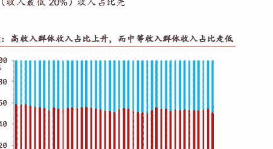

- 收入位于最高20%群体占比
- 收入位于中间60%群体占比

数据来源：CBO，以及需求要求

其中，农村群体的收入保持快速增长，高等教育群体的收入增速为慢，美国国际预算办公室（CBO）显示，2021年，美国高等教育的最高五分之一的收入（转移支付和后收入）自1979年增长了16%，2020年以后移民收入增速较快；收入的前五分之一增长了13%，尤其2020年后农村收入增长明显，且预计将继续对农村群体的收入缩小和后期效应。然而，美国等高等教育群体（收入的前五分之一）自1979年增长了17%，是更快的收入群体，农村的规模的缩小（基于转移支付和后收入）在扩大，从自1979年的0.352至2021年的0.496，未出现持续持续性危机。

图3：收入群体分类，转移支付和后收入的收入增长趋势

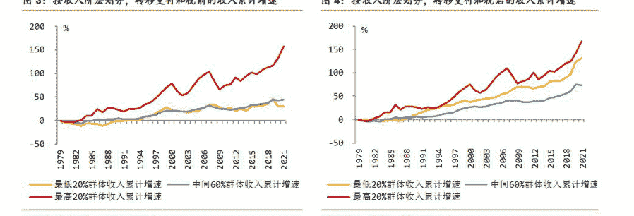

- 农村等群体的收入增长
- 农村等群体收入增长
- 中高等教育群体的收入增长
- 中高等教育群体的收入增长

来源：CBO，由作者数据绘制

美国人是如何转向自由主义的？始于1980年代“新自由主义”的出现，近年来又引发了“新自由主义”的回归。1980年代初，美国开始推行“新自由主义”，“自由主义”的核心是市场化、标签化、规模化。为了实现这一目标，政府实施了一系列政策：（一）减少政府规模，扩大私人部门规模；（二）减少政府监管，减少政府对公共服务的投入；（三）国有企业私有化，带来了竞争激烈；（四）金融化的改革使公司对行业垄断的状况得到打破，鼓励公司通过渗透并购、机械化等方式，发展了跨国垄断，社会权力结构变化，还引起许多重要变化，“新自由主义的崛起”（《1976/2008年经济危机》）、《贸易自由化与全球化》以及《基础设施投资与就业政策》等专业政策，政策决策者在某些方面体现出“新自由主义”的色彩，引发了对本土产业、结构转型等关注。

请务必阅读正后的重要部分

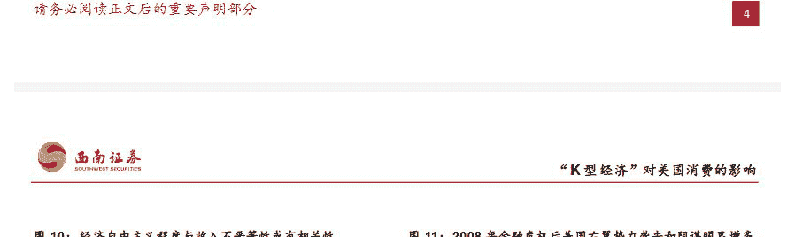

图10：自由主义的崛起与收入不平等相关性

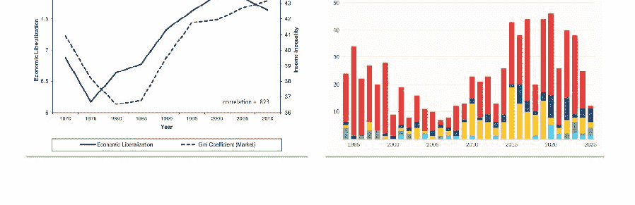

根据美联储数据，2025年Q2，美国净资产增长709万亿美元，其中551万亿美元由股票驱动，其次是房地产，房产贡献了22万亿美元。在期间，增长主要高收入人群驱动。2025年Q2，高收入人群的资产幅度高达88.5%，规模为44.4万亿美元，其中高收入人群贡献了38.6%的股票。与中低收入人群相比，高收入人群贡献了56.8%的房产，在80-99%水平的资产（444亿）中，占比为30%。

图20：美国净资产分类的构成

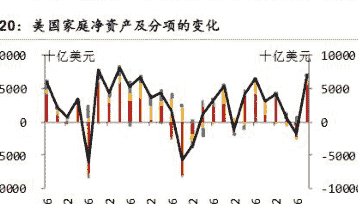

图21：美国净资产中房价占比

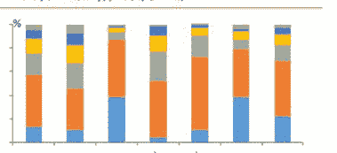

数据来源：FED，美国数据

图24：收入差距受房价影响

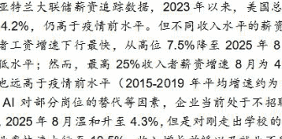

图25：美国失业率趋势

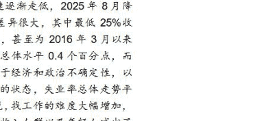

数据来源：美联储，美国数据

家庭信用卡、汽车和学生贷款逾期升高，整体状况恶化。家庭贷款逾期90天的比例在2025年Q2达到3.04%，在2020年Q2为最高，受信用卡、学生贷款等影响。2023年以来，家庭信用卡和汽车贷款逾90天的比例在快速上升，从2025年Q2起，汽车贷款逾90天的比例已达到5%，接近2010年Q4（金融危机后）和2020年Q1（疫情复苏）；信用卡贷款逾期90天的比例已达到12.3%，也接近2010年Q1（金融危机后）13.7%。2024年Q4学生贷款逾期回升，2025年Q1逾90天的比例大幅升至7.5%，2025年Q2进一步至10.2%。然而，在家庭债务中占多数（超过70%）的住房押贷款逾期率仍然较低，2025年Q2为0.82%，主要是受疫情期间居民以低利率锁定固定利率。

图31：美国信用卡贷款、汽车贷款和学生贷款逾期90天的比例快速增长

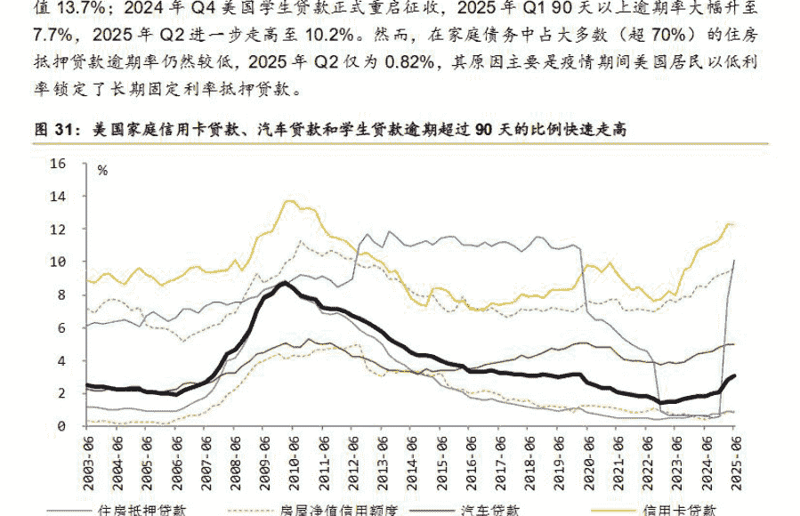

数据来源：联储报告，纽联数据库

FT：全球最大的汽车运输运营商表示，随着中国竞争对手进入扩张与创新的格局，欧洲汽车制造商正面临失去市场份额。

全球汽车运输运营负责人表示，随着中国竞争对手正在扩张与创新的阶段，欧洲汽车制造商正在全力在全球争夺市场份额。在中国国内热击价格战，Wallenius Wilhelmsen物流公司首席执行官克拉克·罗斯特霍森对中国、欧洲、非洲和亚洲的巨大增长。

“中国企业之所以能够扩大市场份额，是因为他们近期的电话会议分析表示，中国的生产产品已经从领先者成为了技术领先者”。

凯赛昂(AllPartners)公司数据，中国制造汽车出口增长23%，达到640万辆，排名二的国内份额高达50%。

咨询公司预计，到2030年，中国制造车辆在全球汽车市场的份额将从现在的21%升到30%。

汽车市场竞争激烈，包括比亚迪(BYD)，以及德国公司上汽SAIC，中国的品牌在墨西哥快速扩张，今年几个月已占市场销量的5.7%，去年为3.2%。

在过去的三个个月里，中国制造在欧洲汽车市场的份额增长高达10%。

尽管中国和美国品牌在欧洲汽车市场的份额竞争激烈，但他们从对手手中夺回了一部分，克拉克·罗斯特霍森表示，中国汽车在其他地区的增长很快。欧洲汽车制造商面临多重压力：国内需求疲软以及海外市场受到挫折。政府已采取行动限制来自西方的中国制造，欧盟上也考虑了对中国电动汽车的限制。尽管如此，Wallenius Wilhelmsen历史上受益于西方企业，现在正帮助中国品牌出海获取收入。

日本外汇市场将汇率推向日元贬值方向。在货币政策上，日本银行将加息，而美国储备委员会（FED）则是暂停。日美利率差缩小理论上引起日元升值，但目前来看，利率差依然良好。

| 财经 | 2023年12月15日纠正后 | 五大外汇指数（包括欧元、日元等） | 预计2024年第一季度初发布 |
|---|---|---|---|
| 摩根大通银行 | 142 | 156 | 139 |
| 瑞穗证券 | 147 | | 158 |
| 三菱UFJ银行 | 144 | 152 | 142 |
| 三井住友银行 | 147 | 153 | 145 |
| 理策纳控股 | 149 | 149 | 150 |

（注）美元兑日元的汇率

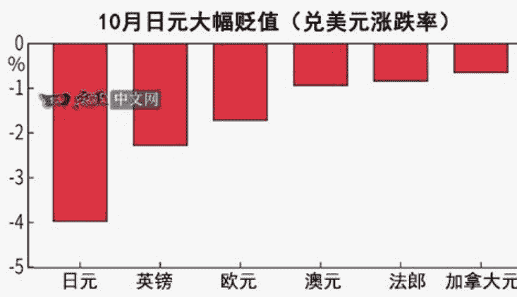

（注）9月30日与10月31日对比日元货币指数接近2024年汇率干预时的水平

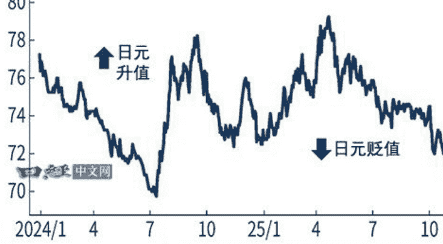

中金：截至9月，真实二手房价累计跌35.2%。

图4：房价仍在止跌

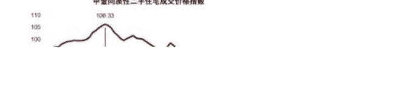

图表4：房地产价格仍在止跌

中金同质二手住宅价格指数

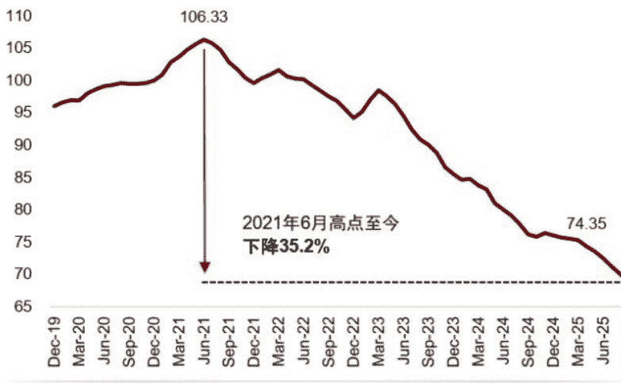

资料来源：彭瑞、58、贝壳源产平台、中数据、中金研究院

东吴：如果本人民币汇率偏离幅度与2019年到2022年的升值幅度13%相当，那么在2025年4月作为高位，预测本人民币汇率升值的终极点位置在6.40-6.50。一个观察因素是截至2025年9月，2022年以来三个时间累积的“待汇”资金总量约为4650亿美元，它们是否会在升值预期中逐步下降，会影响汇率升值的速度。

图6：2025年以来实物贸易趋势持续好

图7：2024年中国出口份额环比回

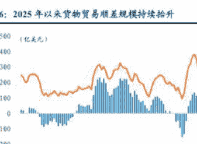

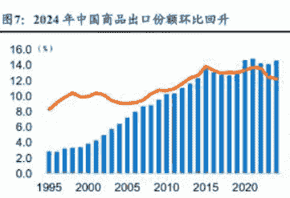

图8：出口企业“持粘回升”

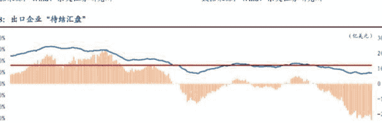

数据来源：Wind, 东亚研究所，圣亚研究所

摩根丹利：追踪中国今年截至11月9日新房销售持续低迷，连续两周下降38%，显示需求仍较软，尤其一线城市（48%），表明在政策预期下，信心未企。二手成交量同比29%，比上周略好，反映出挂价意愿上升。

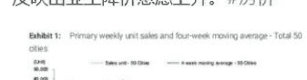

我们预计中国在2026年继续把增长目标设定在“5%左右”，同时首次为“消费占比”设定量化指标。2026年高个百分点，给部分群体带来机遇。2026年预计降储20bp并下调存款准备率4%，考虑到回购利率，有效将维持在6.2%。2025年以下不再下降，这项操作更起到“信号”的作用。我国GDP比重接近历史以来低位，2026年可能需要退出部分税收优惠。

- 特国债占比到7.9%，2025年将加大发行万亿，专家称使用货币工具弥补通胀压力。
- 财政政策增强韧性；防范政府负债的恶性循环。
- 中美利差与汇率波动，与股市市场匹配。
- 利润方面，“消费占比+1%落地，向家用“以旧换新”，设备升级质量和订单可见度有望提升。

Figure 1. The Chinese economy has proved wrong in GDP forecasting for 2024-25

Figure 2. -5% growth target could be both feasible and softening tone on doubling GDP

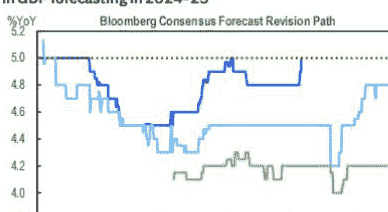

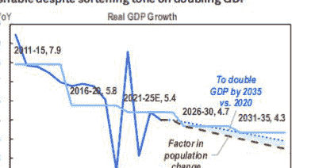

Figure 5. We expect the CEWC to set the tone for the realistically accommodative policy package for 2026

| Unit | 2024 | 2025 | 2026F |
|---|---|---|---|
| Targets | | | |
| GDP Growth | %YoY | Around 5% | Around 5% | Around 5% |
| New Urban Employment | mn ppl | Above 12m | Above 12m | Above 12m |
| CPI | %YoY | Around 3% | Around 2% | Around 2% |
| Consumption Ratio | % of GDP | | | |
| Monetary Policies | | | | |
| Rate Cut | bps | 30bps | 10bps | 20bps |
| QE | bps | 100bps | 500bps | - |
| Fiscal Policies | | | | |
| Pro-growth borrowing | RMB rate (% of GDP) | 8.7% (6.4%) | 10.8 (7.5%) | 11.8 (7.9%) |
| Budget deficit | RMB rate (% of GDP) | 5.6% | 5.92% | - |
| Special CBD | RMB bn | 1000 | 1300 | 1600 |
| Trade-subsidies | RMB bn | 150 | 300 | 300 |
| Equipment upgrade | RMB bn | 200 | 700 | 1100 |
| New special LGB | RMB bn | 3100 | 3600 | 4100 |
| Unused LGB quota | | | 200 | - |
| Risk-deleveraging | RMB rate (% of GDP) | 3.2 (2.4%) | 3.6 (2.5%) | 3.6 (2.4%) |

## Figure 8. Exports growth of auto and motorcycle slowed to zero after voluntary retentions in 2013

## Figure 9. Our global team expects a pickup in global (China) nominal GDP growth in 2026E

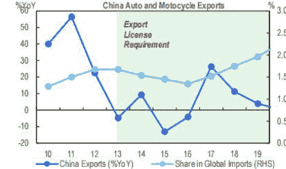

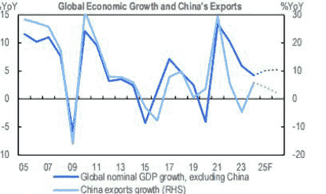

2025 Clipgroup Inc. No redistribution without Clipgroup's written permission.
Source: UN Comtrade/World Bank Wits CSR

2025 Clipgroup Inc. No redistribution without Clipgroup's written permission.
Source: China Customs, Wind, CIR Estimates

## Figure 12. Household expectations remain muted on home prices

## Figure 13. The PBOC's lending funds for house buying could be little tapped

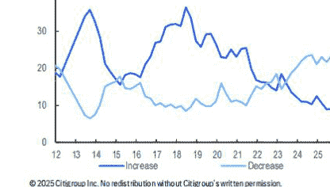

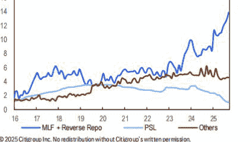

2025 Clipgroup Inc. No redistribution without Clipgroup's written permission.
Source: PBoC, Wind, CIR Research

2025 Clipgroup Inc. No redistribution without Clipgroup's written permission.
Source: PBoC, Wind, CIR Research

## Figure 14. The RMB exchange rate has been stable against the US dollar for a prolonged period

## Figure 15. Cross-border RMB settlement has turned into surplus since this May

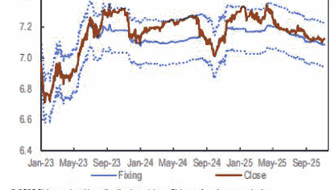

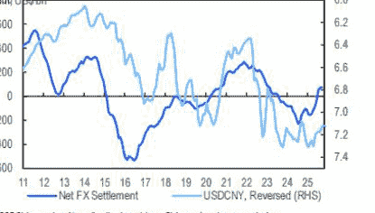

2025 Clipgroup Inc. No redistribution without Clipgroup's written permission.
Source: CIR Research, PBoC, Wind

2025 Clipgroup Inc. No redistribution without Clipgroup's written permission.
Source: PBoC, SAFE, Wind, CIR Research.

# Jason不离

2025-11-01 05:15

JPM: 2025 年至今，中国汽车整体上涨 17%，涨落后 MSCI 中国指数 (+36%)。但有 5 个股份在 2025 年实现翻倍，分别落在 (8863.HK)，小鹏 (XPEV.US)，蔚来 (NIO.US)，华晨 (1114.HK)，东风 (0489.HK)。各自因不同的“股权故事”（战略转型、品牌重塑、出海战略等）而表现。

展望 2026 年，我们预计国内车辆需求将萎软或下降 0-5%，出口增长与份额提升可能面临分歧压力。部分股份可能在不利环境下“逆势翻赢”。市场

# J.P.Morgan

JMorgan

Discounted Sales
APC Specialist Sales Team
10 November 2023

# J.P.Morgan

APAC Industrial & Auto Sector Specialist Sales Commentary
Auto & EV | Equipment | Machinery | EBC

# China Auto Calls Series: Exploring Stocks That Could Double in 2026

Jason 666
2023-11-08
jason@gmail.com

China Auto, being collectively rallied up to 17% YTD and share of MSCI's 36%, has seen a record of 5 stocks
that have seen their prices double during the year so far through their respective equity stories (Lagom, SpaceX, Nex,
Hiance Cha and Dongfeng). Into 2025, we see rebound as domestic demand rises or even decline
(IPOs fact recover just soon as market wealth other stocks help to offset such
headwinds). While volatility will remain high among auto stocks - as it always has and we won't rule out
the possible could still see some stocks rally or double, despite industry challenges. Please join
our calls series to explore industry dynamics, corporate strategy and expert insights.

# Jason不离

2025-11-01 05:35

高蓝：我们去了广州、深圳等地实观察市场，高端消费与大众市场“背离”。富人豪宅A股估值持续处于双低，但尚未转化为刚性住宅的更快速。

广州/深圳城市人口仅有30-60%套住在“城中村内”，但资金来源主要是刚性需求，若要回振，需更大需求可能通过政策或直接接购房补贴。

两家银行的调研显示，近期房价下跌30%，按其房产组合加杠率升至40-55%：行业压力巨大，一线城市仍可以承受，但可能涉及透支/ABS收回率 40-80%。

在看到房价已下跌20-30%，人口流动缓，资金下调，金租持续压制均衡。已有的HPR松/调整效果有限。

在广州看到空置率增加10-20%，近期房价加速，挂钩历史高位（约13万套）；约30%卖方住房价格频繁触及底部，约20%流动性压力增大。#房价收益

更多优质内容：微信cuk2555

## Exhibit 1: On a relatively comparative basis, we note
secondary prices trended weaker than primary prices in
Both Shenzhen and Guangzhou...

Same-period: Primary and secondary ASP comparison in
Shenzhen

(Indexed to Jan-2018)
- Primary ASP (RMB)
- Secondary ASP (RMB)

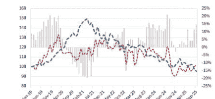

We used the average of the secondary/primary ratios of four cities: Beijing, Tianjin, Wuhan and Guangzhou.

Source: Data compiled by Goldman Sachs Investment Research

## Exhibit 2: On a relatively comparative basis, we note
secondary prices trended weaker than primary prices in
Both Shenzhen and Guangzhou...

Same-period: Primary and secondary ASP comparison in
Shenzhen

(Indexed to Jan-2018)
- Primary ASP (RMB)
- Secondary ASP (RMB)

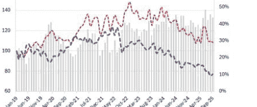

We used the average of the secondary/primary ratios of four cities: Beijing, Tianjin, Wuhan and Guangzhou.

Source: Data compiled by Goldman Sachs Investment Research

# Jason不离

JPM: 2025 年至今，中国汽车整体上涨 17%，涨落后 MSCI 中国指数 (+36%)。但有 5 个股份在 2025 年实现翻倍，分别落在 (8863.HK)，小鹏 (XPEV.US)，蔚来 (NIO.US)，华晨 (1114.HK)，东风 (0489.HK)。各自因不同的“股权故事”（战略转型、品牌重塑、出海战略等）而表现。

展望 2026 年，我们预计国内车辆需求将萎软或下降 0-5%，出口增长与份额提升可能面临分歧压力。部分股份可能在不利环境下“逆势翻赢”。市场

高蓝：我们去了广州、深圳等地实观察市场，高端消费与大众市场“背离”。富人豪宅A股估值持续处于双低，但尚未转化为刚性住宅的更快速。

广州/深圳城市人口仅有30-60%套住在“城中村内”，但资金来源主要是刚性需求，若要回振，需更大需求可能通过政策或直接接购房补贴。

两家银行的调研显示，近期房价下跌30%，按其房产组合加杠率升至40-55%：行业压力巨大，一线城市仍可以承受，但可能涉及透支/ABS收回率40-80%。

在看到房价已下跌20-30%，人口流动缓，资金下调，金租持续压制均衡。已有的HPR松/调整效果有限。

在广州看到空置率增加10-20%，近期房价加速，挂钩历史高位（约13万套）；约30%卖方住房价格频繁触及底部，约20%流动性压力增大。

## 3Q25 financial performance recap

The retail sector witnessed a mixed recovery especially in bottom line in 3Q25. Industry bellwers such as Dashenlin (DSL) and Yifeng are our top picks in the sector) showed better recovery in same-store growth as well as adj. DSL's adj. NP growth has accelerated YoY, reflecting effective store and operating optimizations. Yifeng remained the steady performer, noting 88%+ adj. NP growth through 1-Q25. Laobuxing lagged on the front-end; NP continue to see negative growth but the pace of the decline rate has been narrowing.

Figure 1: China retail pharmacy showed financial performance recovery in 1-3Q25

| | Revenue growth (YoY) | Adj. NP growth (YoY) | GPM | Adj. NPM |
|---|---|---|---|---|---|---|---|---|---|
| | 3Q25 | 2Q25 | 1Q25 | 3Q25 | 2Q25 | 1Q25 | 3Q25 | 2Q25 | 1Q25 |
| Dashenlin | 2.5% | -0.4% | 0.6% | 8.1% | 14.8% | 34.4% | 37.7% | 35.0% | 5.1% | 7.5% |
| Yifeng | 2.0% | -1.4% | 0.6% | -9.5% | 8.5% | 40.3% | 41.3% | 39.6% | 2.3% | 7.3% |
| Laobuxing | 0.1% | -1.1% | -1.9% | -19.0% | -21.6% | 31.4% | 31.9% | 34.2% | 2.1% | 6.5% |
| Yintang | -0.6% | -1.4% | -6.5% | -78.0% | 66.0% | 32.3% | 33.4% | 31.8% | 0.2% | 2.1% |
| SYPM | 13.5% | 5.2% | -2.5% | -45.9% | -47.6% | 44.6% | 25.0% | 25.7% | 0.9% | 3.0% |
| IJZ | 7.7% | -0.7% | -0.4% | -123.9% | 129.3% | 17.0% | 36.4% | 35.0% | 0.5% | 0.4% |

Source: Company data

## Net benefits from store optimization

The main reason for the notable improvement in pharmacies' profit has been store optimization, in 2024-25, hundreds of chain operators closed yielded unprofitable outlets – Sinohealth data show ~39,000 pharmacy stores shut in 2024 (5.7% closure rate). In 1-Q2 2025, another ~24,000 stores were closed, reflecting more chains can no longer withstand the pressure of losses and are adjusting. The ongoing market consolidation also helps to improve the operating situation of survivors.

Figure 2: More stores are getting closed in 2024-25 facing intensified competition

| | 16,035 | 15,113 | 14,114 | 13,831 |
|---|---|---|---|---|
| | 9,257 | 7,794 | 10,781 | 10,284 | 9,822 |
| | 6,771 | 1,319 | 3,847 | |
| | | | -3,395 | -3,316 | -4,009 |
| | 1Q24 | 2Q24 | 3Q24 | 4Q24 | 1Q25 | 2Q25 |

Source: Sinohealth CMH database

As a result, we calculated under our base case scenario, incremental revenue from non-pharma expansion will contribute 1.1% to total revenue growth in 2026, with profit growth contribution of 7.4% associated with the cost, resulting in a net increase of 0.5 pt in net margin, and a net profit increment of $0.5bn. Based on the sensitivity analysis, we believe non-pharmaceutical category expansion is an effective lever to enhance the financial performance of pharmacies.

Table 20: We expect non-drug expansion to bring 7.4% net profit growth to Yife Base Case.

| Non-drug stores | Bear | Base | Bull |
|---|---|---|---|
| % non-drug stores | 528 | 1057 | 1585 |
| Incremental revenue from non-drug stores (Rbn) | 6% | 266 | 799 |
| % growth from non-drug category | 50% | 100% | 200% |
| Gross margin | 32% | 33% | 52% |
| Incremental profit (Rbn) | 28 | 126 | 405 |
| % incremental profit contribution | 1.7% | 7.4% | 23.8% |
| Deducting labor cost (c. 15% of sales) | 2.0 | 4.0 | 6.0 |
| Deducting inventory costs (c. 5% of sales) | 1.7 | 2.7 | 4.0 |

Source: Company data, J.P. Morgan estimates.

Yang Huang
(852) 2800 3812

Asia-Pacific Equity Research
10 November 2025

# J.P.Morgan

Jason 不嵩
2025-11-11 05:44

Cotality截至10月的最新数据显示，澳大利亚的房价增长目前为两年来最快的速度。仅10月全国房价就上涨了1.1%，增长率超过6%。在截至10月31日的三个月，墨尔本和达尔文房价上涨了4%，布里斯班的房价随之上涨了9%。根据Cotality的最新数据租赁转换导致全国空置率达到4.7%的历史低，低于10年平均水平的3.3%。这代表一个大学和新生移民多数的城市住房租金非常高。

截至10月31日澳洲房价指数

来源：Cotality

Jason 不离
2025-1-11 08:55

现有的压力，把它看作是一座山去爬吧。“只有面对恐惧，才能战胜它。”只有不害怕的勇气，胜利将如约而至。在挫折中学习，在挑战中成长，是胜过一切的开始。记住，只有经历过无数失败的人，才会有通往成功的秘诀，它是不断的失败教训。

我想请教您关于财富和人生的问题。我和妻子经历过家庭遭遇，一起在城市工作。毕业后我们很困惑，需要什么样的能力才能财务自由？我和妻子创业后五年，只有一个小公司，没有足够的财富和经验，完全靠自己摸索。

1. 感谢，“感恩”是一种速度，是很多人共同的问题，以及不同的想法。感恩是一种力量，需要去培养。

2. “心态”是一个人的选择，决定了生活的影响。心态不是问题，而是你的选择。要积极，从阳光的回头看到自己的地方，负面的情绪是正常的，但要做自己生活的主人，不要把压力留在身上。

3. 小时候，父母对我那段记忆很清晰，或者是他们让我非常快乐。长大的过程是父母决定的，完成了自己，另一方面去帮助别人。没有人帮助我打拼，完全无法挥霍。我开始创业，周末挣扎，赚了钱，然后失去，又失去，最后收获道理（心理学、哲学等）。

4. 关于你的问题，我告诉你放宽心态。财富源于积累。积累的规则不在于最简单的办法你可以学会控制欲望，忠于自己，创造自己的内在价值太大了，而且我们的快乐是在过程中的找到对应的动力。新的动力是热情的。

Jason 不离
2025-11-11 14:44

国信达：10月全国范围内住宅挂牌指数下降0.96%，同比下降8.4%。从出售挂牌指数看，一、二、三、四线城市均下降，降幅分别为1.3%、1.02%、0.98%、0.74%。全国范围内住宅挂牌指数下降0.56%，同比下降3.07%。

Jason 不离
2025-11-11 13:16

# 央视评跨地创收

部分执法机关跨越辖边界办案，将企业视为可随意“捕获”的“渔获”，以执法之名牟利之实，本质上是对公权力的滥用与异化。此类行为不仅侵犯企业与公民的合法权益，也破坏公平竞争的市场秩序，严重损害执法公信力。

这一问题背后的深层原因还是经济利益驱动。在少数地区，执法部门的罚收入上交地方财政，可按比例办案经费等形式返还。“多罚多返”的机制导致一些执法者将执法权视为“创收工具”，把企业当作“摇钱树”。部分地区甚至在财政压力下，为部门下达“指标”，默认或变相鼓励盈利性执法。

面对这一问题，2024年9月，中共中央政治局会议明确提出要“进一步规范涉企执法、监管行为”。10月，国家发展改革委相关负责人强调，要规范异地执法行为，建立健全异地行政执法协助制度。最高法院、最高检和公安部相继出台文件，从审判监督、案件督办和管辖等方面派出“组合拳”。

# 深度视野优质集群（链接优质社群，助你成功）

全部包含以下内容：限时费188/年 加微信cuk255

- ① 吃瓜群众倍时文档加时群对话（原价 365 元/年）
- ② 子明私享汇（含）
- ③ 守夜人知识星球、接换魔王后实谈
- ④ 欧洲金顶（原价 599 元/年）
- ⑤ 欧洲圈专属文章（原价 328 元/年）
- ⑥ 三万内部文档（原价 400 元/年）
- ⑦ 卢克文读书会（原价 699 元/年）
- ⑧ 鉴茶知识星球（原价 3310 元/年）
- ⑨ 猫哥的视界星球（原价 299 元/年）
- 十 财新周【独家】（原价 148 元/年）
- 十一 杨世在金钱（原价 2200 元/年）
- 十二 森淼知识星球（原价 1600 元/年）
- 十三 激游异译付费文章（持续更新）
- 十四 司马林解读全套音频和全套书籍收藏版无割（2.3 万）
- 十五 虚构三部曲[国梦、帝国战争、不被理解的 MAO]（原价 599 元）
- 十六 卢克文星球（原价 268 元/年）
- 十七 额外再送：卢薛元新微付费专栏、三村丰老王、三花九洞文集
