# 南半球聊财财经251113

Jason不赢
2025-11-13 03:15

乡村振兴(债券)看一看，起名字（往政策靠）有的是，本质都是一样的样的#TAX

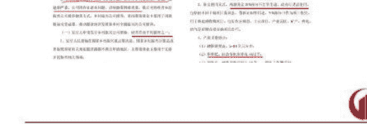

# 乡村振兴公司债券业务介绍

一、关于乡村振兴公司债券

针对当前地方政府平台负债压力高，后续存在大量商业、定融产品跨期压力，因存在诸多问题，后续融资困难，我们公司推荐乡村振兴债券融资方式。乡村振兴债券，是指募集资金主要用于巩固脱贫攻坚、推动农村地区和乡村全面振兴的债券。

(一)发行人申请乡村振兴公司债券，应当包含下列情形之一：

- 1、发行人注册地在国家振兴重点帮扶县、国家振兴示范县或按照国家有关规定脱贫摘帽不满五年的地区，且募集资金主要用于支持乡村振兴相关领域；
- 2、发行人为涉及农业，且募集资金通过乡村振兴业务主要用于支持乡村振兴相关领域；
- 3、募集资金主要用于乡村振兴相关项目的建设、运营、收购，或还偿项目原有债务。其中，乡村振兴领域，包括粮食和重要农产品保障、支持乡村振兴产业发展、加快乡村农业现代化、促进农村农业增收、改善乡村基础设施设施、提升乡村公共服务水平等国家乡村振兴支持，通过市场化方式实现乡村就业结构、健健全乡村产业体系、推动乡村产业链升级、完善乡村基础设施等。

(二)乡村振兴公司债券融资方式有利利率、额度高、期限长、使用灵活等优势，具体情况如下：

- 1、不增加债务，不增地方及财政平台负债，不需要政府平台提供担保、融资平台公司商票、融资产品逾期不受影响。
- 2、财务门槛低、平台公司总资产 50 亿以上、净资产 25 亿以上、公司营业收入 2 亿左右、净利润不亏损即可。
- 3、资金使用灵活，融资资金 30%部分不监管用途，政府可灵活使用，包括不限于项目资金、借新还旧等用途。70%部分作为项目投资、用于新建或收购项目，包括农业项目、工业项目、产业园区、矿产、热电、供气等后期收益的项目。
- 4、产品其他特点：
  - (1)融资额度高、5-10 亿元左右
  - (2)利率低、综合利率在 4%以下：
  - (3)期限长、融资期限可达5-10 年，一般按 7 年期发行；
  - (4)融资快，可以在三个个月左右募集约定的融资额度，如市场融资未达到目标，我司可包销剩余所有募集资金：

## 二、推进流程

1. 与政府主要领导及主管部门负责人座谈确定合作意向，了解地方政府平台公司各项指标数据、县内主要产业及经营性资产、待投资资产项目等基础情况；
2. 签订框架协议或保密协议，收集地方政府平台公司财务数据、待投资项目、梳理县内经营性资产。根据实际情况和融资需求，确定发行主体、出资资产重组及融资初步方案；
3. 签订债券发行及承销协议，专业机构出具相关文件，提交交易所备案，可以包销方式确保发行成功。

## Jason不离
2025-11-13 03:49

BOFA: 10 月份，美国高收入家庭工资同比增长放缓至3.7%，而低收入家庭的工资增长率下降至1%#其他国家经济

> Exhibit 12: In October, higher-income household wage growth eased to 3%, while for lower-income households ticked down to 1%. After-tax wage and salary growth by household income terciles, based on Bank of America aggregated consumer deposit data (3-month moving average, YoY%, SA).

# Exhibit 12: In October, higher-income household wage growth eased to 3.7%, while for lower-income households ticked down to 1%. After-tax wage and salary growth by household income terciles, based on Bank of America aggregated consumer deposit data (3-month moving average, YoY%, SA).

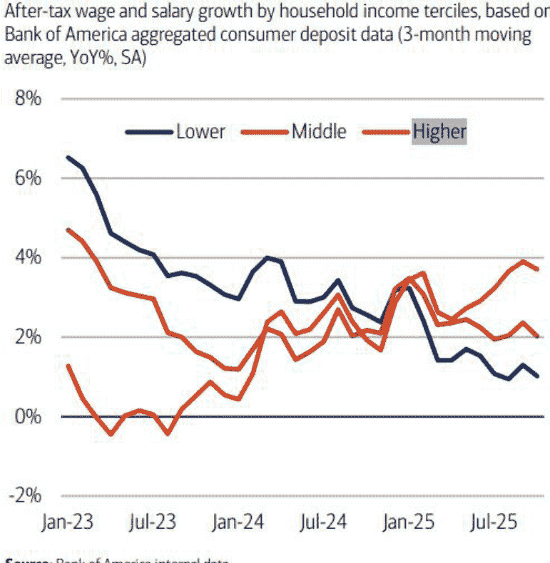

## Jason不离
2025-11-13 03:57

bloomberg: 俄罗斯计划在12月初发行首批人民币债，以帮助弥补今年纪录的赤字。根据卫星数据，中国加大进口俄罗斯天然气。

- 俄罗斯计划在12月初发行首批人民币债，以帮助弥补今年纪录的赤字。
- 财政部将于12月2日接受投资者要约，首批人民币债国内债券，期限从三年到七年。
- 随着油价下跌和美国新波制裁生效，政府正在寻找增加支出和收入下降的缺口。
- 俄罗斯计划在12月初发行首批人民币债，这突显了受制裁打击的经济并帮助弥补今年纪录的赤字。
- 财政部周三显示，从12月2日接受投资者两批人民币债国内固定收益债券要约，期限从三年到七年，面值为10亿元。
- 政府正在寻求在支出增加的情况下借贷，并且随着油价下跌和美国新波制裁生效，预算赤字预计达到5.7万亿（7000亿美元），约占国内总值的2.6%。
- 甚至在俄罗斯弗拉基米尔·普京入侵乌克兰后受到国际制裁之前，财政部就曾考虑以人民币出售债券，已经用此货币进行了销售。

## Jason涵
2025-11-13 04:01

bloomberg; 债券交易的焦点是未来的10年期收益率升至4%以下，数据显示美国正在放缓。周四财政部以4.07的价格获得了42亿美元的10年国债，而拍卖日期收益率为4.08%，这表明需求未达到预期。美国通胀进展不佳，如果我是政策制定者，我会冷静地低估。

# 国际国债
自12月以来，10年国债的拍卖表现非常差，这一周美国国债价格收益率已转向看涨。上周，13.0出现了大量买盘，这与收益率升至4%以下的一致。

## 国债收益溢价
鉴于最近12月和1月期的10年期国债需求很大，过去一周美国国债价格收益率已转向看涨。上周，13.0和15.0的行情都出现了大量买盘，这与收益率升至4%以下的一致。

## Treasury Options Call/Put Skew
Skew by 1-month 25-delta call vs. put spread

- 10-year 1-month 25-delta calls minus puts
- 2-year 1-month 25-delta calls minus puts
- 5-year 1-month 25-delta calls minus puts
- Long bond 1-month 25-delta calls minus puts

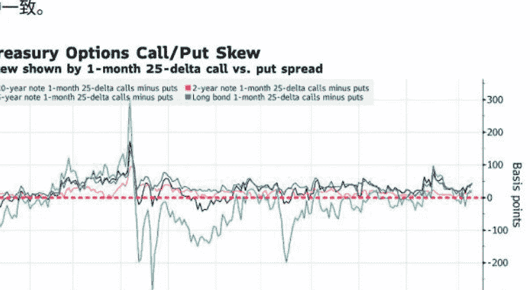

Source: Bloomberg

## Jason涵
2025-11-13 04:10

李进雷：建议设立5万亿基金，医疗自费率大部分解决了（5万亿可能是养老基金，医疗自费率大部分解决了）

自“9·24”以来，A市场迎来一波反弹，指数从2000点下升至4000点，市场风险偏好显著提升。然而，中国国际期货首席经济学家李进雷：股市的不确定性依然很大，风格切换尚需预测。

针对市场上“存款数据爆发”的说法，李进雷并非完全认可。他指出，9月居民存款依旧上升，与“存款数据”的预期相符。股市上涨更多是资金偏好提升的结果，而非居民储蓄的大规模转型。

李进雷强调，股市确实可以成为居民财产属性的主要渠道，“股市可以增加财产性，但部分居民的收入并未显示增长，甚至在减少”。他引用谢尔茨学者权威的研究指出，在长达20年的时间里，全球股市未能显著显示对消费的量联动作用，即“财富效应”。

对于增加财产属性，应该怎么办？李进雷认为要缩短周期。通过分析，对周期的认识还不充分，如同股市的顶点已经在5月，此后进入震荡通道，引起了多个关联企业回调。李进雷指出，如同日本，周期持续了20年，当周期结束后，那么居民部门要回升，可能是因为股市的顶点。

对于稳定股市，李进雷提出一个具体的建议：“设立一个万亿规模基金”。考虑到市值高达5万亿，是国内市值的3倍左右，合适。通过这种方式进入市场，作为配置中占比最大的产品，兼具财产属性。李进雷说，“稳定股市，才能缓解中长期压力。”

长期看好黄金，李进雷提示在历史上，黄金类上涨的情况极少，今年涨幅超预期，继续买入避险还是好黄金。

## 四、给投资者的建议：避免追跌，把握分化中的“二八”机会

面对复杂的环境，李进雷提出两大核心策略：

- 一是避免追跌，优先考虑避险。当前资产整体估值低于——美股已调整、日本收益率较高、A股创历史新高，他建议“持有现金，不要忙着套利”，全球进入资金驱动期，不确定性加大，避险放在首位。
- 二是把握分化的“二八”机会。李进雷表示，新兴产业将持续上升，传统产业由于周期持续下去，需要向上的领域；企业层面，头部效应凸显，美国虽未出现类似企业，但需耐心等待优质，避免在竞争中盲目投入。无法判断企业优劣时，宁可持有现金，静静观察，或许最好的选择。

Jason
2025-11-13 04:22

（注：你不把人进来，就是市场，市场就是一群人。大V是负责的，任何成功背后有问题，说明他们不懂风控，不理解投资的概率，把错误的成功当经验，后面会有很大的风险）

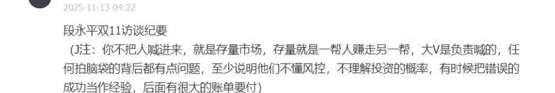

## Jason不离
2025-11-13

1. 人们往往只关注我们做了什么，实际上，我们之所以成为今天的我们，很大程度上是因为我们选择不做的事情。因为我们清楚哪些事情适合自己，就不做；不做，自然就少犯很多错误，对事情的对也就减少了。
2. 巴菲特的安全边际不是价格便宜，而是对理解的深度有多深，价格便宜，还能变得更便宜。
3. 做投资的，我可以教一个赚钱的方法：就是买标普500指数，长期来看总是赢的。
4. 之前我有一个朋友买过原油指数，当时他投了差不多一亿美元，亏了一千多万。看到这个情况我就全都挪除了。我对石油还有点情结，觉得油类东西确实不好把握。后来看到巴菲特买了西方石油，我就想，这真是投资石油的一个很有意思的方式——相当于把油存在地下，不受时间损耗，所以我买入了一点，可能二十年后，我觉得油价注定不是现在这个水平。我对石油并不十分了解，所以仓位很轻。但如果你跟我进去，那就是自己的决定，跟我没关系，我的仓位很小。
5. “作业”是滞后的。你抄巴菲特的作业还好，他的仓位是透明的。但抄我的怎么抄？我从不公布我的持仓，你根本不知道我买了多少，仓位多少。不懂企业确实难投资，不合适的最好别碰。我非常保守，在A股我买了等量的。
6. (AI)对炒股的人很危险，因为你不过是棋子，所以你会成为韭菜。想靠看懂线的人，就是肯定的韭菜。但AI收割了我，因为我不动，买了就认持有。其实“买公司”这句话，有人是理解的，真正的买家只有一个，就是公司本身——遇到问题就能买回来。
7. 炒股难，大部分人都是韭菜，除非你自己知道怎么做。现在很难了，大部分股票都在跌。我并不是想买股票，只是觉得大部分人来说，股票可能是很有价值的考虑。
8. 股市所谓的“今天涨”“明天跌”。
9. 股市不是几年，大部分股票都在跌。我并不是想买股票，只是觉得大部分人来说，股票可能是很有价值的考虑。
10. 如果对东西没把握，不知道有没有要，就不要买。像巴菲特那样买的，很多是做不到的。在对话中还有很多，我还买过股票，我是比例比较大的。例如，我就买三只股票，苹果、腾讯等，股票的差别是不这样的。

## Jason不离
2025-11-13

方文：理解买股票这个理念是容易的，但要懂一家公司不容易。
段永：其实理解这个理念本身不容易。我看雪球上的球迷，懂的人少了，有时候也不能挣钱。
方文：他不一定懂，可能只是理解不一样。
段永：我说的就是这个意思。理解之后，就不会受市场影响了。如果你还在关注动态，回过头去……那些大V，我也看到他们在市场会怎么样。我看我什么时候错过市场？什么时候在“今天涨”“明天跌”？不是等到赚钱。大家方法：买标普500指数，长期来看能赚钱。投资这件事很有意思——闭着眼睛随机买一只股票，一百人里，大概五十个人能挣钱，那五十个人就可以出来了。重复成功就那么容易。但是你想要做生意，我可以教一个办法：买标普500指数，长期来看总是赢的。但这并不等于你懂。如果你真的这样做，其实说明你懂了一点。

## Jason不离
2025-11-13

方文：确实如此。那你怎么算定自己选了一家公司？比如网易，你当时是怎么确定自己懂了？
永平：我自己是游戏出身的，他们的游戏团队，感觉他们是一帮真正热爱游戏的人，做事很认真，这是第一点。第二，我觉得它的商业模式确实不错，而且现在的现金流比市值还高。我就像掷骰子一样投了进去。再加上三个股票，股价涨得那么快，市场觉得他们充分了，但我认为他们大概有机会挣钱。刚好身上有点现金，就全买了网易，六个月后涨了二十倍。你说懂了吗？如果真的懂了，我应该把整个网易买下。所以“看懂”到底是什么，我也不清楚。我大概判断他们是能挣钱的，觉得投资风险不算高。为什么我能拿着那么久？因为这些钱对我来说不多，我能比较理性地看待。如果我全部买那么多，我可能也拿不住，会卖掉。保持理性是非常困难的。

方文：听起来，你对网易的判断包含两个部分：一个是对游戏本身有判断，认为它能挣钱；
永平：当然，我可是游戏出身，我懂游戏。
方文：第二，是对它的定价有判断，比如此时股价低，至少低于净现金。这其实也是巴菲特的“安全际”吧
永平：巴菲特的安全际不是指这个。按我的理解，安全际指的是对公司理解有多深，它是价格有够便宜，便宜的东西可以变更便宜。我当时只是是觉得他们有机会挣钱，但不知道能挣多少。如果早知道能挣这么多，我不敢买，也会买更多，不会卖。

我后来其实是摔跟了，这说明我也没有完全看懂。

方文：照你这么说，“懂”和“不懂”似乎处于一个灰色地带，并没有一个非常清晰的标准呢？你可以说这

方三：现在这个价格的苹果，你觉得怎么样？

永平：不便宜。进加微信cuk255

方三：就是，从投资回报来看，这就是机会成本。

永平：是的，这取决于投资者自身的成本。如果一个人只是把钱存银行一个多多的利，那真没有买苹果。如果你有其他路径能赚十几个点，那可能就没买苹果了。

至于苹果未来有没有发展，其实我不知道。它，它很强，拥有庞大的用户基础。

AI最终到底是，还是要通过手机吗？苹果未来再一、两倍甚至三倍都是可能的，但还不确定，并不是说，一定不行，只是不便宜。

方三：你曾在2008年采用通用电气，后来的对它的看法有任何改变？这个变化主要是商业模式还是企业文化方面的考虑？

永平：我觉得以前的问题在企业文化中，其实商业模式我一直太看好，但当时我很认同他们的企业文化。

他们曾强调“时代在变，唯一不变的是忠诚”。后来我去了他们的公司，发现这句话不见了。从哪里开始开始，，就决定出去。

我觉得他们不再强调这一点了，再加上商业模式我确实看不准，他们买了太多公司了。

最早是因为受沃伦·希尔格的影响，觉得这家公司很神奇，后来才发现其实也没有什么人是神奇的。

## 深度视野VIP群 人工追踪50+大V 付费进群加微信cuk255微信chp5568

方三：不是对杰·布鲁斯觉得你“疯了”？

段永平：倒也说不上，我并不真正了解他。不过好在换了。我卖掉它市值四千亿美元，现在可能买不到多少了。我想要，我把它换成现金，差别有多大。我维持了两三年，或三四年，没太久太了。

方三：你这笔交易还是亏钱了？

段永平：确实没有亏钱吧，但我认为那是错误。如果回到今天，我不会再买了。

方三：即使亏了，你也不认错吗？

段永平：当然是个错误，因为它不符合我后来确立的原则：必须同时满足企业文化和商业模式这两个过滤器。

持有西方石油，但是只是小位，"all in”，和我无关。

方三：你现在还有西方石油吧？你说是巴尔菲特的作业？

段永平：是的，这背后有一些历史原因。之前我被一个朋友影响了油气指数，当时他告诉我油气指数数据大得离谱，油价不能长这么低。

我问他这个指数和油价关联度有多大，他说那99%。我觉得那很好，买了打算长期持有。

后来我再问他，你指的是什么样的关系？他说“每一天99%”。我一听就明白了，如果是每天99%，那差别就太大了。这种产品损耗非常大，不适合长期持有，所以我就卖了。

当时我投了差不多一亿美元，亏了一千多万。

## 深度视野VIP群 人工追踪50+大V 费进群微信cuk255 微信chp5568

方三：AI对投资行业会有影响吗？

永平：对盲抄票的人会很危险，因为你盲目不懂，所以你会成为菜叶。

想靠看懂线线的赢，都是注定的韭菜。AI割不了了我，因为我不动，你靠来就拿着。

其实“买公司”这句话很少有人真正理解。公司真正的买家只有一个，就是公司本身——它通过回购把自己买回来。

虽然有很多形态，只要公司持续挣钱，买到撞到墙时，它就不会通过分红把韭还给你。

菜市场也有这个问题，它赢得不得分，你可以用红利买，或者它自己回。我觉得靠单就直接购回了，它现在要在开始购回一回，实在钱太多不知道买哪花，不知方便买自己的股票。

方三：你的意思是，AI对投资影响很大，但对投资没有影响吗？

永平：对投资没有影响，它会影响你的决策。

如果你看懂线线内的交易，大概率会比以前更难。很多量化基金反应很快，由于量化，有人工干预，你打不过它们，所以账户靠近线线，长期来看，大概率连成功。

方三：你对普通人的投资有什么建议？

Jason-不羁
2025-11-13 04:27

bloomberg: 法国在欧洲尽快提高小包裹的关税，计划提前了两年。
可以结合另一篇报道，立法法支持暂停马克的养老金改革。

都是对财经类#其他国家经济

## 深度视野VIP 人工追踪50+大V付费进群加微信cuk255微信chp5568

## 智能的要点

- 法国在欧盟争取在2026年提高包裹的关税，计划提前了两年。
- 拟议的变更将终止对 150 欧元以下包裹的关税免税，这将严重影响中国零售商。
- 欧盟成员正在提议考虑限制来自中国的电子商务包裹的运输的方法，理由是担心它可能会损害当地商家。

法国在欧洲尽快提高小包裹的关税，计划提前了两年。可以结合另一篇报道，立法法支持暂停马克的养老金改革。

都是对财经类#其他国家经济

## 行业动态

- 法国在欧盟争取在2026年提高包裹的关税，计划提前了两年。
- 拟议的变更将终止对 150 欧元以下包裹的关税免税，这将严重影响中国零售商。
- 欧盟成员正在提议考虑限制来自中国的电子商务包裹的运输的方法，理由是担心它可能会损害当地商家。

法国在欧洲尽快提高小包裹的关税，计划提前了两年。可以结合另一篇报道，立法法支持暂停马克的养老金改革。

## 核心内容解析

- **1. 关税调整**：法国在欧盟争取在2026年提高包裹的关税，计划提前了两年。
- **2. 免税政策取消**：拟议的变更将终止对 150 欧元以下包裹的关税免税，这将严重影响中国零售商。
- **3. 贸易限制**：欧盟成员正在提议考虑限制来自中国的电子商务包裹的运输的方法，理由是担心它可能会损害当地商家。

- 拟议的变更将终止对 150 欧元以下包裹的关税免税，这将严重影响中国零售商。
- 欧盟成员正在提议考虑限制来自中国的电子商务包裹的运输的方法，理由是担心它可能会损害当地商家。

法国在欧洲尽快提高小包裹的关税，计划提前了两年。可以结合另一篇报道，立法法支持暂停马克的养老金改革。

## 深度背景分析

- **政策趋势**：法国在欧盟争取在2026年提高包裹的关税，计划提前了两年。
- **零售影响**：拟议的变更将终止对 150 欧元以下包裹的关税免税，这将严重影响中国零售商。
- **限制措施**：欧盟成员正在提议考虑限制来自中国的电子商务包裹的运输的方法，理由是担心它可能会损害当地商家。

法国在欧洲尽快提高小包裹的关税，计划提前了两年。可以结合另一篇报道，立法法支持暂停马克的养老金改革。

## 永平的投资哲学

- 1. **童年安全感**：父母责任是基石。我出生在南昌，当时父母比较宽松，不要求。我从小习惯自己做决定，这可能与父母有关。父母信任我，现在我自己做决定，不再要求。
- 2. **设定边界**：什么是边界？边界就是告诉孩子什么不能，我认为这很重要。如果没有安全感，人就没有理性。父母对孩子的事情都是为了增加安全感。相反，降低安全感的事情不应该，比如打孩子、呵斥孩子。你不听话，那就寻找其他解决办法。
- 3. **职业选择**：远离“不舒服”的环境。研究生后，我就南下广东。当时我可以留在北京，有两个单位招我。后来去广东是因为年轻，可以尝试。我习惯，如果遇到不合适的环境，就赶紧离开。我曾经考虑去海南，但从海南后，觉得不如去广东。所以，如果你的决定是基于长远的发展和未来规划，你犯错的概率就会低一些。
- 4. **学习能力**：大学教的是“怕未知”。我认为大学里主要的方法是建立信心，遇到不懂的东西就可以学会。这对于未来的焦虑感减少，不至于妥协。我发现很多人用智能手机时却连打字都不会，我认为很奇怪。我以前也不会打字，学了很快就学会了，自己培养了学习的习惯。所以我觉得学到的知识并不重要，关键在于方法和态度，方法和学会东西的信心非常重要。遇到问题时首先不是害怕，而是想要去学习。我们很多人对不会的东西是感到害怕。
- 5. **不为清单**：对的事情。我在大三无意中看到捷鲁的一句话，“对的事情和把事情对”，这对我触动很大。它一下就把“是”拿出来，凡事只花五秒钟想一下这个事情，一辈子会省很多事。比如，我们公司要请一个业务是否有没有转钱，会有一句叫“这不是对的事情”。如果不是对的事情，容易就放弃，如果只是考虑有没有转钱，就会发现复杂了。很多事情你先不知道，但有些不对的事情，你可能很早时候就会知道。当然有些事情是事后才知道，没有关系，以后不改就行，比方，“不为清单”。我举个清单的例子，你举个不对的，这就叫“不为清单”里。有一次在舞台畅谈时，我们有一个不为清单，让他举个对的例子，我说，“我们不要举例子”。他问“什么意思”，我说，“我们要对，对过你对对？”他表示承认。我接着看着，如果是我们聘的员工对好的，企业也不要留，不是对的，不是对的只是对我们来说是不合适的，我们就会止损。所以，后来你人都要求我们要对的生意，我们就简单一一落实。这就是“不为清单”，就是对的事情。
- 6. **核心原则**：买靠谱公司。我建议休息后不要加班，也不可能工作。以后我想，活得像生意，企业要有关系。于是我研究，读了很多书，读了那种道理，直到我找到了老爸（帕哈·迪特）。“买靠谱就是公司”这句话就明白了，对了。因为底下的你就是老板，生意，讲什么道理很重要。我的投资理念应该是“买靠谱就是公司”。还有一句，你要淘汰99%的人。
- 7. **总结**：德鲁这两句话：安全感，远离不舒服。

## 总结与展望

- 为什么投资简单是不容易的？简单，就是买靠谱公司，一定赢。
- 难见到这一点，要看未来的现金流。
- 大部分人都不易赢钱的。
- 以后，你不会被市场，天天看过去。
- 什么时候涨？你说“明天涨”。
- 投资这个东西很有意思，闭着眼睛买股票靠着，你有100%里，其实50%的人就能挣。
- 但是你要让它回，就没有那么容易。
- 标普500指数年化率为6.5%，其中包含6%的收益增长、1%的估值下滑。
- 历史来看，这一水平并不稳，仅从1990年以来分布的第27个百分比。
- 期间考虑了悲观和乐观情形，风险期间年化回报3%到10%。
- 目前指数接近历史高位，5%的水平升至13%。
- 这一变化主要受到供应链、利息和利润的推动。不过有利于未来利润的作用使得10%。
- 最近查看标普500指数的市盈率从23倍降至21倍。

## 经济数据

上海：我们预今年今年季度经济增速或慢至4.2%，全年经济增长达4.9%。净出口的缩时期显示今年经济增速优于我们去年预测的主要原因。第一季度经济增速或回升至4.4%，而在二季度进一步回升至4.6%，由于低基数下，三、四季度经济增速将进一步快到4.7%和4.9%。预计CPI通胀率明年将回升至0.6% (2025-01)，预计GDP增长回升0.1百分点到4.5%。

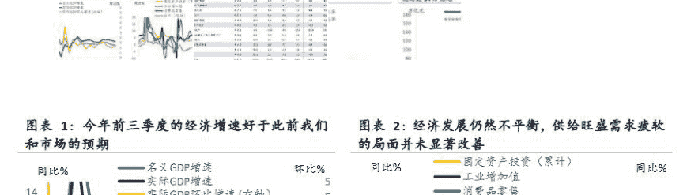

图1：今年前三季度的经济增速优于我们市场预期。
图2：经济发展仍然不均衡，供需紧张长期的局面未显改善。

| 占比 | 名义GDP增速 | 占比 | 占比 | 固定资产投资（累计） | 占比 |
| :--- | :--- | :--- | :--- | :--- | :--- |
| 14 | 实际质GDP增速 | 5 | 20 | | 150 |
| 12 | 城市失业率 | | | | |
| 10 | | | | | |
| 6 | | | | | |
| 4 | | | | | |
| 2 | | | | | |

## Exhibit 10: We forecast an annualised nominal return of 6.5% for the S&P 500 during the next decade

## Exhibit 11: Building blocks of our 10-year return and scenarios

| Earnings | Upside | Base case | Downside |
| :--- | :--- | :--- | :--- |
| 10Y CAGR (%) | 5 | 5 | 5 |
| Net profit margin at end of period (%) | 15 | 13 | 11 |
| Earnings 10Y CAGR (%) | 7 | 5 | 3 |
| Average net buyback yield (%) | 2 | 1 | 1 |
| 10Y EPS CAGR | 9 | 6 | 4 |

| Shareholder return |
| Average 10Y dividend yield (%) | 1.6 | 1.4 | 1.3 |

| Valuation |
| NTM P/E (current = 23x) | 23 | 21 | 17 |
| Annualized 10Y valuation change (%) | 0 | -1 | -3 |

| S&P 500 annualized 10Y total return (%) | | | |
| :--- | :--- | :--- | :--- |
| Nominal | 10 | 6.5 | 3 |
| Percentile rank since 1900 | 56 | 27 | 7 |
| Real | 8 | 4.3 | 1 |
| Percentile rank since 1900 | 58 | 33 | 16 |

## 图 34：连通增速在今年并未改善，反而恶化

## 图 35：工业生产需要是PPI指数扩大的原因

| 同比 | 同比% |
|---|---|
| GDP增速（同比） | 15 |
| PPI（同比） | 10 |

| 同比 | 同比% |
|---|---|
| 工业产品产量 | 14 |
| 工业增加 | 9 |

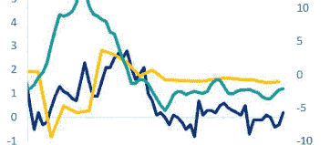

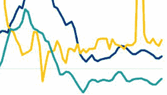

来源：Wind、同比、数据报告

来源：Wind、同比、数据报告

## 图 36：今年三季度原油价格的跌幅是PPI下降的原因

## 图 37：CPI 食储，是核心CPI下降的

| 同比 | 同比% |
|---|---|
| 原油价格 | 25 |
| PPI（同比） | 20 |

| 同比 | 同比% |
|---|---|
| 核心CPI | 15 |
| CPI（同比） | 10 |

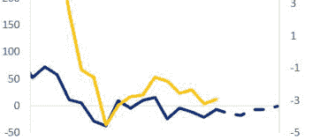

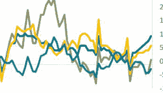

来源：2023年11月Wind宏观策略报告，作者：2023年11月16日

来源：Wind、同比、数据报告

## 图 38：CPI 分项同比增长比率

## 图 39：我们预计价格下行周期将在 2026 年反转

| 同比 | 同比% |
|---|---|
| TT：交通 | 45 |
| 交通食品（同比） | 30 |

| 同比 | 同比% |
|---|---|
| 核心CPI | 25 |
| 食品CPI（同比） | 20 |

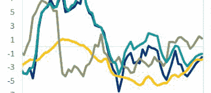

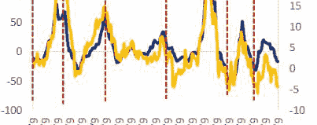

来源：Wind、同比、数据报告

来源：Wind、同比、数据报告

## 图 42：我们预计月度财政预算率今年将在几个季度达到9.7%

## 图 43：2026年财政预算率历史位于4.0%

| 12个月同比 Core | 结构性基金 |
|---|---|
| 通胀/GDP | 预算赤字 |
| GDP占比% | 预算赤字（统计） |

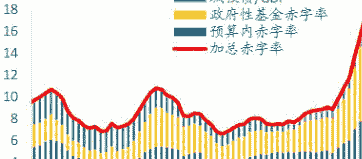

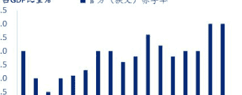

来源：Wind、同比、数据报告

来源：Wind、同比、数据报告

## 图 44：今年以来在5月涨50个基点

## 图 45：5月涨10个基点

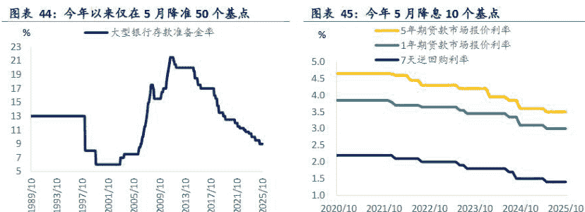

数据来源：华财经、东方财富

## 图 46：今年M2增长量持续上升，在6月后首次回落

## 图 47：意味着信贷溢价在六月内回落

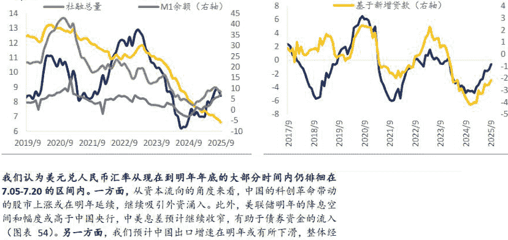

我们认为人民币资金从年初以来高点撤到7.05-7.20的区间内。一方面，季节性变化，中国的科技革命使得股市活跃持续，缓解了外流压力。另一方面，美联储政策性宽松和预期，债市持续回暖，通胀有望回落0.2个百分点到4.7%。综合之下，我们认为人民币资金维持在7.05-7.20的区间内，在今年六月之前维持在7.1左右。

2023-05-11

## 图 53：人民币资金从2023年初以来震荡回升

## 图 54：央行政策有助于缓解债务压力

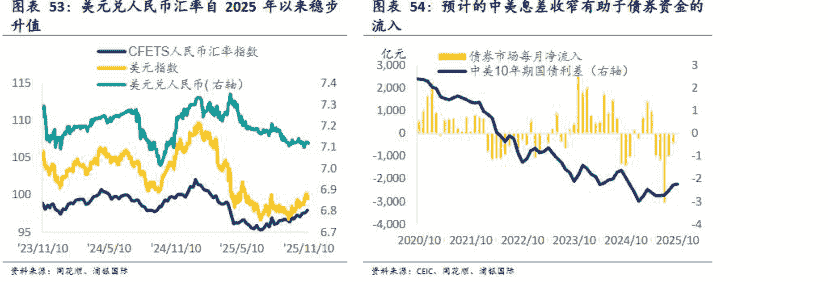

数据来源：华财经、东方财富、Wind

## Jason：电力短缺

摩根斯坦丹利：到2028年，美国的数据中心将面临20%的电力短缺。这意味着当人工智能达到临界点时，将损失44吉瓦的容量。可能的解决方案包括天然气轮机、燃料电池和小型核交易，这些交易加起来可能增加多达40吉瓦的供应。## 其他国家经济

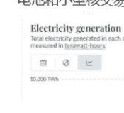

## Electricity generation

Total electricity generated in each country or region, measured in terawatt-hours.

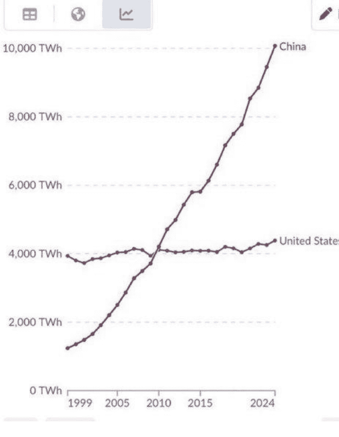

## Jason：特朗普

特朗普泄密：美国众议员周刚拥有一封邮件记录，其中已死的性侵受害者之一在我家里待了好几个小时；这些邮件是向议员委员会提交的爱德斯坦邮件的一部分。议员委员会对受害者的姓名和身份信息进行了检查。

由于未公布全部文件，目前尚不清楚这些邮件是否被从加密的通信中截取，完整版尚不透明。特朗普澄清外界对于此处的传闻是民主党人的“编造”，称爱德斯坦是特朗普的“家奴”，自称从未与爱德斯坦在哈顿和罗伯特·麦道纳通来，1990年代和2000年代初期交情，两人在2004年曾聚会。

关于其是否违法，有一种说法是两人在离奇岛处理房产闹的。

特朗普否认与爱德斯坦涉及的性交易有任何关系或冲突。他表示，自己已与爱德斯坦保持朋友，后来才知道。

爱德斯坦在2019年在狱中自杀的。

然而，议员委员会的成员此表示，这些邮件是议员委员会从爱德斯坦邮件中获得的数千万文件中筛选出来的，内部外界可能再次详细特特朗普与爱德斯坦的关系。其中一封邮件中，爱德斯坦直言告诉特朗普似乎知道那些女孩的情况，其中许多人后来发现是未成年。

另一封邮件中，他思考如何应对群体与他就保持的关系，当时特朗普正执政期。这些法似乎会哈顿联邦法院处理特朗普与高层官员之间存在争议。这个问题引起共和党内部发现，使得右翼支持者对此并不敏感。尽管政府事件持续，众院仍在调查此事，舆论焦点再次回到爱德斯坦案件上。监督委员会主席加州众议员亚瑟琳在邮件中写道：“这些邮件和信件令人的经历太痛苦了。”

周三公布的三封邮件，关于爱德斯坦与特朗普在2000年达成的谅解协议。当时纽约州检察官不再追提这件事。其中一封写给爱德斯坦的邮件中提到：“你要知道没有特朗普。”韦德斯坦回复：“实在在想那件事。”4月，爱德斯坦在写给韦德斯坦的邮件中提到：“他应该知道那些女孩的情况，因为他问过莉莲再做了。”

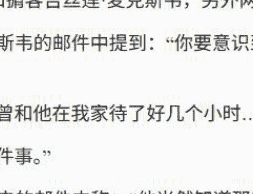

## Jason：人工智能热潮

投资者纷纷涌入腾讯股，作为人工智能热潮。bloomberg预计腾讯今年公布的业务报告显示利润增长正常。这得益于其在线游戏的强劲表现。腾讯的股价今年上涨，但仍低于全球科技预计，一些分析师预计，由于其游戏和业务压力，腾讯公司将超出预期。表示，在众多的互联网业务中，是一个另一个风险点。他说，在人工智能的支持下，最近一段时间的收入可能来自更具吸引力的客户纳入腾讯控股。

随着人工智能交易出现泡沫的状况，人们对科技股中的担忧加剧，投资者纷扰购腾讯有限公司的股票，作为安全的避。预计腾讯将成为少数在即将公布的业务报告中利润增长的中国巨头之一，由于在线游戏业务的强势增长可能延续腾讯今年利润增加约20亿美元。该股上月上涨4.5%，反映了这种情绪，对于竞争对手阿里巴巴集团和JD.com在香港涨跌，标准普全球数据显示。里昂证券亚洲电信与互联网研究部总经理Eanor Long表示：“在这种环境下，腾讯提供了非常具有竞争性的增长，因为它的竞争较少，而且股票便宜，”她将腾讯评为首选。## Tencent Trades at Discount to Major Global Tech Stocks

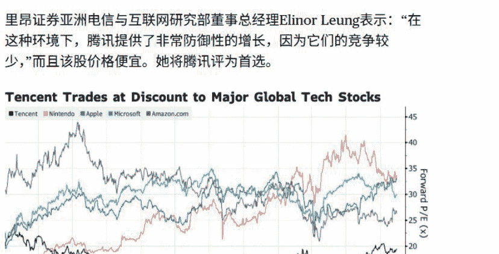

## 腾讯利润增长势头而中国科技下滑

投资者对该行业的怀疑程度较低。根据标准普尔全球的数据，腾讯及其音乐部门和游戏公司相对于其在恒生科技指数的自由流量而言，空头回处于最低。在周四晚公布的9月的季度报告后，腾讯预计同比增长5%。相比之下，阿里巴巴JD.com等公司估计下降了60%以上，这些面临竞争、美国和中国经济放缓而受到的打击更大。美国被视为。高盛分析师表示，他们预计中国互联网公司的总利润将下降三分之一，连续第二季度下降，腾讯是大型股中唯一的。- Tencent estimated net income growth/y for three months ended Sept. 30

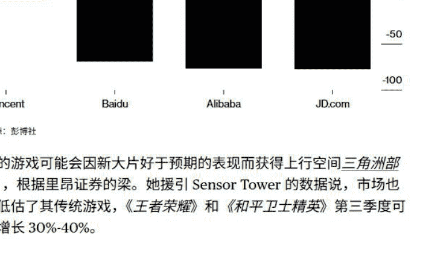

资料来源：智搏

腾讯的游戏可能会好于预期的表现获得空间亚洲头部部队，根据引 Sensor Tower的数据，市场可能低估了它的传统游戏，“王者荣耀”和“和平精英精英”第三季度可能会增长30%-40%。

经此，世界各地对中国的反响及反补贴的调查在增加。为了保护本国产业免受中国渗透的冲击，WTO的数据显示，2025年1~6月各国对中国产品的反响及反补贴调查共计79项。截至2023年1月，这类查询每半年仅20~30项，而到2024年7~12月已激至125项，仍高位。

根据中国海关每月发布的贸易快报，对类主要出口产品的单价进行分析发现2025年1~10月同比下降的68%，这一比例在2023年已升至持续维持高位。

## 针对中国的倾销及反补贴调查

| 年份 | % 中国出口占比 |
|---|---|
| 2018 | |
| 2019 | |
| 2020 | |
| 2021 | |
| 2022 | |
| 2023 | |
| 2024 | |
| 2025 1~10 | |

(注)按半年计算数据来源：世界贸易组织

##：的低价

随着保险会计准则全面实施，并没有一个统一的称。对于利润能力有信心，盈利能力更倾向于FVTPL。公允计量且其变动计入其他综合收益（FVOCI）或以摊成本计量的金融资产（AC）取代了原来的分类模型。根据财政政策要求，非上市准则将于2026年6日起实施。目前保险会计准则已全面实施。准则继续执行，债券可以指定为FVOCI，只有达到股息比例5%以上的股票才会被指定为FVOCI。

| 表：IAS39与IFRS 9金融资产分类与计量 |
| 分类计量标准 | IAS39 | IFRS 9 |
|---|---|---|
| 分类标准 | 主观的：合同特征和用途 | 客观的：业务模式和现金特征 |
| 会计科目 | 1. 持有期计量—HTM 2. 贷款收款和应账款—L&R 3. 公允计量且其变动计入当期损益的金融资产—FVTPL 4. 可供出售计量的金融资产—AFS | 1. 以摊成本计量的金融资产—AC 2. 公允计量且其变动计入当期损益的金融资产—FVTPL 金融资产—FVTPL 3. 公允计量且其变动计入其他综合收益的金融资产—FVOCI 4. 公允计量且其变动计入其他综合收益的FVOCI |

| 表：主要金融资产分类 | 可能的会计分类 |
|---|---|
| 金融资产 | 以摊成本计量的金融资产（AC） |
| 债券 | 公允计量且其变动计入当期损益的金融资产（FVTPL） 公允计量且其变动计入其他综合收益的金融资产（FVOCI） |
| 股票 | 公允计量且其变动计入当期损益的金融资产（FVTPL） 公允计量且其变动计入其他综合收益的金融资产（FVOCI） |
| 基金 | 公允计量且其变动计入当期损益的金融资产（FVTPL） |

## 图：上市企业投资收益占净利润比例高

## 图：上市企业资产占投资资产情况

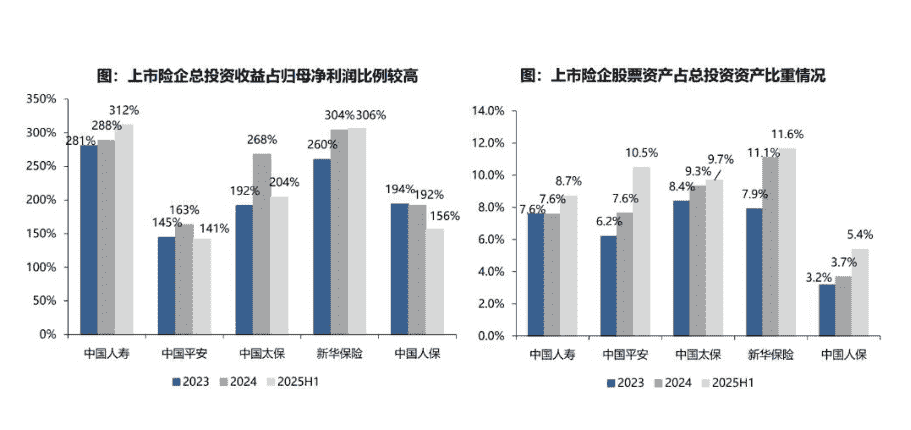

## 图：上市企业资产占投资资产比例较高

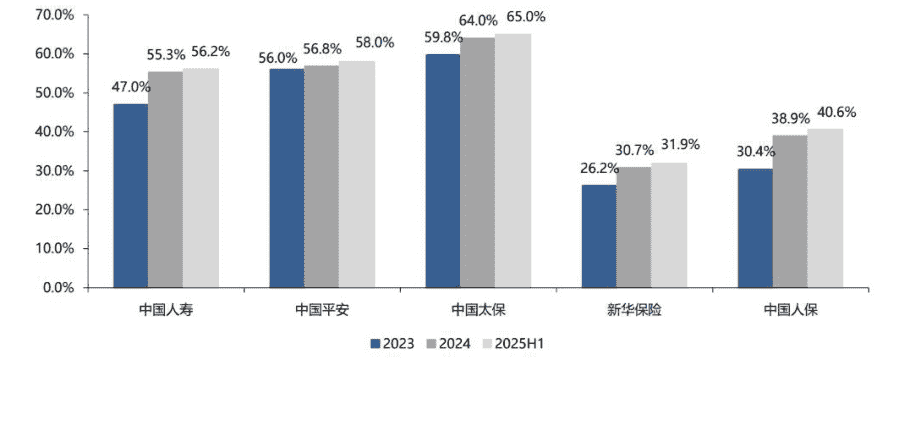

Jason·不离

2025-11-13 08:28

bloomberg:之前美国代表团认为中国在今年年底购买1200万吨大豆，但在上个月底的一系列订单之后，目前好像推迟了。过去几个月，中国在购买大豆以实现来源多元化。贸易，美国大豆面临13%的亏损，买美国大豆将遭遇重大损失，中国加工企业几乎没有动力预订订单，一些购买是中国国购入。##经济数据

中国大豆期货交易由于大量的大豆被预订了期货
- Delivery soybean futures

Jason：大豆库存

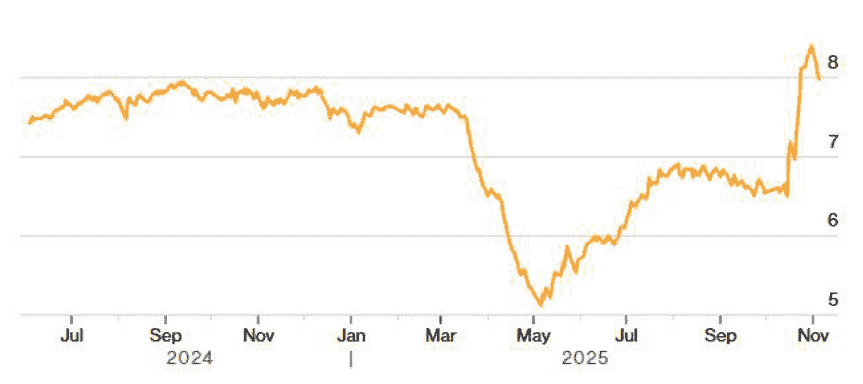

来源：Wind

Jason：不离
2025-11-13 08:28

bloomberg:之前美国代表团认为中国在今年年底购买1200万吨大豆，但在上个月底的一系列订单之后，目前好像推迟了。过去几个月，中国在购买大豆以实现来源多元化。贸易，美国大豆面临13%的亏损，买美国大豆将遭遇重大损失，中国加工企业几乎没有动力预订订单，一些购买是中国国购入。

# 深度视野优质集团（链接优质社群，助你成功）

全部包含以下内容：限时年费188/年 加微信cuk255

- ① 吃群众粉丝倍时圈加时群群对话（原价 365 元/年）
- ② 子明私享汇（内部）文章
- ③ 政事室（顾子明）付费内容加送顾子明群资料
- ④ 米联储闲【作者米穗】（原价 599 元/年）
- ⑤ 欧洲黄金会员专属文章（原价 328 元/年）
- ⑥ 砖瓦斥内部文档（原价 400 元/年）
- ⑦ 卢克文青读书会专属文章（原价 699 元/年）
- ⑧ 鉴茶财经知识星球（原价 3310 元/年）
- ⑨ 猫哥的视界知识星球文章（原价 299 元/年）
- ⑩ 财经周刊【独家新闻】（原价 1498 元/年）
- ⑪ 杨世光在金钱榜（原价 2200 元/年）
- ⑫ 森淼财经知识星球（原价 1600 元/年）
- ⑬ 潇游译译付费文章（持续更新）
- ⑭ 司马林解课毛选全套音频和全套书籍版权无损辑（原价 2.3 万）
- ⑮ 虚构三部曲[民国梦、帝国亡、不被理解的MAO]（原价 599 元）
- ⑖ 克星球文章（原价 268 元/年）
- ⑰ 额外再送：卢绪新浪微博付费专栏、三村丰老王、三花九术文集

不定期内容：......（更多资源将写下下去......

- ① 守夜人知识星球、接换魔王知识星球、生才有知识星球、
- ② 创始笔记、达叔谈论星球、成就财富、雪雪花甲头部等
- ③ A 视野、大树乡谈、江初后、咩咩说、上海海家学等付费文集
- ④ 西风付费文章、老端、赢在八小时之外、局外的视界、升值、老A体制内等其它一些大 V 付费文章

# 限时年费188/年 底部链接链接全网V优质内容

深度视野文集群微信cuk255 深度视野（付费文集）

