# 南美邦财财经251114

Jason
2022-11-14 13:03

国信：牛市三阶段包括孕育期、爆发期、狂热期，当前处于第二阶段 #A

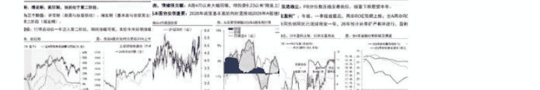

## 4000点后如何看？牛市进入“第二阶段”

- 牛市三阶段包括：孕育、爆发、狂热，当前处于第二阶段。
- 一轮牛市分为三个阶段：孕育期（底部与价值修复驱动）、爆发期（基本面估值驱动）和狂热期（情绪驱动）。目前处于历史阶段的第二阶段。
- 本轮牛市已完成“3500”更新，行动上已进入第二阶段，市场尚未进入狂热阶段，空间更高。

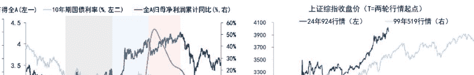

## A股4月以来涨源于，后续动力来自基本面

- 熊后转暖、情绪驱动：A股4月以来大逻辑驱动，特别是23年以来结构性上行行情。
- 牛市二三段，基本面后量充足：2026年牛市基本面是2026年A股继续运行的第一性属性。

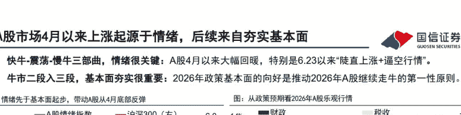

深度视觉VIP群，加入国内50+A费进群微信cuk255 微信ch5568

## 从“涨情境”到“真实盈利”，盈利需止损

- “9.24”标志情境与估值双底部：PB分值至最低，下准备跌整年。
- 从“涨情境”到“真实盈利”：年报、季报披露后，ROE再度压修；全A两ROE25Q向，利润、净率开启修复，现金回底部，亏损有望有序延续，26年净利润有望转盈，盈利性持续性。

> “9.24”情境与估值双底部，25年最底部，23年实现盈利

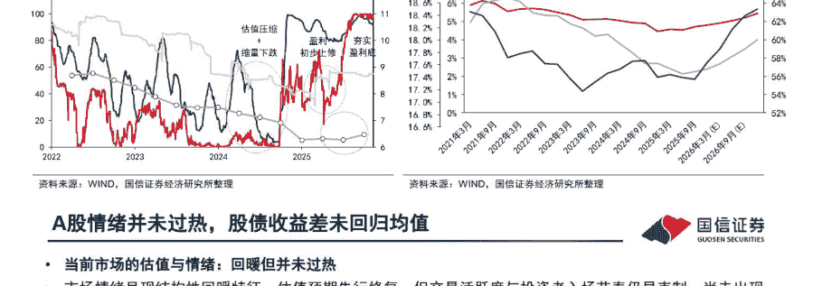

数据来源：WIND，国信证券研究所研报告

## A情境并未到位，收益有望尚未回归

- 当前市场的情绪：调整后巩固尚未。
- 市场情绪仍处于惯性底部，修复预期尚未完成，交易活跃度与投资者情绪尚未充足，暂未出现极端恐慌。
- 金融大行情后的收益指标尚未回归，“2024”以迈回行情趋势，当前并未回到历史位值。

图：收益指标尚未回到历史位置处

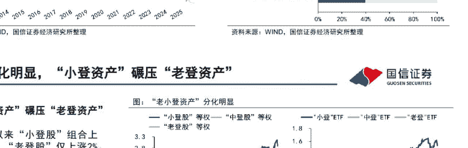

数据来源：WIND，国信证券研究所研报告

## 市场分化，“小涨情境”、“老资产积累”

- “小涨情境”“老资产积累”
- 2025年以“小涨情境”组合上涨18%，“老资产”仅涨22%。
- 2025年以“老ETF”组合上涨54%，“老ETF”仅涨13%。
- “老资产”ETF波动率接近2016-2024年均值水平。ETF表现具有可比性，“小涨资产”ETF波动率接近超过2021年以来的中枢水平。

数据来源：WIND，国信证券研究所研报告

深度视野VIP群 人工追踪50+V 付费群加粉cus225 免费ch255

## 非亚洲遭遇后半场，AH行情迎来受益

- 美欧三次遭遇奥运会后半场，AH行情在年年表现良好：1995年、1998年、2000年、2020年3月，“跌后半场”后一年，AH均获得两次底部。
- 利率型数据“下半场”受益：全球金融市场数据持续接力，为资产提供流动性支持，以科技、A股为代表的利率型股票受其影响，前期估值增速逐步提升。

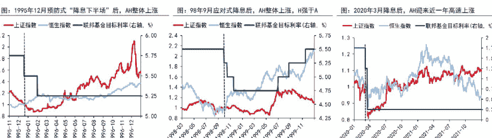

图1：1999年以来“跌下半场”表现，AH指数一年涨幅

| | 上证指数 | 沪深300 | 医药行业 | 科技行业 |
|---|---|---|---|---|
| 199906 | 6.02 | 2.47 | 5.79 | 1.23 |
| 1999100 | 5.58 | 2.36 | 1.53 | 1.52 |
| 200010 | 5.17 | 2.17 | 1.17 | 1.18 |
| 200040 | 1.75 | 1.35 | 5.09 | 1.29 |
| 2000070 | 1.42 | 0.96 | 4.75 | 0.39 |
| 2000100 | 1.39 | 0.88 | 0.68 | 0.35 |

数据来源：WIND，国信证券研究所

头部成长：2024年上半年以来，AH龙头在资产赛道中运行速度领先。从目前来看，科技板块内累计收益率达到28.6%，其中沪深占比达40%以上。成交速度：科技行业占比回升至历史位，50%。

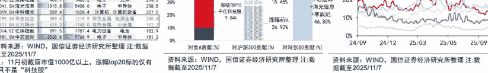

图2：2024年以来中行业涨幅

| | 医药 | 消费 | 制造 |
|---|---|---|---|
| 成交占比 | 50% | 37.28% | 15.45% |

数据来源：WIND，国信证券研究所

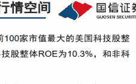

图3：各行业收益对比

## 中美板块转型：利润提升，科技龙头

- 中国科技板块的利润水平处于回归，估值比美国更低，沪深500整体PE为25.8%，科技板块基本持平9.6%。
- 中国科技板块有望起跑，目前中国行业生命周期优于美国，前期投入过高，其尚未成熟。

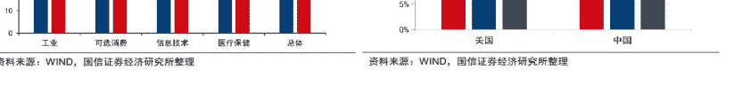

数据来源：WIND，国信证券研究所

## “十五五”布局，产业政策已成型

**建议对标：** 本次推荐关注新兴产业和未来产业，在新能源、新材料、航空航天等领域承接“十五五”建设，“航天强”是增量市场、量子科技、核聚聚变、机器人平台等受益的产业重心。

**产业聚焦：** 十五布局，新兴产业与未来产业内全A获得15%以上的超额收益。

“十五五”规划：现代产业体系与未来产业的布局要点

| 现代产业体系 | 未来产业 |
|---|---|
| 能源转型进入“深区” | 量子科技 |
| 人工智能进入“爆发期” | 核聚聚变 |
| 智能制造升级 | 机器人平台 |
| 绿色低碳 | 空航天经济 |
| 消费升级 | 生物医药 |

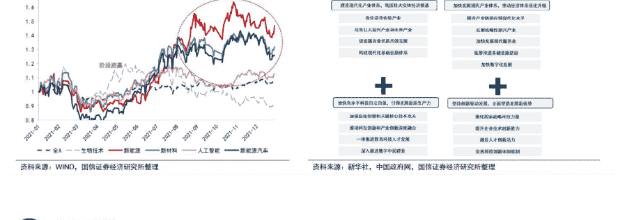

数据来源：中信证券，证券行业研究小组

Jason
2025-11-14 03:19

Bloomberg：泽连斯基希望被冻结的140亿欧元俄罗斯资产质化，他说，时间在流逝。如果明年第二季度没有新的援助，乌克兰将面临巨大的困难，没有明确的战争融资途径。

## 其他国家经济

数据来源：新兴，中国财新，中信证券行业研究小组

深度视野VIP群 人工追踪50+大V 付费进群加微信cuk255 微信ch5568

乌克兰总统弗拉米尔·泽连斯基（Volodymyr Zelensky）承诺支持对腐败该国统治精英（包括他的前商业伙伴）的不断扩大的腐败交易进行全面调查。

在泽连斯基要求政府部长制裁他的前商业伙伴后，腐败调查已经迫使他们下台，他要求政府制裁他之前的商业伙伴和另一名涉嫌参与该计划的商人。

泽连斯基警告称，“重要的是有罪的人的判罚，”并且每个人都必须在法律面前坦然平等地对待。

乌克兰总统弗拉米尔·泽连斯基（Volodymyr Zelensky）承诺支持对腐败该国统治精英（包括他的前商业伙伴）的不断扩大的腐败交易进行全面调查。

铁木·明迪希（Timur Mindiche）是电视制作公司的共同所有人，在泽连斯基竞选之前曾被指嫌滥用达10亿美元的计划的头目。

泽连斯基要求政府部长制裁他的前商业伙伴后，腐败调查已经迫使他们下台。人员称，该计划涉及建造工程以保护核设施免受俄罗斯攻击的承包商。

“重要的是有罪的人的判罚，”泽连斯基周三在接受电视台访谈时说。“一个处于战争状态不可能有任何朋友。”

亚历山·茨克曼（Oleksandr Tsukerman）据称，明迪奇在几个小时离开了乌克兰。

深度视野VIP群 人工追踪50+大V 付费群加微信cuk255 微信ch5568

乌克兰反腐败局（NAB）宣布，已经拘留了5人，作为大规模腐败行为为15个月的一部分。

泽连斯基周三表示，他没有与明迪奇谈过。乌克兰宣布，这不断升级的危机变成重大考验。

在俄罗斯能源设施攻击后，乌克兰正在努力应对，这项调查引起了群众的震惊，包括欧盟在内的盟友的批评。同时，泽连斯基说服反对利用冻结的俄罗斯资产获得资助，称这对莫斯科至关重要。

匈牙利总理欧尔班（Viktor Orban）在布鲁塞尔上发表说，他的政府一直受到欧洲的支持。“无论如何，他们都会偏离。”泽连斯基周四会了德国总理德尔希·梅尔茨，德国的发言人施特芬·科内利斯（Stefan Kornelius）表示：“德国政府将大力开展对乌克兰的进一步援助，特别是在法治领域。”

Jason
2025-11-14 03:41

我们统计数据显示，10月零售销售额同比增长2.8%，为近以来最低。10月贷款总额增加8150亿元，为2024年7月以来最低水平。家庭中抵押贷款再次减少，显示消费者疲软。企业则不愿进行投资或扩张，企业贷款扩大了310亿元，不到前的五分之一。

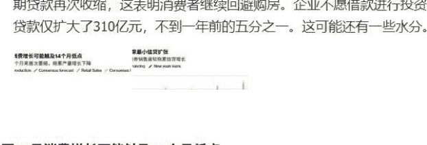

## 中国10月消费增长下降及4月低点

- 产量总量增长八月以来首次减少。
- 零售销售可能下降。
- 出口增长下降。

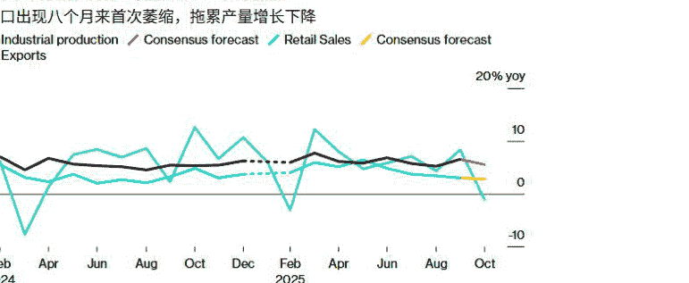

数据来源：国家统计局、中国银行、中广社

注：国家统计局公布今年两个月的工业生产和零售销售汇总数据。

## 中国创以来最小信贷扩张

- 政府债券销售幅拖累信贷增长。

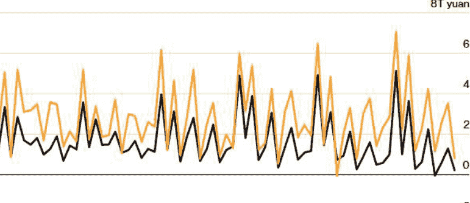

数据来源：中国人民银行

深度视野VIP群 人工追踪50+大V 付费群加微信cuk255 微信ch5568

Jason
2025-11-14 03:43

Bloomberg：在截至9月的12个月里，新西兰的公民离开人数创历史新高，因为经济低迷使更多人向海外寻找高薪的工作。这些离开的人中，有58%去了澳洲

## 新西兰失去大量公民

- 离境 / 入境

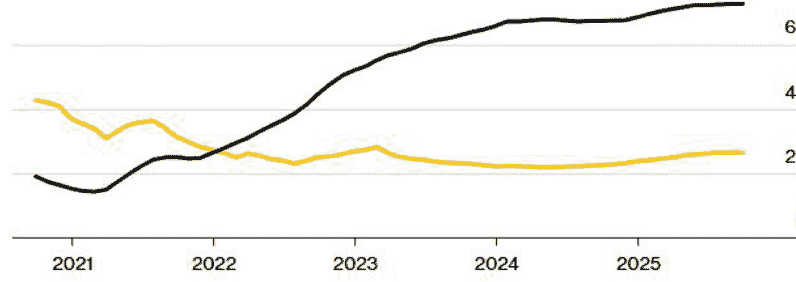

Source: Statistics NZ

Jason
2025-11-14 04:26

Brad Sester：中国的出口导向型制造业模式正在压抑其他出口导向型制造业经济体的生存空间，包括德国等发达经济体，以及一些新兴经济体。

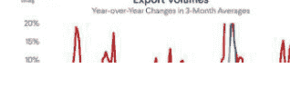

深度视野VIP群 人工追踪50+大 付费进群微信cuk255 微信chp568

## 出口量

Year-over-Year Changes in 3-Month Average

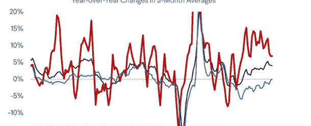

Jason
2025-11-14 06:01

长江：10月居民短贷，中长信比别同比-0.3万亿、0.2万亿。目前来看，短期贷款内Q向向，利润、净率开启修复，现金回底部，亏损有望有序延续，26年净利润有望转盈，盈利性持续。

数据来源：WIND，国信证券研究所

深度视野VIP群 人工追踪50+大 付费进群微信cuk255 微信ch5568

## 10月消费增长下降及4月低点

（此处重复前文逻辑，已按要求合并）

# Jason-不遇

2025-11-14 06:11

房源: 十月成交的平均折价率为32.7%，环比上升0.4个百分点，挂牌拍卖的平均起拍价为29%，上升了0.8个百分点，为二季度以来新高。本月买卖双价偏差均有所上升，其中挂牌的成交源牌价幅度最大，10月份平均挂牌折价率达到32.7%，较上月增加了1.2个百分点，回到周期内高位。#房价

图:挂牌与成交折价率发展趋势

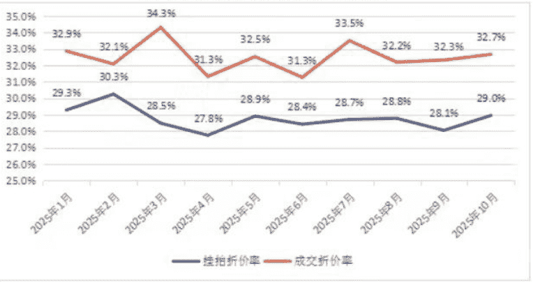

注:折价率为基准折价率的比例。

数据来源:CRIC 监测

# Jason-不遇

2025-11-14 06:14

bloomberg:韩元接近近16年前全球金融危机爆发以来的最低水平，给央行增加了保护货币的压力。韩国央行行长李穆准表示，如果看到疫情波动，他们愿意进行干预，韩元在过去三个月内下降了6%，亚洲最大的货币，原因是股票资金持续流出和居民外投资增加。亚洲也称，本周10年期债收益率回升至16个月高点，原因是人们对宽松政策已经结束的预测不断增强。#全球经济

Korean Won Approaches Lowest Since 2009

# 深度视野VIP群 人工追踪50+大V 付费进群加微信cuk255 微信chp5568

# 深度视野VIP群 人工追踪50+大V 付费进群加微信cuk2556 微信chp5568

# # New Amazon.com Seller Registrations

by year and business country

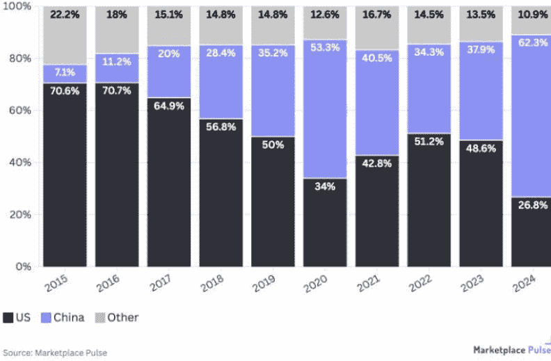

# # Share of Global Amazon Active Seller Base by Country of Business

top ten by share

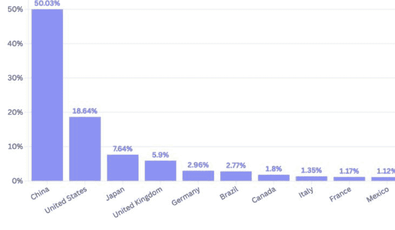

Source: Marketplace Pulse
Note: Unique businesses only. Sellers selling in multiple marketplaces count as one. India and Brazil marketplaces excluded from international seller restrictions.

深度视野VIP群 人工追踪50+大V 付费进群加微信cuk255 微信chp5568

Jason不离

埃瑞哲:四年时间，中国消费者的品牌选择理念巨变，从国际品牌完全转向国内品牌，55%的中国消费者拥有优质的品牌，也频繁比较多个品牌，相比2021年上升了13个分点。年轻群体在物质生活上对财富相对匮乏，正处于职业早期，缺乏财富和时间积累，相当由于人的压力导致他们焦虑，由于优先选择的排斥反映了快速消费的心理，将健康和财富视为基本的保障，而爱情、个人成长等更具理想色彩的追逐被取代。

中青年群体（70、80后）的观念转变打破了他们努力就能带来回报的信念，开始重新评估人生优先顺序。一方面，他们逐渐意识到健康的身体才是维持生活的前提，另一方面，他们通过财富积累寻找新的安全感。

中国消费者的线上购物品牌在范围内最为集中，43%习惯线上逛、线上，远高于全球平均的32%，线下购物占比仅低于20%。经济数据

图1: 四年间，中国消费者市场竞争格局已巨变

# 2021年中国消费者的品牌倾向

# 2025年中国消费者的品牌倾向

| 类别 | 2021年倾向 | 2021年倾向 | 2021年倾向 | 2025年倾向 | 2025年倾向 | 2025年倾向 |
|---|---|---|---|---|---|---|
| 美妆护肤 | 78% | 30% | 12% | 美妆护肤 | 37% | 21% | 42% |
| 营养保健 | 53% | 20% | 27% | 营养保健 | 50% | 24% | 46% |
| 3C数 | 63% | 14% | 23% | 3C数 | 28% | 17% | 55% |
| 婴用品 | 53% | 18% | 29% | 婴用品 | 22% | 23% | 55% |
| 服饰鞋帽 | 49% | 14% | 37% | 服饰鞋帽 | 12% | 27% | 60% |
| 食品饮料 | 28% | 15% | 57% | 食品饮料 | 10% | 28% | 64% |
| 家用电器 | 55% | 12% | 33% | 家用电器 | 16% | 15% | 69% |

* 优先选择国际品牌·没有倾向
* 优先选择国内品牌·没有倾向

注：百分比数据的四舍入
数据来源：2025年中国消费者调研(N=5000)、2021年消费者调研(N=140)
问题：您在购物时买什么品牌？购买此类商品时，您的倾向是什么？

# 图2:超过一半的受访者在3C类向国际品牌

# 图3:超过一半的高收入群体美妆肤类向国际品牌

# 2025年城市消费者的倾向

# 2025年高收入群体（家庭收入＞万元）的品牌倾向

| 类别 | 2021年倾向 | 2021年倾向 | 2021年倾向 | 2025年倾向 | 2025年倾向 | 2025年倾向 |
|---|---|---|---|---|---|---|
| 美妆护肤 | 42% | 19% | 40% | 美妆护肤 | 52% | 20% | 28% |
| 营养保健 | 36% | 22% | 43% | 营养保健 | 37% | 22% | 41% |
| 3C数 | 54% | 18% | 28% | 3C数 | 38% | 13% | 51% |
| 婴用品 | 24% | 19% | 57% | 婴用品 | 30% | 20% | 50% |
| 服饰鞋帽 | 18% | 28% | 54% | 服饰鞋帽 | 19% | 24% | 56% |
| 食品饮料 | 10% | 26% | 64% | 食品饮料 | 9% | 23% | 68% |
| 家用电器 | 22% | 18% | 60% | 家用电器 | 23% | 17% | 60% |

* 优先选择国际品牌·没有倾向
* 优先选择国内品牌·没有倾向

注：百分比数据为四舍入
数据来源：2025年中国消费者调研(N=5000)
问题：近期倾向于购买哪类的品牌？购买这些商品时，您的倾向是？

# 图4：忠诚度被稀释

# 有喜欢品牌时，是否会持续选择(2021年 vs.2025年)

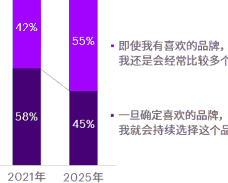

数据来源：2025年中国消费者调研(N=5000)，2021年中国消费者调研(N=140)
问题：以下两个描述中，您更倾向回答哪一项？

# 图6:消费者理性与感性、信任机制的变化

# 新品牌引起的原因

| 因素 | 2025年 vs. 2021年 (百分比) |
|---|---|
| 产品有特色 | 61% +10 |
| 控销力大 | 48% +10 |
| 营销方式新颖 | 42% +9 |
| 主播/博主/UP推荐 | 37% -3 |
| 店员服务好 | 29% +11 |
| 代言/我是喜欢的 | 21% -4 |

●2025年 ○2021年

注：百分比数值为四舍入
数据来源：艾瑞2025年中国消费者调研(N=5000)、艾瑞2021年中国消费者调研(N=140)
问题：回想起新品牌引起的原因，除了上述之外，还有哪些因素引起了关注？

# 其他引起因素(2025年 vs. 2021年)在前三名的受众占比

# 2025年 vs. 2021年(百分点)

| 年龄 | i-1 | i-8 | i-12 | i-3 | i-8 | i-6 | i-2 |
|---|---|---|---|---|---|---|---|
| 00后18岁 | 16 | -6 | 4 | 18 | 0 | -11 | -12 |
| 96-00 25-29岁 | 14 | 1 | 5 | 15 | -1 | -12 | -16 | -7 |
| 91-95 30-34岁 | 9 | 7 | -3 | 8 | 0 | -6 | -3 | - |
| 86-90 35-39岁 | 12 | 6 | -6 | 9 | -3 | -10 | -5 | -3 |
| 81-85 40-44岁 | 11 | 2 | -11 | 13 | 1 | -8 | -6 | -1 |
| 76-80 45-49岁 | 8 | -1 | -8 | 11 | 1 | -8 | -3 | 0 |
| 71-75 50-54岁 | 9 | -1 | -17 | 13 | 6 | -5 | -3 | 1 |
| 66-70 55-59岁 | 2 | -10 | -15 | 12 | 10 | 0 | 1 | |
| 60-65 60-65岁 | 2 | -15 | -8 | 9 | 14 | 1 | 2 | 0 |

注：百分比数值为四舍入
○2021年 ●2025年

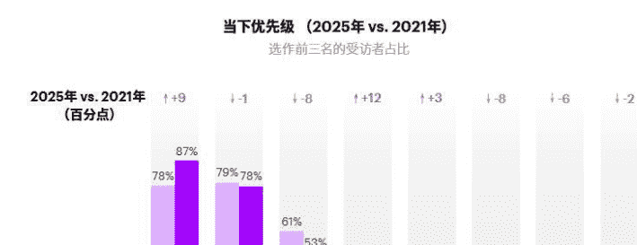

# 图10:85%的中国消费者线上，仅有9%线下

# 中国消费者的购物习惯

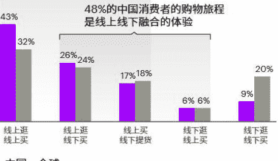

# 85%的中国消费者线上，48%的中国消费者线下体验

注：百分比数据源原始
数据来源：2025年全球消费者行为，2025年1月，全球样本2000
问题：以下选项最符合您平时购买习惯？

随着美储通胀政策制定者解析宽松的信号，他们倾向于谨慎行，偏向于下个月暂停加息。这次会对股市造成积极影响。美国首席经济学家凯尔文·哈塞特（Kevin Hassett）告诉路透新闻，10月份的就业报告将跳过失业率。

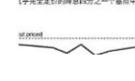

# 对美联储12月降息的押注变动

交易员已经从几乎定价的降息四分之一基点中撤回

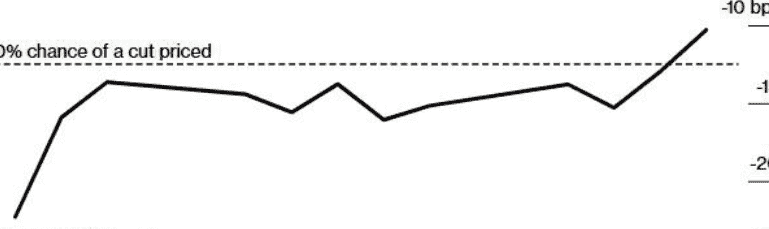

资料来源：彭博社

# 美债市场波动创一个月高

/ The MOVE Index

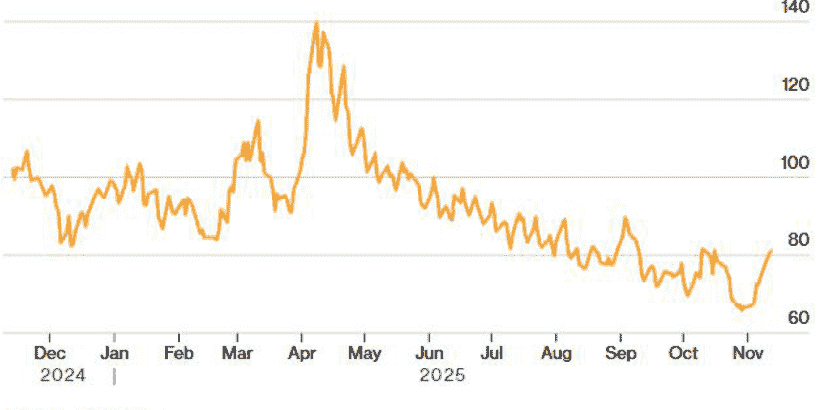

资料来源: ICE BofA

# 10年期国债收益率高居4%以上

/ Yield Level

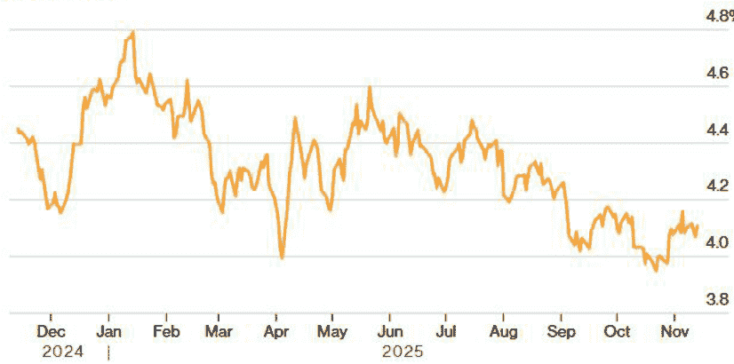

资料来源:彭博社

# Magnificent Seven Rally Loses Momentum

/ Last Price

| | Mar | Apr | May | Jun | Jul | Aug | Sep | Oct | Nov |
|---|---|---|---|---|---|---|---|---|---|
| 2024 | | | | | | | | | | |
| 2025 | | | | | | | | | | |

Source: Bloomberg

银河：10月政府债券融资连续三个月下行，增速为19.2%（前值20.2%），去持政府债券的社融增速为5.92%，由于基数效应，季度政府债券融资对社融增速的拉动作用可能减弱，有效社融增速（中长期债券+委托+信贷+直接融资）为5.57%，连续两个月上行，10月企业债券利率下行，可能存在震期的中期变化。非债贷款相比减少164亿元。展望2026年，全年有望维持政策利率10-20BP，并提升货币政策引导效率，推动贷款利率的下调，以及配合50BP的维持以影响银行成本。同时，央行已重购国债买，我们预计国债购买将成为行为常态，央行实施货币政策的重要路径，央行资产负债也将扩张。

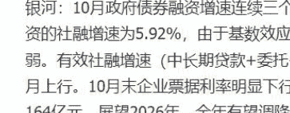

# 图5:社融增速（去除政府融资）和政府增速（%）

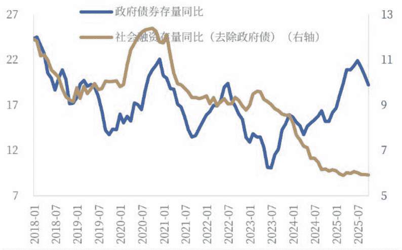

资料来源：Wind，中国银河证券

# 图6:社融增速和有效社融增速（%）

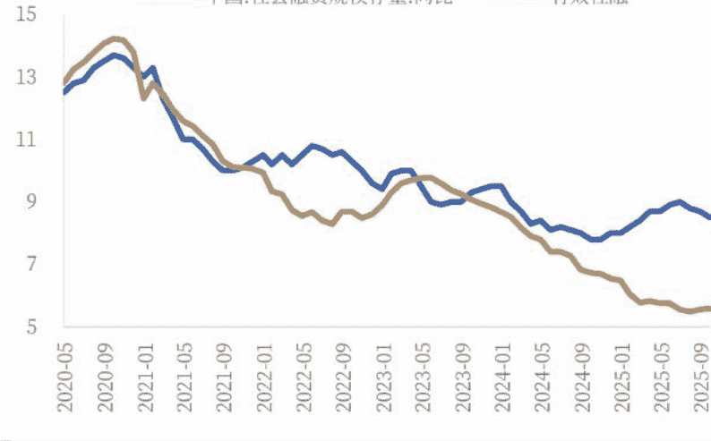

资料来源：Wind，中国银河证券

# Jason Lee

2025-11-14

JPM:随着反向政策相关行业的调整，通过投资者咨询，国内政策的实际影响及未来方向，我们通过分析反向政策中市值最大的上市公司在2025年第三季度资本支出(Capex)与库存(Inventory)趋势，未见。在资本支出方面，12个行业中有9个行业的支出下降；这些趋势显示，反向政策的锚点从规模为核心的转型，转向以质量为导向的转型——这一结构转型是一个长达十年的周期。我们认为：反向政策将沪深300指数2025年每股收益(EPS)增长预计为16.6%。2025年第三季度，金融行业支出增速将持平(+0.8%)，低于上半年4.5%。注意的是，硬件、半导体行业的Capex增速自2023以来首次转折，显示半导体周期可能已经终结。2025年第三季度，库存下降增速至2.7%（较第二季度的6.5%明显放缓）。制造业与汽车供应链下降最为明显，说明企业在管理上转向现金，而非盲目扩产。我们认为：“反向政策将通过手段调整企业行为：包括收紧资本支出、强化经营效率、提高资本回报(ROIC)的要求。当前阶段是一个“数量驱动”向“质量驱动”增长转换的早期阶段。历史经验显示，这类政策的推行平稳时期，有利于那些资本回报(ROIC)、现金流转化率高。在A股市场上，我们更看好以下：工业自动化、半导体设备、医疗服务及高端消费。

# Figure 2:Selected anti-involution Industries' capex and inventory day changes

Aggregate capex in 3Q25

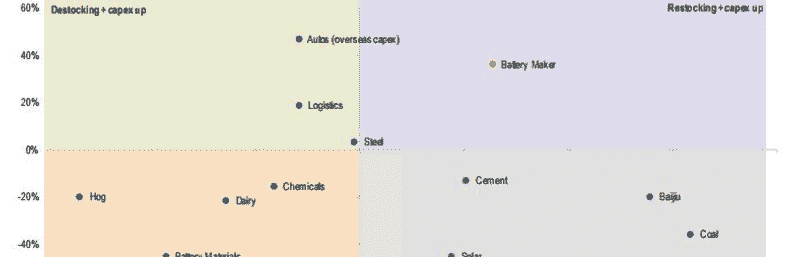

Source: Wind of 11 Nov 2023; J.P. Morgan

# Figure 3:Selected anti-involution Industries' performance since end-Jun 2025

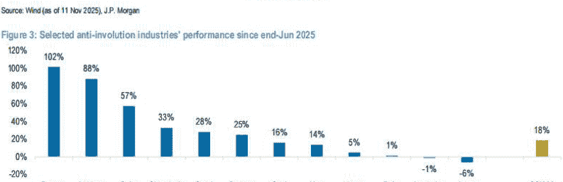

Source: Wind of 11 Nov 2023; J.P. Morgan

# China-shares Equity Strategy

Assessing the progress of anti-involution policies through the lens of capex and inventory trends

China's government launched the anti-involution policy in late 2025, with broad industry impact. Entering this era, we helped many clients understand the impact and trajectory of this policy. Here, we analyze 3Q25 capex and inventory trends. On capex, we observe de-rating in several industries. On inventory, we see some restocking. These trends indicate that the industry has shifted away from price-based competition to quality-based competition, for ultimate execution. We reiterate that anti-involution can support CSI-300-2025 EPS growth (bottom-up calculated estimate of 14.6% y/y). Please see our screens on page 11 for more details. Companies with largest free-float market cap in the upstream industries are LONG Green, Wanhua, Shenhua, Qinhai Salt and Guangfeng Lithium; with largest free-float market cap in downstream industries are Montai, BYD, Walmart.

Equity Macro Research
Enric Zhang, CFA
(8621)5196-5028
en.zhang@gmail.com
SAC Registration Number: S173052100002
J.P. Morgan Securities (China) Company Limited

## Figure 1: Stock screen of A-share listings by market cap ($US1bn) in auto, battery materials, lithium, solar, chemical, chemicals, coal, dairy, hogs, liquor and logistics

| Type | Name | GIES Industry | FPL | CSI-300 constituent | Cap (US$bn) | Current (US$bn) | FTM percentage change | LTM gross margin % | LTM net margin % |
| :--- | :--- | :--- | :--- | :--- | :--- | :--- | :--- | :--- | :--- |
| Auto | 000276 | Ganfeng Technology | Commodity Chemicals | Y | 7 | 58.62 | 81 | 34 | 19 | 6 |
| Auto | 600059 | Luxi New Energy | Battery Materials | | 17 | 54.53 | 23 | 77 | 78 | -6 |
| Auto | 300762 | Hengrui New Energy | Battery Materials | | 2 | 109.56 | 75 | 81 | 24 | -5 |
| Auto | 002594 | BYD | Electric Vehicles & Equipment | | 18 | 127.48 | 42 | 18 | 17 | 4 |
| Auto | 600519 | GAC Group | Electric Vehicles & Equipment | | 3 | 114.22 | 29 | 51 | 32 | 7 |
| Auto | 600838 | Gishan | Lithium | | 5 | 96.11 | 54 | 4 | 11 | -3 |
| Auto | 300459 | Yanfeng | Lithium | | 11 | 53.55 | 20 | 27 | 13 | -5 |
| Auto | 600750 | CATL | Semiconductors | Y | 17 | 542.53 | 23 | 77 | 78 | -6 |
| Auto | 601399 | Yingkou | Semiconductor Materials & Equipment | | 2 | 109.56 | 75 | 81 | 24 | -5 |
| Auto | 300168 | Huayou | Semiconductor Materials & Equipment | | 10 | 85.66 | 52 | 65 | 23 | -4 |
| Auto | 002475 | Sanan | Semiconductor Materials & Equipment | | 9 | 91.13 | 11 | 44 | 31 | -1 |
| Auto | 600698 | Asia-Cement | Construction Materials | | 14 | 68.14 | 22 | 27 | 10 | 9 |
| Auto | 600158 | Huacity Building Materials | Construction Materials | | 8 | 103.38 | 19 | 36 | 26 | 5 |
| Auto | 001988 | Zhongtai | Construction Materials | | 7 | 115.43 | 30 | 45 | 30 | 1 |
| Auto | 601686 | Tancheng | Construction Materials | | 1 | 21 | 68.51 | 54 | 11 | -2 |
| Auto | 600019 | Tongwei | Special Chemicals | Y | 6 | 216.38 | 73 | 13 | 15 | 7 |
| Auto | 601165 | Yanshan | Special Chemicals | | 6 | 125.36 | 76 | 11 | 36 | 22 |
| Auto | 600999 | Yongfu | Special Chemicals | | 5 | 96.11 | 55 | 19 | 11 | 1 |
| Auto | 600888 | Yansheng | Coal & Construction | | 6 | 186.15 | 38 | 35 | 21 | 13 |
| Auto | 601088 | Yannan Energy | Coal & Construction | | 5 | 507.53 | 67 | 24 | 23 | 8 |
| Auto | 601694 | Yugong Coal | Coal & Construction | | 3 | 87.11 | 57 | 23 | 31 | 11 |
| Auto | 600875 | Yuzhou | Coal & Construction | | 3 | 68.56 | 19 | 10 | 10 | 3 |
| Auto | 603366 | Yijiang | Dairy | | 5 | 521.31 | 81 | 38 | 6 | 4 |
| Auto | 605512 | Yishian | Dairy | | 2 | 109.56 | 84 | 16 | 8 | 12 |
| Auto | 600972 | Yizhong | Dairy | | 3 | 37.56 | 63 | 53 | 34 | 13 |
| Auto | 600000 | Yuzhou | Dairy | | 8 | 885.13 | 49 | 76 | 52 | 32 |
| Auto | 601171 | Yichuan | Logistics | | 5 | 136.68 | 23 | 19 | 28 | 27 |
| Auto | 603986 | Yanchong | Logistics | | 6 | 144.33 | 33 | 18 | 39 | 1 |
| Auto | 600118 | Yansheng | Logistics | | 6 | 118.78 | 54 | 13 | 31 | 5 |
| Auto | 600666 | Yiwu | Logistics | | 8 | 314.12 | 90 | 17 | 76 | 34 |
| Auto | 600375 | Yansheng | Logistics | | 7 | 310.95 | 35 | 20 | 15 | 16 |
| Auto | 601434 | Yansling | Logistics | | 5 | 232.88 | 71 | 15 | 35 | 37 |
| Auto | 600533 | Yansheng | Logistics | | 2 | 83.59 | 23 | 19 | 17 | 17 |
| Auto | 601334 | Yishun | Logistics | | 6 | 82.13 | 62 | 29 | 5 | 12 |
| Auto | 601422 | Yitong | Logistics | | 5 | 66.38 | 62 | 22 | 9 | 13 |
| Auto | 600765 | Yulin | Agricultural Products | | 3 | 61.61 | 75 | 30 | 18 | 9 |

## Figure 2.34. The net emigration of foreigners to Japan has risen since 2012
Negative values mean that the number of departures exceeds that of entrants

## Figure 2.35. The number of foreign workers in Japan is rising
1. Includes (permanent) residents and spouses of Japanese or (permanent) residents
2. Includes persons who have permission to engage in activities outside of their visa status. This group consists primarily of international students.
3. Includes professors and teachers, artists, religious teachers, journalists, business management (including corporate intra-industry transfers), legal and accounting services, health and nursing care, entertainment, research, engineers and specialists in humanities and international services

## Debt-to-Income Ratio (%)

# 《廉价日本》文学或书籍推荐
Jason不离 | 2025-11-14 11:08

很多人在读这本书之前，都是对“廉价日本”的误解。对日本这个国家，我其实非常熟悉，但直到读了这本书，我才真正开始。

书中把日本人当作整体，用理性的视角解构了这种廉价的虚假。对日本这个国家我其实非常陌生，但作者通过这本书的视角，让我对日本这种“廉价日本”的印象变得深刻，以及对它产生了新的好奇。在作者看来，也许我们对日本这个国家的了解需要深入渗透，以及对未来的期待。书中记录了廉价日本是某种文化的浪潮的结果，它记录了廉价日本的过去，分析了廉价背后的原因以及未来，并改变了我对日本这个国家和日本人的认知。

# 廉价日本：为什么是廉价国家？起源
我一直认为这种泡沫是暂时的，但读完这本书后，我开始反思什么是廉价。从80年代后日本就变得廉价了，我非常认同。泡沫并没有破灭，直到2000年才彻底消失。书中描述了日本为了获取短期利益而牺牲了长期未来，另一方面选择了廉价化。

# 廉价潮的黄昏
《廉价日本》在书中描写了：泡沫破灭之后，我们并没有迎来真正的廉价化，而是进入另一个廉价时代。书中提到：“从廉价日本结束，进入了另一个廉价时代。”

# 6 超市里的下跌
在日本，与消费者最近的卖场所，也面临持续的通货紧缩。日经POS统计了日本全国约400家超市的销售数据，利用该数据调查了自2000年以来，食品及日用品共7800个品种（非单一商品，而是按种类分类）的平均销售价格（不含税）的变化。POS是“Point Of Sales”（销售时点管理）的缩写，是指通过销售商品的条形码用来管理销售信息的系统。零售店可以利用系统积累的数据进行销售管理及预测。

## 4 应届大学生的崛起与IT人才的薪资

前文提到“日本企业面临应届大学生的崛起的困境”。

然而毕业生的崛起上迎来转机，那么与海外国家相比，日本的起薪薪资是否如何？

总部预测毕业生薪资的知名公司发布报告，2019年全球大学届入职第一年的平均薪资调查。结果显示，美国为6.9万美元，德国为5.1万美元，中国为2.69万美元，日本应届生入职的薪资为2.52万美元，在约14个国家中排名第六位，仅次于韩国、硕士和博士。

然而，日本应届毕业生的薪资只有硕士和博士学士的二三之一？

毕业生薪资的差距令人感叹：“海外的毕业生的崛起与日本的相比，薪资水平如此低，因此导致了‘高龄化’的问题。”

不仅如此，“日本企业以身份视为核心，作为工作的起薪受到了限制”

- 日本的应届毕业生的起薪不起美国的三分之一

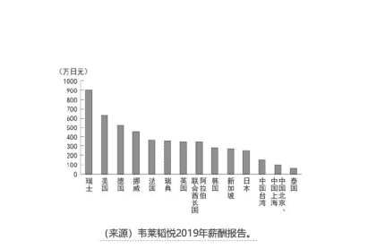

(来源) 毕业生2019年起薪薪资报告。

(注)大学生入职第一年的薪资，不考虑调整，采用社会保险结合的数据结果。

近年来，日本大学生入职开始了“打破差别”的尝试，如某些公司从2019年起，根据个人能力增加应届生的薪资。

## 美国30多万IT人才的年薪为日本的2多

与美国国家相比，日本的起薪低，IT人才的薪资与与其他国家相比是存在巨大的差异。

# 深度视野优质集团（链接优质社群，助你成功）

全部包含以下内容：限时年费188/年 加微信cuk255

- ① 吃瓜群众含帝圈加时群群对话（原价365 元/年）
- ② 子明私享汇（内部）文章（原价 568 元/年）
- ③ 政室（顾子明）付费内容内加送顾子明群聊
- ④ 米联储闲【作者米栖】原价 599 元/年）
- ⑤ 欧洲金雀会员专属文章（原价 328 元/年）
- ⑥ 砖瓦斥内部文档（原价 400 元/年）
- ⑦ 卢克文青读书会专属文章（原价 699 元/年）
- ⑧ 鉴茶财经知识星球（原价 3310 元/年）
- ⑨ 猫哥的视界知识星球文章（原价 299 元/年）
- ⑩ 财新周刊【独家新闻】原价 1498 元/年）
- ⑪ 杨世光在金钱爆（原价 2200 元/年）
- ⑫ 莱森财经知识星球（原价 1600 元/年）
- ⑬ 潇泽译译付费文章（持续更新）
- ⑭ 司马林解课全套音频和全套书籍版权无损删减（原价2.3 万）
- ⑮ 虚彦三部曲[民国梦、帝国争国、不被理解的MAO](原价 599 元）
- ⑯ 卢克知识星球文章（原价 268 元/年）
- ⑰额外再送：卢薛元微信滚播获费专栏、三村丰老王、三花九洞热门文集

不定内容：......（更多资源将下文）......

- ① 守夜司令知识星球、接魔王知识星球、成败财富圈、雪花肥甲老头等
- ② 创始人笔记、达叔谈论星球、成败财富圈
- ③ A 视野、大树乡谈、江初号、咩咩说、上海海家学等付费文集
- ④ 西风付费文章、老端、赢在八小时之外、局外的视界、升值、老A体制内等等其它一些大V付费文章（每月低于600 元的付费文集)

深度视野文集进群微信cuk255
深度视野（付费文集）

限时年费188/年 内部底链接全网优质内容**
