# 南半闲聊财经251115

Jason-Bruce
2025-11-16 03:23

南华早报: 近期亚洲巨型计划失败，因为消费者担不起。而小企业受到了重视，因为消费升级是一大牌。#经济危机

Reuters - Recent Asian giant-plans have failed because consumers cannot afford introduced voucher programs, with the government pledging to recover its economy amid... Guangdong's new scheme is the latest attempt by Chinese authorities to

Published: 10:00 am, 10 Nov 2025 | Updated: 11:26am, 10 Nov 2025

In early November, China's most popular province launched its consumer subsidy programme, with the government pledging to commit 3.5 billion yuan (US$492 million) to offer discounts on a slew of products: from smartphones to snowboards.

Guangdong's scheme is the latest attempt by Chinese authorities to boost domestic consumption - a campaign that is key to China's efforts to shore up growth and rebound the ongoing US trade.

But on the ground, the new programme has received a tepid response. Locals in Guangdong told the Post seems unlikely to convince them to up their spending - especially on non-essential items.

Despite the big headline figures, the vouchers often not provide provide attractive discounts in practice, and many consumers are being cautious in an uncertain economy and a shaky job market.

The lack of enthusiasm underscores the challenges facing Guangdong - one of China's technology and export powerhouse - as the region of 128 million people strives to revitalize a local economy that is feeling the effects of the trade war and a prolonged downturn.

Guangdong's new subsidy programme - which launched amid fanfare on November 3 - will last until March next year with the goal of driving a surge in foot traffic and spending during the coming National Games and major public holidays like Spring Festival.

深度视野VIP群 人工追踪50+V 付费进群加微信chp255 微信chp5568

# Jason-不离
2025-11-16 03:29

WSJ: Job Outlook调查显示，2026年将成为美国本土毕业生就业最严峻的一年#其他国家经济

雇主对应届招聘预期的年度同比变化

-- 秋季 春季

春季招聘计划低于秋季预期

# Jason-不离
2025-11-16 03:44

JPM: 10 月中房产数据全面下滑，表明前期政策宽松的提振效应已经完全消失。基数效应导致同比看起来更差，但房价也在走低。Centaline数据显示一线城市二手房价跌1.5-1.7%，年内跌9.7%，反映了成交量萎缩与挂牌高企双重压力。从销售角度来看，当期市场“供需极弱”；从二手房价来看，70 城房价尚未跌至政策放松前“购需极弱”的程度，但以政策影响可能上升，但仅有行政手段才能扭转根本趋势，信贷与预期仍是决定因素。#房价

# 深度视野VIP群 人工追踪50+大V 付费群加微信cuk255 微信chp5568

# J.P. Morgan
# China Property

## NBS October data: all-round deterioration

2026 External
All-Asia Equity Research Survey
VOTE
Voting Open Nov 12th - Dec 3rd
Please vote for J.P. Morgan (5 stars)

According to NBS, the latest data for October (sales, home prices, investment) worsened, partly due to a higher base. We have been trying to make nationwide easing that the indicators are "bad enough" to trigger more policy actions by comparing the latest data with April & August 2024 (the month before). Based on sales value (Table 1), the current situation is already "weak enough". However, based on secondary home prices, while tier-1 cities are not as weak as the month before last nationwide easing, 70-city cities are not as weak as hoped. The current market trend suggests a rising likelihood for step-up in policy (for example, expanding the scale of inventory or lowering tax rates). Markets need more policy support. In our opinion, we believe Long offers the best risk.

70-city home prices - downtrend: The primary price M/M declined from -0.41% in September to -0.45% in October, with a wider decline across all cities (tier-1 cities down from -0.28% to -0.33%). The secondary price M/M also declined from -0.64% to September to -0.66% in October (tier-1 cities down from -0.93% to -0.95%). Year-to-date, primary/secondary prices have respectively dropped 2.3%/4.8% (tier-1 cities: -0.9%/-5.0%). However, Centaline tier-1 cities' secondary home index has shown a worse trend (down 1.5-1.7% M/M in the past 3 months, and year-to-date secondary prices have dropped 9.7%). With the volume of secondary listings elevated (+1.2% M/M in October - Figure 4), we believe home prices will remain under pressure in tier-1 cities.

## Table 1: Key property data - Oct 2025 vs. April / August 2024 (one month before easing)

| Metric | Apr-24 | Aug-24 | Oct-25 |
| :--- | :--- | :--- | :--- |
| Home price 70-city UIM - primary | -0.58% | -0.77% | -4.49% |
| 70-city UIM - secondary | -0.61% | -0.14% | -2.19% |
| Tier-1 city - primary | -1.12% | -0.69% | -4.68% |
| Volume | -7.03% | -7.13% | -7.50% |
| NBS Real estate investment | -11% | -15% | -23% |
| Home price Tier-1 city secondary | -1.2% | -1.1% | -1.9% |
| Volume | -5.68% | -5.33% | -6.12% |
| Sales Top-100 developers | -47% | -34% | -42% |

Source: NBS, CRC

# 70-city home price index

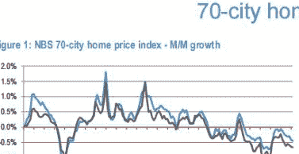
Source: NBS

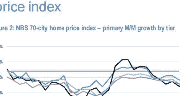
Source: NBS

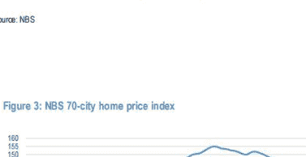
Source: NBS

Source: CREIS

## Sales & construction

Figure 5: 10M25 (Year-to-date) - NBS real estate data vs. 10M24 / 10M23 / 4-year (2018-21) average

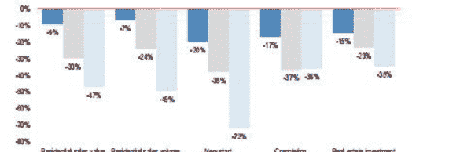
Source: NBS, J.P. Morgan

Figure 6: Oct 2025 - NBS real estate data vs. Oct 24 / Oct 23 / 4-year (2018-21) average

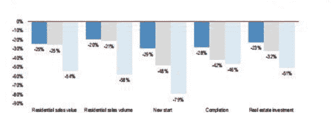
Source: NBS, J.P. Morgan

Figure 7: National private residential sales value Y/Y vs. top 100 developers' contracted sales Y/Y growth (CRIC)

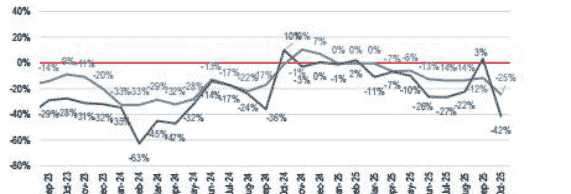
Source: NBS, CRIC, company data, J.P. Morgan

Jason-Chen
2025-11-16 03:53

车辆：以换新出现“政策效应”，家居，汽车在十四月显著回升，口碑-14.6%。汽车-6.6%；此处地产租赁对的刚需，水泥产量按月分别-12.1%/-15.8%此后5000亿元政策性投资举措尚未显现。经济数据

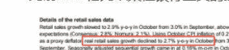

# 深度视野VIP群 人工追踪50+大V 费群加微信

## Details of the retail sales

Retail sales slowed to 2.9% y-y in October, below expectations (Consensus: 2.8%; Nomura: 2.1%). Using October inflation of 0.2% as a proxy, retail sales declined to 2.7% y-y. Stripping out gold & jewelry, auto growth was the main drag on October, dipping to -7.6% y-y. Durable goods consumption is shifting from tailwind to headwind (see China report), 23 September..

Merchandise sales excluding groceries ticked up to 3.9% y-y in October from 3.5% in September, led by gold & jewelry and beverages, which increased to 37.6% y-y and 7.1%, respectively, from 7% and -0.5% in September. Growth in sales by designated restaurants with annual revenue RMB2 billion to 3.7% y-y in October from -1.6% in September. This uptick could be partly attributed to the extended Golden Week, as well as reduced intensity in the price war among the food delivery platforms. Sales for furniture also slowed notably to 9.6% y-y in October from 16.2% in September. Sales growth remained resilient in communication applications (10.1%), sports & entertainment (13.5%), comparable to September levels of 16.2% and 11.9%.

Jason Li
2025-11-16 04:16

经济观察：此前，财政部曾披露了债务有望的消息，李星在财政部门的朋友们也出过要单独拆分一个债务债的动向，李星近期下定决心，不去成立新的债务债，因为这些地方化债务的工作，将推进增大。#债务

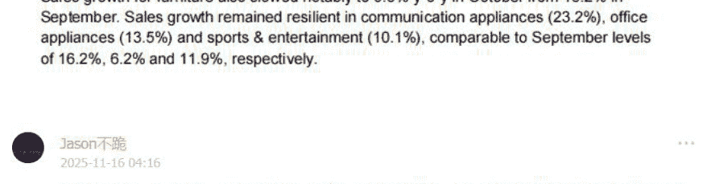

2025年11月中，在东部某市财政局科长李奎面前，看到一叠记录着当地融资平台退出的进度表格。今年融资平台要退出4家，此外还有1家的地方性债务置换还在改进。

李奎说：“这已经是融资平台退出的第二年了。这个任务的重要性并不亚于三保（保民生、保工程、保交通），融资平台退出属于经营性的重要任务。”

2024年8月，行业、财政部、国资委在京聚会，成立四部门联合发布了《关于规范地方融资平台公司的通知》（简称《通知》），要在2027年6月之前，让政府的融资平台干净，地方政府没有地方性债务，城投平台退出平台名录，对政府投资融资限制。

2025年7月30日召开的中央财政政策会议决定，要积极缓解地方政府债务风险，严禁新增债务，有序推进地方融资平台退出。

按照《通知》的要求，退出融资平台分为四个情形，分别是：
- 融资平台地方政府性债务已清零；
- 融资平台没有政府债务，或持有平台2/3以上份额的金融债权人同意退出；
- 融资平台已到政府债务还款期，转型为主经营、自负责的市场化经营主体；
- 关注转型，由融资平台本人人民政府或授权部门说明退出：维护地方金融性债务稳定。

李奎看来，前面的标准是融资平台退出的核心要求，也是工作的重心。在实际操作中，融资平台退出就是上级部门认定的债务已还完毕，之后平台仍然可以正常运营。

他说，这个过程中难的是寻找资金来还债务。去年财政部推出的一项化解债务政策的作用，无法完全靠量化缓解地方债务的风险。

融资平台转型进入深水区，行业内部多关注的是，当“以债还旧”以此为目标，这项改革能否打破融资平台不再为地方债务的困局？

李星认为，从前景看到，融资平台退出后将不再承担给地方政府融资的责任。“但作为地方企业，若财政有需求，融资平台依然能找到为地方政府和其主导的项目融资。融资平台不能真正实现退出，还是要看地方政府的事权和财力能否进一步平衡。”李星说。

## 01 出渝

地方政府融资平台是由地方政府及其部门和机构、事业单位单位等，通过财政登记注册、股权所有等的经济实体，这类具有政府公益性项目融资功能，拥有独特立法法人身份，业务包括各类经营性融资公司（如投资公司、建设开发公司、投资开发公司）和行业投资公司（交通投资公司）。

通常，融资平台通过举债融资为地方经济和社会发展募集资金。但随着融资规模不断扩大，一些不规范行为显现，融资平台成为地方性债务的主要承担主体，这些债务可能给经济社会发展带来风险。

2010年，国务院发布《关于加强地方政府融资平台管理有关问题的通知》，开始全面规范地方政府融资平台债务。2014年，国务院在《关于加强地方政府性债务管理的意见》中明确要求，剥离地方政府融资平台债务，严禁新增政府债务。2021年，国务院在《关于进一步深化预算管理制度改革的意见》中进一步提出，清理规范地方政府融资平台，剥离其融资债务，对失去融资能力的平台实施破产或清算。

2025年6月24日，财政部部长蓝强向全国人大常委会报告，汇报2024年工作时，加速推进地方融资平台转型，融资平台数量减少7000多个。

当前，不仅地方财政部门在推动融资退出时面临多重压力。“最难的是寻找资金化解隐性债务。”李星要求交出退出舞台的债务清单，标注有融资、租赁融资、定债等类型。

当前地方政府解决隐性债务主要依靠融资债券，将融资债务转为隐性债务，但是对于许多地方来说，年底面临的剩余隐性债务，这种情况就需要寻找资金。这两年来，地方债务要靠融资平台寻找资金。

但在现在，在各政府的政策下，融资平台的资金能够缓解，获得资金的压力上不去。李星和地方平台开展了一次会议，会议要意见是解决资金的问题，但到整个会议结束，大家没有找到有效的方法。

面对债务，李星和团队找到了另一路径：债务转换。

地方债务分为四类：
- 第一类是政府债务，一般债和专项债务；
- 第二类是隐性债务；
- 第三类是经营性债务（城投国有）；
- 第四类是拆缴企业的债务。
其中，财政部门统计前三类，拆缴企业债务统计第一类，债务化是财政部门的事情。

李星说：“债务转换就是隐性债务转换为经营性债务。这个过程需要几步办法：一是需要现金，二是需要说服债权人和监管部门。”

李星说：“对债权人而言，原本没有政府背书的隐性债务，要转为没有政府背书的国企债务。他们同意的剩余规模。进一步说明，这类隐性债务的债权人涉及三类：一是银行贷款，二是工程贷款，三类是非标债。”

为此，地方政府采取了许多办法争取债权人同意，比如通过置换债务后还一半债务额，将一半债务额转换为经营性债务，转型需争取债权达成共识，要求债权人接受息减本金折扣。此外，还可以以当地项目、资产、资源为标，邀请债权人共同开发，双方约定未来收益按比例分成，避免了资产损失。这种方法并不是每个地方都可行，例如某些市就不允许使用债务的方式。”

李崇说，对于很多地方来说，由于债务转型利息低、期限长，利息更高、时间更短，反而增加了财政压力。周丽表示，融资平台主要分为隐性债务和经营性债务。针对债务化解措施大致总结为债权化、金融化和资产活化三大类：
- 债权化：利用财政资金发行政府性债，将高成本、短时间的隐性债务。
- 金融化：依托银行、资产管理公司、AMC等金融机构通过市场手段参与债务，常见模式包括展期融资、债务转换等。
- 资产活化：灵活变现存量资产（如出让土地、厂房、商业权益），用其收益来还债务。

一名省审计对财政部门进行了绩效观察，发现地方财政部门与融资平台的往来增多。在财政收入面临巨大压力的情况下，地方政府对融资平台的依赖是在增加的。负责人说：“地方政府对融资平台的需求也发生了变化。以前是为基础建设筹集资金，而在转向了为财政保障性支出。”

根据财政部函报，个别地区新增隐性债务规模巨大。2025年4月，财政部通报了有关地方财政隐性债务问责典型案例，涉及重庆、湖北、甘肃、吉林、河南、内蒙古以及南部市县，为建设项目融资新增隐性债务，分别为683.96亿元、614.08亿元、103.85亿元。8月，财政部又通报了六起地方财政隐性债务问责典型案例，此次披露的典型案例涉及广州、成都、湖北等地国家级企业融资融资。

近日发布的《中央关于加强国民经济和社会发展“十五五”规划的建议》中，财政部指出：“十五五”将进一步落实做好地方债务改革，做好地方政府存量隐性债务置换工作，建立地方政府债务监管机制，防止出现出现，加快地方融资平台改革转型，严禁设立或产生各类融资平台。”

周丽说，企业与地方政府的历史风险需要通过地方平台再次承担政府融资职能。首先，要划清地方平台承担政府融资职能的底线，在法律框架内明确经营性业务与政府债务转型；其次，对财政、国资、金融监管等部门建立常态化监管机制，加强跟踪；最后，地方财政建立融资平台运营体系，对转型型的企业应聚焦市场化目标，且符合其常规决策。

瑞瑞：房价跌两年，空置率19%，报告我附件可下载

![img/07b95dd447d7c06f1e4ed3084c3be99_10_0.png]
![img/07b95dd447d7c06f1e4ed3084c3be99_11_0.png]
Source: Centaline, UBS. Red is estimate.

rating dog: 给万利输血

由于宏观经济环境和政策性因素的双重影响，我们对未来中国房地产市场持谨慎态度。尽管近期出台了一系列支持政策，但市场去库存压力尚未显现。短期内房价可能面临调整。我们预计2025年房价面临12%下跌。

## Figure 23: We expect property price to fall 10% / 5% in 2026E and 2027E after a 12% decline in 2025E, as destocking continues
![img/07b95dd447d7c06f1e4ed3084c3be99_11_0.png]

### 图4:25Q3 德中 MT 板块EPS增速

| 标普500 | 25-09 | 25-06 | 25-05 | 24-12 | 24-09 | 24-06 | 24-03 | 23-12 | 23-09 | 23-06 | 23-03 |
|---|---|---|---|---|---|---|---|---|---|---|---|
| 信息技术 | 13.4 | 12.3 | 12.9 | 17.6 | 5.9 | 11.4 | 6.1 | 4.2 | 5.3 | -3.2 | -0.1 |
| 金融 | 26.3 | 2.2 | 5.1 | 7.9 | 1.8 | 3.1 | 4.0 | 4.8 | 2.7 | -2.9 | 1.0 |
| 工业 | 13.4 | 0.1 | 0.6 | -0.3 | 0.0 | 0.3 | 0.6 | 0.3 | 1.6 | 1.0 | 2.6 |
| 消费 | 0.8 | 0.5 | 0.7 | 2.4 | 0.9 | 1.2 | 1.7 | -2.5 | -2.9 | 3.0 | 3.2 |
| 材料 | 0.8 | 0.5 | 1.7 | 1.6 | -2.1 | -7.5 | -3.4 | -2.5 | -3.2 | -4.6 | -5.8 |
| 工具 | 0.4 | -0.1 | -0.1 | -0.2 | -0.2 | -0.6 | 0.2 | 0.3 | 0.6 | -1.2 | -0.1 |
| 医疗 | 0.0 | 0.1 | -0.3 | -0.7 | 0.4 | 0.2 | 0.4 | 0.4 | 0.4 | 0.5 | 0.0 |
| 能源 | 0.0 | -1.0 | -0.7 | -1.9 | -1.8 | 0.1 | -2.2 | -2.6 | -4.5 | -6.6 | 1.2 |
| 通信 | -4.8 | 3.2 | 3.1 | 2.3 | 0.4 | 3.0 | 3.4 | 3.1 | 1.5 | -0.9 | |

资料来源: Bloomberg, 方正研究所

### 图5:25Q3 主要行业及板块EPS增速

| 标普500 | 25-09 | 25-06 | 25-05 | 24-12 | 24-09 | 24-06 | 24-03 | 23-12 | 23-09 | 23-06 | 23-03 |
|---|---|---|---|---|---|---|---|---|---|---|---|
| 信息技术 | 13.4 | 12.3 | 12.9 | 17.6 | 5.9 | 11.4 | 6.1 | 4.2 | 5.3 | -3.2 | -0.1 |
| 金融 | 6.0 | 3.7 | 5.1 | 7.9 | 1.8 | 3.1 | 4.0 | 4.8 | 2.7 | -2.9 | 1.0 |
| 工业 | 1.1 | 0.1 | 0.6 | -0.3 | 0.0 | 0.3 | 0.6 | 0.3 | 1.6 | 1.0 | 2.6 |
| 消费 | 0.8 | 0.5 | 0.7 | 2.4 | 0.9 | 1.2 | 1.7 | -2.5 | -2.9 | 3.0 | 3.2 |
| 材料 | 0.8 | 0.5 | 1.7 | 1.6 | -2.1 | -7.5 | -3.4 | -2.5 | -3.2 | -4.6 | -5.8 |
| 工具 | 0.4 | -0.1 | -0.1 | -0.2 | -0.2 | -0.6 | 0.2 | 0.3 | 0.6 | -1.2 | -0.1 |
| 医疗 | 0.0 | 0.1 | -0.3 | -0.7 | 0.4 | 0.2 | 0.4 | 0.4 | 0.4 | 0.5 | 0.0 |
| 能源 | 0.0 | -1.0 | -0.7 | -1.9 | -1.8 | 0.1 | -2.2 | -2.6 | -4.5 | -6.6 | 1.2 |
| 通信 | -4.8 | 3.2 | 3.1 | 2.3 | 0.4 | 3.0 | 3.4 | 3.1 | 1.5 | -0.9 | |

资料来源: Bloomberg, 方正研究所

### 图8:25Q3 标普500 ROE(TTM%)

| 标普500 | 25-06 | 25-05 | 24-12 | 24-11 | 24-06 | 24-05 | 23-12 | 23-09 | 23-06 | 23-03 |
|---|---|---|---|---|---|---|---|---|---|---|
| 标普500 | 19.0 | 19.2 | 18.8 | 18.2 | 18.3 | 18.4 | 19.4 | 19.4 | | |
| 信息技术 | 32.1 | 31.9 | 31.6 | 31.4 | 32.2 | 32.3 | 31.2 | 31.9 | 33.6 | |
| 消费 | 28.7 | 28.5 | 28.3 | 28.0 | 28.1 | 27.6 | 26.5 | 26.2 | 26.5 | |
| 金融 | 21.5 | 21.2 | 19.4 | 17.6 | 17.4 | 17.9 | 19.4 | 19.4 | 23.4 | |
| 机械 | 18.8 | 18.5 | 18.2 | 17.8 | 16.9 | 16.2 | 15.6 | 15.3 | 20.1 | 30.2 |
| 材料 | 10.9 | 11.4 | 11.9 | 10.6 | 11.1 | 12.2 | 15.2 | 16.1 | 8.6 | 9.2 |
| 电子 | 10.3 | 10.1 | 10.3 | 10.1 | 10.0 | 10.0 | 9.8 | 9.5 | 8.7 | 8.8 |
| 地产 | 7.8 | 7.6 | 7.5 | 7.7 | 7.9 | 8.1 | 8.0 | 7.4 | 8.7 | 9.4 |

资料来源：Bloomberg，方达证券

![img/07b95dd447d7c06f1e4ed3084c3be99_16_0.png]
![img/07b95dd447d7c06f1e4ed3084c3be99_16_1.png]

# UBS

# New Zealand Equity Strategy
## Steepening signals

NZ 10Y bond yield implies the NZX50 is trading at +8% premium...

Historically, there has been a strong negative correlation between the NZX50 10Y fwd PE and 10Y bond yield (correl -0.85), though we have seen a rebasing of this relationship post-COVID (-0.76). This is likely explained by REITs, Industrials, Telcos and Utilities, representing ~70% of market cap with weighted avg-long correlation of -0.75. With the current 10Y fwd PE, this relationship implies a 1Y NZX50 PE of 36 vs the current 1Y fwd NZX50 PE of 33 (+8% premium).

The RBNZ has halved 30bps of rate cuts, resulting in a steepening effect on the curve with the 2Y bond yield having compressed ~12bps over the last 12mo coupled with only ~40bps compression of the 10Y bond yield. In this note, we explore outperforming the peak as the RBNZ nears the end of the cycle and the 10Y-2Y spread peaks.

As the RBNZ nears the end of the cycle with an anticipated final 25bps in Nov-25 (UBS neutral 2.25%), we believe 10Y-2Y spreads are approaching their peak (vs La 60bps). Our analysis of similar periods (6 months since 1985) suggests that in the 6mo leading up to the peak, Financials and Tech tend to outperform, while Consumer Staples and Utilities underperform. However, in the 6mo post-peak, Industrials typically underperform, while Tech, Energy and Financials outperform. We see a broadly similar theme in Australia, Energy and Consumer Discretionary are the key winners in the 6mo prior to the 10Y-2Y spread peaking, with Tech and Industrials outperforming the peak.

Relating to the NZ context, our analysis suggests Consumer and Industrial stocks are avg near-term benefits in the lead up to the 10Y-2Y spread peaking, with ~3% avg outperformance vs NZX50. Within these sectors, we highlight HUN (Buy), MFT (Buy) and POT (Buy). Conversely, sectors showing strength in the near-term include Nics, REITs and Utilities; we flag CNU (Neutral), KPG (Neutral) and CEN (Neutral) as potential underperformers. Plus, we note Tech and Healthcare as attractive as the 10Y-2Y (Buy) and VGL (Neutral). Within these sectors, we highlight EBO (Buy), SKY (Buy).

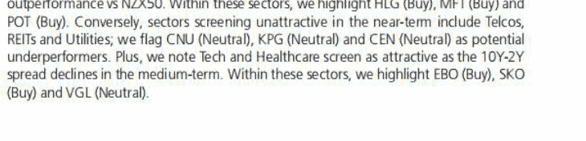

Source: FactSet, UBS Research

New Zealand Equity Strategy
LIBS Research

# OUR THESIS IN PICTURES

Figure 2: NZX50 1y fwd PE vs NZ 10y bond yield

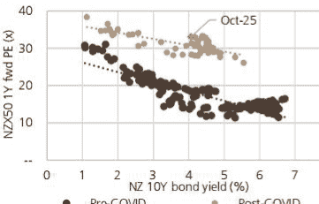

Source: FactSet, LIBS Research

Figure 3: NZ OCR and 10Y bond yield

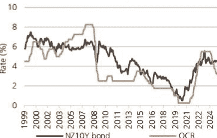

Source: FactSet, RBNZ, LIBS Research estimates

Figure 4: Relationship between NZ and US 10y bond yield

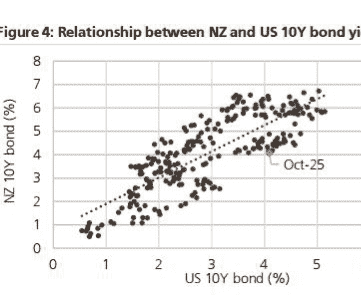

Source: FactSet, LIBS Research

Figure 20: Increases in holdings by Institutional Buyers (SH) of NZX50 stocks

| Stock | Holding | Previous Holding | Change |
|---|---|---|---|
| BGE | 9.8% | 7.7% | 2.1% |
| FPH | 14.3% | 14.8% | -0.5% |
| ARB | 8.9% | 9.6% | -0.7% |
| REZ | 14.5% | 12.4% | 2.1% |
| FHT | 11.7% | 11.9% | -0.2% |
| Gamma Group | 8.2% | 7.5% | 0.7% |
| MCG | 7.9% | 5.1% | 2.8% |
| TMX | 9.1% | 5.1% | 4.0% |
| KPH | 8.6% | 2.7% | 5.9% |
| Milford Asset | 8.7% | 6.7% | 2.0% |
| OCA | 8.6% | 7.3% | 1.3% |
| Furnith Investment | 11.2% | 10.2% | 1.0% |
Source: Company data

Figure 21: Changes in holdings by Institutional Sellers (SH) of NZX50 stocks

| Stock | Holding | Previous Holding | Change |
|---|---|---|---|
| VSP | 4.7% | 6.3% | -1.6% |
| ASD | 11.3% | 11.8% | -0.5% |
| VGT | 4.6% | 5.6% | -1.0% |
| NZZ | 5.4% | 5.9% | -0.5% |
| EMD | 5.3% | 5.5% | -0.2% |
| ATM | 4.4% | 5.2% | -0.2% |
Source: Company data

Figure 22: Changes in directorship and management of NZX50 stocks

| Stock | Position | Appointed/Firing | Other Interests |
|---|---|---|---|
| ASD | Chair | Chief Executive | Customer Office, NZ |
| MCY | Director | Appointed | Investment Agency |
| SJS | Director | Appointed | Deputy Executive, Investment Agency |
| SKG | Director | Appointed | |
| SIR | Director | Firing | |
| SIC | Director | Firing | |
| TRS | Director | Chief Revenue Officer | |
| WHC | Director | House of Travel, UC |
Source: Company data

## Figure 23: NZ equities covered by UBS Research

| Code | Company | Rating | Price | Price Target | Avg PE | Current vs Avg PE |
|---|---|---|---|---|---|---|---|
| EBO | Electro Group | Medical Supplies | Buy | $28.75 | $29.50 | 18.4x | 23.6x | -5.0x |
| FSF | Fonterra | Food Products | Buy | $8.30 | $8.55 | 14.4x | 9.3x | -5.1x |
| GAT | Goodman Trust | Hold | $22.50 | $21.25 | 24.8x | 23.8x | -5.7x |
| IFT | Meridian | Industrial, Developer | Buy | $12.40 | $13.75 | 66.8x | 60.4x | 20.5x |
| MMT | Mainlight | Transportation Services | Buy | $58.13 | $74.00 | 21.6x | 24.0x | -2.4x |
| OCA | Ocean Healthcare | Healthcare Providers | Buy | $0.82 | $0.95 | 8.2x | 9.2x | -1.0x |
| RST | Real Property | Real Estate | Buy | $2.72 | $3.18 | 15.8x | 13.3x | -1.3x |
| POT | Port of Tauranga | Marine Transport | Buy | $7.58 | $7.90 | 33.3x | 36.6x | -9.1x |
| RNZ | REA Group | Real Estate | Buy | $48.50 | $54.00 | 41.4x | 47.5x | -1.2x |
| SKD | Xero | Software | Buy | $2.47 | $4.55 | 11.7x | 4.5x | 2.5x |
| SPK | Spark New Zealand | Road-Communications | Buy | $2.37 | $3.50 | 16.8x | 18.8x | -2.1x |
| SUM | Summit Group | Healthcare Providers | Buy | $11.76 | $13.65 | 10.4x | 14.4x | -1.5x |
| VCT | Vocus | Utilities | Buy | $13.85 | $15.50 | 12.1x | 12.8x | -0.6 |
| HIG | Halogenix Glasses | Consumer Goods | Buy | $10.12 | $11.50 | 13.6x | 12.1x | -0.7x |
| AIA | Auckland Airport | Transportation Services | Buy | $23.50 | $25.00 | 21.8x | 23.3x | -0.6x |
| ARG | Argos | Real Estate | Buy | $1.29 | $1.25 | 18.3x | 17.3x | 0.7x |
| ATM | Apler | Technology | Buy | $19.60 | $20.00 | 29.4x | 30.6x | -0.4x |
| CHN | Chicken | Food Retail | Buy | $9.53 | $9.53 | 58.9x | 62.4x | -0.6 |
| CEN | Contact Energy | Utilities | Buy | $9.50 | $9.70 | 24.2x | 29.9x | -1.7x |
| FPH | FPG Healthcare | Telecommunications | Buy | $9.35 | $9.20 | | | |
| FPI | Fisher & Pay | Advanced | Buy | $37.75 | $39.50 | | | |
| GEG | Electric | | | | | | | | |
| GNE | Genesis Energy | | | | | | | | |
| HTN | Hunter Express | | | | | | | | |
| KMD | Kiwi | | | | | | | | |
| MCY | Mercury | | | | | | | | | |
| SC | Southern | | | | | | | | | |
| SPK | Spark | | | | | | | | | |
| TAA | Air New Zealand | | | | | | | | | |
