# 南半球聊财经251119

Jason-不嵩
2025-11-19 04:07

## 10月16-24岁、25-29岁失业率都比去年同期 #自制图表

## 今年青年失业率比去年差
南半球聊财经

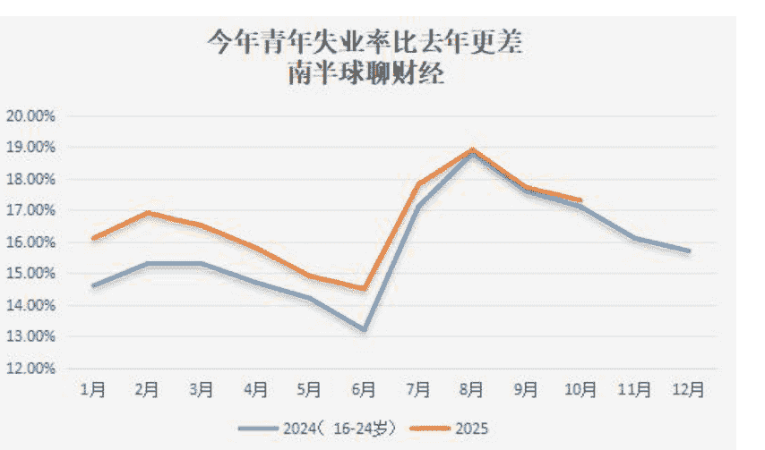

## 25-29岁失业率比去年差
南半球聊财经

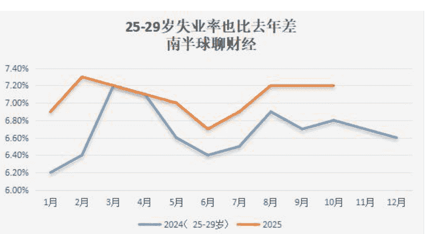

一手优质资源进群微信cuk255

## Jason-Dam

BofA: 11月美国银行全球基金经理调查显示，投资者持有的现金比例创造了现代历史最低之一。自2002年以来，现金水平跌到3.7%或更低的案例有20次出现，且接下来的1-13个月内，股票下跌，表现优于股市 #美股

“做多头”再次为FMS者带来最熟悉的交易（高于40%），超过了上月最高敞口的现金多头（从43%降至28%）。

调查显示，投资者正在退出中国市场。21%的受访者正在建立仓位，14%已完成全面配置，另14%在积极寻找入场。

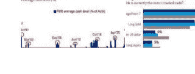

## Chart 3: FMS cash level drops to 3.7% from 3.8%

BofA Global FMS average cash level (%)

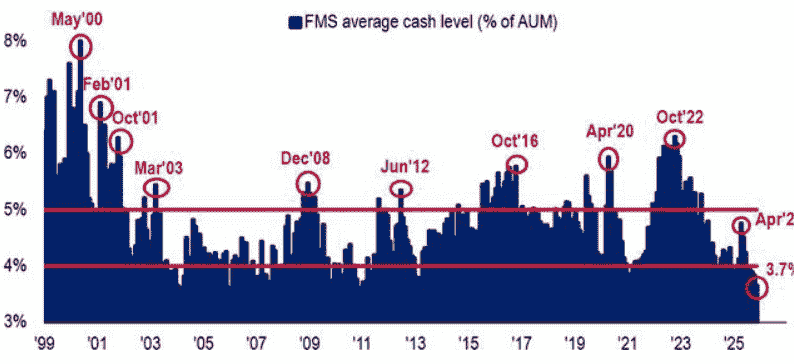

Source: BofA Global Fund Manager Survey

BofA GLOBAL RESEARCH

一手优质资源进群微信cuk255

## Chart 7: "Long Magnificent 7" retakes the most crowded trade

What do you think is currently the most crowded trade?

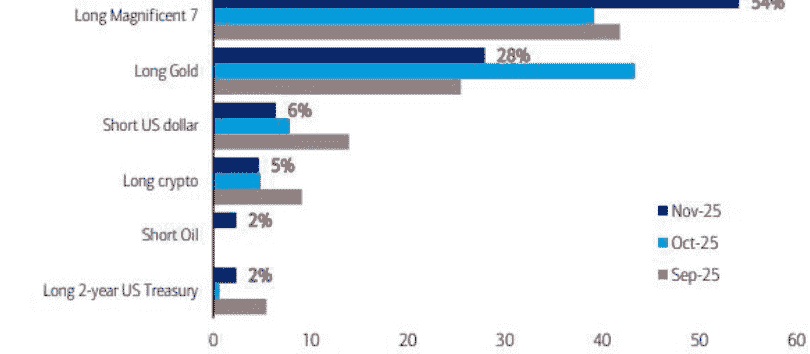

Source: BofA Global Fund Manager Survey.

BofA GLOBAL RESEARCH

## Chart 11: Record number of FMS investors say companies are overinvesting

% FMS say companies are overinvesting and % companies to improve balance sheets

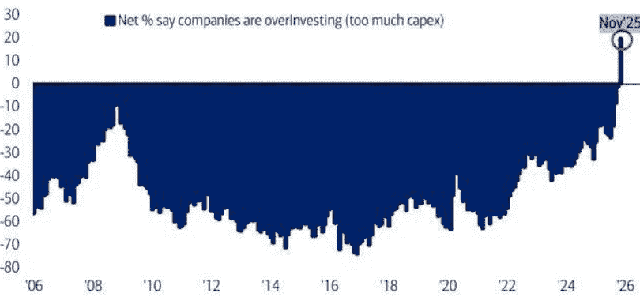

Source: BofA Global Fund Manager Survey.

BofA GLOBAL RESEARCH

## Exhibit 11: Unlike in previous three years, investors have been engaging with Chinese equities

FMS current state/positioning on China equities

### 29% Current state/positioning on China equities

| | 24% | | 21% | Oct-25 | Nov-25 |
|---|---|---|---|---|---|
| | | 20% | 20% | | |
| | 4% | 7% | | 14% | | |
| | | | 8% | | 14% | |
| Building exposure on incremental signs of easing | Looking to exposure on any bounces | Fully exposed | Waiting for more credible signs of easing before adding exposure | Looking for opportunities elsewhere |

Source: BoFA Asia Fund Manager Survey. Notes: For 'Don't know' are not shown above

BofA GLOBAL RESEARCH

Jason

charlie: 更新资源资产表现全景

CREATIVE PLUMINE Asset Class Total Returns Since 2011 (Data via Ycharts as of 12/17) Charlie's Jan-25 | Jan-1-25 Cumulative Annualized

| ETF Asset Class | 2011 | 2012 | 2013 | 2014 | 2015 | 2016 | 2017 | 2018 | 2019 | 2020 | 2021 | 2022 | 2023 | 2024 | 2025 |
|---|---|---|---|---|---|---|---|---|---|---|---|---|---|---|
| ACWI | -11.9 | 23.7 | 15.5 | 19.3 | -3.1 | 1.7 | 25.1 | -13.8 | 22.0 | 17.6 | 11.5 | 14.4 | 18.5 | 19.3 | 11.0 |
| EAFE Stocks | -12.2 | 18.8 | 21.8 | -6.2 | -1.6 | 1.4 | 25.1 | -13.8 | 7.6 | 11.5 | 15.4 | 14.8 | 15.3 | 26.5 | 6.4 |
| TIP | 7.7 | -9.3 | 7.3 | 3.5 | -3.1 | 3.7 | -2.9 | 26.5 | 12.6 | 12.5 | 7.8 | |
| QQQ 100 Index | 7.7 | 16.9 | 18.6 | 19.5 | 3.9 | 11.1 | 19.7 | 2.7 | 20.6 | 24.5 | 18.5 | 19.3 | 54.8 | 51 | |
| Emerging Markets | -21.5 | 13.5 | 13.3 | 1.4 | -10.8 | -1.6 | 22.6 | -5.4 | 22.9 | 20.5 | 14.1 | 9.4 | | | |
| Convertible Bonds | -7.7 | 15.9 | 20.7 | 9.9 | 10.3 | 7.6 | 19.9 | -2.2 | 22.2 | -5.4 | 22.9 | 20.5 | 14.1 | 9.4 | |
| US Treasury Bond | -2.1 | 13.3 | 13.3 | 10.3 | -1.8 | -1.6 | -1.7 | 11.1 | 41.9 | 2.2 | 7.3 | 7.7 | | | |
| EM Small Cap Index | -7.7 | 12.9 | 13.6 | 19.3 | 7.7 | 5.7 | 5.3 | 5.7 | 9.8 | 15.5 | 5.4 | 18.6 | 10.5 | 23.8 | 5.1 |
| China Grade Bond | 13.7 | -6.4 | 8.5 | 3.6 | -5.3 | -5.5 | -3.5 | -3.8 | -9.8 | -10.3 | -5.2 | -12.8 | -3.7 | 7.8 | 10.8 |
| Total Market | 7.7 | 3.3 | 5.3 | 5.3 | 0.6 | 5.8 | 0.3 | 5.3 | 6.8 | 4.1 | 2.7 | | | | |
| Long Duration Treasuries | 38.2 | 5.4 | 23.5 | 27.9 | 11.8 | 23.7 | 11.5 | 14.9 | 14.2 | -41.3 | 21.2 | 7.8 | 3.2 | |
| PPF Preferred Stocks | -2.8 | 17.8 | 15.6 | 14.1 | 4.3 | 1.7 | 8.1 | -6.7 | 11.5 | 15.9 | 7.3 | 9.2 | 7.2 | 3.8 | 5.9 |
| US High Yield | -7.7 | 13.3 | 18.1 | 13.5 | 5.3 | 3.1 | 1.1 | 8.8 | 11.7 | 15.5 | 23.6 | 16.1 | 8.1 | 5 | 4.3 |
| MDY US Mid Caps | -2.1 | 18.5 | 23.1 | 7.9 | 2.4 | 9.5 | 21.5 | -11.9 | -15.5 | 13.5 | 24.6 | -23.3 | 16.1 | 15.8 | 10.2 |
| BTC | -12.2 | 18.8 | 21.8 | 16.2 | 1.1 | 1.4 | 25.1 | -13.8 | 11.7 | 13.5 | 24.6 | -23.3 | 16.1 | 15.8 | 1. |
| % of Asset Classes | 62% | 90% | 52% | 71% | 38% | 50% | 59% | 5% | 88% | 75% | 71% | 10% | 96% | 95% | 91 |

## Jason-不涵

2025-11-19 04:38

bloomberg: 许多采取措施应对“关税损失”的影响，根据Sensor的数据，其第三季度活跃用户下降3%，好于第二季度的暴跌24%，取得了效果。在国内市场，多多表示在激烈的竞争市场上，出现了机会。

阅读更多：Temu策略积累的回报，60%从长期来看，Temu仍然是增长动力——尽管面临不确定性。

随着关税消失，Temu通过免税政策向美国建立了双重零售业务，开始在本土挑战Amazon.com。彭博预计，在该月至6月期间，活跃用户数量激增了46%。

## Jason-不涵

2025-11-19 04:44

bloomberg: 最新银行调查显示，三分之一基金经理表示日元明年将带来最佳回报，其次是黄金和美元。这些基金经理管理规模近5000亿美元。

一手优质资源进群微信cuk255

## 投资者预计日元命运将转折
美国银行：“2026年哪种货币将跑赢？”

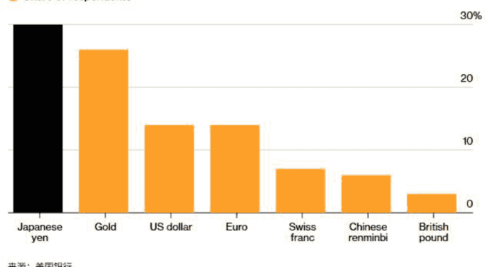

来源：美国银行
注：美国银行于2025年11月7日至11月13日调查了172家资产管理总额。

Jason-不离
2025-11-19 05:07

JPM: 2026年GDP增长预计为.8%，美国储的核心通胀指标预计为2.7%。预计失业率将回升至4.5%，随后可能会提高失业率。预估美国赤字与2025年相比变化。

## 其他国家经济

Figure 14: Labor force growth assuming current participation rates

Note: Participation for each age/sex bucket sent Jan 24 - Jan 25 average

## Figure 14: Labor force growth assuming current participation rates

% Participation for each age/sex bucket set to Jan 24 - Jan 25 average

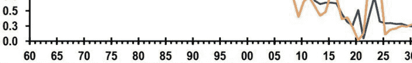

Source: Social Security Agency, CBO, BLS, Census Bureau, J. Morgan

一手优质资源群微信:cuk255

## Jason-不离

2025-11-19 05:12

民生：10月支出增速向下，可能是年内增速转负至9.8%。其原因，我们认为可能是10月一般支出转负可能是受到今年赤字增速偏慢的约束。今年财政支出转型，赤字约束也为四季度财政支出埋下伏笔。此前一直持续性的民生类支出同比下降6.0%，出现了首次增长。

对外出口同比下降14.8%（9月显示增速4.2%），这一的变化预示着外需正在转弱，与10月出口增速下行的信号趋一致。

在四大中，个人所得增长表现为迟缓，对比增速高达27.3%，为拉动股权增长的核心

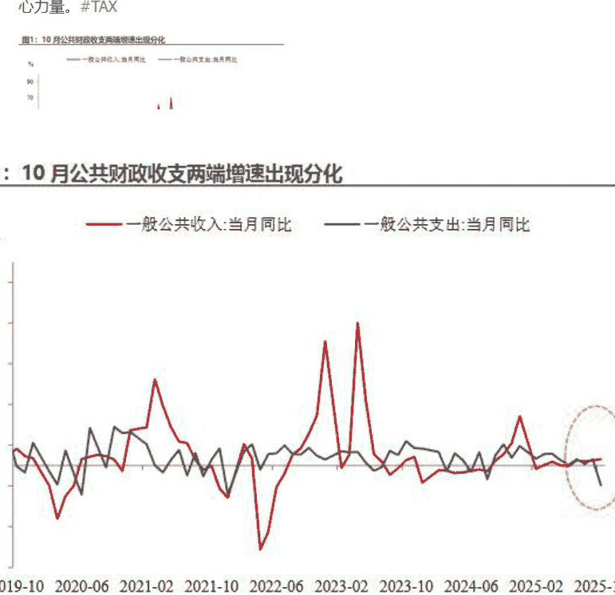

一般公共支出：当月环比 一般公共收入：当月环比

2019-10-20 2020-06-21 2021-10-22 2022-06-23 2023-10-24 2024-06-25 2025-02-25

资料来源：IFind，民生证券研究院

## Jason-Zach

2025-11-19 09:15

我们：将亚洲经济人均 GDP 与消费水平划分为四种类型。香港居民的财富不仅体现在本地收入，更源于其卓越的全球资产配置能力。数据显示，香港的来自海外的投资净升，其中证券投资表现尤为亮眼，成为推动亚洲经济向高速增长的关键动力。

日本的产业领域经历转型，在群众消费转向精细市场之后，与此相辅相的是日本发达的医疗行业。

新加坡的发展的趋势，可以被视为“向外扩张，内需为主”。随着指数持续增长，居民消费水平持续。

的-的-的-的-的-的-----。

Jason-Zach。

来源：美国银行
注：美国银行于2025年11月7日至11月13日调查了172家资产管理总额。

Jason-不离
2025-11-19 05:07

JPM: 2026年GDP增长预计为.8%，美国储的核心通胀指标预计为2.7%。预计失业率将回升至4.5%，随后可能会提高失业率。预估美国赤字与2025年相比变化。

## 其他国家经济

Figure 14: Labor force growth assuming current participation rates

Note: Participation for each age/sex bucket sent to Jan 24 - Jan 25 average

## Figure 14: Labor force growth assuming current participation rates

% Participation for each age/sex bucket set to Jan 24 - Jan 25 average

Source: Social Security Agency, CBO, BLS, Census Bureau, J. Morgan

一手优质资源群微信:cuk255

## Jason-不离

2025-11-19 05:12

民生：10月支出增速向下，可能是年内增速转负至9.8%。其原因，我们认为可能是10月一般支出转负可能是受到今年赤字增速偏慢的约束。今年财政支出转型，赤字约束也为四季度财政支出埋下伏笔。此前一直持续性的民生类支出同比下降6.0%，出现了首次增长。

对外出口同比下降14.8%（9月显示增速4.2%），这一的变化预示着外需正在转弱，与10月出口增速下行的信号趋一致。

在四大中，个人所得增长表现为迟缓，对比增速高达27.3%，为拉动股权增长的核心

一般公共支出：当月环比 一般公共收入：当月环比

2019-10-20 2020-06-21 2021-10-22 2022-06-23 2023-10-24 2024-06-25 2025-02-25

资料来源：IFind，民生证券研究院

## Jason-Zach

2025-11-19 09:15

我们：将亚洲经济人均 GDP 与消费水平划分为四种类型。香港居民的财富不仅体现在本地收入，更源于其卓越的全球资产配置能力。数据显示，香港的来自海外的投资净升，其中证券投资表现尤为亮眼，成为推动亚洲经济向高速增长的关键动力。

日本的产业领域经历转型，在群众消费转向精细市场之后，与此相辅相的是日本发达的医疗行业。

新加坡的发展的趋势，可以被视为“向外扩张，内需为主”。随着指数持续增长，居民消费水平持续。

的-的-的-的-的-的-的-的-的-的-的-的-的-的-的-的-的-的-的-的-的-的-的-的-的-的-的-的-。

## 投资者预计日元命运将转折
美国银行：“2026年哪种货币将跑赢？”

来源：美国银行
注：美国银行于2025年11月7日至11月13日调查了172家资产管理总额。

Jason-不离
2025-11-19 05:07

JPM: 2026年GDP增长预计为.8%，美国储的核心通胀指标预计为2.7%。预计失业率将回升至4.5%，随后可能会提高失业率。预估美国赤字与2025年相比变化。

## 其他国家经济

Figure 14: Labor force growth assuming current participation rates

Note: Participation for each age/sex bucket sent to Jan 24 - Jan 25 average

## Figure 14: Labor force growth assuming current participation rates

% Participation for each age/sex bucket set to Jan 24 - Jan 25 average

Source: Social Security Agency, CBO, BLS, Census Bureau, J. Morgan

一手优质资源群微信:cuk255

bloomberg: 摩根丹利表示，印度 BSE Sensex指数在年初前上涨空间为13%，印度股市今年相比于亚洲行的低迷表现，主要因为和美贸易谈判+科技含量较低，不过印度股市今年已上涨超过8%，Sensex指数年增长率达到17%。大摩根和信丰也看好印度股市的相对表现，尤其是科技领域利好巨大。

美国国家经济委员会主任约翰·普奇表示，和印度非常接近达成交易，这确实在印度股市从底部转开。#其他国家经济

# Indian Shares Are EM Peers Most Since 1993

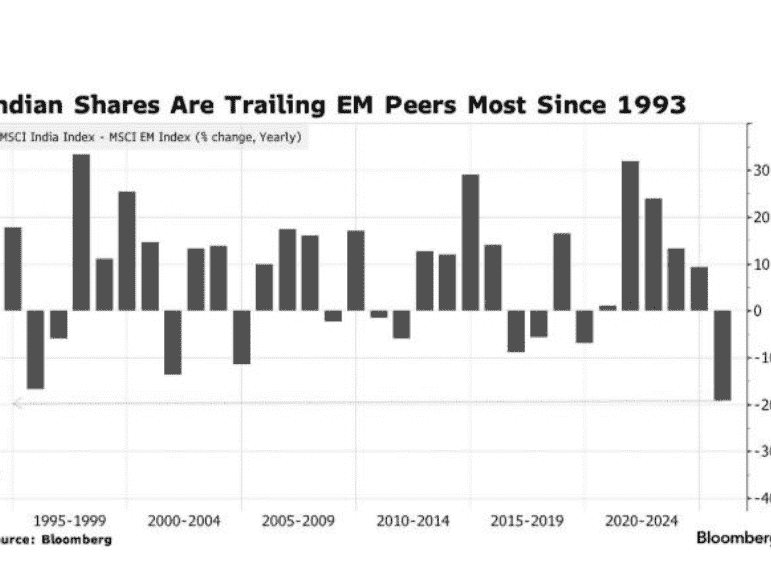

一手优质资源进群微信cuk255

## 2025年11月18日 晚上11:07 GMT+13

关注彭博印版WhatsApp，获取独家内容和分析，了解亿万富翁、企业和市场的动态。点击此处注册。

印度贸易部长表示，印度正致力于与美国达成“公平、公正和平衡”的贸易协议，这一消息发生在该部门宣布预计很快就能完成最终协议的第二天。

商务与工业部长皮尤尔·艾韦尔周在新德里表示：“谈判是一个过程”、“作为一个国家，印度必须确保保障自身利益，也必须保障利益相关、企业的利益，并与我们的敏感性进行平衡。”

新德里一直与美国周周谈，降低特朗普对该两国征收的50%关税，部分是因为其从俄罗斯购买石油的报道。近几个月来，两国官员多次见面，但尚未达成协议。

印度近周采取了多项措施以安抚特朗普。在华盛顿上个月对俄罗斯石油生产中国实施制裁后，炼油厂已缩减了从俄罗斯的采购。周一，印度石油部长宣布，邦级炼油厂已签署首个长期协议，从美国进口液体石油。

Jason-
2025-11-19 05:37

国信：10月份，全国公布住房房价指数环比下降1.59%，同比下降7.15%。成交挂牌指数环比下降0.48%，同比下降2.04%#经济数据

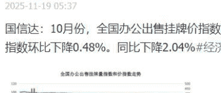

-一手优质资源进群微信cuk2255

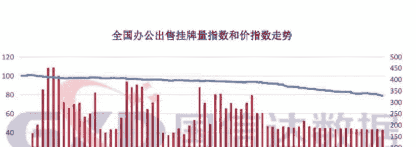

## Jason不离

2025-11-19 05:43

华创：测算2025年证券业务税收约7600亿元（同比增加700亿元），测算2025年税类资本市场分项约3300亿元（同比增加400亿元），包括股权转让、限售股权转让、利息股红个人所得税、#TAX

数据来源：全国城市二手住房数据网站（统计）

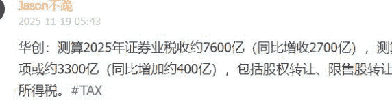

一手优质资源进群微信cuk255

## 图表 1 市对证券业务收益的驱动因素（长期对应趋势）

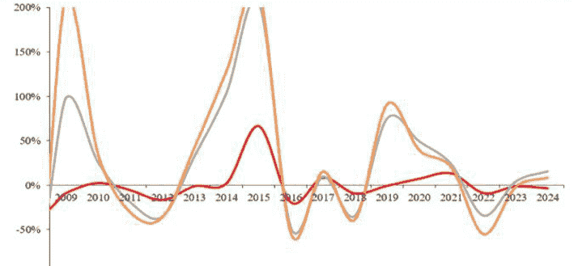

| 指数同比(均值偏点) | 证券业务净利润同比 | 证券业务收益同比 |
| :--- | :--- | :--- |

资料来源：Wind，华泰证券

## 图表 2 市对证券业务收益的短期因素

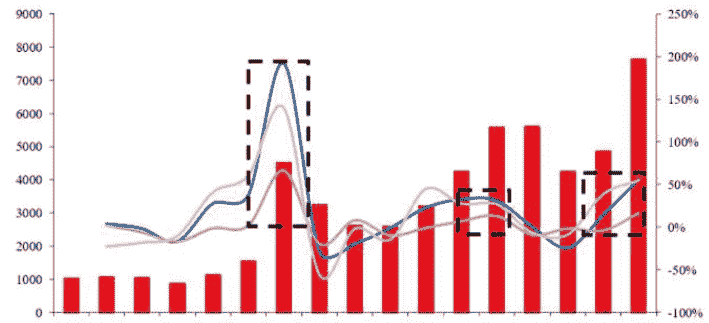

| 证券规模(亿元) | 证券业务收益同比 | 指数均值偏点同比 | 上交所成交额同比 |
| :--- | :--- | :--- | :--- |

资料来源：Wind，华泰证券

Jason-bubble
2025-11-19 06:07

JPM：我们最近实地调研了深圳、杭州中机构进行了交流。自市场市场以来，深圳二手住房价格下跌22%，房价仍面临挑战。新房开盘去化率依然低（低于20%）；保障住房性供应仍对私人住宅的准入形成竞争，未见到明显的改善；人才吸引力下降，因为人才房与私人住宅的房价区间缩小；从当前销售的比例从近10%以上上升至35%。

展望2026年，中国房价预计下降约5%（今年已降7%）。
有意思的是，在新房低迷市场下，平均中介金额已达近4%（去年高峰期甚至达到10%）。开发商高度依赖房产中介渠道；#房价

-一手优质资源群微信信cuk255

## J.P.Morgan

Asia Pacific Equity Research
18 November 2025

## China Property

Takeaways from channels in Shenzhen

2026 Outlook
All-Asia Equity Research Survey
Vote
Voting Open Nov 14th - Dec 5th
Please vote for J.P. Morgan (5 stars)

We recently visited a residential property & spoke to a market manager at Cornerstone (property agency) in Shenzhen. Shenzhen's market prices have, dropped 42%, the latest reading supply of affordable housing remains a challenge to entry-level products in the private market. With demand rates of the launches still low for -20% in the private market, and for 2024, China expects to remain flat (Forecast: down -5% Y/Y in 2026, after a 7% yearly decline-to-date) based on Cornerstone's asking price index, which hit a new low in 2021 (Jan-Jun) as has observed in other cities too. If the home price weakness continues, we are seeing likelihood of a new round of policy support. Within the sector, our top picks remain CR Land, Mix & Jima. In a policy-induced rally, we believe Longfor may offer more upside.
China/Hong Kong Property & Conglomerates
Karl Chan AC(852) 2800-6513
karl.chan@jpmorgan.com
Jocelyn Gao(852) 2800-6549
jocelyn.gao@jpmorgan.com
Venus Choi
venus.choi@jpmorgan.com
J.P. Morgan Securities (Asia Pacific Limited)
jpmorgan.com

## Shenzhen market

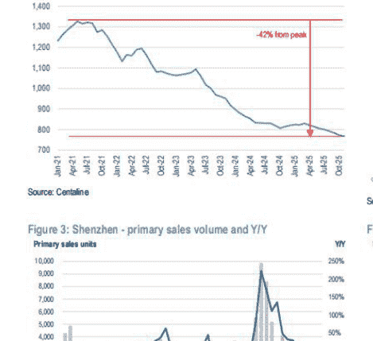
Source: Centrais

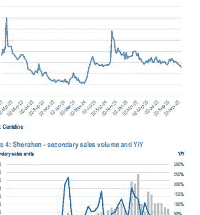
Source: Centrais

## Figure 3: Shenzhen - primary sales volume and YoY
## Figure 4: Shenzhen - secondary sales volume and YoY
Primary sales units
Secondary units

Source: CREIS, J.P. Morgan

一手优质资源群微信cuk255

## Jason
2025-11-19 06:17

高：“双十一”购物节已11月14日结束。今年的活动时长最长。占今年整体GMV（含退货）同比增长约10%，与去年“68”相当，但较去年年底增速有所缓。
1. Double 11 GMV growth driven by lower spans, expected: According to our China internet team, year-on-year GMV (before return) grew by 10% compared to 18 last year, though decelerated from double digits.
2. Overall highlights: Our price checking (Exhibit 3) suggests that Discounts were across categories a few for food, beer and condiments. A high rate was seen last year, more rules to reduce incentives and slower growth than GMV, but it is worth noting that the magnitude was not as material as seen during 18, though sportswear brands' return rates were higher.
3. Local vs. competition, with greater reliance on product/brand cycle and value-for-money proposition as consumers remain reliant: For rankings in Exhibit 4 and Exhibit 5, local brands are to be recapturing market share in beauty/sportswear/pet sectors, similar to what we observed during 18 shopping festival this year.

一手优质源深度cuk255

# CHINA CONSUMER CONNE

## Double 11 wrap: Stable GMV growth; Sportswear/Durables/Partly decline while beauty was below

The Double 11 Shopping Festival concluded on Nov 14th. The event saw longest in our history. We summarize within datapoints, category and brand level our key takeaways.

### Exhibit 1: GMV growth by company for Singles Day

| Singles' Day | GMS | Alibaba | Futuan |
| :--- | :--- | :--- | :--- |
| BABA | 8% | 9% | 0% |
| JD | 7% | 6% | 0% |
| PDD | 10% | 12% | 1% |
| Douyin | 10% | 14% | 1% |
| Kuaishou | 10% | 10% | 0% |

industry online gmv growth 10%
Parcel volume growth (11.10-11.15) 7%
Parcel volume growth (11.1-11.11) 9%
GMV growth outperform vs parcel 3%

Pre-sale peaked Oct 10 at RMB billion, which for the first time. Brands GMV doubled, with the category saw-breaking growth. JD reported 40% increase in revenue compared to the same period last year. New high during Singles Day sales period. Promotion 'low price' and traditionally effective. Use of 14% of GMV for2020. Douyin doubled, the number of products from livestreaming grew 67%. We estimate industry online gmv growth of 10% for Singles Day, outpacing parcel category growth. Per our weekly analysis, we estimate parcel volume growth of 7% from Oct 1 to Nov 11. During Singles Day period, we saw 9% growth of parcel check over-on-year. We believe Singles Day saw higher demand for parcel growth driven by higher parcel prices (anti-monopoly policy); reduced orders for electronics, but higher volumes for beauty, jewelry (brand rankings) and quick commerce

Source: Company data, Analysts, Futuan, Goldman Sachs Global Investment Research

### Exhibit 2: Industry GMV declined to c.10% growth from 2027

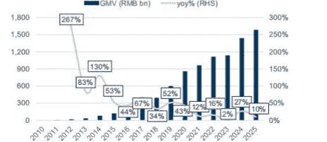

Double 11 GMV (2010-2024)

Source: Analysis, Systumn, Goldman Sachs Global Investment Research

### Exhibit 3: Compared to Double 11 last, Compared to Double 11 last, Compared to Double 11 last, Compared to Double 11 last, Compared to Double 11 last, Compared to Double 11 last, Compared to Double 11 last, Compared to Double 11 last

Goldman Sachs Consumer

| | 2020 | 2021 | 2022 | 2023 | 2024 | 2025 |
| :--- | :--- | :--- | :--- | :--- | :--- | :--- |
| Company staples | 27% | 31% | 53% | 56% | 55% | 54% |
| Beauty | 19% | 19% | 18% | 19% | 19% | 19% |
| Pet food | 25% | 20% | 14% | 23% | 20% | 22% |
| Beer | 24% | 32% | 24% | 17% | 19% | 18% |
| Comounded conditions | 25% | 26% | 25% | 25% | 25% | 25% |
| Snacks | 46% | 50% | 40% | 39% | 36% | 37% |
| Consumer discretionary | 55% | 58% | 56% | 56% | 55% | 54% |
| Beauty | 19% | 19% | 18% | 19% | 19% | 19% |
| Sportswear | 27% | 40% | 33% | 32% | 33% | 40% |

1) We use average discount rate to calculate price-discount change. 2) For Beauty sector, we use discount excl. gifts.

Source: Tmall

Jason不靠

2025-11-19 08:45

Trade Me Property: 新西兰租住房的趋势继续坚定地向租客，10月全国租金中位数高为610新西兰，这是2023年5月以来的最低水平。出租房源总数对比去年同期高2%，其他国家经济

## Rental Price Index
Oct 2025 vs Oct 2024

## Rental Price Index
Oct 2025 vs Oct 2024

- -3.9% year over year
- -17% including Auckland

| Region | Rental Price Index |
| --- | --- |
| Auckland | $650 |
| Bay Of Plenty | $650 |
| Gisborne | $579 |
| Canterbury | $640 |
| Hawke's Bay | $630 |
| Manawatu / Whanganui | $549 |
| Marlborough | $580 |
| Nelson / Tasman | $590 |
| Northland | $620 |
| Otago | $490 |
| Southland | $625 |
| Taranaki | $580 |
| Waikato | $585 |
| Wellington | $600 |
| West Coast | n/a |

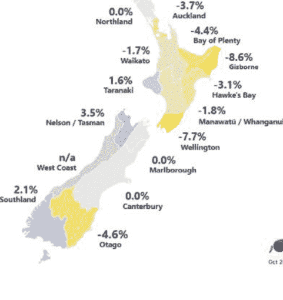

Jason不靠

2025-11-19 09:24

国信达：2025年第46周（截至11），全国住宅出售挂牌指数环比下降0.17%，房荒

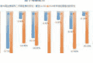

- 一手优质资源源群微信cuk255

## 各城市二手住房挂牌新增数据
全球趋势对比

■ 当年第46周主要城市二手住房挂牌量（截至11/26）2024年本指数基点的变化

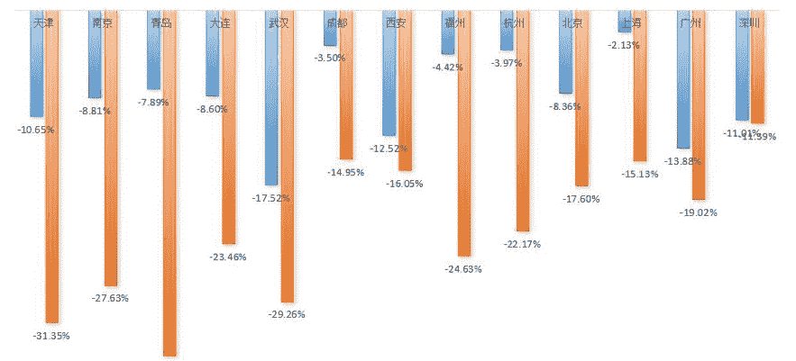

- 一手优质资源进群微信cuk255

## 深度视野优质集团（链接优质社群，助你成功）

全部包含以下内容：限时年费 188/年 加微信cuk255

- ① 吃瓜群众包信时圈加时群群对话（原价 365 元/年）
- ② 子明私享汇（含）内部文章
- ③ 政事室（顾子明）付费内容加送顾子明群
- ④ 米联储闲闲【作者米穗】原价 599 元/年）
- ⑤ 欧洲金雀会员专属文章（原价 328 元/年）
- ⑥ 砖瓦内部文档（原价 400 元/年）
- ⑦ 东方克青云读书会专属文章（原价 699 元/年）
- ⑧ 鉴茶财经知识星球星球（原价 3310 元/年）
- ⑨ 猫哥的视界知识星球文章（原价 299 元/年）
- 10 财新周【独家新闻】（原价 1498 元/年）
- 11 杨世光在金钱坝（原价 2200 元/年）
- 12 蒜森财经知识星球（原价 1600 元/年）
- 13 激游异译付费文章（持续更新）
- 14 司马林解读课全套音频和全套书籍版权无削减（原价 2.3 万）
- 15 虚构三部曲【民国梦、帝国争霸、不被理解的 MAO】原价 599 元）
- 16 虎克知识星球文章（原价 268 元/年）
- 17 额外再送：卢旷元新浪韭搏付费专栏、三村丰老王、三花九树文集

不定内容：......（更多资源不下下去）......

- ① 守夜司令知识星球、接换魔王知识星球、成术财富、雪花铁甲老头等
- ② 创始笔记、达叔谈论知识星球、成术时光、雪花等
- ③ A 视野、大树乡谈、江宁后、咩咩说、上海海家等付费文集
- ④ 西凤付费文章、老端、赢在八小时之外、局人的视界、升值迁、老体制内等其它一些 V 付费文章（每月不超过 600 元的付费文章）

限时年费188/年

## 底层链接对接全网V优质内容

## 深度视野文集进群微信cuk255

深度视野（付费文集）

