# 南半球购财经251124

Jason Wang
2021-11-24 03:12

摩根士丹：我们最近对超过2000名居民进行了调查，受访者对住房的倾向在过去12个月内明显减弱，由于过去12个月内房价价格下降（7月份为33%），显示出购房者对购房意愿减弱，尤其是城市住房自夏季以来持续低，信心在1月份大幅下降，持有购房意愿的人房价下降为（7月份为50%），二线城市下降30%（7月份为24%）。

大多数受访者表示价格相同（52%，7月份为56%），具体而言，48%的房主表示售价与购价相同或更高（7月份为47%），有38%和11%的买家表示，他们可以接受房价涨幅10%到20%的折扣（7月份分别为42%和12%），还有3%的买家希望无论如何尽快卖出房产（7月份），持有高于购售价的的卖家更少一处（17%，7月份为4%，21%），这与持有高于出售价的卖家的趋势正在加剧。

Exhibit 2: Overall house price index is weak, and Tier 1 cities showed more confidence over Next 12 Months (among homeowners)

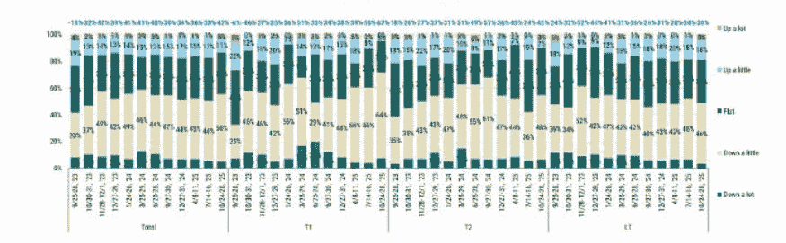

Exhibit 4: 52% of homeowners with home sales plan are willing to take losses

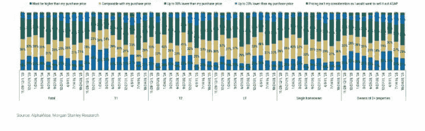

-一手优质资源进群微信cus255

# Jason-book

2025-01-24

李雷：本轮行情核心驱动的特质在于：资金利宽松估值中枢回升，流动性维持温和而非决定性力量，真正驱动行为的是风险偏层面的演化。2024年A股后整体流动性由利好驱动通过，企业的内生增长能够增强。然而，市场市值中枢仍在抬升，时资金利与估值“回归”行情开启并未分化。

风险承受能力好，使得对风险的回归在侧面呈现出三个特征：中线资金进入市场，机构与A股筹杀活跃，ETF回归。这特征意味着本轮行情有望持续。房地产等持续下行后，居民资金可能将大规模撤离市场，但未来14-15个月或将逆转形势，更有有望“小震多”。目前暂未看到ETF资金流入明显引发权益份额加速回购。

在资金持续利好，本轮行情呈现的特征是“技术驱动”。2020年是科技行情，本轮行情有望持续，持续时间更长、低位活跃。判断AI行情能否持续，关键在于AI产业是否已经均衡？当前A股AI行的领先，对美国AI产业的领先：破颈，硬件设备正在完成。

AI尚进入布局期。这意味着，行情远未尽头，下阶段市场的重点将是核心龙头领先AI的兑现以及AI产业的落地化程度，这将为行情提供持续的动力。

综合以上，或许有资金寻求收益率切换而引发防御的行为，短期高溢引发防御，风险波动速度较快，中后期资金进入市场行情有望增强，在中长期资金中ETF成为舱石作用，居民资金进入仍有空间，科技创新政策对AI产业向上的多重因素作用下，本A股行情向空不缺。

重点关注四条中线逻辑：
一是科技龙头领先。AI力度加大，市值估值已包含分红预期。在宽大模型和端侧应用竞争中，真正有能力落地到产品和商业化的，仍要在头部企业中突破。

二是AI技术带来产业的类机会。例如，机器人及其产业链，中国在体制内和关键零部件及设备制造上具有极结构化优势，未来随着量产推进，对内需订单弹性有望逐步提升。AI的演进，重点关注主机、PC、车场等领域中具系统集成能力和核心能力的企业。

三是创新药与医疗AI，在政策支持方面有利于真正具备头部研发能力的企业，国内临床资源与AI技术结合快速新研的背景下，将具备高质量质控和国际化能力的龙头。

四是高收益资产配置，可以延伸至量化+以稳收益品种。#A股收益

-一手资源深度进微cuk255

# 图表：A股整体盈利水平仍未明显金稳抬升

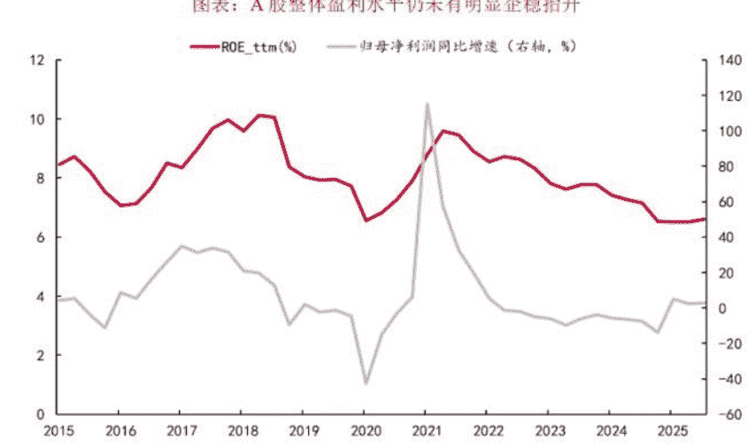

数据来源：Wind，中泰证券研究所

# 图表：大沪深300ETF累积净净流入在市场低迷期增长明显

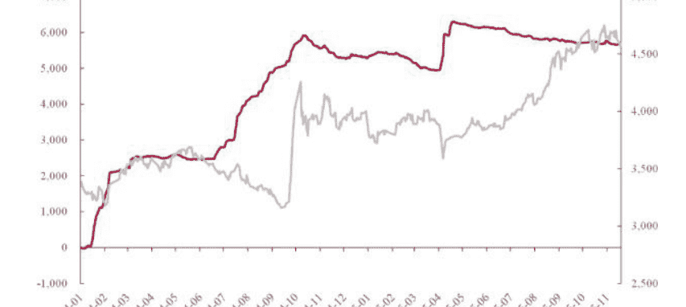

数据来源：Wind，中泰证券研究所

—一手优质源进群微信255

# 图表：截至2025年11月20日，科技类的成交占比为35%

| 主线：台湾 | 主线：新能源 | 主线：消费 |
| :--- | :--- | :--- |
| 55 | | 3900 |
| 50 | | 3700 |
| 45 | | 3500 |
| 40 | | 3300 |
| 35 | | 3100 |
| 30 | | 2700 |
| 25 | | 2500 |
| 20 | | |

数据来源：Wind。中泰证券研究所

Jason-2025-11-24 03:47

国内：中泰证券2025年10月的统计，市场融资账户总数已1539.8万户，而2015年同期仅781.23万户——账户几乎翻倍，且均融规模均高于2015年同期56%。融资热度看来，以往商证券、华泰证券等至少6家券商已登陆融市场相关业务规模较上限，目前融占A股流通值的比例为2.5%，较前有所上升，但仍低于2015年高点。今年11月以来的日均交易额达219亿元，是自8年以来首次挂2000亿元之上。全年来看，2025年日均交易额为1729.6亿元，高于2015年的165.1亿元，显示出市场的活跃程度。2025年市场的另一个亮点，是投资者越来越多借助ETF进行分化布局。目前融已交240亿元，较2015年的530亿元增长34%。#A股

一手优质资源进群微信cuk255

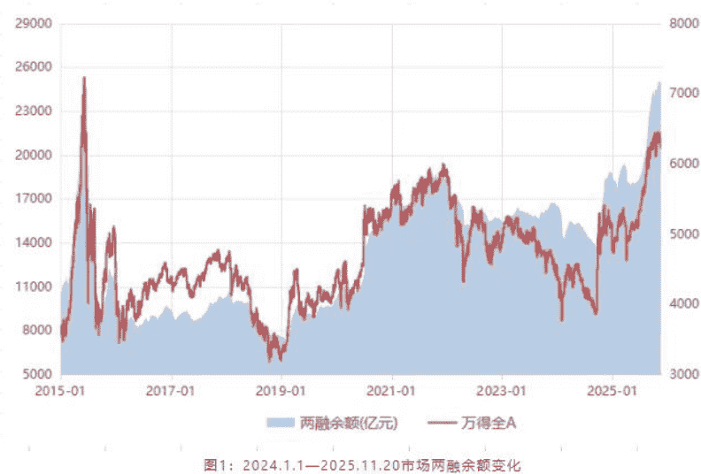

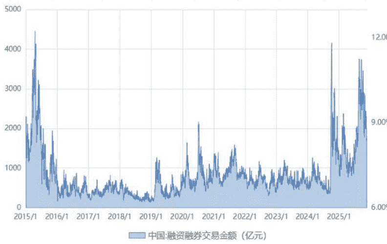

一手优质资源进群微信cuk255

# Jason-com

2025-01-24 03:51

信达：上，业绩基础的延续，后有利于改善重心和资金流入牛市。从整体上看，业绩空窗期、扩张或海外调整均可能带来市场震荡，年后周期可能是政策转向或市场变化带来的机会。未来1年市场周期的波动受监管政策和供给的影响。年后触底的因素，政策和资金的影响往往会放大长期。②行业周期（如地产、钢铁）和国家政策，将持续市场支撑；③利率，维持中长期来看资金流入很大空间。④资金供需节奏引发的居民流动性将逐渐落实。我们认为牛市的基础将延续，与14-15年类似，交易热、资金流入、权益价值、板块规模等因素具有相似性。更多行业的有望持续机会，AI等产业有望实现本地化，具有较强的确定性。各行业有望类16-17年类似的健康复苏，历史上流动牛市的调整和活跃大多受监管，需要监管变化对市场的影响。流动性牛市的核心在于流动性放量的速度，市将再次转匮。

| 未来1年牛市可能的节奏 | |
| :--- | :--- |
| 5600 | |
| 5100 | |
| 4600 | |
| 4100 | |
| 3600 政策需求 更多资金流入 |
| 3100 政策空窗 | |
| 2600 | |
| 2024-09-04 | 2024-10-04 | 2024-10-14 | 2024-10-24 | 2024-11-03 | 2024-11-13 | 2024-11-23 | 2024-12-03 | 2024-12-13 | 2024-12-23 | 2025-01-02 | 2025-01-12 | 2025-01-22 | 2025-02-01 | 2025-02-11 | 2025-02-21 | 2025-02-28 | 2025-03-03 | 2025-03-13 | 2025-03-23 | 2025-04-02 | 2025-04-12 | 2025-04-22 | 2025-05-02 | 2025-05-13 | 2025-05-23 | 2025-06-02 | 2025-06-12 | 2025-06-22 | 2025-07-02 | 2025-07-12 | 2025-07-22 | 2025-08-01 | 2025-08-11 | 2025-08-21 | 2025-09-10 | 2025-09-20 | 2025-09-30 | 2025-10-10 | 2025-10-20 | 2025-11-09 | 2025-11-19 | 2025-12-09 | 2025-12-19 |
| 资金流入 | 监管 | |
| IPO重启 | 监管 | 没有资金流入 |
| IPO重启 | 监管 | 泡沫扩散 |
| | | 资金流入 |

数据来源：万泽，信达证券中心
注：图表仅代表相关条件下趋势，不代表预测点。一手优质资源深度分析cuk255

# Jason

近期，美国“铁电”引起关注，从美国基础的电力需求来看，短期（明年）暂不会电力紧张迹象，甚至供给增速可能是充足；中期（到2030年），数据中心的建设将主要在德州、西等地带来的电力需求增长，可能这些地区电力供给下降，加剧电力可靠性下降（发生停电频率增加），不能满足客户需求。从电力供给来看，当下并不是供给的瓶颈，需求增速处于历史高位，但需求增长受限于生活水平（用电成本/人可支配收入）速度有限，但增长受生活水平变化的迹象。预计2030年，数据中心规模将从33-68GW（中值50GW左右）几乎翻倍，占据2024-2030年电力负荷总量近分之一。同时，中国和欧洲地区数据中心增长需求增速的6%-10%，数据中心的快速扩张，将导致电力需求增加（特别是地区），也导致核心组件的供应链压力，这可能导致目前建设的数据中心不会及时交付（IEA估计有20%可能延期）。各国电力消耗变化（1949-2024）及短期预测

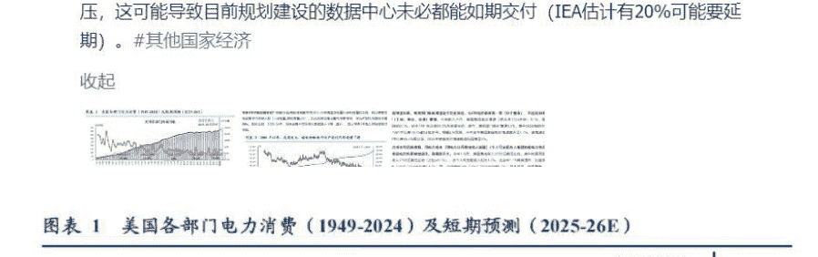

数据来源：EIA，华盛薛

# 图 2 2026年美国数据中心用电有望超过居民用电

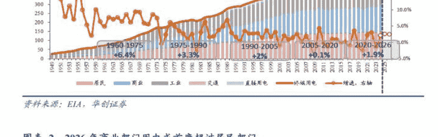

数据来源：EIA，华盛薛

一手优质资源进群微微信255

# 短期视角下（到2026年），供给增速快于需求，发电设备利用率将不再显著未来1年产能利用情况：根据EIA短期展望以及对2025-2026年美国发电量和装机容量的预测，我们预测发电电设备平均利用天数（=发电量/装机容量）将下降，以此反映产能利用率的代理指标。我们发现，2025-2026年，发电电设备平均利用天数趋于或下降（图4），显示未来1年电力供应相对充足。

# 图 3 2021年以来，美国发电、风电和输电配电行业产能利用率下降

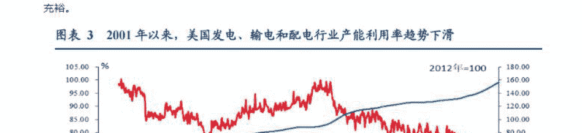

数据来源：EIA，华尔街见

# 图 4 美国用电量与装机容量（预测）

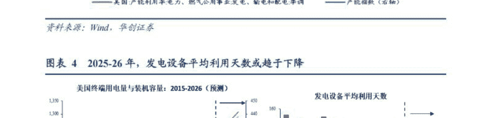

数据来源：EIA，华尔街见。我们预测发电电设备平均利用天数（发电量/装机容量）趋于下降，以此反映发电电设备的利用率，作为产能利用率的代理指标。一手优质资源进群255从电价传递来看，居民部门电价处于历史高位，与CPI电价趋势一致（较为整体），比起其他部门（工业、商业、交通）的21.1%分位，相比2024年的5.1%，涨至2024年的22.1%；在1991年至1998年为85.2%的历史位中，居民部门电价隐含3.8%，高于2024年的3%，从1991年至1998年为86.4%的2026年家庭电价升至4.7%，该尚未回落。从电力成本来看，用电费用（占可支配收入/个人）较高，今年家庭电价增幅增大，涨前六个月，居民可支配收入增长379美元左右，其中居民部门电价增长179美元（占48.1%），但可支配收入增长为1.2%，比上同比缩小，比较过去5年（2020年-2024年）1.2%基本持平，对于上同比，居民可支配收入维持在今年的6.4%，高于此前EIA预测，电价则维持基本持平或增长。区域显著，电力供应较为薄弱的区域（EBCOT区域），家庭部门电价支出与可支配收入

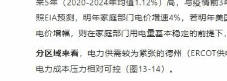

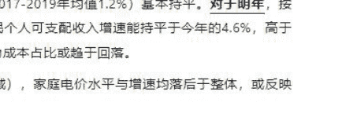

数据来源：EIA, Wind, 彭博统计Jason-bubble-2025-11-24 04:03bloom:美联储的柯林姆斯表示，他尚未决定12月的利率，“决定还在未来。“目前市场在鲍威尔宣布重新维持利后发生变化，转向乐观，因为威廉姆斯被认为是鲍威尔的队友。”金融一手优质资源进群

December Fed Rate Cut Hangs in Balance as Risk Aversion Rules Traders now see greater than even odds of a reduction next month as markets swo across the globe

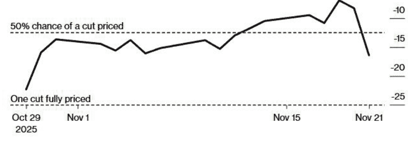

Source: Bloomberg Target Rate Probabilities for 10 Dec 2025 Fed Meeting

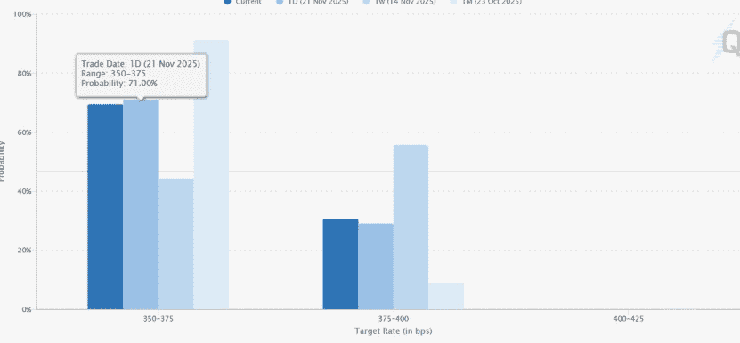

一手优质资源进群微信255

# 图表 5 美股 FOMC 趋势量化分析，支持与不支持的人数为4:5

| 类别 | 成员 | 意见 |
| :--- | :--- | :--- |
| 支持 | 威尔姆斯 (John Williams) | 维持 11月 |
| | 斯米特伦 (Stephen Mirren) | 维持 11月 |
| | 沃勒 (Chris Waller) | 维持 11月 |
| | 鲍曼 (Michael Bowman) | 维持 10月 |
| | 库斯林 (Colm Collins) | 维持 11月 |
| | 奥斯汀 (Augustin Gomez) | 维持 12月 |
| 不支持 | 威尔森 (Michael Barr) | 维持 11月 |
| | 杰弗瑞 (Jeffery Schmid) | 维持 11月 |
| | 穆勒 (Alberto Mueser) | 维持 11月 |
| 未中立 | 李斯 (Lisa Cook) | 维持 11月 |
| | 杰斐逊 (Philip Jefferson) | 维持 11月 |
| | 鲍威尔 (Jerome Powell) | 维持 10月 |

数据来源：美联，申信宏源

中信建：从市场预期来首，在9024年加息周期后，A股首先迎来“信心的重估”，价值屡触新高。在市场预期领先下大量资金流入市场，多个科技行业价值估值较高，我们认为这些行业已经积累了长期增长，预计A股在入季后验证关键期，在2026年之前建议关注重点行业的增长验证（和通胀回归经济改革）情况。我们在1月2日的发布中指出“对未来如何对？”显示，在A股有望上涨的同时，10年美债收益率维持回升，市场情绪面临压力，利空因素需要关注。预计11月市场将进行一轮行情调整，建议投资者持有仓位，适当增加商业政策权重面也进入空市，市场震荡导致资金波动等特殊可能会进一步放大，目前上证指数、创业指50回撤表现优异，10%、15%左右的回撤。

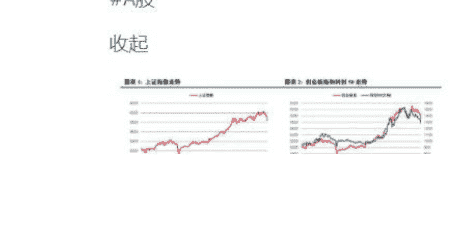

# 图表1：上证指数趋势

# 图表2：行业沪深50趋势

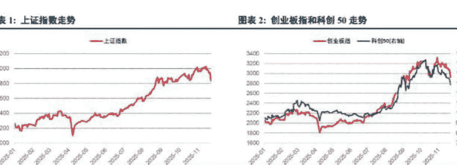

数据来源：Wind, 中信建

# 图表3：2019-2021估值

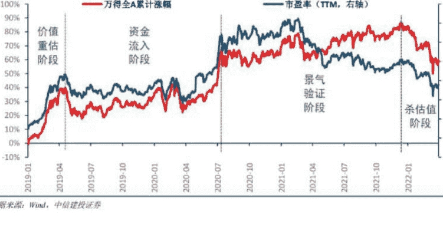

数据来源：Wind, 中信建

Jason-2025-11-24 04:10发：在政策面、基本面、海外市场，流动性出现大幅恶化的情形下跌破20日线后，调整7%。6月、9月、10月三次及20日线后，调整不超过5%，符合规律。本次自11月17日跌20日线后，遭遇4天，调整%，短期内释放的较为充分。A股一手优质资源微信

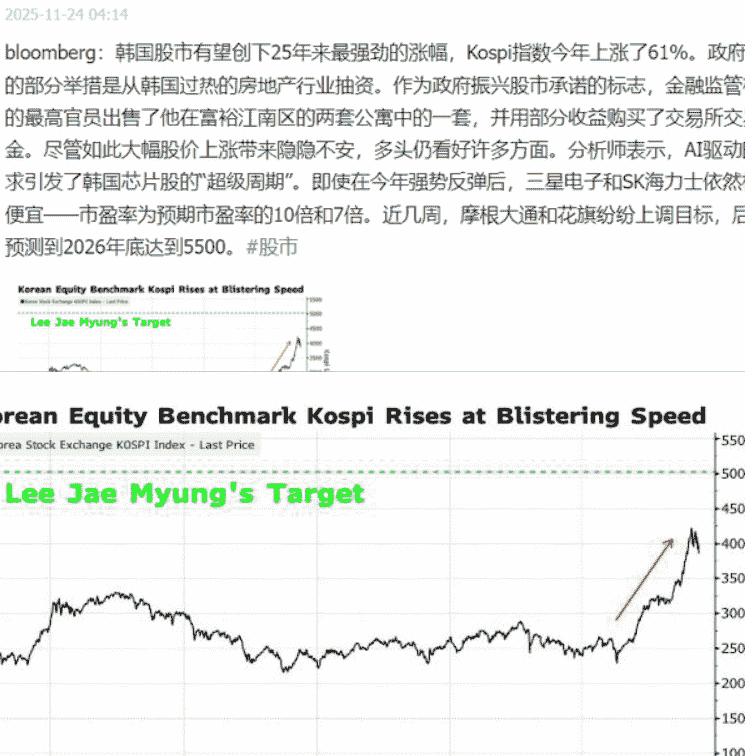

# 图 6：历史上6种指数涨跌率、以及近年来的某种形式

| 期间 | T-5 | T-10 | T-20 | T-60 | T-100 | T-180 | T-365 |
| :--- | :--- | :--- | :--- | :--- | :--- | :--- | :--- |
| 第一阶段(2021年9月日至15日) | 55.60% | 0.33% | 77.80% | 14.40% | 100.00% | 73.06% | 3.2% |
| 第二阶段(2021年6月日至30日) | 58.80% | 0.05% | 58.80% | 1.51% | 100.00% | 82.00% | 11.5% |
| 第三阶段(2020年8月日至31日) | 64.30% | 0.53% | 73.80% | 21.40% | 70.67% | 85.70% | 15.3% |
| 第四阶段(2019年12月日至31日) | 66.70% | 2.45% | 100.00% | 19.15% | 100.00% | 60.22% | 3.3% |
| 第五阶段(2019年8月日至31日) | 80.00% | 4.29% | 100.00% | 12.58% | 80.00% | 84.87% | 21.49% |
| 总计 | 60.00% | 0.77% | 66.70% | 14.69% | 78.70% | 14.25% | 92.00% |

| 2025-06-19 | 3.23 | / | 22.09% | / | 1 | / | -0.31% |
| 2025-09-04 | 2.95 | / | 1.56% | / | 0 | / | / |
| 2025-10-14 | 0.84 | / | 2.82% | / | / | / | -3.54% |
| 2025-11-17 | / | -4.99% | / | / | / | / | -4.99% |

数据来源:Wind；宏观发展趋势中心

bloomberg:- 韩国股市拥有下25年来最强的涨劲，韩国指数今年又涨了61%，政府部分将从韩国等地进行产业升级，作为政府宣布股市的市场，金融机构的首席官他在首江南的办公室之一，并用部分收益购买了交易所基金，由于如此幅幅来波动不易，吸引了许多投资者。

# Jason不离

2025-11-24 04:22

华尔街日报：OpenAI上月显示，chatgpt机器人每周用户超过8亿，且在快速增加。人工智能技术正在快速进步。衡量这一点的方法来自METR，这个非营利机构研究AI系统智能能力的边界。研究人员设计测试，用追踪AI完成的任务复杂度。结果显示AI模型能够稳定完成的边界。任务耗时已持续六年指数级增长，每个月用户翻倍。职业

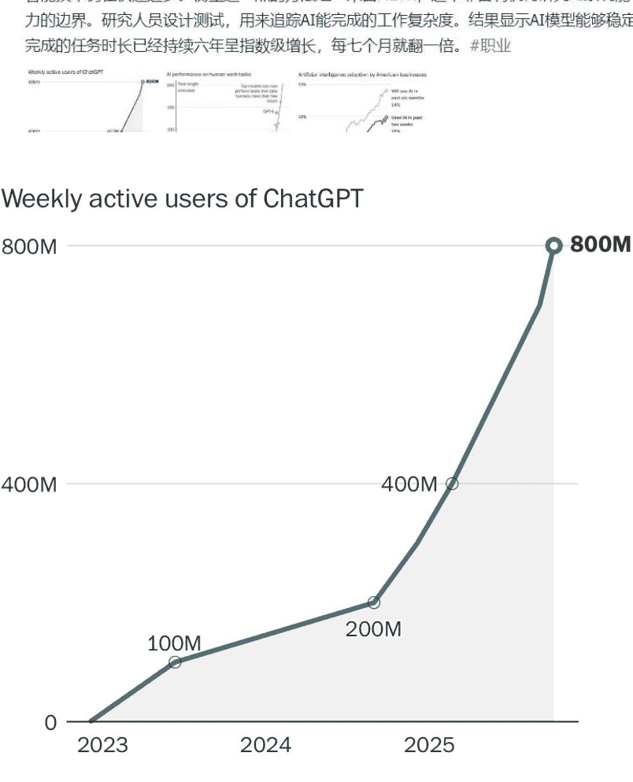

# Weekly active users of ChatGPT

800M
400M
400M
100M
200M
0
2023
2024
2025

Source: Company statements

# AI performance on human work tasks

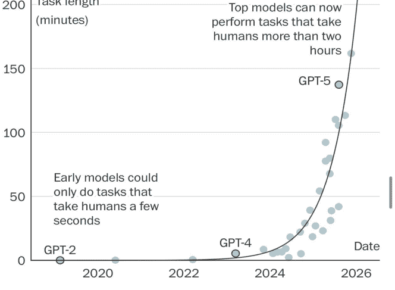

Circles show tasks AI completes with a 50 percent success rate

Source: "Measuring AI ability to complete long tasks" by METR

# Artificial intelligence adoption by American businesses

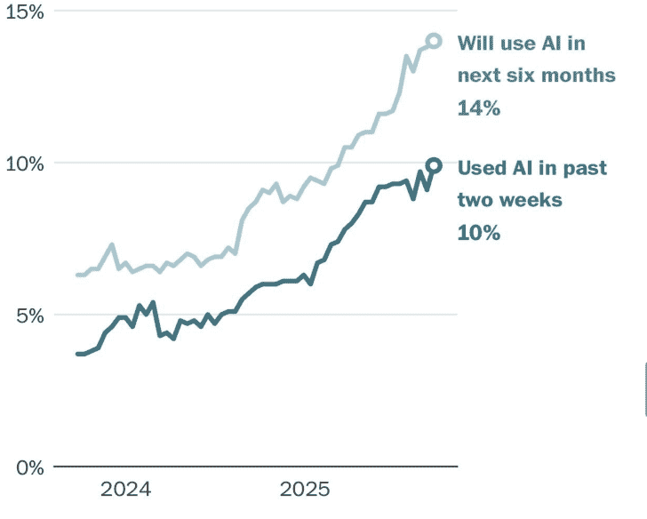

Source: U.S. Census Bureau

一手优质资源进群微信cuk255

# It's the Economy, Mr. President

Share of voters who say Trump is focusing on each issue...

- Too much
- Right amount
- Not enough

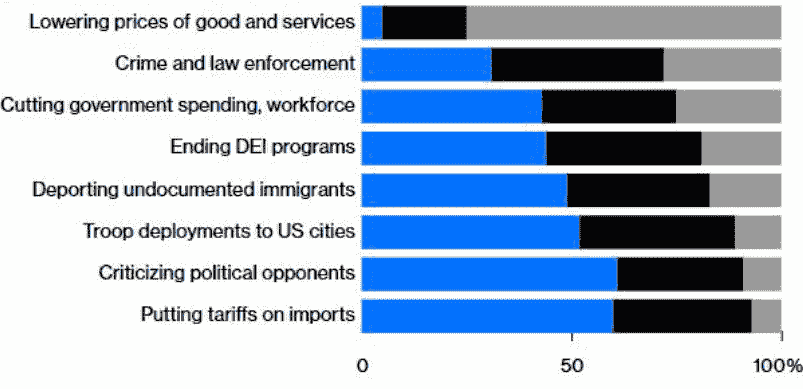

Source: CBS News/YouGov survey conducted Oct: 1-3

# Consumers Pick Up More of the Tab for Trump's Tariffs

Share of tariff burden

- US importers
- Foreign exporters
- US consumers

April 2025

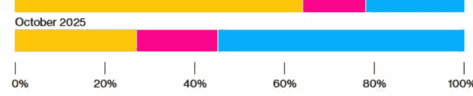

Source: Goldman Sachs

# Jason Flynn

2025-11-24 06:34

BOFA: 基于前瞻流动性对多个资产类别造成的冲击，美联储正面面临被迫扭缓政策转向的压力。回到2025年，全球加密货币市场因首次流动性密集，直接推动了AI投资热潮，日后剧烈波动与加密货币市场重为常态。展望2026年，美联储将重启“宽松”政策，开启降息周期。在这一情形下，三类资产将为受益：一是国债债券，其长期收益率将直接实现利率下行带来的估值回归；二是加密货币，作为对通胀最灵敏的资产，往往在市场信号完全落地前就已开启；三是中盘股，作为对政策成本最为敏感，在降息预期后将展现出显著的弹性与补涨缺口。#金牌 大美模型

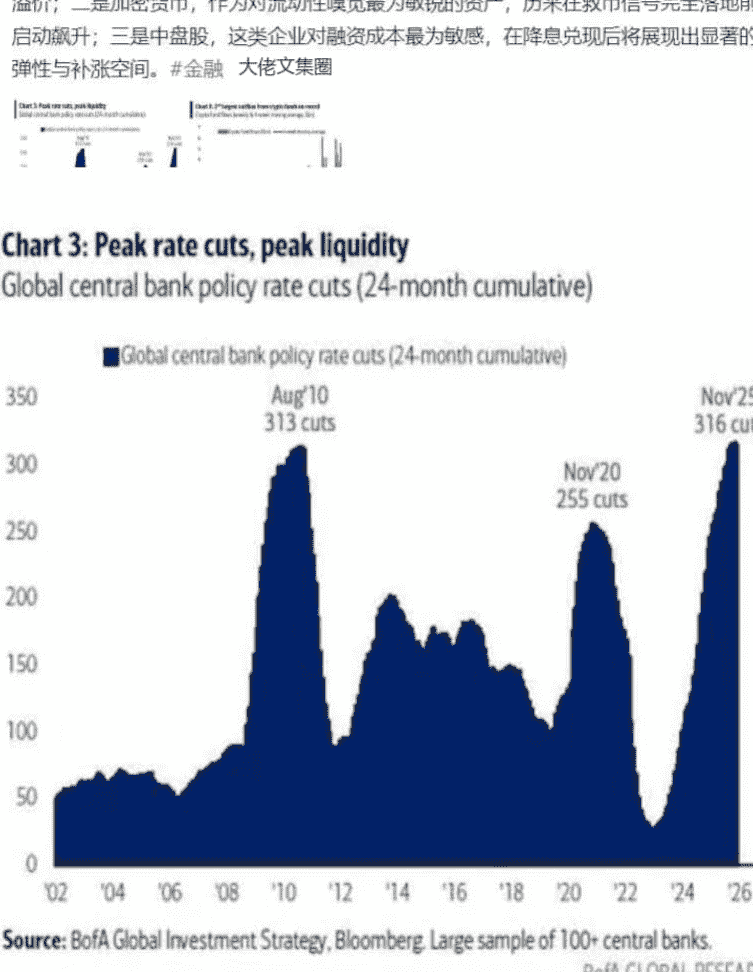

Source: BoA Global Investment Strategy, Bloomberg. Large sample of 100+ central banks. 
BoA GLOBAL RESEARCH

一手优质资源进群微信cuk255

### ### Chart 8: 2nd largest outflow from crypto funds on record

Crypto fund flows (weekly & 4-week moving average, Sbn)

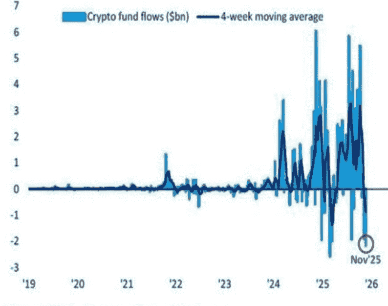

Source: BofA Global Investment Strategy, Bloomberg

BofA GLOBAL RESEARCH

Jason Laing
2023-11-24 04:47

bloomberg: 分析师预估，新西兰储备银行 (RBNZ) 将在本周预期的降息后，逐渐转向中立立场的立场——RBNZ在周三降息25个基点后，可能会释放宽松周期的信号。这意味着澳纽元汇率可能已经触底，并可能回落1.14，下跌近1%。其他国家经济

一手优质资源进群微信cuk255

# AUD/NZD Forms Bears Candlestick Pattern

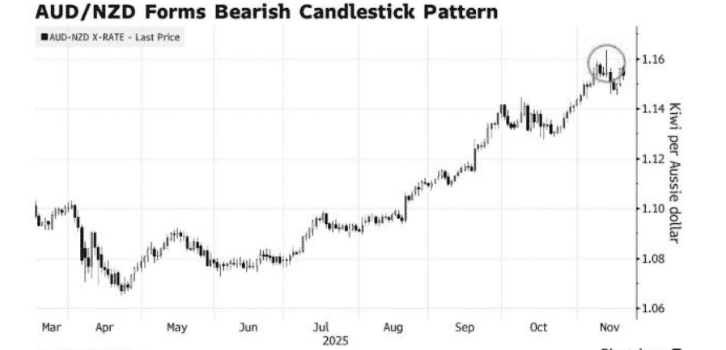

AUD-NZD X-RATE - Last Price

Source: Bloomberg

Jason Noble
2025-11-24 06:55

我们认为居民贷款违约率自2020年以来明显上升，从2019年的5%上升至2022-2024年的平均值10%，这种增加通常会导致还款风险增加15%。按杠杆率计算系统性金融风险，我们认为当前房产贷款率（LTV）比例在40%左右，仍处于安全的水平。对于2021年至2025年，我们认为贷款余额下降了40%，LTV也从70%下降到50%左右。根据不同比例和杠杆率的压力显示，虽然当前贷款额度增加15%并出现风险，部分地区个人贷款额度上升或下降，由于房产价值带来的风险，部分地区个人贷款额度未达到80%的警戒，因此一线、三线城市房产流动性增大，房产市场活跃减弱，房价跌幅已扩大至一线。

我们认为住房流动性进一步下调：2025年10月房产贷款规模较2021年同期下降了53%，贷款压力缓解。我们监测截至今年季度末，房产贷款规模约为55亿元，其中贷款规模对于银行是足够的，但根据压力测试，当前现行贷款处于6.8%的历史低位，剩余空间有限。远期90天以下的下跌并未反映杠杆率的压力，当前银行执行针对房产贷款的准备充足，对于部分小型银行，可能需要压力增大带来的利润。我们静测增加1个百分点的贷款额度和10个百分点的房产贷款上升将导致贷款覆盖率下降3个百分点，对ROE的影响约为3百分点。

# 对房产贷款不良率，个人按贷款不良率仍压力

# 上市银行房地产贷款与不良率

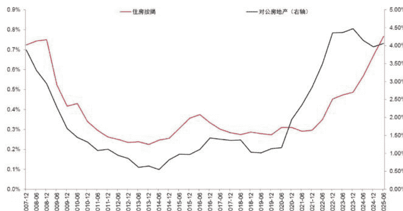

注：根据上市银行数据计算
数据来源：Wind, 公告 中金研究

# 从国际对比来说，中国房价跌度和斜率都在水平

中国大陆、日本、英国、首尔、中国房价指数

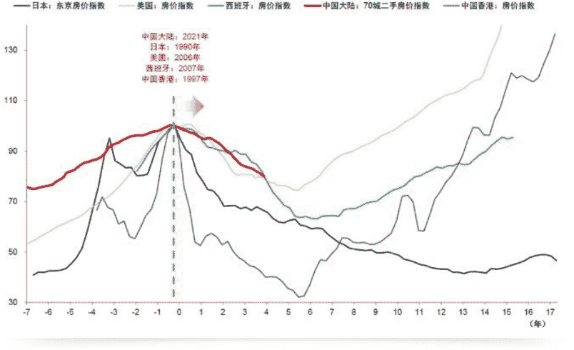

数据来源：Wind，国家统计局，韩国银行，发行，中金研究

一手优质源进群:cuk255

# 从国际对比来看，中国大陆住房贷款违约率较低水平

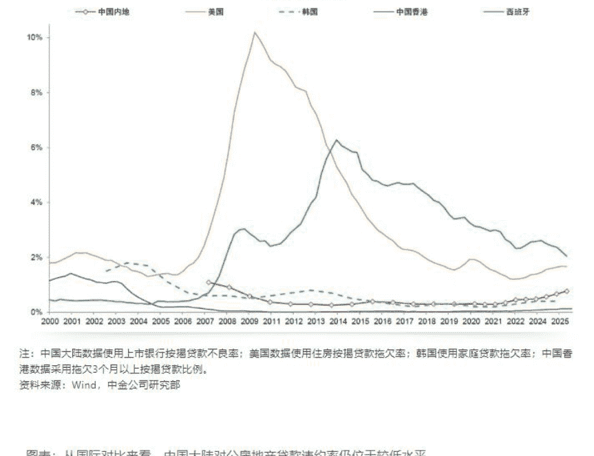

注：中国大陆数据使用住房数据不准确；美国数据使用住房贷款违约率；韩国使用家庭贷款违约率；中国香港

资料来源：中国，金科研究院

# 从国际对比来看，中国大陆对房屋贷款违约率较低水平

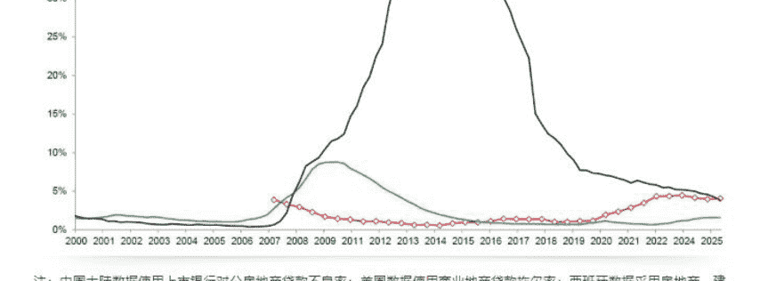

注：中国大陆数据使用公房房地产数据不准确；美国数据使用商业地产违约率；西班牙数据采用住房

资料来源：中国，金科研究院

一手优质资源群cuk255

# 三线城市房价调幅对比—二三线城市更深

# 70大城市二手房价价格指数

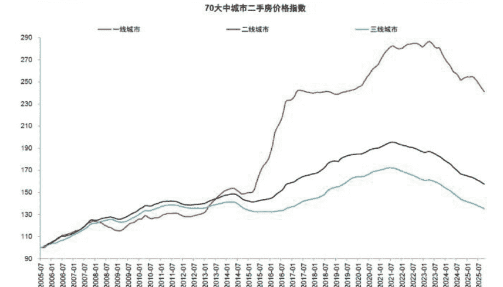

注：盟统计公布70大城市房价调幅计算；
数据来源：Wind、国家统计局、中金研究

# 贷款价值比（LTV）压力测算

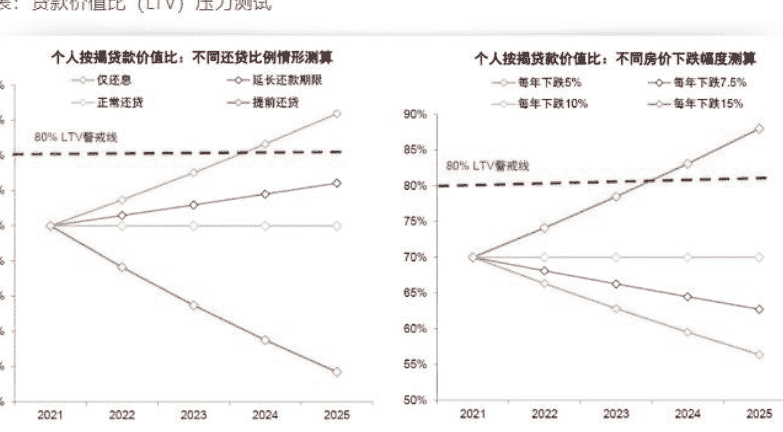

注：初始LTV为70%，假设基准房价跌5%，仅考虑延期还贷/正常还贷/提前还贷情形下每年房价还贷比为0%/3%/5%/13%；假设房价还贷比10%，2022-2025每年二手房价跌幅度为5%/7%/10%/15%
资料来源：Wind、中金研究部

一手优质源进微信cuk255

# 图表：我们测算地产相关负债规模约600亿元

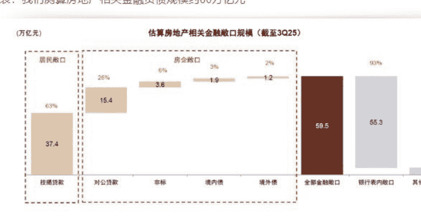

# 房地产行业负债敞口

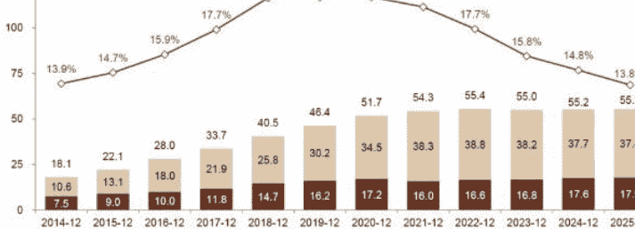

注：数据截至2023年三季度
资料来源：中国银行、国家金融监管局、公司、Wind、中金

图表：我们测算地产相关负债规模约600亿元当前银行执行针对房产贷款的准备充足，对于部分小型银行，可能需要压力增大带来的利润。# 金融

# Jason Flynn

# Jason不离

# 深度视野

# 优质资源进群

一手 优质资源进群微信cuk255

# 限时年费188/年 内部链接全网网V优质内容
