# 南半球聊财经251125

Jason-不遇
2025-11-25 00:37

BCA: MSCI 新兴市场股票指数处于关键节点。它已反弹至此前的高位，似乎新兴市场指数一直遵循——在其长期的移动平均线视，并在之前的高点出现预见，新兴市场基本面未显著改善股市。

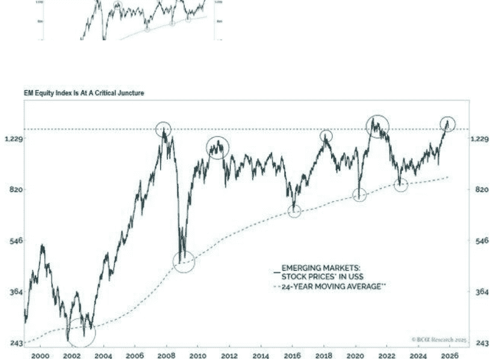

Jason-不遇
2025-11-25 00:52

PPG: 从BIS的数据看，债务被讨论最多的是欧洲，债务未必是最严重的，而被讨论较少的，截至今年第三季度已经超过了300%。#金融

## China Has Taken On More Debt Than Any Other Major Economy Since 2008

Total non-financial sector debt as a percentage of GDP

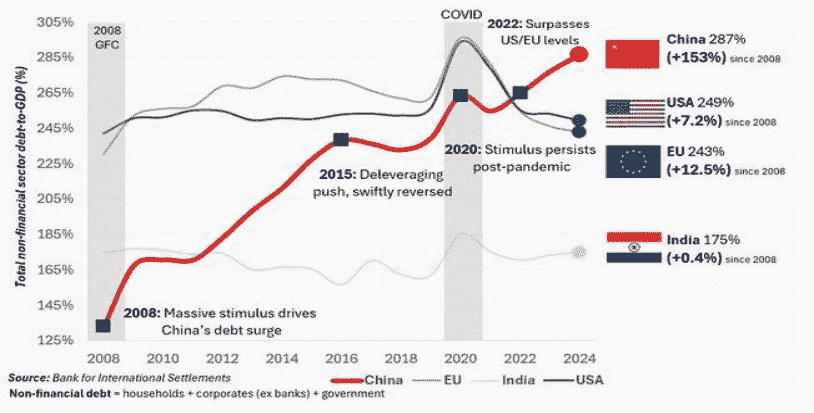

Jason
2025-11-25 01:11

bloomberg: 投资者截至11月已从美国上市的比特币ETF中提取了35亿美元，几乎追平了前瞻36亿美元的月度流出。花研院对这一现象进行了量化：每从ETF中提取10亿美元，价格下跌约3.4%。反过来也是如此，花研最近设定了年度8200万美元的市值目标。#泡沫

### 美国比特币ETF有望创纪录月度流出

- US Bitcoin ETFs cumulative monthly net flow

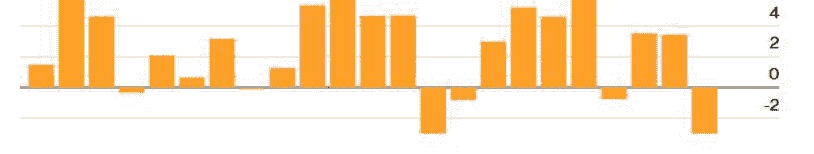

- IBIT monthly net flow

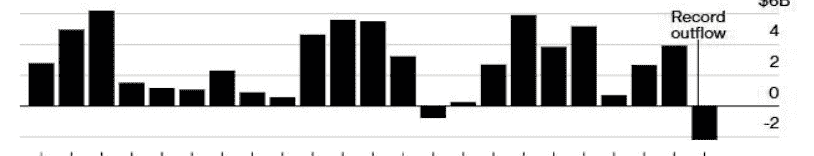

更多优质内容：微信cuk255

# Jason不诡
2025-11-25 01:23

FT: 分亚银行财经经济研究所（Bofit）的一项最新研究，中国出口对俄罗斯JG行业的供应出现大幅涨价，从2021年到2024年，平均价格上涨了87%。相比之下，类似商品出口到其他市场的价格上涨了9%。这主要是由于棉花的采购成本，这是因为俄罗斯无法从其他地方采购。#经济

## Russians are now paying much more for export-controlled goods from China
by users in other countries

Change in unit price of example goods subject to export controls, split by destination (2021-24, %)

| Data-processing machines, automatic, portable |
| --- |
| Spark-ignition reciprocating piston engines |
| --- |
| Centrifugal pumps |
| --- |
| Tapered roller bearings |
| --- |

FINANCIAL TIMES
Source: Bofit

# Jason不诡
2025-11-25 01:23

bloomberg: 目前并没有看到特朗普对华的关税政策带来蓝领岗位的增加，相反，9月的就业数据显示显示COVID以来关键蓝领岗位——制造业、建筑、采矿、伐木、运输和仓储行业的人员比2024年9月减少了59,000人。不过，贝贾斯特对NBC表示，“我们认为我们每周都会看到这些工人工厂开业，自2026年以来非常活跃。#其他国家经济

Trump Overrides Five Straight Months of Factory Job Losses
US manufacturing payroll has lost 59,000 workers since April
* Monthly change in year over year

## Trump Presides Over Five Straight Months of Factory Job Losses

US manufacturing payrolls have lost 58,000 workers since April

- Monthly net job gain or loss
- May-September declines

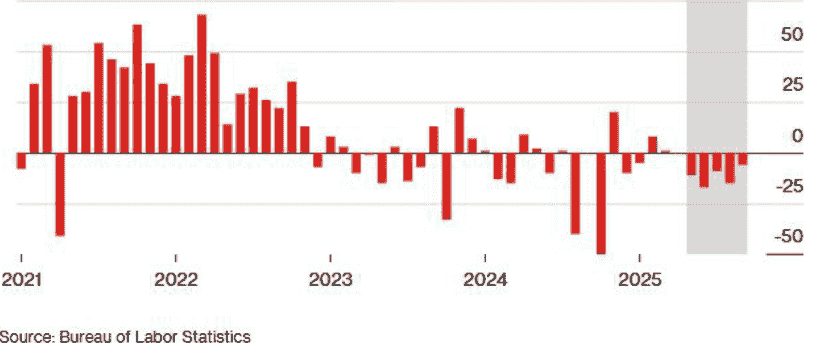

Jason-不错
2025-11-25 01:37

bloomberg: 数据显示英国的收入不平等越未减少，在金融危机爆发前，英国收入最高的纳税人收入几乎是最低者的20倍。这个数字在过去15年几乎一半。#其他国家经济

## 全球金融危机以来，英国的收入不平等急剧下降

最高和最低百分位值者之间的差异已经缩小

- 99th percentile/top percentile (post-tax)

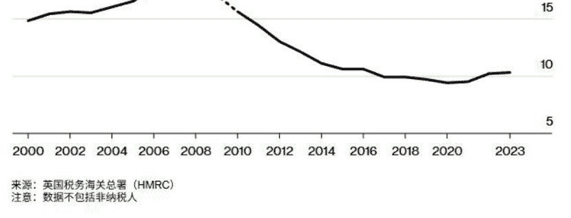

来源：英国税收总署 (HMRC)
注：数据包括非居民

## 英国的收入不平等降至20世纪以来的最低点

基尼系数：得分越高，不平等越大

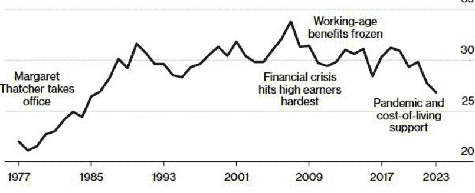

来源：国家统计局
注：1994年4月起

## 越来越多的英国工人缴纳40%或45%所得税的比例急剧上升

- Higher rate (40%) 
- Additional rate (45%)

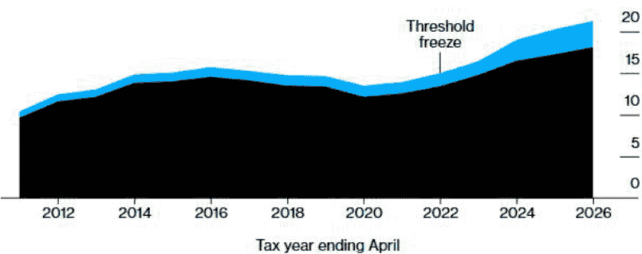

来源：英国税收总署（HMRC）
注：23/24纳税年度为预计

Jason/London
2025-11-25 01:00

FT:随着监管放宽，全球基金疯狂收购印度银行的股权。其中日本买家的身影尤显活跃，“对于日本，资本已进入老龄阶段，人口老龄化的经济，他们需要寻找某种方式来配置资金，使风险调整后的回报才合理。这方面，印度是一个非常有力的市场。”#金融

更多优质内容：微信cuk255

## Inbound M&A rises in India's financial sector

Total value of M&A deals by foreign buyers in India's financial sector ($bn)

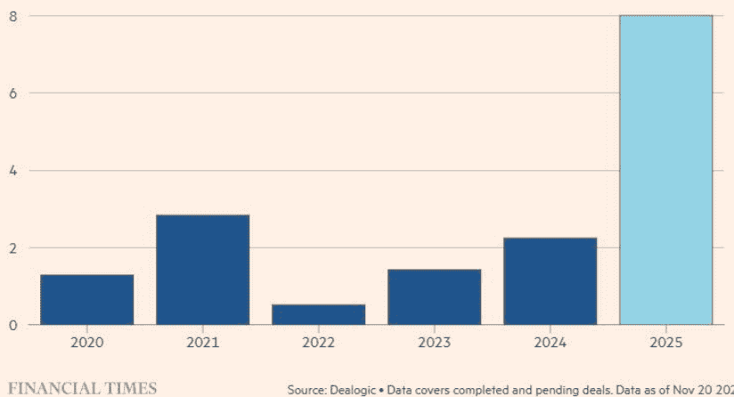

FINANCIAL TIMES
Source: Deologic • Data covers completed and pending deals. Data of Nov 20

Jason-不离
2025-11-25 01:47

国信达：10月全国个人所得税环比下降1.97%，同比下降17.9%。挂牌价环比下降0.67%，同比下降15%。#经济

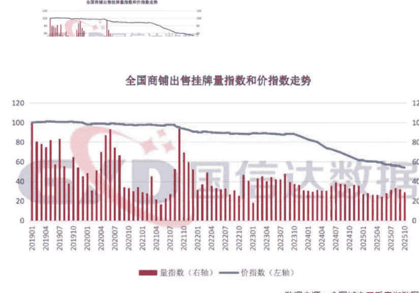

更多优质内容：微信cuk255

经济观察：今年以来，北京、上海、浙江、广东等地部门通过短信、电话和APP等多种方式，鼓励居民投资海外，助力2022年至2024年外贸收益的申报手续。#TAX

2025年1—10月，全国个人所得税收入13336亿元，同比增长11.5%，较上一季的8%，第三季度的9.7%逐步走高，10月增速跃升至27.3%，成为主要收入来源的亮点。国内消费14390亿元，同比增长4%；企业所得3182亿元，同比增长1.9%。

山东大学税务中心主任李华荣对经济观察表示：“2025年个税高增长并非偶然，而是证效与税收精细化升级、税源多元化与监管到位共同作用的结果折射出我国税收治理能力的显著进步。”

她说，这一持续高端态势背后，是税收精细化升级、监管到位、平台监管补位与资本市场活跃、收入结构优化等多重因素的共同效益。东方财富财经部执行总监冯玮认为，10个月个人所得税同比增长27.3%，增速较上月加快0.6个百分点，今年以来个人所得税收入保持较快增长，除低基数外与税收监管能力的加强密切相关。

更多优质内容：微信cuk255

Jason-Zhou
2025-11-25 01:56

## 《人口与经济》：我国基本医疗保险对居民生育意愿的影响——论文或书籍推荐

第一，基本医疗保险显著提升了居民的生育意愿，且在群体异质性中，意愿的促进作用更为显著；第二，新农村家庭、低教育水平以及低收入人群的生育意愿受基本医疗保险对生育意愿的影响无显著影响；第三，分类分析表明，基本医疗保险通过增强生育保障和降低医疗支出促进生育意愿；第四，基本医疗保险在对生育意愿的影响中通过商业保险产生替代作用，进而抑制了居民的生育意愿；第五，进一步研究显示，基本医疗保险对已育居民的生育意愿有意显著，尤其是对于高龄居民，对生育意愿的影响明显。

### 摘要

当前我国人口发展面临“两压”严峻挑战，超低生育率使人口增长减缓，人口红利正逐渐变为“人口负担”压力。这种人口结构的时代性转变，不仅面临养老压力，更面临劳动力供给减少的压力。因此，实现生育友好型社会，完善生育服务与就业支持日益重要，有利于人口可持续发展。“面三”政策下，青壮女性对生育意愿的增强，基本医疗保险作为关键的社会保障制度，对生育意愿的作用备关注。本文通过理论和实证分析，深入探讨基本医疗保险对研究基于2019年和2021年人口普查数据（CSS），分析基本医疗保险对居民生育意愿及生育数量的影响。研究发现居民生育意愿随时间而变化，首先通过回归分析生育意愿的驱动因素，其次通过双重回归模型和倾向得分匹配模型，界定基本医疗保险对生育数量的因果效应。再次，按年龄、职业及地区特征进行分样本分析，发现基本医疗保险对生育意愿的影响具有群体质性，并一步分析城乡城镇保险城乡居民保险的差异。最后证明基本医疗保险对居民生育意愿的作用，构建中介效应，显示生活满意度和收入水平具有中介作用，深入探讨基本医疗保险对生育意愿的作用路径与传递机制。研究结论：一，基本医疗保险保障状况对居民生育意愿和生育数量呈现正向影响；二，分析显示不同人群对医疗保险依赖程度不同，无论是男性还是女性，基本医疗保险表现出显著的正向影响，在生育数量方面，女性受影响。三，不同地区类型存在差异，城乡居民对补贴功能能够缓解生育压力，而规模导致生育推迟。四，基本医疗保险通过“收入增加”提升生活水平，从而增强生育意愿。

Jason-不磊
2025-11-25 02:04

敞：我们的外汇资金显示，10月净流入了约300亿美元，其中240亿美元来自客户。再加上外汇对美元强的预期，我们认为美元对汇率将逐步低，即人民币逐步升值。我们已经将3个月/6个月预测从7.0/6.9调整至6.5/6.8。我们的地产将增加，如果房贷利率达到一个百分点，那么每月还贷可以与租平。

### Our preferred gauge suggests FX inflows

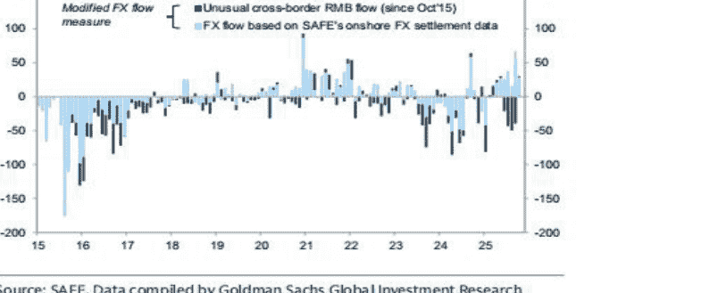

### Potential mortgage rate will reduce the gap between mortgage payments and rental costs

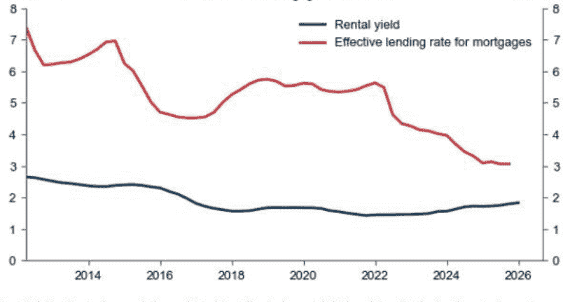

Rental yield refers to population-weighted 6-city rental yield, and the effective lending rate for mortgages is only. Source: Goldman Sachs Global Investment Research, Haver Analytics

Jason不鑫
2025-01-25 22:16

BOFA: 金融多次创新高，且被买入，仍然不足。看多到5000美元。我们现在预测2026年增长率为3.3%，2027年为3.4%，通胀在2026年保持稳定，美国增长率2.4%，CPI增长2.9%和0%。Au path to $5000/oz: Gold has a series of records, has been overlooked, remains underestimated. Many the macro drivers pushed the yellow metal higher, including unorthodox US policies, remain support. There is a pathway for gold to hit $5,000, though a tough by the Fed is risk. We raise long-term gold and silver to $2,500 and $535oz. We upgrade to focus on capital return, strategic redirection of the business to emerging market jurisdictions, 2026 to see an improvement in Nevada Gold Mines (NGM) unit costs, still under appreciated from attractive relative value to senior peers. Agnico Gold Mines (AEM) and Pan American Silver (PAAS).

Exhibit 3: GDP growth, inflation, and policy rate forecasts We now forecast GDP growth at 3.3% in 2026 and 3.4% in 2027, to remain stable in 2026.

| | 2023E | 2024F | 2025F | 2026F | 2027F | Current | Short term interest rates, % | 2023E | 2024F | 2025F | 2026F | 2027F |
|---|---|---|---|---|---|---|---|---|---|---|---|
| Global | | | | | | | | | | | |
| Developed Markets | 1.6 | 1.6 | 1.7 | 2.6 | 2.3 | 2.1 | 2.81 | 2.79 | 2.39 | 2.43 |
| US | 2.1 | 2.4 | 2.2 | 2.2 | 2.1 | 2.1 | 5.33 | 5.33 | 4.60 | 4.30 |
| Euro | 0.9 | 1.4 | 1.0 | 2.4 | 2.1 | 1.8 | 2.00 | 2.00 | 1.75 | 1.75 |
| China | 5.2 | 4.6 | 4.5 | 4.4 | 4.0 | 3.5 | 2.90 | 2.50 | 2.20 | 2.00 |
| Japan | -0.2 | 1.3 | 0.7 | 0.8 | 3.1 | 1.9 | 0.50 | 0.50 | 1.00 | 1.50 |
| Emerging Markets | 4.3 | 4.6 | 4.4 | 4.3 | 2.5 | 2.6 | 4.50 | 4.40 | 3.80 | 3.73 |
| China | 5.0 | 4.5 | 4.5 | 4.2 | 0.1 | 0.0 | 1.40 | 1.40 | 1.20 | 1.20 |
| India | 6.5 | 7.5 | 3.5 | 9.2 | 6.8 | 5.5 | 8.63 | 8.82 | 7.00 | 6.08 |
| Emerging ME | 2.5 | 3.2 | 3.7 | 3.5 | 9.2 | 6.8 | 5.65 | 5.65 | 5.20 | 5.20 |
| Latin America | 2.1 | 2.3 | 2.3 | 2.2 | 2.2 | 2.2 | 9.36 | 9.36 | 8.60 | 8.67 |
| Brazil | 3.4 | 2.5 | 1.8 | 4.8 | 4.5 | 4.0 | 15.00 | 15.00 | 11.25 | 10.25 |

## Exhibit 2: The US GDP Growth Outlook Looks Decent Again

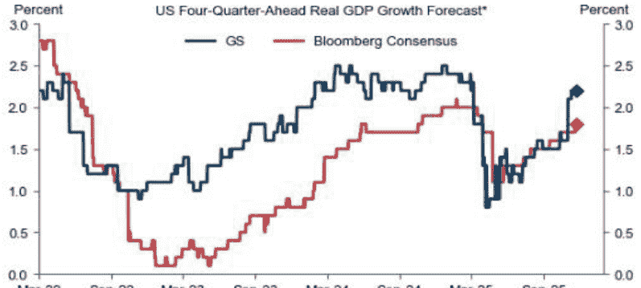

*Interpolated between quarters on a daily basis.

Source: Bloomberg, Goldman Sachs Global Investment Research

## Exhibit 3: Tariff Pass-Through Kept Inflation 3% But Abate in 2026

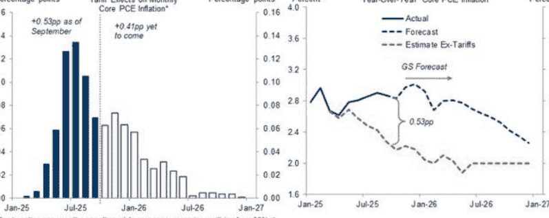

*Our baseline assumes the pass-through to consumer prices will rise from 50% in Jan-25 to 70% in H127.

Source: Goldman Sachs Global Investment Research

## Exhibit 1: More Cuts Coming

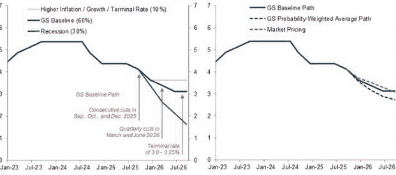

Source: Bloomberg, Goldman Sachs Global Investment Research

## Jason不离

2025-11-25 02:14
bloomberg: 美联储克莱斯·托夫·威尔逊一表示支持12月降息，激发了乐观情绪。#金融

Target Rate Probabilities for 10 Dec 2025 Fed Meeting

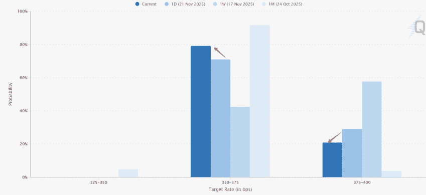

## Jason不离

2025-11-25 02:18
特朗普：通话很愉快。我接受了邀请，明年4月访问，然后晚些时候，我们会在英国见面。

### 政策分析

## Jason不离

国信：去年，全国住房租赁市场整体步入调整季，呈现出明显的“量价齐跌”态势。所有监测城市的租金指数均环比下降，一、二、四线城市分别下降0.69%、0.65%、0.45%和0.61%，同比亦全面回调，跌幅分别为2.31%、3.01%、2.99%和5.03%，其中四线城市同比跌幅最为显著。

### # 宏观数据

| 2025年10月城市租赁市场数据摘要 |
| --- | --- | --- | --- |
| 北京 | 75.23 | -0.69% | -2.31% |
| 上海 | 68.45 | -0.65% | -3.01% |
| 广州 | 55.12 | -0.45% | -2.99% |
| 深圳 | 62.18 | -0.61% | -5.03% |

## 2025年10月各城市租金指数涨幅情况

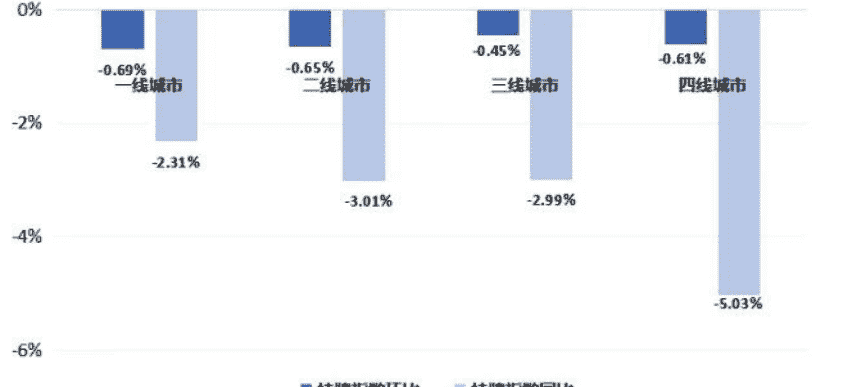

表：2025年10月重点城市租金及指数涨幅

| 城市 | 租金（元/月·m²） | 指数同比涨幅 | 指数环比涨幅 |
|---|---|---|---|---|
| 上海市 | 81.28 | -0.54% | -1.70% |
| 北京市 | 79.57 | -0.96% | -3.65% |
| 深圳市 | 76.68 | -0.45% | -1.32% |
| 广州市 | 47.15 | -0.41% | -2.67% |
| 杭州市 | 46.64 | -0.50% | -3.06% |
| 南京市 | 36.06 | -0.76% | -5.21% |
| 福州市 | 33.7 | -0.47% | -3.64% |
| 成都市 | 31.77 | -0.60% | -2.13% |
| 天津市 | 29.18 | -0.92% | -1.30% |
| 大连市 | 28.71 | -0.91% | -2.93% |
| 武汉市 | 27.65 | -0.03% | -2.09% |
| 西安市 | 26.43 | -1.41% | -5.64% |
| 青岛市 | 23.27 | -0.89% | -4.36% |

数据来源：国信达数据

更多优质内容：微信cuk255

## 深度视野优质集群（链接优质社群，助你成功）

全部包含以下内容：限时年费188/年 加微信cuk255

- ① 吃瓜群众包帝文加时群对话（原价 365 元/年）
- ② 子明私享（内部）文章
- ③ 政事室（子明佛）付费内容
- ④ 米联锦顶【作者米】（原价 599 元）
- ⑤ 欧洲金雀会员专属（原价 328 元/年）
- ⑥ 砖瓦斥内部（原价 400 元/年）
- ⑦ 卢克文读书会专属（原价 699 元/年）
- ⑧ 鉴茶财经星球（原价 3310 元/年）
- ⑨ 猫哥的视界星球（原价 299 元/年）
- ⑩ 财经周刊【独家新闻】（原价 1498 元/年）
- ⑪ 杨世光在钱圈（原价 2200 元/年）
- ⑫ 森淼财经星球（原价 1600 元/年）
- ⑬ 激源异译课付费持续更新

- ⑭ 司马林解读毛选全套音频和全套书籍无损无割（原价2.3 万）
- ⑮ 虚政三部曲【民国梦、帝国亡、不被理解的 MAO】（原价 599 元）
- ⑯ 卢克知识星球文章（原价 268 元/年）
- ⑰额外再送：卢薛元微博付费专栏、三村丰老、三花九树文集

不定内容：......（更多资源不下去了......
- 守夜人司令星球、接换魔王后星球、财富知识星球
- 创始星球、达叔浅论星球、成就财富圈、雪花甲老头等
- A视野、大树乡谈、江初俊、泮说、上海海家等付费文集
- 西凤付费文章、老端、赢在八小时之外、局外的视界、升值、老体制内等其它一些大V付费文集

## 深度视野文集
进群微信cuk255

深度视野（付费文集）

限时年费188/年 低成本链接全网U优质内容
