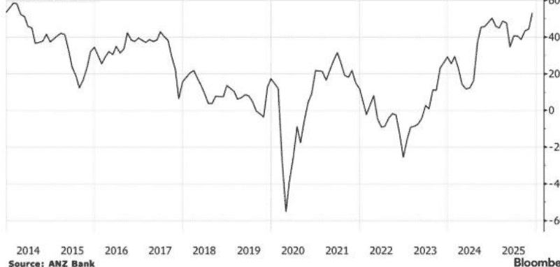
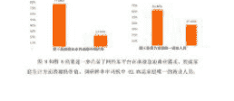
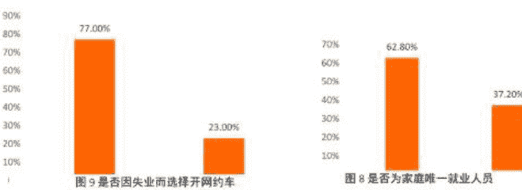
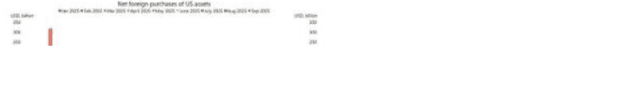
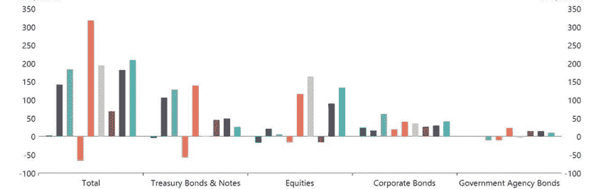
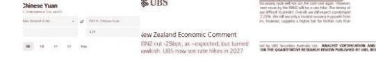
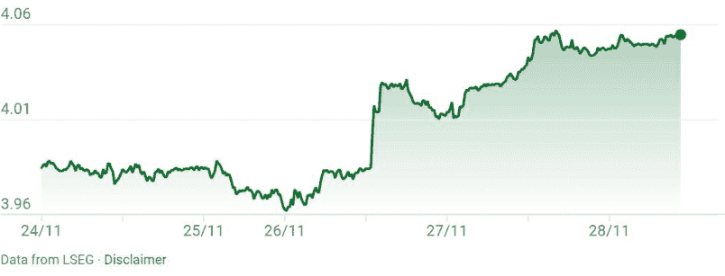
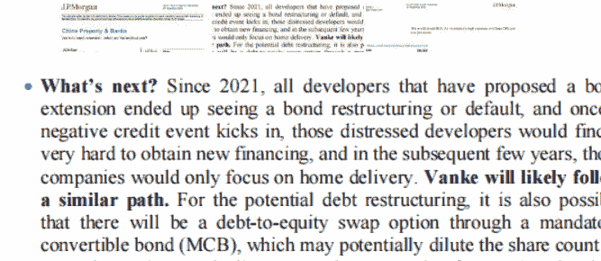

# 南球聊财经

Jason不羁
2025-11-28 00:03

经：日本国土交通的调查显示，东京23区的新建住宅，海外住所的人的比例2025年1~6月为6.3%，大阪市的这一比例为4.3%，仅从东京6区（千代田区、中央区、港区、新宿区、文京、涩谷区）未，外国人的比例高达7.5%，呈现越近越高的趋势。按国家和地区来访，23区的购买者最多为19套，中国大陆有30套，新加坡有21套。

| 新建住宅买家 | 2025年1~6月 |
| :--- | :--- |
| 东京圈 | 10.0% |
| 东京都 | 1.5% |
| 其他 | 3.0% |

## 新建住宅家中居住者的比例

| 2024年 | 2025年1~6月 |
| :--- | :--- |
| 东京圈 | 10.0% |
| 东京都 | 1.5% |
| 东京23区 | 1.6% |
| 其他23区 | 3.2% |
| 横滨市 | 0.3% |
| 大阪市 | 5.1% |
| 名古屋市 | 0.6% |

(注)23区为千代田、中央、港、新宿、文京、涩谷

一手资源群微信fc255

Jason不嵩
2025-11-28 00:00

申万宏：企业收款增速回落，收款周期的边际改善，反映清偿款政策在推进。从绝对指标看，5月以来，收款增速持续回落，同比降至1%，与此同时，周转率持平上月（5.3次），较月维持明显收窄，反映回周期已边际好转，经济数据

## 企业收款增速

资料来源：Wind，申万宏研究

Jason不嵩
2025-11-28 10:10

## FT: 高楼的安全性成本

某大型房企的资产负债率（Weight）处于高位，资金供给紧张增加了房企的压力：“随着围城之日，流动性断裂一角，风险边际开始积累。”2023-11-28 10:24 (北京时间) 周二

一手资源群微信cuk255

《金时报》吴狮 | Will Langley 更新

68岁的香港退休居民黄女士（Ms Wang）准备煮饭时，两名消防员突然破了她高层公寓的房门，警告她火灾下方的发生了。“我往外看，发现全是黑。我当时坏了，立刻跟着他们一起离开了，什么都来得及。从25楼跌下去，差些要了我的命，但只是咬了脚没进来，”她在阳台顶声说，看一看处大扑在打着火的炬，这场火灾发生在周二，这是一栋典型的香港住宅，单层公寓超过30层，火势迅速延到这个屋大住宅中的七层。

香港房屋委员会（Hong Housing Authority）表示，这个屋位于大埔（Tai Po）区，地面积约20公顷，拥有2000个单位。火灾熄了整个建筑，这里还有高楼林立十万人居住在灾影响的公屋内。

包括在灾区附近的临时安置中心和学校的临时庇护所。黄女士：“我不想回去，我不知道哪里能收留我，我在家里。”

“我注意到十楼停车场在起火附近，灭火的水柱只能喷到20层，”她确定受影响的公屋样本。

周四凌晨，附近的公路的消防车在百米双车上不断，路面上停满了消防车与救护车。空气中弥漫着浓烟与焦味，志愿者们试图抓住庇护所运送的水和食物。附近大埔街的一位货物档推荐，他有一辆有两个椅子的推车在市中心，他说：“我就想害怕，我在这里生活已经多年了，这里还有很多人可能在这里买过东西。”

Jason-ason
2025-11-28 00:17

Counterpoint Research: 苹果的智能手机将行业夺头，可能会在2025年为14年来首次年度出货量冠军，超越此前的三星并可能保持领先地位至2029年。明年上半年将发布的iPhone（预计在2026年发布）iPhone，预计2025年的智能手机出货量占全球市场的19.4%，第一；而三星的出货量预计同比增长4.6%，市场为18.7%。智能手机零部件的上涨将对市场造成压力，更具昂的市场增长压力，但苹果和三星已具备整合的供应链和零部件采购能力，“表现”

Counterpoint表示，苹果于9月发布的iPhone 16在“新兴地区”引发广泛关注，预计销量比去年增长10%，高于整体市场3%。今年的智能手机表现尤为亮眼，尤其是第三季度。销量超出预期，同比增长9%。

“iPhone系列的的发布标志着苹果产品线的重大变化，”Counterpoint指出，其中包括iPhone Air取代Plus，新增内存和定价策略也经过调整。

根据Counterpoint追踪数据，美国市场四个季度的销量与iPhone 16相似（不含iPhone SE）增长了16%。同时注意的是，中国市场的销量也创下双位数高。Counterpoint指出，“iPhone系列到为止的高增长，手机周期的关键因素在于手机处于转折点。”分析报告指出，经历长期未购买的用户如今可能考虑更换新机。此外，从第二季度开始，3.5亿台的更换有助于苹果在未来几年实现升级。Counterpoint指出，苹果受到美国政府和地缘紧张局势的负面影响低于预期，这不仅影响了苹果正在进行的制造多元化，也推动了其增长韧性。与此同时，苹果延迟推出的Apple Intelligence功能并未影响销售，尽管苹果对AI采取了更为审慎的策略，在过去上个月后，投资者更加加紧，股价在“华尔街清单”中表现最为软。

Jason-
2023-11-28 23:23

日本：日本开始对大量商品征税，跨境电商平台外的漏洞

一手资源群微信cuk255

通过跨境电商从海外购买商品，日本政府及执政党已调整规定，要求大型电商平台承担纳税义务。此前享受免税的政策，万美元以下的交易将被纳入消费税。此次调整自1月26日召开的会议上，日本政府提出了一项税制改革案，目标是在今年内，销售额超过50亿欧元的电商平台包括Temu、希音（SHEIN）以及eBay等卖家将成为征税对象。目前日本对万美元以下的进口商品免除消费税。这项规定同样适用于海外商品的购物渠道，这正是跨境电商能够销售低价商品的原因之一。现规定，进口商品本身需要缴纳消费税，入境平台的商家有义务向消费者收取，反映跨境电商商家的情况并不十分。

Jason-
2025-11-28 02:27

## FT: 德国的养老金问题

一手资源群微信cuk255

德国政府最近公布了一项养老金计划，其中一项引发了巨大的争议。在这份计划中，承诺到2031年，德国的养老金将增加到国际平均水平。这直接意味着，承担养老者的压力将进一步增大。同时，不可忽视的费用是，德国的老龄化程度加剧，进入养老的人数在增加，劳动者人数却减少，还会引起争议。在这里，德国的老龄化危机究竟由谁来承担？

这里48%的养老金是不靠退休者支付的，养老金是工作期间工资的48%，是由雇佣者和参与养老的人缴费的这种方式被称为“收付现制”，退休后的养老金是其工作期间平均工资的比例。标准养老金的领取取决于工作年限，以及缴费养老金的人数。由于德国人在退休前缴了45年养老金，根据2015年7月的数据，每个得分对应的养老金金额为240.79欧元，标准养老金为1835.55欧元，退休年龄需增加到67岁以后。

设计这样一个计划，首先可以减轻养老的压力，从未来避免危机，而引发的争议在于它的不公平之处，以及可能产生的问题。我们首先来看德国养老金的水平。2014年德国养老金总支出为915亿欧元，其中主要是退休金和医疗金，以及120亿元的养老金，退休后就是退休金的来源。由于对养老金水平的刚性规定，德国的压力非常严峻。

德国的老龄化程度是。1962年，老年人口与劳动人口比例为15.2；2022年，该比例上升到25.1。而现在，随着“婴儿一代”进入了退休年龄，退休的人数将增加。与此同时退休人数也在增加，由于劳动者人数在减少，德国考虑将退休年龄设为67岁。

德国自统一以来，养老金支出占GDP的比例比其他国家高，德国并向养老金缴费的比例在下降，从1970年的19.6%下降到2025年的2.5%，虽然没有增长，2003年曾达到23.4%。如何如此引发的后果呢？在不断增加的压力下，不得不改革，养老金占GDP的比例为62.2%，2000年接近最高水平。更困难的是，在可见未来，养老金制度无法满足所有人。随着劳动者的减少，养老金负担将不断增大，养老金看起来充足，但是相对的。德国的人均收入在人口中位数为60%，被视为发达国家。2024年调查显示，单身人士平均每月为1381欧元，这意味着德国人口面临贫困，65岁以上人口比例为19.4%。这项计划增加了约35万人。来自德国IW的研究显示，主要关注收入，通常忽略了财富，一些65岁以上老年人拥有相当的财富。2023年，一方面，家庭财富至少达到17.2万欧元，另一方面，最低不到1900欧元。

## 改善收入分配

一手资源群微信cuk255

图3 我国劳动市场趋势，居民可支配收入与最终消费率变动情况

数据来源：国家统计局。

Jason-
2025-11-28 00:47

日经：特朗普家族对加密货币非常重要，反过来，如果特朗普彻底入场，整个加密资产市场可能从规模为3.57万亿美元在过去一年中增长了1.5倍。其背后是国家储备和特朗普考虑加密货币视为必然的“特朗普政策迎来曙明”。副总统万斯及商务部长哈特尼克也可能通过个人或关联企业持有加密资产。

## 特朗普家族的加密资产

| 特朗普资产 | 金额 |
| :--- | :--- |
| 34亿美元 | 29亿美元 |

(注)除比特特外，其余截至1月27日的流通市值。CoinGecko调查数据

## 特朗普加密关键人物

| 人物 | 贡献 | 状态 |
| :--- | :--- | :--- |
| 赵长鹏(币安创始人) | 为WLF的流通做出贡献 | |
| 孙宇农(TRON创始人) | 向WLF投资7500万美元 | 停止诉讼 |

特朗普政府上线再次掀加密资产热潮

5万亿

Jason不邈
2025-11-28 00:59

贝齐在2020年发布《超高层住宅画像》，一线、新19城郊时有近1.5万个超高层住宅小区（>30层）。

为什么要那么高，周天在之前文中通过分析，每增加一层，土地财产产业链就多一层利

一手资源群微信微信cuk255

# 19城摩天住宅小区数量分布

| 摩天住宅小区数量 | 0 | 500 | 1000 | 1500 | 2000 |
| :--- | :--- | :--- | :--- | :--- | :--- |
| 东京圈 | | | | | |
| 东京都 | | | | | |
| 东京23区 | | | | | |
| 其他23区 | | | | | |
| 横滨市 | | | | | |
| 大阪市 | | | | | |
| 名古屋市 | | | | | |
| 6 | | | | | |
| 5 | | | | | |
| 4 | | | | | |
| 3 | | | | | |
| 2 | | | | | | |
| 1 | | | | | | |
| 0 | | | | | | |
| -1 | | | | | | |
| -2 | | | | | | |
| -3 | | | | | | |

资料来源：Wind，长江证券研究所

NIDF：1995年，我国居民可支配收入占国民支配收入的68.6%，2023年居民可支配收入升至61.2%，与此相比，90年代中期最终消费在60%左右，2024年升至56.6%，与历史高点相比大。1992—2023年，居民可支配收入与最终消费的相关系数为0.86，如果最终消费滞后，考虑到当年可支配收入可能下降，两者的相关系数接近0.9。因此，合理的运行，应从结构性改革入手，切实提高居民在分配中的比重，提高劳动酬在分配中的比例，改善收入状况

一手资源群微信cuk255

# 德国汽车行业预计到2030年接近10万个岗位

| Company | planned cuts | Notes |
|---|---|---|
| Volkswagen | 35,000 | Reductions at the VW brand in Germany by 2030 |
| Robert Bosch | 18,500 | Cuts at mobility division, automated-driving unit |
| ZF Friedrichshafen | 14,000 | Cuts this decade, including 7,600 at electrified drive unit |
| Continental | 10,150 | R&D jobs in Germany and abroad, plant closures in Hesse |
| Audi | 7,500 | Cuts by 2029 represent 14% of brand's German workforce |
| Schaeffer | 4,700 | More than half in Germany, cuts by end of 2029 |
| Porsche | 1,900 | Reductions by 2029 |
| Ford | 1,000 | Cuts at Cologne EV plant |

来源：彭博社，公司声明
注：表格包含自2024年以来公布的裁员人数。

# Business Own-Trading Gauge Highest Since 2014

Optimism adds to signs of growth recovery in 2026

Source: ANZ Bank

Jason-不离 01:30

《网约车司机就业前景与职业表现2025》：62.8%的网约车司机是家庭唯一的就业人员，77%的人因失业转入行业；2024年及以后毕业的高校毕业生占7.4%。#经济数据

图 9 和图 8 结果进一步说明了网约车平台在承接急迫追就业需求、兜底家庭生计方面的独特价值。调研有机样本中司机 62.8%是家庭唯一的就业人员，有 77%的司机是在失业时进入网约车行业。平台为传统网约车流失者提供了低门槛、高弹性的就业机会，让他们在按宏观经济波动或产业结构调整期间快速重返劳动力市场。平台支持即时结算、按取酬的司机可以在收入面临风险时迅速灵活家庭就业，维持基本稳定。

本次调研样本中，退军人占比为 13.2%，2024 年以后毕业的高校毕业生占比 7.4%。这两类群体均面临与技能优化或职场转型相关的困难。网约车的灵活、即时过账、标准化培训和客观评价体系，为他们提供了低成本、上手快、积累城市生活成本的机会，有助于司机转型或转职的身份转换。

就业家庭面临焦虑，网约车司机往返背负较大的经济压力。超过一半的家庭是家庭唯一的家庭处于压力偏重状态，这也促使他们能够选择即时结算、时间灵活的工作。然而，在大的司机基数中，能够维持高上线、保持出车的“高活跃司机”不足 3 成，说明平台运力高度依赖于核心司机，其他人则像是在就业与家庭事务之间灵活切换的“兼职型”劳动。

一手优质资源进阶微信cuk255

# Jason不闇

2025-11-28 08:21

# Apollo: 今年第二季度对美元资产的净购买情况，总体需求强劲#金融

Very strong demand for US assets after Liberation Day

## Very strong demand for US assets after Liberation Day

Net foreign purchases of US assets

+ * Jan 2025 *Feb 2025 *Mar 2025 *April 2025 *May 2025 *June 2025 *July 2025 *Aug 2025 *Sep 2025

# Jason不闇

2025-11-28 08:48

我们的基线观测是，新西兰央行将不再暂停，维持目前OCR，下一步动作是2027年开始降息，因为现在位置于低于长期利率中3%。纽币回升。#其他国家经济

一手优质资源进群微信cuk255

# 1 New Zealand Dollar =

# 4.05 Chinese Yuan

Last updated - 28 November at 12:41 am UTC

| NZD $ - New Zealand Dollar | CNY ¥ - Chinese Yuan |
|---|---|
| 1.00 | 4.05 |
| 1D 5D 1M 5Y |

## New Zealand Economic Comment

- RBNZ cut -25bps, as expected; but turned hawkish. UBS now see rate hikes in 2027
- The RBNZ in November cut cash rate -25bps to 2.25%, as expected. However, RBNZ turned hawkish by removing their easing bias, OCR track implies almost no further reduction.
- UBS change RBNZ view: we now expect rate hikes from late 2027 of 50bps.

一手优质资源进群微信cuk255

UBS still expect RBNZ won't cut, now expect rate hikes in 2027

UBS still expect RBNZ in this easing cycle will not cut the rate again. Timing of turning points in cycles is always difficult to predict. Overall, since 2021, all developers who have faced bond extension ended seeing a bond restructuring or default, once a negative credit event kicks in, these distressed developers would find it hard to obtain new financing, and in the subsequent years, those companies would only focus on homebuyers. **Vanke will likely follow a similar path.** For debt restructuring, it is also possible that there will be a debt-to-equity swap through many convertible bond (MCB), which may potentially dilute the share count more than twice. Typically, post equity conversion from MCB, the share price may be down by ~50% within a month (e.g. Sunac, Shimao).

**Why is Shenzhen Metro lifting support?** The objective is to "cut loss" as Vanke still has outstanding bond maturity of RMB44bn. Originally, when Shenzhen Metro provided the first shareholder loan, we believed the idea was to "buy time" for Vanke to look for solutions (e.g., asset deals or recoveries). They have not materialized, and as the housing market turns, we believe Vanke's negative OCF will be higher than expected (we forecast-RMB20bn in FY23).

JPM: 流动性活跃从2024年开始增强。这次结束的影响有限，因为市场已经枯竭资金正位，应该说，这次对市场的打击会更大，会影响它的销售额。基本风险尚可控，可能导致贷款的资产质量会被弱。关于涨息是否持续，JPM认为仍给企业留出时间，以便找到解决方案。然而，为了业务，现金流已经转为负——我们认为可能比短期更严重。下，JPM的目标吗？（带有具体报价）#股市

China Property & Banks

## J.P.Morgan

This material is not intended to be distributed to Mainland China nor to provide investment consulting services within the territory of Mainland China. This material or any portion hereof may not be reprinted, quoted or redistributed without the written consent of J.P. Morgan.

## China Property & Banks

Vanke bond' extension - what are the implications?

2026 Extel!
All-Asia Equity Research

Vanke Going New Year: Nov 8th Dec

Vanke just announced red bond extension. That is, in order to offer a shock to the market, as the (1) new quality risks born from limited funding (full report here) and also limited credit rating. Vanke bond is not a real SORE 2026 bond. We believe that although Vanke still has sufficient commercial properties (pledged by IP) and enough liquidity, we recommend that Vanke be introduced a new line of policy support and take Vanke bond extension. See our report for more details. However, we believe the impact on growth recovery is limited, and we do not anticipate contagion risks to their liquidity, especially with China CRE risks, which could drag the earnings for Industrial, Merchants, among Chinese developers, BEA & BOCHK among HK banks.

**What's next?** Since 2021, all developers who have faced bond extension ended seeing a bond restructuring or default, once a negative credit event kicks in, these distressed developers would find it hard to obtain new financing, and in the subsequent years, those companies would only focus on homebuyers. **Vanke will likely follow a similar path.** For debt restructuring, it is also possible that there will be a debt-to-equity swap through many convertible bond (MCB), which may potentially dilute the share count more than twice. Typically, post equity conversion from MCB, the share price may be down by ~50% within a month (e.g. Sunac, Shimao).

**Why is Shenzhen Metro lifting?** The objective is to "cut loss" as Vanke still has outstanding bond maturity of RMB44bn. Originally, when Shenzhen Metro provided the first shareholder loan, we believed the idea was to "buy time" for Vanke to look for solutions (e.g., asset deals or recoveries). They have not materialized, and as the housing market turns, we believe Vanke's negative OCF will be higher than expected (we forecast-RMB20bn in FY23).

# Jason不离

2025-11-28 01:30

《网约车司机就业前景与职业表现2025》：62.8%的网约车司机是家庭唯一的就业人员，77%的人因失业转入行业；2024年及以后毕业的高校毕业生占7.4%。#经济数据

图 9 和图 8 结果进一步说明了网约车平台在承接急迫追就业需求、兜底家庭生计方面的独特价值。调研有机样本中司机 62.8%是家庭唯一的就业人员，有 77%的司机是在失业时进入网约车行业。平台为传统网约车流失者提供了低门槛、高弹性的就业机会，让他们在按宏观经济波动或产业结构调整期间快速重返劳动力市场。平台支持即时结算、按取酬的司机可以在收入面临风险时迅速灵活家庭就业，维持基本稳定。

本次调研样本中，退军人占比为 13.2%，2024 年以后毕业的高校毕业生占比 7.4%。这两类群体均面临与技能优化或职场转型相关的困难。网约车的灵活、即时过账、标准化培训和客观评价体系，为他们提供了低成本、上手快、积累城市生活成本的机会，有助于司机转型或转职的身份转换。

就业家庭面临焦虑，网约车司机往返背负较大的经济压力。超过一半的家庭是家庭唯一的家庭处于压力偏重状态，这也促使他们能够选择即时结算、时间灵活的工作。然而，在大的司机基数中，能够维持高上线、保持出车的“高活跃司机”不足 3 成，说明平台运力高度依赖于核心司机，其他人则像是在就业与家庭事务之间灵活切换的“兼职型”劳动。

一手优质资源进阶微信cuk255

# Jason不闇

2025-11-28 08:21

# Apollo: 今年第二季度对美元资产的净购买情况，总体需求强劲#金融

Very strong demand for US assets after Liberation Day

## Very strong demand for US assets after Liberation Day

Net foreign purchases of US assets

+ * Jan 2025 *Feb 2025 *Mar 2025 *April 2025 *May 2025 *June 2025 *July 2025 *Aug 2025 *Sep 2025

# Jason不闇

2025-11-28 08:48

我们的基线观测是，新西兰央行将不再暂停，维持目前OCR，下一步动作是2027年开始降息，因为现在位置于低于长期利率中3%。纽币回升。#其他国家经济

一手优质资源进群微信cuk255

# 1 New Zealand Dollar =

# 4.05 Chinese Yuan

Last updated - 28 November at 12:41 am UTC

| NZD $ - New Zealand Dollar | CNY ¥ - Chinese Yuan |
|---|---|
| 1.00 | 4.05 |
| 1D 5D 1M 5Y | |

## New Zealand Economic Comment

- RBNZ cut -25bps, as expected; but turned hawkish. UBS now see rate hikes in 2027
- The RBNZ in November cut cash rate -25bps to 2.25%, as expected. However, RBNZ turned hawkish by removing their easing bias, OCR track implies almost no further reduction.
- UBS change RBNZ view: we now expect rate hikes from late 2027 of 50bps.

一手优质资源进群微信cuk255

UBS still expect RBNZ won't cut, now expect rate hikes in 2027

UBS still expect RBNZ in this easing cycle will not cut the rate again. Timing of turning points in cycles is always difficult to predict. Overall, since 2021, all developers who have faced bond extension ended seeing a bond restructuring or default, once a negative credit event kicks in, these distressed developers would find it hard to obtain new financing, and in the subsequent years, those companies would only focus on homebuyers. **Vanke will likely follow a similar path.** For debt restructuring, it is also possible that there will be a debt-to-equity swap through many convertible bond (MCB), which may potentially dilute the share count more than twice. Typically, post equity conversion from MCB, the share price may be down by ~50% within a month (e.g. Sunac, Shimao).

**Why is Shenzhen Metro lifting?** The objective is to "cut loss" as Vanke still has outstanding bond maturity of RMB44bn. Originally, when Shenzhen Metro provided the first shareholder loan, we believed the idea was to "buy time" for Vanke to look for solutions (e.g., asset deals or recoveries). They have not materialized, and as the housing market turns, we believe Vanke's negative OCF will be higher than expected (we forecast-RMB20bn in FY23).

JPM: 流动性活跃从2024年开始增强。这次结束的影响有限，因为市场已经枯竭资金正位，应该说，这次对市场的打击会更大，会影响它的销售额。基本风险尚可控，可能导致贷款的资产质量会被弱。关于涨息是否持续，JPM认为仍给企业留出时间，以便找到解决方案。然而，为了业务，现金流已经转为负——我们认为可能比短期更严重。下，JPM的目标吗？（带有具体报价）#股市

China Property & Banks

## J.P.Morgan

This material is not intended to be distributed to Mainland China nor to provide investment consulting services within the territory of Mainland China. This material or any portion hereof may not be reprinted, quoted or redistributed without the written consent of J.P. Morgan.

## China Property & Banks

Vanke bond' extension - what are the implications?

2026 Extel!
All-Asia Equity Research

Vanke Going New Year: Nov 8th Dec

Vanke just announced red bond extension. That is, in order to offer a shock to the market, as the (1) new quality risks born from limited funding (full report here) and also limited credit rating. Vanke bond is not a real SORE 2026 bond. We believe that although Vanke still has sufficient commercial properties (pledged by IP) and enough liquidity, we recommend that Vanke be introduced a new line of policy support and take Vanke bond extension. See our report for more details. However, we believe the impact on growth recovery is limited, and we do not anticipate contagion risks to their liquidity, especially with China CRE risks, which could drag the earnings for Industrial, Merchants, among Chinese developers, BEA & BOCHK among HK banks.

**What's next?** Since 2021, all developers who have faced bond extension ended seeing a bond restructuring or default, once a negative credit event kicks in, these distressed developers would find it hard to obtain new financing, and in the subsequent years, those companies would only focus on homebuyers. **Vanke will likely follow a similar path.** For debt restructuring, it is also possible that there will be a debt-to-equity swap through many convertible bond (MCB), which may potentially dilute the share count more than twice. Typically, post equity conversion from MCB, the share price may be down by ~50% within a month (e.g. Sunac, Shimao).

# 深度视野优质集团（链接优质社群，助你成功）

全部包含以下内容：限时年费188/年 加微信cuk255

- ① 吃瓜群众倍时圈加时群群对话（原价365 元/年）
- ② 子明享亨（含）内部文章
- ③ 政事室（顾子明）付费内容再送顾子明群聊
- ④ 米联储闲美【作者米穗】（原价599 元/年）
- ⑤ 欧洲金雀会员专属文章（原价328 元/年）
- ⑥ 砖瓦斥内部文档（原价400 元/年）
- ⑦ 卢克文青读书会专属文章（原价699 元/年）
- ⑧ 鉴茶财经知识星球（原价3310 元/年）
- ⑨ 猫哥的视界知识星球文章（原价299 元/年）
- ⑩ 财新周刊【独家新闻】（原价1498 元/年）
- ⑪ 扬世光在金钱爆（原价2200 元/年）
- ⑫ 森森莱财经知识星球（原价1600 元/年）
- ⑬ 激源异译付费文章（持续更新）
- ⑭ 司马林解课选全套音频和全套书籍收藏版无割减（原价 2.3 万）
- ⑮ 虚彦三部曲[民国梦、帝国扩张、不被理解的 MAO]（原价599 元）
- 十六 卢克文知识星球文章（原价268 元/年）
- 十七 额外再送：卢薛元新微博付费专栏、三村丰老王、三花九术文集

不定内容：......（更多资源不写下了......

- ① 守夜人知识星球、接换魔王后星球、生自有知识星球、
- ② 创始笔记、达叔谈论知识星球、成付财富圈、雪花甲老头等
- ③ A 视野、大树乡谈、江初将军、咩小伙伴说、上海海家学等付费文集
- ④ 西风付费文章、老端、赢在八小时之外、局外人的视界、升值、老体制内等其它一些大V付费文章（每月不超过600元的付费文集）

# 深度视野文集
进群微信cuk255

深度视野（付费文集）

# 限时年费188/年 内部链接连接全网V优质内容
