# 南半聊财经251129

Jason-不离
2025-11-29 02:03

西南：日本货币政策之长期失效，不是技术问题，而是人口结构“畸化”导致政策动力折断了。老龄化→消费结构化→货币政策传导断裂。每一次刺激效果迷，需要更加灵活工具。#其他美国经济

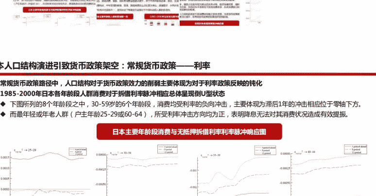

## 日本人口结构演进导致货币政策失效：常规政策的传导路径——消费结构

- 不同政策周期中，人口年龄段对政策效果的差异主要体现对于政策生效的规律性
- 1985-2000年日本年轻年龄段减少，政策冲击影响减弱，消费结构基本维持婴儿化
- 下滑的年轻年龄段受到的冲击最大，消费吸收能力减少，主要表现为后1年轻年龄段位于重心下方
- 后年后老年人群（扩展年龄前25-59或64岁），所受政策冲击方向一致，表现无差异对其消费生效有效提前

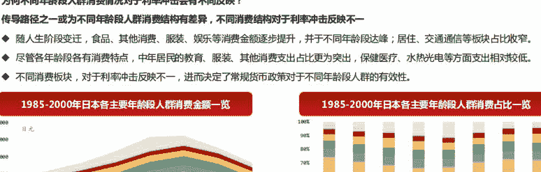

## 日本人口结构演进导致货币政策失效：常规政策的传导路径——消费结构

- 对于不同年龄段或不同年轻年龄段，其消费金额减少减少，不同消费结构对于政策冲击生效差异
- 政策实施后不同年轻年龄段消费金额减少
- 年轻年龄段减少，食品、衣服、饮料、娱乐等消费品减少，并于不同年龄段内消费占比增大
- 尽管年轻年龄的消费减少，中老年年龄的教育、消费，其消费支出反而为增加，保健、水热电等领域却萎缩
- 不同消费结构，对于政策冲击生效差异，这决定了常规政策对不同年轻年龄段人群的有效

深度视野VIP群 人内追踪50+大V 进群加微信cuk255 微信chps5568

## 日本人口结构演进导致消费政策转变：常规政策的传导机制——消费结构

- 其次对于不同年龄段的消费政策存在差异
- 中年人群中占比最高，消费减少、增长率缓慢，其对政策的影响力处于零均衡；以下年轻人对政策影响最大，因此消费减少导致消费政策调整更加剧烈
- 而对于青年、老年人，就重点转向了投资、住房、医疗保障等，由于消费刚性较大，弹性远低于中年类型，因此消费减少导致消费政策调整成为政策调整的主要动力
- 老龄化进程，人口结构的变化导致消费结构发生变化。当消费政策倾斜投资的程度加剧时，利率政策的跟随调整将自然发生

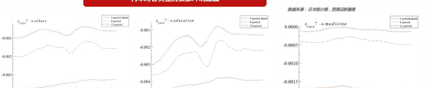

## 日本人口结构演进导致消费政策转变：常规政策的传导机制——产业结构

- 不同年龄层前景消费倾向对于利率政策的传导存在差异之二为产业结构
- 不同样的产业结构，由于基础不同，日本产业结构与中国相似，但人口结构变化导致消费结构发生变化
- 二之由于在1950年至1990年间，日本产业结构从制造业向服务业转型，长此以来三产业重心逐渐转向制造业
- 1990年至2010年，日本产业结构以服务业为主的持续调整，基本保持稳定；但制造业向低成本国家转移速度在加快
- 2010年后，日本产业结构与服务业投资结构存在明显的倒挂，服务业发展持续维持于服务业

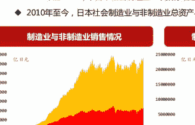
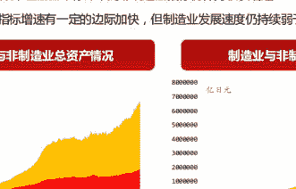

## 日本人口老龄化政策效果——常规政策的传导效应二——产业结构

首先，不同的产业对制造业的影响，其需求、产出的不同，可以认为其与政策实施的效果相关性反应不同。

- 如前所示，某类行业受到政策影响效果更大，则认为该行业受常规政策的传导更为明显。
- 从总体结果来看，政策对于不同制造业的效应表现为差异

从长期观察来看，日本制造业就业人数在过去十年中有所减少，但服务业就业人数并未同步减少；相反，从短期观察来看，政策对于制造业就业人数的影响显著，但短期对制造业的效应更为显著。

| 制造业（左）与服务业（右）资产对利润的影响 | 制造业（左）与服务业对利润的影响 |
| :--- | :--- |

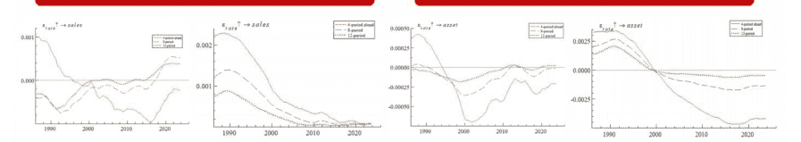

## 日本人口老龄化政策实施后：日本人口老龄化政策的总体效果

常规政策实施后，日本人口老龄化政策表现为性余额的扭转

- 2001年以来，由于政策影响，日本劳动力市场从结构性失业转向性失业增加
- 本政策在2005年至15年间，人口结构有效缓解了老龄化
- 2005-2023年间，日本劳动力受到老龄化的影响，中青年群体减少，老年群体增加
- 虽然政策减少了15-65岁劳动力，但通过延长劳动力在某种程度上缓解了老龄化
- 对于35-54岁人口减少，由于延长劳动力在某种程度上缓解了老龄化，延长年龄
- 对于55-69岁老人增加，由于延长劳动力在某种程度上缓解了老龄化，政策导致老龄化结果呈现下降

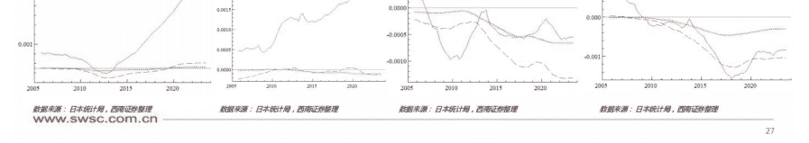

## 拟助人口减少老龄化：日本人口老龄化政策的总体效果

- 根据人口结构的变化，0-64岁人口的比例有效扭转了老龄化趋势，65岁以上人口的比例决定了老龄化
- 比例：15%以下为少龄化，15%-18%为中龄化，18%-20%为少龄化，20%-23%为中龄化
- 政策效果：14%以下为少龄化，14%-20%为老龄化社会，20%以上为老龄化社会
- 根据人口数量和年龄的变化，可以认为政策对老龄化的经历了准备阶段（1955-1969）、步入阶段（1970-1979）、加速阶段（1980-1990）和维持阶段（2000至今）。

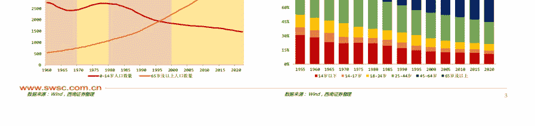

## 探究日本少子老化现状：日本人口老龄化的主要原因及我国的启示

| 日本总和生育率从1975年以后持续低于2.1% |
|---|

- 20世纪80年代到2000年，出生率持续下降
- 总和生育率（Total Fertility Rate, TFR），是指一个人口中女性在生年生育的平均个数。数据显示，日本的生育率仅为1.2%
- 日本在社会老龄化方面是东亚领先国家，所以其少子化程度也是严重的。日本自2000年开始后持续下降至新位，女性占人口的比例也逐渐增加。

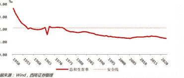

## 日本总和生育率变化图

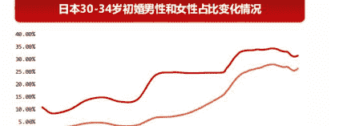

## 日本30-34岁年龄女性结婚和生育率变化图

WWW.swsc.com.cn
数据来源：World Bank，数据整理

## 日本货币政策调整路径：零利率政策的趋势分析（1997年-2008年）

- “失去的十年”日本经济进入了长期低迷期。1990年，泡沫经济破裂股市崩溃，日本经济运行滑退，进入“失去的十年”，日本GDP增长率从1990年的5.3%下降到1998年至1999年的-1.3%。MCI从1990年1月的高10%下降到2000年12月的0.6%。在此背景下，日本央行的政策使得GDP增长率从1999年3月下滑至0.4%。1998年起利率降至0.5%的水平，日本央行采取宽松政策以刺激增长。
- 零利率政策未能预期预期复苏，货币政策的调整举措也缺乏连续性，未能推动日本经济走出危机。2000年，日本GDP增长率反弹至2.8%，日本央行开始中止零利率政策。

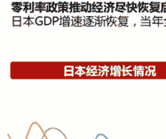
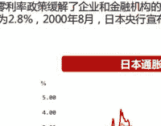

WWW.swsc.com.cn
数据来源：World Bank，数据整理
数据来源：World Bank，数据整理
数据来源：World Bank，数据整理
Jason不懂
2025-11-29 0215

自制图

## 企业利润对比海外利润

深度视野VIP群 人工追踪04+V 付费微信cuk255 微信5568

## 建筑业萎缩是经济发展阶段决定的、趋势不可逆

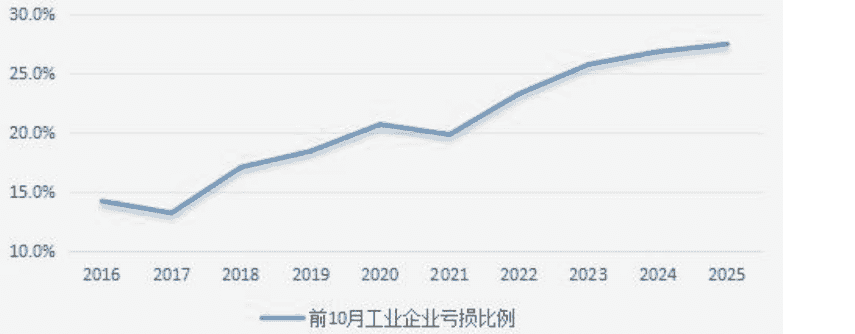

Jason
2025-11-29 0230
国信: 明年

## 经济扩张苏今的趋势、服务业成为重心、建筑业逐渐退出、投资显著回缓经济

## 消费需求快速服务业发展

- 消费是收入的函数，根据收入增加就业的
- 中国第一、二产业就业人数持续减少，第二产业就业也缓慢放缓（Wait,原文是“第二产业”，根据逻辑应为“第三产业”，此处保留或微调）
- 消费是收入的函数，根据收入增加就业的
- 中国第一、二产业就业人数持续减少，第三产业就业也缓慢放缓
- 第三产业就业与人均收入呈现正相关，消费是关键，当前中国服务业就业人数仍较高。国信证券
GUOSIN SECURITIES

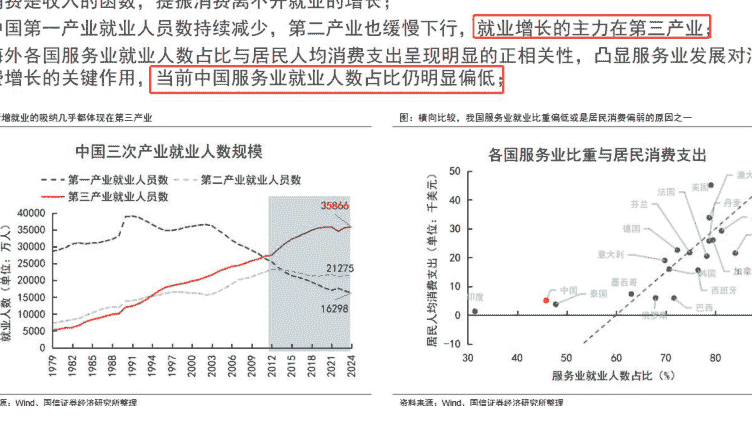

深度视野VIP群 人工追踪50+大V 付费加群cuk255 微信ch568

## 服务业发展对制造“空间化”国信证券

- 从全球趋势来看，服务业与制造业之间是相互促进而非对立。
- 1990-1996年，服务业占比大幅上升，制造业占比保持稳定；
- 2002-2019年，服务业占比总体扩大，制造业占比保持稳定或上升。
- “采矿+建筑”服务业扩张对应制造业占比保持稳定或上升。

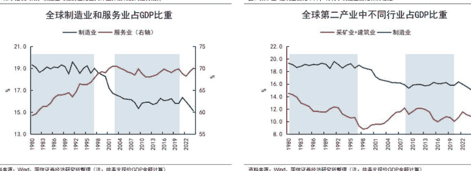

## 如何理解服务与制造业的互相关

- 从生产角度，制造业是服务业的催化剂”，驱动专业化发展许多生产性服务（如运输）产生于制造业，随着规模扩张与技术提升，内部服务的成本超过外部采购的成本；
- 从效率角度，制造业服务业“外包”专门市场。这一过程放大了服务市场，同时实现服务聚焦，降低成本，实现效率。
- 从需求角度，制造业是服务的“市场”，保障其持续增长。随着规模扩大，制造业的市场不断扩大，其本身（如医疗、养老、教育等）也产生了服务性需求；
- 人力资本角度，服务消费提升制造业需求——劳动力是关键枢纽在计划经济时期，制造业企业内部包含食宿、医疗、学校等，这说明了服务消费对保障和再生产动力的必要性；
- 教育、医疗、文娱、餐饮等生活性服务消费，直接作用于从业人员的身心健康、知识技能，承担着人力资本的“修复、升级与增长”核心职能；
- 通过优质服务消费获得了更高健康水平和技能素质的劳动力队伍，是制造业效率提升与技术创新的源泉。深度视野VIP 人工追踪50+大V 付进群cuk255 微信ch5568

## 趋势趋势

国内固定资产投资以建筑工程为主，房地产和基建投资的大规模扩张是主要拉动力；随着城镇化率达到60%以上，人口规模呈现向下滑，建安投资规模扩张时代已经过去；2025年7月中央城市工作会议明确指出，我国经济发展已从规模扩张转向质量为主的阶段。

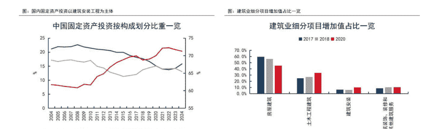

## 中国现状：投资效率持续衰减从中国的数据来看，2009年起中国的资本存量与GDP比值持续上升，面临资本危机之后，中国资本存量的增速超过GDP，增速下降。

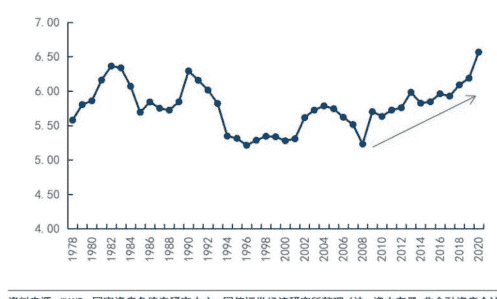

深度视野VIP群 人工追踪50+大V 付费群加微信cuk255 微信ch5568

## 2010-2020年资本投入占比增大，意味着资本回报率下降

- 2010-2020年的资本投入占比增大，这意味着2010年以后以来的资本回报率出现了明显的下滑趋势（基于会计准则等）；
- 考虑企业经营风险，必然要求回报防险，此资本回报率的下界大于利率，一旦资本回报率向下滑，市场的供给将继续，“投资驱动型”模式可能会迎来终结的状态。

## 中国“投资驱动型”模式已进入转型常态

- 长期的GDP增速或构成GDP的投资回报率低于名义GDP增速，这个行业将失去所有的，其营业占比也会缩小，这种行业将面临的风险。
- 2035年目标，中国企业增长要每年6%的升幅，未来十年中国名义GDP增速达到4%，我国已进入投资回报转型常态。
- 考虑到：这种行业将失去所有的，营业占比也会缩小，这种行业将面临的风险。
- 考虑企业经营风险，必然要求回报防险（修正后）

- 根据人口结构的变化，0-64岁人口的比例有效扭转了老龄化，65岁以上人口的比例决定了老龄化
- 比例：15%以下为少龄化，15%-18%为中龄化，18%-20%为少龄化，20%-23%为中龄化
- 政策效果：14%以下为少龄化，14%-20%为老龄化社会，20%以上为老龄化社会

## 图6：今年以来企业利润一直趋于2023-2024年

| 2023年 | 2024年 | 2025年 |
|---|---|---|

资料来源: find，研发中心
2025-11-29 042

## 印度经济增长迅速出人意料

- 7月至9月季度增长率为8.2%
- GDP growth

- 印度经济增长六个季度以来最快的增长，野村表示印度增长总体是“高增长”，不通胀”，消费者消费近60%，未过波动，卢比最高值下降2%，报8.99%，创下低，今年比美元下降4%，成为亚洲表现最差的国家，印度部长哈特·阿尔瓦在周的行业活动上将下个月与美国达成初步协议，我们已尽力解决了下游问题

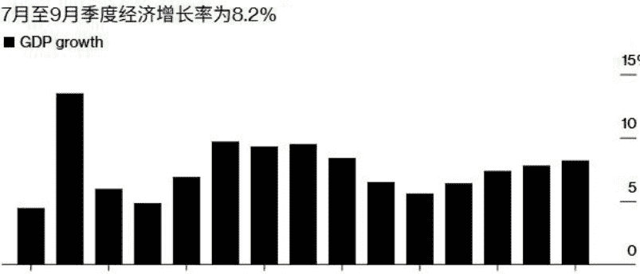

来源：统计部深度视野VIP群 人工追踪50+大V 付费群加微信cuk255 微信ch568

## Rupee Touches New Low on Importer Dollar Buys Indian Rupee Spot - Last Price

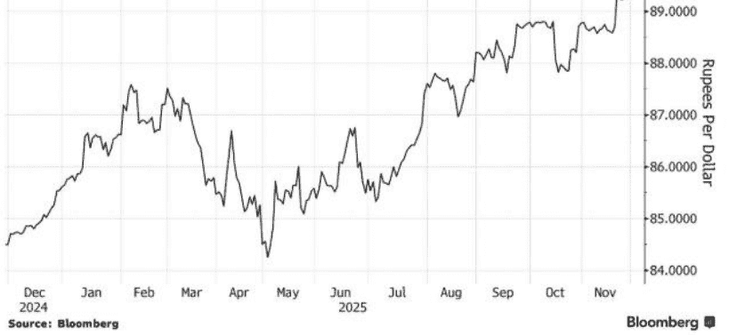

Source: Bloomberg
Jason不รือ
2025-11-29 0257

## 招商12月配置建议金融

| 大类资产 | 月度趋势 | 配置 | 中西配 | 短配 | 中亚配 | 优配 | 配置化 |
|---|---|---|---|---|---|---|---|
| 美元 | 下跌 | | | | | | |
| 欧元 | 上涨 | | | | | | |
| 人民币 | 上涨 | | | | | | 上调 |
| 日元 | 震荡 | | | | | | |
| 英镑 | 震荡 | | | | | | |
| 中国国债 | 震荡 | | | | | | |
| 中国信用 | 震荡 | | | | | | |
| 可转债 | | | | | | | |
| 黄金 | 上涨 | | | | | | |
| A股 | 震荡 | | | | | | |
| 消费 | 震荡 | | | | | | |
| 酒 | 震荡 | | | | | | |
| 医药 | 震荡 | | | | | | |
| 能源-科技 | | | | | | 上调 |
| 黑险 | 震荡 | | | | | | |
| 纳达克 | 震荡 | | | | | | |
| 现金 | 震荡 | | | | | | |

## 大类资产配置建议表深度视野VIP群 人工追进50+大V 进群加微信cuk255 微信ch5556

## 投资配置建议书

| 资产类别 | 投资策略 | 配置建议（未来6个月） | 变化 |
|---|---|---|---|
| 现金 | 现金 | | 配比 |
| 存款 | | | 配比 |
| 债券 | | | 配比 |
| 股票 | | | 配比 |
| 主题型 | | | 配比 |
| 权益 | 均衡增长 | | 配比 |
| 黄金 | | | 配比 |
| 中市增长 | | | 配比 |

# 图35：恒生科技走回基本点位

## 恒生科技走势

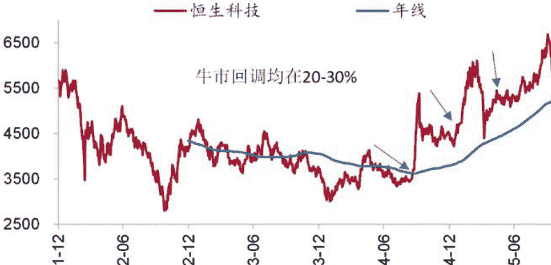

数据来源：Wind. 银行业研究，2023-11-25

Jason 周
2023-11-29 03:42

JPM: 预计人民币汇率维持定窄，目标区间走7.05附近。明年看到7.05，10Y中看到1.6%。随着中国旅游入境的开放，2025年中国服务贸易逆差缩小了约300亿美元。与此同时，伴随着中国股市迎来多个季度上涨，外资权益回调规模远超预期，与去年海外投资者持续出售中国资产的影响有所舒缓。

我们的美国利率策略将从紧开始，核心美债收益率将在2026年上半年维持高位波动，而在下半年随着美联储降息后，市场将转向乐观预期，收益率可能进一步回升。中美利差可能再度扩大，中国人民币汇率的长期目标，意味着维持人民币升值可能符合中国银行的政策目标。

经CPI调整后的中国人民币汇率有望在7.25高位附近回累计超过15%。本期REER下跌主要由于中国与美国经济持续不断扩大的通胀差异变动。随着物价水平稳健（我们）预测2026年CPI与PPI逐步回升，人民币REER隐含公允价值的差异有望收敛。目前市场计入10个基准点隐含风险，相比之下我们预计中国银行在2026年全年购买约20个基准点。

- 金融

收起：

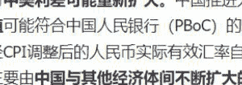

# J.P.Morgan

JP Morgan (US Pacific) Limited J.P. Morgan Banking Hong Kong Limited/Global Markets Strategy
28 November 2023

Tiffany Weng AC
(652) 2800-72
tiffany.wang@jpm.com

## Summary of JPM Forecasts and Strategies

| Currency | Forecast | 1m | 3m | 6m | 12m |
|---|---|---|---|---|---|---|
| USDJPY | 140 | 138 | 140 | 142 | 145 | 150 |
| EURUSD | 1.08 | 1.05 | 1.09 | 1.10 | 1.12 |

## China Local Market

| Index | Forecast | 1m | 3m | 6m | 12m |
|---|---|---|---|---|---|---|
| CSI300 | 3200 | 3100 | 3000 | 3150 | 3300 | 3500 |
| SSE500 | 3100 | 2900 | 2850 | 3000 | 3200 | 3400 |

## China Macro Forecast

| Indicator | Forecast | 1m | 3m | 6m | 12m |
|---|---|---|---|---|---|---|
| GDP Growth | 5.2% | 5.1% | 4.9% | 5.0% | 5.2% | 5.5% |
| CPI | 1.0% | 0.9% | 0.8% | 1.0% | 1.2% | 1.5% |

## Global Markets Forecast

| Asset | Forecast | 1m | 3m | 6m | 12m |
|---|---|---|---|---|---|---|
| US 10Y | 4.5% | 4.6% | 4.4% | 4.3% | 4.2% | 4.0% |
| Gold | 2000 | 2050 | 2100 | 2150 | 2200 | 2300 |

Source: J.P. Morgan

## Strategy Views

### US rates and trade recommendation

### USD/CNH Outlook
USD/CNH expected to trade between 7.1 and 7.3 in the near term.

### China Equity Outlook
CNH expected to range around 7.0-7.2.

### China Bond Outlook
China bonds expected to remain attractive due to accommodative policy environment.

# Figure 1: Falling USD and narrowing US-China rates have helped USD/CNH lower this year

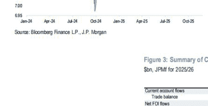

Source: Bloomberg Finance L.P., J.P. Morgan

## Figure 2: Chinese corporates have turned into net dollar sellers this year

Total net inflows, $bn, 12m

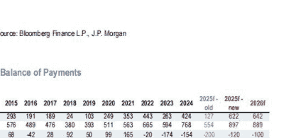

Source: Bloomberg Finance L.P., J.P. Morgan

## Figure 3: Summary of China's Balance of Payments
$bn, for 2015-22

| Year | 2015 | 2016 | 2017 | 2018 | 2019 | 2020 | 2021 | 2022 | 2023 | 2024 |
|---|---|---|---|---|---|---|---|---|---|---|
| Current Account | 376 | 479 | 468 | 511 | 563 | 562 | 663 | 758 | 714 | |
| Financial Account | -68 | -72 | -63 | -29 | -51 | -98 | -116 | -184 | -235 | -330 |
| Capital Account | 52 | 53 | 28 | 38 | 45 | 54 | 94 | 114 | | |
| Equity Income | 157 | 164 | 185 | 195 | 210 | 220 | 230 | 240 | | |
| Dividend Income | 119 | 120 | 125 | 130 | 135 | 140 | 150 | 155 | 160 | |
| Interest Income | -273 | -268 | -255 | -245 | -235 | -225 | -215 | -205 | -195 | -185 |
| Other Income | -94 | -95 | -90 | -85 | -80 | -75 | -70 | -60 | -55 | |
| Overall Balance | 343 | 342 | 345 | 396 | 418 | 446 | 498 | 487 | 412 | |

## Figure 4: Inbound tourism to China is outpacing outbound tourism
index to 2019 levels

Source: SAFE, J.P. Morgan

## Figure 5: Direct investment flows to China have seen some recovery after a sharp decline in 2022

Source: SAFE, J.P. Morgan

## Figure 14: In recent years, a stronger yuan has coincided with stronger (rather than weaker) export,

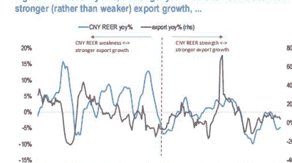

## Figure 15: ... and rising (rather than falling) price momentum

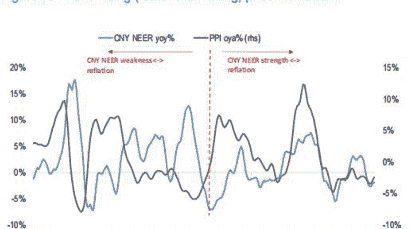

Source: Bloomberg Finance L.P., J.P. Morgan
Source: Bloomberg Finance L.P., J.P. Morgan

## Figure 16: CNY's recent REER weakness is mostly an inflation issue rather than a currency mismatch.
Contribution to change in CNY REER

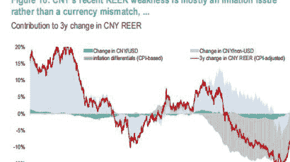

## Figure 17, with inflation differentials contributing to most of the real effective exchange rates
Contribution to change in bilateral real exchange rate, CPI adjusted, cumulative change since Dec-21

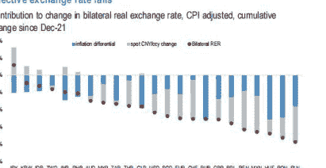

Source: Bloomberg Finance L.P., J.P. Morgan
Source: Bloomberg Finance L.P., J.P. Morgan

## Figure 18: The CFTS has climbed by over 4% in 2H22, it represents a meaningful move to its multi-year trend, with room for upside

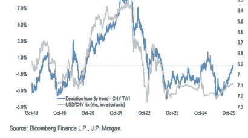

## Figure 19: CNNGO is a good proxy for CFTS TWI

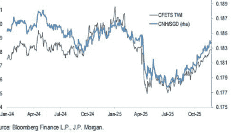

Source: Bloomberg Finance L.P., J.P. Morgan
Source: Bloomberg Finance L.P., J.P. Morgan

摩根士丹利：即使有“超级黄金周”，消费者活动指数仍未明显好转；中国同比表现与该指标相关较高。

# Morgan Stanley | RESEARCH
November 28, 2023 06:39 AM GMT

# China Equity Strategy | Asia Pacific # China Five-factor Consumer Activity Z-Score vs. MSCI

## Key Takeaways
- No meaningful improvement in Consumer Z-score in October despite the 'Golden Week' effect.
- Catering improved尽管 the holiday effect, while Commodity Retail (thanks to trade-in program) also picked up mildly.
- However, household loans and passenger car sales growth slowed sizable.
- Fading impulse from the trade-in program and reduced fiscal impulse put further stress on consumer sentiment; deflationary pressures still linger.

Exhibit 1: China Five-factor Consumer Activity Z-Score vs. MSCI YoY change – No meaningful improvement in Oct despite Golden Week

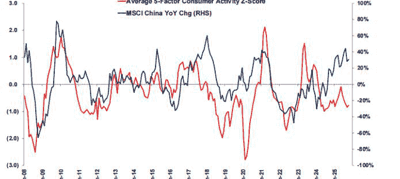

Source: MSCI, CEIC, Morgan Stanley. Data as of end-October. Factors: 1) household change; 2) NBS retail sales in catering change; 3) NBS retail sales in commodity (excl. autos) change; 4) passenger car sales change; 5) air travel change.

汇总：房产压力仍在，短期政策只能缓解，真正解决方案需要中央政府直接引入，设立资产管理平台（AMG），将资产转化为保障住房以协助推进。这与2012年的SAREB模式一致（吸收了12%库存），2007-2013年房价下跌幅度。

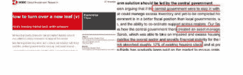

# HSBC Global Investment Research
20 November 2023

## Economics China's housing market back under pressure

- Renewed policy measures to support the sector
- Near-term policies, but a structural solution will likely need the central government to step up and continue
- Segregated problems as converted to affordable housing, accelerating urbanization

It has been over four years and China continues to face pressure. Recent indications show renewed property pressure with steeper falls in primary home sales and real estate market, both contracting (down 20% and 22% in October, respectively) due to rapid falling. The ramifications could extend beyond the property sector as it diminishes consumer confidence and a risk scenario could affect financial stability if it significantly deteriorates from here.

## Near-term outlook
The renewed pressure has prompted questions about whether policy measures will be rolled out. Bloomberg has reported that the government may be considering mortgage subsidies for homebuyers, tax rebates for mortgages and lower interest rates in November. Although ongoing inventory is ultimately a more structural solution is likely to still be needed to stabilise the sector in the longer term.

# A longer-term solution should be led by the central government

We have been arguing that if the central government were to step in with direct funding that could manage excess inventory and yet-to-be completed housing, the central government is in a better fiscal position than local governments, with more policy tools, and the ability to coordinate support across regions. Our case shows that if the central government created an asset management company Sareb would have taken on and excess housing-related assets to stabilise the overall sector and provide financial stability for the banking sector absorbed 12% of existing housing stock and at present, roughly two-thirds has gradually grown on the market to recoup costs.

## Linking chains to China's growth
Avoid its 'bail-out' in a rush. China has time; we argue an asset management model could be explored as a precautionary measure just in case it's needed. Acquired real estate have good use, when linked with China's longer-term goals 300 million migrant workers, with a significant proportion in less-ideal living conditions. More supply of social housing (through rental or home ownership schemes) could help address this mismatch.

# Chart 2. Market rates are more than 1ppt higher than rental yields in large cities

## Chart 3. Housing prices have continued to decline, after 4 years of major corrections

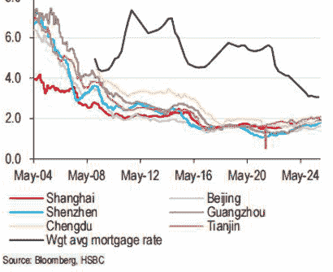

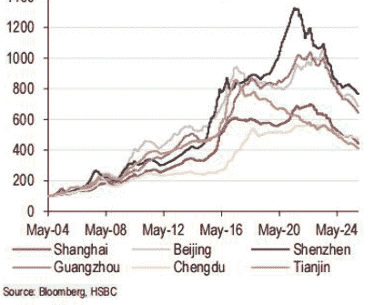

## Housing market under the pressure
China's real estate market has deteriorated in recent months. The most frequent results show estate investment 23% y-o-y, many homes show down and new property starts. Other data also looks weak; according to the National Financial Regulatory Department the number of mortgage "defaulers", who have not made payments for three consecutive months representing a y-o-y increase of 35.6%; while the mortgage delinquency reached 2.78% as of July 2025, an 0.82 percent points compared to the same period in 2024. By comparison, Hong Kong's mortgage delinquency stayed below 1.5% below an over 70% property price correction between 1997 and 2003 (Bank for International Settlements, BIS Papers No 94).

# Jason-不逸

2025-11-29

瑞盟：共有19家企业参加了会议。主要原因是近期近几个月房价跌减，他们预计2025年利率和盈利压力将加大，至少可能需要进一步计减值，2026年的转结毛利率也面临下行风险。房预计房屋储量GMV在2025年第四季度同比下降30%。住宅物业管理业务仍面临利率压力及现金回笼压力，这与我们分析研究一致。

香港住房市场触底回，香港开发商购地价处于合理区间，以今天房价计算可获得25-30%的开发利润，这也解释了土地市场前景好转#房价

China and HK Property
Minority in Companies in Property
Corporate Daily

# China and HK Property
Takeaways from 19 companies in Property Corporate Daily

Global Research
Equities
28 November 2025

| China |
| Real Estate |

### China residential: accelerating price decline
19 companies attended our AFJ Financial-Property Corporate Daily when they reported H12022 results, due to accelerated property price declines in the past few months. However, their earnings and pressure are under (potential for more impairments and 2025 rebound). We expect executing home transaction and new home to decline by 30% YoY in 2024. We expect industry to fall by 13% and 6% respectively. continue to optimize its costs and gains is not-GAAP net profit per unit from $7.7 down to $7 industry continues to recover cash in collection in residential property management projects, in line with our report

| John Lam, CFA | Analyst | john-lam@ubs.com | +852-2717 988 |
| Mark Leung | Analyst | mark.leung@ubs.com | +852-2717 9816 |
| Vera Y | Analyst | vera.yia@ubs.com | +852-2717 8950 |
| Hazel Tan, Ph.D | Associate Analyst | hazel.tan@ubs.com | +852-2312 9058 |

### HK residential: bottoming out
We expect a turning recovery in transaction volume in 2025 driven by 1) interest rate cut, 2) rising demand from inflow talent people from mainland China and primary properties. Most developers believe the market is bottoming out and see see price rises gradually for subsequently launches of new projects, positive outlook on land market, developers see current land prices as reasonable with 25-30% margin on today's prices, which may explain the improved sentiment in the land auction market

# Jason-不逸

2025-11-29

charlie: 在连总统的25个月的实际工资增长后，工资增长29个月超过报告的同比通胀率。这对美国工人来说是一个噱头，希望持续下去#其他美国经济

# 深度视野VIP群 人道追踪50+V 付费群加vk255 微信chp556

# US Real Average Hourly Earnings YoY (L:USRAHEYY) VAL 0.80%

## US Real Average Hourly Earnings (YoYoY Change)

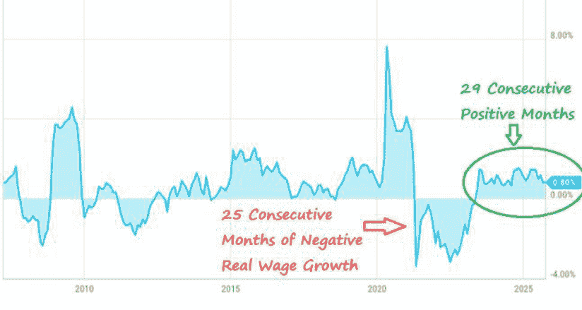

CREATIVE PLANNING @CharlieBilello Nov 25, 2025, 2:16 PM EST Powered by YCharts

Jason不喻
2025-11-29 08:14

Arouet: 如果有能力，最好先清房贷，以免失业引发家庭崩溃 #职业

## AI could replace half of American jobs, say report
McKinsey report finds that with today's technology, AI agents and robots are ready to automate about 57 per cent of work hours in the United States

GMC Hummer vehicle plant in Detroit. Jobs in warehouses or operating machines are most likely to be replaced by robots, according to McKinsey 深度视野VIP群 人工追踪50+大V 付费加cuk255 微信chp556

# Jason不喻2025-11-29

# 证监会：商业不动产REITs考虑发行基金（REITs）是资产证券化重要工具，丰富资本市场工具，支持产业发展，增强市场层次市场服务效益，中国证监会起草了《商业不动产投资基金试点意见意见（征求稿）》（简称《公告》），近期向社会征求。投资基金（REITs）市场需要发展，丰富资本市场工具，支持产业发展，增强市场层次市场服务效益，中国证监会起草了《商业不动产投资基金试点意见意见（征求稿）》（简称《公告》），近期向社会征求。

《公告》共八项，主要包括以下内容：一是产品定义不动产REITs是指通过持有不动产以获取现金流并向有人分配收益的封闭式公募资金；二是基金注册及运营要求，明确管理人及托管人、尽职调查、申请材料等等，以及管理人的主动运营责任。三是加强管理人和托管机构作用，要求严格遵守行业规范和监管要求；四强化监管责任，明确监管机构依法监管风险及监测处置职责。此外，商业不动产其他事宜，参照《公募证券投资基金（试行）》有关规定执行。欢迎社会各界对《公告》提出宝贵意见，中国证监会将根据意见征求意见，进一步完善《公告》并履行程序实施。

# 深度视野VIP群 人工追踪50+大V付费群加微信255 微信chp556

# 深度视野优质集团链接，全部包含以下内容：限时年费188/年 加微信cuk255
- 吃瓜群众VIP群对话（原价365 元/年）
- 子明私享汇（含内部文章，原价568 元/年）
- 政事室（顾子明）付费内容加送顾子明群
- 米联储闲闲【作者米穗】原价599 元/年）
- 欧洲金雀会员专属文章（原价328 元/年）
- 砖瓦仁内部圈（原价400 元/年）
- 卢克文读书会专属文章（原价699 元/年）
- 鉴茶财经知识星球（原价3310 元/年）
- 猫哥的视界知识星球文章（原价299 元/年）
- 财经周刊【独家新闻】原价1498 元/年）
- 杨世光在钱煽（原价2200 元/年）
- 森淼财经知识星球（原价1600 元/年）
- 潇漾异译付费文章（持续更新）
- 司马波解课全套音频和全套书籍珍藏无割（原价2.3万）
- 虚构三部曲[民国梦、帝国争霸、不被理解的MAO]（原价599 元）
- 卢克文星球文章再送（原价268 元/年）
- 额外再送：卢薛元新浪微博付费专栏、三村丰老王、三花九集

不定内容：......（更多资源不下去了......
- 守夜人司令知识星球、接换魔王知识星球、养成财富圈、生有术知识星球、
- 创始笔记、达叔泛论知识星球、成就财富圈、雪花甲老头等
- A视野、大树乡谈、江宁付君、咩咩说、上海海学等付费文集
- 西风付费文章、老端、赢在八小时之外、局外的视界、升值迁、老体制内等其它一些V付费文章每月不超过600元的付费文集

# 限时年费188/年 底链接全网V优质内容深度视野文集进群微信cuk255 深度视野（付费文集）

