# 南半球聊财经251201

Jason不拖
2025-12-01 02:55

zerohedge: 自ChatGPT发布AI时代以来，美股市持续牛市（绿线），而美国就业市场（红线）一路走低，其他经济国家

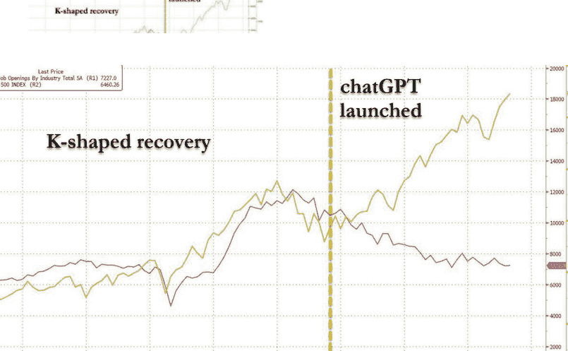

Jason不拖
2025-12-01 02:59

信达：从中国经济指数对外来看，经济预期仍然徘徊，四季度以来居民资金流入放缓，拉长了牛市回撤达到高点后市场震荡的时间。当前PMI处于荣荣线之下，工业生产、房地产销售、社融等遭遇衰减，经济复苏可能要到2026年初。因为社融和信贷年初初出现异常，同时每年一季度经济数据容易超预期波动。#A财经

一手优质资源进群微信cuk255

## 图1：中国经济外差指数显示预期偏差（单位：点）

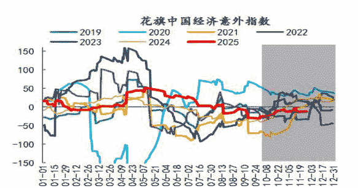

材料来源：方得，信达研发中心

## 图2：融资融利率/流动性指数的运行趋势（单位：%）

## 图3：ETF份额波动，行业基金份额溢值（单位：份额）

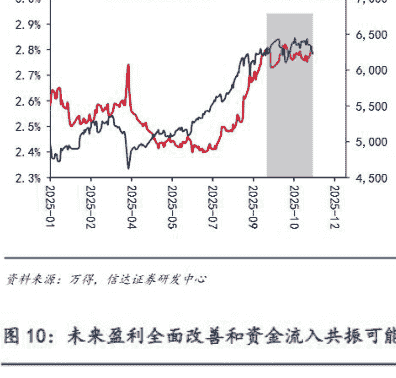

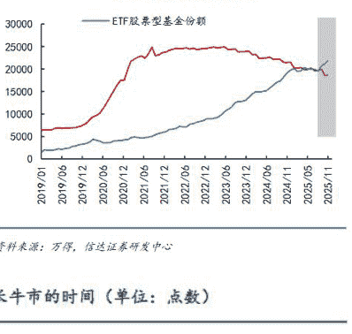

材料来源：方得，信达研发中心
材料来源：方得，信达研发中心

## 图10：未来资金面改善与资金流入持续可能长股市的时间（单位：点）

# 未来股市可能的# 票

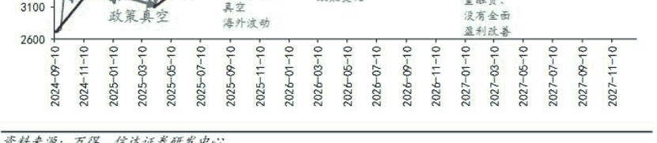

材料来源：方得，信达研发中心

注：数据仅代表相关设备外下跌的可能，不代表预测值。

# Jason不遇
2025-12-01 03:01

财信：11月原材料价格指数和出厂价格指数分别为53.6%和48.2%，较上月提高1.1%和0.7百分点，但原材料价格指数高于50%线下，而出厂价格指数虽处于收缩区间，表明价格仍在集中于上游行业，中下游行业的价格供给受限于终端需求不足。预计11月PPI环比继续微增，同比增加2.1%左右，全年延续负增长局面。

责编：11月PPI环比继续保持增长

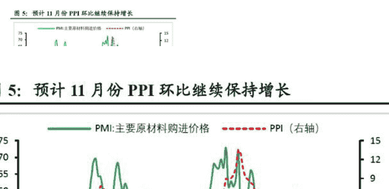

图5：预计11月PPI环比继续保持增长（右侧）

资料来源：WIND，财信研究院

# Jason不遇
2025-12-01 03:08

11月制造业PMI低反弹至49.2%，低于49.4%的预期，仍处于收缩区间，这数字虽是以来最低值，但2013年以前之外的2022年以前的同期相同最低值。制造业PMI还首次处于收缩区间，创了历史上的最长记录。

反弹源于外需逐渐滞带带动，需求整体迎来回，11月新订单指数回升至49.2%，其中新订单较上月大幅回升1.7pct至47.6%。经济数据

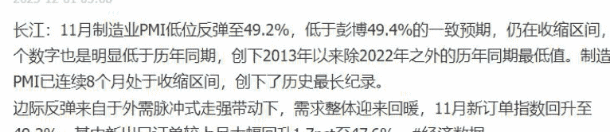

## 图 1: 历年各月制造业 PMI (%)

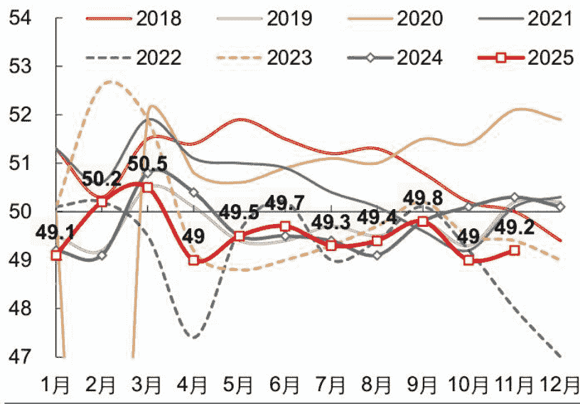

数据来源：Wind, 长江证券研究所

## 图 5: 历年各月制造业进出口订单指数 (%)

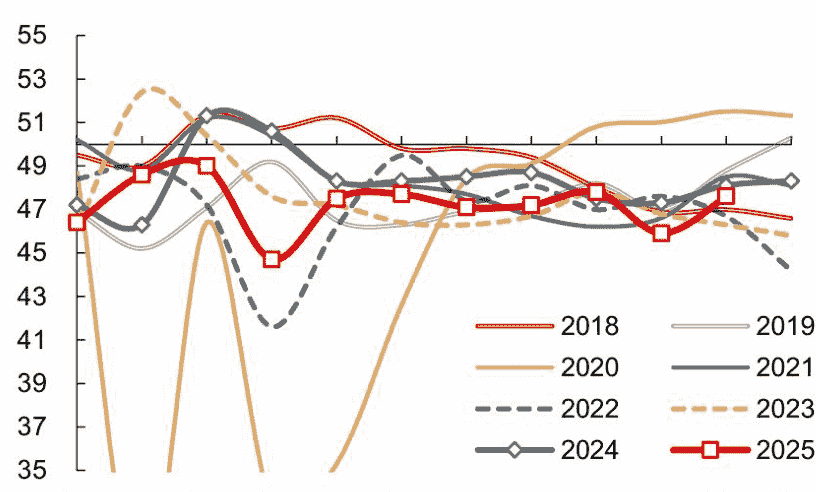

数据来源：Wind, 长江证券研究所

## Jason Wang
2025-12-01 03:45

bloomberg: 摩根士丹、花旗和高盛预计，随着盈利稳定和政策支持的到来，印度市场将迎来反弹。投资者为可能退出人工智能交易准备。

MSCI指数今年上涨8.2%，落后于更广泛的新兴市场，差距自1993年以来最大。卢在1月后触及低点，下跌4.3%，其为反弹潜力。全球基金在今年年初撤回16亿美元，过去两个月，流入达到17亿美元，经济状况有所改善，市场将出现大反转。

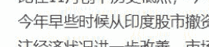

## 印度股市在新兴市场中落 MSCI Index - MSCI Emerging Markets

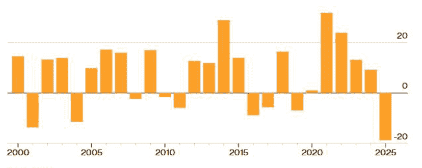

来源：彭博

## 印度股票对新兴市场的估值溢价窄MSCI India - MSCI Emerging Markets P/E

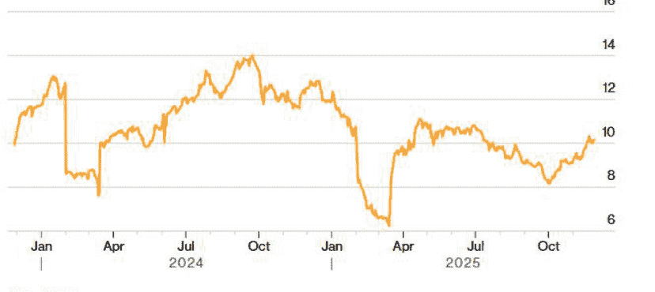

来源：彭博

一手优质资源进群微信cuk255

# Jason不逸
2025-12-01 03:49

bloomberg: 瑞士投票否决超级富豪50%的遗产税，瑞士已经富有财富——根据瑞士的一项研究，百万人口中有超过九位翁，是西欧平均水平的五倍。瑞士投票否决超级富豪征收50%的遗产税，此前企业家恐离开该国。

根据瑞士政府的数据，计划遭到78.3%选民反对。民调显示了这一结果，投票率为43%，该措施能在单一州获得多数支持。财政部长卡特曼-凯特表示：“选民显然拒绝了一项高风险的财政政策。这样的税收将使我们的体系失衡，损害瑞士的吸引力。”

## 瑞士选民拒绝为富豪征收50%的遗产税

| Inheritance tax | | | |
| :--- | :--- | :--- | :--- | :--- |
| 0 | 25 | 50 | 75 | 100 |

来源:瑞士政府
注: 临时统计结果

一手优质资源进群cuk255

## Jason郭涵
2025-12-01 03:57

万宏源：日本财政政策或拉低2026年GDP增速0.5点，但财政政策效果低于美国、德国。德国通胀率0.63点，美国0.6点，欧元区0.2点。日本财政政策偏向居民，消费倾向较低，二是财政政策乘数为0.27，三是日本财政结构中，5%为养老和投资支出较低。货币政策加紧导致收益率下降，可能引发套利交易反转压力。美日利差是套利交易的核心极易导致损，利差扩大，波动加剧，需警惕日元行情偏离、美联储的收缩调整，可能加大套利交易导致赤字。

| 2026年日本财政赤字预测 | 日元对财政政策的影响 |
| :--- | :--- |
| 上述的政策组合 | 下述的政策组合 |

## 图 5: 美日明年财政赤字可能扩大主要经济体财政赤字率

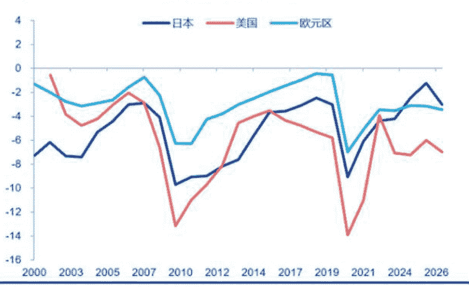

资料来源：Wind，申宏源研究

一手优质资源进群微信cuk255

## 图表 6：2026 年财政拉动 GDP 的排列

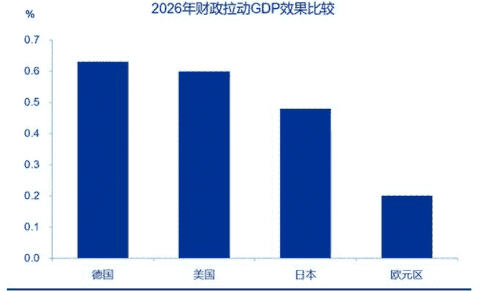

资料来源：彭博、申宏源研究

## 图表 7：美德日财政刺激转向比较

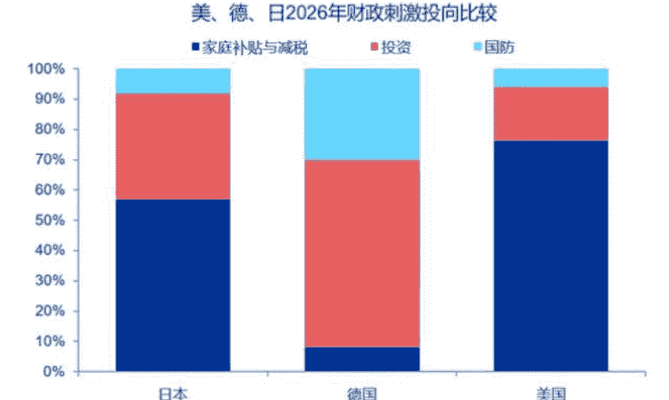

资料来源：彭博、申宏源研究

# Jason不遇
2025-12-01 03:59

华尔：市场对明美利率变动可能造成的政策变化较为关注，我们分析的主要结论是：明美FOMC1月的政策走向（大约是4个险、4个维持、4中性，小概率是5个险、4个维持、3中性）相比下方预测（目前是3个险、4个维持、5个鸽息），但变化为险的概率远于许多。

市场普遍认为美联储接班人名单不多，包括：现任白宫国家经济委员会主任哈特、现任美联储理事威尔、现任美联储理事肖沃、现任莱纳德·高普德，从政策转向来看，这五位候选人的倾向都是鸽派。

## 表 1 明美FOMC政策转向的倾向样本分析

| 候选人 | 政策倾向 | FOMC: 4险+4维持 | FOMC: 3险+5维持+4鸽 | FOMC: 5险+3维持+4鸽 |
| :--- | :--- | :--- | :--- | :--- |
| 哈特 | 鸽派 | 4险（或维持加息）、4维持（或加息）、4中性（或维持、加息） | 3险+5维持+4鸽 | 5险+3维持+4鸽 |
| 威尔 | 鸽派 | 4险+4维持 | 3险+5维持+4鸽 | 5险+3维持+4鸽 |
| 肖沃 | 鸽派 | 4险+4维持 | 3险+5维持+4鸽 | 5险+3维持+4鸽 |
| 莱纳德·高普德 | 鸽派 | 4险（或维持加息） | 3险+5维持+4鸽 | 5险+3维持+4鸽 |

资料来源：界面

## Jason不涵
2025-12-01

广发：国际收支引发资金调整，由于并未产生应对的资金，基于美元及M2可能直接影响。作为跨境流动中的领先环节，且可能忽视市场活跃并没有得到有效，事实上已经消耗了总量资金，由于忽略了国际账户贸易差。其中每月公布的贸易数据规模有望逆转，但非资本流动在季节性上10月末的贸易差收窄，数据显示10月末结束的净流入增加408亿元，外币净流入增加214亿元，但仍保持。从回流角度（国际账户）比例为0.2%，随着出口回购，资金多处于“缺口”状态，对人民币维持压力。

## 图2：10月末跨境资金流入及规模（亿元）

| 月份 | 净流入 | 净流出 | 同比 | 净流入 | 净流出 | 同比 | 净流入 | 净流出 | 同比 |
| :--- | :--- | :--- | :--- | :--- | :--- | :--- | :--- | :--- | :--- |
| 2019 | 2064 | 3773 | -41% | 4 | 1621 | -2624 | 18030 | 2998 | -22% |
| 2020 | 5423 | 1409 | 138% | 108 | 745 | 15600 | 1110 | 10% |
| 2021 | 6088 | 2371 | 27% | 276 | 1061 | 81% | 14320 | 4630 | 50% |
| 2022 | 4537 | 791 | -16% | 516 | 3113 | -3091 | 47400 | -3163 | -13% |
| 2023 | 4067 | 2107 | -24% | 1502 | 17023 | 57% | 10500 | -1718 | -7% |
| 2024 | 3186 | 1028 | -44% | 644 | 1002 | 50% | 7516 | 7019 | -7% |

## 图1：海外账户逆差规模（亿元）

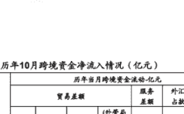

备注：海外账户口径：广发国际收支数据口径

# 图2：海外账户逆差规模（亿元）

## 图3：外币净流入规模（亿元）

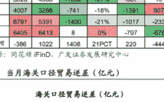

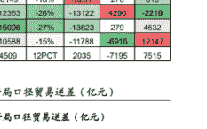

## 图1：海外账户逆差规模（亿元）

## 图4：外币资金规模（亿元）

备注：海外账户口径：广发国际收支数据口径
备注：海外账户口径：广发国际收支数据口径

一手资源深度微信cuk255

# Jason不喻
2025-12-01 04:09

## 正方：12月大类配置建议金融

## 图表1:2025年11月大类资产表现(截至2025/11/27)

| 权重 | YTD | 1M | 外汇 | YTD | 1M |
| :--- | :--- | :--- | :--- | :--- | :--- |
| MSCI 全球 | 18.9 | -0.5 | 美元指数 | -11.3 | 0.0 |
| MSCI 新兴市场 | 27.4 | -2.2 | 美元指数 | -8.2 | -0.2 |
| MSCI 发达市场 | 18.0 | -0.3 | 美元加元 | -2.4 | 0.1 |
| 通达工业指数 | 11.5 | -0.4 | 美元日元 | -0.6 | 1.6 |
| 标普500 | 15.8 | | 美元哈澳人民币 | -3.6 | -0.7 |
| 纳斯达克 | 20.2 | -2.2 | 美元新台币 | -4.3 | 1.7 |
| 上证指数 | 15.6 | | 美元港币 | 0.2 | 0.1 |
| 深证指数 | 23.6 | -3.8 | 欧元指数 | 5.6 | -0.2 |
| 胶指数 | 29.3 | | 欧元美元 | 12.0 | 0.5 |
| 美国帝国 | 18.6 | -0.2 | 新西兰美元 | 2.3 | 0.1 |
| 德国 DA | 19.4 | -0.8 | 英镑指数 | 5.8 | 0.7 |
| 法国 CAC40 | 9.7 | | CFETS人民币 | -3.0 | 0.5 |
| 日经225 | 25.7 | -4.3 | | | |
| 俄罗斯 RTS | 18.1 | 7.4 | 大类资产 | 9.0 | -2.4 |
| 印度 SENS | 9.7 | | LME铜期 | 11.0 | -1.8 |
| 台湾指数 | 19.6 | -2.4 | 菲律宾期 | 10.0 | 1.1 |
| 美国 10年债 | -58.0bp | -10.0bp | ICE 债 | -4.7 | -1.8 |
| 中国 10年债 | 17.9bp | 5.8bp | CBOT农产品 | 13.6 | 0.4 |
| 英国 10年债 | 1bp | | LME铜 | 24.7 | 0.4 |
| 德国 10年债 | 33.0bp | 5.0bp | NYMEX原油 | 12.7 | 3.2 |
| 法国 10年债 | 21.6bp | 1.1bp | 沪油连续 | 18.9 | 0.2 |
| 日本 10年债 | 69.6bp | | COMEX黄金 | 54.8 | 2.2 |
| 意大利 10年债 | -17.7bp | -24.6bp | CBOT小豆 | 13.5 | 0.9 |

注：YTD 代表年初至年末收益率变动基点，1M 代表2025年1月

资料来源:wind，正方研究所

## 图2:2025年1月全球股票活跃度下降

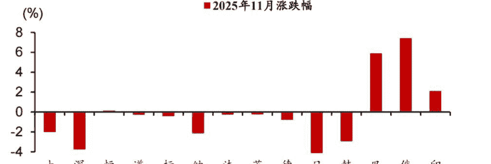

资料来源：wind，方正证券

## 图18:2025年1月沪市融资余额降低

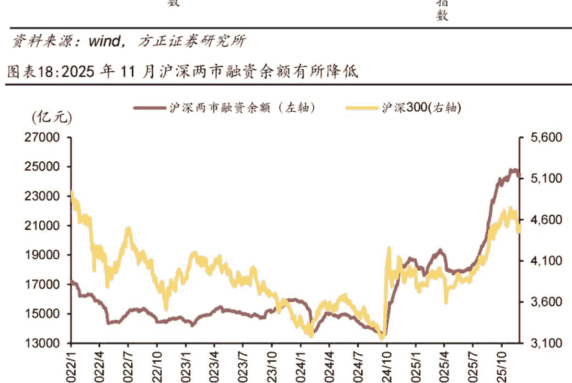

资料来源：wind，方正证券

## 配置比例及精选产品

## 图38 大类资产配置

| 大类 | 产品种类 | 中债 | 股票 | 本月建议 (常驻比例) |
| :--- | :--- | :--- | :--- | :--- |
| 现金类 | 货币基金 | □ | □ | □ | 中国银行一年期利率 5% |
| 确定收益类 | 国内利率债 | □ | □ | □ | 国债款 |
| | 融债 | □ | □ | □ | 中证级债券 15% |
| | 可转债 | □ | □ | □ | 中证可转债券 | 发达市场债券 |
| 权益类 | 大盘型 | □ | □ | □ | 上证 50 |
| | 中盘型 | □ | □ | □ | 中证500 35% |
| | 小盘型 | □ | □ | □ | 沪深300 |
| | 港股 | □ | □ | □ | 纳斯达克指数 15% |
| | 美股 | □ | □ | □ | 经纬500 |
| | 欧洲 | □ | □ | □ | 欧洲 STXX600 |
| | 日本 | □ | □ | □ | 日经225 15% |
| | 新兴市场 | □ | □ | □ | 华能能源债券 |
| | 化工能源 | | | | 华泰金属债券 |
| 大宗商品 | 金金属 | | | | 华泰农产品债券 |
| | 农产品 | | | |

资料来源：wind，方正资产研究所

# Jason-嵩
2025-12-01 04:17

高鑫：我们认为基金利率触底的上行风险有限，核心个人消费支出（PCE）对比通胀率横盘下跌，关税和市场效应导致，通胀应该已回落至2%，最近美联储露出的策略是可以接受的。#其他国家经济

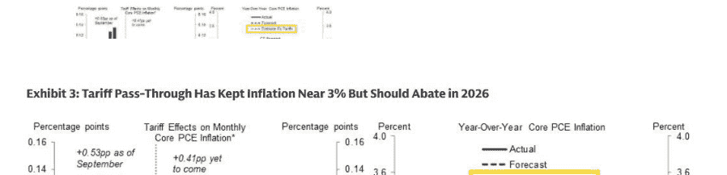

Exhibit 3: Tariff Pass-Through Has Kept Inflation Near 3% Before Abate in 2026

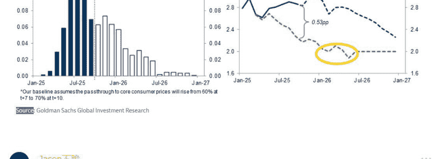

*Our baseline assumes the pass-through to core consumer prices will rise from 60% at to 70% at t10

Goldman Sachs Global Investment Research

# Jason-嵩
2025-12-01 04:28

高鑫：美、德、德国今年暴涨并非真实需求，而是库存交易+错配+美国政策预期触发的结构性出口，中国实际进口仍小于2021~2024均值，说明这不是需求性行情，而是投机+套利驱动。如果黄金变成防守型资产，那么，美、德，就是“高杠杆黄金”。中期上空间，但不如黄金稳健。

+ Precious Analyst_Silver, Platinum and Palladium_Volatili...

## Goldman Research
25 Nov

### PRECIOUS ANALYST
#### Silver, Platinum and Palladium: Volatility Now, Upside Later

- Silver, platinum and palladium have rallied YTD by 66/65/50%, supported by private investor inflows on Fed cuts and the belief that these metals could catch up with gold. At the same time, speculation around US trade policy—with all three metals on the Critical Minerals List and therefore potentially eligible for tariffs up to 50% (despite being exempted in April 2025), and with Russian palladium under anti-dumping investigation—has led to metal being pre-positioned into the US earlier this year. This has drawn metal out of London, where benchmark prices are set, and reduced the available float. Thinner inventories have in turn set the stage for squeezes, where prices are easier to amplify when investor flows absorb the remaining float and quicker to recover when tightness eases.

- We view the probability of US tariffs or a ban on Russian palladium imports as low. US production capacity of these precious metals is geographically constrained, meaning such policies would likely raise US prices without significantly increasing supply and would negatively affect downstream industries—particularly the automotive sector, which relies heavily on platinum and palladium—while offering only limited gains to domestic producers.

Jason-
2025-12-01 04:35

摩根斯坦丹：简单描述我们对钻石的观点——我们的观点是——估认为有支撑。

- 1) 钻石资本市场带来的发行行为如何影响信用市场？我们预计钻石市场将得那么有利，为对投资提供支持(G).
- 2) 未来12个月内我们预计钻石需求增加多少？钻石预计将再增加三次，到2026年上半年完成。
- 3) 美元的走势如何？我们认为在2026年上半年美元将继续受到压力。
- 4) 美国企业会从铂矿扩张到更多铂领域吗？是的。早期结构与政策支持显示盈利将进一步扩大至更广领域。#美股

# Morgan Stanley | RESEARCH
November 30, 2025 08:00 AM GMT

### Cross-Asset Brief
#### Worried Should We Be About AI Valuations? Key Debates in Under 5 Minutes – November 2025

Don't have a lot of time? Here are some brief thoughts on a few key cross-asset debates we've had with investors in November on out-of-consensus calls.

- 1) How worried should we be about AI valuations? We think valuations can stay supported
- 2) What is the impact of AI-related issuance on credit? We expect a less supportive environment, particularly for IG
- 3) How many Fed cuts do we see over the next 12 months? Three cuts into 1H26
- 4) Where do we see the path of USD? In 1H26, the downward pressure on USD should persist
- 5) Will US stock earnings broaden? Yes, early-cycle dynamics and policy tailwinds signal a wider recovery

Exhibit 1: After adjusting for profit margins, valuations look much more reasonable
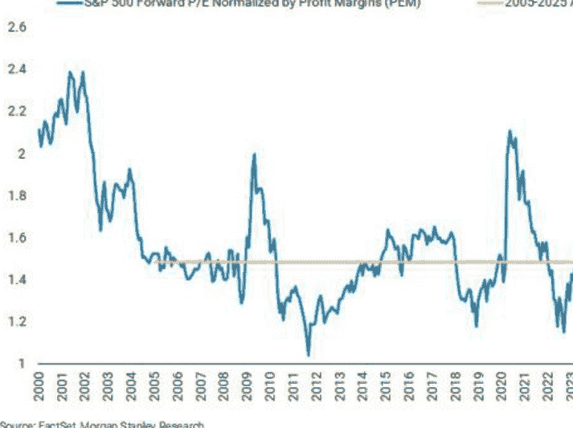
Source: FactSet, Morgan Stanley

While some investors worry about the durability of AI trade and parallels to the late 90s bubble, we see some important differences. First, equity indices today are of higher quality, with operational efficiency, strong profitability and free cash generation. valuations look more reasonable after adjusting for profit margins. Second, the macro regime is fundamentally different and more supportive of valuations today.

Exhibit 2: After adjusting for profit margins, valuations looks much more reasonable
Exhibit 3: AI-related stocks have resumed after a long consolidation, with revenue revisions to maintaining outperformance
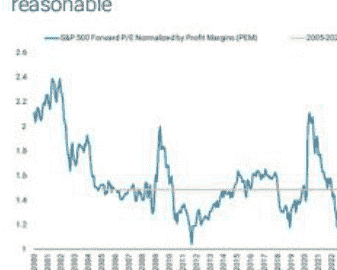
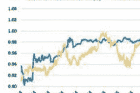
Source: FactSet, Morgan Stanley
Source: FactSet, Bloomberg

### 3) How many Fed cuts do we see over the next 12 months? Three cuts into 1H26
We expect the Fed to cut three more times over the next 12 months, taking the target range to 3.0-3.5%. Softer growth could reduce labor demand, lifting unemployment to 4.7% by Q26, as slower labor growth limits sharp rise in slack. Meanwhile, headline and core PCE inflation are set to peak near 2.8% and 3.7% in 1Q26 before easing towards 2.5% and 2.6% in 4Q/4Q, as tariff impacts recede. The mix of softer labor market and gradually lower inflation would allow the Fed to continue cutting, at a measured pace.

Exhibit 6: We expect hiring to remain subdued.
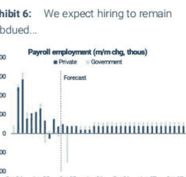

Exhibit 7: ...and inflation to peak in Q26 before decelerating
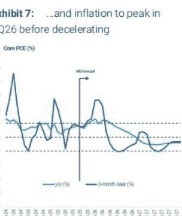

### 4) Where do we see the path of USD? In 1H26, the downward pressure on USD should persist
We expect the downward pressure on USD to continue into 2026, pushing DXY levels lower to bottom at 94 by 1H26. We see potential for higher DXY-negative risk premium driven by near-term worries about the US labor market, and a compression in US-rate differentials reducing FX-hedging costs, which adds incentives for hedging activity and USD selling.

Exhibit 8: Morgan Stanley's forecast of USD-negative risk premium over 2026
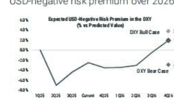

Exhibit 9: DXY forecast consensus and forward
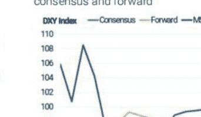

# Jason不离
2021-12-01 07:52

中指院：11月百城二手住宅均价为13143元/平方米，环跌0.94%，跌较上月放大0.1个百分点，同比跌7.95%，在高挂及预期调整影响下，二手房价下行压力有所增大。

租型住宅：11月住房进入传统回调期，50城市平均租金为34.36元/平方米/月，环比跌0.60%，同比跌3.57%。#房价

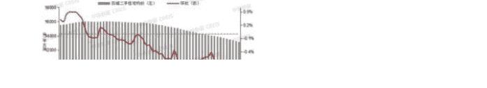

图：2021年11月至2025年11月百城二手住宅价格及环比变化
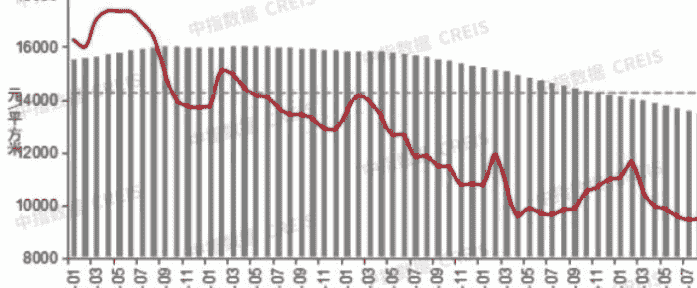

图：2021年11月至2025年11月50城住宅租金及环比
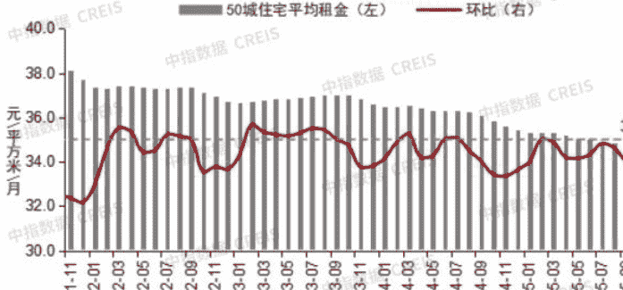

## Jason不涵
2023-12-01

市场：中场发力，红利和信用回来，本质上都是基本面与预期的衔接。这一点，无论是私人蓝筹在6月先行，还是国内增速在10月开始，都得到验证。过去两年国内资产的聚热和轮动，本质可能还是“结构性波动”对价值创造。数字时代，信息差越小，很难被认可为“价值创造”。市场活跃度将加大，使得价格迅速回归。

我们在2026年之前做出判断，基于高位，预期和回报依然是稳健的结构性增长，除非策略加大，国内流动性从大涨转向衰退；此外低基数的维持，整体节奏和流动性的乐观预期在一定程度上“掩盖”了原本的结构性增长，这些因素导致波动加剧，后续可能会震荡，近期底部再反弹将重要。

综合而言，投资者需要构建“组合（AI+科技硬件）”作为配置思路，并配合组合调整以应对波动。在此基础上，外部波动的回归（包括红利、AI、工程、基建等）和创新成长可以选择性策略，尤其是在第一阶段，国内需求将面临压力，配置红利资产的价值在于内需。

这种路径来看，第一类是AI本身，还是政策和周期，其估值和强度越高，越是景气逻辑，可以进一步发现核心和硬的节奏，弹性越大；第二类是关注估值，需要重点关注活跃度；第三类是国内需求与供需严峻，然而需求和估值陷阱，但基本面的加速容易使其持续回归，还需要结构优化，发现具有确定性的机会。当估值回归，红利是一个机会。第四类还可以关注周期，可能来自美国利差对中国政策将加大力度，美储通胀超预期，可能导致PMI弱持续，一季度后PPI回落至4%以下也会持续。

在2026年全球市场展望下，解析国内流动性周期转换将分部：在某些特定下可能会“过热”。简而言之，AI产业或将持续；财政扩张，美国泡沫软陆，每年3000亿美金将相当于1%的GDP，我们调整占比将由5.9%升至7.5%，若美国关税政策明年涨至7%，增量来自美国及国外过万亿投资，将分配到2026年；需求还需要中国支撑，美债在22年加息期间维持低增长，更多是因为成本太高而需求不足，因此有望逐渐修复，修复幅度得到稳缓和逸缓。总而言，在财政和政策上“双宽松”，科技投资在这样的环境下，流动性是导向的关键。

-一手优质资源

## 图表3：市场表现的背后信用扩张的疲弱
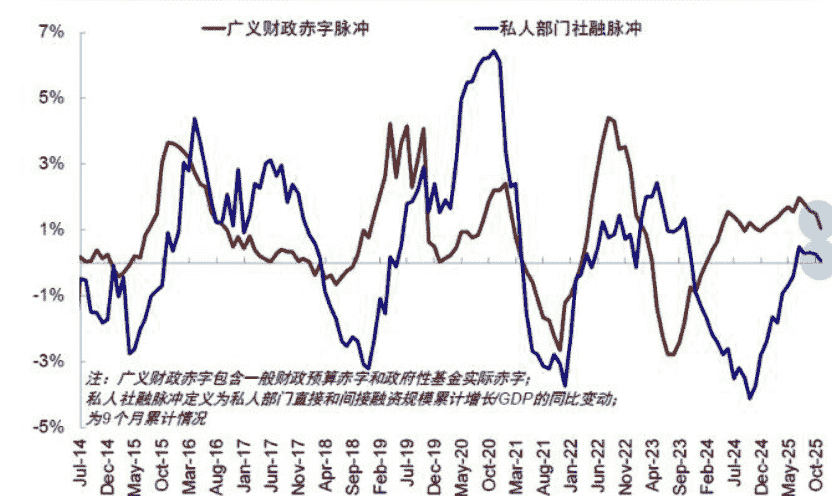

注：广义财政字额包含一般财政字额和政府性资金赤字；私人部门融资脉冲定义为与GDP增长的比重

资料来源：Wind、中金公司研究院

## 图表4：10月M1同比增速出现放缓脉冲
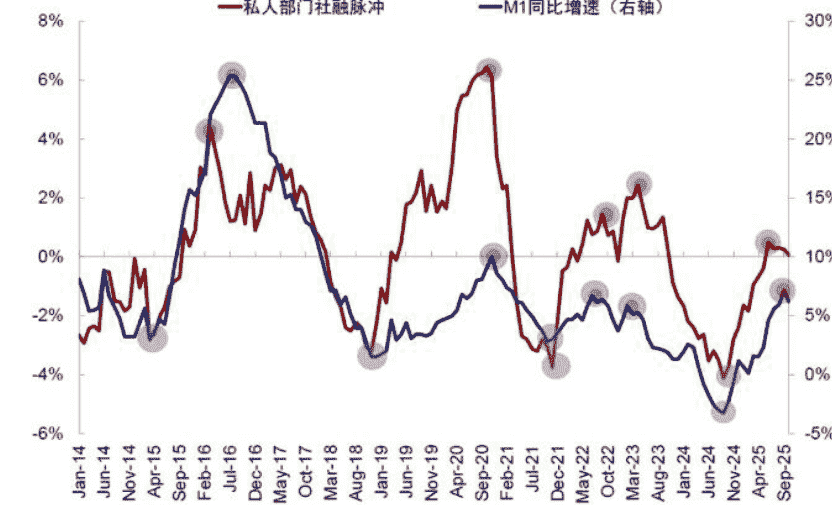

资料来源：Wind、中金公司研究院

### 图表7：四大板块的投资优缺点、择时思路

| 板块 | 优点 | 缺点 | 择时 |
| :--- | :--- | :--- | :--- |
| AI | 产业趋势持续 | 高长期 高估值 高波动 | 1) 周期适用应用破线： 2) 链联动需窗口期 | 短期避锋创造国替代 长期应用变现 |
| 外需 | 强周期、高弹性 | 持续性差 | 美国制造业 美国零售销售 中国PPI回升窗口期 | 能源供给选择高弹性方向 |
| 内需 | 低周期 低估位 低波动 | 缺乏易利支撑 | 国内政策预期 | 根据行业和政策预期选择对应方向 |
| 红利 | 稳定回报 | 缺乏上行性 | 结合“拥挤度”、避免在交易拥挤时买入 | 选择性具有较高率的目标和行业 |

资料来源：中金公司研究

## 图表8：可结合拥挤度调整配置权重（成交板块占比市值）

各主题行情“拥挤度”（成交板块占比市值）
——非消费——互联网——电商——内行营销——保险——创新药（右）——科技硬件（右）

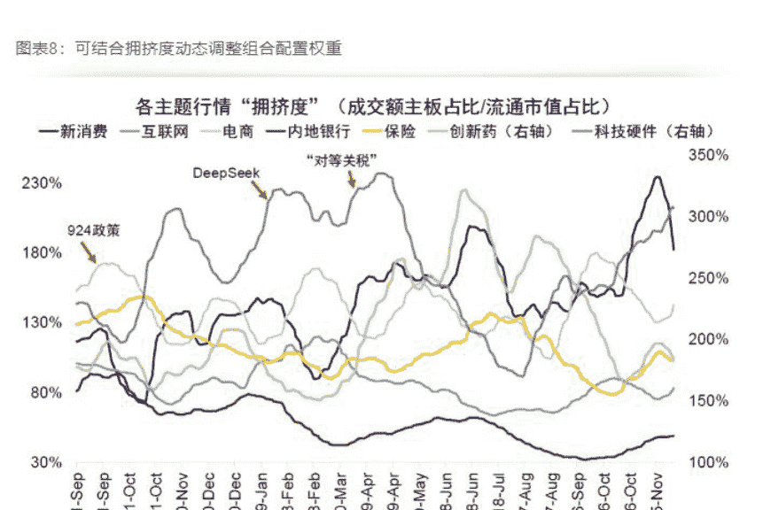

一手优质资源进群微信：cuk255

## 图15: 明年美国信用周期方向向上

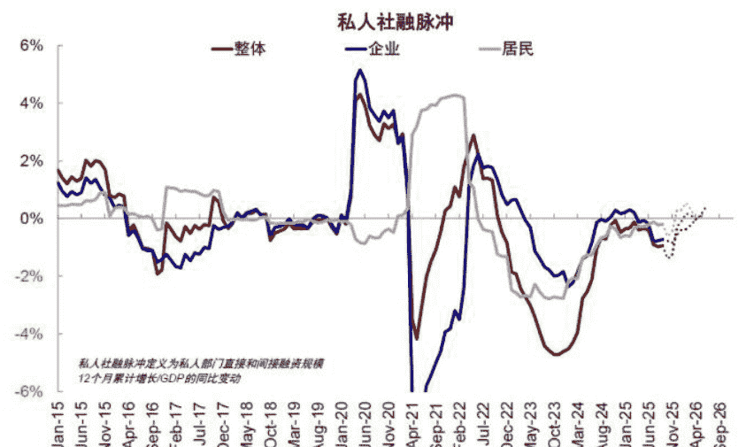

私人融资脉冲中，私人部门、企业和居民贡献度最高，12个月后影响了GDP的同比变动。

来源：Haver, 中金公司研究部

## 图16: 国内PPI在明年一季度大概维持修复趋势

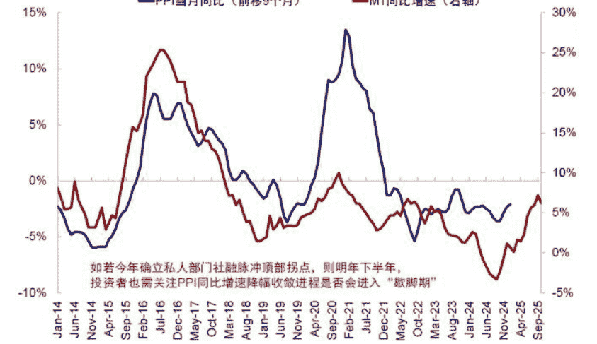

如记者今年独立私人部门融资脉冲触顶点，明年下半年，投资者需关注PPI同比增速放缓过程是否进入“衰静期”。

资料来源：Wind, 中金公司研究

一手优质源聚集微信cuk255

## 深度视野优质集团（链接优质社群，助你成功）

全部包含以下内容：限时年费188/年 加微信cuk255

- ① 吃瓜群众包时圈加微信时群对话 (原价 365 元/年)
- ② 子明私享会（内部）文章
- ③ 政事室 (顾子明)付费内容加送顾子明群聊
- ④ 米联储闲直【作者米穗】(原价 599 元/年)
- ⑤ 欧洲金雀会员专属文章 (原价 328 元/年)
- ⑥ 砖瓦仁内部图 (原价 400 元/年)
- ⑦ 卢克文青读书会专属文章 (原价 699 元/年)
- ⑧ 鉴茶财经知识星球 (原价 3310 元/年)
- ⑨ 猫哥的视界知识星球文章 (原价 299 元/年)
- 十 财新周刊【独家新闻】(原价 1498 元/年)
- 十一 杨世光在金钱树 (原价 2200 元/年)
- 十二 森淼财经知识星球 (原价 1600 元/年)
- 十三 潇泽异译付费文集（持续更新）
- 十四 司马林解课毛选全套音频和全套书籍收藏版无割减 (原价 2.3 万)
- 十五 虚构三部曲[民国梦、帝国国争、不被理解的 MAO] (原价 599 元)
- 十六 卢克文知识星球文章 (原价 268 元/年)
- 十七 额外再送：卢薛元新浪韭搏付费专栏、三村丰老王、三花九洞文集

不定内容：......（更多资源写下去了......

- ① 守夜人司令知识星球、摇拨魔王知识星球、成跃谈论星球、成后财富圈、雪球花甲头部等
- ② A 视野、大树乡谈、江初付阳、咩译说、上海海家学等付费文集
- ③ 西风付费文章、老端、赢在八小时之外、局外人的视野、升值、老A体制内等其它一些大V付费文章（每月不超过600元的付费文集）

### 限时年费188/年 底本链接全网V优质内容

深度视野文集
进群微信cuk255
深度视野（付费文集）
