# 南半球聊财经251202

Jason不赢
2025-12-02 03:02

FT: 11月服务业PMI为49.5，这是近年来首次跌破50。消费数据显示，全年以来，宏观政策通过旧换新等项目鼓励居民购买补贴商品以刺激内需，但整体消费依然低速。#经济数据

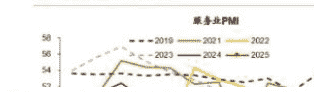

图 4：服务业 PMI 历年变化趋势

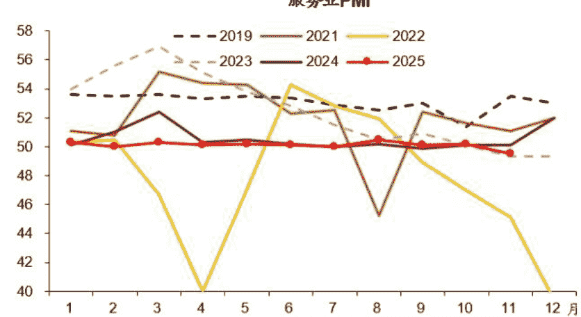

Jason不赢
2025-12-02 03:04

## 自制图表

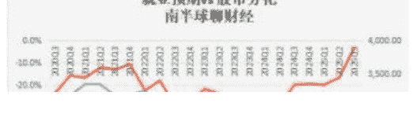

- 一手优质资源进群微信cuk255

## 学业预期vs 股市分化
南半球财经

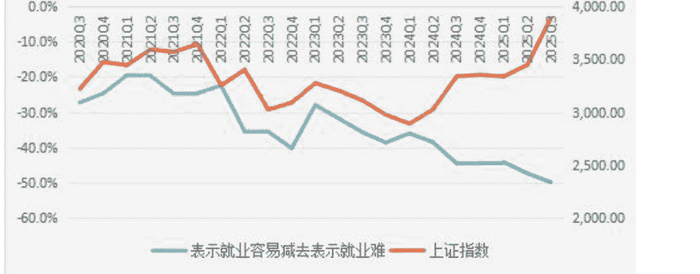

- 表示就业容易减去表示就业准 —— 上证指数

Jason不燥
2025-12-02 03:44

zerohedge: 标普环球制造业PMI11月高于预期，但ISM制造业PMI未达预期，连续九个月收缩，ISM数据暗示通胀压力放缓——支付价更高，新订单和就业情况依然。#其他国家经济

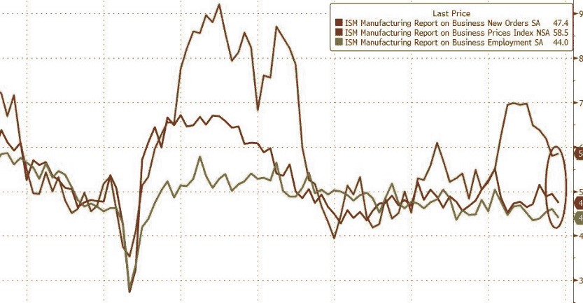

| Last Price | Value |
| :--- | :--- |
| ISM Manufacturing Report on Business New Orders SA | 47.8 |
| ISM Manufacturing Report on Business Prices Index NGA SA | 58.5 |
| ISM Manufacturing Report on Business Employment SA | 49.5 |

一手优质资源进群微信cuk255

Jason不晓
2025-12-02 04:07

bloomberg: DeepSeek推出AI模型，可与谷歌和OpenAI对抗。#经济数据

- DeepSeek发布了两个版本的实验性人工智能模型，增加了新功能，帮助了推理和自主执行能力。
- DeepSeek在多个推理基准测试中与OpenAI GPT-4的性能相当，并将推理、数学和计算等工具的能力相结合。
- DeepSeek推出了Coder-V2，在编程领域超过最新的Gemini-3-Pro，并在数学、数字和英语标准化测试中获得顶尖水平。

中国DeepSeek发布了两个版本的实验性人工智能模型，初创公司称这些新的动作将有助于组合推理和自主执行某些动作。

## 中国智能的总结

- 中国DeepSeek发布了两个版本的实验性人工智能模型，增加了新功能，帮助了推理和自主执行能力。
- 新版本DeepSeek-V3.2在多个推理基准测试与OpenAI版GPT-5的性能相当，并将推理、数学和计算等工具的能力相结合。
- DeepSeek发布了DeepSeek-V3.2，专注于数学计算，性能优于最新的Gemini-3-Pro，在数学数字和英语标准化测试中获得顶尖水平。

这家总部位于中国的九月发布的型号被命名为DeepSeek-V3.2-Exp，以其实验性，但最新版本简称为DeepSeek-V3.2。这家初创公司表示，这项新服务的表现与OpenAI公司相当。旗舰GPT-5在多个推理基准测试中表现出来，表明中国原生系统在某些指标上已经能与硅谷的领先模型竞争。

Jason不晓
2025-12-02 02:12

南华早报：欧盟对中国市场最新调查显示，三分之一的欧洲企业将转移到海外采购渠道。#其他国家经济

中国商会在对13个贸易国或公司的初步调查中发现，超过一半的企业将受到中国出口的影响，政策制定者寻求长期解决方案为企业提供稳定。一手优质资源进阶微信cuk255

bloomberg: 澳大利亚的经济增长可能加速，同时通胀升温，促使货币市场预测2026年澳洲加息的概率为50%。从2022-2023财年数据来看，移民处于非常高的水平——每年约40-50万人净流入虽有下降，但仍高于历史平均。#其他国家经济基准利率
- Fed / RBA / Bank of England / Bank of Canada / RBNZ

Jason不遇
2022-12-02 04:21

zerohedge: 最新报告，全球生育率严重低估了。由于生育率下降和未来收支关联，这可能会引发问题。目前的预测仍然以乐观的观。#人口

Future of Fertility Overestimated
Actual historically projected OECD-average fertility rates (lifetime births per woman)

Current projections from 2025
Source: UN Population Division

Jason涛
2025-12-02 04:28

预计：明年GDP4.7%，名义GDP4.5%，明年增长将在3%-3.5%的区间。然而，我们并不认同市场上“美元长期维持”的观点，我们认为经济基本面仍决定美元的关键因素。基于我们对美国最快从明年二季度开始回温的预计，美元指数在明年一季度持续下行，而在下季度开始回升。在明年半年预期回温的情况下，美元指数有望有所机会从2025年的升至2026年初。

图 5：经济关键因素及预测(2021-2026F)

| 指标名称 | 单位 | 2021 | 2022 | 2023 | 2024 | 2025F | 2026F |
| :--- | :--- | :--- | :--- | :--- | :--- | :--- | :--- |
| 实际GDP增长 | 百比 | 8.4 | 3.0 | 5.2 | 5.0 | 4.9 | 4.7 |
| 消费通胀率 | 百分 | 4.9 | 1.2 | 4.3 | 2.2 | 2.7 | |
| 利率 | 百分 | 1.7 | 1.4 | 1.5 | 1.3 | 0.9 | 1.6 |
| 净出口 | 百分 | 1.9 | 0.4 | 0.6 | 1.5 | 1.4 | |
| 名义GDP增长 | 百比 | 13.4 | 4.8 | 4.6 | 4.2 | 3.7 | |
| 资产收益率 | 百分 | 4.4 | -10.0 | -9.6 | 3.2 | -15.0 | -0.6 |
| 房地产 | 百分 | | | | | | |
| 基础建设(包括电力) | 百分 | 0.4 | 9.4 | 5.5 | 4.9 | 4.2 | 6.0 |
| 制造业 | 百分 | 13.5 | -0.2 | 7.2 | 3.5 | 4.4 | 4.8 |
| 消费景气 | 百分 | 29.6 | 5.6 | -4.7 | 5.9 | 4.5 | 3.0 |
| 出口 | 百分 | 30.1 | 0.7 | -5.5 | 1.1 | -0.5 | 2.0 |
| 进口 | | | | | | | |
| 贸易差额 | 亿美元 | 6704 | 8379 | 8221 | 9926 | 11664 | 12271 |
| 经营净产量 | 百比 | 1.8 | 2.3 | 1.4 | 2.2 | 2.8 | |
| GDP通胀指数 | 百分 | 4.6 | 1.8 | -0.6 | -0.7 | -1.1 | -0.2 |
| 消费CPI | 百分 | 2.0 | 0.2 | 0.2 | -2.6 | | |
| PPI | 百分 | 8.1 | 3.1 | -3.0 | -2.2 | -2.6 | |
| 失业率 | 百分 | -3.1 | -2.8 | -3.8 | -4.0 | | |
| 政策利率 | % | 2.2 | 1.8 | 1.5 | 1.4 | 1.3 | |
| 银行准备 | 年 | 11.5 | 10.5 | 9.5 | 9.0 | 8.5 | |
| 10年国债收益率 | 年 | 3.2 | 2.8 | 2.6 | 1.7 | 1.7 |
| 美元人民币汇率 | 年 | 6.4 | 7.0 | 7.3 | 7.1 | 7.1 |

-一手优质资源类群cuk255

## 图 34：国内在今年有所改善，反而逐渐恶化

| 同比 | 同比% |
| :--- | :--- |
| CPI | |
| GDP同比增长(国内) | 15 | 19 |
| PPI (国内) | 10 | 14 |

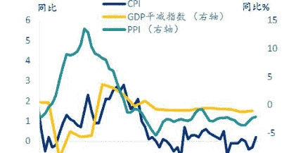
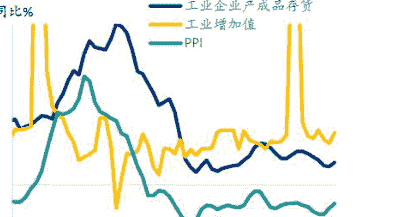

备注：来源：Wind、财经数据

备注：来源：Wind、财经数据

## 图 36：年前三季度是通胀的大幅下跌但是PPI回升的原因之一

## 图 37：CPI走低，但是核心CPI增速在下降

| 同比 | 同比% |
| :--- | :--- |
| 价格指数同比 | 5 |
| PPI (国内) | 25 |

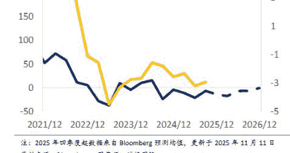
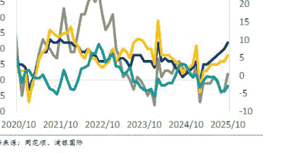

注：2025年数据来自Bloomberg，数据更新至2023年11月15日

数据：来源：Wind、财经数据

数据：来源：Wind、财经数据

## 图 42：我们统计的月度财政赤字今年以来回升到9月的17.5%

## 图 43：2026年官方预算赤字再次在4.0%

| 12个月加 | |
| :--- | :--- |
| 超额贷款 | |
| 国内增长/GDP | |
| 预算内赤字 | |

| GDP比率 | 官方(缺失)赤字率 |
| :--- | :--- |

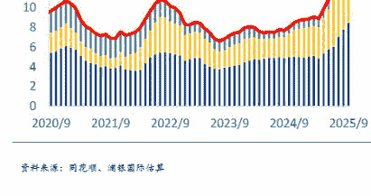
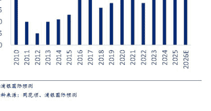

备注：来源：Wind、财经数据

备注：来源：Wind、财经数据

一手优质资源进阶群cuk255

Jason不遇
2025-12-02 04:32

BCA:英国进口开始萎缩。图表显示，截至十月，加利福尼亚洛杉矶和长滩港的装箱数量正在减少。美国进口减少全球贸易/出口减少。日本出口萎缩也证实了这一个，全球贸易萎缩对新兴市场风险的主要动力。因此，全球贸易萎缩是不一样的。#其他国家经济

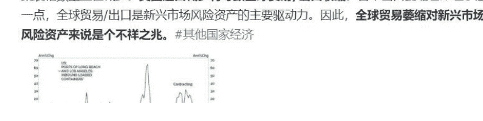

Ann@Chg

Ann@Chg

US
PORTS OF LONG BEACH
--AND LOS ANGELES:
BROKERED LOADED
CONTAINERS

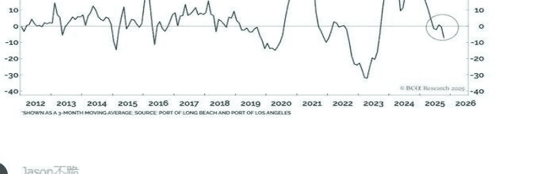

# Jason不离
2025-12-02 05:05

摩根士丹利：重点跟的 25 家开发商，11 月销售同比-42%（10 月是-36%），年初以来累计-23% 。#房价

## Morgan Stanley | RESEARCH

December 1, 2025 04:43 PM GMT

## China Property | Asia Pacific

## Developers' November Sales
Stayed Weak

CRIC preliminary sales data show that contracted sales of 25 major developers we track continued to record a deep decline of 42% y-y on average in November. We believe their sluggish sales may prolong into 1Q26 owing weak buyer sentiment, policy rollout and a high base.

Developers recorded deep sales decline in November as expected: The top 50 and top 100 developers' attributable sales recorded declines of 35% and 36% y-y (vs. 39% and -42% in October), respectively, on the high base and with reduced project launches, widening the YTD sales decline to -18% and -19% y-y, respectively, in 1M25. For the 25 major developers we track, November fell 42% y-y (vs.-36% in October), widening YTD sales to -22% y-y in 1M25.

Divergence continued in terms of sales performance: SOEs are continued to outperform in November, with milder y-y declines. Jinmao, CR Land, and COLI outperformed at 0%, -17% and -26% y-y, respectively. Some semi-OE developers like Agile Red, Zhongjiang, CIIC and Longfor posted >55% y-y declines. Some OE developers also recorded weak performance, such as Gemdale and Vanke, who were off 68% and 53% y-y, respectively. We attribute the outperformance of SOs to their better brand names and new sales in top-tier cities.

Challenging market price may linger into 1Q: Home sales continued to post similar y-y drops in recent weeks. Lower secondary listing prices and high listing volume indicate weakening resident sentiment our AlphaWise showed resident interest in tier-1 cities much faster. We reiterate our prudent view that meaningful housing policy will remain muted in the coming months, while the potential subsidy on mortgage interest may roll out in late-2/3Q26 if the accelerating home prices in tier 1 cities spreads into more tier 2 cities. With fewer launches and high base, developers may record similar magnitude of y-y sales in coming months.

# Jason不离
2025-12-02 05:16

## Roger: 特朗普 1.0 vs 2.0 美指#金融

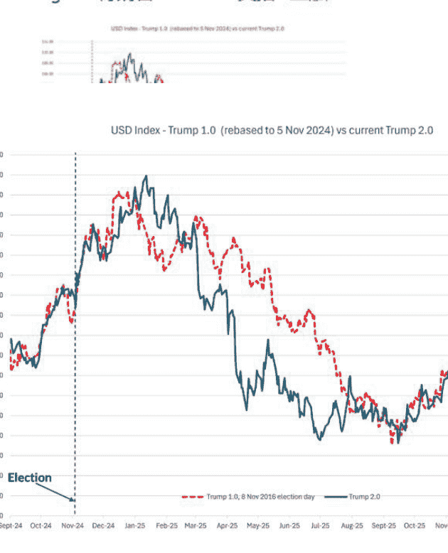

# Jason不离
2025-12-02 08:25

## 极简重点：关注财经、洪源、李豪 bloomberg weekly上的分享

付费：

- 1. 经济层面的核心矛盾，是生产关系的错配。
- 2. 去年9月，政策的出台，更多为了兜底和对冲，并不能解决这个核心矛盾。
- 3. 明年很多人会讨论（开始质）：技术的进步不能解决经济的问题。
- 4. 在大家眼里还是躲避避险——因为拿了科技票，……

极简重点：关注财经、洪源、李豪 bloomberg weekly上的分享

一手优质资源进群微信cuk255

# 南华：展望未来，美元人民币汇率的走势将是贬值趋势（人民币相对于美元值）与波动风险开启的强势调整。短期内人民币汇率将继续保持强势的态势，但升值可能会有所释放，双向波动的特征将更加明显。中期来看，随着中国经济的发展和人民币国际化的推进，人民币有望获得一个温和的升值通道，但不会极端。

## 1.2 美元人民币汇率预期的特征

2025年11月人民币相对于美元强势升值的背景下，人民币市场出现了“结汇”特征。2025年9月，人民币汇率曾回升至7.10，自2020年以来的最低高位。10月份收的结汇量保持在177亿美元的水平，这一特征是明显的。前10个月结汇量接近820亿美元，进入11月后，人民币市场选择结汇以锁定利润，规避波动。在2025年11月后，市场开启了企业结汇热潮，推动美元人民币汇率一度回升至7.07。一方面是由于人民币强势升值，另一方面是由于企业需要结汇。季节性需求是传统的结汇高潮期。这一时期，许多企业需要结汇以支付贷款资金、进行财务结算，以及为方便操作形成了叠加效应。市场上，人民币汇率的强势趋势使得企业更愿意进行结汇，以锚定有利的汇率。季节性的资金需求使得企业有动力将资金兑成人民币，因此我们看到了最后，结汇压力增大，推动美元人民币汇率快速下跌，前瞻市场波动幅度扩大，也为人民币强势表现提供了额外的动力。

一手优质资源进群微信255

# 人民币是否延续升值趋势

主要结论：支持人民币在短期内升值的因素如下：
- 内部：基本面稳固；
- 外部：美联储政策转向以及人民币国际化带来的需求。

支持人民币在短期内升值的因素有哪些？
综合来看，美联储的转向是影响关键变量。如果美国经济增长放缓出现压力，当前市场普遍预期美联储将在2025年12月开始降息，并在2026年继续宽松，为人民币提供了有利环境。

## 三、策略建议：数据驱动管理与政策引导

未来，如果利率保持维持，将进一步加强美元压力。因此在人民币市场时，必须动态评估汇率信号。这些因素共同决定了欧元的走势，进而影响人民币市场。其中，中国经济的韧性并非短期表现，而是建立在内需市场、高效运行体制和强大的政策之上。

人民币市场采取哪些措施是可能的？短期内，人民币市场将继续维持均衡，人民币汇率有望呈现双向波动，维持在0.07左右的关键区间。未来，人民币市场有望从“单向修复”向“双向修复”转型。与此同时，提升人民币汇率弹性是必要的。

为了应对风险，对于企业而言，加强风险管理和安全预期至关重要。希望人民币市场提供充足的避险工具。面对市场波动，汇率波动的压力将会加大。首先可以从技术手段入手降低汇率风险水平；其次政策引导非常关键，任何突然的调整都会引起市场波动。

首先要关注美国基准利率的走向。美国利率的维持对市场具有重要影响，虽然美国不会继续加息，但维持高利率有望在高位，这将导致美元压力。对于人民币市场而言，汇率的变化是一个节点。应尽早做好准备和应对。两个季度内，全球地缘政治冲突、通胀等因素可能加剧市场波动，汇率具有较大的不确定性。任何事件发生可能都受到外部冲击，政府需要加强引导，有效应对冲击。同时，中国经济的基本面稳健良好，房地产市场的政策引导的作用至关重要。如果处理不当，也可能影响市场预期，增加人民币汇率压力。

基于上述情况，对于人民币市场应积极应对波动，加强引导与风险管理，丰富金融市场的供给。特别是企业，需要加强灵活性和主动风险管理措施。

其次，在企业层面，应加强“主动管理”的心态，做好“对冲管理”，利用套期等工具规避汇率风险。企业可以通过金融工具将汇率风险收益对冲，以平衡汇率波动带来的风险。例如，可以考虑在人民币对美元的汇率维持在7.07或7.09左右。

最后，在政策层面，可以灵活运用政策工具。例如可以关注“外汇套期灵活化”等工具，有效降低汇率波动的冲击。

在最后的保障方面，企业需要增强良好的保险意识和态度，动态调整对冲工具。对于出口型企业，可以根据自身需求调整保险水平，利用多种工具。在执行政策时要考虑到灵活性，采取灵活的操作方式，不应采取“一刀切”的模式，而是根据自身的风险能力来选择合适的对冲工具。对于风险程度较高的企业，可以扩大保护范围。在合同中，企业可以将汇率占比从5%提升至20%。

优质资源关注微信255

# Jason不离
2025-12-02 08:55

摩根士丹利期数据显示，投资者增加了纽元(NZD)和澳元(AUD)多头，同时美元指数(DXY)空头。投资者目前偏多AUD&NZD，同时空JPY&CHF。在1月28日的周一，纽元(NZD)幅度最大。

## Morgan Stanley | RESEARCH

December 1, 2025 02:45 PM GMT

## FX Strategy | Global # FX Positioning Indicates Long

Our FX positioning scores are now published daily on Bloomberg.

## Key Takeaways

- Options pricing data indicate that investors increased long NZD and AUD positions and decreased DXY positions.
- In the futures market, investors decreased short NZD positions, while they added short GBP and CHF positions.
- Overall, options data suggest tactical investors are currently long AUD and NZD while short JPY and CHF.
- Positioning in the futures market is long EUR, and short CHF and CAD.

## Exhibit 1:
DXY net options positioning (11/28/2025):
- -100%: max short
- 0%: neutral
- +100%: max long

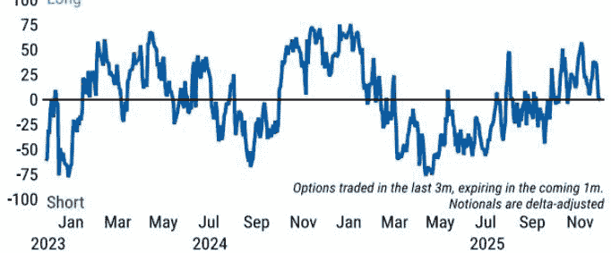

Options traded in the last 3m, expiring in the coming 1m.
Nationals are delta-adjusted (of total options outstanding).

In the week ending Friday, November 28, options pricing data indicates that investors increased long NZD and AUD positions and increased short DXY positions (Exhibit 3).
In the futures market, investors decreased short NZD positions, while they added short GBP and CHF positions in the week ending Tuesday, October 14 (Exhibit 4).

## Exhibit 3:
1-week change in options positioning (% of total options outstanding)

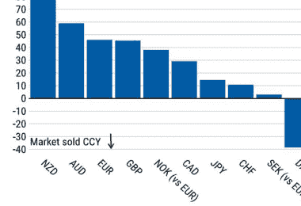

Market sold CCY

## Exhibit 4:
1-week change in CFTC positioning (% of open interest, non-commercial)

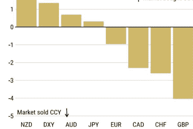

Market sold CCY

Source: DTCC, Bloomberg, Morgan Stanley Research, Data as of Friday, November 28. See FX Trading Signals From Options Data and Assessing Positioning with Currency Options.
Source: Bloomberg, Macrobond, Morgan Stanley Research, Data as of Tuesday, October 14.

# 深度视野优质集团（链接优质社群，助你成功）

全部包含以下内容：限时年费188/年 加微信cuk255

- ① 吃瓜群众包时微信群对话（原价365 元/年）
- ② 子明享汇（内部）优质文章
- ③ 政事室（顾子明）付费内容再送顾子明群聊
- ④ 米联储闲文【作者米穗】（原价599 元/年）
- ⑤ 欧洲金获会员专属文章（原价328 元/年）
- ⑥ 砖瓦斥内部图文（原价400 元/年）
- ⑦ 卢克文青读书会专属文章（原价699 元/年）
- ⑧ 鉴茶财经知识星球（原价3310 元/年）
- ⑨ 猫哥的视界知识星球文章（原价299 元/年）
- ⑩ 财经周刊【独家新闻】（原价1498 元/年）
- ⑪ 杨世光在金钱爆（原价2200 元/年）
- ⑫ 蒜森财经知识星球（原价1600 元/年）
- ⑬ 潇源异译付费文集（持续更新）
- ⑭ 司马林解课全套音频和全套书籍版权无损（原价2.3 万）
- ⑮ 虚构三部曲[民国梦、帝国扩张、不理解的MAO]（原价599 元）
- 十六 克文知识星球文章（原价268 元/年）
- ⑰ 额外再送：......（更多资源不下去了......）
