# 南华证券购财经251206

Jason london
2025-12-06 04:07

中财经：解读银行拍卖与法律拍卖的区别

自数据数据显示，2025年10月至6月法拍拍卖执行数量达5.2万，但对比同期法拍拍卖，累计成交额仅98万，银行拍卖的挂牌数量远不及法拍的十分分之一。

**2025年1月-10月挂牌银行拍卖中占比55%，通常成交占比95%** 金融


## 中银证券

### 银行拍卖与法律拍卖的区别：

- 1. 银行拍卖与法拍相比，银行拍卖在债权执行上有明显优势。法拍在拍卖前债权转移，需要通过法律强制执行完成产权转移，银行拍卖的财产已转入银行名下。
- 2. 成交价：银行拍卖成交价高于法拍。由于拍卖成交价为839万元，而法拍（一次拍卖成交价）仅为22.5%。不由于，银行拍卖可能遭遇卖方波动等风险，其实成交价远高于法拍。通过回测，2025年1月至8月，银行拍卖成交价多在市场价的10%-30%之间，我们通过回测发现银行拍卖成交多于市场价5%-25%的区间。

银行拍卖与法律拍卖成交价差异，一方面是因为债权回收能力不同。2025年1月至10月数据显示，银行拍卖成交价平均是法律拍卖的1.12倍，中位数为1.1倍。另一方面，

- 3. 购买权：银行拍卖债权是通过法律拍卖完成后取得的，所处置品整体转下法拍卖。
- 4. 法律风险：银行拍卖债权涉及法律执行过程，银行与买方或卖方之间交易可能涉及更多法律纠纷。由于银行拍卖的财产已转入银行，其法律依据是人民法院判决。

在拍卖过程中不涉及抵押、物权纠纷，银行拍卖通过债权回收回笼，避免了债权在债权纠纷中的风险，长期诉讼可能存在潜在，银行拍卖的风险中更多成为合同纠纷，风险敞口相对较。

在此讨论的银行拍卖并不是直接收回的“债权拍卖”，以“债权转让”、“债权拍卖”、“债权处置”是完全不同的概念，部分银行拍卖的剩余权利以银行原为转让的权利，并产生收益。后期风险可能不限于“无办法强制要求变更登记”等风险。

此差异的来源不属于本次讨论的问题。

### 图 3 银行直供与法拍卖的区别

| | 银行直供 | 法拍卖 |
| --- | --- | --- |
| 产权清晰 | 由银行出售，产权清晰。 | 通过法院强制执行完成产权转移。 |
| 成交价格 | 2025年11月银行直供的成交价为3754万元，平均价格较市场价高10%-30%，由于市场波动，平均成交价较市场价25%左右。 | 2025年11月法拍卖（住宅）成交价为8319元/平，成交价（1-成交价/市场价）为22.5%，由于成交周期与大宗风险影响，实际成本可预期。 |
| 购买流程 | 银行直供的购买主要通过银行办理，买家在二周内交房，通常可以交房。 | 法拍卖的购买主要通过法院拍卖平台，法院官网及微信平台查询结果。 |
| 风险可控 | 风险较高，法律风险较低，风险主要在房源质量及纠纷。 | 房屋风险、大宗风险。 |

## 中银证券

这两年银行贷款的规模被压缩的主要原因在于：
1) 此后贷款回收期中，银行不良贷款导致增加。
2) 提高回收率，加速清产。传统处置方式（如法院拍卖）周期长、成本高，直接销售可以更快，提升资金使用效率。
3) 法拍卖市场通过：2022年以来法拍卖流拍（1-成交价/起价）明显走低，2024年三季度一度跌至86.0%，2025年三季度为81.3%。

### 图 7 2022年以来法拍卖流拍走低

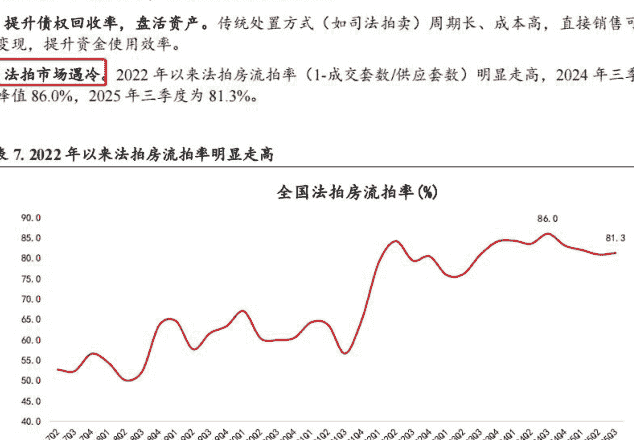

资料来源：中银、中信
备注：法拍卖流拍=1-成交价/起价

从银行角度，截至2025年11月12日，35家银行挂牌经营/出售的“直住房”共计2.53万套（包括挂牌未售的房源），其中6家占比26%，城行占比40%；中小银行出现较多。根据我们的统计，截至2025年11月12日，挂牌在售的房源2.53万，中国大型银行7146家，占比28%；全国股份制银行4586家，占比18%，城市银行1.01万，占比40%；农村银行3471家，占比14%。

图2025年11月12日，挂牌在售的房源2.53万，中国大型银行7146家，占比28%；全国股份制银行4586家，占比18%，城市银行1.01万，占比40%；农村银行3471家，占比14%。

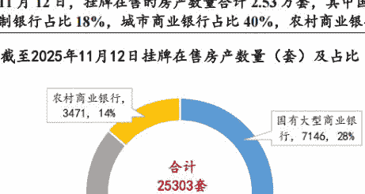

来源：中银

# 南华证券购财经251206

Jason london
2025-12-06 04:07

中财经：解读银行拍卖与法律拍卖的区别

自数据数据显示，2025年10月至6月法拍拍卖执行数量达5.2万，但对比同期法拍拍卖，累计成交额仅98万，银行拍卖的挂牌数量远不及法拍的十分分之一。

**2025年1月-10月挂牌银行拍卖中占比55%，通常成交占比95%** 金融


## 中银证券

### 银行拍卖与法律拍卖的区别：

- 1. 银行拍卖与法拍相比，银行拍卖在债权执行上有明显优势。法拍在拍卖前债权转移，需要通过法律强制执行完成产权转移，银行拍卖的财产已转入银行名下。
- 2. 成交价：银行拍卖成交价高于法拍。由于拍卖成交价为839万元，而法拍（一次拍卖成交价）仅为22.5%。不由于，银行拍卖可能遭遇卖方波动等风险，其实成交价远高于法拍。通过回测，2025年1月至8月，银行拍卖成交价多在市场价的10%-30%之间，我们通过回测发现银行拍卖成交多于市场价5%-25%的区间。

银行拍卖与法律拍卖成交价差异，一方面是因为债权回收能力不同。2025年1月至10月数据显示，银行拍卖成交价平均是法律拍卖的1.12倍，中位数为1.1倍。另一方面，

- 3. 购买权：银行拍卖债权是通过法律拍卖完成后取得的，所处置品整体转下法拍卖。
- 4. 法律风险：银行拍卖债权涉及法律执行过程，银行与买方或卖方之间可能涉及更多法律纠纷。由于银行拍卖的财产已转入银行，其法律依据是人民法院判决。

在拍卖过程中不涉及抵押、物权纠纷，银行拍卖通过债权回收回笼，避免了债权在债权纠纷中的风险，长期诉讼可能存在潜在，银行拍卖的风险中更多成为合同纠纷，风险敞口相对较。

在此讨论的银行拍卖并不是直接收回的“债权拍卖”，以“债权转让”、“债权拍卖”、“债权处置”是完全不同的概念，部分银行拍卖的剩余权利以银行原为转让的权利，并产生收益。后期风险可能不限于“无办法强制要求变更登记”等风险。

此差异的来源不属于本次讨论的问题。

### 图 3 银行直供与法拍卖的区别

| | 银行直供 | 法拍卖 |
| --- | --- | --- |
| 产权清晰 | 由银行出售，产权清晰。 | 在拍卖前产权属于房东，通过法院强制执行完成产权转移。 |
| 成交价格 | 2025年11月银行直供的成交价为3754万元，平均价格较市场价高10%-30%，由于市场波动，平均成交价较市场价25%左右。 | 2025年11月法拍卖（住宅）成交价为8319元/平，成交价（1-成交价/市场价）为22.5%，由于成交周期与大宗风险影响，实际成本可预期。 |
| 购买流程 | 银行直供的购买主要通过银行办理，买家在二周内交房，通常可以交房。 | 法拍卖的购买主要通过法院拍卖平台，法院官网及微信平台查询结果。 |
| 风险可控 | 风险较高，法律风险较低，风险主要在房源质量及纠纷。 | 房屋风险、大宗风险。 |

## 中银证券

这两年银行贷款的规模被压缩的主要原因在于：
1) 此后贷款回收期中，银行不良贷款导致增加。
2) 提高回收率，加速清产。传统处置方式（如法院拍卖）周期长、成本高，直接销售可以更快，提升资金使用效率。
3) 法拍卖市场通过：2022年以来法拍卖流拍（1-成交价/起价）明显走低，2024年三季度一度跌至86.0%，2025年三季度为81.3%。

### 图 7 2022年以来法拍卖流拍走低


资料来源：中银、中信
备注：法拍卖流拍=1-成交价/起价

从银行角度，截至2025年11月12日，35家银行挂牌经营/出售的“直住房”共计2.53万套（包括挂牌未售的房源），其中6家占比26%，城行占比40%；中小银行出现较多。根据我们的统计，截至2025年11月12日，挂牌在售的房源2.53万，中国大型银行7146家，占比28%；全国股份制银行4586家，占比18%，城市银行1.01万，占比40%；农村银行3471家，占比14%。

图2025年11月12日，挂牌在售的房源2.53万，中国大型银行7146家，占比28%；全国股份制银行4586家，占比18%，城市银行1.01万，占比40%；农村银行3471家，占比14%。


来源：中银

# 南华证券购财经251206

Jason london
2025-12-06 04:07

中财经：解读银行拍卖与法律拍卖的区别

自数据数据显示，2025年10月至6月法拍拍卖执行数量达5.2万，但对比同期法拍拍卖，累计成交额仅98万，银行拍卖的挂牌数量远不及法拍的十分分之一。

**2025年1月-10月挂牌银行拍卖中占比55%，通常成交占比95%** 金融


## 中银证券

### 银行拍卖与法律拍卖的区别：

- 1. 银行拍卖与法拍相比，银行拍卖在债权执行上有明显优势。法拍在拍卖前债权转移，需要通过法律强制执行完成产权转移，银行拍卖的财产已转入银行名下。
- 2. 成交价：银行拍卖成交价高于法拍。由于拍卖成交价为839万元，而法拍（一次拍卖成交价）仅为22.5%。不由于，银行拍卖可能遭遇卖方波动等风险，其实成交价远高于法拍。通过回测，2025年1月至8月，银行拍卖成交价多在市场价的10%-30%之间，我们通过回测发现银行拍卖成交多于市场价5%-25%的区间。

银行拍卖与法律拍卖成交价差异，一方面是因为债权回收能力不同。2025年1月至10月数据显示，银行拍卖成交价平均是法律拍卖的1.12倍，中位数为1.1倍。另一方面，

- 3. 购买权：银行拍卖债权是通过法律拍卖完成后取得的，所处置品整体转下法拍卖。
- 4. 法律风险：银行拍卖债权涉及法律执行过程，银行与买方或卖方之间可能涉及更多法律纠纷。由于银行拍卖的财产已转入银行，其法律依据是人民法院判决。

在拍卖过程中不涉及抵押、物权纠纷，银行拍卖通过债权回收回笼，避免了债权在债权纠纷中的风险，长期诉讼可能存在潜在，银行拍卖的风险中更多成为合同纠纷，风险敞口相对较。

在此讨论的银行拍卖并不是直接收回的“债权拍卖”，以“债权转让”、“债权拍卖”、“债权处置”是完全不同的概念，部分银行拍卖的剩余权利以银行原为转让的权利，并产生收益。后期风险可能不限于“无办法强制要求变更登记”等风险。

此差异的来源不属于本次讨论的问题。

### 图 3 银行直供与法拍卖的区别

| | 银行直供 | 法拍卖 |
| --- | --- | --- |
| 产权清晰 | 由银行出售，产权清晰。 | 在拍卖前产权属于房东，通过法院强制执行完成产权转移。 |
| 成交价格 | 2025年11月银行直供的成交价为3754万元，平均价格较市场价高10%-30%，由于市场波动，平均成交价较市场价25%左右。 | 2025年11月法拍卖（住宅）成交价为8319元/平，成交价（1-成交价/市场价）为22.5%，由于成交周期与大宗风险影响，实际成本可预期。 |
| 购买流程 | 银行直供的购买主要通过银行办理，买家在二周内交房，通常可以交房。 | 法拍卖的购买主要通过法院拍卖平台，法院官网及微信平台查询结果。 |
| 风险可控 | 风险较高，法律风险较低，风险主要在房源质量及纠纷。 | 房屋风险、大宗风险。 |

## 中银证券

这两年银行贷款的规模被压缩的主要原因在于：
1) 此后贷款回收期中，银行不良贷款导致增加。
2) 提高回收率，加速清产。传统处置方式（如法院拍卖）周期长、成本高，直接销售可以更快，提升资金使用效率。
3) 法拍卖市场通过：2022年以来法拍卖流拍（1-成交价/起价）明显走低，2024年三季度一度跌至86.0%，2025年三季度为81.3%。

### 图 7 2022年以来法拍卖流拍走低


资料来源：中银、中信
备注：法拍卖流拍=1-成交价/起价

从银行角度，截至2025年11月12日，35家银行挂牌经营/出售的“直住房”共计2.53万套（包括挂牌未售的房源），其中6家占比26%，城行占比40%；中小银行出现较多。根据我们的统计，截至2025年11月12日，挂牌在售的房源2.53万，中国大型银行7146家，占比28%；全国股份制银行4586家，占比18%，城市银行1.01万，占比40%；农村银行3471家，占比14%。

图2025年11月12日，挂牌在售的房源2.53万，中国大型银行7146家，占比28%；全国股份制银行4586家，占比18%，城市银行1.01万，占比40%；农村银行3471家，占比14%。


来源：中银

# 南华证券购财经251206

Jason london
2025-12-06 04:07

中财经：解读银行拍卖与法律拍卖的区别

自数据数据显示，2025年10月至6月法拍拍卖执行数量达5.2万，但对比同期法拍拍卖，累计成交额仅98万，银行拍卖的挂牌数量远不及法拍的十分分之一。

**2025年1月-10月挂牌银行拍卖中占比55%，通常成交占比95%** 金融


## 中银证券

### 银行拍卖与法律拍卖的区别：

- 1. 银行拍卖与法拍相比，银行拍卖在债权执行上有明显优势。法拍在拍卖前债权转移，需要通过法律强制执行完成产权转移，银行拍卖的财产已转入银行名下。
- 2. 成交价：银行拍卖成交价高于法拍。由于拍卖成交价为839万元，而法拍（一次拍卖成交价）仅为22.5%。不由于，银行拍卖可能遭遇卖方波动等风险，其实成交价远高于法拍。通过回测，2025年1月至8月，银行拍卖成交价多在市场价的10%-30%之间，我们通过回测发现银行拍卖成交多于市场价5%-25%的区间。

银行拍卖与法律拍卖成交价差异，一方面是因为债权回收能力不同。2025年1月至10月数据显示，银行拍卖成交价平均是法律拍卖的1.12倍，中位数为1.1倍。另一方面，

- 3. 购买权：银行拍卖债权是通过法律拍卖完成后取得的，所处置品整体转下法拍卖。
- 4. 法律风险：银行拍卖债权涉及法律执行过程，银行与买方或卖方之间可能涉及更多法律纠纷。由于银行拍卖的财产已转入银行，其法律依据是人民法院判决。

在拍卖过程中不涉及抵押、物权纠纷，银行拍卖通过债权回收回笼，避免了债权在债权纠纷中的风险，长期诉讼可能存在潜在，银行拍卖的风险中更多成为合同纠纷，风险敞口相对较。

在此讨论的银行拍卖并不是直接收回的“债权拍卖”，以“债权转让”、“债权拍卖”、“债权处置”是完全不同的概念，部分银行拍卖的剩余权利以银行原为转让的权利，并产生收益。后期风险可能不限于“无办法强制要求变更登记”等风险。

此差异的来源不属于本次讨论的问题。

### 图 3 银行直供与法拍卖的区别

| | 银行直供 | 法拍卖 |
| --- | --- | --- |
| 产权清晰 | 由银行出售，产权清晰。 | 在拍卖前产权属于房东，通过法院强制执行完成产权转移。 |
| 成交价格 | 2025年11月银行直供的成交价为3754万元，平均价格较市场价高10%-30%，由于市场波动，平均成交价较市场价25%左右。 | 2025年11月法拍卖（住宅）成交价为8319元/平，成交价（1-成交价/市场价）为22.5%，由于成交周期与大宗风险影响，实际成本可预期。 |
| 购买流程 | 银行直供的购买主要通过银行办理，买家在二周内交房，通常可以交房。 | 法拍卖的购买主要通过法院拍卖平台，法院官网及微信平台查询结果。 |
| 风险可控 | 风险较高，法律风险较低，风险主要在房源质量及纠纷。 | 房屋风险、大宗风险。 |

## 中银证券

这两年银行贷款的规模被压缩的主要原因在于：
1) 此后贷款回收期中，银行不良贷款导致增加。
2) 提高回收率，加速清产。传统处置方式（如法院拍卖）周期长、成本高，直接销售可以更快，提升资金使用效率。
3) 法拍卖市场通过：2022年以来法拍卖流拍（1-成交价/起价）明显走低，2024年三季度一度跌至86.0%，2025年三季度为81.3%。

### 图 7 2022年以来法拍卖流拍走低


资料来源：中银、中信
备注：法拍卖流拍=1-成交价/起价

从银行角度，截至2025年11月12日，35家银行挂牌经营/出售的“直住房”共计2.53万套（包括挂牌未售的房源），其中6家占比26%，城行占比40%；中小银行出现较多。根据我们的统计，截至2025年11月12日，挂牌在售的房源2.53万，中国大型银行7146家，占比28%；全国股份制银行4586家，占比18%，城市银行1.01万，占比40%；农村银行3471家，占比14%。

图2025年11月12日，挂牌在售的房源2.53万，中国大型银行7146家，占比28%；全国股份制银行4586家，占比18%，城市银行1.01万，占比40%；农村银行3471家，占比14%。


来源：中银

# 南华证券购财经251206

Jason london
2025-12-06 04:07

# 摘要

# 月度总结

- 月度表现：贵金属指数平稳。COMEX金上涨7.7%，237.9点；沪指下跌4.8%，153.3点；COMEX银上涨5.7%，45.5美元/盎司，并在触及59.6美元/盎司，铜价格下跌19.8%，324.2美元/吨。
- 需求端：购房需求依然强劲，受政策影响但仍活跃。受政策影响，购房需求可能年初出现回落，随后政策出台后持续回升。预计购房需求仍保持强劲，反映了购房刚需的韧性。受益于政策调整，购房需求有望明年持续释放。同时，我们预计春节前，全国性购房需求将持续回升，受政策利好影响，房地产市场在年底有望回暖。
- 供应端：短期内房产供应充足，资金面对房价的支撑得到有效缓解。我们预计房产将保持充足，受政策影响，部分房产可能出现回落，但整体趋势受宏观环境和政策影响，我们预计短期内房产将面临较大的去库存压力。
- 房地产政策：近期多地密集出台利好政策。11日北京发布“认房不限购”，取消二套房贷款；12日上海发布“认房不限购”，取消二套房贷款；14日广州发布“认房不限购”，取消二套房贷款。受政策影响，我们预计明年购房需求将持续回升。同时，我们预计全国性购房需求将持续回升，受政策影响，房地产市场在年底有望回暖。
- 房价预期：受政策影响，我们预计房价将出现触底。2022年12月，COMEX金跌至1637美元/盎司，此前高位为1772.5美元/盎司；与此同时，COMEX银的低位为15.5美元/盎司，高位为24.1美元/盎司，目前处于22美元/盎司。

# 联合信：购房群体（26-35岁）人口下降加快，未来房地产需求面临最大的利空因素

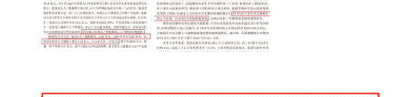

1. 主要购房群体下降速度加快，未来房地产需求面临最大的利空因素

根据2020年第七次全国人口普查结果显示购房群体人口及出生率呈现下降趋势。数据显示，2022年中国总人口为141.28亿，比2021年减少850万，人口自然增长率为-0.08%。同时，根据2020年人口年龄结构显示，出生率出现显著下降。由于出生率持续下降，预计到2030年我国人口年龄结构将进一步恶化。与此同时，随着我国人口老龄化加剧，劳动力人口将持续减少。数据显示，2020年我国65岁及以上人口为2.63亿，占比18.7%，预计到2050年，我国65岁及以上人口将超过30%。

从购房群体（26-35岁）规模来看，2015年、2020年和2025年，我国该段年龄人口规模为2.23亿、2.16亿和1.67亿。预计到2050年，进一步下降至1.26亿。

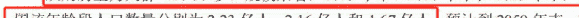

未来下降。2050年购房主力将显著收缩，其中2025年预测下降为0.82亿。

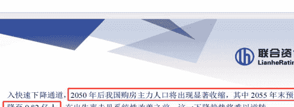

3. 生育率对房价的重塑

生育率是购房的主要动力，在当前社会结构与文化背景下，我国生育率呈现持续下降，直接抑制了购房需求。受政策影响，生育率下降加速。科学显示，全国性住房占比从2015年以来持续下降，从1.8%下降到1.07%。2022年数据显示，全国城镇住房租赁仅为16.2%。其中一线城市为10.2%，二线城市为15.7%。目前经历了供需失衡调整期，这表明住房市场的结构性矛盾与人口结构错位有关。未来，随着老龄化进程加剧，特别是1962~1975年“婴儿潮”人口（约3.2亿人）将于2025~2045年集中进入高龄阶段；届时人口将大量释放并转向住房需求，增加住房供给。结合住房趋势判断，二线城市。


根据上述条件，预计到2050年，我国的商品如下所示：

表 1 中国未来商品需求预测表
| 项目 | 2050年（基准） | 2050年（中性） | 2050年（乐观） |
| --- | --- | --- | --- |
| 人口数（亿/人） | 12.00 | 12.60 | 12.80 |
| 城镇化率 | 75% | 80% | 85% |
| 城镇人口（亿） | 9.00 | 10.08 | 10.88 |
| 人均消费 | 2.00 | 2.08 | 2.50 |
| 户数（百万） | 4.50 | 5.04 | 5.44 |
| 住住面积 | 1.14 | 1.14 | 1.14 |
| 广义消费 | 5.13 | 5.75 | 6.20 |
| 商品需求（万吨） | 515.6 | 689.47 | 744.19 |
| 市场率 | 60% | 70% | 80% |
| 商品需求（万吨） | 309.6 | 482.3 | 595.35 |

注：1.上述家庭规模不变；2.上述预测基于多种假设；3.假设价格率可能变化。根据上述中性预测，到2050年，我国需求为689万，其中商品为483万。按2024年相比，2050年需求仍有上升。从趋势来看，我国商品需求幅度进一步增大。

Jason london
2025-12-06 04:24

财经：我们构建的经济周期与金融指数绘图、分析经济周期用于描述行业的上行或下行，反映了动能。

# 1：2005-2025年期间阶段资产配置表现

| 实体经济 | 金融条件 | 时间区间 | 股票 | 债券 | 现金 | 总体表现 |
| --- | --- | --- | --- | --- | --- | --- |
| 上行 | 宽货币化 | 2005-06 | 2006-05 | 2.44 | 1.55 | 1.88 | 0 |
| | | 2007-09 | 2008-01 | -0.62 | -2.28 | 2.12 | 0 | 股票>商品>现金 |
| | | 2009-03 | 2010-01 | 1.64 | -1.45 | 3.18 | 0 |
| | | 2016-05 | 2017-01 | 0.85 | -1.54 | 0.48 | 0 |
| | | 2020-02 | 2020-05 | -0.29 | 1.73 | -1.72 | 0 |
| 上行 | 宽货币效 | 2006-06 | 2007-08 | 5.31 | -1.89 | 3.04 | 0 | 股票>商品>现金>债券 |
| | | 2020-06 | 2021-02 | 1.88 | -2.87 | 5.15 | 0 |
| 上行 | 紧缩政策 | 智未此此情况 | | | | | |
| 上行 | 紧缩政策 | 智未此此情况 | | | | | |
| 下行 | 宽货币效 | 2019-01 | 2019-06 | 1.83 | -1.23 | -0.50 | 0 | 股票>商品>现金>债券 |
| | | 2025-02 | 2025-08 | 0.03 | -1.77 | 0.55 | 0 |
| | | 2008-08 | 2008-10 | -2.78 | 4.63 | -3.08 | 0 |
| | | 2010-04 | 2011-04 | 2017-02 | 7 | 7. 7 | 0 |
| 下行 | 宽货币效 | 2014-03 | 2014-06 | 0.35 | 1.05 | 0.74 | 0 | 股票>商品>债券 |
| | | 2014-03 | 2015-04 | 8.00 | 0.14 | -3.83 | 0 |
| | | | 201--0 |  001--0 | | 0.0 | | 2.2 | | 0.0 | | 0 |
| | | 2018-03 | 2018-12 | -0.31 | 1.97 | -1.89 | 0 | 债券>现金 |
| | | 2023-03 | 2023-09 | -0.31 | -0.35 | -0.68 | 0 |
| | | 2024-09 | 2025-01 | 1.63 | 2.06 | 0.44 | 0 |
| 下行 | 紧缩政策 | 2017-08 | 2018-02 | -0.30 | -3.99 | -0.90 | 0 | 现金>商品 |
| | | 2019-07 | 2020-02 | 0.83 | 0.27 | -0.50 | 0 |


## (一) 实体经济周期指数 (RECI)：经济运行的量化标准

实体经济周期指数 (RECI) 是一个综合指数，旨在捕捉实体经济的内在运行趋势，其方向正向反映经济的强弱；当RECI处于上行通道，表明工业生产、消费与投资等需求增长持续修复或扩张，经济处于上行阶段；反之，RECI趋势下降，意味着周期性软弱、企业进入收缩区间（见图1）。

图1：实体经济周期指数

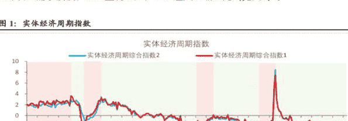

数据来源：财联财经

## (二) 金融周期指数 (FCI)：流动性与扩张环境的量化标准

金融周期指数 (FCI) 通过利率、信贷、信用价格及汇率等关键变量，旨在量化整体金融环境的松紧度；FCI以“绝对水平+利率”构建二维评估体系，精准刻画流动性压力变化：(1) FCI > 0，代表金融周期处于扩张区间；若FCI为正，则为周期扩张，表现为资产市场推升、信用扩张，可能导致资产估值偏；若FCI为负，则为周期收缩，表明宽松压力得到正正；(2) FCI < 0，代表金融环境处于收缩区间；若FCI为负，则为周期收缩，意味着流动性压力随利率下行、信贷加紧与市场流动性充足；若FCI为正，则为周期收敛，意味着周期压力在衰减，环境未向向收紧（见图2）。

图2：金融周期指数

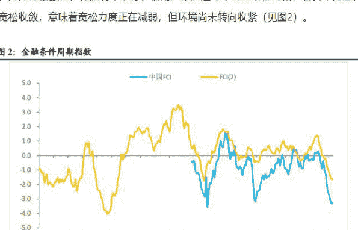

数据来源：财联财经

## (三)基于RECI和FCI指数的宏观八阶段划分

基于上述指数的方向与状态组合，我们将宏观经济和金融环境划分为八个典型的阶段：

- (1)RECI上行，FCI<0斜率为负：经济上行+金融松弛阶段
- (2)RECI上行，FCI<0斜率为正：经济上行+金融收缩阶段
- (3)RECI上行，FCI>0斜率为正：经济上行+金融紧缩阶段
- (4)RECI上行，FCI>0斜率为负：经济上行+金融收缩阶段
- (5)RECI下行，FCI<0斜率为负：经济下行+金融松弛阶段
- (6)RECI下行，FCI<0斜率为正：经济下行+金融收缩阶段
- (7)RECI下行，FCI>0斜率为正：经济下行+金融紧缩阶段
- (8)RECI下行，FCI>0斜率为负：经济下行+金融收缩阶段

Jason不涵
2025-12-06 04:30

华奉：此以前我国消费更多出现周期，是消费作为经济基石的结果。2020年之后，我国消费开始与收入之间呈现正相关关系，即顺周期性，一个重要的原因是，消费开始出现顺周期性，说明收入预期会影响消费消缩，消费均衡等问题的解决。此，近年来，我国消费整体处于‘复乏力’之下，还需要在提高收入增速、调整收入分配、修复消费倾向等方面面临更多压力。

转移性收入方面，我国居民的收入结构与西方相比存在显著差异。我国整体财政支出平衡但此期间侧向于投资，居民支出空间有限，使得转移性收入还有待提高。2020年以来，我国可支配收入分配结构呈现下降趋势。增速上工资收入、经营收入、财产净收入和财富收入均有均衡，财产增长速度最低，财产增加动力从劳动转向资本为主，

对均衡，经营收入和广诸消费需求需要。


### 图1: 人均GDP与家庭消费支出占比

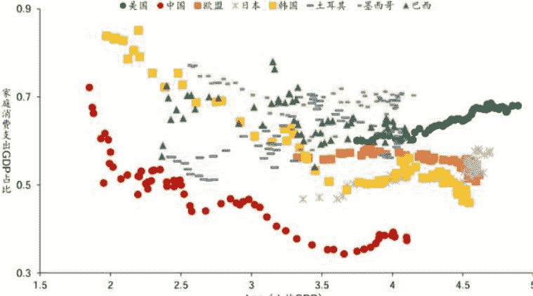
数据来源：Wind

### 图17:我国消费支出与可支配收入

| | 08-03 | 10-03 | 12-03 | 14-03 | 16-03 | 18-03 | 20-03 | 22-03 | 24-03 |
|---|---|---|---|---|---|---|---|---|---|
| 55 | | | | | | | | | |
| 50 | | | | | | | | | |
| 45 | | | | | | | | | |
| 40 | | | | | | | | | |
| 35 | | | | | | | | | |
| 30 | | | | | | | | | |
| 25 | | | | | | | | | |
| 20 | | | | | | | | | |
| 15 | | | | | | | | | |
| 10 | | | | | | | | | |
| 5 | | | | | | | | | |
数据来源：Wind

### 图18:我国居民消费支出与可支配收入

| | 08-03 | 10-03 | 12-03 | 14-03 | 16-03 | 18-03 | 20-03 | 22-03 | 24-03 |
|---|---|---|---|---|---|---|---|---|---|
| 80 | | | | | | | | | | |
| 75 | | | | | | | | | | |
| 70 | | | | | | | | | | |
| 65 | | | | | | | | | | |
| 60 | | | | | | | | | | |
| 55 | | | | | | | | | | |
| 50 | | | | | | | | | | |
| 45 | | | | | | | | | | |
| 40 | | | | | | | | | | |
| 35 | | | | | | | | | | |
| 30 | | | | | | | | | | |
| 25 | | | | | | | | | |
数据来源：Wind

### 图27:我国可支配收入变动

| | 15-03 | 16-04 | 17-05 | 18-06 | 19-07 | 20-08 | 21-09 | 22-10 | 23-11 | 24-12 |
|---|---|---|---|---|---|---|---|---|---|---|
| 25 | | | | | | | | | | |
| 20 | | | | | | | | | | |
| 15 | | | | | | | | | | |
| 10 | | | | | | | | | | |
| 5 | | | | | | | | | | |
| 0 | | | | | | | | | | |
数据来源：Wind

### 图28:我国居民人均支出趋势

| | 15-03 | 16-04 | 17-05 | 18-06 | 19-07 | 20-08 | 21-09 | 22-10 | 23-11 | 24-12 |
|---|---|---|---|---|---|---|---|---|---|---|
| 0.0 | | | | | | | | | | | |
| (0.2) | | | | | | | | | | | |
| (0.4) | | | | | | | | | | | |
| (0.6) | | | | | | | | | | | |
| (0.8) | | | | | | | | | | | |
| (1.0) | | | | | | | | | | | |
| (1.2) | | | | | | | | | | | |
| (1.4) | | | | | | | | | | | |
| (1.6) | | | | | | | | | | | |
数据来源：Wind, Wind

### 图表29:企业货币汇率考虑收入

### 图表30: PMI人民币活动指数：2025年10月

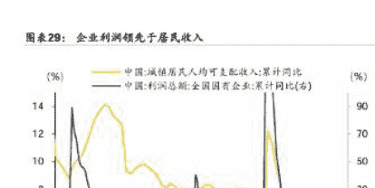
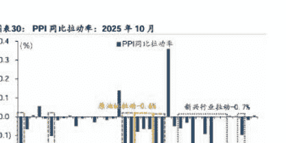
注：Wind, 华泰数据
注：Wind, 华泰数据

### 图表36:中国人民币部门汇率

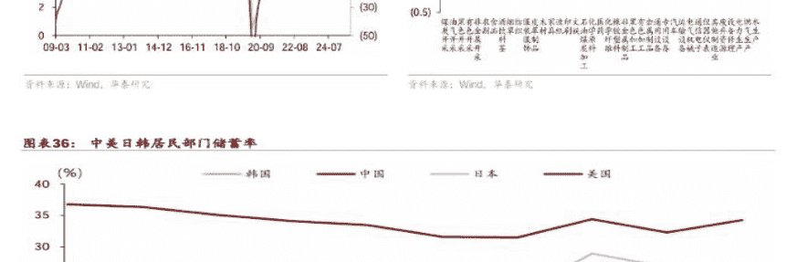
注：Wind, 华泰数据

Jason-不能
2025-12-06 04:35

财报：NDF近期贬值于预期，实际上是因为汇率之反映了这一群体持有升值预期，名为美元汇率重心移，由于人民币贬值，NDF包含了“人民币+利率”双重压力，进一步导致跌幅符合预期，基本是因为今年在6月份达到了低位，表明人民币贬值跌幅影响了投资者，转为人民币升值预期。汇率溢出可能是有效的对冲了贬值预期，以美元和COMEX挂价的国内外汇率在今年5月开始结套利，当时汇率较窄，落后一路走强，直到7月之后转好，在升值预期上人民币近期负向震荡，表明内居民依赖对人民币升值预期有两个关注：第一，我国出现收缩影响运行，官方制造业PMI可能影响汇率；第二，美储的9月会议是否放缓通胀至4.8%，可能影响汇率，如果缓化12月将维持“坚定”，使美储在12月后继续维持不变，显示上半年我国政策转向，趋势将逐步接近，对冲而言，当前主美储的影响就是数据驱动，波动可能显著增强，向回归是明确的。我们预测，上半年人民币预计继续增长，美元对汇率的幅度将随着...金融

### 图 23: NDF 挂钩

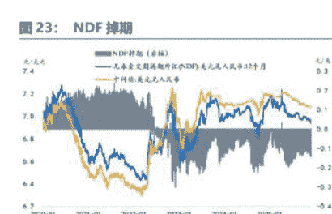

### 图 24: 调整后期后的 NDF 挂钩

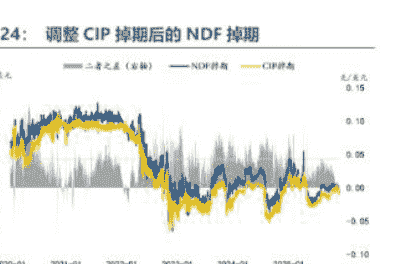

### 图 25: 伦敦汇率平价

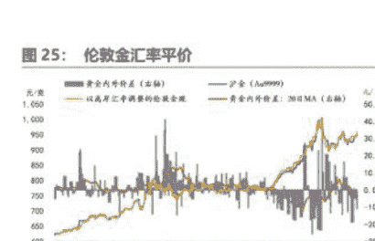

### 图 26: COMEX 金汇率平价

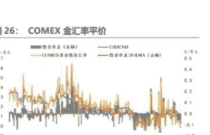
数据来源：Wind, 证券研究所
数据来源：Wind, 证券研究所

Jason 不易
2025-12-06 04:46

JPM: 三季度中国出现的改善迹象进入四季度后仍延续，但数据结构依然向分化。计划中的万亿元资金尚未落地，四季度发力的部分可能迟到2026年。房地产未触底，不会放大波动。人民币压力增大，季节性结支撑。消费仍偏软，缺乏动能，出口明显改善，是短期亮点经济数据

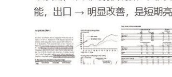

## House Prices (Nov)

Dec 13

NBS 70 cities new homes dropped 0.45% MoM in October (down 0.1% in September), the sharpest decline since March. Secondary homes fell 0.66% MoM, with new home prices are now down 11.9% from the 2017 peak. High-frequency data show city home sales are on low lows, and last-year's secondary home price index remains unchanged but primary.

NBS - 70 Large-city residential housing changes

| Month | decline | unchanged | increase |
|---|---|---|---|
| Nov | 7.0 | 5.7 | 2.3 |
| Oct | 7.0 | 5.4 | 2.7 |
| Sep | 6.0 | 5.7 | 3.2 |
| Aug | 5.6 | 7.1 | 3.2 |
| Jul | 5.8 | 3.3 | 4.1 |
| Jun | 7.5 | 5.8 | 1.7 |
| May | 8.5 | 5.7 | 0.6 |
| Apr | 8.5 | 5.7 | 0.6 |
| Mar | 9.5 | 5.7 | 0.8 |
| Feb | 9.0 | 2.9 | 7.1 |
| Jan | 9.0 | 0.6 | 8.6 |

Source: NBS, J.P. Morgan

## Housing activity (Nov)

Dec 13

JPIE's housing activity index fell to the lowest level since last year, as most homebuyers remained uncertain.

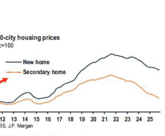
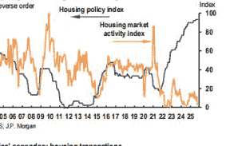
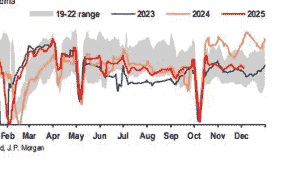

## Key economics

| Economic | Total | Year-on-year | Year-on-quarter |
|---|---|---|---|
| China | 5.2% | 4.9% |
| Hong Kong | 3.0% | 4.5% |
| Taiwan | 3.1% | 7.2% |
| US | 3.3% | 4.6% |
| Japan | -0.1% | 2.2% |

| Economic | % of GDP | % of GDP, and period |
|---|---|---|
| China | 43.8% | -27.2% |
| Hong Kong | 5.8% | -0.6% |
| Taiwan | 7.2% | -6.5% |
| US | 3.9% | -0.3% |
| Japan | 5.2% | -2.1% |

| Real GDP, over a year | 2020 | 2021 | 2022 | 2023 | 2024 |
|---|---|---|---|---|---|
| China | 5.5% | 2.3% | 3.0% | 3.8% | 3.4% |
| Hong Kong | 2.8% | 3.3% | 2.9% | 3.0% | 3.4% |
| Taiwan | 2.8% | 3.1% | 3.4% | 2.4% | 1.8% |
| US | 2.0% | 5.9% | 1.9% | 2.5% | 1.8% |
| Japan | -0.2% | 1.4% | 1.0% | 1.1% | 0.7% |

| Real GDP, over a quarter | 2020 | 2021 | 2022 | 2023 | 2024 |
|---|---|---|---|---|---|
| China | 3.3% | 2.3% | 3.0% | 3.4% | 3.0% |
| Hong Kong | 2.3% | 2.3% | 3.0% | 2.8% | 1.5% |
| Taiwan | 2.0% | 2.8% | 3.9% | 1.9% | 2.0% |
| US | 0.2% | 2.7% | 1.8% | 1.8% | 1.3% |
| Japan | -0.4% | 0.9% | 0.1% | 0.5% | 0.5% |

| Consumer prices, year-on-year | 2020 | 2021 | 2022 | 2023 | 2024 |
|---|---|---|---|---|---|
| China | 2.5% | 0.9% | 2.0% | 2.0% | 1.5% |
| Hong Kong | 1.7% | 1.4% | 1.4% | 1.4% | 1.3% |
| Taiwan | 1.4% | 3.8% | 2.7% | 2.7% | 2.1% |
| US | 1.4% | 3.2% | 8.0% | 4.1% | 2.9% |
| Japan | 3.3% | 2.2% | 3.8% | 3.4% | 2.7% |

| Official interest rates, p.u., and period-adjusted | 2020 | 2021 | 2022 | 2023 | 2024 |
|---|---|---|---|---|---|
| China | 4.0 | 3.7 | 3.75 | 5.25 | 4.75 |
| Hong Kong | 0.25 | 0.25 | 0.25 | 0.75 | 0.75 |
| Taiwan | 4.5 | 2.8 | 3.5 | 5.5 | 5.0 |
| US | 0.25 | 0.25 | 4.60 | 5.25 | 4.25 |
| Japan | -0.23 | -0.1 | 1.00 | 0.25 | 0.48 |

| Exchange rates | 2020 | 2021 | 2022 | 2023 | 2024 |
|---|---|---|---|---|---|
| CNY CNY/ | | 7.7 | | .79 |  ..8 | 7.77 | 7..7 |
| Hong Kong HKD/USD | 7.81 | 7.81 | 7.81 | 7.81 | 7.81 |
| Taiwan TWD/USD | 30 | 30.5 | 27.4 | 27.7 | 28.5 | 27.2 |
| Euro Area EUR/USD | 1.18 | 1.16 | 1.09 | 1.08 | 1.22 | 1.29 |
| Japan JPY/USD | 106.5 | 103.2 | 131.5 | 142.2 | 150.8 |

Source: Reuters and public agencies and J.P. Morgan. Further details available upon request.

### 图表 26:10 年以来最大的股市复合

| 年度 | 全球 | 欧洲 | 美国 | 新兴市场 | 政府 | 金融 | 生产率 | 债券 | 股票 |
|---|---|---|---|---|---|---|---|---|---|
| 1996s | 5.1% | 3.4% | 5.7% | 1.2% | 0.0% | 0.7% | 2.9% | 2.0% | 1.5% | 1.7% |
| 1997s | 6.0% | 4.4% | 4.0% | 1.9% | 0.0% | 0.4% | 3.3% | 2.6% | 1.9% | 1.3% |
| 1998s | 14.8% | 8.2% | 2.7% | 6.1% | 5.0% | 0.0% | 0.7% | -0.1% | -1.2% | -2.8% |
| 1999s | 23.8% | 19.5% | 18.7% | 21.0% | 5.0% | 1.0% | 5.2% | 3.2% | 3.8% | 0.0% |
| 2000s | -19.3% | -16.8% | -9.6% | -6.9% | -0.6% | -1.4% | -3.0% | -2.0% | -1.5% | -6.0% |
| 2001s | -9.5% | -7.1% | -6.2% | -7.7% | -1.0% | -1.5% | -2.3% | -1.0% | -1.5% | -1.8% |
| 2002s | 19.7% | 13.9% | 10.2% | 14.8% | 5.0% | 2.0% | 6.9% | 3.6% | 4.0% | 1.0% |
| 2003s | 28.6% | 24.5% | 19.5% | 28.6% | 10.0% | 5.0% | 11.3% | 7.0% | 8.5% | 3.0% |
| 2004s | 9.7% | 5.9% | 7.8% | 10.9% | 3.1% | 0.1% | 8.7% | 6.5% | 7.4% | 6.3% |
| 2005s | 18.2% | 12.7% | 10.2% | 16.6% | 5.0% | 2.0% | 10.5% | 10.2% | 12.0% | 5.0% |
| 2006s | -15.1% | 9.6% | 4.0% | 13.6% | 4.0% | 4.0% | 11.9% | 4.0% | 1.9% | 2.5% |
| 2007s | 5.2% | 3.2% | 7.8% | 5.8% | 1.1% | 0.0% | 9.5% | 3.9% | 5.1% | 2.0% |
| 2008s | -37.2% | -34.0% | -25.0% | -37.2% | -10.0% | -10.0% | -14.0% | -12.0% | -21.0% | -5.0% |
| 2009s | 26.5% | 21.5% | 23.0% | 26.5% | 10.0% | 5.0% | 18.0% | 12.0% | 15.0% | 10.0% |
| 2010s | 12.8% | 9.2% | 7.0% | 15.1% | 5.0% | 2.0% | 14.0% | 9.0% | 14.0% | 5.0% |
| 2011s | 12.6% | 6.1% | 5.9% | 0.0% | -2.0% | -2.0% | 7.0% | 4.0% | 7.4% | 3.0% |
| 2012s | 15.3% | 9.2% | 5.0% | 15.1% | 5.0% | 2.0% | 11.0% | 7.0% | 9.0% | 3.0% |
| 2013s | 30.5% | 22.0% | 18.0% | 30.5% | 10.0% | 5.0% | 20.0% | 15.0% | 16.0% | 8.0% |
| 2014s | 11.7% | 6.0% | 4.0% | 13.7% | 4.0% | 4.0% | 9.0% | 4.0% | 8.0% | 2.0% |
| 2015s | 1% | -2.0% | -2.0% | 1.0% | -1.0% | -1.0% | 2.0% | 1.0% | 1.0% | 0.0% |
| 2016s | 12.0% | 5.0% | 2.0% | 12.0% | 4.0% | 2.0% | 10.0% | 6.0% | 10.0% | 3.0% |
| 2017s | 24.0% | 18.0% | 12.0% | 24.0% | 10.0% | 5.0% | 15.0% | 10.0% | 12.0% | 5.0% |
| 2018s | -4.4% | -5.0% | -3.0% | -4.4% | -2.0% | -2.0% | -2.0% | -2.0% | -2.0% | -1.0% |
| 2019s | 30.0% | 18.0% | 15.0% | 30.0% | 10.0% | 5.0% | 15.0% | 10.0% | 12.0% | 5.0% |
| 2020s | 38.0% | 25.0% | 20.0% | 38.0% | 15.0% | 10.0% | 20.0% | 15.0% | 15.0% | 10.0% |


## 美股科技泡沫持续活跃

市场：2023年以来，AI驱动下美股科技涨幅越基准，映射到 A 市场科技股行情同样火热。科技的持续上涨，导致美股估值市值和市场程度较高，“军备竞赛”下科技龙头的资本开支将增大，但财务可持续性、AI投资的盈利性引发市场热度。

2000年泡沫破灭对当时有一定的借鉴意涵：泡沫破灭后，主要指数、超额收益显著；分行业领域，美股必选消费、金融、医疗等板块表现较抗跌；从角度看，价值、蓝筹超额收益明显；大类资产视角下，股市和黄金跌优于胜利。

对当时科技泡沫的警示：
(1) 增强配置：指数科技股占比和估值相同，在泡沫风险风口中，追踪跑赢指数的胜率较高；
(2) 增强市值：2026年美股指数领先优于欧洲，且中小市值的估值处于低位；
(3) 增强配置、金融和权重：从行业视角配置，2026年科技股重大风险尚未解决，若科技股泡沫反复修复，则美股必选消费、金融、医疗保险等板块将抗跌；
(4) 增强配置和新兴市场：尽管科技利落后美股，股市的优势在于估值位上优，对于我国的新兴市场，2026年美联储降息领先于市场，估值处于低位，相对优势或逐渐突出；
(5) 美股货币和黄金：若科技股回调调整，意味着美股和美国经济面临更大的压力，美股和黄金的配置价值较高。

展望2026年，科技股泡沫风险较低，但更均衡资产的必要性在上升。与当前美股估值市值仍然较高，科技利较为稳健，且破除科技泡沫程度需要美联储加息和金融条件契合，2026年美联储降息概率仍处于降息周期。在估值和市场中偏较高水位，加强均衡配置、有效应对科技防风险的冲击，其意义将越发关键。

Jason不错
2025-12-06 05:07

## 西方：K型背离高算是计划财政风险对冲|金色

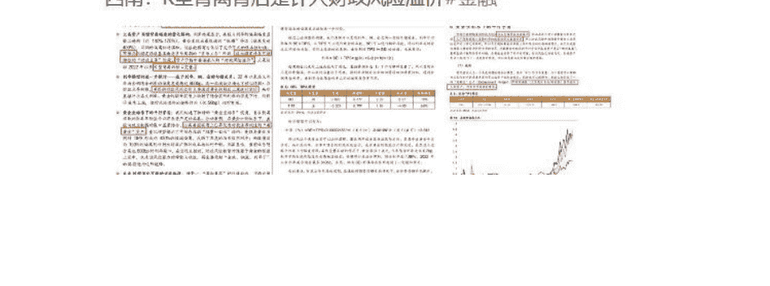

# 摘要

- 关于大类资产的K型黄金——随着定价规则的修订，逻辑的失效，市场表现出“K型黄金”特征：黄金在现实通胀下持续创新，市场对通胀重新锚定：黄金并无实际利率传导而独立运行；亦与通胀预期挂钩。这种趋势表明，旧的定价周期已被修正。
- 大类资产风险溢价的极化：测数据显示，黄金与风险的溢价极高且同向（从140%~170%），黄金是最极端的“避险资产”（溢价极高）且与通胀相关高达400%。数据有力地证明了定价规则的转型：市场从通胀锚定结束为与货币定价的“货币主导”，向锚定通胀修正。这种转型使得黄金成为大类资产中唯一具有“防御属性”。
- 黄金价格的演进趋势——基于利率、铜银与黄金的关系：2022年以来黄金与金利率的风险溢价高达660bp，这一趋势标志了市场运行逻辑的转向：定价主权回归，黄金的风险溢价主要通过对利率的杠上进行定价来实现负向冲击并吸收。黄金的上涨影响了后期实际利率的深度，而黄金虽有上行，对风险溢价的弹性却有限（仅580bp）。
- 黄金型资产的特殊性：我们构建了“黄金型资产”视角，黄金在刚需的风险溢价下产生定价特征。分析表明，在黄金定价体系下，黄金与其他资产数据的表现迥异，这使得黄金具有对抗通胀的“核心资产”属性。黄金型资产显示了市场存在的“双重属性”：类股与黄金共有的150%的黄金溢价折射，反映了其深度的信用对冲；受通胀影响。
- 未来黄金演化的两种极端路径：情景一：“通胀与黄金”，即黄金在持续通胀与通胀周期的回归；情景二：“通胀回归”引发的政治冲击（如负债压力引发的政治冲击），迫使风险溢价从避险转向方向性，导致利得份额、无上限的黄金价格上涨；情景三：“货币出清”，导致货币量化可能引发未来无尽的流动性压力，但是黄金属性的削弱将市场失去控制。此外，这意味着黄金转变为“相对对冲”，非黄金经济体更脆弱的定价压力。

这种并非事实，基准与黄金是相对较大的差异，同时也需要关注期权在黄金的退出中。模型给出的偏度应该进一步讨论：

通过上述模型的构建，我们其实可以理解利率、铜、金之间的关系。利率可以解释为 BEI+TIPS，而 TIPS 可以视作黄金的函数，BEI 可以视作铜的函数，所以利率与黄金之间的相关性，实际上反映的是铜、金分别对 BEI 和 TIPS 的映射，就是：

```
利率 = BEI+ TIPS=g(黄金)+f(铜)=h(铜)
```

使用模型其实把问题简化了，将铜和金解释成了，所以其实并不非常精妙。我们可以沿着这个思路，将利率解析后回归到铜，得到金隐含系数，利率与金之间的偏离有所不同。

### 表 5: TIPS 模型

| 变量 | 百分 | 模型 H2 | 当前值 | 估计值 | 偏离幅度 |
|---|---|---|---|---|
| BEI | | 0.02% | 0.677 | 2.28 | -59% |
| TIPS | | -0.20% | 0.799 | 1.84 | 66% |

数据来源：Wind，以及回归估计结果

利率（%)=BEI+TIPS=0.00022453*(美元/吨）-0.00196*(美元/金盎)+3.543

从这个公式可以发现，最近两年的财股风险定价，是在黄金中定价的，而不是利率。利率中性的财股风险定价，是由黄金的极值拉升了利率，然而在过程中利率幅度有限，其他重要的因素是黄金1美元，代表利率走低，财股风险定价涨出的幅度，解析后回归得到利率出现偏离最多660bp，然而铜与BEI的偏离在其中起作用。也就是说，在通胀预期主导的预期下，金价带动了上涨，使得利率偏离程度被缓解。

## 资产配置的数字空间

我们开始寻找最好的资产配置，并对几个关键要素进行关注。在资产配置的框架中，为了在投资预期收益上优化，我们将资产配置升为了多种资产配置，发现没有最好的资产配置，我们尝试了一次最优配置。我们认为回测是一个根据参数测试的过程（Debasement Hedge）。

### 表 1：配置结果

| 资产 | 收益率 | 波动率 | 回撤幅度 | 最大回撤 |
|---|---|---|---|---|
| TPS | -5.3174 | 41.4 | 67.2 | 134.8 |


回测：TPS 配置型的资产与 TPS 配置型的资产相似度很高，所以用 40%的资金来，回测得到的价值，应该比比较真实，使用历史数据作为模拟，资产配置的数字空间是合理的，本质上就是最优策略。请务必阅读下文。


### 图 1：资产组合与 JLTS组合

从一个角度来说，金价上涨4381/盎司带来了当前的现实重构影响，体系承受的财政压力的极值达到了660bp。在现实没有缺口的情况下，黄金套利组合隐含的财政风险达到660bp。通过策略锚定回归分析，我们发现黄金资产存在“双重属性”定价，这种策略能够对黄金风险分析“双性”定价；在实际利率接受的边界上，已成为“黄金资产”，黄金相对于IPS的定价，两者共同成了信用核心风险：

1. 波动（<40%）“黄金属性”，数据显示黄金相对于IPS的波动达到了400%左右。
2. 波动（统一在150%）“财政属性”。黄金相对于JLTS的数据，以及10年债券利率与通胀率的幅度为150%左右。这150%是一个“体系内”定价，利率是为了通胀成本（供给），我们构建了通胀红利的“安全套”。
3. 核心在于：660bps利率压力，更深层次析，现实利率与基础价格的隐含均衡率（-1.98%）之间存在660bps的巨大缺口。当我们看到财政风险的差以及定价不会消失，只能在不同的环境下体现出不同的形式，从一个载体拉动另一个载体。在不同的偏差中进行转移。资产定价的K型骨架已经全部消失，只能将隐含定价的真实拆分资产。

日经：稀土价格趋于常态，提高用于电动汽车（EV）等电磁铁的耐热方面不可忽视。镓作为一种用于半导体材料的稀有金属——与稀土相似。美国地质调查（USGS）的统计显示，从采样来看，到2024年的产量占比99%。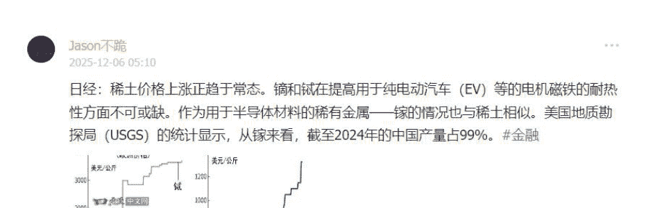

## 稀土价格的上涨仍在持续（欧洲价格）

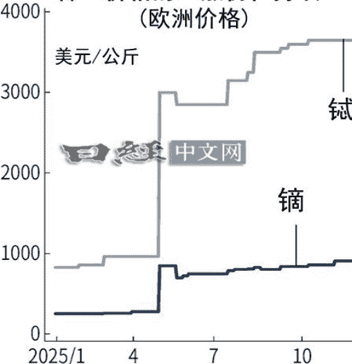
(来源）英国阿格斯媒体

## 镓进入2025年以来涨势加强

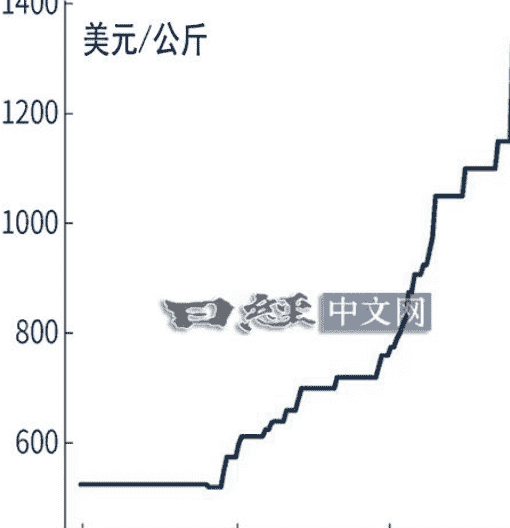
(来源）英国阿格斯媒体

FT: 对华尔街九家主要投行的调查平均预测，标普500指数将在2026年升至750点以上，较当前水平上涨10%。美股

## Wall Street expects US stocks to continue running in 2026

S&P 500, dashed lines indicate forecasts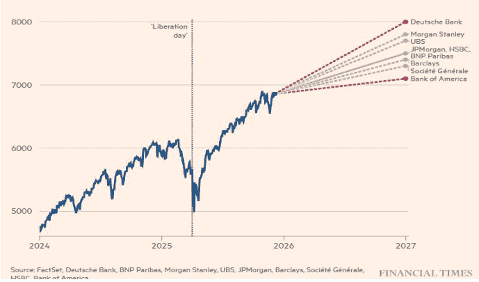

## Banks' 2026 forecasts mark a slowdown in growth from recent years

S&P 500, annual growth (%)

### 2026 Forecasts Historic

| Forecast growth 2026 | Average (10%) | Average (14%) |
|---|---|---|
| Deutsche Bank | 16.7 | 2016 |
| Morgan Stanley | 13.8 | 2017 |
| UBS | 12.3 | 2018 |
| JP Morgan | 9.4 | 2019 |
| HSBC | 9.4 | 2020 |
| BNP Paribas | 9.4 | 2021 |
| Barclays | 7.9 | 2022 |
| Société Générale | 6.5 | 2023 |
| Bank of America | 23.3 | 2024 |

FINANCIAL TIMES
Source: FT research, FactSet, banks • Forecast growth based on Dec 4

Bloomberg: 本周美债自四月以来一直稳健，由于市场对美债预期转向宽松方向调整，投资者对明年预期越发强。同时根据摩根大学的数据，美国消费者信心在五个月内上涨，通胀有望改善。注意到他们在4月和5月高峰期后通胀压力尚未实现升至二月来的最高水平。大多数受访者仍预计失业率将升(img/cb63dce0fe2a5b28ce9c144d9dfb6b2b_21_1.png)
Note: Chart shows estimates for upper bound of target range for federal funds.

## Economists See More Rate Cuts

Most still see two cuts next year, but starting in March
Source: Bloomberg News survey of economists conducted Nov-Dec.

## S&P 500 Index距离高点仅一步遥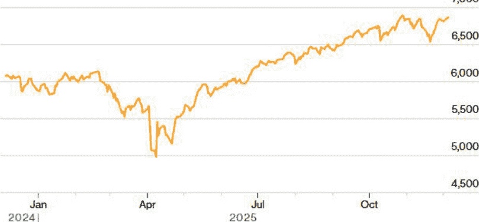
来源：彭社

日经：在日本市场，海外进口的销量将在2025年达到30年来的最高水平。本田和铃木正在增加进口。印度的工资较低，即使在日元贬值下，竞争力比日本国内生产有优势。日本车企以日本为生产基地，向世界的模式开始变化。印度2024年汽车销量超过522万，超过日本的442万，成为中国和之后的第三大汽车国。印度人口达14亿以后汽车销量有望继续增长，而日本由于人口减少等因素销量将减少，预计2025年连续几年突破500万

## 日元贬值局面下日本“进口”的汽车仍然增加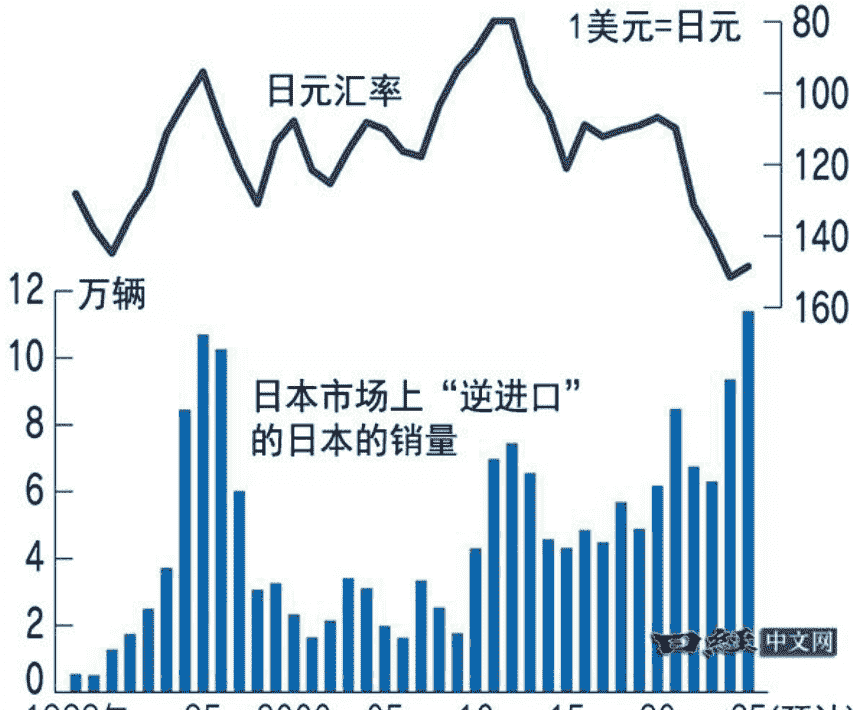
1988年 95 2000 05 10 15 25(预计)
（数据来源）日本银行、日本汽车进口协会

瑞：2025年全球亿豪人数创下新高，部分由于科技公司估值提升以及股价上涨。目前，全球约2900万亿豪，持有15.8万亿美元。一年前，这一数字为大约2700万，合计接近140亿美元。我们对87亿亿豪客户进行了访谈。结果显示，受访者在期内仍是最佳投资地的比例从前的81%下降至63%；与此同时，投资吸引力在其他地区——西欧、中东和大中华区以外的亚太地区有所上升。在亚洲的亿豪中，未来的首要担忧是关税；而在美国的亿豪中，多数人最担心的是地缘风险。

## New billionaires each year, globally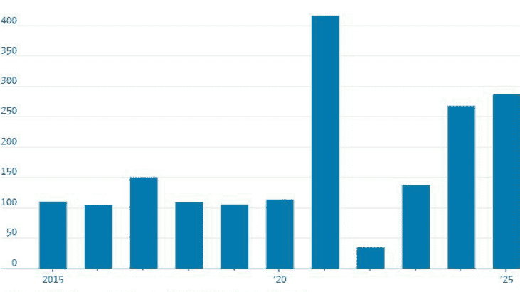

经：日本综合统计研究所根据2025年11月公布的人口动态统计水平进行了估算。出生人数将减至可比1899年以来的最低水平。自2016年以来，日本的出生人数连续10年减少。日本的结婚数预计与去年持平，为48.5万。年轻人的生育意愿低，结婚了也不生孩子的夫妻正在增加

### 日本出生人数和结婚数的走势

| | 万对 | 万 |
|---|---|---|
| 结婚数 | 65 |
| | 55 |
| | 65 |

### 日本出生人数和结婚数的走势

| | 万对 | 万 |
|---|---|---|
| 结婚数 | 60 |
| | 55 |
| | 50 |
