# 南半球聊财经251208

Jason-Macro 2022-09-02 09:59

ShanghaiMacro: 以下是我认为理解中国当前经济最最重要的两张图表。去年9月召开会议后社会金融总额（TSF）回升，然而过去12个月TSF增长的改善几乎完全由政府发行债券推动，私人信贷的需求——无论是企业还是家庭——短期钝化。政府愿意提高杠杆时替代了私人信贷需求，带来TSF的短期反弹和经济功能的改善。目前的核心挑战是，当前的政策刺激资金已经走到尽头。政府债券发行的微放水逆转了公共部门TSF的增长，私人信贷需求依然低速。如果未来几个月财政政策进一步放缓，可能引发一轮deflation浪潮，对中国资产价格和全球性产生重大影响。#财经

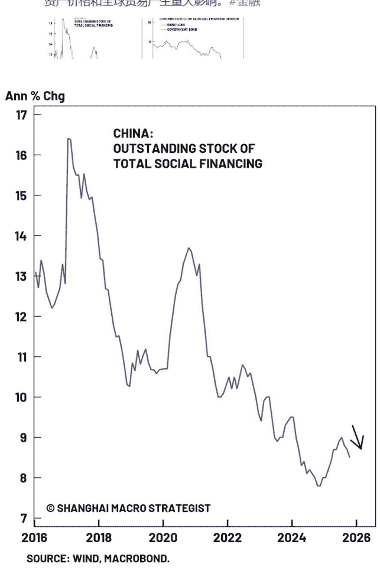

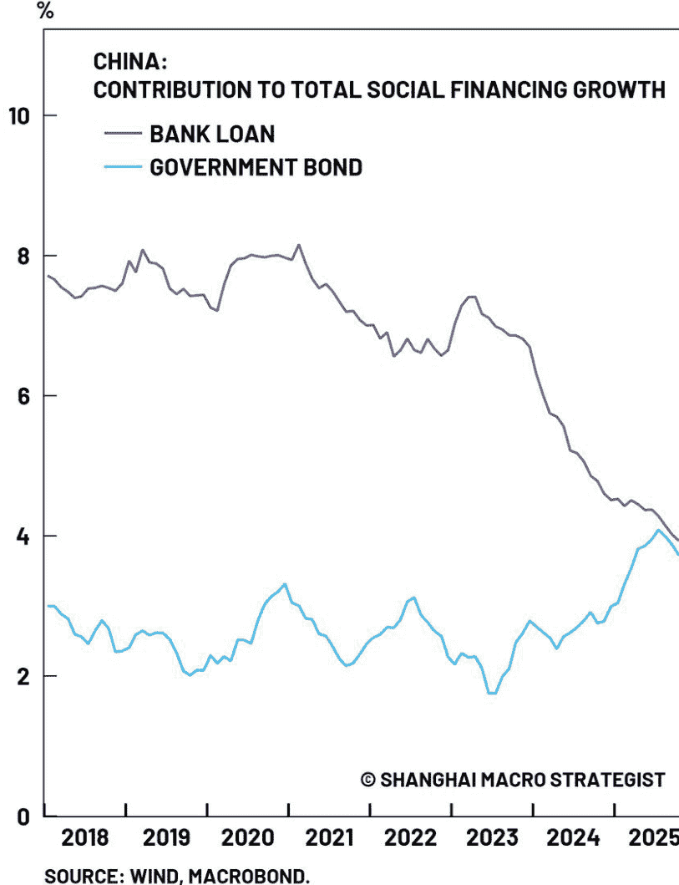

Jason不瀚
2025-12-09 03:07

Gavekal: 各经济体青年失业率对比，西班牙、法国、中国位置靠前#经济数据

Unemployment rates for 15-24 age group (China is 16-24), 2024 or latest available data

| Country | 5 | 10 | 15 | 20 | 25 | 30 | 35 |
| --- | --- | --- | --- | --- | --- | --- | --- | --- |
| Australia | | | | | | | | |
| Brazil | | | | | | | | |
| China | | | | | | | | |
| France | | | | | | | | |
| Hong Kong | | | | | | | | |

一手优质资源进群微信cuk255

# China's youth unemployment rate is high in a global context

Unemployment rates for 15-24 age group (China is 16-24), 2024 or latest available data

| | 0 | 5 | 10 | 15 | 20 | 25 | 30 |
|---|---|---|---|---|---|---|---|
| Australia | | | | | | | | |
| Brazil | | | | | | | | |
| China | | | | | | | | |
| France | | | | | | | | | |
| Germany | | | | | | | | | |
| Hong Kong | | | | | | | | | |
| India | | | | | | | | | |
| Indonesia | | | | | | | | | |
| Japan | | | | | | | | | |
| Mexico | | | | | | | | | |
| Philippines | | | | | | | | | |
| Singapore | | | | | | | | | |
| South Korea | | | | | | | | | |
| Spain | | | | | | | | | |
| Türkiye | | | | | | | | | |
| UK | | | | | | | | | |
| USA | | | | | | | | | | |

Gavekal Dragonomics/Macrobond

Jason-不睡
2025-12-09 03:45

国金:上周五金锡关注保险公司相关业务风险因子，同时向陆清泽发言时提到扩宽资本空间与杠杆受限，这可能会带来两个影响：一方面，对于市场而言，保险等资本占用下降，可以为市场带来更多资金；另一方面，在A股获利意见回升的背景下，随着非金融机构的资金扩张和杠杆提升，非长期资产收益端将受益。
从过去几次由于保险或行情政策出台后的1-3个月来看，市场表现较好，而非板块较于A有超收益。#A股

一手优质资源进阶群微信cuk255

# 图10:从过去几次下调准入和红利调整来看，市场表现良好，而非板块相比全A有超收益

| 涨指数 % | 政策宣布后 | 发布政策后的一个月 | 发布政策后的三个月 | 发布政策后的半年 |
|---|---|---|---|---|
| 沪深 | 2021.05 | -0.16 | -3.76 | -9.01 | -9.52 |
| | 2021.06 | 6.18 | 7.23 | 14.91 | 20.01 |
| | 2012.04 | 5.70 | 6.46 | 7.05 | 3.05 |
| | 2012.05 | 2.67 | 4.47 | 105.53 | 122.12 |
| | 2014.08 | -3.39 | -2.69 | -12.38 | -13.4 |
| | 2024.09 | 22.45 | 37.63 | 38.63 | 31.61 |
| 全A | 2021.04 | 4.18 | 10.10 | 11.98 | 13.89 |
| | 2021.05 | -0.07 | -1.46 | -1.42 | -7.76 |
| | 2012.03 | 2.40 | 2.16 | 12.54 | 26.54 |
| | 2012.04 | 3.29 | 3.78 | -3.39 | -6.49 |
| | 2014.08 | 2.41 | 2.99 | 28.30 | 55.52 |
| | 2020.01 | -3.27 | 2.25 | -5.28 | 17.35 |
| | 2014.05 | 15.02 | 24.65 | 32.10 | 35.78 |
| | 2014.09 | 2.41 | 4.61 | 4.58 | 21.95 |
| 超跌 | 2021.03 | -0.49 | -2.29 | -4.69 | -17.5 |
| | 2021.05 | 7.18 | 1.57 | 4.37 | -6.51 |
| | 2012.04 | 2.49 | 6.69 | 10.44 | 13.89 |
| | 2014.08 | 7.42 | -3.12 | 11.88 | 9.54 |
| | 2021.3 | 0.25 | 1.50 | 11.76 | 67.00 |
| | 2020.01 | -0.12 | -7.23 | -8.08 | -9.64 |
| | 2014.05 | 7.23 | -3.77 | 6.53 | -4.17 |
| | 中位数 | 1.33 | 2.53 | 5.45 | -2.96 |

来源：华信，wind，中国研究所

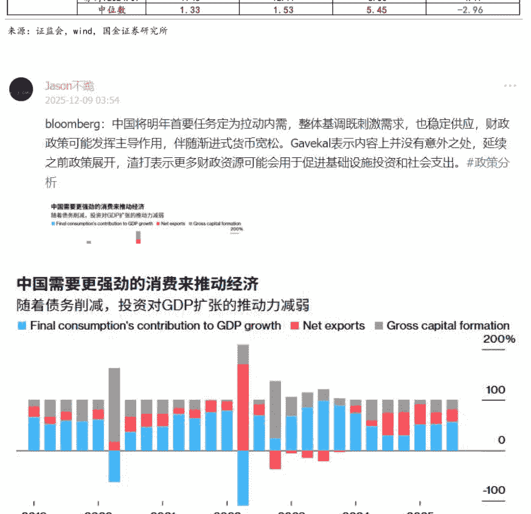

bloomberg: 中国明年首要任务放在国内，整体结构调整灵活，最能稳定，财政政策更加积极，后续宽松显示内容并有意外之外，继续坚持为主，将配置更多资源用于基础设施投资和社会发展#政策分析

# 中国需要更强的消费来拉动经济

随着债务减少，投资对GDP扩张的动力将增强

- Final consumption's contribution to GDP
- Net exports
Gross capital formation

来源：中国统计局

# Jason不遇
2023-12-03 03:56

国内：2023年中央会议又是“吹风会”，篇幅有限的提到的不代表重要，不过达成共识。整体来看，本次会议的信号量不少，进一步明确了2024年将做好市场导向、偏差调节、坚持，重点集中在落实中突破，强调在落实中求进的重要性；一系列良好安排将更好落实，坚持更加积极的财政政策和适度灵活的货币政策，“政策发力要协同发力”，“发力要加大逆周期和跨周期调节力度”，“扩内需重回重要任务，且扩内要实现“结构化升级”并加大持续创新等。政策分析

# 表格 1：2025.12.8经济行情分析/2025.7.30数据对比/2024.12.8数据对比

| 2025.12.8 | 2025.7.30 | 2024.12.8 |
| --- | --- | --- |
| 指标 | | |
| 某项数据 | | |
| 另一项数据 | | |

由于数据来源限制，以上数据仅供参考，不构成任何投资建议。由于数据来源问题，我们无法保证数据的准确性、完整性或真实性。文中涉及的观点、数据、结论等仅代表作者个人意见，不代表任何机构或个人的立场。本文涉及的分析仅供交流参考，请读者理性对待。市场有风险，投资需谨慎，请根据发布决策。如有任何政策调整或官方通知，请以官方发布为准。

当前经济环境复杂、严峻。

面对这些挑战，我们需要加大发力力度。

从宏观来看，当前我国经济运行总体平稳回升，但恢复的动力与预期相比有差距。一方面，外需下行压力依然巨大，内需不足、有效需求不振、预期偏弱等问题比较突出；另一方面，部分领域结构性问题仍有待解决。

坚持政策精准，增强市场信心。

在当前复杂变化的形势下，政策制定更具针对性、及时性。财政政策更加积极主动，持续加大发力，支持重点领域、重点工程，通过加大政府债券发挥作用。货币政策要保持稳健，总量适度充足，根据经济形势灵活调整结构。政策发力要协同，形成合力。扩大内需是当前当务之急，完善社会保障、提高居民水平等措施激发内需潜力。优化供给结构，培育新增长点。支持科技创新、绿色转型、数字产业等未来发展，防控风险，确保经济平稳运行。

一手优质资源聚信

# Jason不嗨

bloomberg: 中国年度顺差突破万亿美元，较去年同期增长5.9%。今年出口占经济近三分之一。11月的顺差达到120亿美元，是中国单月最大值，远超预测。虽然11月对美国的增长率为29%——这是连续个月下降，但对欧洲地区的销售额远抵消了一次下滑。新款显示中国“必然”拥抱以内为主，这种转型还需要时间#经济数据

# 中国贸易顺差突破万亿美元

2025年前11个月出口增速
- Jan.-Nov. trade surplus

| 2010 | 2012 | 2014 | 2016 | 2018 | 2020 | 2024 |
|---|---|---|---|---|---|---|
| $1T | | | 0.8 | 0.4 | 0.2 | 0.0 |

来源:中国海关总局

# Jason不嗨
2025-12-09 04:24

bloomberg: 美联储利率可能在2026年货币政策预期之前，美债收益率升至近两个月最高。市场参与者关注2026年的展望——通过他们的点脚证明对美国感到担忧。鲍威尔表示，预计下周美联储将维持并将震荡，明年可能更长时间，让投资者放松，特朗普表示美联储可能会在接近3.5%而非3%时停止。“财经

一手优质资源群微信

# 美国国债10年期收益率测试多月高点
/ 10-Year yield

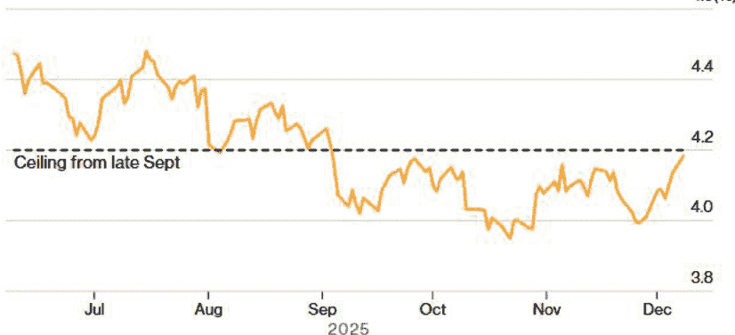

来源：彭博社

# 12月及以后美联储利率展望

交易者权衡本月一次降息，2026年利率将降幅在一至两次之间波动
Cumulative interest-rate pricing in basis points

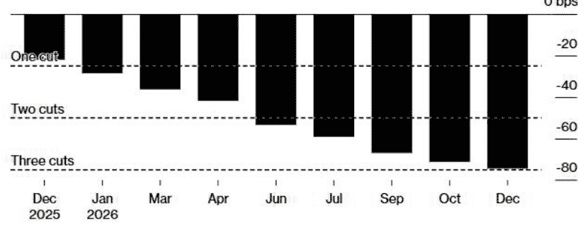

来源：彭博社

一手优质资源进群微信

# CME FEDWATCH TOOL - AGGREGATED PROBABILITIES

| MEETING DATE | 275-300 | 300-325 | 325-350 | 350-375 | 375-400 |
|---|---|---|---|---|---|
| 12/10/2025 | 0.00% | 0.00% | 0.00% | 89.43% | 10.57% |
| 1/28/2026 | 0.00% | 0.00% | 16.00% | 84.00% | 0.00% |
| 3/18/2026 | 0.00% | 0.00% | 47.31% | 52.69% | 0.00% |
| 4/29/2026 | 0.00% | 0.00% | 68.00% | 32.00% | 0.00% |
| 6/17/2026 | 0.00% | 16.28% | 83.72% | 0.00% | 0.00% |
| 7/29/2026 | 0.00% | 43.00% | 57.00% | 0.00% | 0.00% |
| 9/16/2026 | 0.00% | 74.50% | 25.50% | 0.00% | 0.00% |
| 10/28/2026 | 0.00% | 90.00% | 10.00% | 0.00% | 0.00% |
| 12/9/2026 | 6.56% | 93.44% | 0.00% | 0.00% | 0.00% |
| 1/27/2027 | 10.00% | 90.00% | 0.00% | 0.00% | 0.00% |
| 3/17/2027 | 0.00% | 81.71% | 0.00% | 0.00% | 0.00% |
| 4/28/2027 | 14.00% | 86.00% | 0.00% | 0.00% | 0.00% |
| 6/9/2027 | 10.79% | 89.21% | 0.00% | 0.00% | 0.00% |
| 7/28/2027 | 13.00% | 87.00% | 0.00% | 0.00% | 0.00% |
| 9/15/2027 | 28.19% | 71.81% | 0.00% | 0.00% | 0.00% |
| 10/27/2027 | 19.00% | 81.00% | 0.00% | 0.00% | 0.00% |

# Jason不易
2025-12-09 04:26

bloomberg: 美联储最新调查显示1月美国消费者通胀预期稳定，而对就业市场的认知有所改善——消费者在1月对通胀程度超过一个月，降低了生活的可能性，并报告说找到工作的概率更大。由于就业市场相比去年，通胀依然高，更多国家报告其财务状况恶化。表示当前财务状况比年前差受访者比例上升到39%，为最高。其他国家经济

一手优质资源

# 美国家庭对财务状况的看法更加极端
认知“更差”，超过10%，是一年来最大比例

- Much better off
- Somewhat better off
- About the same
- Much worse off

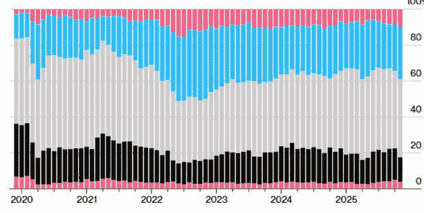

来源：纽约联储
注：数据反映的是一年前的比较

Jason不满意
2022-11-09 04:31

FT: 欧洲拟动用俄罗斯冻结的资产，这是否会冲击欧元？一些基金经理认为，这项有争议的计划可能会削弱欧元的全球地位。#金融

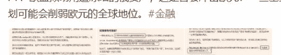

# 俄罗斯委员会提议提供一项以俄罗斯对抗乌克兰战争担保的贷款。这些贷款的大部分目前由欧洲证券托管机构负责。

将从Euroclear注入这笔贷款，再以胜利转给乌克兰，得俄罗斯在战后支付贷款后，乌克兰有义务偿还这笔贷款，并将其作为债务的抵押品。

委员会会将这项法律落实，这并不包含相关的没收，因为俄罗斯对这些金钱和其储备金有信心。

委员会将提出一项法律，把自2022年2月俄罗斯从乌克兰获取收入以来这些资产的冻结措施无限期，以便俄罗斯央行可以将这些资金锁定。不过，某些俄罗斯对这种设计感到担忧。

# 与美元有什么关系？

美元是第二大储备货币，各国银行将“俄卢换”持有国际国债等低风险资产。俄罗斯央行的外汇储备中美元的占比为20%，而美元则为

今年，由于对美元的地位，政策制定者一直提升美元的国际作用。然而，一旦动用美元方资金，可能会让储备资产及其他风险资产对美元风险更加加剧，因为这会导致我们看到美元与俄罗斯资产之间的风险的增加。

投资者表示，这种风险在近期未对俄罗斯的所描述的“断裂”。美联储开始增加对风险的政策调整，使得储备资产从美元多元化配置，增量买入记录中的黄金。

资产管理公司Carmagnac Global的投资委员会成员凯·托泽(Kevin Thozet)表示，此举将影响欧元的储蓄地位，随着投资者对欧元资产要求地缘政治溢价，欧元这种货币可能因此受毁。

然而，俄罗斯属于特殊区域，三年前之前这些资产进入市场后，市场就已经意识到存在被没收的风险。

Neuberger 德国高级投资组合经理罗伯特·迪纳(Robert Disher)表示：“此为补的时间早就结束了。”

## 欧洲对欧元持观望态度

欧洲行(European Central Bank)的欧元尤为关注。欧洲委员会的早期蓝图曾是，让欧元成为欧洲最后的守护者。

欧元具有分区域的属性。如果俄罗斯在成功对欧元做出提出来，可能导致欧元转向向美元提供贷款，这种说法引发了关注，因为相对于政府的直接接触，此类债券在欧洲法律下是被禁止的。

泛蕾哥的债券可能让欧元在欧洲中仍然成为最后的主角，但欧洲央行行长克里斯斯蒂娜·拉加德(Christine Lagarde)在欧洲委员会上表示，这项计划至少是在推动法律的实施。她表示，这项被称为“欧元债券”，希望符合法律”，并补充，让欧洲在全球范围内更复活力。

俄罗斯银行萨拉斯(Safarasan)的经理卡斯滕·尤金斯(Karsten Justein)表示，在投资者眼中，欧元被视为高度流动性的资产，这无疑是一项关键资产。如果这一漏洞出现，来自东南亚和中海沿岸的投资者可能会资金被没收，从而可能在中长期导致欧元暴跌。

一些投资者对欧洲央行的态度持正面。

欧洲央行提供流动性，有利于维护欧元的流动性地基。“东方投资研究院(Amundi Investment Institute)宏观市场分析马哈穆德·普拉丹(Mahmoud Pradhan)表示。

Jason - 2023-09-04

中信建融：经历“美元化”汇率收益终结后，利好在全球中反弹，欧元领域均衡发生反转。2018年后新兴市场加速增长回热，背后主要驱动可能是提高回报组合。黄金领域更多是市场风险。贵金属对亚洲市场表现良好，其基本属性是黄金还带有收益的国内货币以及存储货币。通过历史规律进行比较，对应对紧急情况以及汇率顺序很重要。看到此之后，我们可以得到两点结论：

第一，短期内央行行为位黄金仓储提供流动支持。微信pep854
第二，金价上的波动，需要需要一次大反转——新一轮股市行情完成。旧有的货币体系失效后，优质资金将流入市场的另一侧，但这不过是一个需要的过程。“金银

－一手资源资讯进微信cuk255

其，美元在国际支付体系中的接近50%，以绝对优势领先。美元在国际支付体系中的接近50%，以绝对优势领先第二的欧元（约占比20%），值得注意的是，近年来美元汇率在进一步上升，目前美元在支付结算领域的主导地位尚未被动摇。

美元，在外汇交易（投资领域）的主导地位继续强化中。

投资领域，美元在外汇交易的核心地位尤为突出。无论是即期交易，还是外币衍生金融产品，美元的平均均值份额，在外汇交易执行中接近90%（这种交易涉及多种币种），这近三十年来美元在外汇交易中的占比极高，这种深度渗透极具意义，意味着投资者在配置全球外汇市场时，管理汇率风险时将首选美元，形成了美元的金融黏性。

根据国际清算报告（BIS）2022年9月的最新三季度报告，美元继续主导全球外汇市场，占比高达89.2%，高于2022年的88.4%，占比从30.6%降至28.8%。

## 全球的美元主导地位继续源于强大的基础设施以及对全球美元交易的量依赖

一是全球支付结算基础设施与美元深度绑定。环球金融电信系统（SWIFT）、国际清算银行结算系统（CHIPS）、联邦储网络（Fedwire）构成了跨境金融信息网络与美元结算体系，形成了强大的网络效应与协同机制，高效支持了美元的流动，强化了美元的核心地位。

二是全球对美元交易的依赖，从大宗交易到石油、欧元等循环国际经济的主流模式，大多数大宗商品的定价与交易与美元相关，从金融市场看，交易交易如同与美元深度绑定。

图 7：美元在国际支付体系中的占比的比较及其优势领先

| | 1.42% | 1.04% | 0.82% |
|---|---|---|---|
| 1.68% | | | |
| 1.97% | | | |
| 3.33% | | | |
| 4.17% | | | |
| 6.69% | | | |
| 7% | | | |
| 11.77% | | | |
| 17.79% | | | |

| 美元 |
| 欧元 |
| 英镑 |
| 日元 |
| 人民币 |
| 澳币 |
| 通货 |
| 韩元 |
| 加元速 |
| 瑞法郎 |
| 瑞典 |
| 比特 |

-一手优质资源进微信cuk255

## 图 8：欧元在外汇交易（投资领域）中的主导地位强化

| | 0% | 10% | 20% | 30% | 40% | 50% | 60% | 70% | 80% | 90% | 100% |
|---|---|---|---|---|---|---|---|---|---|---|
| 欧元 | | | | | | 89.20% | | | | |
| 美元 | | | | | | 28.90% | 98.40% | | | |
| 日元 | | | | | | 16.80% | 16.70% | | | |
| 英镑 | | | | | | 12.20% | 12.90% | | | |
| 人民币 | | | | | | 8.50% | 7% | | | |
| 瑞士郎 | | | | | | 6.40% | 5.20% | | | |

数据来源：SWIFT、中信证券

## 图 15：2008年后，新兴市场外汇储备占官方比例上行

数据来源：IMF、中信证券

## 图 17：经济体外汇储备规模（亿美元）

| | 0 | 20 | 40 | 60 | 80 |
|---|---|---|---|---|---|
| 欧元 | | | | | |
| 美元 | | | | | |
| 英镑 | | | | | |
| 日元 | | | | | |
| 加元 | | | | | |
| 新西兰 | | | | | |
| 新加坡 | | | | | |
| 瑞士 | | | | | |
| 香港 | | | | | |
| 韩国 | | | | | |
| 印度 | | | | | |
| 俄罗斯 | | | | | |
| 沙特 | | | | | |
| 中国 | | | | | |
| 土耳其 | | | | | |
| 兰兰 | | | | | |
| 阿联酋 | | | | | |
| 南非 | | | | | |
| 巴西 | | | | | |

数据来源：世界企业、中信证券

## Jason-Down
2025-12-09 04

bloomberg: 世界钢铁协会总会德堡预计钢铁需求在2025年下降2%之后，2026年再下降1%，继续推动产量低价出口，这代表需求越、出口增强经济数据

## 人工智能的总结

- 世界钢铁协会总会德堡表示，中国钢铁产能过剩难以解决，因为该行业与更多国家的经济增长密切，正面临产能过剩，但需求水平并不平稳，形成了对全球市场的过剩。
- Worldsteel 预计中国钢铁产能将下降，钢铁出口创下纪录，但数据显示年初目前这几个月的钢铁过剩已经见底了。

世界钢铁协会负责人表示，中国钢铁产能过剩难以解决 因为该行业与更多国家的经济增长密切。

代表全球钢铁制造商的组织总会德堡表示：“如果关闭一家钢铁公司，对整个国家国内产生巨大反应。”他告诉路透新闻：“没有短期的实际解决方案。”

中国10亿吨钢铁行业在经历多年快速扩张后，面临产能过剩的问题，而需求水平并不平稳。房地产市场的低速削减了钢铁产品的的需求，形成了越来越多的过剩，这导致以低价冲击全球市场。这反映给其他国家的生产者带来了压力，加剧了贸易紧张。

中国的钢铁产量在十年内趋于平衡

| One billion tons | | | | | | | | | | | | |
|---|---|---|---|---|---|---|---|---|---|---|---|
| 2001 | 04 | 06 | 08 | 10 | 12 | 14 | 16 | 18 | 20 | 22 | 24 |

来源：中国统计局
注：2025年数据基于前十个月的钢铁产量统计

一手优质资源进微信cuk255

日经：市场预计，日美两国的央行在本周将确定采取相反方向的政策调整，也就是“日美静息、日本加息”。按照常规，这是推动日元值的主要原因，但日元汇率一直在1美元兑150日元附近波动。日韩和美联储在一个月内发生相反方向的政策调整，至少在1998年现行《日本银行法》以来有人指出，在影响汇率的利率差中，美国通胀影响的实际利率差发挥重要作用。在2022年以后日元近历史低值的面上，日美的实际长期利率差（利率差影响消费者物价指数）急剧扩大。其原因是，美联储通过收益率控制（Yield Curve, YCC）抑制长期利率，导致对日元汇率的预期巨大差异。

## ：2025年11月报告

| 零售 | 整车 | MPV | 销量 | 占比 | 11月 | 出口 | 整车 | MPV | 销量 | 占比 | 汽车出口 |
|---|---|---|---|---|---|---|---|---|---|---|---|
| 11月 | 100.7 | 8.6 | 113.2 | 222.5 | 1.9 | 224 | 15.4 | 1.0 | 43.7 | 60.1 | 0.4 |
| 10月 | 102.3 | 8.5 | 114.2 | 225.0 | 2.6 | 227 | 12 | 1.2 | 41.6 | 55.1 | 0.3 |
| 9月 | 112.0 | 10.9 | 119.8 | 242.2 | 3.1 | 245 | 8 | 0.7 | 30.0 | 39.4 | 0.4 |
| 8月 | -18.0 | -16.6 | -6.8 | -8.1 | -3.7 | -8.5 | 76.6 | 44.4 | 44.5 | 52.4 | -16.3 | 51.7 |
| 7月 | -1.9 | -8.0 | -0.9 | -11.1 | -26.8 | -14.7 | 25.7 | -22.3 | -23.1 | 9.1 | 2.0 | 9.1 |
| 累计 | 983.1 | 96.3 | 1069.9 | 2148.3 | 26.1 | 2175.0 | 128.7 | 6.9 | 376.7 | 515.1 | 4.2 | 519.2 |
| 累计 | 933.4 | 95.3 | 996.8 | 2025.5 | 20.5 | 2046.0 | 112.9 | 6.6 | 319.9 | 439.4 | 4.7 | 444.1 |
| 增长 | 5.3 | 8.1 | 7.3 | 6.1 | 2.9 | 6.3 | 14.1 | 14.8 | 17.2 | -11.5 | 16.9 |

bloomberg：去年今年，日本人认为的房产激增。遭受地震后震荡着更广的日本，废弃房屋，称秋楼，或许是最悲惨的标志。大约有900万户空置，由于无人继承或家族遗他们，他们不想居住的经济负担

## 彭博人工智能的总结

- 去年，世纪性的大量无人认领进入了日本政府财政，随着人口老化导致死亡人数激增，越来越多的人在无直系亲属的情况下走向终点。
- 根据日本最高法院的数据，2024年约有1290亿元元的无主资产返还日本国库。
- 日本无暇的财富反映了双重问题：人口减少和老人孤立。
- 去年，世纪性的大量无人认领进入了日本政府财政，随着人口老化导致死亡人数激增，越来越多的人在无直系亲属的情况下终点。
- 根据日本最高法院的数据，2024年约有1290亿元（83亿美元）的未认领资产返还日本国库。这几乎是2013年336亿元的四倍。
- 日本无暇的财富反映了双重问题：人口减少和老人孤立。2009年左右以来，人口持续减少。研究院表示，在去世的日本人中，越来越多的人未婚且无亲属。无人认领的财产在增加

来源：日本最高法院

| 类别 | 第一季度-27年 | 第二季度-27年 | 三季度-26年 | 四季度-25年 | 四季度-24年 |
|---|---|---|---|---|---|
| 主导产品 | | | | | |
| 上游产品 | | 5月、06月 | | | |
| 中游产品 | 1815年-1820年 | 1852年-1901年 | 1888年-1918年 | 1951年-1968年 | 1991年-2005年 |
| 下游产品 | | 1864年-1870年 | 1920年-1929年 | 1966年-1977年 | 2004年-2011年 |
| 需求端 | 1825年-1831年 | 1873年-1880年 | 1929年-1937年 | 1973年-1982年 | 2015年-2020年 |
| 需求端 | 1839年-1845年 | 1883年-1890年 | 1957年-1961年 | 1982年-1990年 | 2024年-2030年 |

Source: 海通报告

东华：去年注重缓解资产价格下跌带来的风险，因此直接提出“稳股市”，这也是去年9月之后的政策线。过去一年，资产价格压力减小，今年7月和12月会议都没有提到及房地产、稳定价格成为更为重要的任务。

债市调整，我们认为从央行释放宽松信号，而是市场有误读，且央行表示更倾向于相机决策，不希望市场过于宽松，明年宽松空间不足。从当前节点来看，10年国债收益率已经看到合理间的上限1.85%，且地方发债幅度有限，后续央行可能有进一步的“稳”操作。
10年国债与7年国债收益率之差在45BP左右，已经来到央行考核水平的上限。30年国债的重点重点在于确定30年国债和10年国债的利差。基于我国国况，当个人房贷利率为3.06%时，若30年国债收益率可能是30年债的相对下限，目前是2.3%附近。

## 图1:各部门增速

数据来源：Wind、东望证券研究所、横轴是份额

### 图18：30y 国债、租金收益率与房贷收益对比

| % | 30y国债 | 资金(考虑综合成本) | 租金收益率 | 房贷(只所得收益) |
|---|---|---|---|---|
| 3.2 | | | | |
| 3.0 | | | | |
| 2.8 | | | | |
| 2.6 | | | | |
| 2.4 | | | | |
| 2.2 | | | | |
| 2.0 | | | | |
| 1.8 | | | | |
| 1.6 | | | | |

### 图12：10 年国债与利率

## Economic forecasts – New Zealand

| New Zealand: economic projections percentage change over previous year, seasonally adjusted annual rates, unless stated |
| | 2015 | | | | 2016 | | | | 2017 | | | | |
| | Q1 | Q2 | Q3 | Q4 | Q1 | Q2 | Q3 | Q4 | Q1 | Q2 | Q3 | Q4 |
| Real GDP (1995-96 prices) | 0.3 | 2.2 | 2.4 | -3.7 | 3.1 | 3.8 | 1.2 | 3.9 | 1.3 | 4.0 | 2.7 | 1.2 |
| Price index | 2.0 | 2.1 | 2.3 | 1.8 | 2.0 | 2.7 | 2.7 | 2.7 | 2.7 | 2.7 | 2.7 | 2.7 |
| Fixed investment | -1.4 | 2.0 | -2.7 | -4.4 | 0.7 | 2.7 | 2.7 | 2.7 | 2.7 | 2.7 | 2.7 | 2.7 |
| Other fixed investment | 0.5 | -2.5 | -3.7 | -0.8 | 3.2 | 3.2 | 3.2 | 3.2 | 3.2 | 3.2 | 1.2 | 1.2 |
| Imports (1995-96 prices) | 0.9 | 2.8 | 3.1 | 4.1 | 4.1 | 4.1 | 4.1 | 4.2 | 4.1 | 4.1 | 4.2 | 4.1 |
| Government spending | 2.8 | 3.4 | 2.1 | 0.3 | 4.1 | 4.1 | 4.1 | 4.2 | 4.1 | 4.1 | 4.2 | 4.1 |
| Exports of goods | 1.1 | 1.4 | 1.6 | 4.4 | 4.1 | 4.1 | 4.1 | 4.4 | 4.1 | 4.1 | 4.0 | 4.1 |
| Exports of services | 2.2 | 3.9 | 3.2 | 4.2 | 4.1 | 4.1 | 4.1 | 4.0 | 4.1 | 4.1 | 2.0 | 4.1 |
| Domestic demand | 0.5 | 2.7 | -2.4 | -3.8 | 2.7 | 4.1 | 1.5 | 4.2 | 1.6 | 0.6 | 3.0 | 1.5 |
| Net exports (forecast) | -0.4 | -0.2 | -0.1 | -0.1 | -0.1 | 0.0 | 0.1 | 0.1 | 0.1 | 0.1 | -0.3 | -0.3 |
| Net trade | -0.3 | -0.0 | -1.5 | -1.9 | -0.0 | 0.1 | 0.0 | -0.3 | -0.4 | -0.3 | -0.4 | -0.3 |
| Consumer prices | 2.8 | 2.2 | 2.3 | 1.8 | 2.0 | 2.1 | 1.9 | 1.3 | 1.6 | 2.0 | 2.5 | 3.1 |
| Trade balance (% of GDP) | -4.8 | -5.4 | -5.2 | -5.8 | -5.4 | -5.4 | -5.3 | -5.2 | -2.5 | -2.7 | -2.8 | -2.9 |
| Bank rate (NZ$ per annum) | 3.5 | 3.0 | 3.0 | 2.75 | 2.25 | 2.15 | 2.30 | 2.40 | 2.5 | 2.5 | 2 | | |
| Current account (% of GDP) | -1.5 | -5.4 | -5.6 | -6.8 | -5.4 | -5.3 | -5.3 | -3.5 | -3.5 | -3.3 | -2.9 | -2.9 |
| Government budget (% of GDP) | 1.9 | 0.5 | 0.7 | 4.7 | 5.2 | 5.3 | 4.9 | 4.8 | 4.6 | 4.7 | 4.7 | 4.8 |
| 10-year bond yield (%) | 3.9 | 3.9 | 4.0 | 3.7 | 2.65 | 2.75 | 2.75 | 2.30 | 2.40 | 2.79 | 2.75 | |
| USD/NZD | 0.8 | 0.7 | 0.7 | 0.65 | 0.59 | 0.59 | 0.56 | 0.58 | 0.59 | 0.59 | |

Jason-Chen 2022-12-05

JPM: 全球出口持续阴跌，“去全球化”支撑了整体表现，美国订单并没有反弹在11月中可能还需要12月回落至4%。考虑到内需增长压力，所以出口仍有上行风险，因为要满足其GDP目标。China PPI and index RMB times, % 

Source: China Customs, NBS, JP Morgan

Jason-li 2022-12-09

高磊: 中国监管想让保险公司“耐心资本”，减少短期炒。保险信付能力影响有限，可能提升1-3个百分点。未来保险公司会加大股票配置吗？长期加大配置有望突破历史上限（大约15%）。市场上对保险利润影响巨大，只有股票上涨40%~60%。 

Goldman Research December 5 | 11:28AM HKT

## CHINA INSURANCE

### Implications of lower risk factor for equity investments

The NFRA announced reductions to risk factors for equity investments and export credit. Per NFRA, the lower risk factors for equity investment will only apply to investments with an average holding period of at least 2 years.

Thomas Wang thomas.wang@gs.com Goldman Sachs (China) LLC.

Simeon Chen simon.chen@gs.com Goldman Sachs (China) LLC.

While we expect more equity investment in the coming months, on the back of successfully improving premium ratio in 1Q, we believe for significant increase in equity investment risk limited (relatively small impacted from risk factor changes) only policy mix shifts towards products from balance sheet leverage and earnings volatility, as a result of higher equity investments. Over time guaranteed returns and policy sharing products and mix of dividend stocks (i.e. FVCI equity stock) increases, we see room for equity investment to move higher vs. historical.

For illustrative purposes, to gauge the potential impact from the newly announced risk factors, we apply the factors to insurers equity investments. From this, we calculate the potential impact of the changes is limited, implying single-digit uplift to solvency coverage. However, following the increase in equity investment cap in Apr, we see support for higher allocations to equity investments and to act as patient capital in the capital markets.

### Exhibit 2: Industry stocks & funds allocations increased to c.16% as of 3Q22

Equity asset as a % of total investment asset

### Exhibit 3: We estimate the increase in equity investment in 3Q was mostly from market movements Estimated breakdown of equity investments

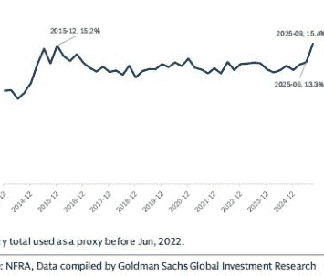

Industry total used as a proxy before Jan 2022. Source: NFRA, Data compiled by Goldman Sachs Global Investment Research.

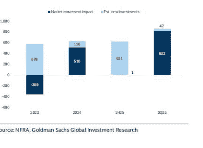

Source: NFRA, Goldman Sachs Global Investment Research.

Jason-conner 2022-12-05

高嵩: 我们12月05号与专家电话，得到信息如下——一茅台（天飞）发价可能进一步下行，去库存压力、五粮液、国酒等面临价格压力，整体需求需求，白酒企业频繁变现说明现金流充足，整体行业转向年初，2025年春日行情旺季，到2025年，白酒全线将出现底部反动力，行业转型：能量需求持续增长，水饮复苏。

Goldman Research 2022/12/05 10:59:04

China consumer staples: Spirits & Beverage retail-wholesale price call slows as demand recovers

## Goldman Sachs Equity Research December 2025

### China consumer staples: Spirits & Beverage call: more price pressure for Moutai/Fenji

We hosted an industry call with Spirits & Beverage experts on Dec 5 to discuss calls and 2026 targets across our covered spirits. Include: Moutai, Laojiao, Fenji, Nongji. Key takeaways:

- Wholesale price for spirits remains under pressure-expert expects Fenji to fluctuate seasonally during the current non-peak season, or any further sales call to actually stimulate demand and recover overall inventory levels lower for two months (contributing roughly 30% volume/value).
- Wholesale prices for Gullang are also under pressure weak while the expert expects Gullang to maintain channel support-based discount (e.g. 18 month).

Christina Liu 2022/12/05 Valerie Zhu 2022/12/05

### Table 1: November 2023 PV+EV penetration and YTD trends (by region)

| Region | Nov-23 | Nov-22 | YTD | Europe-23 | Nov-22 | YTD | US-23 | Nov-22 | YTD | China-23 | Nov-22 | YTD |
|---|---|---|---|---|---|---|---|---|---|---|---|---|
| Passenger Vehicles (PV) | | | | | | | | | | | | |
| Germany | 70 | 149 | 6,407 | 21.3% | 22.6% | 8.2% | 25.1% | 22.8% | 9.2% | 19.2% | 19.3% | 8.2% |
| France | 130 | 133 | 1,459 | 32.9% | 36.7% | 23.2% | 22.5% | 20.3% | 11.9% | 22.0% | 20.2% | 9.9% |
| Italy | 155 | 151 | 1,698 | 19.7% | 21.3% | 13.5% | 14.5% | 13.5% | 7.7% | 23.1% | 25.0% | 16.7% |
| Spain | 94 | 83 | 1,016 | 22.6% | 24.8% | 10.2% | 18.9% | 19.1% | 7.1% | 11.2% | 11.8% | 4.6% |
| United Kingdom | 103 | 110 | 1,243 | 24.3% | 25.7% | 16.9% | 23.1% | 23.3% | 12.3% | 30.2% | 31.3% | 20.5% |
| Other | 428 | 397 | 4,569 | 10.1% | 11.5% | 7.6% | 10.2% | 10.5% | 5.3% | 13.4% | 13.5% | 6.2% |
| Total | 4,250 | 4,177 | 45,810 | 25.5% | 26.9% | 18.9% | 21.8% | 22.5% | 14.6% | 20.1% | 20.6% | 14.6% |
| PHEV | | | | | | | | | | | | |
| Europe | 81 | 42 | 777 | 5.7% | 5.1% | 3.1% | 5.1% | 5.0% | 2.1% | 10.7% | 10.8% | 6.0% |
| Germany | 32 | 9 | 197 | 8.1% | 9.2% | 4.2% | 7.1% | 7.5% | 3.6% | 8.3% | 8.2% |
| France | 25 | 12 | 124 | 9.1% | 9.4% | 4.9% | 5.5% | 5.6% | 2.7% | 5.1% | 5.0% | 2.4% |
| Italy | 19 | 5 | 112 | 5.7% | 5.8% | 3.0% | 3.2% | 3.3% | 1.6% | 4.7% | 4.8% | 2.5% |
| Spain | 12 | 3 | 72 | 5.2% | 5.3% | 2.9% | 3.7% | 3.8% | 1.8% | 2.5% | 2.6% | 1.2% |
| United Kingdom | 10 | 4 | 60 | 4.1% | 4.2% | 2.2% | 4.6% | 4.7% | 2.3% | 6.4% | 6.5% | 3.2% |
| Other | 3 | 1 | 13 | 1.2% | 1.3% | 0.6% | 0.9% | 1.0% | 0.5% | 0.4% | 0.4% | 0.2% |

Jason- 2023-12-05

JPM: 全球新能源汽车-欧洲、中国渗透率39%，中国渗透率60% (+pt)，全球第一、亚洲、吉利占美国57%市场份额；美国渗透提到到6.3% (-pt)迎来底部

Source: CNEV, European Union, US Intelligence. Data are based on preliminary or official monthly sales.

一手优质资源进群微信cuk2555

# Jason 不聪

2025-12-09 06:16

## 界面：这句话可说出来了 #A股

图片来源：界面新闻记者张拍

界面新闻 | 吕凯

## 浙中、祥泽源证券产品到期无法兑付事件迎来新进展

12月8日，界面新闻记者复电浙江金融的状况，就浙泽源相关产品到期无法兑付问题，已成立工作小组，投资者维权中，调查进展还未知。

12月5日，界面新闻记者实地走访位于杭州杭州区的金融中心，根据界面新闻记者透露的信息，目前未登记的金融证券资产债权涉及祥泽集团有限公司有限责任公司（下称“祥泽集团”）及祥发，祥发为祥泽集团法定代表人。

祥泽集团注册地在浙江杭州，成立于1992年，是一家以旅游业运营为主的文旅企业，其上市公司旗下祥发（600576.SH）、海昌海洋公司（02255.HK）、交建股份（603815.SH）控股股东。

12月7日，三家上市公司已发布公告回应该事件，本次事件涉及的金融产品与交建股份、祥泽源、海昌海洋公司及其控股公司均无关联，公司不承担任何责任及担保义务，公司亦未为任何理财产品的兑提供担保或增信，并表示目前产品生产已经结束。

12月5日，祥泽集团执行总裁王许接受界面新闻，“我们总资产600亿，包括地产、股权等；负债400亿，包括银行、施工单位和投资者的债，资产的600亿是股权和股市都在。”

12月5日，沈面对界面新闻记者和众多投资者表示，“我们希望继续成为上市公司股东，否则此股票有望套现。”

- 一手优质资源提供微信cuk255

Jason不遇
2025-12-09 06:23

## zerohedge: 中国和越南对美国的出口，越南看起来像一个转运地 #经济数据

Exports to the US:
China vs Vietnam

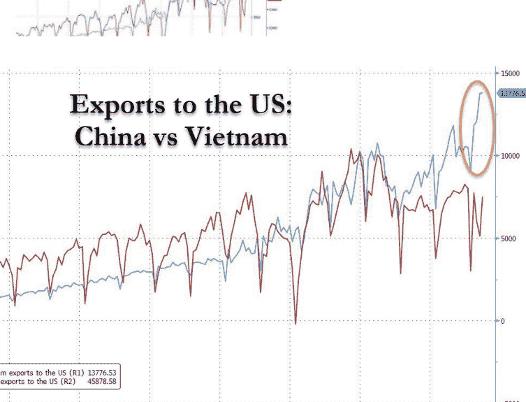

# Exports to the US:
China vs Vietnam

Vietnam exports to the US (R1) 13176.53
China exports to the US (R2) 46878.50

2011 2012 2013 2014 2015 2016 2017 2018 2019 2020 2021 2022 2023 2024 2025

Jason不遇
2025-12-09 06:31

## Tavi Costa: 黄金对美股的长期表现，三个时期分别对应：
- 1) 1940年代的债务问题
- 2) 1970年代的滞胀问题
- 3) 1990年代资产价值流失 #金融

# Times When Gold Outperforms the S&P 500

一手优质资源进群微信cuk255

十五未

# Times When Gold Outperforms the S&P 500

Gold-to-S&P 500 Ratio 10-Year Rolling Changes (%)

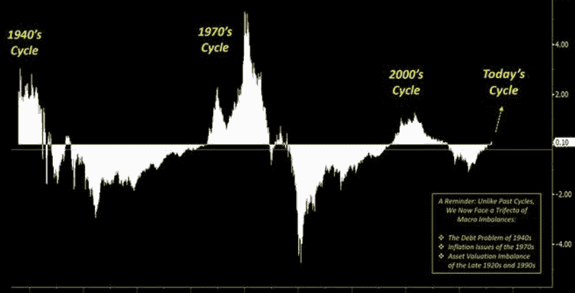

1940-1949 1950-1959 1960-1969 1970-1979 1980-1989 1990-1999 2000-2009 2010-2019 2020-2029 2030-2039

Disclosure: Crescat may or not own the securities mentioned here; investing involves risks including risk of loss
Source: Bloomberg, Tavi Costa Chart As of 12/05/2023 © 2025 Crescat Capital LLC

Jason-不遇
2025-12-09 06:34

neilksetheti: 第二期收益率对FOMC降息定价更为敏感，现已向上漂移至3.58%，最近2024年初以来所通道的底部，CME工具显示市场对2026年降息定价已从周三的67个基点、周四的80个基点，以及十月公开市场委员会前的103个基点回到至53个基点。金融

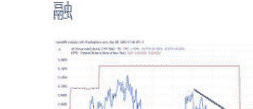

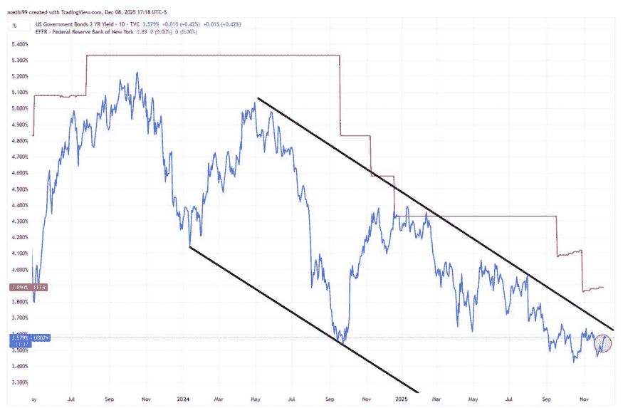

Jason-不遇

根据乘联会数据，今年1-10月汽车行业利润回落至4.38%，出口均价（截至上半年）1.75万美元/台，低于2023年的1.94万美元/台、2024年的1.83万美元/台。

根据乘联会的数据，乘用车行业每卖100元，约有7元是财政政策。#自制图表

## 汽车行业利润率 vs 出口量
南球财经

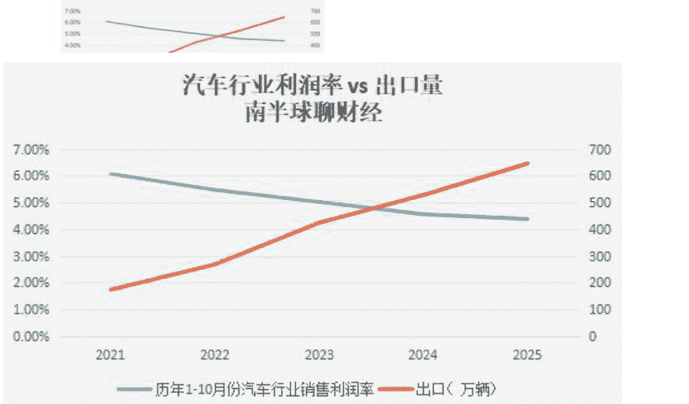

- 一手优质资源进群微信cuk255

## 深度视野优质集群（链接优质群，助你成功）

全部包含以下内容：限时年费188/年 加微信cuk255

- + 限时年费188/年 加微信cuk255
- + 守人司令知识星球，加微信时时（原价365 元/年）
- + 换魔王知识星球，祥泽内部（原价568 元/年）
- + 米联储闲兜【独家】（原价599 元/年）
- + 欧洲金雀会员专属文章（原价328 元/年）
- + 砖瓦仁内部（原价400 元/年）
- + 卢克文青会专属文章（原价699 元/年）
- + 鉴茶财经星球（原价3310 元/年）
- + 猫哥的视界知识星球（原价299 元/年）
- + 财经周刊【独家】（原价1498 元/年）
- + 杨世光在金钱（原价2200 元/年）
- + 森淼财经知识星球（原价1600 元/年）
- + 潇漾异译付费文章（持续更新）
- + 司马林解课全套音频和全套书籍收藏版删减（原价2.3 万）
- + 虚构三部曲[民国梦、帝国争霸、不被理解的DAO]（原价599 元/年）
- + 卢克文知识星球文章（原价268 元/年）
- + 额外再送：卢麒元新浪韭搏付费专栏、三村丰老王、三花九树文集

不定内容：......（更多资源将下去了......）

- ① 守人司令、财富财富圈、雪球花甲老头
- ② 创始笔记、达叔浅谈、财富圈、雪球花甲老头
- ③ A视野、大树乡谈、江宁后、咩咩说、上海海学等付费文集
- ④ 西凤付费文章、老端、赢在八小时之外、局人的视界、升值、老体制内等一些大 V 付费文章（每月不超过 600 元的付费文章）

限时年费188/年 底部链接全网V优质内容

# 深度视野文集
进群微信cuk255

