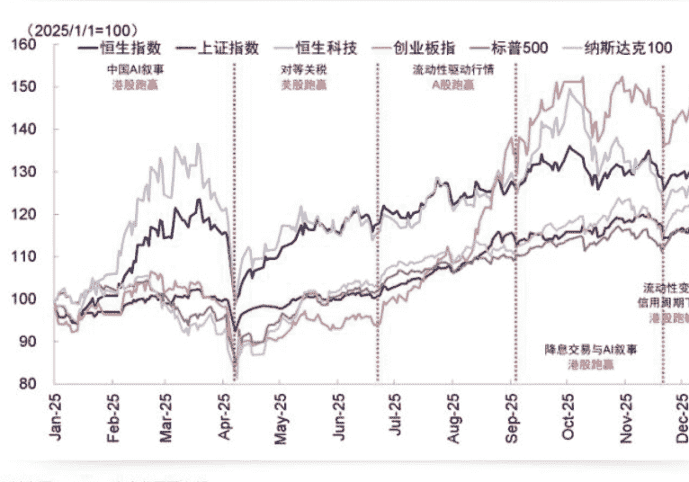
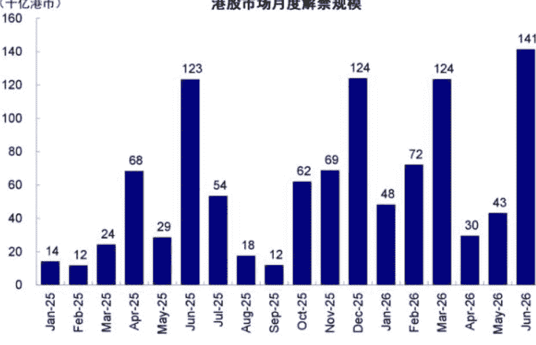
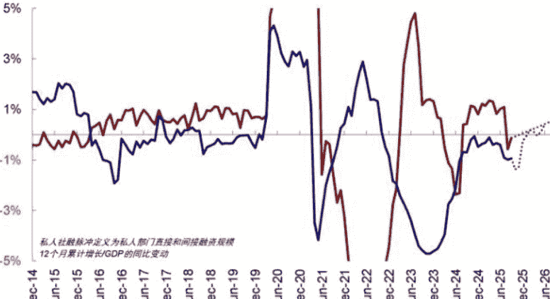
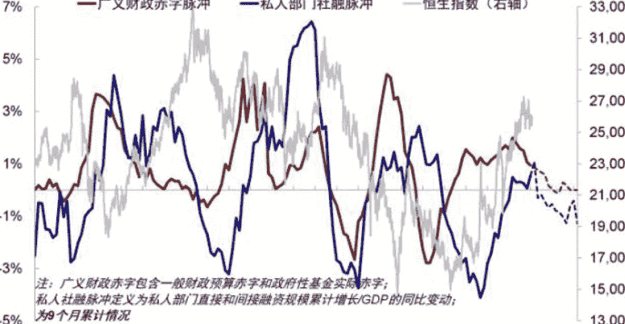
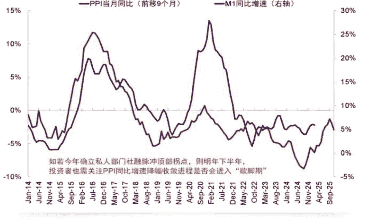
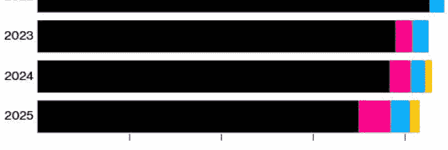
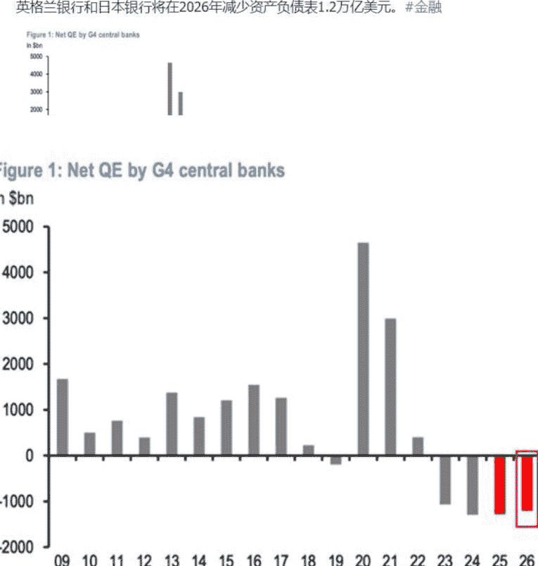

# 南半利购财经251215

Jason不透
2020-12-15 05:43

摩根士丹利：美储提前续购国债（T-Bills），不是QE，而是“量化防火”。目的是给银行体系加“锚带”、扩充TGA（财政部账户）波动（影响资金利率），让“准备金”维持在“充足水平”，有利于利率（而QE是放大资产负债表、压低长期利率）#金融

December 13, 2025 12:42 AM GMT
US Rates Strategy | North America

### Crisis of Confidence in the SRF

Reserves are above the levels that existed when QT ended, but the Fed chose to go SOMA again. We think the decision to provide a buffer and sterilize reserves (not QE) was due to a crisis of confidence in the SRF. Front-end markets get liquidity deisired but not needed; stay long 2y UST spreads.

December 13, 2025 12:42 AM GMT

## US Rates Strategy | North America
### Crisis of Confidence in the SRF

Reserves are above the levels that existed when QT ended, but the Fed chose to go SOMA again. We think the decision to provide a buffer and sterilize reserves (not QE) was due to a crisis of confidence in the SRF. Front-end markets get liquidity desired but not needed; stay long 2y UST spreads.

## Key Takeaways

- The Fed delivered a significant surprise in starting reserve management purchases, less than 2 weeks after balance sheet normalization officially ended.
- We think this decision was born out of a crisis of confidence in the SRF’s efficacy to ensure effective rate control on days of pressures in money markets.
- The solution was to provide a buffer and sterilize reserves against sharp increases in the TGA, like those on tax payment dates -- which is not QE.
- We raise our forecast for total Fed secondary market purchases of T-bills to $396bn during 2026, bringing bills as as a share of SOMA UST holdings to 14%.
- While repo markets supplied the cash it wanted, but did not need, we continue to see 2y UST swap longs as a compelling expression for softer funding.

深度视野VIP群 人工追踪50+大V 付费群加微信uk255 微信chp5568

## Jason-不错

《政策与争论》论文：延迟退休改革有助于缓解中国劳动人口快速减少的压力，有助于缓解社会保障体系的支付压力，即便在现行方案下延迟退休年龄，劳动人口数量仍会在2035—2060年减少，或加剧年轻人就业环境的不确定性。“论文正文及书籍推荐。

表 3 延迟退休改革生效后2020—2060年中国劳动人口规模及其变动

| 年份 | 劳动人口数量（万人） | 劳动人口数量的5年平均增长率（%） | 劳动人口数量相对于2020年水平的增幅（%） | 改革前 | 改革后 |
| --- | --- | --- | --- | --- | --- |
| 2020 | 8.2 | 0.42 | -6.62 | -4.00 | -3.60 |
| 2025 | 7.9 | 7.99 | -5.70 | -7.44 | -4.39 |
| 2030 | 7.6 | 5.44 | -4.43 | -1.38 | -5.22 |
| 2035 | 7.5 | 7.74 | -6.82 | -9.94 | -9.34 |
| 2040 | 6.7 | 10.15 | -14.12 | -12.19 | -24.37 |
| 2045 | 6.5 | 6.20 | -13.43 | -23.48 | -25.14 |
| 2050 | 5.5 | 8.42 | -8.39 | -27.99 | -31.91 |
| 2060 | 4.8 | 8.65 | -6.85 | -41.14 | -36.05 |

数据来源：2020年数据；国际基金会七国调查小组办事办公室《中国人口蓝皮书2020》
2025—2060年基于预测的模型。
注：（1）劳动人口的年龄上限为66岁，男性的劳动人口上限为59岁，女性的劳动人口上限为54岁。
（2）改革后的劳动人口年龄上限将延迟退休年龄（国际基金会关于延迟法定退休年龄的报告）推迟至2039年年末，男性的劳动人口上限将延迟到66岁，女性的劳动人口上限将延迟到57岁，预计2040—2060年延续此标准。（3）劳动人口数量的以“人”为单位，其他项目将根据该统计口径数据计算得出。

## Jason-不错

bloomberg: 美联储下一次会议将通胀已经缓解，除非在就业报告中看到通胀的迹象。鲍威尔就业报告将延迟9月的数据可能引发美债反弹，推动10期收益率回升至4.2%。另一个变量来自于特朗普是否推迟加息的想法。特朗普曾在白宫招待会上说：“我们很快就会看到利率降到我们需要的水平。”鲍威尔表示他认为美联储还是独立的。访问者：2023年8月24日。

## 金融

### 交易认为2026年降息比美联储更深

| Fed-dated OIS swaps / Fed's latest dot-plot 2026 pricing | 2026/6/17 |
| --- | --- |
| -31.7 bps | -10 |
| -25bp cuts | -20 |
| -50bp cuts | -30 |
| - | -40 |
| - | -50 |
| - | -60 |

来源：彭博
注：市场定价基于美联储期的OIS数据

## Jason-von...
RIA: 从2022年初开始，股票和黄金都开始上涨，打破了之前的增长趋势。黄金和股市出现了“双重泡沫”。这次变得更加像一种投资，如果历史重演，投资者可能会在股票和黄金中遭受巨大损失，失去传统上的多元化优势。泡沫的，人们由于追险情绪而提前交易，导致价格供需匹配加速上升，并不是泡沫会被重视，只是需要提示这个风险：

GOLD - Spot (USD) CME 12-Dec-2022
▇ EGH (Monthly) 256.64
▇ EGH 253.38

## Chart 1: Global debt hit a record $346 trillion in Q3 2025

$ trillion % of GDP, weighted avg.
Global debt (in USD) % of GDP (rhs)
360 340 310 300
2017 2018 2019 2020 2021 2022 2023 2024 2025

Source: IIF Global Debt Monitor

## Jason Frankel
2025-12-15 06:15

村野：从历史上上看，日本央行的紧缩周期发生在全球紧缩周期的末期，并因海外经济走弱而迅速结束。近期，其他主要央行（如澳洲联储、欧央行）的政策转向预期短期内削弱了日元的升值，但从中长期来看，这可能增强日本银行紧缩周期的可持续性。如果日本银行不再加息，其持续加息至2027年的信息将变得更容易，而在中长期内为日元提供更强力的支持

Fig. 6: Policy rates of major economies

## Fig. 6. Policy rates of major economies

Source: Bloomberg, Nomura

## Jason-Lee
2025-12-15 06:22

民生：回望2025年，我们看不出大类资产配置的三条主线——AI与财政：美元与财政：货币信用下行周期开启，金属周期波动提供了机会；AI产业深化，加剧了全球通胀的风险暴露；财政预期（尤其是欧洲财政改革进程）引发了欧洲资产估值的重估。外汇市场上，欧元依然走弱，此外还有一个巨大的变量就是关税。
我们认为，隐含三条主线的均衡与博弈，仍是2026年大类资产配置的核心逻辑。
2026年，美股可能宏观环境改善与AI产业深化的双重利好延续上涨趋势。2026年可能仍延续低迷的通胀特征，春年中下，储政府在财政和货币政策上将加大力度，政治局势可能出现不确定性，或者生产力实现突破引发有效通胀。从基础基金来看，在供需平衡、财政赤字双重压力下预计会有空间。

## 金

### 图1：今年以来主要资产涨对比

### 图8：若政策调整，美国收益率的变化

### CMF: 管住经济

由于篇幅限制，此处显示正文内容。在实际分析中，债券收益率受通胀预期的影响。如果通胀预期下行，那么收益率可能会下降；反之，则收益率可能上升。

## 深度 

综合治理内卷竞争，首先要全面理解内卷竞争的原因，然后才能对症下药。如前所述，过剩会加剧价格战，本文将聚焦产能过剩。我们将从供给和需求两个方面进行分析。

首先看供给，主要是地方政府和企业。在地区竞争下，地方政府是导致产能过剩的非市场主体，经济学的研究证明，中国经济持续增长的关键因素是区域间的竞争，而地区竞争的动力来自于地方官员。通过增加区域内增长，地方官员可以获得更多财政收入，更高的财政概率或其寻租权力（许东和赛华，2020）。但地区竞争的后果是，会导致地方政府保护主义，并导致出现产能过剩。

一个典型的现象，是由于市场决定了重点区域，地方政府就会重点区域行业招引投资，并为该行业提供税收和补贴方面的优惠政策。因为这些企业更容易获得中央权威的支持。此外，同时地方政府对中央战略的执行力较弱，导致企业使得收益有风险的选项。如此，如果每个地方都如此竞争，必然会导致产业结构失衡和产能过剩。此时，此市场失效的表现。

## 深度

市场是实现资源配置的手段，而竞争却导致资源错配。上世纪五六年代，市场明确指出企业过度负担。至今有人认为市场不存在问题，还是幼稚的市场主义观点。博弈经典模型“囚困境”，表明在某些特定条件下存在过度压力。在一些国家中，企业打战战最后的冲击往往从价格开始。很多企业会亏损，而幸运的企业也无法固定成本。即便获得了微薄的利润，难以进行创新。创新需要冒险，而冒险所需的利润很难从这个意义上讲，竞争存在。这种竞争形成了一个理论上的悖论：经济学教科书，完全竞争是最有效的市场，但在完全竞争条件下是不可能的！我们现在现实中也能看到很多企业在不断增加，是因为它们已经有了压力。如此，竞争和企业之间的关系不是线性关系，而是一种U型竞争，这是2025年。

除了价格竞争，竞争的另一个表现就是产能过剩。在博弈中，这就是典型的产量过剩。在一个市场上，每个企业都希望提高质量，这样就可以增加产量。但企业也会拉低价格，如果过度扩张的企业承担了拉低价格成本，这种负面效应会导致市场规模过大，超过需要，以至于所有企业都少了利润。从企业的角度来看，过度扩张就是一种价格竞争，这里的“过度”是指超过利润最大化的。

在现实中，价格和产能往往是连续的。因为行业产生竞争，所以企业通过价格对对手。这应该是当前竞争的主要表现。价格竞争也经常发生在行业兴起阶段，如此前几年市场“满溢”和“内卷”的情况，以及今年东京，美国和微软三大平台之间的，但是竞争和产能过剩。不管是价格竞争还是产能过剩，都是竞争的副作用，并且使得整个行业都成为低效率的竞争。2017年，京东屡次引发“最低价格”中标，并将这种激性的竞争在市场上真实地引发了“横肉当街”，以往。更严重的问题是，由于产能过剩和价格竞争，都是一种囚困境，所以所有企业预见到这种之后，单独的力量很难在短期内改变。这是市场失效的一种表现，如此需要政府和其他力量在短期内调整，才能市场失效。

## 图表1：美债季节活跃度的市场转换脉络

来源：Wind, 中金公司研究部

## 图表6：港股潜在解禁金额1200亿港币

来源：Wind, 中金公司研究部

深度视野VIP群 人工追踪50+大V 付费进群加微信cuk255 微信chp5568

## 图表13：2026年美国信用周期走向修复甚至在一定条件下出现“过热”

### 美国信用周期
—广义财政赤字率 私部门信贷脉胀

私人信贷脉胀定义为私人部门直接和间接信贷规模增长率12个月累计/GDP的同比变动

资料来源：Wind，中金公司研究

## 图表14：中国信用周期领先差至走弱

注：广义财政赤字包含广义财政赤字和政府性基金债券赤字；

私人信贷脉胀定义为私人部门直接和间接信贷规模增长率/GDP的同比变动n12个月累计值

资料来源：Wind，中金公司研究

深度视野VIP群 人工追踪50+大V 付费群加微信cuk255 微信chp5568

## 图表17：M1领先PPI-6-9个月（高泰国明年二三季度）

由于今年私人部门链冲出顶点，到明年下半年，投资者仍需关注PPI同比通胀进程是否会进入“割倒期”

来源：Wind，中金汽车研究部

Jason不
2025-01-15 08:13

bloomberg:中国汽车制造商在泰国实施了颇幅的折扣，比亚迪将其Sea电动汽车价格大幅缩减38%，上月还以27%的折扣销售MG4，大幅折扣推动10月和11月的销量激增超过20%，但让买家犹豫。如果现在购买，电动汽车价格将迈下一步，泰国局目前几乎没有采取措施击退激进的渗透。#经济数据

中国汽车制造商在泰国调整市场份额

## 中国汽车制造商抢得泰国市场份额

- Japanese Automakers - BYD - SAIC - Changan

2022
2023
2024
2025

来源：邦汽车（泰国)
注：2025年数据为1月至10月。这就是数据市场份额的百分比

# 深度视野VIP群 人工造陆50+大V 付费加微信cuk255 微信chp5568

Jason-不
2025-12-15 08:26

JPM: 即使美联储结束QT，全球其他主要央行将继续缩减资产负债表，预计其中欧洲央行、英格格兰银行和日本银行将在2026年减少资产负债表1.2万亿美元。#金融

## Figure 1: Not QE by G4 central banks

Source: Federal Reserve, ECB, BoE, BoJ, J.P. Morgan Flows & Liquidity.

深度视野VIP群 人工追踪50+大V 付费进群加微信cuk255 微信chp5568

# 深度视野优质文圈，链接优质社群，助你成功

全部包含以下内容：限时年费188/年  加微信cuk255

1 吃瓜群众倍时圈内加时群聊对话（原价365 元/年）
2 子明私享兮（含）内部文章（原价568 元/年）
3 政事堂（原子明）优质内容再加送顺子明群聊
4 米联储闲间【作者米穗】（原价599 元/年）
5 欧洲金雀会员专属文章（原价328 元/年）
6 铸五厂内部圈文（原价400 元/年）
7 卢克文青读书会专属文章（原价699 元/年）
8 鉴茶财经知识星球（原价3310 元/年）
9 猫哥的视界知识星球（原价299 元/年）
10 财新周刊【独家新闻】（原价1498 元/年）
11 杨世光在金钱（原价2200 元/年）
12 森森财经知识星球（原价1600 元/年）
13 源译译译付费文集（持续更新）

# 深度视野文集 进群微信cuk255

14 司马林解读毛选全套音频和全套书籍珍藏版无删（原价2.3 万）
15 虚走三部曲【民国梦、帝国战争、不被理解的MAO】（原价599 元）
16 卢克文知识星球文章（原价268 元/年）
17 额外再送：卢萨再送·湖南浪博付费专栏；三丰边老王、三花九树文集

不定期内容：（更多资源将不下去了...）

① 守夜人司令知识星球、接魂魔王知识星球、生有术知识星球
② 创始笔记、达沃译论星球、成付财富圈、雪花桃花老头等
③ A视野、大树乡谈、江初知道、咩同学、上海海学等付费文集

④ 西风付费文章、老端、赢在八小时之外、局人的视界、升值、老A体制内等其它一些大V付费文集（每月低于600 元付费文集）
