# 南半球聊财经2511218

Jason不离
2025-12-18 03:09

长安：2018年以来有息债务呈现扩张态势：2018年规规模约35.7亿元，此后逐年增长，至2025年11月已升至78.8亿元，总规模已经没有持续缩减，这说明在化债的同时，城投类主体的债务扩张依然较为强劲。

与此时，融资债平台经营性债务逐渐被大家关注。我们认为未来城债平台的经营性债务化债路径无非三个：1）再次认定后进行政策置换；2）金融化债；3）市场化处置#

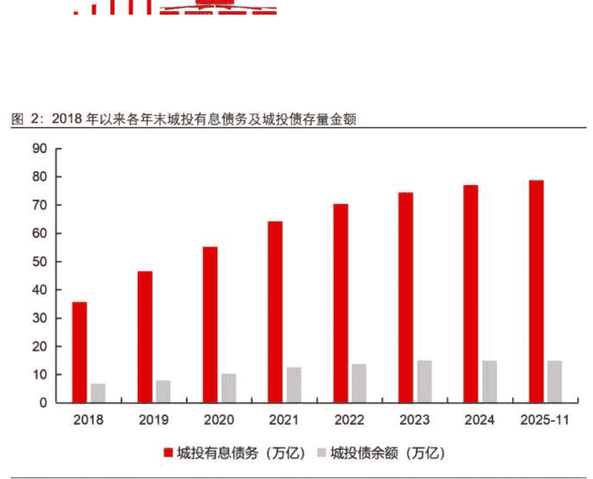

资料来源：Wind，长江证券研究所，2025年截至11月底

大佬文圈VIP群专属分享，付费进群微信pep854 微信daizongdai2021

## 图 5: 解化融资平台经营性债务风险的市场化手段体系

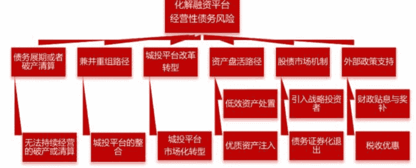

资料来源：中国大网站、财政部网站、中国政府、江苏证券研究所

Jason不满意
2025-12-18 03:16
Bloomberg: 截至2025年9月期，日本家庭金融资产总额为2285万亿日元，创历史新高。比上年同期增长4.9%。风险资产（股票和投资信托）首次提升至总资产的20%以上。#其他国家经济


## 风险资产占日本家庭投资组合的20%

- Ratio of stocks and investment trusts in total household assets

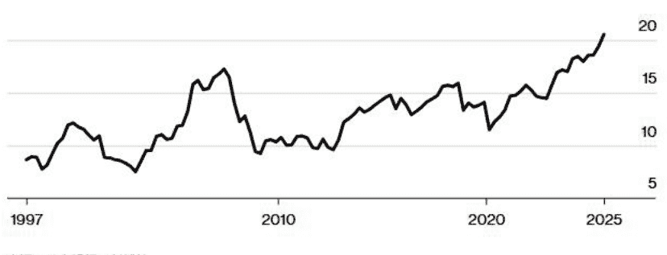

来源：日本银行、彭博社

大佬文圈VIP群专属分享，付费进群微信pep854 微信daizongdai2021

## Jason-不遇

2025-12-18 03:25
HNH：预计AI主题将继续推动500等指数上涨。但与此同时，由于市场对信用风险的担忧持续上升，与其股及其他AI相关公司的债务挂钩的信用违约（CDS，类似违约险）可能再度上升。可多AI股票，空信用债券。美联可能在明年进入“热”运行，这可能在2026年下半年引发新的通胀压力，迫使投资者要求更早的宽松。从长期而言，这将对价格构成压力。对于如何从2026年起增长速度预期的中期转型，花旗建议多备，他们认为这是一个“全天候”交易，相对不易美国国内因素影响。投资者可以通过购买铜债、铜期货或相关ETF来与美股

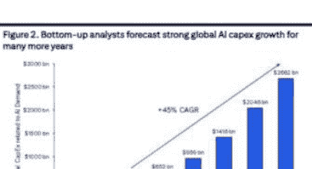

> Figure 3.Bank reserves at the Fed are getting to rise thanks to Reserve Management Purchases (RMP) and QT ending

> Figure 2.Bottom-up forecast storm global AI caps growth for many more years

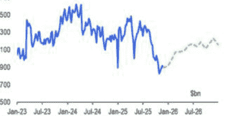

© 2021 Citibank Inc. No redistribution without writing's written permission.
Source: Citi Research, Bloomberg

© 2021 Citibank Inc. No redistribution without writing's written permission.
Source: Citi Research, Bloomberg

## Jason-不遇

2025-12-18 03:30

zerohedge: 根据IMF最新数据，伊朗2025年实际GDP预计增长0.6%，通胀却仍有43.3%，货币里亚对贬值。#其他国家经济

## Iran's Economy Amid High Inflation

Real GDP growth and annual inflation rate of the Islamic Republic of Iran since 2010 to present (percent)


## Iran's Economy Amid High Inflation

Real GDP growth and annual inflation rate of the Islamic Republic of Iran since 2010 (percent)

- Real GDP growth - Inflation rate

IMF forecasts as of October 2025
Sources: IMF, press reports


## Jason-不遇

2025-12-18 03:38
Bloomberg: 包括英莱、富达和豪在内的海外基金表示，未来一年可能会更多资金流入中国股市，尽管社会情绪和消费者信心有效应对可能有限。估算过去几年，家庭国内房价上涨了4.5万人民币，许多基金对如此市场投入资金，更希望中国股市回涨为经济转折，数据尚未证明。#中国股市后回涨是否为经济转折，数据尚未证明。


## 中国股市今年优于全球

- MSCI China Index - Normalization
- MSCI Japan Index - Normalization
- MSCI World Index - Normalization
- S&P 500 INDEX - Normalization
- MSCI Europe Index - Normalization

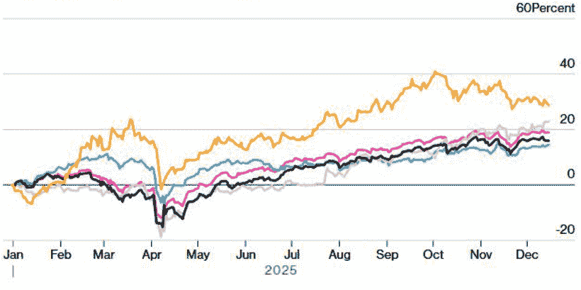

来源：财联
数据已与024年12月31日的百分值进行归一化。

## Jason不涵

2025-12-18 03:42
Bloomberg:德国推出儿童养老账户缓解老龄化压力，至18岁的儿童每月缴纳10欧元。2036年，约33%的劳动力将退休。#其他国家经济

德国人口正在减少出生率低影响

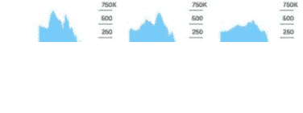

大佬文圈VIP群专属分享，付费进群微信pep854 微信daizongdai2021

## 德国人口正在减少并日益老化到2036年，近30%的现有劳动力将退休

- Men
- Women

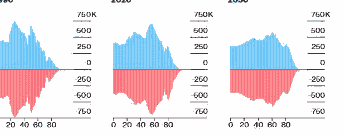

来源：联邦统计局

## Jason·凯恩

2023-12-18 03:45
财新：11月70个大城市二手房价环比持续下跌，是2011年有记录以来首次连续三个月对观测的城市房产全部环比下跌。“以换为主为主仍在持续。”#房价

- 一线城市二季度房价环比下跌至1%

2023年11月—2023年11月各线城市二手房价环比变化

| 一线城市 | 二线城市 | 三线城市 |
| :--- | :--- | :--- |

## 一线城市二手房价环比跌幅扩大至1.1%

2023年11月—2023年11月各线城市二手房价环比变化

- 一线城市 — 二线城市 — 三线城市

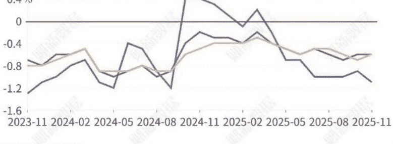

2023-11 2024-02 2024-05 2024-08 2024-11 2025-02 2025-05 2025-08

数据来源：财新CEIC
原始数据：国家统计局

大佬文集团VIP专属分享，付费加微信pep854 微信daizongdai2021

## Jason不易

2025-12-18 03:51
日：日本经济中心发布了亚太地区18个国家和地区截至2040年的经济增长预测。其中预测2025年中国经济增长率为4.9%，预测放缓4.5%，2027年降至4.4%，2029年降至3.9%。预计2030年为3.8%。1.5年间保持年均4.6%的经济增长率，与2024年12月公布的预测值相比下降0.2~1.5个点。预测中国的增长率在2031~2035年平均为3.5%，2036~2040年平均为2.8%。加速的老口减少成为负担，低劳动生产率成为低增长的主要因素。#经济

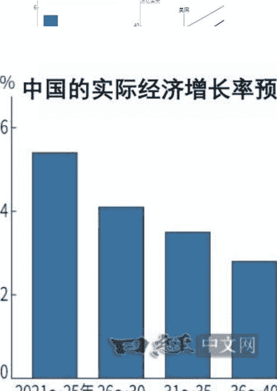

## 中国实际经济增长率

2021~25 26~30 31~35 36~40 (注)每年的平均值
数据来源：日本经济中心

## 预测中美GDP不会逆转

- 名义GDP。2025年以后为预测
数据来源：日本经济中心

## Jason-不愁

2025-12-18 04:06
国泰君:我们认为2026年股票仍处回升，“盈利牛”继续，市场风格有望均衡；2026年港股“盈利牛”有望，科技领先题材带来增量，呈“蓝筹牛”。#股市

- 2025年以后为预测
- 2026年
- 2027年年底前

```H3_AP202512178025843_pdf```

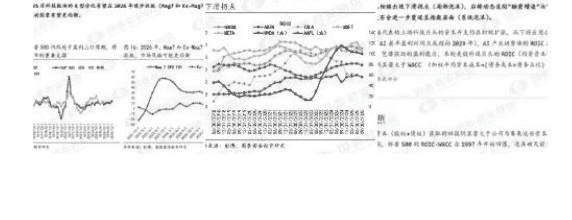

## 股市

对美股，我们预测2026年标500处于盈利上行周期，将成为2026年美股的重要支撑结构上，非科技领先的K型有望在2026年稳步收益（Mag7和Ex-Mag7的EPS增速将持续维持）。

图15:2026年标500仍然盈利上行周期；图16:2026年，Mag7和Ex-Mag7的EPS增速会有维持，市场风格可能均衡

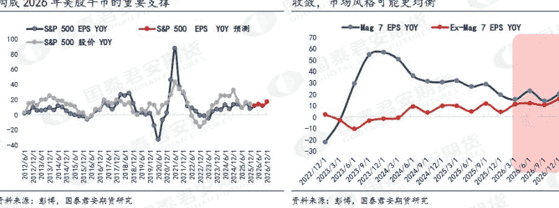

数据来源：彭博，国泰安中期研究

## 图27: 为代表的科技巨头ROIC已经相继下降拐点

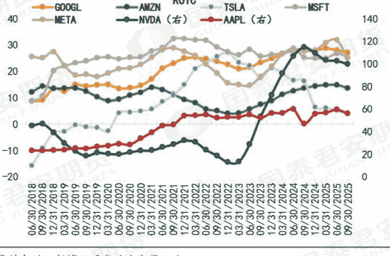

数据来源：彭博，国泰安中期研究

## 第一：后劲道的领先科技与追进者的“ROIC-WACC”是否能避免差距？转型后的领先科技头ROIC的趋势已经领先转落，后劲道的路径面临“资本增长”与“利润增长”的抉择，以及ROIC是否会进一步缩小。对于未来两年头部代表的领先科技资本开仍在规模扩张，而下游应用的商业模式或许仍然需要的情况（AI领先时点指向2029年），AI行业整体的ROIC在2026年可能进一步落。两者的差距在于，领先的胜利能力，头部领先科技头的ROIC（投资回报率税后净利润与资本成本）显著高于WACC（加权平均成本×债务占比+股权成本），公司必须注意这些历史关键点，用公司利用投入资本（股权+债务）获取的回报显著高于WACC为收集这些资本所付的平均成本。

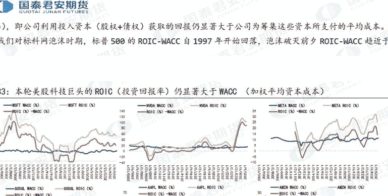

##领先科技头的ROIC（投资回报率）显著高于WACC（加权平均成本）

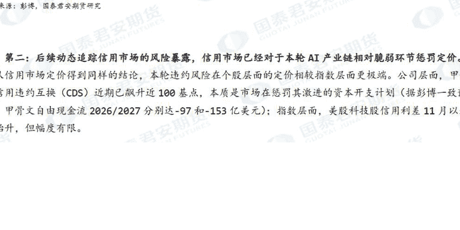

资料来源：国泰证券首席分析

第二：后劲道的追进市场的风险因素，信用市场已经对整个AI行业相对环境进行周期性调整。从我们相信市场定价得出的利润的特殊性，跨越违约风险在个层面的定价的相同差距更为显著。公司布局，其信用选择违约（CDS）到期已经额外增加100亿，主要是市场在担心激烈的资本开支计划“泡沫”一破，其自由现金流预测2026/2027年分列为-97和-153（亿美元），如此数据，某类科技股信用利息11个月以来偏幅，但幅度有限。

价值回归“恐慌”不是事实。尽管如此从全球及美股回归的视角来看，强劲的衰退/赢利能力是支撑美股回归的关键。

我们预计2026年将出现惯性回调，股市防守+黄金组件将活跃，货币政策转向转向宽松，唯有支撑美股高价值回归。我们预计2026年美元将回调至3.25%，全年会有两次运行。我们认为目前的估值仍处于高位，预计2026年：1）存在回归并在2027年底前出现底部；2）市场情绪从高位转向低位，随着流动性逐渐宽松，预计2027年迎来底部；3）市场情绪从高位转向低位是关键，美股全年下行空间，但并未崩溃。从历史来看，这种调整通常需要时间，经济和政策转向是支撑股市回归。

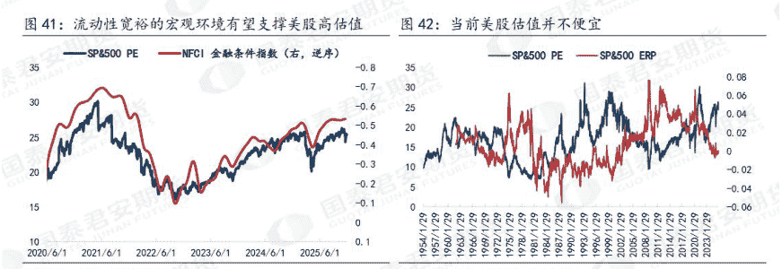

数据来源：基金，国泰证券

数据来源：基金，国泰证券

## 3.2026年股市逻辑与配置

2026年策略：虽然依然贵，估值扩张可能有限在中性环境下，2026年500点上方主导，并当前估值水平在低位能支撑；当前25.3XPE+13%（彭博预测），目标至2025年10月后的高点：26.2XPE+20%（根据未来3增长历史外），EPS增速→标普500约为850点。我们预计下，2026年标普500高值将引发回落，且估值同样落落3年均值水平：25.3XPE+7%的EPS增速→标普500约为650点。

图45：三种情况下对2026年股市的展望

| 场景 | 2025年内及未来水平 | Target EPS | S&P500估值 |
| :--- | :--- | :--- | :--- |
| 乐观情况 | 26.2X3增长历史外：20% | 8500 |
| 中性情况 | 维持当前水平：25.3X13% | 7600 |
| 悲观情况 | 回落至3年均值水平：22.5X7% | 6500 |

数据来源：基金，国泰证券研究

## 国泰明期货

行业配置：科技与科技类更具价值，关注AI+存储、公用事业（AI电力）、AI+材料（AI铜）边缘领域。其中，AI芯片/服务器设备/存储（Hyperscale），AI生产有望从受益更多“看回报率”驱动，头部规模可能增长，市场处于行业底部财务状况更为稳健。

图48：市值5000以内行业表现；优选其市盈率和增长性的方向

图49：优选至热门道；优选其市盈率和增长性的比例

| Forward PE | AI Software | AI Robotics | AI Exposed |
| :--- | :--- | :--- | :--- |
| 60 | | | |
| 50 | Real Estate | | |
| 40 | Growth 100 | Information Technology | |
| 30 | Consumer | 4 Powers | |
| 25 | Consumer | | 7 |
| 20 | | Health Care | |
| 15 | Energy | | Materials |
| 10 | | | |
| 7 | | | Hardware & Storage |
| | 12% | 17% | 22% | |
| | EPS YCAG | 1 | 0.2 | 0.3 | 0.4 | 0.5 | 0.6 |

数据来源：国泰证券研究中心

## 6. 来源：国泰证券研究中心

## 6. 2026年港股盈利结论与配置建议

### 6.1 2026年盈利空间：低估驱动高盈利

中性观点，2026年港股指数将迎来盈利主驱动，并且当前的估值水平在波动性较高的情况下修复增长：目标至12倍的PE+10%（距离一年中期）的EPS增长→指向EPS28500的目标：

理想情况下，2026年港股指数将迎来盈利驱动，并且估值有望进一步回升至2025年10月的高高点位：12.5倍的PE+12%（根据3年增长历史外枢）的EPS增长→指向30000的目标：

悲观情况下，2026年港股盈利增长显著于预期（回落至3年均值水平），并且估值回落过去3年的平均水平：10倍的PE+5%的EPS增长→指向EPS24000的目标：

| Target PE | Target EPS yoy | 盈利数据目标 |
| :--- | :--- | :--- |
| 2025年增长率:12.5% | 3年增长历史外枢（创作2025年）12% | 8500 |
| 中性情况 | 维持当前水平：25.3X13% | 7600 |
| 悲观情况 | 回落至3年均值水平：22.5X7% | 6500 |

图77：三种情况下对2026年股市的展望


今年7月28日，国家育儿补贴实施方案公布，从2025年1月1日起，无论一孩、二孩或三孩，每年均可额外领取3000元补贴，直至满3周。这次出台的国家育儿补贴政策，意味着全面生育福利的起点，人口增孩问题得到了重视。

不过，与高欧国家的育儿成本相比，以及与欧洲国家相比，这次出台的育儿补贴还是太大了。根据OECD数据，近年来，瑞典、瑞典等欧洲国家用于育儿补贴等方面的家庭福利支出占GDP的比例在3%以上；法国育儿补贴的母亲每月可获得177元的补贴；在三胎及以上孩子满6岁前，补贴每月发放到6000元，持续到孩子满6岁；再生三胎，补贴增加到9000元，直至孩子满18岁。法国和北欧国家的育儿补贴水平较高，这些是这些国家育儿政策的重要因素之一。

为了缓解中国的出生率，我们应该发放生育资金，加大育儿补贴，建议给予每个孩每月1000元，给予每个二孩每月2000元，给予三孩及以上每月3000元直至孩子满18岁。未来可根据经济发展情况和出生人口目标调整育儿补贴标准。

我们可以算一笔账，看看政府在养孩子上的投入和回报：

在正常情况下，每出生人口中，一孩于二孩，二孩于三孩及以上。因此，按照平均每孩每月发放1500元育儿补贴计算，则平均每个家庭每年发放1.8万元，18年共发放32.4万元。

大学毕业一般从22岁开始工作，费到65岁退休，一生工作43年。考虑到硕士和博士推迟工作年限，则按照平均每一个人一生工作约40年来计算，中等收入群体（未来可能是收入15万-30万元）的40年的税费贡献如下：

- 个人所得税：每年缴1.5万-3万，40年共计60万-120万元；
- 社保险费：每年缴4万元，40年共计80万-160万元；
- 消费税等间接税：每年缴约1万元，40年共计40万元；
- 平均每一个人一生总税费贡献：180万-320万元。

以上上述估算可以看出，虽然政府给每个孩子平均发放育儿补贴32.4万元，但孩子长大后参加工作，一生总税费贡献达到180万-320万元。

给养育家庭并不是成本，而是支持养育家庭的福利支出，可以看到社会对他们的父母养育未来纳税者的付出所补偿。发给养育家庭也是公平的，因为这些家庭付出时间、精力和财力养小，长大长大还要消费，通过消费来支撑整个经济，并通过纳税方式直接贡献社会。

有担心人说：“增加育儿补助，会变成变相养育家庭吗？” 事实上，养育孩子不需要付出直接的成本，还需要额外付出时间和成本，这可是对于女性来说，养育孩子不会迫使女性的时间增加，减少时间问题，这会导致女性报告的时间窗口减少，以及工资负担增加。

有担心人说，发钱会不会引起通胀？在目前，经济已经很均衡，产能能够充分利用，供给的需求如果满足就会引起通胀。如果目前的状况非常特殊：我们几乎所有的资源都已经生产，不光满足自己，还能供给世界，产能够充足，而且现在在整体处于通畅状态。因此，发钱不会引起通胀，反而能够解决均衡和消费不足的问题。这是一个非常特殊的时机窗口，通过发钱可以同时解决通胀、消费不充足的问题。政府、企业、国家，就业困难等一系列问题得到解决。国家在其他阶段可能不会这样做，但目前的状况给这种做法是合理的。

目前经济面临的主要问题，就是很多行业的需求供给供给增长速度。无论企业如何投入扩大生产或提高效率，都不能满足太多的需求，反而导致价格低迷，企业将面临困难，中国经济要解决这个问题，关键就是要创造更多的需求，最直接有效且简单的方法就是给养育家庭发钱，由于是发给养育家庭的，由于养育家庭的需要，他们给的钱会有很大比例转化为消费支出，促进市场繁荣并带动对收入的增长。

Jason-一滴
2025-12-18 04:18

国信还：第50周，全国二房挂牌价环下降0.11%，一线城市环比0.14%#


## 各城市-千井杯奶茶 4S 店数据

趋势分析

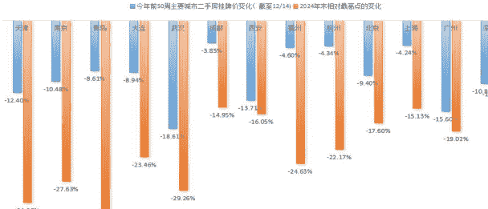

Jason不离
2025-12-18 04:24

花蜜：基于 Thinkcar 对中国 Top 30 城市的 4S 店数据，12月上旬，新能源（NEV-PV）行业平均增长率7.1%（环比增加0.1个点），不再增长而是持续减库存，每月有10~20新款轿车销量，远未到“正常”态


| Weighted average discount | 15-Aug | 21-Aug | 15-Sep | 25-Sep | 30-Sep | 25-Oct | 31-Oct | 15-Nov | 20-Nov | 25-Dec |
| :--- | :--- | :--- | :--- | :--- | :--- | :--- | :--- | :--- | :--- | :--- |
| Tesla | 0.9% | 0.6% | 0.0% | 0.0% | 0.6% | 0.6% | 0.8% | 0.8% | |
| Nio | 4.9% | 4.6% | 4.0% | 4.0% | 2.9% | 2.9% | 2.8% | 2.9% | |
| Xpeng | 2.7% | 2.7% | 3.4% | 1.4% | 1.5% | 1.6% | 1.7% | 2.0% | 1.9% | |
| Li Auto | 5.2% | 5.4% | 5.4% | 4.7% | 5.0% | 5.8% | 5.6% | 7.7% | 7.1% | 7.2% |
| Leap Auto | 5.5% | 5.6% | 5.9% | 6.9% | 6.1% | 5.8% | 5.8% | 7.2% | 7.2% | |
| BYD | 6.6% | 6.6% | 6.6% | 6.9% | 6.9% | 7.1% | 7.1% | 8.3% | 8.3% | 8.4% |
| Geely | 6.9% | 6.9% | 7.0% | 7.0% | 7.0% | 8.0% | 8.0% | 9.0% | 9.0% | 9.1% |
| Great Wall | 4.4% | 4.2% | 4.2% | 4.0% | 4.0% | 4.2% | 4.5% | 3.0% | 3.6% | 3.2% |
| Beijing Motors | 32.8% | 33.0% | 34.1% | 34.7% | 34.1% | 28.5% | 29.8% | 29.2% | 29.7% | 30.2% |
| BMW Auto | -0.7% | -0.8% | -0.2% | -0.9% | -1.0% | -0.2% | -0.3% | -0.6% | -0.4% | -0.4% |
| Audi Group | 20.9% | 21.1% | 21.9% | 18.0% | 20.9% | 21.4% | 21.9% | 21.4% | 21.5% | 21.7% |
| NEV-PV sector weighted discount | 8.1% | 6.7% | 6.3% | 6.3% | 6.3% | 6.8% | 6.8% | 6.5% | 7.0% | 7.7% |

| Weighted average retail discount Change | 15-Aug | 21-Aug | 15-Sep | 25-Sep | 30-Sep | 25-Oct | 31-Oct | 15-Nov | 20-Nov | 25-Dec |
| :--- | :--- | :--- | :--- | :--- | :--- | :--- | :--- | :--- | :--- | :--- |
| Tesla | 0.2pt | -0.3pt | -0.6pt | 0.0pt | 0.0pt | -0.3pt | -0.3pt | 0.2pt | -0.1pt | 0.1pt |
| Nio | -4.2pt | -0.4pt | -0.6pt | -0.0pt | -0.0pt | -1.9pt | -0.5pt | -0.1pt | -0.1pt | -0.1pt |
| Xpeng | 1.5pt | -0.5pt | -0.7pt | -1.3pt | -1.9pt | -0.2pt | -0.1pt | 0.3pt | -0.1pt | 0.0pt |
| Li Auto | 0.3pt | -0.2pt | -0.5pt | -0.3pt | -0.3pt | -0.2pt | -0.2pt | 0.5pt | -0.1pt | 0.0pt |
| Leap Auto | 0.5pt | -0.1pt | -0.3pt | -0.2pt | -0.1pt | -0.2pt | 0.6pt | 0.0pt | 0.0pt | |
| BYD | -0.1pt | -0.3pt | -0.4pt | -0.1pt | -0.1pt | 1.1pt | 1.0pt | 1.3pt | 0.3pt | |
| Geely | -0.9pt | -0.3pt | -0.4pt | -0.3pt | 1.0pt | 1.0pt | 1.7pt | 0.3pt | 0.7pt |
| Great Wall | 0.2pt | 0.2pt | -0.2pt | -0.2pt | -0.3pt | 0.5pt | 0.6pt | -0.4pt | | |
| Beijing Motors | -1.4pt | -0.2pt | -1.2pt | -1.1pt | -0.2pt | -0.6pt | -0.4pt | -0.5pt | | |
| BMW Auto | 0.2pt | 0.2pt | 0.8pt | 1.9pt | 1.0pt | 0.2pt | 0.1pt | -0.3pt | 0.2pt | 0.3pt |
| Audi Group | -0.9pt | -0.9pt | -1.9pt | -0.5pt | -0.5pt | -0.4pt | -0.5pt | -0.2pt | -0.2pt | |
| NEV-PV sector weighted discount | -1.4pt | -0.9pt | -0.9pt | 0.0pt | 0.5pt | -0.3pt | -0.3pt | 0.2pt | 0.7pt | |

## Figure 7. CPCA: ICE Discount Trend
## Figure 8. CPCA: NEV Discount Trend 
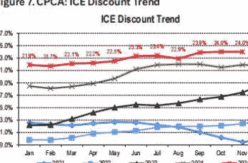

## Figure 9. CPCA: Luxury Discount
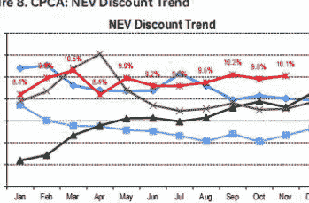

## Figure 10. CPCA: ICE Discount
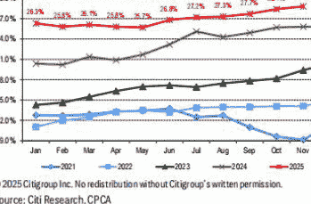

## Figure 11. CPCA: Local ICE Discount
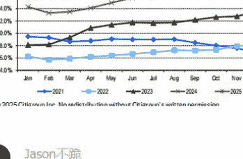

Jason-不凯
2025-12-18 04:32

Paul Casey: 近近期日本财政动向（发言）成为热门话题，但现实是日本截至9月的财政赤字已缩减至至少20年的最低水平#其他国家经济


## Japan, Quarterly fiscal balance*, % of GDP
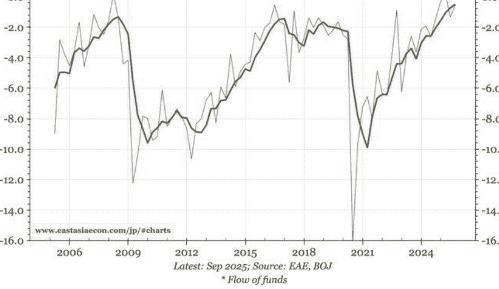
