# 南半联购财经251219

Jason不赢
2025-12-19 03:36

## 高盛：测算房产合理价格多少

我们预计，由于行业内部的转型性压力以及房价水平维持，2026-2027 年一套入住住房市场的施工活动将保持低迷。

不过，如果到 2027 年房地产资产投资 (FAI) 的绝对收益下降为房产销售的 85%，我们可能会开始看到与前两个阶段相比出现异常。这是因为，房产 FAI 在很大程度上受影响的是……

## 高盛：测算房产合理价格多少

Jason不赢
2025-12-19 03:47

亮亮：中国汽车制造在经历了第一阶段和第二阶段的估值下降周期之后，我们认为，第三阶段的行业估值下降周期将从 2026 年第一季度非常常态的库存压力引发，这将迫使汽车在 2026 年第一季度和第二季度同时减产（即 2026 年传统燃油车 (ICE) + 新能源车 (NEV) 发售销量可能下降 41%）——这一点我们在第二阶段估值下降报告中提到，根据 Tinkercer 的周度变化数据，2025 年 12 月中我们行业发售销量较上月旬下降 31%，日均调整后为 -21% MoM（图表 1），这与我们预计的 12 月中购车订单对比符合预期，即便在我们预计 2026 年第一季度完成理性的去库存之后，我们预计 2026 年 3 月后行业库存水平将维持在约 2.8 个月（其中燃油车为 3.2 个月），预计到 2025 年 3 月的行业平均值为 2.3 个月，以及过去 8 月份平均值的 2.1 个月。在 2026 年一、二季度的库存下降周期中，我们认为燃油车品牌将承受明显的经营压力。

# China Auto Manufacturers

CITI'S TAKE

After Stage 1 & 2 de-rating cycles, we believe that the Stage-3 sector de-rating cycle should be triggered by relatively higher than usual inventory pressure into 1H26, forcing auto makers to cut productions in both 1Q and 2Q (e.g. 1Q26 ICE + NEV wholesale -41% QoQ which we had mentioned in Stage-2 de-rating cycle note: Stage-2 in a full de-rating cycle (1Q26 wholesale, -19% YoY). According to Thinkercer weekly wholesale volume, sector half-off Dec wholesale tracking was at -31% Mom, or daily adjusted to -21% Mom (Figure 1), which coincided with our half-month Dec NEV orders at -17% Mom: EV Orders Update (Dec 8 – 14)

A long-lasting 6 months destocking cycle in 1H26: Having said that, after factoring in a restocking into a full 1Q26, we will still see March-26 inventory being relatively high at around 2.8 months (ICE alone at 3.2 months), more than March-25's sector average of 2.3 months, and the past 8-years' March average at 2.1 months. In our view, this could force auto makers to further cut wholesale volume in both 1Q/Q26 at -17%/-8.6% YoY to 5.23/6.39mn units. Eventually, this should force inventory decline to 2.3 months by end of June-26, aligning with FY25 and FY24 June levels (we assume 1H26 China domestic retail and export = 12.4mn units).

ICE pressure: During 1Q and Q2 destocking cycles, we believe ICE brands will suffer most on operating de-leverage with 1Q26 wholesale -37% YoY to 2.15mn units and 2Q wholesale at -14% YoY to 2.9mn units (we assume both quarters NEV sales at 58%). This should affect auto makers with a higher portion ICE sales most.

# Figure 1. Dec-Half-month Wholesale

| OEM | No. of Working Days | 14-Dec-25 | 15-Dec-24 | 16-Nov | YoY | MoM | MoM (adjusted) |
| :--- | :--- | :--- | :--- | :--- | :--- | :--- | :--- |
| Sample Size % | 1.14 | 1.15 | | -44.8% | -44.8% | -31.0% | -21.1% |
| Reported Subtotal | 471,990 | 855,770 | 683,668 | -44.8% | -44.8% | -31.0% | -21.1% |
| Dongfeng | 20,552 | 59,988 | 36,681 | -66% | -65% | -44% | -36% |
| GAC | 42,266 | 56,148 | 44,987 | -52% | -23% | -4% | 5% |
| Great Wall | 10,686 | 24,351 | 17,021 | -27% | -56% | -37% | -29% |
| Geely | 94,653 | 73,638 | 104,481 | -25% | 29% | -9% | -4% |
| BYD | 3,720 | 3,219 | 5,217 | -33% | -40% | -15% | 15% |
| Honda | 138,728 | 256,096 | 202,019 | -45% | -46% | -31% | -22% |
| Japanese subtotal | 72,284 | 134,044 | 100,856 | -47% | -47% | -20% | -18% |
| Nissan | 11,227 | 35,607 | 28,235 | -58% | -68% | -60% | -55% |
| Toyota | 50,632 | 67,115 | 58,056 | -25% | -25% | -13% | 0% |
| Honda | 10,425 | 33,322 | 14,565 | -69% | -59% | -29% | -18% |
| Shanghai WI | 19,383 | 36,385 | 35,628 | -52% | -62% | -32% | -23% |
| Shanghai GM | 15,866 | 24,992 | 19,234 | -37% | -37% | -18% | -8% |
| Shanghai Wuling | 65,912 | 63,178 | 51,683 | -59% | -59% | -59% | -54% |
| SAC Motor | 22,157 | 11,648 | 31,435 | 93% | 90% | -4% | |
| Beijing Huai | 3,730 | 6,211 | 3,707 | -40% | -40% | 1% | 15% |
| Dongfeng Nissan | 138,728 | 256,096 | 202,019 | -45% | -46% | -31% | -22% |
| Dongfeng Honda | 11,227 | 35,607 | 28,235 | -58% | -68% | -60% | -55% |
| Dongfeng Luzhou | 4,517 | 14,559 | 5,286 | -69% | -19% | -15% | -3% |
| Dongfeng Feichang | 2,601 | 1,883 | 2,330 | -72% | 38% | -27% | -17% |
| Jiangsu Yuling | 2,207 | 1,947 | 2,472 | -120% | 130% | 81% | 107% |
| GAC Toyota | 3,630 | 36,385 | 35,628 | -65% | 8% | 2% | 17% |
| GAC Honda | 5,908 | 18,763 | 19,629 | -69% | -69% | -36% | -27% |
| Changan Ford | 3,878 | 9,879 | 3,534 | -61% | -61% | 10% | 25% |
| Changan | 1,834 | 58,579 | 24,663 | -97% | -97% | -93% | -92% |
| FAW VW | 28,176 | 66,214 | 35,748 | -57% | -57% | -21% | 10% |
| FAW Car | 14,274 | 30,730 | 22,428 | -54% | -54% | -36% | -27% |
| FAW Car | 8,586 | 13,508 | 9,008 | -36% | -36% | -5% | 9% |
| Geely | 17,078 | 47,802 | 32,222 | -65% | -65% | -47% | -39% |
| Geely | 94,633 | 73,638 | 104,481 | 25% | 29% | -9% | -4% |
| Great Wall | 10,686 | 24,351 | 17,021 | -55% | -56% | -37% | -28% |

# Jason不离
2025-12-19 03:55 我们观察中国最近政策的变化，传递的是“延缓与微调”，而非政策转向”。我们认为2026年可能是“解胀”，而不是“再通胀”（不计代价）。

## 政策分析

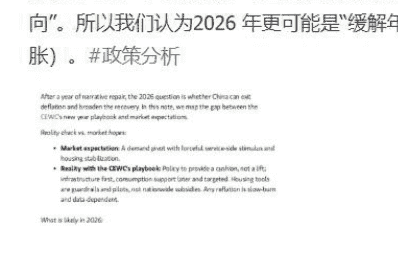

After a year of narrative repair, the 2026 question is whether China can exit deflation and broaden the recovery. In this note, we map the gap between the Citi's new year playbook and market expectations.

Reality check vs. market hopes:
- Market expectation: A demand pivot with forceful service-side stimulus and housing stabilization.
- Reality with Citi's playbook: Policy to provide a cushion, not a lift; infrastructure first, consumption support later and targeted. Housing tools are guardrails and pilots, not nationwide subsidies. Any reflation is slow-burn and data-dependent.

What is likely in 2026:
- Growth anchor: Real GDP target of ~5% stays to steady market expectations.
- No binding CPI target: “Reasonable” price recovery is desired, but it would not be chased at all costs.
- Fiscal stance: The initial headline package (to be announced at NPC March) will likely stay roughly flat as 2025 but front-loaded. Early issuance of special treasuries and LTS back to infrastructure, with focus on urban renewal, green transition, and AI+ projects. Scope for a small mid-year top-up if growth softens.
- Public capex cadence brought front to stabilize investment. This relies on early issuance of local government debt swaps and infrastructure bonds pre-NPC approval.
- Consumer goods trade-in to continue but get further optimized, likely funded by long-term treasuries. Subsidy size will likely stay at ~Rmb300bn, with broader category coverage.

(continued in the next section)

# Jason-不离
2025-12-19 04:05

数据：调查显示投资者认为“人工智能/技术泡沫”是2026年市场稳定的最大风险，第二位是新美联储激进暂停。

If any, of the following do you think the biggest risks to market come in order:

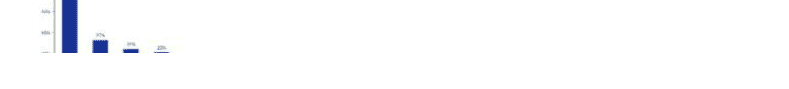

If any, of the following do you think the biggest risks to market stability in 2026?

| 57% | | 27% | 22% | 21% | | 13% | 12% | 10% | 10% | 9% |
|---|---|---|---|---|---|---|---|---|---|---|
| Tech valuations pushes for plunge / AI enthusiasm waves | Fear the adjustment against market turmoil | Crisis in private capital | Yield rises more than expected | Central banks take unprecedented inflation is sticky | All causes a noticeable slowdown | IMF debt sustainability questioned | Bank of Japan hike rates / carry trade unwinds | Turnmoil in crypto-assets | A US trust landing |

Source: Citi Research, CPCA

# CHART 1

## A century of gold inflation, crises, and policy shifts, and its

Gold has tracked inflation, crises, and policy shifts, and its 2025 jump marks the strongest rise in decades.

- Nominal gold price ($/roy ounce)
- Adjusted for inflation

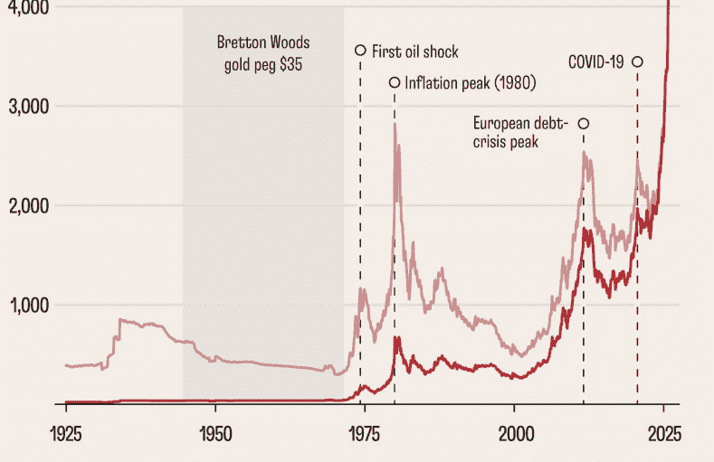

SOURCES: Timothy Green (via World Gold Council); IMF; US Bureau of Labor Statistics/Federal Reserve Economic Data; and World Bank.

# F&D

Jason/不跑
2025-12-19 04:12

Brad Setser: 希望这篇文章能被欧美财经部、发行广泛阅读，明年需要推动人民币汇率，以降低低出口冲击本土低位的影响。#政策分析

> The U.S. Must Put Pressure on China
Let the Yuan Strengthen

# The U.S. Must Put Pressure on China
### To Let the Yuan Strengthen

Europe has borne the brunt of China's ever-widening trade surplus. The U.S. should join in efforts to respond.

BY BRAD SETSER · DECEMBER 14, 2023

Jason-不能
2025-12-19 04:24

bloomberg: 根据德国周发布的一份声明，德国明年将联邦债务发行增加20%到创记录以来的512亿欧元，发布后，十年期收益率上升了近50个基点。德国政府有能力增加债务，因为债务占GDP的比例仍低于10%，是G7达发达经济中最低的。#其他国家经济

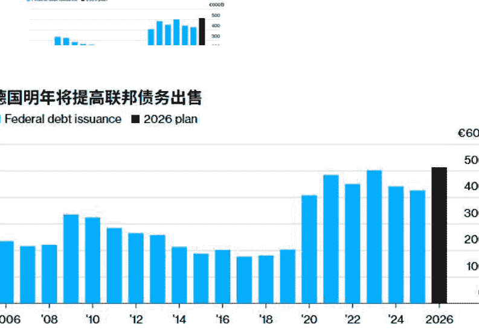

# 德国明年将提高联邦债务出售

- Federal debt issuance 2026 plan

来源：德国金融局

深度视野VIP群 人工追踪50+大V 付费进群加微信cuk255 微信chp5568

Jason不遇
14:29
bloomberg: 中国一直在发行长期债券，目前10Y以上的债券比例占了总量的31%，为十年来最高水平，较2018年11.6%上升不少。这推高了长期债券的利率，本月该国30年期收益率上高10个点，至2.28%，接近近期高点。澳新银行认为长债流动风险可能会在2026年进一步加剧——由于市场风险导向（长期风险），财政部可能需要发行债来维持财政扩张。#金融

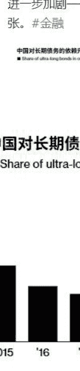

# 中国对长期债务的依赖升至十年新高
- Share of ultra-long bonds in outstanding government debt

| 2015 | '16 | '17 | '18 | '19 | '20 | '21 | '22 | '23 | '24 | 2025 |
|---|---|---|---|---|---|---|---|---|---|---|---|

来源：彭博社
注：2025年数据截至12月17日。

Jason不遇
14:28

瑞瑞：新西兰NZX50指数今年以来（YTD）上涨2%，低于2025年（CY25）14,300目标约6%。作为OECD国家中表现最差的指数之一，并且对MSCI全球指数（All World）追踪18%。展望2026年，我们认为市场层面的总回报约+12%。我们的12个月NZX50预测回撤与美国市场（不含分）大体相当，高于澳大利亚市场。股市

深度视野VIP群 人工追踪50+大V 付费进群加微信cuk255 微信chp5568

# Figure 1: NZX50 outlook for 2026
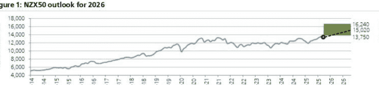
Source: Bloomberg, UBS Research

# Figure 2: Performance of developed markets YTD
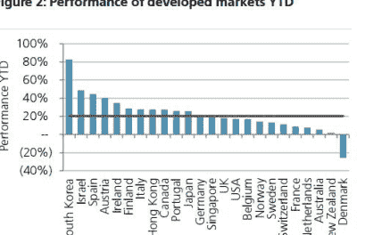
Source: Bloomberg, UBS Research

# Figure 3: NZX50 split by large (top 10) and small (bottom 40) over CY25
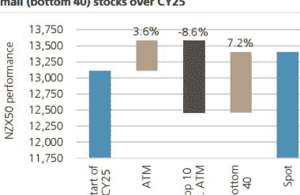
Source: Bloomberg, UBS Research

Jason-不跑
2025-12-19 04:43
2025年以来美国加息，美日利率缩小至3年来最低水平，但日元汇率仍维持在155元附近。为什么在外汇市场上，“利差缩小”日元升值的逻辑失效了？其背后是日本深层结构因素，日本的贸易赤字收缩至2024年，2025年至10月也出现万亿日字。有观点指出，由于日本新的免税制度（NISA）的规定，海外投资持有的资金流入每月平均为690亿日元，比之前的3800亿扩大。每年有8亿日元被卖出。#其他国家经济

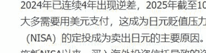

# 日美利率缩小，但日元持续贬值
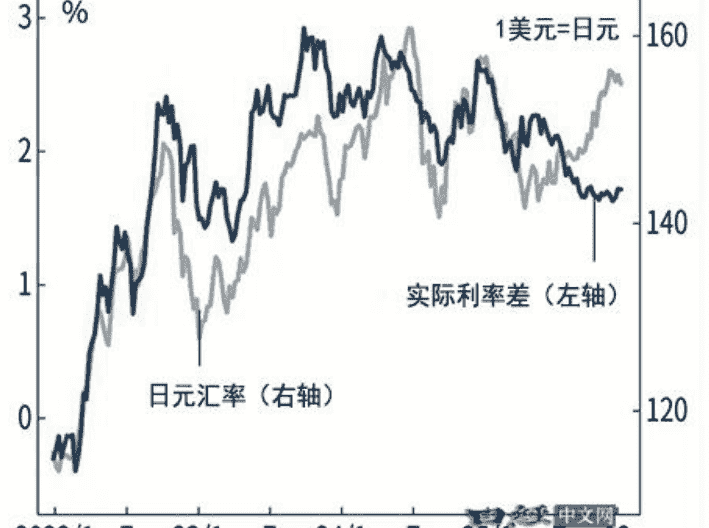
（注）实际利率差为“长期利率”的日美比较

# 日本的旅游顺差弥补数字赤字
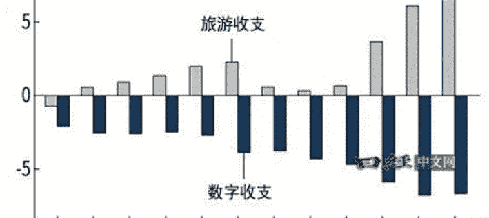
（注）旅游收支为海外游客和旅游的合计。数字收支包括著作权、计算机、信息服务以及专门咨询服务的合计。2025年截至10月的数据换算为（数据来源）日本财务省、日本银行

深度视野VIP群 人工追踪50+大V 付费进群加微信cuk255 微信chp5568

Jason不驰
2025-12-19 04:47
FT: 上周，欧盟同意在可见的未来，继续冻结价值210亿欧元的俄罗斯资产，作为未来两年帮助基金的一部分。俄罗斯警告，如果他们使用主权资产帮助乌克兰，俄将提供90亿欧元贷款；俄将采取“最后手段”的回击——查封俄罗斯境内剩余的西方资产。根据基基经济学院研究院的研究，截至2024年，俄罗斯公司资产上至少为1270亿美元。克里林表示这些公司被要求“交出投资的所有权”。#其他国家经济

# Five countries dominate western companies' assets in Russia
Assets in Russia ($bn)

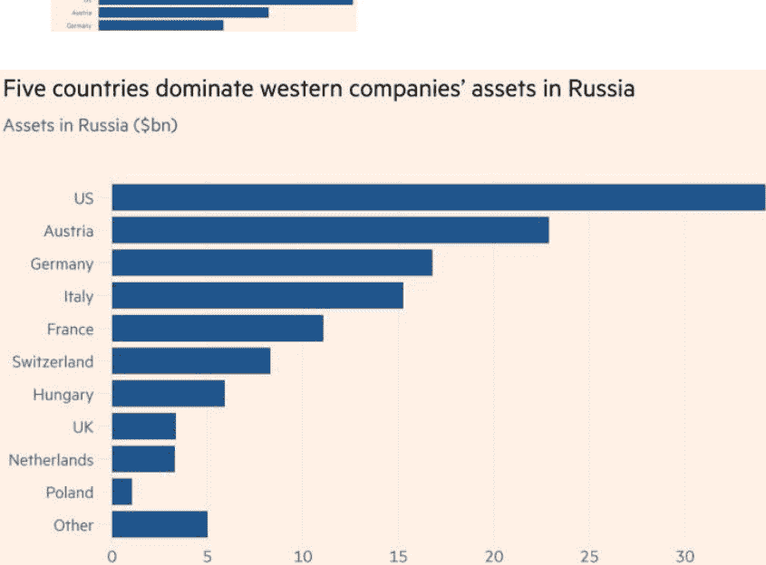
Source: Kyiv School of Economics Statistics

Jason不驰
2025-12-19 04:54
bloomberg: 美国11月CPI通胀放缓，核心CPI同比增长2.6%，创四年来最低速度。数据有利于美联储维持降息，CPI可能反弹，美债收益率和美元指数走软。不过经济学家指出，由于政府关门，劳统计局无法完全收集价格，这可能扭曲了数据，并对11月的数据造成了显著的压力。#其他国家经济

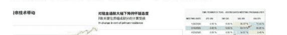

# CPI意外后股市技术性带动
- S&P 500

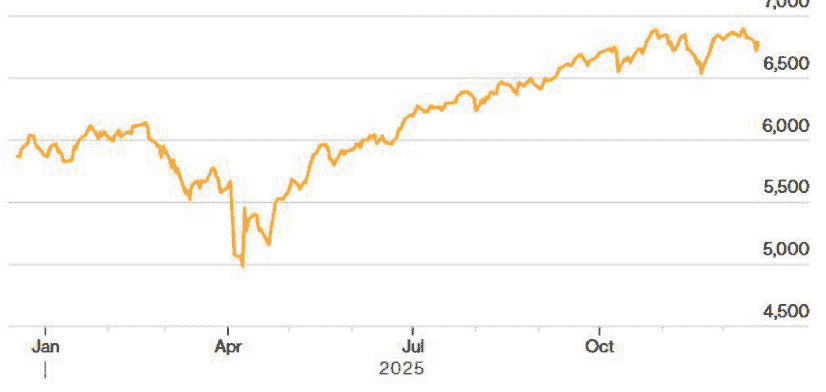
来源：彭博社

# 经济学家对租金胀大幅下降持怀疑态度
政府关门导致关键住房组成部分的计算受损
- Two-month change in rent of of primary residence

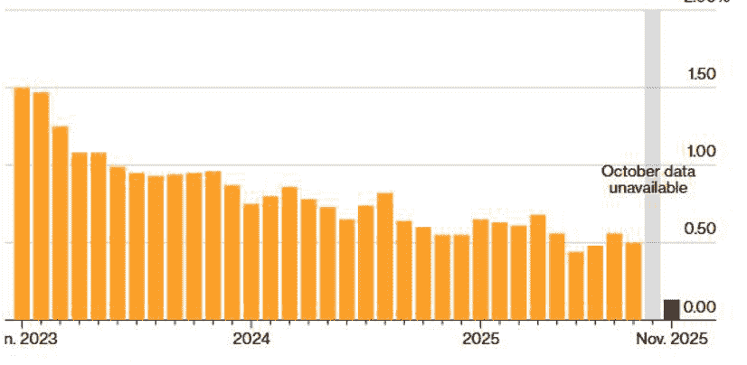
来源：劳动统计局，彭博社
注：由于联储政府关门，10月份的CPI被取消

# CME WATCH TOOL - AGGREGATED PROBABILITIES

| MEETING DATE | 275-300 | 300-325 | 325-350 | 350-375 |
|---|---|---|---|---|
| 1/28/2026 | 0.00% | 0.00% | 26.57% | 73.43% |
| 3/18/2026 | 0.00% | 0.00% | 69.74% | 30.26% |
| 4/29/2026 | 0.00% | 0.00% | 94.57% | 5.43% |
| 6/17/2026 | 0.00% | 50.50% | 49.50% | 0.00% |
| 7/29/2026 | 0.00% | 82.57% | 17.43% | 0.00% |
| 9/16/2026 | 17.07% | 82.93% | 0.00% | 0.00% |
| 10/28/2026 | 32.57% | 67.43% | 0.00% | 0.00% |
| 12/9/2026 | 48.72% | 51.28% | 0.00% | 0.00% |
| 1/27/2027 | 47.57% | 52.43% | 0.00% | 0.00% |
| 3/17/2027 | 52.00% | 48.00% | 0.00% | 0.00% |
| 4/28/2027 | 45.57% | 54.43% | 0.00% | 0.00% |
| 6/9/2027 | 42.36% | 57.64% | 0.00% | 0.00% |
| 7/28/2027 | 75.57% | 24.43% | 0.00% | 0.00% |
| 9/15/2027 | 34.46% | 65.24% | 0.00% | 0.00% |
| 10/27/2027 | 25.57% | 74.43% | 0.00% | 0.00% |
| 12/8/2027 | 37.70% | 62.30% | 0.00% | 0.00% |

Jason不离
2025-12-19 04:58
FT: 老师会给家长布置作业，为什么这几年成为一个奇葩现象？这其实是个财政问题

# TAX

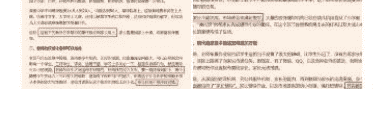

这就意味着，一个老师在35分钟内教45个学生，全班孩子过一课的内容，只需赶20分钟，下15分钟，每个学生平均只有20秒。而在先进的教学模式下，小学教了英语，还有各种兴趣，体育锻炼、谈的，教学就可以进一步推进。

中国中学班级规模为15人到20人，中国还有50人，这就意味着老师在课堂上可以，高中生、大学生还可以照顾学生的作业，达到这样有效的教学，但给学生带来的无疑是教学压力了。

显然，这种教学压力的首源应该交到家长身上，老师需要回学校上作业，或者请家长外辅

# 老师的权威可以由我们建立

老师可以在学校里控制，调动有形的、无形的资源，自由选择空间大，可以在规则之内对一个学生，好学生、培养、选课、学习上多关心，在高中，很多学生的生活生涯。老师与学生之间可以是不对等的，压力的权力关系，要一直坚持到高中，随着学生在体力上与内心的成长，保护了孩子自己的能力，这个社会更加依赖于孩子的能力与性格，老师才能从教育的地上活去。

如果老师开始闹情绪，为了自己的工作找借口，就成为立权威，就有各种方法，通过这种方式向家长施加压力——不仅是为了传递信息，而是传递压力。于是，家长的作业，就像我们倒挂上来，只有一条路——天输。

老师的未来，可以让这成为可能

正好，我们小学学校的家长大可以上课，为了缓解这种压力，家长本身“哄娃”的愿望，也许可以让孩子在幼儿园就开始拼读、识字、数学、英语的学习。我听到的是，一个班45个学生只有在幼儿园过拼读。短的时间，量减少，效率发生了改变。

# 现代技术使得更加方便

以前，校外机构让学生自己要了很大门槛。现在，有了微信、QQ以及各种软件工具，老师也可以方便他们直接布置作业。由于常规机制，到位质量，再找到家长的沟通渠道，多个方向都指向了“利差”。市场对于小学，竞争激烈时，往往出现的局面。其都是公共服务的出现点。经济增长，而且配合能够维持在思想领域，表现外溢，打破了公共教育防线，对于家长是有必要的，即便功能，但是要求自身的素质，更何况。支出不足，最终会导致效率与双重损失。

Jason不睡
2023-12-06
robin brooks: 表面看似稳定，但具有误导性。看起来困难在于下跌，这抵消了美元对许多货币的贬值。把美元出来，就会下跌。

# Exhibit 24: Returns More Constrained Equities Outside Other Asset Classes Diversification

| Percent | 12 Month Total Returns: GS Forecasts | Percent |
|---|---|---|
| 16 | | Local currency | 16 |
| 14 | | USD USD 14 |
| 12 | | 12 |
| 10 | | 10 |
| 8 | | 8 |
| 6 | | 6 |
| 4 | | 4 |
| 2 | | 2 |
| -2 | | -2 |

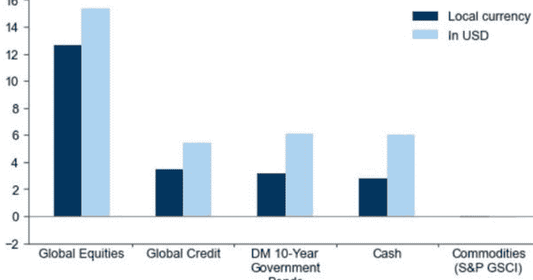
Source: Bloomberg, Datastream, Bloomberg-Barclays, ICE-BAML, iBox, Goldman Sachs Global Investment Research

# Exhibit 12: US Core PCE Inflation Should Slow Sharply in 2024h Because of Tariff-Related Base Effects

| Percentage points | Tariff Effects on Monthly Core PCE Inflation | Percentage points | US Year-Over-Year Core PCE Inflation | Percent |
|---|---|---|---|
| 0.16 | | | 4.0 |
| 0.14 | +0.5pp as September | | --- Forecast | 4.0 |
| 0.12 | +0.3pp yet to come | --- Estimate-Tariffs | 3.6 |
| 0.10 | | | --- GS Forecast | 3.2 |
| 0.08 | | | 2.8 |
| 0.06 | | | 2.4 |
| 0.04 | | | 2.0 |
| 0.02 | | | 1.6 |

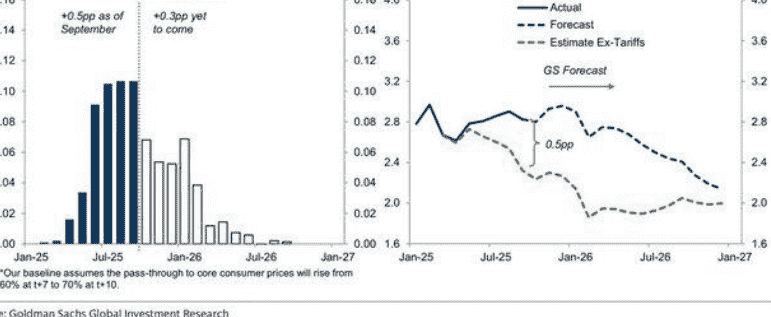

*Our baseline assumes the pass-through to core consumer prices will rise from 65% at t=7 to 70% at t=10.

## Exhibit 1: Global Growth Should Outperform Consensus Again in 2026

| Real GDP Growth: | 2024 | | 2025 | | 2026 | | 2027 | | Annual Average | Q4/Q4 |
| :--- | :--- | :--- | :--- | :--- | :--- | :--- | :--- | :--- | :--- |
| | Actual | GS | Consensus | GS | Consensus | GS | Consensus | GS | |
| US | 2.8 | 2.1 | 2.8 | 2.0 | 2.1 | 2.0 | | 2.5 | |
| Euro Area | 0.8 | 1.5 | 1.4 | 1.3 | 1.1 | 1.0 | 1.3 | 1.4 | 1.4 |
| Germany | -0.5 | 0.3 | 0.3 | 1.1 | 1.2 | 0.9 | 0.9 | 1.4 | 1.1 | 0.9 |
| France | 1.1 | 0.9 | 0.6 | 0.7 | 0.7 | 0.9 | 0.9 | 1.1 | 1.0 |
| Italy | 0.5 | 0.6 | 0.4 | 0.7 | 0.8 | 0.8 | 2.0 | 2.0 | | |
| Spain | 2.5 | 2.2 | 2.2 | 2.4 | 1.8 | 1.8 | 1.0 | | | |
| Japan | | 1.2 | | | | | | | | |
| UK | 1.1 | 1.4 | 1.2 | 0.9 | 1.1 | 1.4 | 1.5 | 1.4 | | |
| Canada | 2.0 | 1.7 | 1.2 | 1.3 | 1.9 | 1.8 | 1.7 | | | |
| Australia | 1.0 | 1.9 | | | | 2.4 | 2.2 | 2.6 | 4.9 | |
| China | 5.0 | 5.0 | 4.9 | 4.8 | 4.5 | 4.7 | 4.3 | 7.0 | | |
| India | 6.7 | 7.6 | 7.5 | 6.7 | 6.5 | 6.4 | 7.0 | | | |
| Brazil | 3.4 | 2.3 | 2.2 | 1.8 | 1.7 | 2.3 | 1.9 | 7.8 | | |
| Russia | 4.3 | 0.5 | 0.8 | 1.2 | 1.0 | 1.7 | 1.4 | 1.7 | | |
| South Korea | 2.0 | 1.1 | 1.0 | 1.9 | 2.0 | 2.3 | 1.8 | 1.5 | | |
| Mexico | 1.4 | 0.3 | 0.5 | 1.3 | 1.3 | 2.1 | 2.0 | 2.0 | | |
| World | 2.8 | | | 2.7 | 2.8 | 2.5 | 2.8 | 2.6 | 2.9 | |

Note: IMF forecast for India 2027 consensus value.

Source: Bloomberg, Goldman Sachs Global Investment

## 深度视野优质文圈，链接优质群，助你成功

全部包含以下内容：限时年费188/年 加微信cuk255

- 1 吃瓜群众倍时文圈加时群群对话（原价365 元/年）
- 2 子明私享亨（会）内部文章
- 3 政事堂（原子明）付费内容再读顺子明群聊
- 4 米联储闲间【作者米糕】（原价599 元/年）
- 5 欧洲金雀会员专属文章（原价328 元/年）
- 6 砖五厂内部圈（原价400 元/年）
- 7 卢克文青读书会专属文章（原价699 元/年）
- 8 鉴茶财经知识星球（原价3310 元/年）
- 9 猫哥的视界知识星球（原价299 元/年）
- 10 财新周【独家新闻】原价1498 元/年）
- 11 杨世光在金钱（原价2200 元/年）
- 12 森森财经知识星球（原价1600 元/年）
- 13 源泽译译付费集（持续更新）
- 14 司马林解读毛选全套音频和全套书籍珍藏版无割（原价 2.3 万）
- 15 虚虚三部曲[民国梦、帝国争亡、不被理解的MAO](原价 599 元）
- 16 卢克文知识星球文章（原价268 元/年）
- 17 额外再送：卢赣元新浪微博获付费专栏、三村边老王、三花九洞文集
