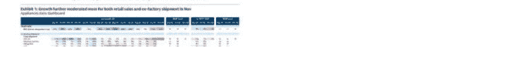
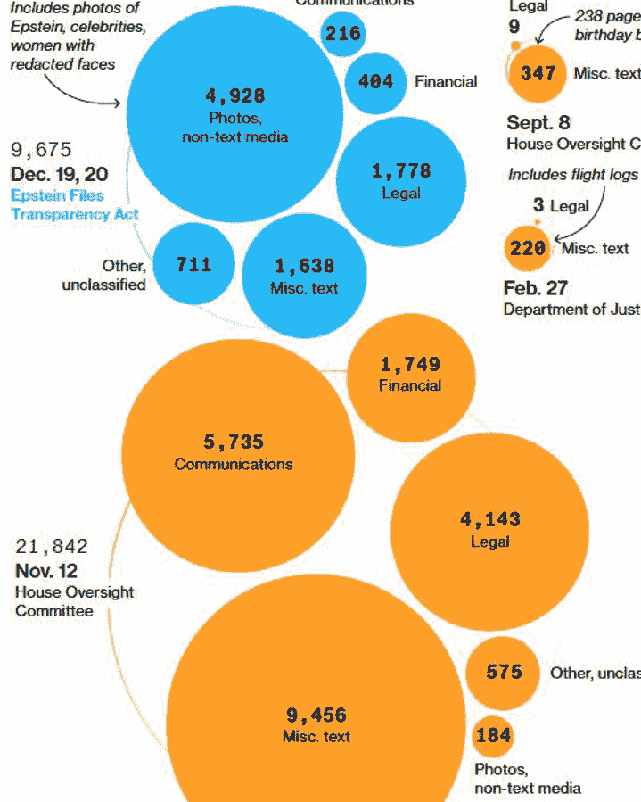
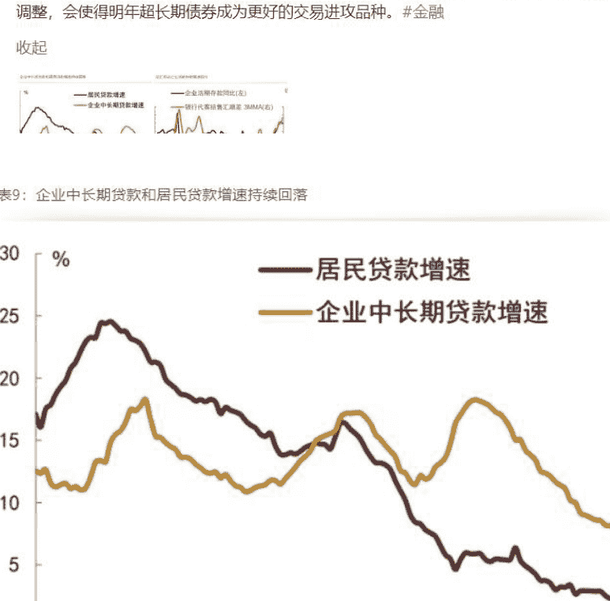
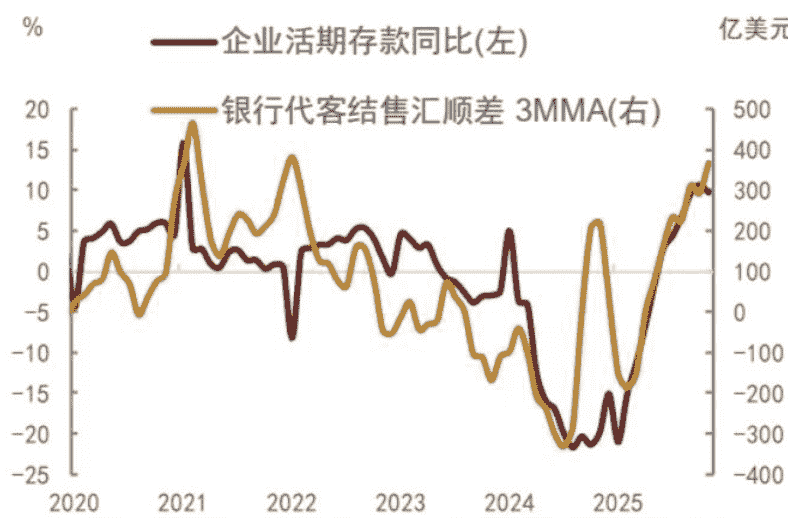
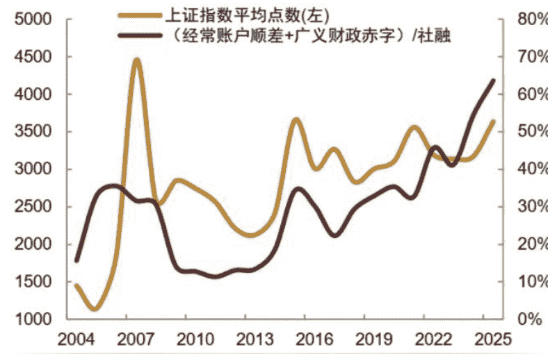
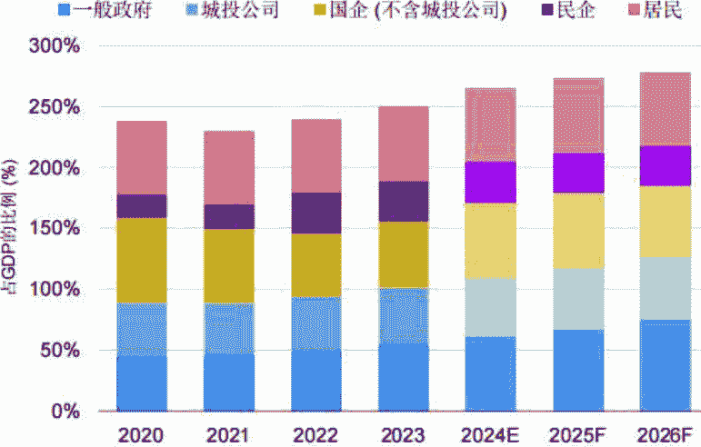
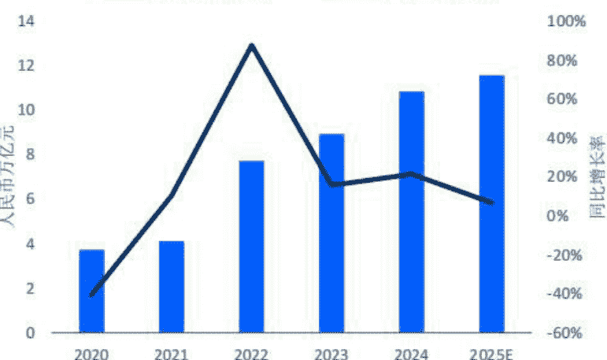

# 南半球聊财经2511221

Jason不遇
2025-12-21 04:11

高嵩：国内电商在11月继续增长，短期仍有压力，政策层面已开始为2026年延续“以旧换新”等策略催增长，空调挂机最明显，出货量下降40%（11月），洗衣机和冰箱则温和化，外卖亮点是清淡，中国品牌维持持价份额中长期效率提升具有吸引力的估值。

Goldman Sachs
China Consumer Durables: Appliance Tracker

Exhibit 1: Growth further moderated by both retail sales and ex-factory shipment in Nov
Appliances data dashboard

by efficiency gains in the medium-to-long-term with attractive valuation.

| | Jan 23 | Feb 23 | Mar 23 | Apr 23 | May 23 | Jun 23 | Jul 23 | Aug 23 | Sep 23 | Oct 23 | Nov 23 | Dec 23 |
|---|---|---|---|---|---|---|---|---|---|---|---|---|
| NBS (above online designed) | 11% | 11% | 11% | 11% | 11% | 11% | 11% | 11% | 11% | 10% | 10% | 10% |
| Refrigerator | 2% | 2% | 2% | 2% | 2% | 2% | 2% | 2% | 2% | 2% | 2% | 2% |
| Air conditioner | 2% | 2% | 2% | 2% | 2% | 2% | 2% | 2% | 2% | 2% | 2% | 2% |
| Washing machine | 3% | 3% | 3% | 3% | 3% | 3% | 3% | 3% | 3% | 3% | 3% | 3% |
| Television | 2% | 2% | 2% | 2% | 2% | 2% | 2% | 2% | 2% | 2% | 2% | 2% |
| Export shipment | 3% | 3% | 3% | 3% | 3% | 3% | 3% | 3% | 3% | 3% | 3% | 3% |
| Washing machine | 3% | 3% | 3% | 3% | 3% | 3% | 3% | 3% | 3% | 3% | 3% | 3% |
| Refrigerator | 2% | 2% | 2% | 2% | 2% | 2% | 2% | 2% | 2% | 2% | 2% | 2% |

Source: AVC, IOI, NBS, Data compiled by Goldman Sachs Global Investment Research

Jason不遇
2025-12-21 04:18

bloomberg：美国司法部发布了关于涉及哈利·盖斯斯坦的文件，该发布内容包括名人和政治人物的照片，如比尔·克兰林和华盛·特朗普，与盖斯斯坦的约翰斯坦·诺瓦茨、马克克斯·韦尔。同时还出现了李查德·弗兰森、兰文·实质·西比和·盖万。未来将更多文件公开，因为材料限制，无法在截止日期日前处理，白宫发言阿比尔·盖斯坦·盖克逊在一份声明中显示：“特朗普政府是历史上最透明的政府。”

## 其他国家经济

深度视野VIP群 人工追踪50+大V 付费进群加微信cuk255 微信chp5568

## 司法部根据《透明法》发布数千份文件按内容分类

来源：彭博新闻
注：彭博对2月27日和9月8日的发布进行了分类，对1月12日和12月19日的发布使用了大型语言模型（LLM）进行了交叉检查，数据可能错误。截至发布日数据包括。

## 通胀抑制的驱动因素是人口结构

Jason不遇
2025-12-21 04:26

RIA：通胀抑制的驱动因素是人口结构的下降。劳动减少、退休人员增加导致生产和消费下降。这意味着随着增长速度较低，社会保障和医疗福利增大，占据了联邦预算中许多份额，会导致通胀增加而引起经济衰退。

Annual growth in working-age population (18-64) and contributions from aging, migration.

Note: Projections are based on the low immigration scenario from Census Bureau 2023.
Sources: Census Bureau; Federal Institute

## 经济观察：土地财政后遗症

Jason不遇
2025-12-21 04:52

## 重视解决地方财政困难

12月中，刚结束的中央经济工作会议报告“重视解决地方财政困难”。为了了解地方财政挑战，他提出了几个问题：
- 重视解决地方财政困难意味着什么？
- 为什么在这个时候提出来？
- 应该如何解决这个问题？
- 财政对地方财政起到保障作用，中间发生了哪些变化？

这次，他还想办法针对土地市场进入持续后，需要地方企业引入增大分母。地方政府是其中最为活跃的话题，通过整合政策，地方政府为各产业提供必要的支持，同时帮助增长。由于支出压力不断增加，收入亟待改革，部分地方财政灵活性不足甚至短缺，财政收入有限性与刚性支出无限性之间的冲突十分突出，尤其是地方财政状况不理想，事实上是不容忽视的常态现象。在区域上，中等地区屡现困难，西部有转移支付，东部有产业基础，一些地区或辽宁等东部的区域面临巨大挑战。

2025年12月召开的中央经济工作会议再次提出“重视解决地方财政困难”，将这一问题放在聚光灯下。多位研究者认为，这也意味着这一问题是系统性解决的开始，解决问题可能有应急色彩，深入中央和地方财政事项调整。

王振认为，“重视解决”地方财政困难，将成为2026年中央和地方工作的一项内容。应该将“地方财政困难”作为中央和地方的“共同财政事宜”来看，这也是长期以来基层治理中地方财政安全运行的重要举措。

上述县财政预算列出了一笔：2023年税收入27亿元，2025年减至23亿元，维持如下增长趋势。支出方面，民生保障却在2023年至2025年间增长3亿元，其中育儿补贴增加，养老标准每月均涨至20元，仅此一项，年增费万元。

据局长计，当地每月收入在1亿至2亿元之间，每月仅“三保”支出就需要4亿元。此外，我国债务压力巨大，地方财政还要承担还债压力。

该局长对经济形势表示，当前“三保”（保民生、工资、运输）是最大的困难，但是又是必须要保障，是绝对的底线。主要的困难就是财政收入无法覆盖支出，也叫做“三个包袱”。

中部某财政部门人士表示，当前地方财政的压力已从“三保”过渡到“五保”。保民生、保工资、保运输，现在还要“保住房”和“保清洁”。近期，由于新增要求齐次，这种压力已经迫近至全面升级。

当地财政的基本工作就是保民生。上述，中部某财政部门人士说，当地财政的增长和支出的剪刀差越来越大，债务的还付压力增大——地方政府还债成为一个考核指标。但经济下行的压力和土地市场的低迷，导致税收和土地收入下降。特别是土地收入下降，政府在短期内难以实现调整弥补缺口。

当地人士强调，增长与剪刀差问题是最突出的。随着老龄化加剧，财政还将面临更大的压力。南认为，由于区域经济基础、产业结构的不同，我国不同地区的财政状况显得差异明显。南方沿海省份如北京、上海、江苏、广东等地给率高达65%，当前面临的是转型升级中的阶段。相比之下，西部及部分地区基础设施较为弱，传统工业依赖程度较高，税基小，这使得地方财政自给能力不足。

地方财政收入包括税收、非税收、土地收入、企业融资和债券收入。他解释，税收受经济环境影响较大，非税收受限于县级资源调度，执行非常普遍。

数据显示，2021年11月，土地使用权收入为29亿元，同比增长10.7%，相比去年同期收入增长67亿元，两者相差8亿元。短时间内，能够带来增长，这也是地方政府为了开发资金还要支付利息和融资成本，对当地正常运转至关重要。

2019年开始，财政建立了地方债务风险识别办法，按照债务情况进行评估，由高到低设置为红、橙、黄、绿色四个等级，动态监管，半年通报一次。他说，这是目前地方财政面临的棘手问题：地方政府为了新增资金，不断借取债券，导致债务压力。调研发现，大部分县债务增长都是从2017年开始的，地方政府通过各种渠道增加债务，反过来增加了息支出。

2024年缓解债务压力的政策已经取得了效果。从财政数据来看，债务负担有望下降趋势。2024年11月，债务支出为12189亿元，同比增长3.9%，较2023全年8.8%、2023全年4.2%的增速有所放缓，但每年付息的量绝对仍在增加。截至2024年9月，全国地方政府债务余额为36995亿元。

2021年，财政部长在《中国的财政政策与发展》文中提到，债务支出占一般预算支出比例上升，增速于还款总额增速。2017、2018和2019年债务支出占当年债务总额超过10%和4.5个百分点。2020年11月，债务付息占比同比增长16.6%，债务支出占地方债务15.4个百分点，新增地方财政占中央政府收支比例为13%。2020年以来，许多地方政府的债务持续性趋于稳定。约1/4的政府财政占50%以上的收入用于还地方债务，不仅影响了地方政府公共服务的供给性，还加剧了财政金融风险。

近期经济数据显示，当前地方政府债务还面临结构性压力长期，主要问题体现在以下几个方面：一是收入持续性，地方财政土地出让收入较2021年高峰值下降45%；减税降费改革基本固化地方财政收入来源，处置资产具有很强的依赖性导致收入占比上升，加剧了收入的不稳定性；二是支出刚性维度持续扩大。在收入增长的同时，三保支出、刚性付息支出持续增长，支出结构空间压力增大。截至2025年11月，全国地方政府债务余额54.35万亿元，存款还本付息压力加大，部分地区的债务风险尚未完全缓解，进一步挤占了地方财政空间。

另一方面，地方政府在这些问题中并非无为。上述某些市的财政人士认为，财政支出不下，一个重要的原因在于地方政府领导的绩效存在偏差，而在“债务观”背后的无奈是地方政府未来在社会经济发展中扮演什么角色，地方政府的提升如何实现？

Jason
2023-12-21 02:41:56

申义宏源：浅浅观察，徐敬敏好事者，其对现状非常冷离。经济数据显示。

“宏观微差”是近年来关注的热门话题。在2022年之前少被提及，自2022年起由于宏观指标超预期，而微观层面却出现偏离。2023年后，这种特质转变为“上半年（宏观强、微观弱），下半年宏观微差得到了反转。其实本身，企业的体感与盈利挂钩，而居民体感与收入挂钩。我们在讨论政策建议时，从宏观角度切入，是否转换视角，从微观角度出发，论述时忽视了。宏观微差的本质在于循环失效。这一问题并非突发，根源自2018年起，经历了两个阶段的转变：内卷式倾向对于保住住房和加大投入。这种理性的选择最终导致了群体的经济增长，但利润率下降。数据显示，利润率自2021年后处于历史低位，在此基础上能够继续升。经济循环的关键在于行业循环，收回于居民收入。只有通过经济循环，才能进入良性循环状态。执行中，由于利率跌破临界点，经济循环极易引发复性循环，例如，“企业越困难越困难”困境。信任的难度倍增。此时，恢复企业盈利能力、提高居民收入水平。

Jason
2025-12-21 05:00

中金：我们认为未来2到3个月，意味着一年左右，理由：首选今年第四季度以来经济数据进一步走弱，显示国内需求依然承接，叠加债券逐渐回落，价格未得到提振都会导致市场信心与预期出现偏差。我们可能在一个季度内维持财政政策，通过货币政策维持利率基准；其次，近期人民币对美元汇率倒挂接近0.70，在一定程度上意味着货币政策宽松共识和动力；第三，对于利率收益而言，明年通常是一个新周期的开始，在年初的配置和参与债券交易，一方面可以获得信息增益，另一方面交易机会再次增大。相比之下年末接近时点，容量空间较小，我们也认为明年初的债券活跃度提升以及参与市场的概率较高。整体来看，我们认为年初的配置调整提供了2026年更好的交易和配置机会，尤其是长期债券的。

图9：中长期贷款和居民贷款增速回落
数据来源：Wind，中金研究部
注：数据截至2025年11月

## 图表10：结汇带动企业活跃期增速回升

%亿美元 —— 银行代客结汇顺差3MMA(右)

来源：Wind，中金研究部
注：数据截至2025年11月

## 图表15：实体经济资本回报与股市表现

80% 上证指数平均点数(左) —— (正常账户顺差+广义财政赤字)/社融

来源：Wind，中金研究部
注：数据为2025年6月收值

深度视野VIP群 人工追踪50+大V 付费进群加微信cuk255 微信chp5568

## 图表17：近年来政府债券新增限额

| 财政预算赤字 | 新增专项地方债限额 | 特别国债 | 地方债结存限额 | 化债限额 |
|---|---|---|---|---|
| 16 | | | | |
| 14 | | | | |
| 12 | | | | |
| 8 | | | | |

来源：Wind，中金研究部
注：数据截至2025年11月

## 12个月基础投资超配观点

- 全球股票、黄金
- 亚洲（除日本）股票
- 新兴市场美元债、本债

## 机会型投资观点 - 股票

- 全球金矿股
- 美国科技股、制药股、公用股
- 印度中型股*、中国非金融企业指数、恒生科技指数*
- 欧洲银行*

## 超配股票行业

- 美国：科技、健康护理、公用
- 欧洲：健康护理、工业、科技、金融
- 中国：科技、健康护理、通信

## 机会型投资观点 - 债券

- 美国国库通债券、短期高收益债、AAA级贷款抵押证券*
- 亚洲投资级
- 欧洲银行或有可转换债*

> *新的机会投资观点
> 更多见第6页附

Jason 不满意 2025-12-21 05:17

通过：过去十年，中国的直接政府债务稳步上升，或有负债管理有所改善，且自2024年以来城债债务增速已显著放缓至慢个位数，但在多年高负债累积后，总体或有负债负担仍然高。

深度视野VIP群 人工追踪50+大V 付费进群加微信cuk255 微信chap5568

## 随着债务置换计划中或有负债化，负债负担正在加重杠杆率

一般政府债务包含中央和地方政府的所有债务。资料来源：财政部、国际货币基金组织、国际金融研究所、国家金融与发展实验室、移迪评估

## 地方政府资金缺口

资料来源：财政部、移迪评估

深度视野VIP群 人工追踪50+大V 付费进群加微信cuk255 微信chap5568

## Jason不跑

2025-12-21 08:35

## 星球问答

1. 感谢你的“信任和支持”，我也非常感谢关注并选择我们，能够和大家一起成长、进步，未来的建议对我来说非常有帮助，希望大家多保持交流，敞开想法，多积极地尝试。
2. 针对你描述的情况，我的建议是：首先不要太焦虑，要给自己一点时间，多去尝试不同的领域。即使真的失败了，也不要放弃，保持良好的心态非常重要。希望这些建议对你有所帮助，找到适合自己的道路。（如果你还有其他的问题，可以随时留言提问）。

Hello, Jason!我关注星球也两年多了，今天冒昧提一个我最近一年多来困扰我的问题。我本人今年已经40出头了，大学毕业以来先在国内某建筑企业呆了3年，然后又在私人造价咨询公司里干了十多年，一直从事安装专业的造价业务。现在建筑行业整体不景气，我们公司的业务也不大如意，已经裁员过一次，虽本人没有被裁，但是收入腰斩。现在定居在上海，感觉继续在这个行业混下去也看不到希望，想转型却不知道从何去，每天浑噩噩过得太累了。本人大学本科科学的是计算机科学与技术专业，后面自己行的。烦请Jason百忙之中抽空指迷，感谢！

深度视野VIP群 人工追踪50+大V 付费进群加微信cuk255 微信chap5568

hello，周末好。

1. 这两个机构都喜欢“新经济”、“老经济”来指代不同的行业位置。一般“老经济”对应的行业下行期（规模收缩），对于行业内的员工来说特别不容易。我理解你所说的“深渊”，但我觉得并非如此，而且我们描述的是一种状态，用什么词汇和语气也相当关键，并没有被收割。
2. 我以前以前碎过这个问题：我的价值是什么？比如我一年能赚多少钱（风险定价后），公司再从中给我多少钱？如果我没有平台，自己又能赚多少钱？这个价值的过程会量化自己变成一种商品，商品的价格既被市场的供求影响，也被它独有的属性影响。（进而不能决定市场，但我决定自己的附加值）。所以我保持学习，形成正反馈，我的时间有限，把有限的时间用在哪个地方，摸清自己能承受的场景（悲观场景、中性场景、乐观场景）。然后保持敏锐的观察，等待属于自己的机会。
3. 我身边有很多人到中年，因为兴趣，也有过连续创业者，我都挺服他们的勇气。但光靠勇气不行，必须像风投那样逻辑，普通人最稳的方式还是骑马，找一个稳定回报的方向。
- 1)朋友A，主业可不去，学了建模，现在在圈内有名气
- 2)朋友B，失业几年，认准了，多次去谈了一个小品牌（实际也是假的）
- 3)朋友C，听说在俄罗斯赚钱被动收入（一年十万刀）。他主业在独角兽例子——

深度视野VIP群 人工追踪50+大V 付费进群加微信cuk255 微信chap556d

4. 他们似乎都是敏锐的发现了某点，为了自己的回报铺路。或者是找到自己主业里面一个小点。当然，我始终认为，人生最重要的还是和自己和解——允许自己以自己的方式过一生。这需要一个强大的内核——你能定义成功，而忽视别人怎么想被别人定价的人生，就像气球，有时膨胀、有时干瘪，也就这么回事。

Jason | 南聊财经

## 深度视野优质圈，链接优质群，助你成功全部包含以下内容：限时年费188/年 加微信cuk255

1. 吃瓜群众付费圈加群对话（原价 365 元/年）
2. 子明私享会内部文章（原价 568 元/年）
3. 政事堂（原子）付费内容再送群聊
4. 米联储闲【作者米糕】（原价 599 元/年）
5. 欧洲金雀会员专属文章（原价 328 元/年）
6. 砖五厂内部圈（原价 400 元/年）
7. 卢克文读书会专属文章（原价 699 元/年）
8. 鉴茶财经知识星球（原价 3310 元/年）
9. 猫哥的视界知识星球（原价 299 元/年）
10. 财新周刊【独家新闻】（原价 1498 元/年）
11. 杨世光在钱（原价 2200 元/年）
12. 森森财经知识星球（原价 1600 元/年）
13. 源译付费文章（持续更新）

## 深度视野文集群cuk255

14. 司马林解读毛选全套音频和全套书籍珍藏版无删（原价 2.3 万）
15. 虚虚三部[民国梦、帝国战争、不被理解的MAO]（原价 599 元）
16. 卢克文知识星球文章（原价 268 元/年）
17. 额外再送：卢阡新源涨博付费专栏、三村边老王、三花九汀文集
不定期内容：（更多资源写去了...）

- ① 守夜人司令知识星球、接鸽魔王知识星球、自有知识星球
- ② 创始笔记、达达译文章、创业财富圈、雪花花甲老头等
- ③ A视野、大树乡谈、江初知道、咩没事、上海海家学等付费文集
- ④ 西风付费文章、老端、汪在小时之外、局外人的视野、升值、老体制内等其它一些大V付费文章（每月低于600 元的付费文章）
