# 南半球聊财经251222

Jason不嵩
2025-12-25 10:41

## 七大姑大姨真作了 #TAX

对于现在的年轻人，越焦虑越没有机会，越没有机会越焦虑。这种状态就像是一个死循环，你无法跳出来，越陷越深。这种感觉，真实了，未来真的太可怕了。我们现在的日子，真的没希望了。

3:37

微信 回答 写

## 城城投融融资岗位怎么样?

如孚·4个回答·27个关注

CV-Read +关注 关注

9个人问了这个问题回答

你现在怎么样了呢，我这边刚回来，部门就在叫我过，我之前没干过融资，现在我就没有过借款困难，浅一下就等来了几个月的感受：第一，城城投追求的是市场转型，但是对于人情来说，确实要市场转型就是命题，他们也不够，而且大部分都是准班子，领导的这七大姑大姨可能有一些人是有真材料的，但是肉眼可见的。第二，大家都知道，你没有实力，别人哪会肯钱给你就算你就能融到钱你也不知道也不知道怎么做和如何呢。那回到第一个问题就是市场转型的。第三，地方融资的“当下”，继续融资的对还会开会议，房地产市场，很多人都说政府能允许，但是形势上还是下去的，政府可能在后面二十年会有很多困难，这是世界经济的变化，而融资作为其中的关键环节，在以后定会越来越难，你告诉我融资闲的意义在哪里呢，目前看来还能或许，现在的城投融资都是拆迁坟墓，后面的日子绝对是难过的了。

CV... +关注

深度视野VIP群 人工避坑50+AV 付费进群加微信cuk255 微信 chchp5568

评论 13

Toven 🤡
地方城投融资还需要你去跑业务吗？？不都是跟银行联系，到期直接做转贷还盈利，实体业务都都没有，怎么可能盈利？

09-07 · 江苏 回复

09-04 · 新疆 回复

高山景
这是真在城。城投如果能转型转转早就转型了何必倒现在，未来城投大概率接城市公共服务部门作为运营主体，债务包到壳卖公司慢化进程。

09-02 · 辽宁 回复

CVU-Read
市场化运营的痛点我觉得还是在于源头人为制度，城投的法人主体是国家是个政府，如果责任完全完全落在个人头上的话，话不管像市场化运营肯定会有效果。反正实在在国企挣痛苦的，想干事领导求稳，员工求稳了，好吧，企业已经差差不多完蛋了，我这个也完蛋了。

09-02 · 四川 回复

理性发言，友善互动

## 评论回复

CVU-Read 作者
现在我的融资圈我感觉就是收集点资料，然后岗位里面的人没有人报表这些东西，然后大部分其实都是领导决断，从选择的银行，融资规模，供应链贷款还是流动性贷款，包括银行贷款推进进度都是领导决断，感觉学习不了什么东西😅

09-05 · 四川 回复

CVU-Read 作者
另外融资大部分资料都是一级公司完美的，说是完美其实就是假资料，风险也很大，尽管领导一再强调胆干

09-05 · 四川 回复

here大人都 CVU-Read
这里材料都是自己做，很累

09-08 · 山东 回复

lulu CVU-Read
清算的时候就是背锅侠，东西是你弄的与领导无关。

09-30 · 四川 回复

lulu CVU-Read
资源你说了算不了，就做假资料

09-30 · 四川 回复

林赫 关注 我的 Lulu here大人都 CVU-Read

李龙：从2012年到2025年时间里，我国平均为半年，每次为负具有某些原因。但观察最近三年的出口指数更能说明结果：下降到17.5%，CPI和PPI的降。也就是说，我国在全球范围内保持占比以出口为主。为什么投资出现负增长？我国消费主要有三大原因：一是人口增速慢，工资收入较低；二是收入结构化，低收入群体增大；三是市场处于下行周期，带来居民还贷储蓄压力。进入AI时代，过去是机器替代，现在是人工智能替代，未来的就业压力会增加。我认为引导非常重要，但如何引导非常重要。例如包括投资和消费，需要。中央和地方应该多少用于内扩，其中许多用于消费？当前消费物价上涨最大的原因是需求不足，如果需求不足，就有可能尽力产生高需求。

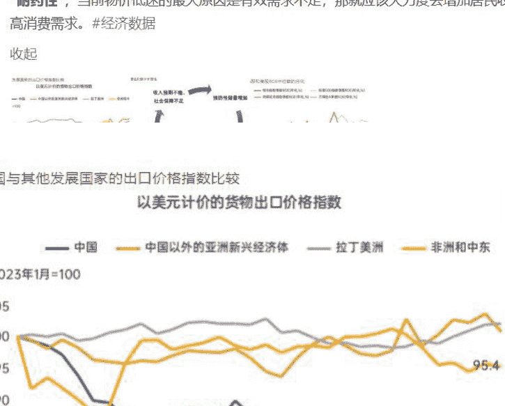

中国与其他国家的出口指数对比深度视野VIP群 人工追踪50+大 付进加微信cuk255 微信chp5566

个体到集体非理性收入预期不稳、社会保障不足、经济增长放缓、国民收入下降、社会总需求减少、投资意愿下降来源：中泰国际2018年以来A股和美股数的分化

— 民生指数ROE(年化%)
— 标普500指数ROE(年化%)
— 纳斯达克综指ROE(年化%)
— 万得全指数ROE(年化%)

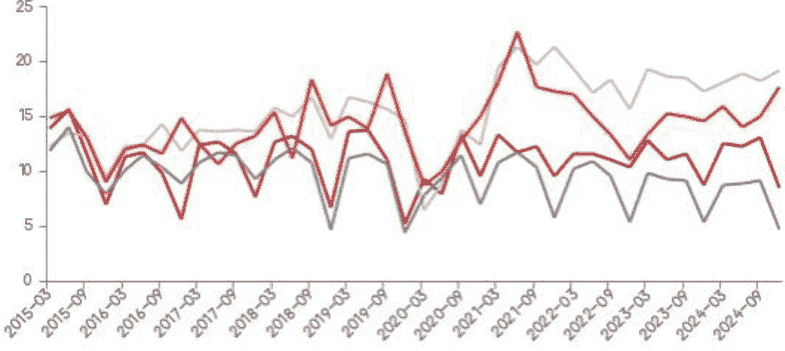

来源：WIND，中泰国际深度视野VIP群 人工追踪50+大 付费进微信cuk255 微信chp568

## Jason 不浪
2025-12-22

受人民币升值的影响，测算10Y人民币债资本驱动率下行2.34%至-0.35%，由资本与金融账户流出积极带动资金回流。11月股市回流向M2的拉动率（人民币结算款+债券TTM/M2系数）环10月继续回至-0.14%。展望后，我们预计回流对国内流动性的补充将持续至明年一季度。首，高景者持有市场维持配置，考虑到年初需求季节性增加，资金将回流银行提供了良好的支撑。其次，随着美联储转向鸽息驱动美元走弱，人民币有望维持强势，套利交易回报有望持续回落，支撑资金回流至明年Q1。

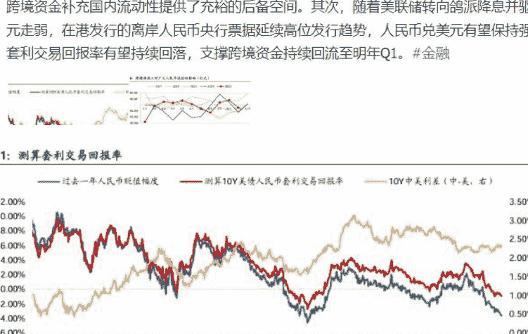

数据来源：同源iFinD，广发发行中心

## 图16：净流入对人民币流动性的影响（亿元）

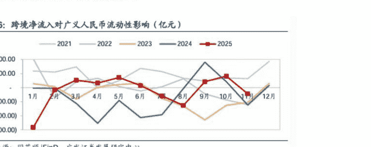

数据来源：同源iFinD，广发发行中心

## 图17：人民币跨境需求影响（亿元）

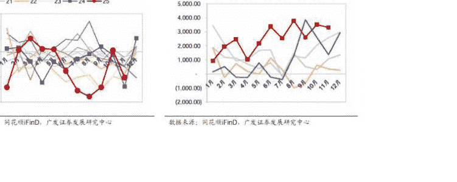

数据来源：同源iFinD，广发发行中心

## Jason-Chaos
2025-12-22

IMF: 原始数据显示美元在第二季度末的全球配置份额从第一季度末的57.79%下降至56.32%，下降了1.47个百分点。然而大部分由于估值变化，如果保持汇率不变，其份额有所下降至57.67%。

## Exchange rate valuations explain almost all the change in the US dollar's reserve share

Change in currency shares, Q2 vs Q1 2025, percentage points

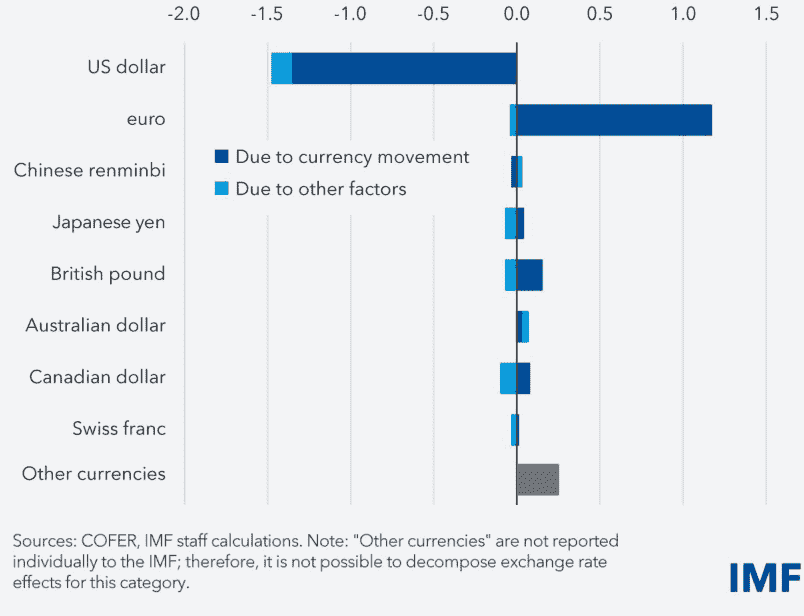

Sources: IMF calculations. Note: "Other currencies" are not reported individually by IMF; therefore possible to decompose exchange rate effects.

## Jason 不
2025-12-22

回到AI话。2025是关键节点：它不是美股打破几年牛震荡，开启趋势性的起点，也是市场全球增长率发生转折点。

## 两路径与时代

### 生产力、生产关系与制度

- 需求
- 需求
- 需求
- 需求
- 需求
- 需求
- 需求
- 需求
- 需求
- 需求
- 需求
- 需求
- 需求
- 需求
- 需求
- 需求
- 需求
- 需求
- 需求
- 需求
- 需求
- 需求
- 需求
- 需求
- 需求
- 需求
- 需求
- 需求
- 需求
- 需求

所有技术路径组合

这是风险投资的核心逻辑：投100个项目，死90个，活10个就是成功。此策略在产业早期估值扩张阶段非常有效，能够享受红利。但当产业进入成熟期，市场必然去伪：资金从90个项目逐一集中到10个真正出来的赢家。此时旧分散投资，回报必然落后。

2022年的市场估值，正是一次“去伪”过程。英达跌了70%，比特币从8万跌至2万，所有估值资产经历调整。这一调整的核心，是产业交付答卷：例如英达，必须证明自己不是游戏关卡，是AI能力的提供商。而年底，2023年初ChatGPT的出现，标志市场从众多技术路径中，明确了少数能通的赢家。英达后期给出了答案，确立了AI的核心——“梦想先修路，修路先买铲”，英达的铲子成了确定性的胜利。

过去几年，万亿美元的AI游戏已落地，算力、数据等高速公路已成基础，但企业级应用——“智能”尚未规模化。目前的ChatGPT、原生文本、图片等只是表层应用，能不能驱动产业变革的核心业务市场的等待，本质是在等一个答案：这些AI基建，究竟是能够拉动增长的资产，还是无法产生回报的债务？答案将决定全产业的未来走向。

从利率曲线来看，也能看到联储的“预防性操作”：结果往往闭环，美国国债三个月减十年期的利差倒挂，每次调整都对股市波动产生影响。这背后是联储通过缩短流动性调节，避免系统性风险扩散，为应用落地争取时间。这种操作是双刃剑，好处是延缓市场崩盘，坏处是让价值变得昂贵。到了今年年底、年初，这个问题已经挡不住了。

> 明年将是从AI生产力产生关系传递的证否年。

特拉斯就是这个证明过程的关键节点。就像2022年的英伟达需要证明自己是算力提供商而非显卡公司，特拉斯明年需要证明：它到底是一家汽车公司，还是一个重塑AI平台？答案不同。

# 俄罗斯与乌克兰

俄博：俄罗斯与乌克兰的关系是否修复？这是笔者首先从俄罗斯媒体报道的。战争结束后，俄罗斯与乌克兰的关系可能在短期内恢复，或者以后。从他的观察得知，俄罗斯人对俄欧、乌克兰的渴望超过了美国。在上次交谈中，俄博表示，俄罗斯与乌克兰仍然让人们对欧洲方面感到渴望、压力，在以后的和平中也不会看到欧洲方面的参与。如果说俄罗斯有足够的资源来结束乌克兰战争，那么结束战争将有利于俄罗斯的胜利，欧洲将不会看到俄罗斯实现局面。

笔者又问俄博，俄罗斯的目标将局限于边界，还要控制整个乌克兰吗？他俄罗斯控制整个乌克兰并不是目标，而是首要让乌克兰走向中立——与西方不北约，但他表示，只要付出努力就能实现。俄罗斯军队将会继续前进（不会停止于边界），包括乌克兰。然而，欧洲方面将面临俄罗斯的推进。

在2022年俄罗斯全面进攻爆发后，俄展现将以乌克兰为目标，但在遭受损失后后撤。如果俄军在全占乌克兰领土后继续，主要目标之一就是攻占乌克兰——这可能已经制定相关的战斗计划。12月1日，北约秘书长马克·吕特对俄罗斯成员发出警告说，我们是俄罗斯的一个目标，“俄罗斯可能在五年内准备使用武力”。如果这样会导致战争发生，俄罗斯与乌克兰之间的战争将不必发生，乌克兰战争也不必发生更大规模的欧洲冲突——后一场战争可能涉及到美俄关系等因素的影响（他自己说，“这是我们可以悲的”）。但是俄罗斯人而言，它不会考虑各种情况，包括在乌克兰战争进行中与北约交战。

俄博：俄罗斯与乌克兰的关系是否修复？俄博是常居住在海外的俄罗斯人，职业是高校教授。他对俄罗斯与乌克兰的事都很熟悉。另外，他对乌克兰问题、乌克兰战争等也有深刻见解。最近他多与俄面，对相关问题进行了深入交谈。从他的话中，可以得知（少部分）俄罗斯人对战争的想法。

## Figure 2: Equity funds saw large inflows this week but these are typical around this week in December

## US equity fund flows (% assets)
(week wise flows)

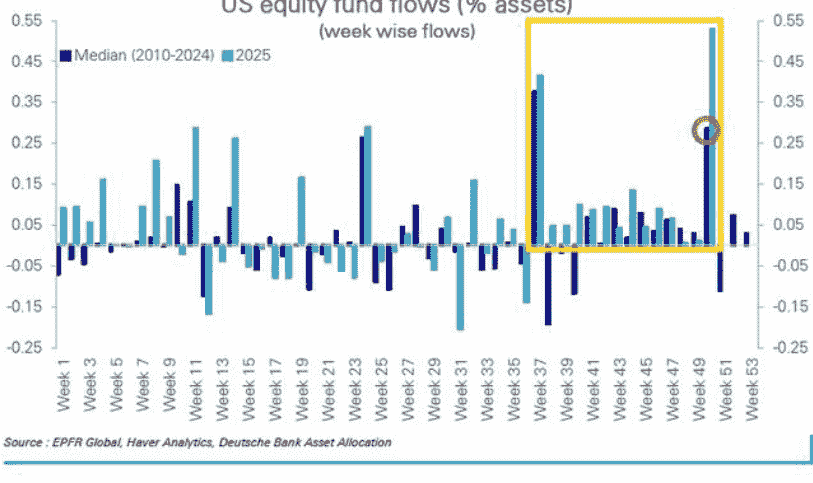

Source: EPFR Global, Haver Analytics, Deutsche Bank Asset Allocation

Jason不盖
2025-12-22 03:42

## 自制图表

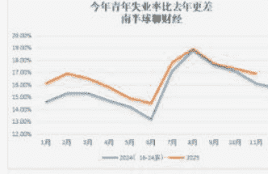

深度视野VIP群 人工追踪50+大V 付费进群微信cuk255 微信chp5568

## 今年青年失业率比去年更差
南半球财经

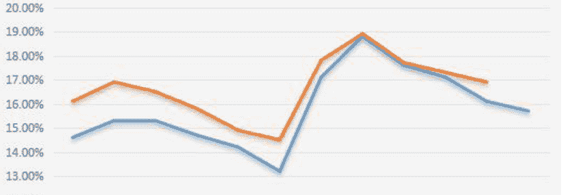

2024(16-24岁) —— 2025

## 25-29岁失业率比去年更差
南半球财经

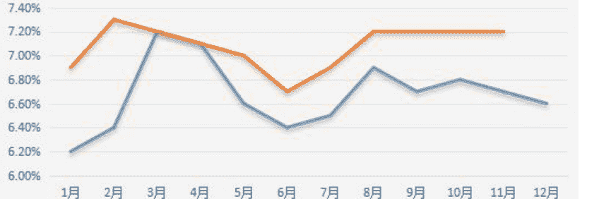

2024(25-29岁) —— 2025

Jason不遇
2025-12-22 03-45

bloomberg: 战争的性质在改变，我们越来越重视技术和非传统承包商，这一转变又反映在股市上。Kratos防务与安全解决方案公司和Palantir Technologies Inc像这样更灵活的新公司今年股份减少至一张，据悉显示，西方将预算从传统的战争装备，将达瑞和其他装甲车辆转向技术领域。#市场

深度视野VIP群 人工追踪50+大V 付费进群加微信cuk255 微信chp5568

## 国防新兴企业起

投资者纷纷押注战争性质的变化

- Kratos / Planet Labs / Palantir / S&P 1500 Aerospace and Defense group

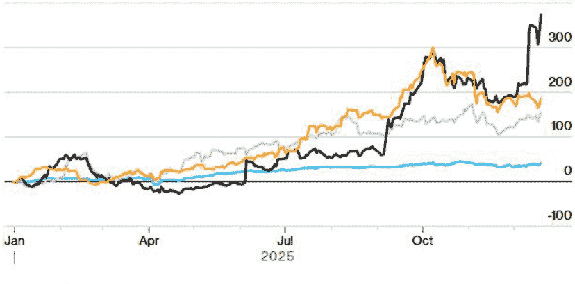

来源：彭博社
数据均已至2024年12月31日。

> Jason:不能
2025-12-22 03:53

CF40: 如果我们把美国从中国大陆进口AI商品的比重视为美国对中国大陆的直接依赖的话，那么直观来看，美国对中国大陆的直接依赖是在减少的。尽管美国对中国大陆AI相关资产的直接依赖程度虽有所下降，但高依赖类别的商品仍然保持了稳定增长的态势，这意味着中国大陆在部分产品上与美国而言仍然具有不可替代性。#经济数据

## 深度视野VIP群 人工控50+大V 付费进群加微信cuk255 微信chp5568

## 图3: 美国相关产品进口占比

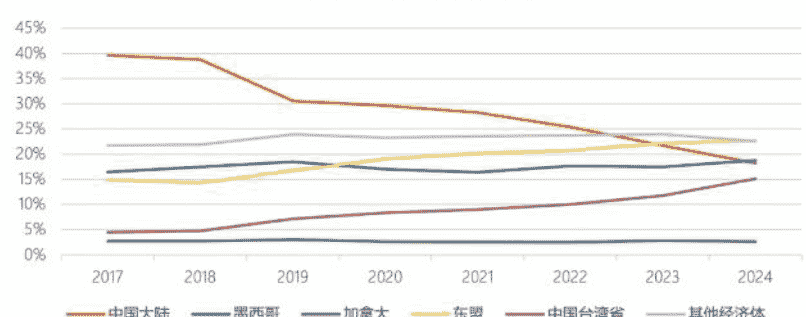

## 图4: 美国AI相关产品进口额（亿美元）

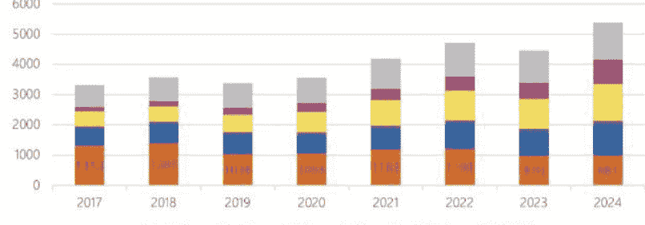

数据来源：Trade Map, CF440 研究

## 表 1 直接依赖的判定标准

| 类别 | 判定标准 | 典型商品 |
| --- | --- | --- |
| 高依赖 | 近期从中国大陆进口占比 ≥ 30% | HS 850760 锂电池 |
| | | HS 847130 笔记本电脑 |
| 中度依赖 | 1. 近期从中国大陆进口占比 ≥ 20% 2. 近期前景下降了至少10个百分点 3. 中国大陆出口份额 ≥ 20% | HS 8762 接收、转换或再生设备等的数据（如模块等） |
| | | HS 847330 自动处理设备的配件（如 GPU等） |
| 低依赖 | 不满足上述条件的 | HS 850440 静式变流器 |

## Jason不离
2025-12-22 03:57

华创: 我们聚焦2025Q3全年盈利分析，ROE主要贡献销售利率（费用），支撑销售利率提升，说明宏观需求导致优质企业更多依赖现金流；从估值/股息看，我们根据不同行业在当前宏观环境下的位置，以此作为市场风险基准。过去一年，24个行业呈现估值、高股息特征#经济数据

来源：Wind, 2023上半年行业分析

## 图13 主要行业分位数与盈率

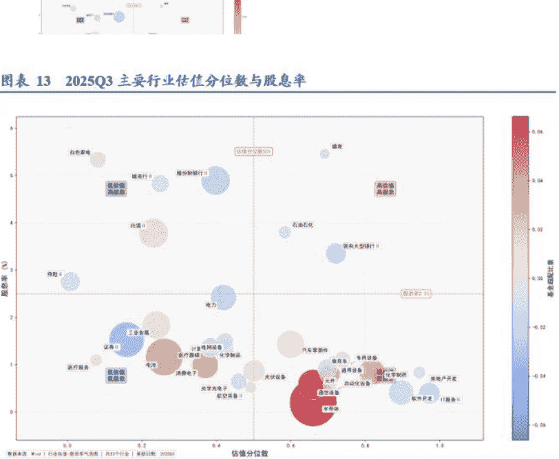

来源：Wind, 东方财经; 气泡大小反映行业中由现金流决定

## 南方周末：地方政府债观察

近年来，地方政府债规模持续扩大。21年地方政府债发行规模为735万亿元，22年进一步扩大，达到780万亿元。用途包括一般性支出和专项用途。一般性支出主要用于补充政府预算缺口，增加资金周转；专项用途则主要用于交通、水利、民生、社会事业、保障等领域的重大项目。发行利率受宏观环境影响较大。23年上半年，受市场流动性充裕影响，地方政府债利率整体呈现低位运行状态，部分利率下降。主体包括省级政府、直辖市政府、县级政府。品种包括一般债券和专项债券，其中专项债券主要用于法律规定的特定用途。23年以来，地方政府债发行规模保持在合理水平，在一定程度上缓解了融资压力

## 深度视野VIP群 人工追踪50+A 付费进群加微信cuk255 微信chp568

每天醒来，一眼却还是钱。

杨在北方某省省级城投业务还是日常工作里令他愁心的事。几年年前，公司应收债务无法取消，还款压力增大，挪无果，债务开始循环。一段时间来，更糟糕的是，由于金融机构减少资金投入，金融机构不支持，债务就不能持续，“旧债还没还，新债又到了期”。如落入潭，债务带来的信用风险会从一家公司蔓延至整个区域，导致他面临融资困难。一家租赁公司公告提前还，过去几年，公司风控高增出现过违约地区基本不能开展新业务。评级机构联合信报告介绍，25年1月，多家债据出现逾期，涉及省级及一个行政区域，逾期债券排名前五的是山东、河南、云南、贵州、重庆，令整个区域的信用响警报。北方省一位地方政府官员表示：“债券交易所每个月都会公布逾期名单，金融机构将其区域资金投放作为重要参考指标。”去年，巴菲特在致股东信中提到：“信用就像氧气。当它充盈时，没有人会注意到它的存在，一旦紧缺，就成了头等危机。”地方化债，要遏制增量债务，更要保障存量债务的平稳延续。信用风险的修复是关键，这考验地方政府“拆弹”的方法、技巧与耐力。

## 深度视野VIP群 人工加速50+V 进群群加微信cuk255 微信chp5

对于债务负责人来说，一开始就会等到债务到期，后才发现，资金的“水”不再流入了。地区的财政局没接触都会挨“趴”、空手而归。北方某某财政局工作多年，宋亮却没接触过债务业务，直到几年前被调到化债专班，他才明白其中的风险与规模。当当地债务违约后，宋亮的电话被“遍，金融机构、个人投资者都在找他，哪怕是半夜。有的债务人打来电话，一挂就是一个小时，他开会挂掉电话，被人投诉到了12345政务热线。宋亮回，当当地风险大时，风险评级被金融机构调整，到期债券无法偿还，只能硬着头要钱，现金资金非常紧张。即便过去几年，风险依然未满，全国股份制在当地的增资风险还远在打算。信用风险出现，就必须全力填补缺口，不能让任何折腾的机会。“宋亮和同事们后才意识到，如果风险暴溃，用信用、资金来回缴，将引发连锁反应，造成更大的风险。上千外的经理，经历过无数困境。作为南方某一市属国企业的经理，他在当地家里任职，几年前，东家就开始债务违约，后续情况愈演愈烈，最终影响了整个区域的环境。他对南方周末记者说，在债务面积违约阶段，当地金融机构找门求道一致——尽量结了债务，无论是打折清还是其他方案，只望可在范围内，快速处理。但面对庞大的债务体量，短时间不能结清还是烂苹果呢。除了合同约日，中秋和春节也是节点节点。到期，曾接到大量催电话，来自各地来的权人，诉说有人，曾联系客户，可能付钱，直到城购离，他才松了一口气，“终于过去的春天。

## 深度视野VIP群 人工追踪V 付微微信cuk255 微信chp

谈论地方债务风险时，一个常见说是：债务规模越大，风险发生的概率越高。然而，24年地方债务情况显示，这并非事实。根据企业预警数据，地方政府与城投相加，24年规模排名前三省份分别是江苏、四川、广东，量分别为13.5万亿、15万亿、37万亿。作为参考，以（地方政府余额+城投债务）×100%/GDP的方式计算负债率，24年都是天津、贵州、河南。然而，在一个行政区域内，并不是这些省份风险最高。报告显示，24年及25年1-9月，非标主体主要位于山东、云南、陕西。可见债务规模、负债率是风险的关键因素，触发债务违约的核心条件，就是流动性危机。其中，区县级投资能力最弱，更容易出现风险。区县级平台数量较多，分布广泛，融资成本高，增加了流动性风险。24年，中国人民大学经济改革发展研究院教授张捷，刊有关地方债务风险论文。他们的团队实地访谈了多个地区区县负责人。一位研究多年的老人士南方介绍，系统。债务地方就能缓。系统系统，如果爆发了流动性危机，资金困难，为维持运转，部分只能承受更高的债务，风险增大。高睿回，他们计划用贷款去置换非债债务，贷款此来了融资租赁机构协商时，对对方非常不意。此前的协议为固定利率，在提前还款或隐债务，意味着金融机构的损失。金融机构对收益有多敏感？临近25年底，在浙江地区一级平台与金融机构的某负责人准确之后，即将发行的一只债券，希望在座的机构给予支持。南方周末记者在现场看到，得知较小的发行利率后，全场猛然安静下来，没有机构再接话。金融机构也在承受。根据金融监管总局数据，25年第三季度，商业银行累计实现净利润1.9万亿元，平均资本净率为8.18%，较2024年同期下滑了0.59%。

## 5 修复信用体系

对于发生风险事件的地区，还有一项更为关键的任务——修复信用体系。这一过程漫长且充满挑战。综合各地公告，退出融资平台需要政府职能回归、市场化平台转型，并清零潜在债务。如果还存在经营性金融债务，还需获得2/3金融债人同意。财部部长杨安一。

## 4 风险解除

不过，曾负责任的目的是确保债务平稳延续而非“消灭”债务。粤证券首席学者梁亚志向指出，如果以前刚性清偿方式压降债务，短期来看，债务规模会下降，但也削弱了地方依托债务形成的基建投资与发展能力，经济增速可能会下滑。他表示，这种刚性化，不仅化解风险，反而其目标是压降“规模”。例如，25年8月，山东海市国资负责人在发布会上明确，严禁预算融资。原则上不得新增非债，新增融资成本不得超过6%。高睿东某一级融资投部长向南方周末记者解释，当地对城市投的非债余额设定了上限，不得过债务总额的10%。而且，非债资金在账上停留一般不超过7天。某一级融资员工介绍，他们有融资上限，如果某笔融资超过上限，需要协调。调整债务结构，就是提前还款分期缴债务，或是协商隐债务，获得金融机构的意见难点。此前的协议为固定利率，在提前还款或隐债务，意味着金融机构的损失。高睿回，他们计划用贷款去置换非债债务，贷款此来了融资租赁机构协商时，对对方非常不意。金融机构对收益有多敏感？临近25年底，在浙江地区一级平台与金融机构的某负责人准确之后，将即将发行的一只债券，希望在座的机构给予支持。南方周末记者在现场看到，得知较小的发行利率后，全场猛然安静下来，没有机构再接话。金融机构也在承受。根据金融监管总局数据，25年第三季度，商业银行累计实现净利润1.9万亿元，平均资本净率为8.18%，较2024年同期下滑了0.59%。

## 图表：1990–1995年，日本也曾出现持续的汇率升值但股市不涨的“背离”

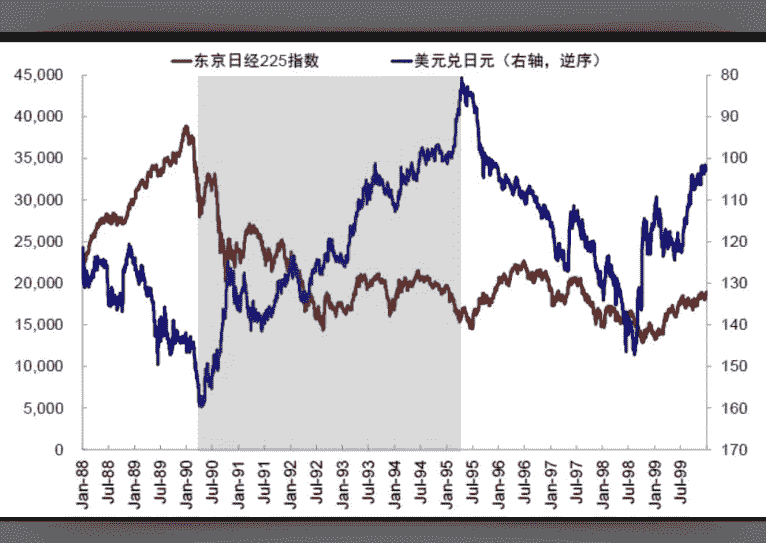

资料来源：FactSet, Wind, Bloomberg, 中金公司研究部

Jason不
2025-02-22 12:37

bloomberg: 鲍威尔押注（明年2次）和内瑞拉拉扯局势上涨导致黄金价格创造历史新高，乌克兰则袭击了俄罗斯影子炼油厂。#金融

深度视野VIP群 人工追踪50+大V 付费进群微信cuk255 微信chp5568

## 黄金在降息押注和风险中升至历史新高

Bullion正自1979年以来最佳年度表现的轨道

- Spot Price

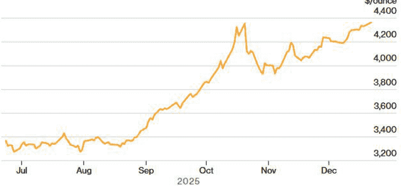

来源：彭博社

Jason不
2025-12-22 13:13

高嵩：高频数据显示2025年Q4中国GDP同比4.5%的预测存在下行风险，增长模式高度依赖广义财财政，由于今年目标完成难度不大，所以一部分被预估的财政空间会用于明年，我们对政策效果保持谨慎态度的中性偏慎判断。#经济数据

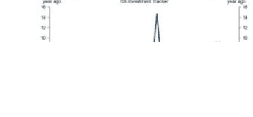

深度视野VIP群 人工追踪50+大V 付费进群加微信cuk255 微信chp5568

## Our investment tracker (on a real value-added basis) indicates a slowdown in Q4

| Percent change, year ago | GS Investment Tracker | Percent change, year ago |
|---|---|---||
| 16 | | 16 |
| 14 | | 14 |
| 12 | | 12 |
| 10 | | 10 |
| 8 | Q4 preliminary reading | 8 |
| 6 | | 6 |
| 4 | | 4 |
| 2 | | 2 |
| 0 | | 0 |
| -2 | | -2 |
| | 2016 2018 2020 2022 2024 2026 | |

Source: Goldman Sachs Global Investment Research

**Revising our fiscal forecast:** November fiscal data continued to show expenditure growth underperforming revenue growth, indicating a relatively conservative fiscal stance. Marked-to-market our estimate for the 2025 augmented fiscal deficit (AFD) to 11.0% of GDP (from 12.0% previously). In addition, we nudged our projection for the 2026 AFD to 12.2% of GDP (12.0% previously). Together, these imply a more positive fiscal impulse for 2026 than previously assumed. With domestic growth momentum continuing to weaken, we believe a more supportive fiscal stance is warranted.

高盛：2025 年，中国 A 股和 H 股分别获得 16% 和 29% 的回报，均超出我们在《2025 年展望》中的原则预测，年初至今的涨缺口（分别为 13% 和 15%）主要由价值权重驱动，指数近 12 个月以来从 2025 年的 9.9% 升至目前的 12.5%，而每股收益在全年下降了 4%。

我们预计中国市场行情仍严峻，但节奏有望有所转变。我们预测，到 2027 年，中国股市整体市场涨幅将达到 38%，由 2026 年和 2027 年分别到 14% 与 12% 的盈利增长，以及约 10% 的估值上行空间。

中国上市公司的海外收入占比，已十年前的 12% 提升至目前的 16%。按照我们的预测，到 2030 年此比有望提升至 20%，仍低于海外/市场企业 53% / 48% 的平均水平。领先于海外占比提升，考虑到海外业务能力增强，这有望让 MSCI 中国增长指数年均提升约 1.5%。#A 股

## 1. Two consecutive years of returns: a slow(er) bull market is costly in the making

China A and H shares have returned 16% and 29% in 2025, respectively, exceeding our original forecasts of 13% and 15% published in our 2025 Outlook, extending the rebound from their recovery cycle troughs in late 2022 to mid-2023.

The ytd has been yielded by multiple re-rating index rose 9.9% from 2025 to 12.5 as of now, whereas PE was down by 4% for the year.

Sectors, Materials, Health Care, and Consumer performed (the best) while Staples, Utilities, and Financial lagged. Stylistically, Growth and Quality gained the most, underperforming the consensus by Value and Defense. We expect the bull to continue, but at a slower pace. Chinese stocks to rise by 38% by end-yet, by 14% and 12% profit growth in 2026 and 2027 and 10-15% points. This is due to quality cycle from Hope to worst with earnings real and moderate PE factor to drive returns.

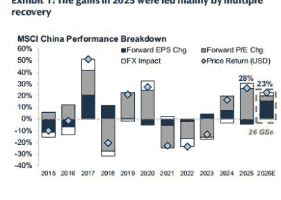
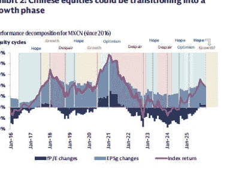

Source: FactSet, MSCI, Goldman Sachs

## 3. AI has changed the game for equities

The breakthroughs we have noticed recently are tech fundamentals. Especially as AI adoption could drive annual earnings in Data & Cloud, Infra & Power, where stock prices have risen 40% on average and more than $75tn of market cap has been added. The tech rally between US and China will reward strong winners along the value chain, particularly in AI and infra of ecosystem where China's cost advantages are high: demand for high-performance hardware, supply chain support and government support due to national security concerns and regulation.

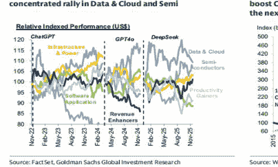
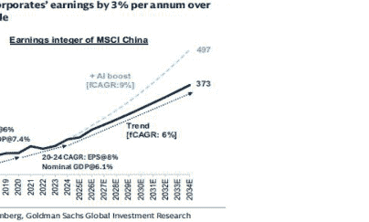

Source: FactSet, Goldman Investment Research

In our view, China's resiliency this year is a strong testament that its exports story has evolved—shifting from a low-cost, low-value-added manufacturer for DM consumers to one where China is more to EM as the final destination, gaining global market share in the high-end manufacturing sectors. Overseas revenues of listed companies have grown from 12% a decade ago to 16% at present, and we expect growth by 2030 on our projection, DM/EM average of 25%/48%. In turn, this could boost MSCI China by about 1.5% annually given higher overseas profitability.

While protective measures from China's trading partners are valid risks/concerns, they are unlikely to derail Chinese companies' Going Global trend, which is underpinned by a highly competitive RMB (in real effective terms), China's pivotal role in global supply chains and dominance in critical minerals, and improving position of Chinese companies.

Our cross-section analysis shows that leaders with strong innovation capabilities are well positioned to compete globally, and outperform their peers in both the export and financial markets. China Going Global portfolio, overseas, containing 25 GS-based companies that on average generate 34% of their revenues overseas, has gained 35% ytd, outpacing MSCI by 9pp.

## Exhibit 12: Overseas revenues of all Chinese companies has grown from 12% in 2010 to 16% at present and is expected to reach 20% by the end of 2030

- All Chinese companies' overseas revenue 23%
- Overseas revenue as % of total
- Overseas revenue as % of total Financials 21%, 19%, 17.5%, 16.8%, 15%, 13%, 11%
- 5pp increase per year

Source: Wind, FactSet, Goldman Sachs Investment Research

## Exhibit 13: Most sectors enjoy better profitability in the overseas markets

- (%)
Average gross margin (ytd)
Based on 2020 GS covered and A-share companies with classmates

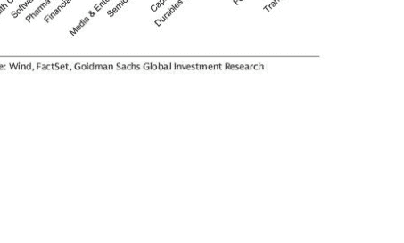

Source: Wind, FactSet, Goldman Sachs Investment Research

## 自制图表

11月北京市房产净值 vs 居民贷 11月北京市房产净值 vs 居民贷

## 历年前11月显性GOV债务

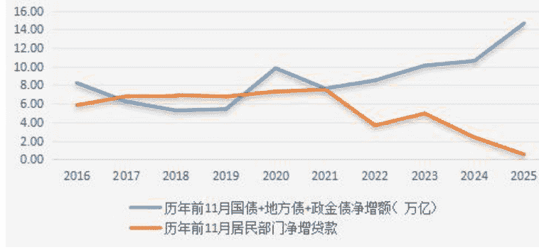

## 历年前11月显性GOV债务

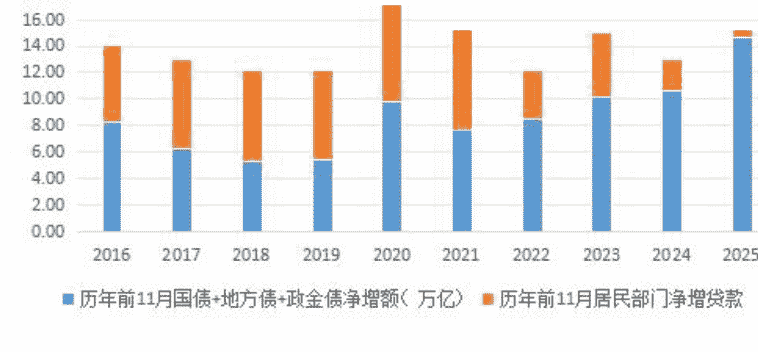

深度视野VIP群 人工追踪50+大V 付费进群加微信cuk255 微信chp5568

## 深度视野VIP群 人工追踪50+大V 付费群加微信cuk25568 微信chp5568

## 深度视野文集
微信cuk255

全部包含以下内容：限时188/年 加微信255

- 1 吃瓜群众时对话 (原价 365 元/年)
- 2 顺享（原子明）内部文章 (原价 568 元/年)
- 3 卢克文读书会专属文章 (原价 699 元/年)
- 4 卢萨元新浪微博费付费专栏；三村边老王、三花九洞文集 (原价 599 元)
- 5 欧洲金准会员专属 (原价 328 元/年)
- 6 传五内部 (原价 400 元/年)
- 7 鉴茶知识星球 (原价 3310 元/年)
- 8 猫哥的视界星球 (原价 299 元/年)
- 9 财经新周【独家】(原价 1498 元/年)
- 10 杨世光在钱圈 (原价 2200 元/年)
- 11 森森财经星球 (原价 1600 元/年)
- 12 激源异译付费文章（持续更新）

不定期内容：(更多资源将下去......)

## 限时年费188/年 低成本链接全网大.优质内容
