# 南半球聊财经251224

Jason-不离
2025-12-24 03:49

瑞银：预计中国2026年实际消费增速约4.4%，低于2025年，没有强需求刺激，PPI转正会非常常（可能在2026年底或2027年），工业压力尚在，但2026年A股利润增速预计回升至~8%，Q4 GDP增速预计约4.2%，2025年约4.9%#经济数据

## Key global indicators

## Key global indicators

## Key global indicators

| Real GDP Growth, % yoy | 2024 | 2025F | 2026F | 2027F | 4Q24 | 1Q25 | 2Q25 | 3Q25 |
|---|---|---|---|---|---|---|---|---|
| US | 3.4 | 3.3 | 3.1 | 3.3 | 3.5 | 3.6 | 3.4 | 3.4 |
| Eurozone | 2.8 | 1.9 | 1.7 | 1.9 | 2.4 | 2.0 | 2.1 | 1.9 |
| China | 0.9 | 1.4 | 1.3 | 1.6 | 0.2 | 1.6 | 1.9 | 0.7 |
| Japan | -0.2 | 1.3 | 0.9 | 1.2 | | | | |
| Non-China Asia | 5.0 | 4.9 | 4.5 | 4.6 | 5.4 | 5.4 | 5.2 | 5.8 |
| Non-China Asia | 5.4 | 5.8 | 5.2 | 5.3 | 5.4 | 5.8 | 6.3 | 6.4 |

### Industrial Production, % yoy

| World | 2024 | 2025F | 2026F | 2027F | 4Q24 | 1Q25 | 2Q25 | 3Q25 |
|---|---|---|---|---|---|---|---|---|
| US | 1.9 | 3.6 | 3.4 | 3.5 | | | | |
| Eurozone | -0.6 | 1.5 | 1.4 | 2.2 | | | | |
| Japan | -3.0 | 1.6 | 1.8 | | | | | |
| China | 5.7 | 6.0 | 6.2 | 5.0 | 2.0 | 2.0 | 1.9 |
| Non-China Asia | 4.4 | 6.5 | 5.1 | 2.2 | 4.1 | 4.7 | 6.9 | 7.0 |

### CPI inflation, % yoy

| World | 2024 | 2025F | 2026F | 2027F | 4Q24 | 1Q25 | 2Q25 | 3Q25 |
|---|---|---|---|---|---|---|---|---|
| US | 5.7 | 5.3 | 3.0 | 2.9 | 2.3 | 2.7 | 2.5 | 2.9 |
| Eurozone | 3.0 | 2.8 | 2.1 | 2.3 | 2.1 | 2.3 | 2.0 | 2.1 |
| Japan | 2.7 | 3.2 | 1.8 | 2.2 | 2.9 | 3.8 | 3.4 | 2.9 |
| China | 0.2 | 0.0 | 4.5 | 0.8 | 0.2 | -0.1 | | |
| Non-China Asia | 1.8 | 3.1 | 3.6 | 2.2 | 1.0 | 3.6 | 2.7 | 2 |

### Key commodity prices

| Brent (USD/barrel) | 79.9 | 68.2 | 64.0 | 70.0 | 75.0 | 66.7 | 68.2 |
| Thermal Cost (USD/ton) | 136 | 106 | 110 | 110 | 138 | 107 | 101 | 109 |
| CR index | 534.5 | | | | | | | 539.9 | 546.0 | 553.2 |

### Key interest rates (USD)

| US Fed rate* | 2024 | 2025F | 2026F | 2027F | 4Q24 | 1Q25 | 2Q25 | 3Q25 |
|---|---|---|---|---|---|---|---|---|---|
| 3-Month LIBOR | 4.49 | 3.73 | 3.35 | 3.14 | 3.33 | 3.35 | 4.49 | 4.41 | 4.45 | 4.24 |
| ECB refinancing rate | 4.15 | 3.15 | 3.15 | 2.45 | 2.15 | 2.15 | | | | |
| 10-year Treasury yield | 4.58 | 3.70 | 4.00 | 4.25 | 4.58 | 4.23 | 4.24 | 4.16 |
| 10-year government bond | 2.36 | 2.50 | 3.00 | 3.00 | 2.36 | 2.74 | 2.59 | 2.72 |

### Key exchange rates (USD)

| EUR/USD | 1.04 | 1.18 | 1.14 | 1.14 | 1.07 | 1.08 | 1.17 |
| USD/JPY | 155 | 152 | 152 | 155 | 149 | 144 | 148 |
| CNY/USD | 7.30 | 7.05 | 7.10 | 7.00 | 7.30 | 7.25 | 7.18 | 7.12 |

Source: CEC, Haver and UBS

## Bloomberg 

2022-12-24 04:35

bloomberg: 美国经济在第三季度以来最快的扩张，BEA报告调整后的GDP增长率为4.3%，经济学家原预计增长为3.3%，今年增速最大。市场对2026年降息的预期乐观，短期通胀缓解，两国国债利率上调4个基点至3.5%，美联储加息的可能性约为16%。不过另一项数据显示美国消费者信心在十二月连续五个月下跌，是因为对劳动力市场和行业状况的悲观，这一连续已追2008年以来最长。

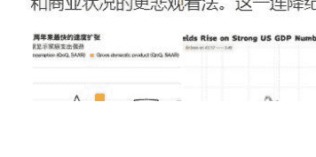

### 美国经济年来最快的扩张

第三季度数据显示家庭支出强劲

- Personal consumption (QoQ, SAAR)
- Gross domestic product (QoQ, SAAR)

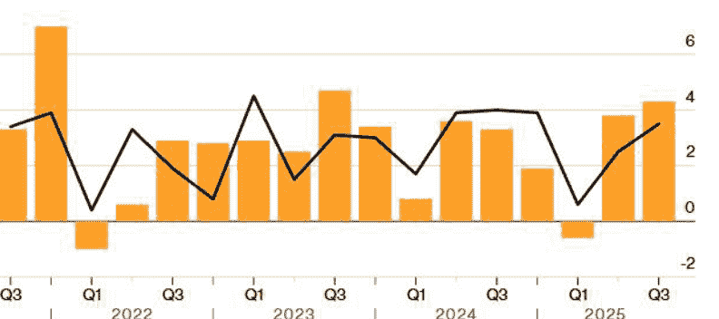

来源：经济分析

## Two-Year Yields Rise on Strong US Numbers

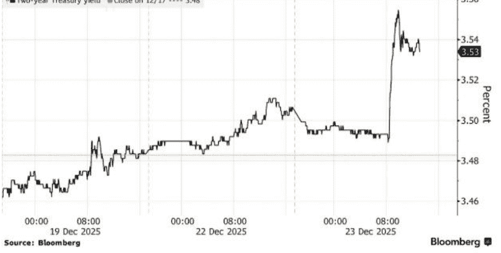

### 美国消费者信心连续五个月跌

12月，当前商业状况和就业市场急剧下滑

- Consumer confidence index
- Present situation index

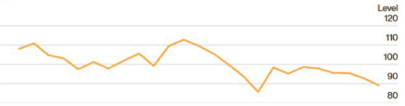

来源：委员会

## FT

2025-12-24 04:47

FT: 俄罗斯经济自2023年初以来首次陷入衰退边缘。俄罗斯采购指数(PMI)已降至48，低于2024年初的均值，标志连续六个月下滑。工资增速缓慢，意味着消费支出与税收也将随之下降。未来几年将需要超过三万名劳动力来弥补这一缺口，当局采取了措施，包括允许不合格的学生就业提前进入劳动力市场。俄罗斯科学院的分析师指出，工作时长已升至极限的每周38小时。最具争议的政策是自2026年强制要求医学学生毕业到医院实习，且往往偏农村地区。他们在TikTok上反对这项法律，称其为“农奴”。

- pay in

### Russia's wage grows more sharply than inflation

- per cent change, year on year

Sources: FT analysis of job market, Russian Central Bank

## 毕 

2025-12-24 04:47

毕马威：45%的跨境企业在过去18个月中主动精简中国员工队伍

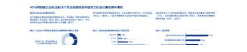

## 45%的中国企业在1月份加强了防范措施

在宏观环境波动的背景下，45%的企业表示“加强风险防范”是首要任务，而“增加现金储备”的企业占比为30%，“减少投资”的企业占比为25%。

图1：1月期间中国企业采取防范措施类型分布

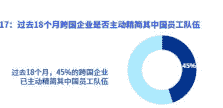

图2：中国企业主要资产策略分布

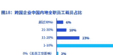

受访企业中，47%的企业将调整资产配置

受访企业中，47%的企业将调整资产配置

## 五矿

2025-12-24 04:51

五矿：我们认为未来国内保险资金配置权益类资产的中性增长（权益类资产占比每年上升1%）更有可能发生。保险资金在2026和2027年权益投资规模将1.15万亿元和1.45万亿元，权益类资产占比将升至23.6%和24.6%。如果利率持续维持低位，保险资金配置权益类资产的占比将继续上升。两年后，我们认为保险资金投资的主要方向仍然是深300成分股中高股息股票。

图10：保险资金调整预测

| 保险资金业务调整 | 假设1 | 假设2 | 假设3 |
|---|---|---|---|
| 沪深300、中证利利成分股占比 | 60% | 50% | 40% |
| 科创板普通股占比 | 10% | 5% | 2% |
| 沪深300、中证利利指数（亿元） | 13341 | 9451 | 7561 |
| 科创板普通股市（亿元） | 1890 | 945 | 378 |
| 合计（亿元） | 13231 | 10396 | 7939 |
| 风险因子 | | | |
| 调整 | 0.27 | 0.36 | |
| 调整前市场最低成本（亿元） | 4158 | 3213 | 2419 |
| 调整后市场最低成本（亿元） | 3743 | 2892 | 2177 |
| 调整结束后市场最低成本（亿元） | 416 | 321 | 242 |
| 投资因子沪深300指数（亿元） | 1540 | 1190 | 896 |

数据来源：国泰基金管理、五方证券

### 图2: 商业资金新增权益类资产情况（2025-2027）

| | 4Q2025 | 4Q2026 | 4Q2027 |
|---|---|---|---|---|---|
| 金额 | 占比 | 金额 | 占比 | 金额 | 占比 |
| 资金余额 | 376.39 | 100.0% | 409.46 | 100.0% | 445.32 | 100.0% |
| 权益类资产 | 84.946 | 22.7% | 94.824 | 23.2% | 105.590 | 23.7% |
| 其他资产 | 291.593 | 77.4% | 314.642 | 76.8% | 339.762 | 76.3% |
| 1) 新增权益类资产 | 19.229 | | 9878 | | 10760 | |
| 2) 新增权益类占比提升1% | 84.946 | 96.469 | 109.377 | 24.6% | |
| 权益类资产占比提升2% | 19.229 | | 115.233 | 100.6% | 118.264 | 26.6% |
| 3) 新增权益类资产 | 19.229 | | 15618 | | 17721 |

数据来源：国金信息博客、中信研究所

2025-12-24 04:56

华牟：多数外资认为，2026年中国实际GDP增速在4.5%左右（小、德瑞、OECD、IMF）。多数外资认为，2026年CPI幅回升至1%，PPI将窄至2%以内，为负。对于PPI转折点的判断，背后是对政策效力判断的差异，绿、德瑞预计PPI将在2026年下半年转折，对于认为PPI可能小幅放缓，2026年或2027年初会转折。对于消费外资观点较为一致，多认为2026年消费增速加快#经济数据

## 图表1 多数外资（非国际机构）对2026年经济增长的预测

| | 大涨 | 小滑 | 滞缓 | 震荡 | 下跌 | OECD (12月) | IMF (12月) |
|---|---|---|---|---|---|---|---|
| GDP增速 | | 4.7 | 4.8 | 4.4 | 4.5 | 4.0 | 4.5 |
| CPI增速 | | | 4.1 | 4.3 | | | |
| 工资增速 | | | | | 6.2 | 3.5 | |
| 投资增速 | | | 3.5 | 2.4 | 4.9 | | |
| 消费增速 | | | | | 3.8 | 4.6 | |
| 结构变化 | | | 4.2 | (10.0) | | | 4.4 |
| 出口增速 | | | 3.0 | 3.4 | 6.6 | | 0.3 | |
| CPI出口 | | | 0.2 | 0.6 | 1.5 | | 0.8 | |
| PPI增速 | | (0.7) | (1.8) | | | 下半年转折 | 2026年下半年转折 | |

来源：OECD、IMF、中信证券研究所

## Jason-Down

民生：虽然其制造业GDP比重高于多数主要经济体，但其从人员收入比例却低于德国、日本、韩国等制造强国。近近年来，智联聘数据显示科技行业在薪酬增长率上领先突出，印证了其在薪酬结构和就业质量上的领先地位，比亚迪、宁德时代、小米等大厂率先开启“涨薪潮”行业数据

数据：国泰证券行业深度报告

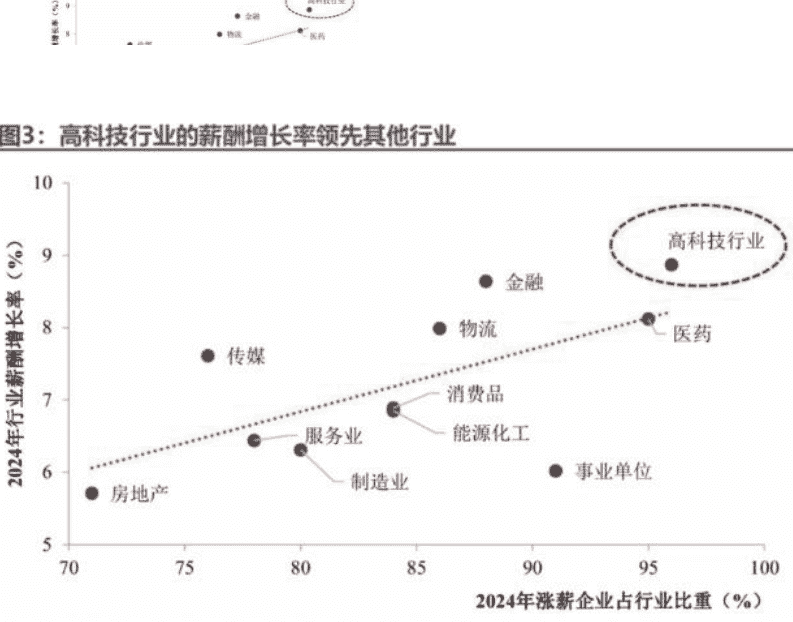

## Jason-Down

民生：虽然其制造业GDP比重高于多数主要经济体，但其从人员收入比例却低于德国、日本、韩国等制造强国。近近年来，智联聘数据显示显示科技行业在薪酬增长率上领先突出，印证了其在薪酬结构和就业质量上的领先地位，比亚迪、宁德时代、小米等大厂率先开启“涨薪潮”行业数据

## Jason-Down

民生：虽然其制造业GDP比重高于多数主要经济体，但其从人员收入比例却低于德国、日本、韩国等制造强国。近近年来，智联聘数据显示显示科技行业在薪酬增长率上领先突出，印证了其在薪酬结构和就业质量上的领先地位，比亚迪、宁德时代、小米等大厂率先开启“涨薪潮”行业数据

## Jason-Down

民生：虽然其制造业GDP比重高于多数主要经济体，但其从人员收入比例却低于德国、日本、韩国等制造强国。近近年来，智联聘数据显示显示科技行业在薪酬增长率上领先突出，印证了其在薪酬结构和就业质量上的领先地位，比亚迪、宁德时代、小米等大厂率先开启“涨薪潮”行业数据

## Jason-Down

民生：虽然其制造业GDP比重高于多数主要经济体，但其从人员收入比例却低于德国、日本、韩国等制造强国。近近年来，智联聘数据显示显示科技行业在薪酬增长率上领先突出，印证了其在薪酬结构和就业质量上的领先地位，比亚迪、宁德时代、小米等大厂率先开启“涨薪潮”行业数据

## Jason-Down

民生：虽然其制造业GDP比重高于多数主要经济体，但其从人员收入比例却低于德国、日本、韩国等制造强国。近近年来，智联聘数据显示显示科技行业在薪酬增长率上领先突出，印证了其在薪酬结构和就业质量上的领先地位，比亚迪、宁德时代、小米等大厂率先开启“涨薪潮”行业数据

## Jason-Down

民生：虽然其制造业GDP比重高于多数主要经济体，但其从人员收入比例却低于德国、日本、韩国等制造强国。近近年来，智联聘数据显示显示科技行业在薪酬增长率上领先突出，印证了其在薪酬结构和就业质量上的领先地位，比亚迪、宁德时代、小米等大厂率先开启“涨薪潮”行业数据

## Jason-Down

民生：虽然其制造业GDP比重高于多数主要经济体，但其从人员收入比例却低于德国、日本、韩国等制造强国。近近年来，智联聘数据显示显示科技行业在薪酬增长率上领先突出，印证了其在薪酬结构和就业质量上的领先地位，比亚迪、宁德时代、小米等大厂率先开启“涨薪潮”行业数据

(注：由于OCR文本中存在大量重复段落，以上部分已根据逻辑进行合并去重，保留核心语义信息)

Jason不跑
2025-12-24 05:16

## BIS更新Q3房价指数#自制图表

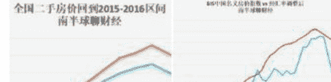

## 全国二手房价回到2015-2016区间 南半球财经

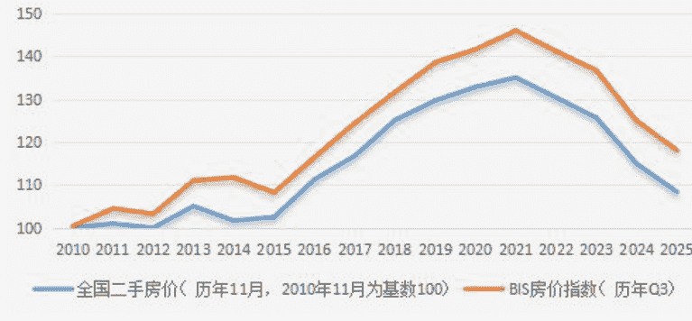

## BIS中国房价房价指数 vs 汇率调整后 南半球财经

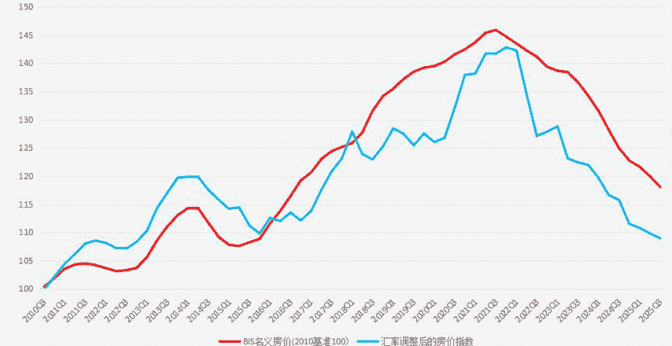

深度视野VIP群 人工追踪50+大V 付费进群微信cuk255 微信chp5568

## 中日房价破裂对比

南半球财经

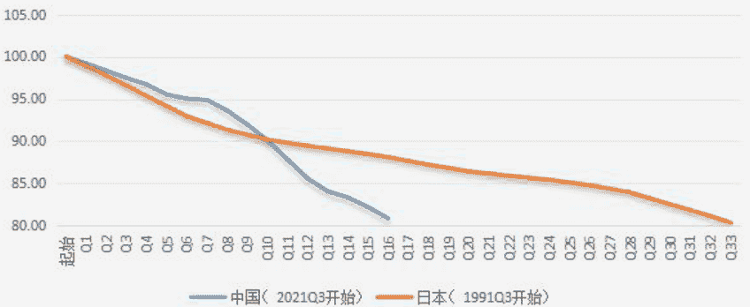

## 2000年日本房价到最低底部，还有33%跌幅

南半球财经

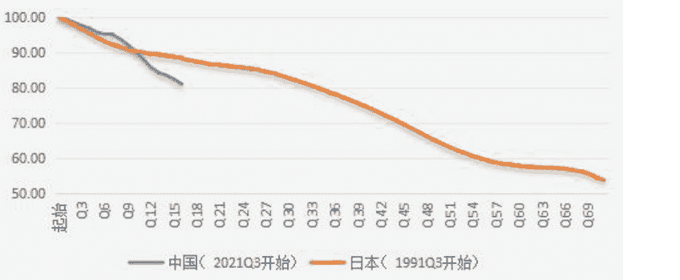

Jason不跑
2025-12-24 05:22

新西兰银行：长期利率、房贷、短期利率是影响新西兰房价的因素，其中长期利率占68%，租金占30%，短期利率只占2%其他国家经济

深度视野VIP群 人工追踪50+大V 付费进群微信cuk255 微信chp5568

# Analytical Notes

## New Zealand House Prices and the Decline in Longer-Term Financing Costs

Matthew Brunton and Punnoose Jacob

### Summary

We disentangled the contributions of long-term and short-term financing costs to the growth in New Zealand house prices over the past two decades by employing a user cost model. We find that the declines in neutral and longer-term interest rates have dominated other determinants in generating the increase in house prices. This is consistent with the findings of Miles and Monro (2020) which suggests that changes in the real interest rate are likely to be a major driver of changes in the United Kingdom.

We also demonstrate that the response of house prices to interest rates is amplified when housing supply is inelastic to prices. Hence on the supply side of the housing market are determining how interest rates affect house prices.

Our results suggest that determinants are more likely to shape the cyclical dynamics of New Zealand house prices rather than the trend. Empirical studies confirm that monetary policy events exert an impact on house prices over business cycles. Chadwick, Dagwaugh and Jacob (2022) and Chadwick and Hadanov (2022) find that such movements in monetary policy have a statistically significant impact on short-run house price dynamics in New Zealand.

Two important empirical insights from the literature refine the main results of our study: Note: (1) yields curves are highly correlated across countries and (2) the dynamics of longer-term interest rates are dictated more by global, rather than domestic factors. The key to this

understanding the upward trend in New Zealand house prices is to understand the global drivers of longer term interest rates.

Alternatively, we examine the contributions of the model drivers in terms of proportions rather than in terms of absolute levels as Figure 2, around 2.8% and 30% of the total increase in house prices over the sample period were contributed to by shorter-term financing costs and rent inflation respectively However, the impact of declining long-term financing costs amounts to 68% and dwarfs the impact of other component variables in the model.

### Figure 2: Cumulative contribution towards house prices since 2002

Change since 2002 (%)

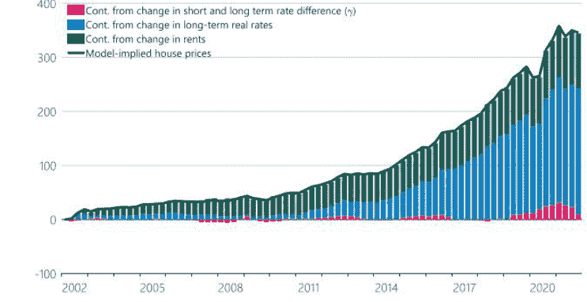

Jason不跑
2025-12-24 06:24

## 人民币升值，而日、韩、印等都进一步贬值#自制图表

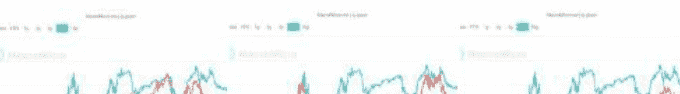

深度视野VIP群 人工追踪50+大V 付费进群加微信cuk255 微信chp5568

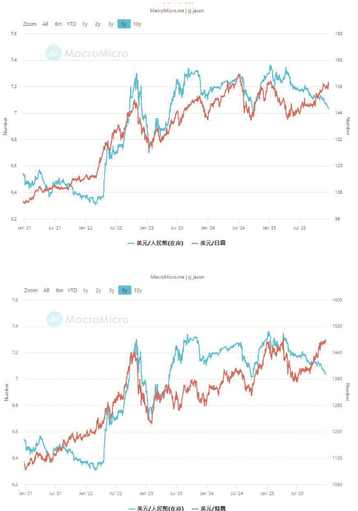

深度视野VIP群 人工追踪50+大V 付费进群加微信cuk255 微信chp5568

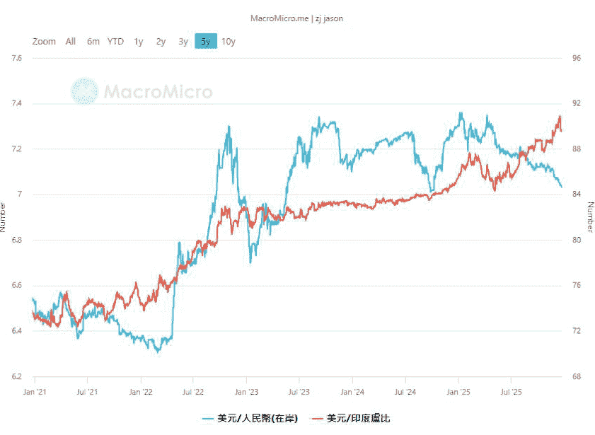

深度视野VIP群 人工追踪50+大V 付费进群微信cuk255 微信chp5568

# 深度视野优质文集，全部包含以下：限时年费188加微信cuk255

- 1 袁时对话（365/年）
- 2 袁粉丝粉丝（568/年）
- 3 政事堂（599/年）
- 4 米联储【独家】（599/年）
- 5 欧洲金会员（328/年）
- 6 钛五内部圈（400/年）
- 7 卢克文青会专属（699/年）
- 8 鉴茶财经（3310/年）
- 9 猫哥的视界（299/年）
- 10 财新周【独家】（1498/年）
- 11 杨世光在钱（2200/年）
- 12 森森财经（1600/年）
- 13 源泽译异付费文集（持续更新）
- 14 司马林解读毛选全套音频和全书珍藏版（无割减）
- 15 虚虚三部曲[民国梦、帝国争霸、不被理解的MAO](599/年）
- 16 卢克文知识星球文章（268/年）
- 17 额外再送：卢麟元新微博付费专栏、三村边老王、三花九树文集

不定期内容：（更多资源不写下了……

- ① 守夜人星球、接魂魔王星球、生才有知识星球
- ② 创始人笔记、达越译论星球、成付财富圈、雪花甲老头等
- ③ A视野、大树乡谈、江初知道、泮咩说、上海海学等付费文集
- ④ 西风付费文章、老端、赢在八小时之外、局外的视界、升值优、老- 体制内等若干大付费文章（每月不超过600元的付费文集）

# 深度视野文集

# 群微微信cuk255

深度视野（付费文集）

限时年费188/年

# 低成本链接全网V优质内容
