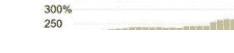
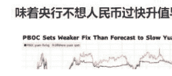
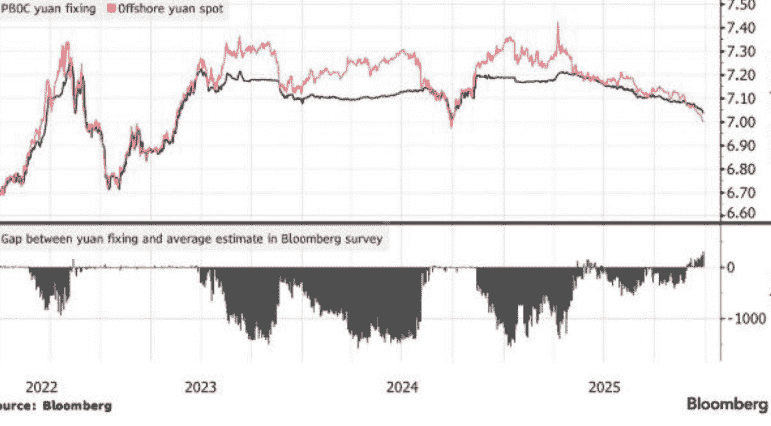
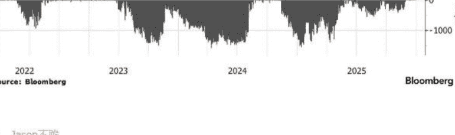
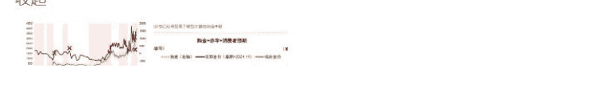
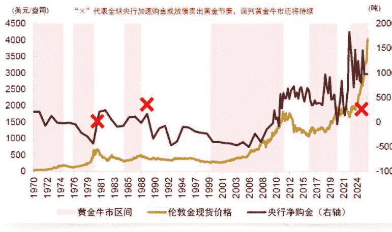
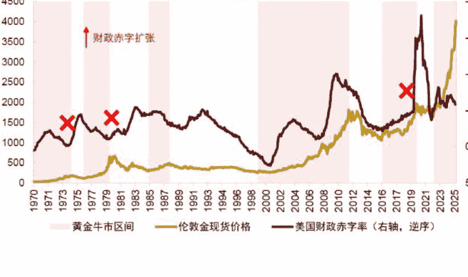
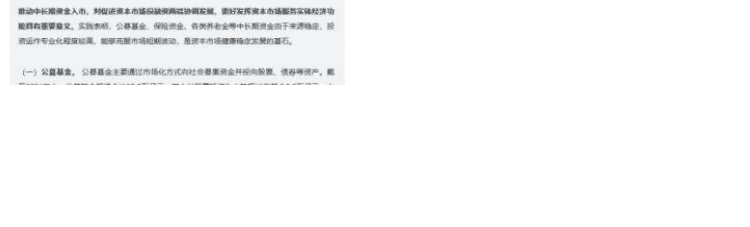
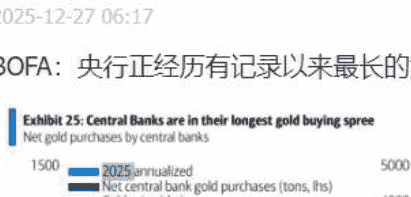

# 南万球聊财经251227

Jason-不赢
2025-12-27 05:27

bloomberg: 日本最新舞算预计将迎来28年来的首次财政盈余，日本财政计划将从4月开始的财政年度减少国债，重点削减长期债务。

日本由于人口老龄化对社会支出需求的增长，看到的财政文件显示，社会保障支出将从本年度的38.3万日元减少至39.1万日元。但以平均收入相当其他国家经济计，国家层面的初始余额预计4月开始的财政年度预算中将出现1.34万亿日元的盈余，内阁的官方数据预计将在下个月公布，此前是考虑了包括地方政府数据在内的数据。

鉴于近期来地方政府出现了初级的盈余，日本很有可能达到内府将采取措施。

Jason-不赢
2025-12-27 05:27

经：根据国际结算银行（BIS）的数据，中国的债务比率接近1998年日本的水平，当时，日本人均GDP高达约32,000美元，而中国的数字约是13,300美元。在6月尾，中国债务比率首次超过了300%，同时日本的债务占GDP比为37.4%。尽管这一数字在主要经济体中仍然较高，超过了2020年的422%极限值以后，这一数字已持续下降。#金融

China's total debt is over 300% of GDP

深度视野VIP群 人工追踪50+大 付费进群加微信cuk255 微信chap5568

## China's total debt is over 300% of GDP
(Debt as share of GDP)

*Excludes financial companies
Source: National Institution for Finance & Development

> Jason-不赢
2025-12-27 05:35
bloomberg: 彭博的美元指数将迎来6月以来最差的周，美元值与美国国债收益率的跌同时发生，美国10年期债收益率本周向约下降一个基点，差为4.14%。

乌拉圭央行发行托拉斯债券计划实施措施，增加乌拉圭比索的国家，减少对美元的影响。在一个超过三分之二的存款以美元计的国家，制约美元将是一条漫长的道路。

## 美元预计将在六月维持最低一

彭博的美元指数自此以来下跌了0.7%

来源：彭博社

深度视野VIP群 人工追踪50+大 付费进群加微信cuk255 微信chap5568

## Jason-不离
2025-12-27 05:40

bloomberg: 26日人民币和美元间报价7.0358，上涨34点创一年新高，但这一水平比波动调查交易员的平均和分析的预期高了301个点。波动幅度不仅反映了监管的意图，更是自2018年该交易启动以来，中间与市场预测之间出现的最大差异。这意味着央行不想人民币升值数据延续线。#金财经

## PBOC Sets WeChat Fix Than Forecast to Slow Yuan

Gap between yuan fixing and average estimate in Bloomberg survey

## Jason-不离
2025-12-27 05:44

中金: 目前黄金上涨至4500美元/盎，已经触达到长期的预测。基于当前基本面指标，其实价格高于模型预测的短期隐含值，存在一定溢价。我们预期在2026年之前，由于美储利率持续，美国增长将放缓，美储可能转向宽松，由于衰退风险形成实质性压力，但是2026年5月后美储可能退休，此时美储可能再次加息，黄金上涨动力不是唯一因素，而是美储通胀政策与美国经济走向。上述逻辑同样适用于加息等周期，由于市场对预期的影响，流动性相对增强，金价波动将至3.5%左右，我们建议等待美储加息。中期来，现在市场预期美储2026年将息两次。我们认为要保守，明年5月份新美储主席上台，美国可能处于或进入下行周期。

深度视野VIP群 人工追踪50+大 付费群加微信cuk55 微信5568

## 图表：央行购金预测牛市顶部

资料来源：Bloomberg, Haver, 中金研究

## 图表：美国财政赤字对金价有长期解释，但对顶部判断准确

深度视野VIP群 人工追踪50+大 付费进群加微信cuk25 微信chp558

## 图表：黄金价格已经明显高于计算的估值中枢

黄金+赤字 (美元盎司) (美元盎司)

| 残差（右侧） | 实际金价（基期=2024.11） | 报合金价 |
|---|---|---|
| 5000 | | 2000 |
| 4500 | | 1500 |
| 4000 | | 1000 |
| 3500 | | 500 |
| 3000 | | 0 |
| 2500 | | -500 |
| 2000 | | -1000 |
| 1500 | | | |
| 1000 | | | |
| 500 | | | |
| 0 | | | |
| 1971 | 1974 | 1977 | 1980 | 1983 | 1986 | 1989 | 1992 | 1995 | 1998 | 2001 | 2004 | 2007 | 2010 | 2013 | 2016 | 2019 | 2022 | 2025 |

资料来源：Wind，中金研究

Jason不咖2025-12-27 05:51

日经：到2030年，日本从美进口液化天然气增长三倍，尤其是美国的液化天然气。此外，日本发现投资违约承诺，政府在准备给美国提供贷款。日本财务省本周五宣布，通过日本国际合作银行（JBIC）提供低息贷款和担保，划78亿美元（约合459亿美元），部分资金将用于对美投资。

## 其他国家经济

由于美国政府的债务违约风险增加，日本正在采取应对措施，包括增加对美元的储备。
Bloomberg指出，美国债务违约风险的上升正使日本重新考虑其策略。
日本政府正在重新其对美国债务违约风险的策略。
日本正在加强其对美国债务违约风险的应对措施。

## 深度视野VIP群 人工追踪50+大V 加微信cuk25 微信chp

东京——到本世纪，日本能够将以近三倍的规模从美国进口液化天然气，这是今年签署的一系列合同。

根据总部位于东京的能源经济与社会研究所的分析，北美LNG的长期合同总量约1400万吨，2022年预计约5000万吨。

到2030年，北美将占长期合同的三分之一以上。这一趋势将使燃料来源多样化，有助于日本的能源安全。

该分析了截至今年，22家公司签署了长期合同，包括电力、天然气、石油和钢铁行业。灵活市场的采购被排除在外。

其液化天然气可以自由调度到任何目的地，在春季和秋季国内需求下降时转售给其他国家和地区。这种灵活使得能够签订更多长期合作。

日本最大电力JERA在6月旬从美国采购共550万吨。去年，JERA曾首次在美国南方开发，今年已完成购买。石油公司Inpex也签署了购买液化天然气。关于关税，日本政府表示，日本每年额外购买相当于1300万吨。根据能源经济研究所的数据，预计到2030年全球天然气产能比2024年增长超过30%。

bloomberg: 虽然特朗普竞选让美国在全球竞争中成为领先者，但他大部分时间与此无关。最近涉及尼日利亚、哈米比亚和苏丹的进展，尼日利亚是非洲最多的国家。另一个苏丹也有进展，乌克兰和许多国家意见可以在停火前谈判，尼日利亚在60天后决定。

## 其他国家经济

## 人工的总结

- 美国在圣节当天继续对疑似恐怖目标发动攻击，可能再次击，尼日利亚继续持立场。
- 美国未对评论可能的进一步措施，五角大局长宣布此次袭击加入了“更多内容”。
- 尼日利亚外交部长表示，基于情报，并在与美国对话后，尼日利亚警告称，在圣节当天对疑似恐怖目标的突袭，可能会更多干预。
- “我相信这是一个持续的合作，”尼日利亚外交部长在接受采访时表示。“这是冲突的新阶段。”

Jason不涵2025-12-27 06:01

央行：各部门正准备落实公募基金、保险资金、各类养老金等中长期资金入市

## 金融

### 一、长期资金入市情况

推动中长期资金入市，为促进市场良性发展、更好资本市场服务实体经济具有重要意义。事实表明，公募基金、保险资金、各类养老基金等长期资金由于来源稳定、运作专业化较高，能够缓冲短期波动，是市场健康发展的基石。

（一）公募基金。公募基金主要通过市场化方式向社会集资并投向股票、债券。截至2024年，公募基金规模达328亿元，其中以股票为主的权益基金82亿元，占比25.1%；市值76亿元，占全A股流通值的7.4%，是A股市场规模最大的投资者。

（二）保险资金。保险资金具有来源稳定、运行周期长的特点，是典型的“长钱”。截至2024年，保险资金直接或间接持有股市3.2亿元，占全A股流通值的4%。

（三）养老基金。我国全国社保、全国养老基金是资本市场投资、价值投资的典范，自成立以来A股平均占比不到10%。截至2024末，全国养老基金持有A股流通市值0.9万亿元，占全A股流通值的1.4%。其次是基本养老保险。基本养老保险是我国养老体系的第二支，近年来规模增长快，各省社保基金管理会的基本养老基金持有A股流通市值0.3万亿元，占全A股流通市值的0.3%。第三是企（职）年金基金。企（职）年金是我养老体系的第三支，发展潜力较大。截至2024末，企（职）年金持有A股流通市值0.8万亿元，占全A股流通市值的1%。

> Jason-hoon
2025-12-27 06:17

BOFA: 行业正经历以来最长的黄金采购潮。#金融

## Exhibit 5: Central Banks are in their longest gold buying

Source: BoFA GLOBAL RESEARCH, Investment Committee

Jason-Lee2025-12-27 07:04

Rogoff: 如果没有美国长期维持美元，那么美元的影响力会小很多。二战以来，美元一直是全球最重要的货币，主要源于美国军事实力和经济实力。然而，随着全球缘政治格局，如果美国无法继续其霸权地位，全球金融体系面临巨大的变化。

### 美元是如何如此主要的货币？

KR: 回答是第二次大战。二战后，英国破产，而美国能占据全球GDP40%，成为竞争者。战争末期达成了一项提议——所有人都必须自己的货币与美元钩。特朗普总统之前，他说：“你知道现在不用美元了吗？”

### 近年来，其他货币是否威胁美元主导地位?

KR: 我们从1971年起美国停止了使用黄金。在罗马会议上，欧洲及其他国家支持美元本位。康纳：“如何处理这些国家？”我不喜欢这种，但废除金本位后，我们没有控制通胀。很快到来，我们正在争取稳定的资金和赤字问题。

### 中央银行是否存在独立的？

KR: 这种压力已经存在长时间了。1982年我第一次访问货币基金组织时，写了第一篇论文阐述了为什么应该拥有独立的中央银行，以及它应该如何应对通胀的一种。后来还有其他人负责。我想中央银行的独立性是过去70年中最影响政策的创作者们。他们可以不同意见，但它成功了以至于我们忘了为什么需要它。在特朗普之前，左翼要求解决环境、平等等等问题。症状构成了警钟——也许我们让它蔓延。压力依然很大，尤其是在美国，处于一种特殊的境。中央银行的独立性面临各种攻击。以前这让我担心，但现在未使用如此严重。

### F&D: 美元是如何成为主要的货币？

KR: 日元曾经是。有一段时间，日本经济似乎超过了美国。我在哈佛的一些投资告诉我们应该模仿日本。那时，日本人口只有美国的一半，股票和房地产的价值更高。他们似乎在各个方面都压制了我们。对他们采取了这样的态度，让他们在许多方面遇到了一场灾难性的金融危机。但是可以不同的发展。

中国人民币与美元的固定汇率维持了长时间。从2000年代初期开始，我担任中国小组宏观经济政策。我们说，你们不应该再这样做。你们是一个大国，应该有自己的政策。如果你挂钩汇率，往往会让出口贸易商品的价格涨得太快。你会遇到通胀。我当时并不完全理解中国的所有层面，但如果他们没有采取这种固定汇率——这扭曲了中国的发展，对他们不利——美元的影响力会多得多。现在，亚洲美元集团的一半。如果中国没有长时间挂钩美元，可能是四分之一或三分之一。

花湖：11月中国智能手机市场整体回调，“内”分化日益明显，国产手机出货量显著下降，而外资品牌（主要是iPhone）对比增长，关注之后中国是否给国产手机更多支撑。

Figure 1. Smartphone shipments in China

| | (mn unit) | Units | 100% |
|---|---|---|---|
| 80 | | | |
| 70 | | | |
| 60 | | | |
| 50 | | 40% |
| 40 | | 20% |
| 30 | | 20% |
| 20 | | 0% |
| 10 | | -20% |
| 0 | | -40% | |
| | | -60% |

© 2025 Citigroup Inc.

Source: Wind，中金研究

