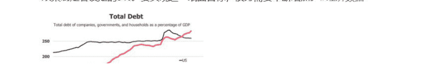
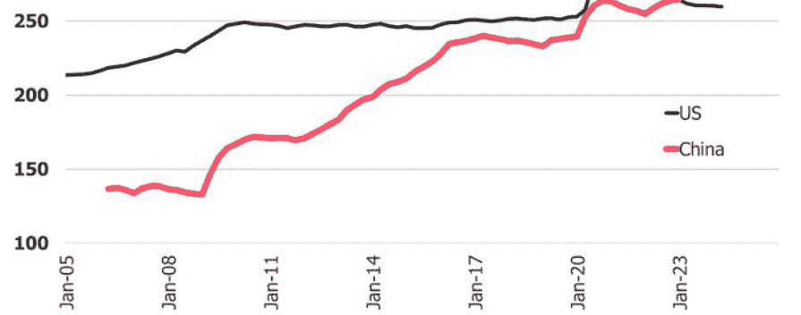
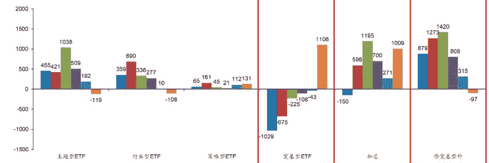
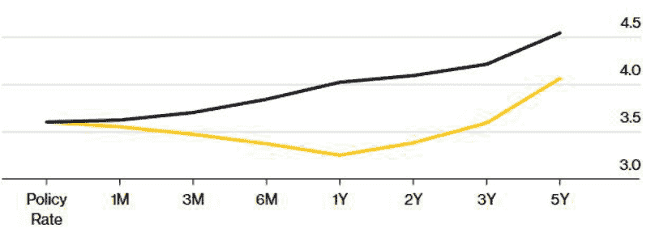
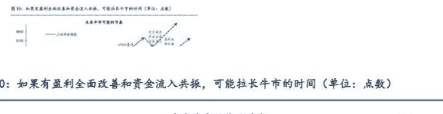
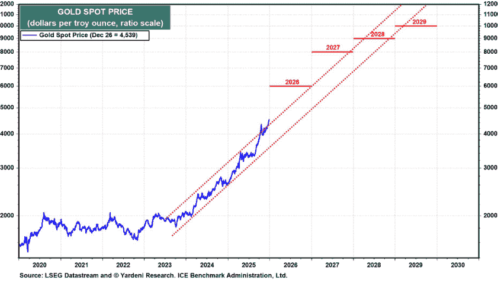
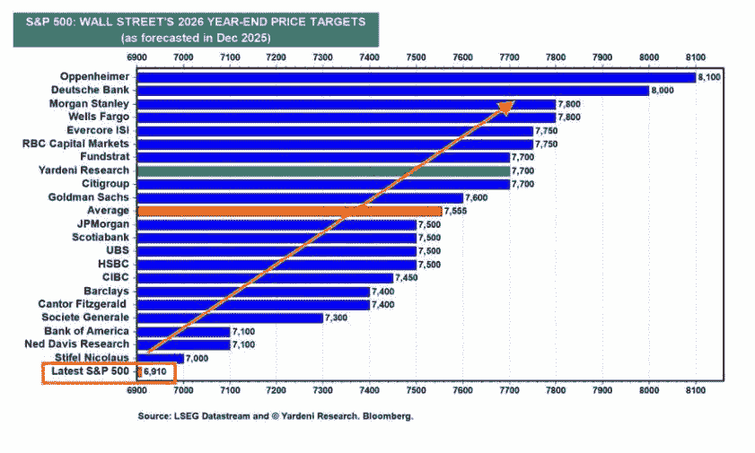
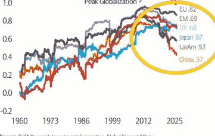

# 南半球聊财经251230

Jason不遇
2025-12-29 09:45

Bukland: 中国和其他快速老龄化的经济一样，正在用债务购买GDP增长。中国的总债务占GDP比率增速超过了任何其他主要经济。国际清算银行和国际基金组织的数据也证实了这一点。这种大额债务累积背后的原因很简单。中国的潜在GDP增长量远远未达到政策设定的5%。要实现这一目标，债务需要不要增加。#经济数据

## Total Debt

## Total Debt

Total debt of companies, governments, and households as a percentage of GDP

Source: The Debt Rebalancing, Bank for International Settlements (BIS)

Jason不遇
2025-12-29 09:47

来源：近个半年，均衡型ETF在12月净流入的，增持规模高达1106亿元，而其中1019亿净流入来自均衡ETF（占比52.2%），为了12月后春季股市的进步推动动力，靠早期的预期热度，助力指数连涨。对市场的影响：如果资金是“冻结”后流出或回到此处，考虑到资金量总量并不是“泡沫”，意味着在南方“小波动，在此1月初或有一波资金面上的小扰动；但本身春季的活跃度增大，由于均衡ETF的增量资金，此部分资金对市场的大趋势影响将不会太大。如果是中长期基金，那么对市场的冲击并不大。#A股

深度视野VIP群 入群追踪350+V 付费加微信cuk2555 微信chpsp556

## 图1:下半年年中仅有12月的行情ETF流入为正，且规模较大

不同类型ETF按月流入规模（亿元）
* 7月 *8月 *9月 *10月 *11月 *12月

来源:京东、华泰证券研究所（数据截至2025年12月25日）

> Jason
2025-12-29 04:39

bloomberg: 随澳洲储蓄银行行业转向正向，澳洲房地产相关损失的可能性正在上升，个人投资者目前尚未感知到风险。#其他国家经济

## 交易员预计澳洲储蓄银行将在2026年加息

本季度预期已从预期降转向

+ Current implied policy curve Implied policy curve as of Oct.1

来源:彭博社

## 深度视野VIP群 人工追踪50+大V 付费进群加微信cuk255 微信chp5568

# Jason-不遇

2025-12-29 04:43

信达：居民增量资金长期乐观，但渠道尚未加速流入。剩余资金/流通市值在7-9月快速抬升后，10月市场震荡小上行，并未出现单边抬头，说明杠杆资金的入市并不缓慢，政策和资金的规模远大于盈利的。流动性货币的核心基础在于供应结构重构，如果股权融资规模速度加快，股市格局再次转向，则市场上波动加大的可能。#A股

来源：中国基金行业报告，东方证券研究所中心（单位：点数））

图 10：如果盈利面改善和资金持续，可能上涨股市（单位：点数）

| 未来股市节奏 | 上行节奏 |
| :--- | :--- |
| 5600 | |
| 5100 | |
| 4600 | |
| 4100 | |
| 3600 | |
| 3100 | |
| 2600 | |
| 2024-09-10 | 2024-10-10 | 2024-11-10 | 2024-12-10 | 2025-01-10 | 2025-02-10 | 2025-03-10 | 2025-04-10 | 2025-05-10 | 2025-06-10 | 2025-07-10 | 2025-08-10 | 2025-09-10 | 2025-10-10 | 2025-11-10 | 2025-12-10 | 2026-01-10 | 2026-02-10 | 2026-03-10 | 2026-04-10 | 2026-05-10 | 2026-06-10 | 2026-07-10 | 2026-08-10 | 2026-09-10 | 2026-10-10 | 2026-11-10 | 2026-12-10 | 2027-01-10 | 2027-02-10 | 2027-03-10 | 2027-04-10 | 2027-05-10 | 2027-06-10 | 2027-07-10 | 2027-08-10 | 2027-09-10 | 2027-10-10 | 2027-11-10 | 2027-12-10 |

资料来源：东方，东方证券研究所中心

# Jason-不遇

2025-12-29 04:46

Yardeni: 每股收益(EPS) 预计在2027年达到35美元，标普500指数有望在2026年底转向7700点，结束今年末未触大关。与此同时，黄金长期目标看到10000美元，而白银等黄金工业需求也将同步走强，有些人把做错的做法比作《施罗斯特-霍利法则》，但全球经济并没有发生规模衰退，世界贸易并没有中断，我们没有终结全球化，而是全球化的再抬头。#金融

# Jason-ner

行业：某些行业走势与人民币汇率相关性强？
- 材料进口依赖程度高，人民币升值驱动进口下降；
- 美元贬值成本较高，人民币升值驱动债务负担减轻；典型如通过海外融资降低成本，长期需求的建筑地产；
- 人民币购买能力带动内需/跨境消费需求：主要集中在海外消费和高端消费领域，包括跨境电商、酒店餐饮、饰品等。#A股

## 图1:2016以来与人民币汇率相关的聚类分析

| 人民币升值偏离 | 行业 | 2016以来 | 三个月 | 两者平均 |
| :--- | :--- | :--- | :--- | :--- |
| 煤 | 贵炭 | -70.4% | -20.0% | |
| 钾 | -59.7% | -46.9% | -53.3% |
| 钢铁 | 铝矿 | -51.1% | -51.0% | |
| 特钢 | -40.6% | -41.9% | -41.2% |
| 基础化工 | -28.6% | -23.6% | -40.1% |
| 农化工 | -33.1% | -40.8% | -37.0% |
| 有色金属 | -42.6% | -29.4% | -36.1% |
| 进口出口型 | 金属制造 | -33.2% | -41.9% | -37.6% |
| 消费 | -63.0% | -44.6% | -53.8% |
| 交通运输 | 航空 | -61.9% | -44.9% | -53.4% |
| 影视设备 | -50.7% | -24.4% | -37.5% |
| 食品 | -37.2% | -37.6% | -49.5% |
| 农产品 | -55.8% | -46.7% | -51.2% |
| 农林交 | -59.7% | -40.3% | -50.0% |
| 传媒 | -42.0% | -35.4% | -38.7% |
| 医疗卫生 | -31.5% | -33.5% | -32.5% |
| 汽车 | -42.7% | -41.9% | -42.3% |
| 汽车制造 | -56.6% | -33.1% | -44.8% |
| 房地产 | -53.1% | -31.8% | -50.3% |
| 房屋开发 | -45.6% | -35.6% | -42.4% |
| 建筑业 | -58.3% | -50.3% | -42.0% |
| 交通运输 | -59.6% | -40.0% | -49.8% |
| 电子 | 光电电子 | -25.7% | -27.3% | -26.5% |
| 商贸零售 | 贵金属 | -41.6% | -40.4% | -41.5% |
| 消费服务 | -40.4% | -29.5% | -34.9% |
| 专业服务 | -56.1% | -32.4% | -44.2% |
| 互联网服务 | -60.2% | -15.4% | -37.8% |
| 食品饮料 | -53.0% | | -41.6% |
| 纺织轻工业 | -48.6% | -22.7% | -35.8% |
| 医药 | -45.2% | -25.7% | -35.4% |

数据来源：Wind聚类经济与金融研究所整理
注：数据截至12月24日

Jason
2025-12-29 05:01

BOFA：分类意味着结构性不受看好的资产，在周期性行情、欧洲和中国股票、新兴市场债券和大宗商品，带来了更大的上空间。再分类意味着全球金融资金流动导致新的分类——“美国科技与金融”的重新选择，全球股票相关性增强；与美国的一些属性已经达到

## 金值

## Exhibit 6: The world owns $26tn of US assets than vice versa
US net international investment position

| World | 1976 | 1983 | 1990 | 1997 | 2004 | 2011 | 2018 | 2025 |
| :--- | :--- | :--- | :--- | :--- | :--- | :--- | :--- | :--- |
| 5 | | | | | | | | |
| 1 | | | | | | | | |
| -3 | | | | | | | | |
| -7 | | | | | | | | |
| -11 | | | | | | | | |
| -15 | | | | | | | | |
| -23 | | | | | | | | |
Source: Federal Reserve Bank of St. Louis, Data as June 2025

## Exhibit 7: Global rebalancing, better diversification
Rolling: 10-year correlations of major indices to S&P 500

Source: Booth Investment Committee, Global Data

2025-12-29 05:03

# 根: 我们2026年美国增长预期上调0.4点，达到2.4%#其他国家

| GDP Growth (%yoy) | Q1-25 | Q2-25 | Q3-25 | Q4-25 | Q1-26 | Q2-26 | Q3-26 | Q4-26 | Q1-27 | Q2-27 | Q3-27 | Q4-27 | 2025 | 2026 | 2027 |
| :--- | :--- | :--- | :--- | :--- | :--- | :--- | :--- | :--- | :--- | :--- | :--- | :--- | :--- | :--- | :--- |
| World | 0.3 | 0.4 | 0.3 | 0.4 | 0.5 | 0.6 | 0.6 | 0.6 | 0.7 | 0.7 | 0.7 | 0.7 | 0.5 | 2.1 | 2.4 |
| Euro Area | 0.5 | 0.5 | 0.2 | 0.2 | 0.3 | 0.4 | 0.4 | 0.4 | 0.3 | 0.3 | 0.2 | 0.2 | 1.3 | 1.5 |
| America | 0.7 | 0.7 | 0.1 | 0.1 | 0.2 | 0.3 | 0.3 | 0.3 | 0.4 | 0.4 | 0.5 | 0.5 | 1.3 | 2.0 | 2.0 |
| UK | 0.7 | 0.7 | 0.1 | 0.1 | 0.2 | 0.3 | 0.3 | 0.3 | 0.4 | 0.4 | 0.4 | 0.4 | 1.3 | 1.5 | 1.5 |
| Japan | 0.3 | 0.3 | 0.1 | 0.1 | 0.2 | 0.2 | 0.2 | 0.2 | 0.3 | 0.3 | 0.3 | 0.3 | 0.7 | 0.6 | 0.5 |
| China | 0.3 | 0.3 | 0.6 | 0.6 | 0.6 | 0.6 | 0.6 | 0.6 | 0.5 | 0.5 | 0.5 | 0.5 | 4.9 | 4.3 | 4.2 |
| Canada | 0.6 | 0.6 | 0.2 | 0.2 | 0.3 | 0.4 | 0.4 | 0.4 | 0.5 | 0.5 | 0.5 | 0.5 | 1.8 | 2.0 | 2.0 |
| Australia | 0.8 | 0.8 | 0.4 | 0.4 | 0.5 | 0.5 | 0.5 | 0.5 | 0.6 | 0.6 | 0.6 | 0.6 | 1.9 | 2.1 | 2.2 |
| South Africa | 0.1 | 0.1 | 0.8 | 0.8 | 0.4 | 0.5 | 0.5 | 0.5 | 0.5 | 0.5 | 0.5 | 0.5 | 1.6 | 1.7 | 1.9 |
| Turkey | 0.7 | 0.7 | 0.0 | 0.0 | 0.0 | 0.0 | 0.0 | 0.0 | 0.0 | 0.0 | 0.0 | 0.0 | 1.0 | 1.0 | 1.0 |
| Brazil | 1.3 | 1.3 | -0.6 | -0.6 | 0.7 | 0.7 | 0.8 | 0.8 | 0.7 | 0.7 | 0.7 | 0.7 | 1.2 | 2.8 | 2.6 |
| Mexico | 0.3 | 0.3 | | | | | | | | | | | | | |

| Name | Symbol | 1 Month | YTD | 1 Year | 3 Years |
|---|---|---|---|---|---|
| South Korea | EWY | 4.7% | 88.3% | 84.4% | 68.0% |
| Peru | EPU | 16.9% | 86.2% | 82.2% | 159.0% |
| Spain | EWW | 4.5% | 73.6% | 73.0% | 122.9% |
| Greece | GREK | 7.7% | 79.9% | 80.9% | 152.0% |
| Austria | EWO | 7.5% | 68.3% | | 85.4% |
| Poland | EPOL | 3.3% | 68.7% | 65.0% | 128.0% |
| South Africa | EZA | 3.7% | 67.8% | 64.1% | 62.2% |
| Colombia | COLO | 4.3% | 68.3% | 62.1% | 85.5% |
| Chile | ECH | 7.1% | 60.9% | 56.0% | 54.0% |
| Vietnam | VMN | 0.9% | 60.3% | 57.1% | 51.6% |
| Italy | EWI | 4.0% | 51.9% | 50.9% | 102.4% |
| Finland | EPFN | 5.2% | 47.3% | 47.4% | 77.1% |
| Mexico | EWW | 5.8% | 52.0% | 46.9% | 95.7% |
| Israel | EIS | 7.0% | 42.4% | 43.2% | |
| Brazil | EWZ | -5.2% | 41.0% | 39.7% | 10.2% |
| Canada | EWC | 4.9% | 36.0% | 35.1% | 66.8% |
| Belgium | EWK | 0.5% | 33.1% | 31.9% | |
| Sweden | EWD | 4.7% | 33.0% | 31.7% | 53.3% |
| Germany | EWO | 5.1% | 34.0% | 31.9% | |
| Switzerland | EWL | 5.2% | 31.7% | 29.9% | 44.3% |
| United Kingdom | EWU | 2.9% | 30.5% | 29.7% | 43.6% |
| Hong Kong | EWH | -1.1% | 31.5% | 29.0% | 4.0% |
| China | XXC | 0.1% | 30.6% | 27.8% | 29.1% |
| Norway | NORW | 6.9% | 29.8% | 27.2% | 15.8% |
| Netherlands | EWN | -1.1% | 28.5% | 26.3% | 52.2% |
| Ireland | ERL | 2.8% | 26.0% | 25.2% | 60.3% |
| Singapore | EWS | -2.0% | 26.1% | 25.2% | 46.6% |
| France | EWO | 1.7% | 25.9% | 25.1% | 36.5% |
| Japan | EWJ | -2.8% | 20.7% | 20.5% | 47.8% |
| Taiwan | EWT | -1.0% | 21.8% | 19.7% | 55.2% |
| Kuwait | KWT | -1.7% | 20.5% | 19.6% | 19.5% |
| UAE | UAE | 5.5% | 18.7% | 18.1% | |
| Malaysia | EWM | 3.8% | 17.2% | 14.3% | 23.1% |
| Indonesia | IDX | 3.0% | 12.3% | 11.5% | 4.6% |
| Australia | EWA | 3.3% | 11.8% | 9.7% | 19.5% |
| Argentina | AROT | 2.6% | 12.3% | 9.2% | 17.3% |
| United States | EUSA | 1.8% | 9.8% | 8.0% | 43.6% |
| Denmark | EDEN | 4.8% | 8.7% | 7.1% | 20.2% |
| Qatar | QAT | -0.1% | 5.2% | 5.9% | 0.2% |
| New Zealand | ENZ | 0.6% | 5.2% | 0.5% | -5.7% |
| Thailand | THD | 3.4% | 0.7% | 0.1% | 16.3% |
| Philippines | EPHE | 0.2% | 0.2% | -0.8% | -4.6% |
| Turkey | TUR | 3.5% | -3.1% | -5.3% | -5.8% |
| India | PIN | -7.8% | -5.9% | -7.1% | 15.2% |
| Saudi Arabia | KSA | -2.2% | -10.5% | -10.5% | -0.7% |

# Jason
2025-12-29 05:15
TKL: 买家现在支付7%的溢价购买银，而不是一年交割。这表明伦敦市场实物短期短缺。本月银价上涨41%，有望创1979年12以来以来月份。上海报价涨至每盎司85美元，美国现货价格高出5美元/盎司。SHANGHAI SILVER TRADES AT $5/OZ PREMIUM TO SPOT SILVER PRICES IN THE US

![b451581a43d693c5a0970dbfe17bd76_7_0]
![b451581a43d693c5a0970dbfe17bd76_7_1]

# CME Group
To: Clearing Member Firms; Chief Financial Officers; Back Office Managers; Margin Managers
Advisory Number: 25-393
Notice Date: December 26, 2025
Effective Date: December 29, 2025

## Performance Bond Requirements - Metal Margin - Effective December 29, 2025

As per the normal review of market volatility to ensure adequate collateral coverage, the Chicago Mercantile Exchange Inc., Clearing House Risk Management staff approved the performance bond requirements for the following products listed in the advisory at the link below.

The rates will be effective after the close of business on December 29, 2025.

Jason: 2025-12-29 05:17
TaviCosta: 铜在突破主要阻力后，正式进入价格发现阶段。在我看来，这可能成为2026年最重要的宏观资产之一。

![b451581a43d693c5a0970dbfe17bd76_8_0]

# Jason
高管：我们预计AI驱动的生产率优势将在2026年提升标每股收益0.4%，2027年增长1.5%。我们预计AI全面采用并开启新业务模式，我们预计如果企业通过更高效的劳动力加投入，总每股收益将增加11%；如果公司通过降低劳动力成本提高利润率，则将增加23%。

![b451581a43d693c5a0970dbfe17bd76_9_0]

Exhibit 12: Corporate AI adoption should continue to rise
Averages weighted by US industry employment shares
Source: Goldman Sachs Global Investment Research

![b451581a43d693c5a0970dbfe17bd76_9_1]

Exhibit 13: Sector variation in potential from AI adoption
Source: Reuters, Company filings, FactSet, Goldman Sachs Global Investment Research

Jason: 2025-12-29 05:59
创业：2025年前11个月每月账户净汇规模中值在237美元（一定不会回）。足够，一个影响因素或是汇率，近期美元汇率低于企业购汇的成本，则造成“负亏”，增强结汇领先。根据近期汇率接近7.0，2022年利润外汇逐渐接近，可能导致汇率回升。长期来看，全国市场自2015年以来呈现“先升后稳”态势。截至2025年11月，其累计租金涨幅为14.17%，远于同期住宅价格43.2%的租金涨幅。

![b451581a43d693c5a0970dbfe17bd76_11_0]

## 表：11月全国40大城市二手均价及幅

| 城市 | 均价（元/㎡） | 同比涨幅 | 当月环比变动 | 1-11月累计变动 | 最高变动 | 价格最高 |
|---|---|---|---|---|---|
| 深圳 | 56633 | -12.26% | -1.83% | -11.93% | -21.97% | 2021-02 |
| 北京 | 48378 | -9.00% | -1.26% | -8.25% | -24.40% | 2017-06 |
| 上海 | 46117 | -11.13% | -1.21% | -10.13% | -23.73% | 2021-07 |
| 杭州 | 31958 | -6.97% | -1.21% | -6.40% | -27.15% | 2022-02 |
| 广州 | 31221 | -12.31% | -1.41% | -11.24% | -28.13% | 2021-09 |
| 厦门 | 28386 | -12.22% | -1.80% | -11.25% | -35.56% | 2022-02 |
| 三亚 | 25411 | -10.47% | -1.18% | -9.63% | -20.58% | 2017-08 |
| 南京 | 21133 | -12.23% | -1.93% | -11.59% | -36.02% | 2021-10 |
| 珠海 | 17922 | -17.21% | -1.80% | -11.63% | -27.22% | 2021-11 |
| 宁波 | 17819 | -11.93% | -1.09% | -10.59% | -37.08% | 2021-08 |
| 天津 | 15573 | -9.44% | -1.06% | -8.95% | -37.49% | 2021-06 |
| 福州 | 15657 | -8.57% | -0.84% | -7.86% | -30.56% | 2018-07 |
| 苏州 | 15439 | -10.15% | -1.08% | -9.46% | -31.46% | 2021-09 |
| 成都 | 13666 | -4.07% | -0.49% | -3.89% | -18.26% | 2021-07 |
| 太原 | 13364 | -11.52% | -0.84% | -10.63% | -30.31% | 2022-02 |
| 青岛 | 13354 | -9.95% | -1.66% | -9.31% | -40.78% | 2018-08 |
| 济南 | 13006 | -6.28% | -1.04% | -5.45% | -28.96% | 2017-08 |
| 无锡 | 12887 | -8.08% | -0.85% | -7.36% | -28.04% | 2022-01 |
| 西安 | 12298 | -12.35% | -1.81% | -11.57% | -25.76% | 2021-08 |
| 合肥 | 12165 | -16.34% | -1.50% | -15.03% | -35.86% | 2022-02 |
| 武汉 | 11143 | -14.71% | -1.74% | -14.02% | -39.18% | 2018-10 |
| 石家庄 | 11071 | -6.96% | -0.95% | -6.53% | -34.03% | 2017-10 |
| 大连 | 10503 | -8.60% | -0.55% | -8.39% | -29.88% | 2021-09 |
| 南昌 | 9858 | -13.69% | -1.25% | -12.77% | -33.70% | 2021-08 |
| 昆明 | 9633 | -4.44% | -0.75% | -7.80% | -31.12% | 2021-07 |
| 贵阳 | 9619 | -11.06% | -1.59% | -10.63% | -35.50% | 2018-07 |
| 太原 | 9510 | -3.25% | -0.25% | -2.90% | -22.02% | 2018-12 |
| 南宁 | 9233 | -7.81% | -0.95% | -7.23% | -23.24% | 2019-07 |
| 长春 | 8952 | -9.38 | -0.91 | -9.02% | -23.82% | 2019-08 |
| 福州 | 8718 | -8.59 | -0.94 | -8.27% | -31.09% | 2021-11 |
| 重庆 | 8678 | -9.25 | -0.93% | -8.30% | -31.41% | 2021-06 |
| 乌鲁木 | 8553 | -2.14% | -0.06% | -1.68% | -9.70% | 2021-06 |
| 西宁 | 8472 | -4.10% | -0.43% | -3.69% | -27.03% | 2021-04 |
| 哈尔滨 | 8224 | -3.85% | -0.56% | -3.69% | -26.02 | 2020-09 |
| 呼和哈市 | 8066 | -9.05% | -0.75% | -8.52% | -27.99% | 2021-07 |
| 庆福 | 7962 | -6.64% | -0.13% | -5.76% | -28.89% |
