# 南半球聊财经2511230

Jason不赢
2025-12-30 04:23

shanghaiMacro:欧元区对华的贸易逆差已正式越过美国——这是全球贸易格局中一个被低估但重要的转变。贸易格局正日益从传统的中轴转向中欧轴关系。#经济数据

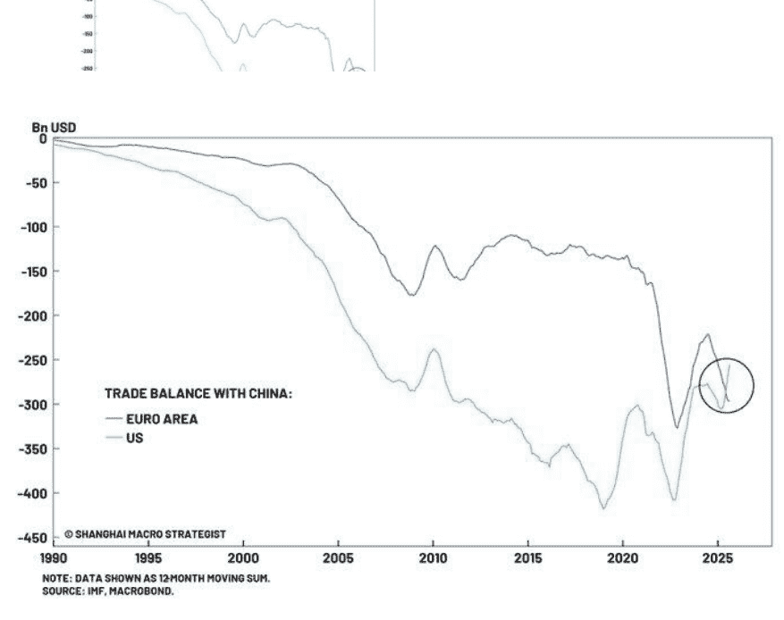

Jason不赢
2025-12-30 04:33

# 高盛:我们对2026年GDP持更乐观预测#经济展望

20 December 2021 | GOLDMAN SACHS Research | Outlook Forecasts

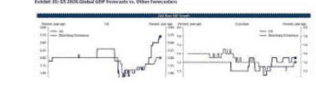

深度视野VIP群 人工追踪50+大V 付费进群微信cuk255微信chp5568

# Chart 35: GS 2026 Global GDP Forecasts vs. Other Forecasters

Source: Bloomberg, Goldman Sachs Global Investment Research

Jason不懂
2023-12-03 04:45

中国劳动力市场：当前国内基层就业的问题并不是“收入下降”或“岗位减少”这样直观的变化，而是一种深层的结构性问题：最低工资标准为企业提供了直观的基准，而过低的最低标准反迫使劳务者几乎找不到地方加班才能获得一个维持生活的收入。我们分析了7.3万条基层招聘信息，发现时薪平均为22元，低于多地定义的最低标准，换成6500元月薪看上去还不够，实际只是招发现有时间换来的结果，近70%的月薪岗位加班、绩效、灵活等调整后，35%的招聘信息扣薪、无保障等违法条款。#经济数据

# 深度视野VIP群 人工追踪50+大 付费加微信cuk2555 微信chp5568

## 时薪中位数 22 元/小时

时薪在招聘信息中的分布

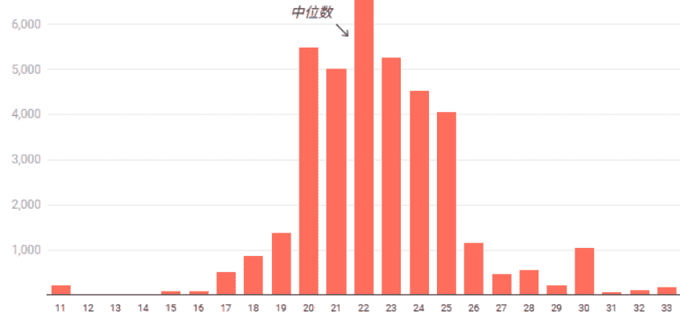

注：招聘信息中常出现一个工作区间，如时薪21-23元，但多数情况下并未明确写出获得较高工资的条件。对于企业或中介来说，按区域下限发放工资，在法律上并未违反承诺，但多数情况下实际薪资远接近薪资下限。本文非特殊说明，均按招聘区间的下限进行分析。

图表：中国劳动统计-获取数据-创建人 Datawrapper

## 时薪中位数普遍低于最低时工资

最低时工资标准2025年1月适用标准

| 城市 | 时薪中位数 | 最低时工资 |
|---|---|---|
| 上海 | 22 | |
| 北京 | 22 | |
| 合肥 | 18 | |
| 深圳 | 19 | 20 |

注：最低时工资需按照最低月剩余以正常工作时出的时工资，只适用于全日制职工，即每日不超过4小时，每周不超过24小时，结算周期为15天。设立最低时工资是为了让不稳定、暂没有福利保障的灵活劳动者拥有一个合理的工资，因此我们将与其扩展的劳动力市场数据进行量化。

图表：中国劳动统计-获取数据-创建人 Datawrapper

# 深度视野VIP群 人工追踪50+大 付费进群加微信cuk255 微信chp5568

## 35%的招聘信息有惩罚性条款

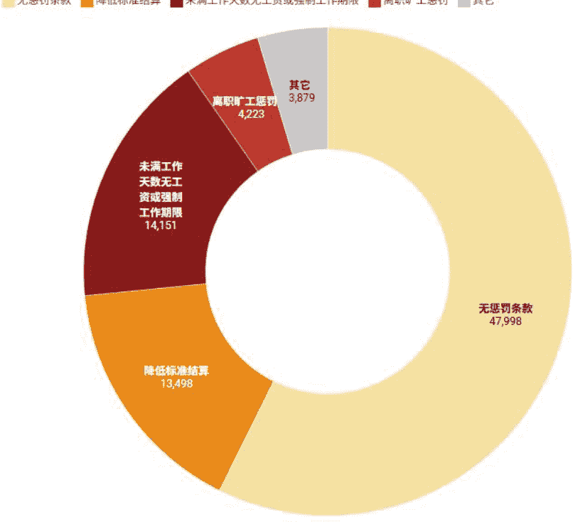

来源：中国劳动、Datawrapper

Jason不
2025-12-30 04:47

## BCA: 联合国对中国年龄人口的展望

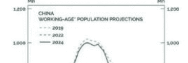

# 深度视野VIP群 人工追踪50+大 付费进群加微信cuk255 微信chp5568

## CHINA WORKING-AGE POPULATION PROJECTIONS

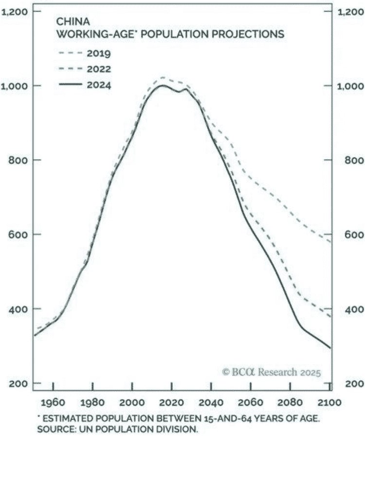

SOURCE: UN POPULATION DIVISION
- ESTIMATED POPULATION BETWEEN 15 AND 64 YEARS
- 2019-2024

Jason不
2025-12-30 04:52

数十年来，大规模基础设施建设推动了中国的增长并建立了庞大的网络，每公里的成本高达1亿元。根据2018年最新更新数据显示，许多城市未能达到预期。上个月，宁波八条线路每天仅4600人，苏州11条线路，这两个规划距离远超所需的密度。

## TAX # 深度视野VIP群 入50+V 付费群cuk255 微信chp568

中国正在暂停地铁扩建，包括某些富城市——分析人士说，这一决定反映了从过去债务驱动的基础设施转向财政纪律和投资效率的新时代。政策制定者正在审查项目中，目前尚未达到国家级机构审批的标准。当地委员会指出，北京已发布更严格的标准，要求在批准前建成项目重新审核。北京交通大学城市研究主任赵健：“由于许多城市的地铁还需要补贴，其资金来源可能有限，政府必须加速。”这种更严格的监管，在曾较小或未发达城市中并不常见，如今已扩展到经济强国。苏州位于江苏省，上海人口1300万，拥有全国国内生产总值之一。

> Jason不赢
2025-12-30 05:10

bloomberg: 美乌会结束后，特朗普或将表示俄乌战争的“突破”越来越近”，尽管这次会谈在达成协议方面几乎没有实质进展，而俄罗斯更加积极。#其他国家经济

# 深度视野VIP群 人工追踪50+大 付费群加微信cuk255 微信chp568

2025年12月30日格林标准时间+13日凌晨4:59 更新于2025年12月30日上午9:25 GMT+13

唐纳德·特朗普总统推动结束乌克兰战争的努力面临临新的复杂局面，由于弗尔基米尔·普京调整了对该国谈的立场，前俄俄罗斯领导人声称乌克兰人猛击了他的住所。据克里姆林宫称，普京在电话中告诉特朗普的决定，尽管基辅将俄罗斯的指控描绘为在破坏和平的进程。特朗普在佛罗接受记者采访时谈及此争议，称普京在讨论中告诉他所调整的基础。美国总统似乎站在普京的一边，表示他“非常愤怒”。

bloomberg:华尔街全部看多明年美股#美股

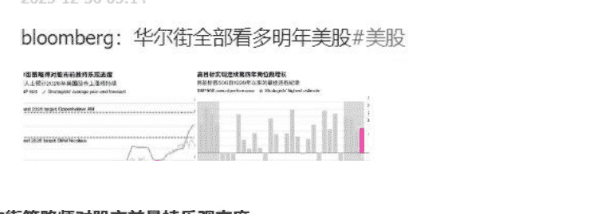

华尔街策略对股市前景乐观态度

- 预测人士预计2026年美国股市上涨将持续
- S&P 500 Strategists' average year-end forecast

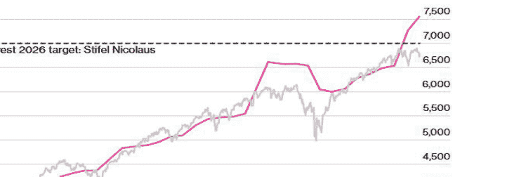

来源: 路博社

# 深度视野VIP群 人工追踪50+大V 付费进群微信cuk255 微信chp566

## 最高目标实现连续第四年两位增长

这将标500自1999年以来的最佳纪录

- S&P 500 annual performance - Strategists' highest estimate

| | 1995 | 2000 | 2005 | 2010 | 2015 | 2020 | 2025 |
|---|---|---|---|---|---|---|---|
| | 35% | 30 | 25 | 10 | -5 | -10 | -15 | -20 |

来源：彭博
注：2026年初基于标500指数12月26日收盘

S&P500指数&债股

Jason
2025-12-30 05:18

东哥：在市场担心销售的现任美储主席鲍威尔可能会失去独立性，一个市场部的风险是鲍威尔可能遭遇参考历史，鲍威尔仿1940年代的美储主席沃尔纳什，市场在短期内出现反弹通常需要交易支持，并将威尔的任期在2025年5月15日结束，但任期预计到2028年1月31日。因此，理论上鲍威尔可以卸任主席后继续担任董事，但当前市场对此仍充分认为博弈成为焦点。数据显示，鲍威尔在2026年8月离开的概率85%，即市场预计期结束后鲍威尔会继续“转型”。最新的2025年12月FOMC会上，鲍威尔暗示是否考虑在卸任主席后继续担任理事”，他表示将专注于主席下的工作。这个问题没有任何回答。#其他经济涉及

# 深度视野VIP群 人工追加50+大 付费加微信cuk255 微信chp568

## 图1：现任董事及人员表

| 姓名 | 职位 | 本任职时间 | 本任职截止时间 | 货币政策立场 |
|---|---|---|---|---|
| 霍内尔 | 主席兼董事 | 董事:2021.5.21 董事提名: 奥麦马 | 董事:2028.1.31 | 中性 |
| Jerome H. Powell | | 副主席: 2022.5.22 祥登 | 副主席: 2026.5.15 | |
| Philip N. | 副主席兼董事 | 董事:2022.5.23 副主席:2022.9.13 董事提名: 祥登 | 副主席:2036.1.31 副主席:2027.9.13 | 中性 |
| Christopher J. Waller | 董事 | 2020.12.18 | 特别首席 | 2030.1.31 | 最宽松 |
| Michelle W. Bowman | 董事 | 2020.10.30 | 特别首席 | 2034.1.31 | 最宽松 |
| Michael S. Bier | 董事 | 2022.7.19 | 祥登 | 2032.1.31 | 中性 |
| Lisa D. Cook | 董事 | 2023.9.6 | 祥登 | 2038.1.31 | 宽松 |
| Stephen I. Miran | 董事 | 2025.9.16 | 特别首席 | 2026.1.31 | 最宽松 |

数据来源：英联、彭博、东英研究所、整理

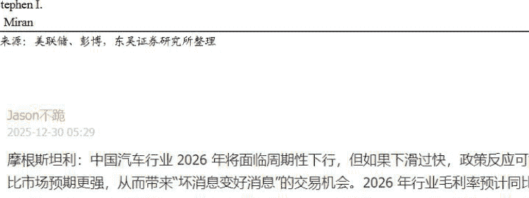

摩根士丹：中国汽车行业2026年面临周期性下滑，但下滑速度快，政策反应可能会比市场预期更强，从而带来“环保消息变好”的交易机会。2026年行业增速预计同比，国内销量预计下降7%，出口占比+16%（主要来自欧洲、东盟、拉）#经济数据

# 深度视野VIP群 人工追踪50+大V 付费进群加微信cuk255 微信chp568

## Key Forecasts at a Glance

Exhibit 1: Our 2026 China auto industry forecast

| 294mn wholesale | 22.5mn domestic |
| We estimate China PV wholesale to fall 3% YoY in 2026. | We estimate China domestic sales to fall 7% YoY in 2026. |

# 6.9mn export

We expect +16% YoY export growth in 2026, including Europe (+20% YoY), India (+25% YoY), ASEAN (+25% YoY).

## 75% local share | 30% overseas share

We estimate China brands to account for 75% volume share in 2026. We estimate China brands to account for 30% outside of China by 2030.

## 17.3mn NEV wholesale

We expect it to grow 19% YoY in 2026, implying 59% penetration.

## 62.3bn BEV/PHEV mix

We expect BEV/PHEV to grow 14% YoY respectively in 2026.

## 32% L2+ penetration

We expect L2+ smart penetration to reach 32% by 2026 and 50%+ by 2030.

Exhibit 8: We expect China PV volume to fall 3% to 29.4mn units in 2026

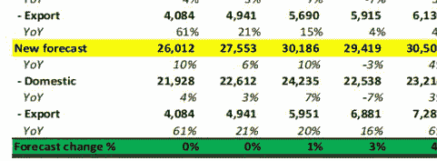

Exhibit 9: China PV forecasts

| | 2023 | 2024 | 2025 | 2026 | 2027 |
|---|---|---|---|---|---|
| PV wholesale | 26012 | 27553 | 29925 | 28454 | 29354 |
| Old forecast | -1% | -5% | -5% | -3% | -4% |
| - Domestic | 21928 | 22612 | 24235 | 22538 | 23214 |
| - YoY | 4% | 3% | 7% | -2% | 3% |
| - Export | 4084 | 4941 | 5690 | 5915 | 6139 |
| - YoY | 6% | 21% | 16% | 4% | 4% |
| New forecast | 26012 | 27553 | 30186 | 29419 | 30501 |
| - Domestic | 10% | 6% | -3% | -4% | |
| - YoY | 4% | 7% | -2% | -3% | |
| - Export | 4084 | 4941 | 5951 | 6881 | 7287 |
| - YoY | 22% | 20% | 15% | 17% | |
| Forecast change % | 0% | 0% | 1% | 3% | 4% |

# Jason不涵
2025-12-30 05:32:03

瑞银:根据ChinaIOL发布最新的白电数据，预估2026年Q1出口同比，空调(AC) -2%，洗衣机(WM) -1%，冰箱(Refrigerator) -5%。总体，白电处于“补库后行业下行周期”(Q3-2025年)。但上半年1H6可能继续惯性，2H6因为数据低，增速可能趋稳定。经济数据

UBS
China Consumer Appliances Sector

Global Research
29 December 2025

# First Read

# China Consumer Appliances Sector
Q126 production growth and shipments YoY on a high base

| Equities | China Consumer Electronics |
| Remote Pan | Analyst | ennie.pan@ubs.com +86-21-868823 |
| Christine Peng, CFA | Analyst | christine.peng@gmail.com +852-2971 7571 |
| Molly Huang | Analyst | 5146052510001 molly.huang@ubs.com +86-23-868823 |

On 26 December, ChinaIOL released the latest goods production planning data. It expects air conditioners, washing machines, and refrigerators production grow by ~1% for domestic demand and ~6% for export in Q1 March 2025. It also expects growth for ChinaWhiteAppliances to be ~2% vs. last year. The latest Jan forecasts imply Q126 growth of -2%~1%~5% YoY, on top of high base (2025=+5%~16%~7% YoY). The YoY decline in 2026 reflects the dcline of 2025 domestic demand and shipment.

Q126 domestic production ~3%~1% YoY

## Inventory

- Tier 1 (cities): Beijing, Shanghai, Shenzhen, Guangzhou
- Tier 2 (cities): Changchun, Changsha, Chengdu, Chongqing, Dalian, Dongguan, Foshan, Fuzhou, Haikou, Harbin, Hefei, Jinan, Kunming, Nanjing, Nanning, Ningbo, Qingdao, Shenyang, Suzhou, Tianjin, Wuhan, Xiamen
- Tier 3 (cities): Beibei, Beijing, Changzhou, Changzhou, Danchang, Guizhou, Guiyang, Hotan, Huainan, Huizhou, Huizhouhou, Jiaxing, Jinhua, Jinan, Jintian, Lanzhou, Maanshan, Maoming, Nanning, Qinhuan, Qinhuang, Ganzhou, Rishao, Urumqi, Xining, Xuzhou, Yantai, Yichang, Yinchuan, Yueyang, Zhengzhou, Zhuzhou
- Inventory months are calculated based on monthly average sales.

### Exhibit 27: Inventory - Tier 1

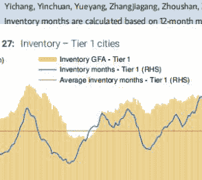

### Exhibit 28: Inventory - Tier 2

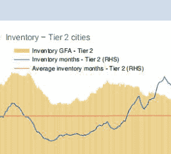

Source: GIC, Morgan Stanley Research.
Source: GIC, Morgan Stanley Research.

Jason Chen
2025-12-30 11:19

截至2024年底，全国有58个城市开通轨道交通线路361条，运营里程12160.77公里，其中追踪平均里程北京、广州、厦门等城市的运营水平较高。

2024年，全国平均人均人次运营收入1.79元，平均每人次运营成本1.6元。
2024年，全国平均每车车辆运营收入17.26元，平均每车辆运营成本33.42元。

截至2024年底，全国有58个城市开通轨道交通线路361条，运营里程12160.77公里，其中追踪平均里程北京、广州、厦门等城市的运营水平较高。

# 2 行业难点 破解行业财务可持续

为破解城轨行业债务规模、建设成本高、票价机制滞后等财务难题，协会专门成立了工作小组，委托上海地铁、联合所有城轨交通企业，并建立了特聘专家组，开展了《城市轨道交通财务可持续发展研究》。期间，组织调研了44城轨交通企业，召开了5次专题座讨会，从债务模式、系统选型、运营机制等维度揭示了问题成因，并提出了“控制初始投资、健全财务机制、争取政策支持”等一揽解决方案。

协会在研究成果的基础上，编制并发布了《中国城市轨道交通协会关于促进城市轨道交通企业财务可持续发展的指导意见》，围绕“公益为本、经营为要”的核心理念，首次明确了“政府补贴是购买公益服务的成本补偿”的理论依据，提出了拓展资金渠道、优化补贴机制、资产管理创新三大政策方案，为破解“建得不起、养不起”的行业困局提供了系统性参考。

## Jason不懂

2025-12-30 12:54
李嵩：2026年GDP增速目标预计将继续维持在5%左右。预计2026年超长期特别国债资金支持消费的规模，至少会将回持至2025年的3000亿，补偿缺退的可能性不大。在低基数回退的影响下，中国CPI和PPI的同比将回升，预计PPI同比将从2025年的2.6%提高到1.2%，CPI同比从2025年的0.0%提高到0.5%。

通过对11个月中国对非洲出口的结构分析，可见11个月中国对非资本出口同比增长50.8%，远于同期范围内最终消费品的对非资本出口增速。我们倾向于认为，中国对非洲出口增长，主要原因是“一带一路”框架下中国企业向非洲的产能转移，并通过非洲制造转制造实现。

## 经济数据

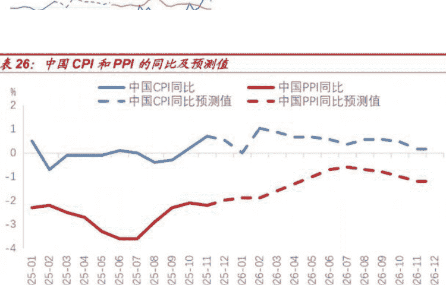

图表26：中国 CPI和PPI的同比及预测值
来源：Wind。中泰证券研究所

## 图表25：近三月出口价格波动指数持续大于 PPI 同比

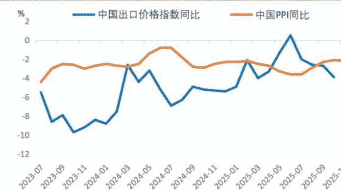

来源：Wind. 中证券研究所

## 图表28：近出口广义财政政策及其各项

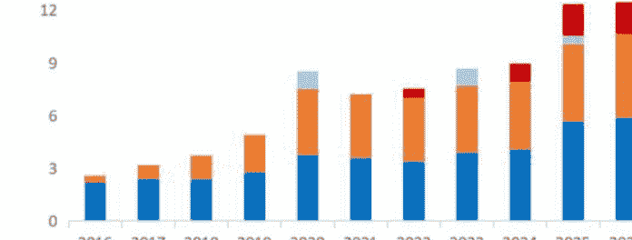

来源：Wind. 中证券研究所（注：2026年为预测值）

## 图表38：主要经济指标2025年、2026年季度和全年预测

| 同比(%) | 2025年 | 2026Q1 | 2026Q2 | 2026Q3 | 2026Q4 | 2026年 |
| :--- | :--- | :--- | :--- | :--- | :--- | :--- |
| 国定资产(累计) | -2.0 | -3.0 | 0.0 | 2.5 | 3.5 | 3.5 |
| 制造业(累计) | 1.0 | -2.0 | 0.0 | 1.5 | 2.0 | 2.0 |
| 房屋(累计) | -16.0 | -16.0 | -13.0 | -12.0 | -11.0 | -11.0 |
| 基建(累计) | -1.0 | 1.0 | 3.0 | 6.0 | 8.0 | 8.0 |
| 出口(当季) | 5.2 | 5.0 | 4.5 | 2.5 | 2.0 | 3.4 |
| 进口(当季) | -0.5 | 0.0 | -0.5 | -1.5 | -1.8 | -1.0 |
| 社会(当季) | 4.0 | 2.9 | 2.8 | 3.2 | 3.3 | 3.0 |
| CPI(当季) | 0.0 | 0.6 | 0.5 | 0.5 | 0.3 | 0.5 |
| PPI(当季) | -2.6 | -1.8 | -1.0 | -0.7 | -1.2 | -1.2 |
| 存量 | 8.4 | 7.6 | 7.7 | 7.7 | 7.8 | 7.8 |
| 存量2 | 8.0 | 7.8 | 7.7 | 7.2 | 7.1 | 7.1 |

来源：Wind. 中证券研究所

# Jason-不离

2025-12-30 12:56
国信：2025年11月，全国13个重点城市租赁市场租金普遍下行。从环比变化看，所有城市租金指数呈现下降态势，其中西安、武汉和青岛；广州跌幅最小，从同比变化，各城市租金延续增长，环比幅度扩大。西安、南京和青岛为最低。(img/98aa4911a1b115f2bc61d9481b6f41aa_15_0.png)

表：2025年11月重点城市租金及指数涨幅

| 城市 | 租金(元/㎡) | 环比变化 | 指数对比幅 |
| :--- | :--- | :--- | :--- |
| 上海市 | 80.88 | -0.72% | -2.02% |
| 北京 | 78.93 | -1.07% | -3.67% |
| 深圳 | 76.66 | -0.45% | -1.69% |
| 广州 | 47.62 | -0.64% | -2.81% |
| 杭州 | 45.78 | -1.12% | -3.13% |
| 南京 | 35.48 | -1.00% | -5.39% |
| 福州 | 33.74 | -0.26% | -2.65% |
| 成都 | 31.53 | -0.83% | -2.38% |
| 天津 | 28.83 | -1.23% | -1.69% |
| 大连 | 28.22 | -1.02% | -2.67% |
| 武汉 | 27.01 | -1.35% | -2.23% |
| 西安市 | 26.28 | -1.58% | -5.92% |
| 青岛市 | 22.53 | -1.32% | -4.44% |

数据来源：国信达数据

## 2025年11月各线城市租金指数涨幅情况

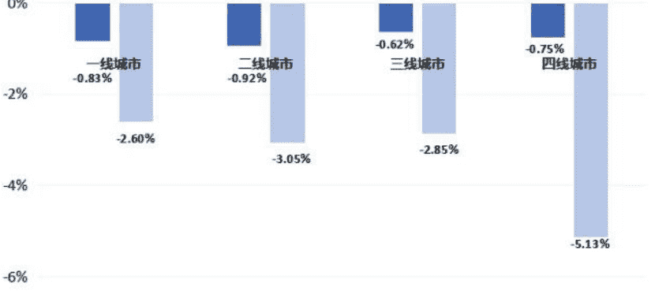

数据来源：国信达数据

## 第一财经：买出口情况

作者：吴嘉鑫·刘涛

少数案例显示，近年来各地出现了很多“买出口”。他们利用了统计数据中的灰色地带和贸易风险，套取地方补贴资金。由于出口政策宽松，这些出口的注册恰恰带来了出口数据的增长。更重要的是，市场对此类行为态度，少数案例显示地方政府并不允许这种行为。

配合报道，今年1月，少数案例显示，地方政府并不允许这种行为。被控在沿海地区，一些“买出口”套取政府资金，金额达亿元，构成骗罪。

细节显示，某地方，被控与当地商务部门达成买出口协议后，在没有实际经营的情况下，以本人的身份，被告仅注册了90余有限公司，提供公司名称和资料，通过外联委托合同真实办理货物，虚用公司名称进行办理，非法在海关的数据中。被告一方面向海关介绍“买出口”单价，另一方面商务部门通过出口文件获取1美元人民币3.5钱左右的标准奖励金，为规避税务审查，在获取奖励金后，被控人将奖励金销毁。

被告辩称：“成立这些公司的目的就是‘买出口’，套式的办理出口数据，缴纳后再去税务局领取奖励金，拿到奖款之后就注销了，其属再三表示：这种行为是配合政府政策的。如果以1美元出口单价扣3.5钱人民币计算，以美元出口对应的购汇将在统计中增加人民币，为‘买出口’发放奖励金产生额外税费负担，对地方经济也没有实质性收益。”相关案件公诉方指出：“地方政府为了稳振地方经济发展设立了平台，被告被控用便利政策行的手段虚立空航空公司，购买他人的出口数据，非法在自己公司名下，在海关系统中构成了形式式的出口增长数据，市场上没有进行任何经营活动，对出口发展没有任何责任，这种典型的虚构事实。没有任何组织程序要求出口上政府的决策并获得同意的。”

## 相关部门存在绩效波动

报关中介机构拥有大量出口数据，企业通过报关中介套取数据，赚取利润。此类出口数据规模巨大，却没有被地方税务部门掌握，因此可能导致地方税务部门业务异常，从而从被调查。

但多名被告家属律师则称，为海关谎报后返回的数据均有对应的货物，数据真实，不存在虚假。有被告方诉称，该地方以及与海关相关的企业提供的出口数据是为了“准确出口”，相关人员对此进行“明示”——提供的数据、账目包含了此类数据。如果地方税务局查实出口数据的需求，相关人员没有相关出口数据，由于涉及出口业务，多名被告还有出口资质，少数案例显示地方政府支持这种出口的。

“买出口”产业的产生源主要是地方政府对出口数据的考核，与当地商务部门达成“买出口”协议，主要是政府主导。案件中所涉及的某些外资企业，海关根据线索摸排，后移交某地方政府要求办理出口数据，地方政府伪造出口文件，对国外企业的出口行为，由当地商务部门负责策划、执行、负责。被控与当地商务部门达成买出口协议后，以本人的身份，被告仅注册了90余有限公司，在公司没有实际经营的情况下，提供公司名称和资料，通过外联委托合同真实办理货物，虚用公司名称进行办理。被告一方面向海关介绍“买出口”单价，另一方面商务部门通过出口文件获取1美元人民币3.5钱左右的标准奖励金，为规避税务审查，为规避税。

## 案例评析

第一财经发现，各地海关发放补贴政策之间存在差异，对“买出口”的定性、处理并不一致。一些税务局发放补贴时属于“免责专享”，无需交涉其他海关官员或职员的证言证明，海关发放主要依据海关出口数据，海关免责专享。相关领域显示：“该项补贴只是针对出口贸易报关完成情况进行审计，考核的准则是出口数据。在未回应补贴的企业实际经营情况完全无暇，比起缴纳社保、没有在本地实产、真实生产时，该项应当表示：‘按照文件要求落实，避免发放补贴时主要依据是海关出口数据，没有其他方面的要求。’被问到：‘如果企业没有在当地社保，没有在当地税务，没有实产，属于‘空壳’公司，但是当地注册的企业，有海关出口数据增长，他们不在你们发放补贴的风险。’”来源：第一财经。

第一财经注意到，判例显示类似被告并未定罪。如果如此审判，法院认为被告在与经贸公司签订合同时表示一致，合同已经得到了经营的认可，所获得出口补助是经集团审计计算并经会议审决定的。证明文件，公诉机关认为被告构成骗罪的意见未被采纳。

安金律师事务所主任王胜在《一说购买货物获取政府补贴资金争议》文中称，自2022以来，某企业购买货物获取政府补贴资金的行为在司法实务中未被认定为骗罪的更为少见。也有非非法经营、提供证明文件并伪造国家机关公文的行为。他在看来：在海关部门中，明确、知道、关注‘出口服装’的方式，以及货物信息真实性，国家对出口信息不全的情况，行为为出口货物的‘棘’到发地区，其实是一点没办法，是自由选择的结果。国家对于基本信息和地方政府‘出口’的目标已经实现，有利于中央政府对地方政府制定制度补贴时的需要，出口的。吴亚林律师认为，各实业人员购买货物获取政府资金的信息不公开，政府方面确定出口范围。”

同时，根据2025年10月1日履行的税务总公告2025第17号文，代理出口企业未确认实际委托出口方基础和出口金额的，作为该出口方承担出口金额申报扣缴的企业所得税。根据新规，在所得税规定层面，代理企业未能履行法定的申报与核实业务，相关税务将会视同缴回，并由全额出口方承担企业所得税的纳义务。这意味着买卖出口的利润空间将大大减小，风险增加。

中国法大法学院法研究主任正面一经表示，此买卖出口案件中，航空公司、报关中介还能存在虚增、骗取利益的。这种“自高套”的行为属于外贸管理问题，他认为买方和卖方要同时击，各个部门要执行权力，加强监管的共识。对于这类虚假和重复的出口还是可以这样出的，政府要有明确的绩效，考核措施应当到位，不应虚假的外贸增长数据，财政方面要严厉惩稽，加强财务监管。

施文认为，外贸政策需要重视，关键在公平执法，主要职责应当是营造执法、市场化、国际化的良好商环境，企业奖励应当从贸易中获得。如果所卖的产品在市场上没有竞争力，靠政府补助扶出口，不仅损害了经济，还违背了WTO相关规则。补助政策会让财政资金消耗使用，干扰市场秩序，特别是对韩国经济、民生、社会保障带来压力，更加将财政资金用于提供公共服务。“现在有些政府可能基于短期利益或者短期目标虚构这些数据，这和中央提出的高水平发展、建设一流营商环境，国际国内双循环背道而驰。

# 深度视野VIP群 人工追踪50+大V 付费进群加微信cuk255 微信chp5568

# 深度视野优质文集·链接优质社群，助你成功

全部包含以下内容：限时年费188/年 加微信cuk255

- 1 吃粉丝粉丝时圈文加时社群对话（原价 365 元/年）
- 2 子明私享圈（含）内部文章
- 3 政事堂（原子明）付费内容再送顺子明群聊
- 4 米联储闲【作者米糕】（原价 599 元/年）
- 5 欧洲金雀会员专属文章（原价 328 元/年）
- 6 钨五厂内部圈（原价 400 元/年）
- 7 卢克文青读书会专属文章（原价 699 元/年）
- 8 鉴茶财经知识星球（原价 3310 元/年）
- 9 猫哥的视界知识星球（原价 299 元/年）
- 10 财新周【独家新闻】原价 1498 元/年）
- 11 杨世光在金钱（原价 2200 元/年）
- 12 森森财经知识星球（原价 1600 元/年）
- 13 源游译付费文集（持续更新）
- 14 司马南解读毛选全套音频和全套书籍珍藏版无割减（原价 2.3 万）
- 15 虚虚三部曲【民国梦、帝国战争、不被理解 MAO】（原价 599 元）
- 16 卢克文再送：星球文章（原价 268 元/年）

# 深度视野文集
进群微信cuk255

深度视野（付费文集）

- 17 额外赠送：卢萨涨爆豪付费专栏、村西边老王、三花九村文集

不定内容：（更多资源将下去了....）

- ① 守夜人司令星球、摇钱魔王知识星球、生财知识星球、
- ② 创始笔记、达沃论星球、成术财富团、雪球花甲老头等
- ③ A视野、大树乡谈、江宁知识、泮咩说、上海海学等付费文集
- ④ 西风付费文章、老端、赢在八小时之外、局外人的视界、升值、老
- ⑤ 体制内等等其它一些大V付费文章（每月不低于600 元付费文集）

# 限时年费188/年 低成本链接全网大优质内容
