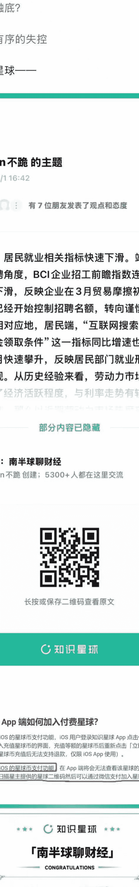

# 雅芬为什么你不懂分责

Jason 不懂的 2023-06-15 20:16 | 2赞

在我看来，你还是应该承担自己的责任的。

第一个，就是主上公司，它的职责是：

第二个，就是你的公司，它的职责是：

但是，现在亏损了是由公司来承担，利润却由你承担？

现在我赚了钱，也是你的公司来承担，如果亏损了，还是由你来承担？

而且，这合理吗？

雅芬，你还是应该承担自己的责任的。

如果你不承担责任，那么公司就不会会承担你的责任了。

雅芬，你太傻了！（此处重复内容略）

- 1. 作为一个经营者你应该承担的责任
- 2. 经营者要对亏损承担责任
- 3. 经营者要对员工的负责
- 4. 经营者要对社会承担责任
- 5. 经营者要对自己的选择负责
- 6. 经营者要对自己的决策负责
- 7. 经营者要对自己的结果负责
- 8. 经营者要对未来负责

Jason不懂
关注作者

# 免费 价值 及时 专注

# 扫码加入 知识星球TOP 免费资源群

- 每日免费获取有价值资源
- 可提供各类资源搜索服务

| 热门付费文章 | 各行行业报告 |
| :--- | :--- |
| 精选图书资源 | 副业挣钱方法 |
| 职场实用资源 | AI政经自媒体 |

公众号: 知识星球TOP | 微信号: jntsg8 | 微信号: jntsg2

分享资料仅供个人学习，请及时删除，切勿商用传播
