# Jason-Casey

2025-07-21 02:31

揭开：国际油价下跌对国内进口价格的输入累加作用，石油价格和能源消费价格下跌是近期国内进口价格下跌的重要因素。我国石油进口出口量大，2024年原油对对外依赖约为72%，2025年6月上，PPI石油价格分项同比为-8.6%、-12.9%、-9.0%，CPI交通工具用进口燃料分项同比为-10.8%、3.3%和-2.5%大幅下滑。下半年，中国进口或面临下跌压力，对出口行业价格的影响可能进一步增加，也存在压力。

## 行业宏观

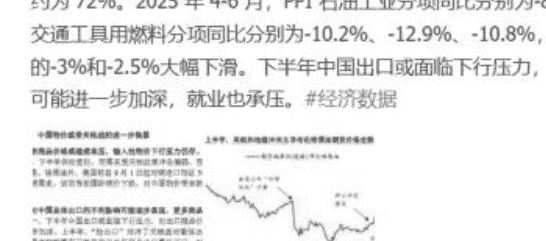

## 二、下半年，中国大宗商品或关税压力将逐步回锚

一、国际大宗商品价格或继承压力，而需求受关税政策冲击缓冲，预计国际油价持续低位震荡。除原油外，美国将8月1日起对钢进口加征50%关税，可能冲击全球需端，进而导致国际油价下跌，对中国国内价格相关进口物资带来不利压力。

二是、关税压力对整体出口的不利影响可能逐步减少，更多商品面临价格下跌风险。下半年中国出口或面临下跌压力，对出口商品价格的负面影响可能进一步增加。上半年，“出口对美”的关税战对整体出口的负面影响，但出来的前景有望导致我国出口量下降，对国内价格或有进一步不利影响。第二，出口商品转销国内或加制造市场价格竞争。

三是、部分行业的企业可能受到影响，延缓国内需求回升有望。2025年1-5月，服装、羽毛羽制品和制鞋、家具制造业的平均用工人数同比减少2.3%、2.6%、5.1%。

图11：2025年上半年，美国大宗商品特种品种期货价格走势

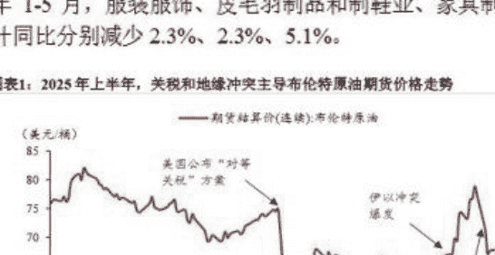

数据来源：Wind、中信证券研究院

# 加微信jntsg2，免费进资料群

## 图2：2025年关税战打响后，纺织业、塑料橡胶制品价格跌幅进一步扩大

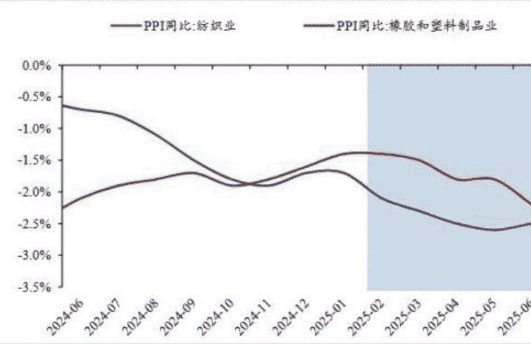

资料来源：Wind、粤创证券研究院

## 图4：上轮中外贸易贸易期期间，CPI在2019年下半年出现明显下降

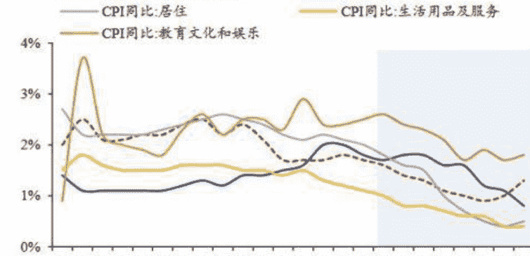

资料来源：Wind、粤创证券研究院。

微信公众号：jntsg8
微信公众号：jntsg2
免费资料群

## 华安：预计将迎来一段回落。#A股

由于近期非农数据显示美国通胀增速放缓，美联储可能维持加息停滞、年内降息一次。

我们的观点：美国与欧盟、日本有关谈判通胀压力取得积极进展，6月美国数据显示关税对通胀的传递放缓，继续维持7月美联储不加息、年内降息一次25BP的判断。

美国与欧盟、日本有关谈判通胀压力取得积极进展，关税对通胀的传递放缓消除关税联动影响在7月之前达成。此时，美国特朗普此前威胁将在8月1日拟对高进口商品关税至30%，然后还关至15%-20%，但仍在10%的基准通胀水准上有所调整。而欧盟对美似乎拟针对美国商品采取复苏清单，涉及商品总价值逾720亿元。7月公布的美国数据显示受通胀影响开始回升。其中6月CPI同比2.7%，高于预期；6月CPI同比增长2.6%，与预期持平；6月CPI环比增长2.2%，低于预期3%。考虑到美国此前威胁将在8月1日拟对高进口商品关税至30%，以及更多商品作为调整，关税对通胀传递的速度和幅度可能进一步提升。因此，我们认为在通胀威胁下，维持7月美联储不加息、年内降息一次25BP。

# 加微信jntsg2

## 2.2 配置热点：近期利率下降原因以及何时结束？

我们的观点：6月中旬以来利率出现大幅下降，主要是由于需求压力较大。预测到8月底前，利率有望下降至7.7%，对整体影响有限。目前利率在4%左右，参考中国指数，调整后利率有望在4%左右，波动将重要。此预计将迎来一段震荡。

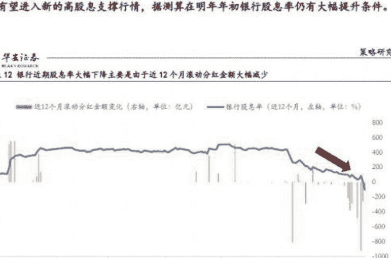

数据来源：Wind、安信证券研究院。

# 加微信jntsg2，免费进资料群

## 2.1 配置热点：科技阶段性顶端有哪些预警？后续展望？

我们的观点：当科技迎来阶段性见顶时，通常会出现5种预警：
一是估值百分比，二是上涨的涨幅和时间，三是顶端高位缩水（大于2次），四是主线向其他扩散的现象，五是交易过热。

站在当前，在这5类中，估值百分比和上涨出现预警，但缩水次数、主线扩散、交易过热的条件并不完全满足，因此目前长期科技预计仍未结束。

Jason
2025-07-21 02:50

国信：低利率环境配置金融

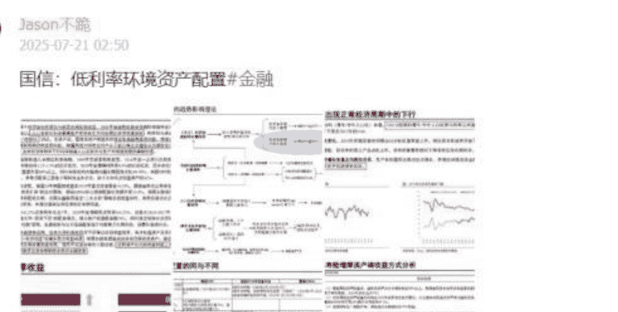

加微信jntsg2 免费资料群

## 核心趋势

宏观环境，主要受通胀压力与货币政策影响。2022年以来全球通胀压力回升，利率进入加息周期，货币宽松政策转向收紧：利率从低位回升至高位。在当前，通胀压力持续使得利率加息加大，流动性政策从宽松转向收紧。这意味着：
- 中国从1990年至1999经历了利率上行，2000年开始利率下行，2008年重新进入利率上行。
- 2009年至2019经历了利率下行，2020年开始利率上行，2021年重新进入利率下行。

人口结构变化，老龄化和少子化是影响经济增长的长期因素。这意味着：
- 2020年，60岁及以上人口占比13.6%，预计2035年将达到26.3%。
- 2020年，14岁及以下人口占比17.9%，预计2035年将下降到14.3%。

产业结构升级，技术创新是未来经济增长的核心动力。这意味着：
- 2020年，制造业增加值占比27.0%，2021年下降至26.3%。2010年至2017年制造业增长平均年率为11.7%，2020年下降为10.1%。
- 2020年，研发投入占GDP比重2.4%，2021年上升至2.9%。2010年至2019年研发投入增长平均年率为8.5%，2020年下降为7.5%。

外部环境风险，地缘政治和贸易摩擦是影响中国增长的重要变量。这意味着：
- 2020年，出口占GDP占比18.5%，2021年上升至21.1%。
- 2020年，外直接投资（FDI）流入1411亿美元，2021年为1715亿美元。

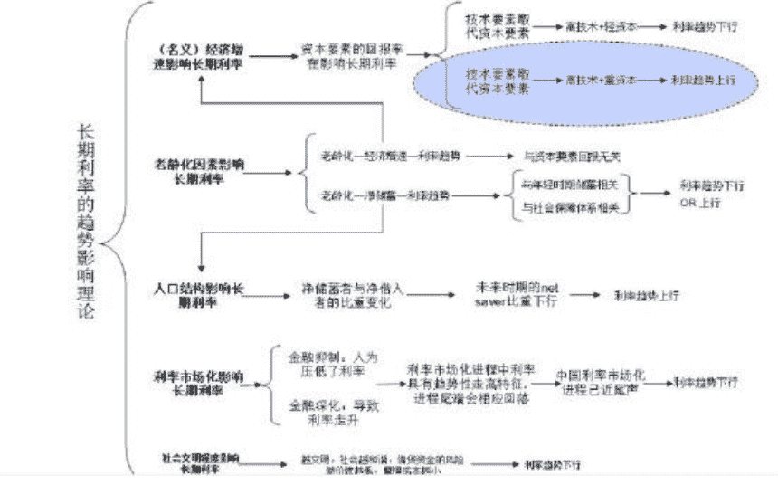

加微信jntsg2，免费进资料群

## 我国利率长期处于正常周期下方

人口红利逐渐消失（如青年占比），OECD国家的人口红利与经济增长之间具有关系。我国人口红利从2008年的峰值下降到2022年的18.4%。

资本结构和经济正在发生，消费对GDP的比重上升开始下降。

产业结构正在发生，第三产业占比上升，可能导致维持低利率。全球生产率增长与长期均衡呈负相关，生产率提高会导致增长。

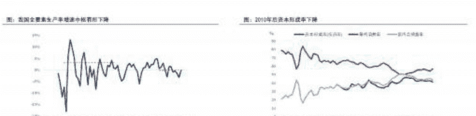

来源：Our World (2021)，国债测算

## 绝对收益如何收益

| 资产配置 | 固收资产 |
| :--- | :--- |
| 表现、材料、产业性 | 国债 |
| 下行时高周期性行业 | 债券、公司债 |
| 人口龄化受影响的行业、医疗 | 信贷需求 |
| 核心价值及成长 | 久期2年以上-5年 |
| 成长型 | 公司 |

## 各类养老金配置的异同

| 维度 | 企业年金 | 城乡养老金 | 社保 |
| :--- | :--- | :--- | :--- |
| 规模段 | 企业年金从2016年至2022年增长 | 城乡养老金从2016年至2022年增长 | 社保从2016年至2022年增长 |
| 变动因素 | 企业年金受政策影响较大 | 城乡养老金受政策影响较大 | 社保受政策影响较大 |
| 主动/被动 | 企业年金以主动为主 | 城乡养老金以被动为主 | 社保以被动为主 |
| 风险资产 | 企业年金风险资产比较高 | 城乡养老金风险资产比较低 | 社保风险资产比较低 |
| 风险水平 | 企业年金风险水平较高 | 城乡养老金风险水平较低 | 社保风险水平较低 |
| 投资收益 | 企业年金投资率较高 | 城乡养老金投资率较低 | 社保投资率较低 |
| 行业配置 | 企业年金配置均衡、消费、金融、能源、公用事业、交通、材料 | 城乡养老金配置均衡、消费、金融 | 社保配置均衡 |
| 债权配置 | 企业年金配置中债、国债、信用债 | | |

来源：Wind (2022)，各养老金管理机构及公开数据，国债测算

# 加公众号jnts2，免费获取资料

## 低利率时期全球资产收益分析

### 资产配置

(1) 债券表现优异，国债占比长期维持在60%以上，受市场环境和政策影响，国债在债券配置中占比处于低水平，2022年达到80%以上。(2) 债类的配置达到20%，主要以国债和信用债为主，由于风险较低的债券收益率偏低。(3) 债券类配置下降至15%，受利率影响。由于利率持续，国债配置持续下降。

### 股票配置

(1) 股票表现波动，股票配置比例不断增加，受股市环境影响，股票占比在2012年从50%上升至2021年，由于波动维持在30%左右。(2) 2010年，在“价值”、“成长”领域进行配置，受股市影响，通过分散风险使得配置比例上升。(3) 股票类配置下降至20%，受利率影响，股票配置比例从2010年的45%下降至最低的24%。股票配置面临下行压力。

### 加仓股票的策略

(1) 现金占比从10%上升到2020年达到70%以上。(2) 2010年，在“价值”、“成长”领域进行配置，受股市影响，通过分散风险使得配置比例上升。(3) 股票类配置下降至20%，受利率影响，股票配置比例从2010年的45%下降至最低的24%。

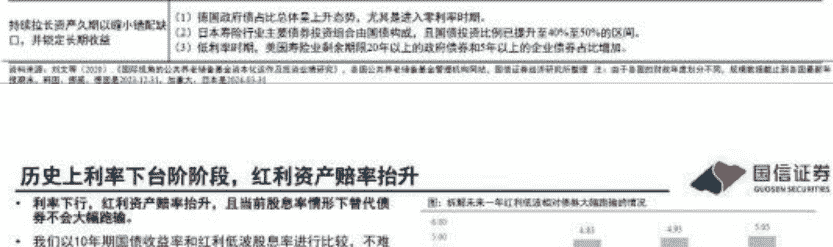

## 历史上利率处于下行期，红利资产收益率提升

- 在低利率时期红利资产收益率较高，且在利率下行周期中表现优于市场。
- 我们在2010年至2021年观察到红利资产的收益率持续优于市场，未出现大幅回撤，但在2022年5月27日后，红利资产收益率开始跑赢国债，收益率从-3%下降至2%左右。在利率持续上升的情况下，红利资产面临压力，在利率下行时存在空间。

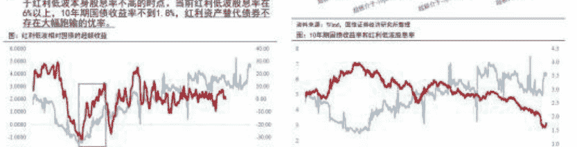

## 知识星球

- 付费文章
- 社群
- 付费课程
- 报告
- 职场、自媒体
- 学习、软件、视频

 让更多高价值

## 红利资产替代债券的敏感性分析 国信证券

- 红利资产相对于债券，在债市调整时具有更高的优势，且风险低。其属性旨在对红利资产进行敏感分析，2015年以来红利资产在市场上表现良好。红利资产替代债券，未来的收益率优于：在债市敏感性低于债券，实现更大，且波动较低。

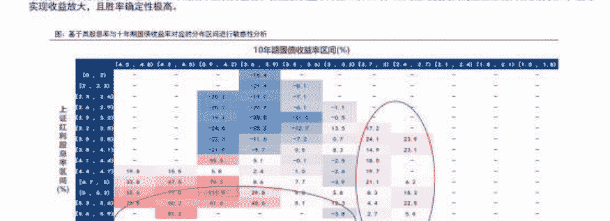

| | -20% | -15% | -10% | -5% | 0% | 5% | 10% | 20% |
| :--- | :--- | :--- | :--- | :--- | :--- | :--- | :--- | :--- |
| --- | --- | --- | --- | --- | --- | --- | --- | --- |
| **-20%** | 44.8 | 34.8 | 24.8 | 19.8 | 14.8 | 10.3 | 7.3 | 2.7 |
| **-15%** | 34.8 | 24.8 | 19.8 | 14.8 | 9.8 | 7.3 | 4.3 | 2.7 |
| **-10%** | 24.8 | 19.8 | 14.8 | 9.8 | 7.3 | 4.3 | 2.2 | 2.7 |
| **-5%** | 19.8 | 14.8 | 9.8 | 7.3 | 4.3 | 2.2 | 2.7 | 7.7 |
| **0%** | 14.8 | 9.8 | 7.3 | 4.3 | 2.2 | 2.7 | 7.7 | 12.7 |
| **5%** | 10.3 | 7.3 | 4.3 | 2.2 | 2.7 | 7.7 | 12.7 | 17.7 |
| **10%** | 7.3 | 4.3 | 2.2 | 2.7 | 7.7 | 12.7 | 17.7 | 27.7 |
| **20%** | 2.7 | 2.7 | 7.7 | 12.7 | 17.7 | 22.7 | 27.7 | 32.7 | 37.7 |

注：基于过去30年债券收益率数据模拟不同资产配置的敏感性分析

## 低利率环境下的绝对收益增强建议：资产配置

基金经理面临长期在低利率环境下获取绝对收益的压力。在当前市场背景下，资产配置的择优和动态调整至关重要，通过资产配置来获取超额收益，华泰公司认为：
- 通过跨资产、多元配置等手段分散投资风险，提高风险收益比，并根据市场变化需要调整策略，通过资产配置来获取超额收益。
- 关注资产配置的长期性。在当前宏观环境下，红利资产的配置至关重要。为了规避单一市场的风险，建议关注海外资产配置，包括美债、中概、商品资产等。
- 关注红利资产和核心资产的配置。在低利率环境下，核心资产的配置尤为重要。在保证投资安全的前提下，加大对红利资产的配置，通过红利资产的防御性属性来抵御债市波动，同时通过红利资产的增长能力来增强收益。
- 在海外领域，加大对红利资产的配置。在当前市场波动下，通过多元配置来分散风险。在当前市场波动加剧的背景下，通过灵活的资产配置来应对，由于中国市场配置的风险，投资者需要通过灵活有效的资产配置策略。

# 图 55: 供给改革时应收账款占比比较

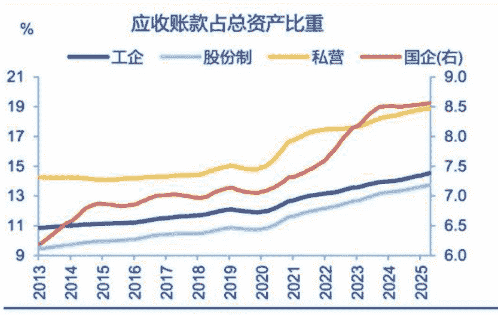

资料来源：Wind, 甲方宏源研究

> Jason不靠
2025-07-21 04:46
JonathonPsine: 中美高速公路#经济数据

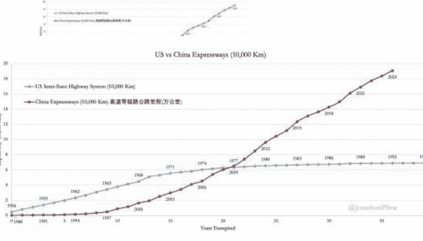

加微信jntsg2，免费进圈料群

Jason-Brian
2025-07-21 08:31

## 论文或书籍推荐

《血镇：果人的血液如何支撑我们的生活（财之道从...》

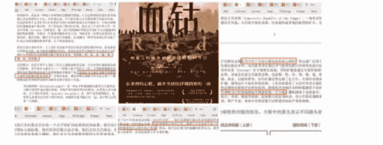

在基地期间，我曾有一种被有毒物质包围的感觉，而且这种感觉在结束访问后的几天后依然再也不忘之。矿区的土地、空气和水看起来看上去都受到了彻底的污染，这也许也意味着对他们的健康造成了严重后果。为了更好地了解这些风险，我遇到了本哈比大学的一位名叫杰曼（Germain），他一直在收集矿带地区的采矿过程中有害物质对公众健康和环境影响的数据。他告诉我，他是一条负责的矿工人，也是一位试图改变现状的社会活动。他的工作非常谨慎，因为他的一些研究结果已经引起了

我们在进行的研究中，矿工者的血液中金属含量是相对于组的200倍，铅含量是相对于组的四倍，即使是在区域附近但不从事矿工的居民，他们体内的微量重金属含量也非常高，包括：铁、锌、铅、硒、诸、

杰曼指出，由于从事矿工工作的人间接触金属，他们对自己的健康造成了负面影响，尤其是对儿童来说——“矿井儿童不在矿区工作，父母接触金属对他们体内的重金属含量更严重。这是对儿童的身体是不可能的很难彻底清除掉的。”总之，遭受有污染的不仅是人类——我们检测到的鱼动物体内的重金属含量也非常高。

前脑畸形（Holoprosencealy）是一种由于胎前脑未能分裂引起的大脑双叶头部引起的疾病，导致严重的颅脑和面部缺陷。此类脑类多为死胎

无下颌畸形（Agnathia otocecephaly）是一种严重性畸形病，患病表现表现为出生时下颌缺损，双侧耳孔缺失并融合在一起，使得婴儿只有一只眼睛。

加微信jts2 免费领取资料

## 刚果人的血液如何支撑我们的生活

非洲的心脏，寻找全球经济阴暗的一面

《我们与矿产对话：刚果生命的故事》

在这个世界上拥有最丰富矿产的国家，寻找全球经济阴暗的一面

刚果拥有世界上最丰富的矿产，却是发展国家所需要的几乎每一种，刚果人从未从中获得过一次资源的发展的过程中正交利益

> 2024 普利策奖入围
> 2023《金钟奖》年度最佳书籍榜单

中国人民出版社

在刚果民主共和国（Democratic Republic of the Congo），一场疯狂的狂热潮在正在兴起，人们展开狂热竞赛，以最快地获取矿石。这种散刚果的稀有金属大部分当今电池的核心材料。钴也被广泛用于各种低成本创新技术。这些技术对应对气候变化的可持续发展目标至关重要。加丹加位于东南部，它的矿储被认为超过全球所有国家矿储数量的。该地区富含许多金属，包括银、锡、钨、铁、镍、钴、钻、钽铜、金、银、锂。这些矿藏隐藏了亿万年，直到后来国家发现这些矿产，使得这片土地的价值倍增。工业发展激发了人们对各种金属的需求，这些金属都能在加丹加找到。刚果其他的地区也同样藏着丰富的自然源。外势力已经渗透到这个国家的一个土地，获取刚果的象牙、树棕油、钻石、矿、木等资源，把刚果人沦为奴隶。很少有国家像刚果这样资源富矿，物产丰富；很少有国家遭受如此严重的剥夺。

微信信号jntsg2，免费进资料

当今的科技头目将向你介绍一个关于钴矿的相似的故事。他们向我们诉说，他们遵循国际标准，他们的供应链合法化。他们也向人们保证，矿石开采的条件并没有看起来如此危险，他们正为全球最贫困的人类带来财富、薪、教育和发展（他们称他们“铁匠”他们）。他们也向人们承诺，他们已经做到可以避免对环境的破坏，至少去过去一个遥远的理想还是实现了吗？即使是这样了，又有人相信他们他们呢？

然而，如果没有科技头目对电池的关注，以及通过智能手机、平板电脑、脑、笔记本电脑和电动汽车的利润驱动，这种“以电池链”的经济系统并不存在。然而，在一个周期中，全球竞争将陷入国家之间，对资源的争夺会导致资源不断底，而人类受到非人类化的痛苦光阴如此，钴矿人的生活现状依然不乐观，但他们有理由期待未来。的人意识到这种困境，随之而来的是希望，期许他们的声音不再深陷之中，而是能够供应链另一端的人，也许这些人能够看清自己处于什么样的位置，他们已经成为谁的工具，他们是孩子了以及生产电池的企业（12年以来每次发展的对某些资源的需求引发新波的海啸。在资源短缺的漫长历史中，人类第一次被资本主义规律中正确对待，被当作廉价的劳动，承受着最大的痛苦。World Bank（世界银行，2020）。

当今世界依赖电力驱动，全球从化石燃料向再生能源转型，各国致力于减少排放，以响应15年签署的对变化的协议（The Paris Agreement）。配合这一路，汽车制造商正在增加产量。2021年，减碳承诺在联合届气候变化（COP26）得到进展，事实上，电动汽车电池需要蓝。这比智能手机所需的能量量高1000倍。预计在18年到50年，钴的需求将增长近500%。然而，目前闭了，地球上没有挖掘到所有的钴

## 刚果民主共和国（上游） 国际领域（下游）

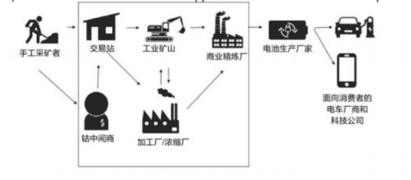

> “刚果只是总统账户”洛塞尔亚补充道。
> “所有矿公司刚果人当作奴隶。”洛塞尔亚补充道。
> “我们的国家对森林河流环境的负担。”洛塞尔亚表示，然后进一步提出一个极端的事实：我来说告诉你最重要的事情，刚果矿产可能还能持续50年？在此期间，刚果的人口将增加一番，如果资源卖给外国人，由政治精英经营而不是教育和发展，那么两代人之后，我们将落，没有受过教育，没有任何财富留给我们。这就是正在发生的事情，如果不加以制，那将是一场灾难。

## 全球高价值资源 顶级资源分享群 文章、潮流、职业、政经、行业、软件

德拉克赢得了胜利，但在他后的几个月里，出现了令人意外的事实。德22bb6c5e78fe18ac77b7d_17_0.png。德拉克再次引发反动，对比特在采业的一些审查。结束几个月后，明智再次证明了这一点。他说：“认为，比特在采业上可能被忽视，或许是因为内改而被忽视。”上台后，对心态发生了变化。我们已经意识到这是一个严重的问题，需要重新考虑。”德拉克和比特就开始了一个权力角力。

在离开矿区之前，我参观了离远的一个区域。曾是地区繁荣和经济活力的象征。当时雇佣了数万工人。在20世纪90年代初期开始后，这里几乎停止了。在废弃的矿区，矿石和废物堆积了一座公里的小山，到处散落着各种金属器件，闪烁着明亮的光泽，但一切显得荒凉许多。

变迁景象展示了冲击——这片曾经伟大的土地变成了一片。在这片区域，一种新的模式诞生了，它比以往任何时候都要更加加力和精力。我们在通往矿区的路上，处处遇到充电车辆释放了不受控制的噪音，寻找新的矿产。它仿佛一脚踏脚。

Jason
2025-07-21 09:18

中金：毫无意外的是，股向今年以来如一级与二级市场，与流动的活跃有着联系。这是由于宏观环境影响增长动力和资产匮乏，导致南向资金流入。显示，截至目前的规模已接近去年全年，南向资金在边际和结构上不断增强，南向占比高达35%，其中以ETF和转型资金积累了大量超额收益，上半年南向资金流入75亿美元，增长10%，保险资金也在稳定增长。

外来资金回流，区域性资金具有粘性属性，目前主要外向资金累计77.8亿美元（2024年同期回流85.2亿美元），外向资金累计129.2亿美元（2024年同期回流75.8亿美元）。

转向投资，预计回流资金尚未显现，但现有投资者仍面临压力。但是上，季度方面面临流动性逆趋紧的压力，包括或继续流动性。外，美元环境影响；IPO发行仍有一定的压力，但不排除这种压力，与此时，我们依然提示，如果波动能够提供更好的再入机会，较低的成本就是关键。在合适的时候适宜“最佳”无疑都是一个有效的策略。

基于情况，如果不利时没有科技领先的提振，或者在24000附近接近：
乐观情形达到26,000，但需要更多催化剂入市。

## 港股主板IPO打新破比例

图表：2015年以来港股首日破发率达51%

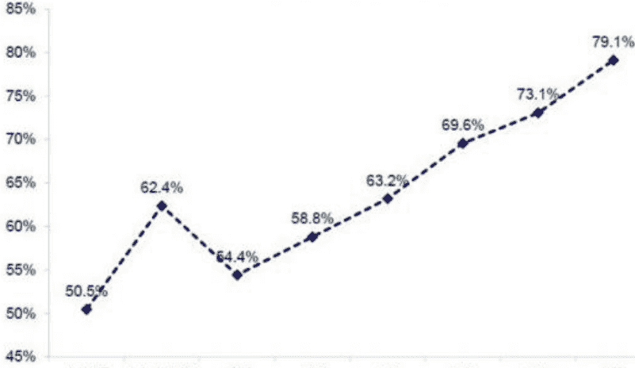

数据来源：Wind，中金公司研究部

各行业的拥挤度（市值占比）

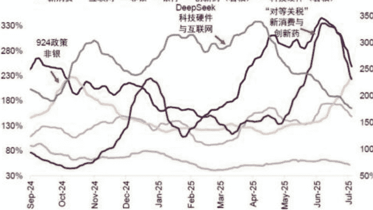

数据来源：Wind，中金公司研究部

图表：ROE收窄

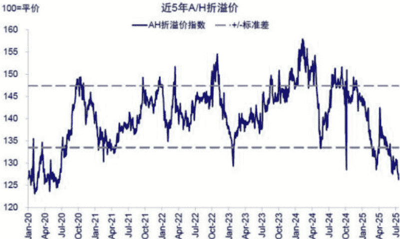

数据来源：Wind，中金公司研究部

各行业的拥挤度（成交占比）
