# Jason·不离

Bloomberg: 中国在启动历史上规模最大、成本最基础的基础项目之一。短期内，它将增加GDP，在十年内每年增加0.1%，至于项目的效益（是否如预期），则要等到2030年再次提及。电力电力合约下降约0.5%，至6月以来的最低水平。经济数据。

花旗集团，西藏巨大水坝可能在十年内每年增加中国国内生产总值0.1个百分点。它有望成为有针对性的刺激措施，为房地产长期打击最严重的行业——建筑、水泥和钢铁。

从能源角度来看，电力空间更为复杂。虽然中国需要所有可以获取的清洁能源来帮助到2060年实现净零排放，但尚清楚该项目是否会提供性的价值。

按照目前的数字，数兆瓦的估计生产成本是波动能源估计的四倍，是太阳能的。

大坝需要维持的高开工效率超过那些曾经得多的水——在天气模式下更不稳定的世界中，这并不是理想的。而且，由于其处远，它将需要长的单向电力，这可能会破坏电网的灵活性。

然而，这些都是项目完成时的问题，很可能要到2030年代。目前，建设之首就是回报。

CBO：周一发布的报告评估预算补贴法案将在十年内使美国增加3.4万亿美元，并数百万人无法获得医疗保险。其他国家经济。

# 加微信号jnts2，免费进资料群

# Relative to the Budget Enforcement Baseline for Consideration in the Senate

As enacted on July 4, 2022

| 2025 | 2026 | 2027 | 2028 | 2029 | 2030 | 2031 | 2032 | 2033 | 2034 | 2025-29 | 2030-34 |
|---|---|---|---|---|---|---|---|---|---|---|---|---|
| Increase or Decreases (-) in Direct Spending Expenditures, Revenues, and Deficit | | | | | | | | | | | | | |
| Estimated Outlays | -300 | -15,521 | -14,524 | -14,774 | -15,815 | -15,556 | -13,244 | -14,987 | -15,199 | -15,261 | -77,772 | -129,560 |
| Estimated Revenues | 0 | 0 | 0 | 0 | 0 | 0 | 0 | 0 | 0 | 0 | 0 | 0 |
| Net Effect on Budget | -300 | -15,521 | -14,524 | -14,774 | -15,815 | -15,556 | -13,244 | -14,987 | -15,199 | -15,261 | -77,772 | -129,560 |

## Title II. on Agriculture, Nursery and Forestry

| 2025 | 2026 | 2027 | 2028 | 2029 | 2030 | 2031 | 2032 | 2033 | 2034 | 2025-29 | 2030-34 |
|---|---|---|---|---|---|---|---|---|---|---|---|---|
| Estimated Outlays | 2,820 | 4,816 | 44,467 | 24,923 | 17,175 | 4,926 | 2,767 | 1,947 | 723 | 130 | 130,659 | 149,542 |
| Estimated Revenues | 0 | 0 | 0 | 0 | 0 | 0 | 0 | 0 | 0 | 0 | 0 | 0 |
| Net Effect on Budget | 2,820 | 4,816 | 44,467 | 24,923 | 17,175 | 4,926 | 2,767 | 1,947 | 723 | 130,659 | 149,542 |

## Title III. on Banking, Housing, and Urban Affairs

| 2025 | 2026 | 2027 | 2028 | 2029 | 2030 | 2031 | 2032 | 2033 | 2034 | 2025-29 | 2030-34 |
|---|---|---|---|---|---|---|---|---|---|---|---|---|
| Estimated Outlays | -115 | -80 | -25 | -72 | -222 | -186 | -315 | -347 | -74 | -526 | -1,568 | 0 |
| Estimated Revenues | 0 | 0 | 0 | 0 | 0 | 0 | 0 | 0 | 0 | 0 | 0 | 0 |
| Net Effect on Budget | -115 | -80 | -25 | -72 | -222 | -186 | -315 | -347 | -74 | -526 | -1,568 | 0 |

## Title IV. on Commerce, and Transportation

| 2025 | 2026 | 2027 | 2028 | 2029 | 2030 | 2031 | 2032 | 2033 | 2034 | 2025-29 | 2030-34 |
|---|---|---|---|---|---|---|---|---|---|---|---|---|
| Estimated Outlays | -65 | 2,505 | 4,896 | 4,531 | 4,271 | -7,068 | -5,935 | -5,816 | -5,411 | 21 | 11,544 | 42,360 |
| Estimated Revenues | -1 | -90 | 173 | 249 | 288 | 319 | 385 | 427 | 121 | 1,683 | 2,003 | 0 |
| Net Effect on Budget | -64 | 2,595 | 4,723 | 4,172 | 3,189 | -7,383 | -5,550 | -5,243 | -5,290 | 21 | 9,541 | 40,677 |

## Title V. on Energy and Natural Resources

| 2025 | 2026 | 2027 | 2028 | 2029 | 2030 | 2031 | 2032 | 2033 | 2034 | 2025-29 | 2030-34 |
|---|---|---|---|---|---|---|---|---|---|---|---|---|
| Estimated Outlays | -156 | -715 | -1,183 | -2,383 | -2,595 | -2,896 | -2,900 | -3,246 | -3,149 | -3,541 | -21,998 | -31,235 |
| Estimated Revenues | 0 | 0 | 0 | 0 | 0 | 0 | 0 | 0 | 0 | 0 | 0 | 0 |
| Net Effect on Budget | -156 | -715 | -1,183 | -2,383 | -2,595 | -2,896 | -2,900 | -3,246 | -3,149 | -3,541 | -21,998 | -31,235 |

## Title VI. on Environment and Public Works

| 2025 | 2026 | 2027 | 2028 | 2029 | 2030 | 2031 | 2032 | 2033 | 2034 | 2025-29 | 2030-34 |
|---|---|---|---|---|---|---|---|---|---|---|---|---|
| Estimated Outlays | -856 | -1,237 | -1,287 | -883 | -709 | -612 | -375 | -300 | -275 | -275 | -4,488 | -4,650 |
| Estimated Revenues | 0 | 0 | 0 | 0 | 0 | 0 | 0 | 0 | 0 | 0 | 0 | 0 |
| Net Effect on Budget | -856 | -1,237 | -1,287 | -883 | -709 | -612 | -375 | -300 | -275 | -275 | -4,488 | -4,650 |

## Title VII. on Finance

| 2025 | 2026 | 2027 | 2028 | 2029 | 2030 | 2031 | 2032 | 2033 | 2034 | 2025-29 | 2030-34 |
|---|---|---|---|---|---|---|---|---|---|---|---|---|
| Estimated Outlays | -72,507 | -50,621 | -54,839 | -71,774 | -130,412 | -174,499 | -168,717 | -158,967 | -9,153 | -19,321 | -834,699 | -1,033,434 |
| Estimated Revenues | 124 | 237 | 241,381 | 110,991 | 64,442 | 54,935 | 111,602 | 162,150 | 187,518 | 561,767 | 1,917,110 |
| Net Effect on Budget | -72,383 | 186,636 | 186,542 | 39,217 | -165,532 | -119,564 | -56,715 | 225,753 | 178,365 | 542,446 | 1,082,747 | 1,033,000 |
| Estimated Outlays | 0 | 275 | 500 | 1,057 | 1,384 | 1,987 | 1,087 | 2,349 | 3,042 | 5,311 | 13,189 | |

## Title VIII. on Health, Education, Labor and Pensions

| 2025 | 2026 | 2027 | 2028 | 2029 | 2030 | 2031 | 2032 | 2033 | 2034 | 2025-29 | 2030-34 |
|---|---|---|---|---|---|---|---|---|---|---|---|---|
| Estimated Outlays | -54,920 | -15,514 | -63,416 | -34,889 | -15,639 | -15,539 | -16,521 | -16,521 | -16,521 | -16,192 | -149,214 | -204,922 |
| Estimated Revenues | 0 | 0 | 0 | 0 | 0 | 0 | 0 | 0 | 0 | 0 | 0 | 0 |
| Net Effect on Budget | -54,920 | -15,514 | -63,416 | -34,889 | -15,639 | -15,539 | -16,521 | -16,521 | -16,521 | -16,192 | -149,214 | -204,922 |

## Title IX. on Homeland Security and Governmental Affairs

| 2025 | 2026 | 2027 | 2028 | 2029 | 2030 | 2031 | 2032 | 2033 | 2034 | 2025-29 | 2030-34 |
|---|---|---|---|---|---|---|---|---|---|---|---|---|
| Estimated Outlays | 0 | 5,911 | 18,826 | 25,312 | 25,434 | 20,262 | 14,311 | 9,411 | 4,954 | 4,815 | 78,012 | 128,911 |
| Estimated Revenues | 0 | 0 | 9,016 | 25,267 | 25,312 | 25,434 | 25,412 | 24,994 | 9,351 | 4,914 | 78,012 | 128,911 |
| Net Effect on Budget | 0 | 5,911 | 16,216 | 4,522 | 5,172 | 11,140 | 15,533 | 4,440 | 1,111 | 128,012 | 208,000 |
| On-Budget Effect | 0 | 0 | 0 | 54 | 188 | 251 | 326 | -349 | -361 | -905 | -1,216 | 1,158 |

| 2025 | 2026 | 2027 | 2028 | 2029 | 2030 | 2031 | 2032 | 2033 | 2034 | 2025-29 | 2030-34 |
|---|---|---|---|---|---|---|---|---|---|---|---|---|
| Total Change | -152,015 | 27,619 | 4,277 | -43,328 | -119,111 | -115,637 | -71,015 | 23,469 | 8,439 | 1,741 | -14,347 | -332,963 |
| Net Effect on Budget | -237,208 | -249,515 | -191,762 | -111,8,911 | -115,637 | -84,699 | 13,763 | 1,741 | -14,347 | -332,963 | -599,119 | -468,537 |
| On-Budget Deficit | -218,228 | -221,505 | -164,473 | -98,111 | -25,790 | -108,915 | -105,994 | -224,829 | -212,732 | -312,963 | -599,119 | -468,537 |
| Off-Budget Deficit | -28,786 | -26,996 | 164,473 | 18,817 | -24,502 | -105,994 | -218,155 | -14,693 | -24,601 | -2,242 | 2,242 | 93,189 |

# Jason不离

2025-07-22 05:54

Bloomberg: 对今年剩余时间全球主要经济体货币政策将如何发展的预测#金融

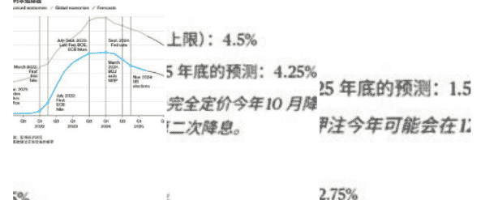

# 政策利率追踪器
Advanced economies / Forecasts

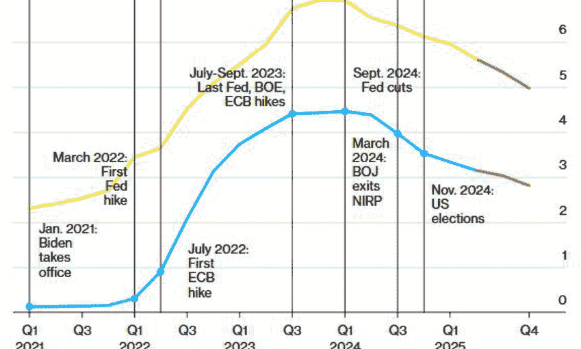

资料来源: 彭博经济研究
注: 图表数据季度末的费率

加微信:jntsg2，免费进资料群

# 美联储
* 当前联储基金利率（上限）:4.5%
* 彭博经济研究对2025年底的预测:4.25%
* 市场定价：货币市场完全定价今年10月再降息25个基点，大约有80%的可能性出现二次降息。

# 欧洲中央银行
* 活期存款利率:2%
* 彭博经济研究对2025年底的预测:1.5%
* 市场定价：交易员押注今年可能会在12月再降息25个基点。

# 日本银行
* 目标利率（上限）:0.5%
* 彭博经济研究对2025年底的预测:0.75%
* 市场定价：市场认为为加息的可能性更大，预计今年加息25个基点的可能性为65%。

# 英格兰银行
* 当前银行利率:4.25%
* 彭博经济研究对2025年底的预测:3.75%
* 市场定价：市场预计9月份将再降息25个基点，并认为二次降息的可能性约为90%。

# 加拿大银行
* 当前隔夜贷款利率:2.75%
* 彭博经济研究对2025年底的预测:2.25%
* 市场定价：交易员认为今年年底再降息25个基分点的可能为65%。

加微信jntsg2，免费进资料群

# 中国人民银行
* 当前7天回购利率:1.4%
* 彭博经济研究对2025年底的预测:1.2%

# 澳洲储银行
* 当前现金利率:3.85%
* 彭博经济研究对2025年底的预测:3.35%

Jason-hu
2025-07-22 09:18

Bloomberg: 中国第二季度工资增长3.9%，这是业内以来的最低数（除了covid），高盛的数据比官方数据要低一些，纳入包括采购经理调查的就业子指标在内的统计数据。

加微信jntsg2，免费进资料群

# 高盛编制的替代指标显示衰步伐
- Goldman Sachs wage tracker Covid years

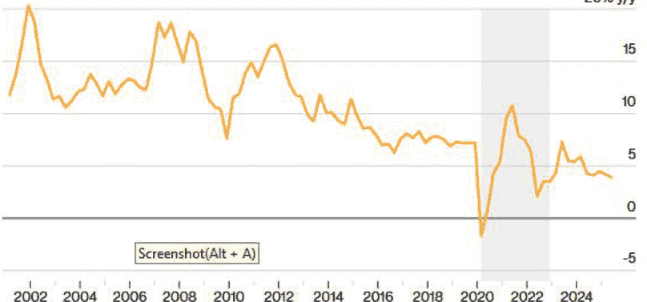

资料来源：高盛全球投资部

- Household disposable income from wages (cumulative)

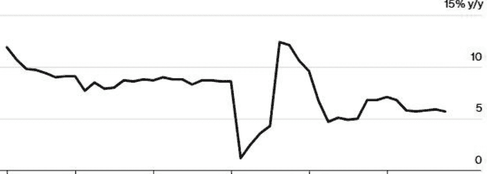

资料来源：国家统计局、彭博社
注：增长率是根据国家统计局公布的工资数据计算的。

- 做空美元（美元贬值）
- 做多黄金/加密货币（对冲无政府状态）
- 做空30年期美债（美联储在繁荣而非衰退中喘息）
- 做多美国科技与EAFE/新兴市场价值的跨链组合（对冲泡沫）

Jason不靠
2025-07-22 09:32

智联招聘：二季度招聘需求，购物服务最为亮眼。#经济数据

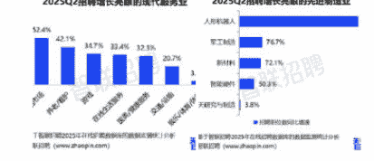

## 经济数据

### 2025Q2招聘增长亮眼的现代服务业

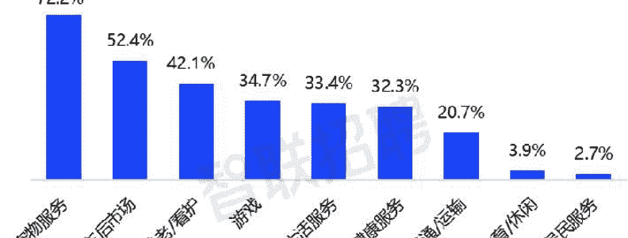

统计规则：基于智联招聘2025年在线招聘数据趋势分析
数据来源：智联招聘（www.zhaopin.com）

微信公众号jnt5g2，免费进资料群

### 2025Q2招聘增长亮眼的先进制造业

| 行业 | 招聘指数同比比 |
| :--- | :--- |
| 人形机器人 | 398.1% |
| 军工制造 | 76.7% |
| 新材料 | 72.1% |
| 智能硬件 | 50.3% |
| 航空/航天研究与制造 | 3.8% |

- 统计规则：基于智联2025年在线招聘岗位的数据监测与分析
- 数据源：智联（www.zhaopin.com）

> Jason 2023-07-22 09:45
中：尽量最终消费在 GDP 中占比低于其他国家，但最终消费支出出来对中国国内经济增长的贡献率较高。2011年以来，最终消费支出对中国国内经济增长的贡献每年在50%以上，但2024年最终消费占比为44.5%，高于2020年。从这个角度来看，提振消费在当前很有必要。
> 最近，最终消费支出增速出现了放缓趋势引起关注。2024年，最终消费支出增速为3.7%，低于2015年以来的水平，最终消费支出分类主要为居民消费和政府支出，2024年，居民消费支出同比增长，而政府支出同比仅有0.7%。事实，政府支出增速近年来缓慢更为明显。以年复合增速，2020—2024年，政府支出增速下降4.5%，2015—2019年复合增速下降4.2个百分点；而2020—2024年政府支出增速下降为7.2%，2015—2019年复合增速下降0.9个百分点。
> 政府支出的放缓本质上是政府支出的结果。2021年之后，以预算财政+政府性基金支出得到了明显改善。
> 从居民消费支出的角度来看，近年来消费出现了明显的放缓。2020—2024年，城乡一体化结构调查数据显示居民消费支出增速为5.5%，低于2015—2019年的8.3%。这是因为近年来居民收入增速也出现了明显的放缓。
> 有此据，提振消费，或者说加强最终消费支出，短期内可以从以下几点着：加强财力力度，提振居民收入、重塑消费效应，稳定居民民生。加强财力力度可以导致两方面的直接效果：第一，增加政府消费支出；第二，改善居民转移收入进入居民消费支出。

# 加微信jtsg2 免费简历

## 图表 8.“三驾马车”对中国增长的贡献率

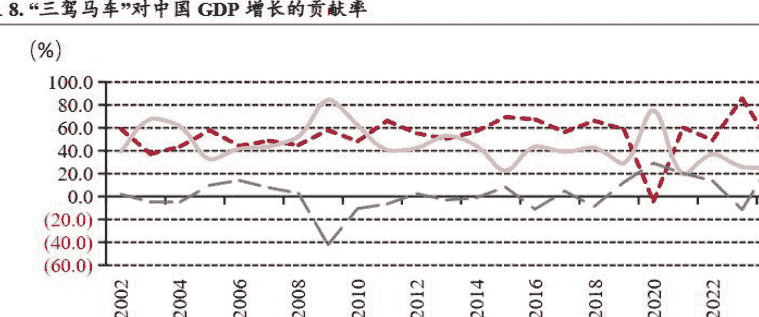
资料来源: Wind, 中银证报

## 图表 6. 各国消费支出占 GDP 比重

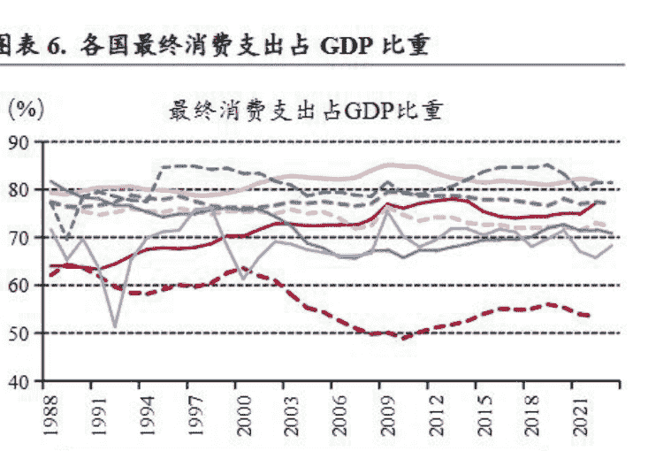
资料来源: 同花顺iFind, 世界银行, 中银证报

加微信信号jntsg2,免费进资料群

## 图 10. 居民消费支出与政府支出趋势

## 图 11. 政府消费支出近年来变更为明朗

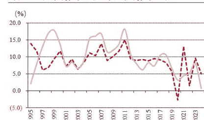
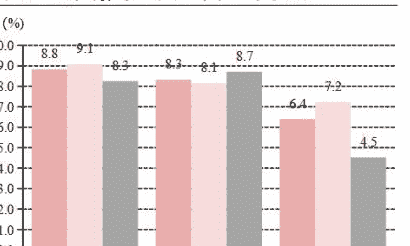

--- 居民消费支出趋势
--- 政府消费支出趋势

※居民消费支出
※政府支出

资料来源：Wind, 中信报告

## 图 12. 2021 年之后财政支出增速大幅下降

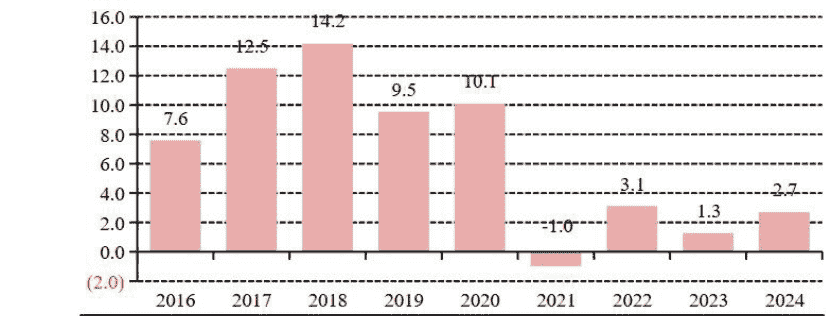
※财政支出增速
资料来源：Wind, 中信报告

加微信信号jntsg2，免费进资料群

## 图表 14. 近年来居民收入增速

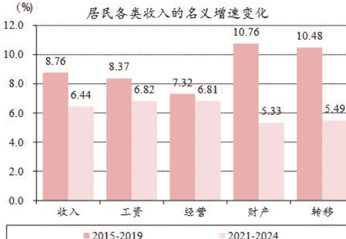
资料来源：Wind, 中信报

## 图表 19. 居民消费预期与居民房价

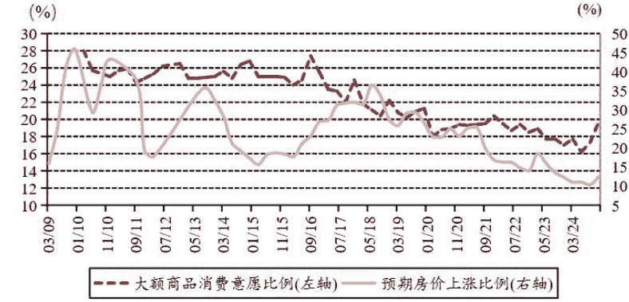
资料来源：Wind, 中信报

加微信信号jntsg2，免费资料群

## Jason不嵩
2025-07-22 09:49
我们认为，当前经济类似2016-2017年，处于L型平台。一方面，当前已经结束了2021-2024年经济下行，开始进入衰境，需求持续缓慢；另一方面，类似2011-2015年的下行，之后GDP增速基本相同；政策有助于缓解当前结构性问题。我们预计拐点：2025年下半年收益率，债市有望下行。

(1) 2011-2015年，GDP增速持续下降，从2011年的9.6%下降到2015年的7.0%左右。
(2) 2016-2020年，GDP增速进入平缓期，从2016年的6.8%下降到2020年的6.5%左右。
(3) 2021-2024年，经济经历L型下行，需求持续。

注：以上数据基于宏观模型测算，仅供参考，不构成投资建议。
注：2016-2020年参考国家统计局数据，具体数值以官方为准。
注：2021-2024年预测数据基于政策预期。

加微信信号jntsg2，免费进资料群

## 市场行情的四种理解

(1) 市场行情：2022年以来亮点一直低迷，比2023年春季底，导致2022-2024年未出现行情，但指数持续下跌。因此，产业亮点和行情不足以指数上涨。
(2) 市场行情：此前出现几次国家涨跌，比2024年2月国家上涨，但2024年5月之后市场再度下跌。当前市场上涨，且并非由国家上涨。
(3) 市场行情：‘美国例外’外涨。汇率持续，海外资金反向大额流入中国，且股市持续新，反映出中股上涨而非外涨，由于‘美国例外’
(4) 市场行情：低利率。2022-2024年债收益率持续低迷，股市持续下跌，利率下降不能驱动股市上涨。估值角度，虽然阶段性价值处于高位，且估值本身并非上涨，比2024年5-9月。

## 上市行的逻辑：政策取向和经济周期

我们认为，市场上行的逻辑在于：政策取向的根本变化，以及经济周期已经上行行情。

(周期一)：政策取向的根本性变化。2024年9月政治局会议为政策转折点，一方面结束了2021-2024年股市长牛行情，另一方面类似2011-2015年初，标志着L型下跌周期结束，进入加息阶段；另一方面2024年1月的地方性债务，类似2016年初经济周期已经上行。2024年2月之后市场已经运行见底，但2024年3季度财报结束再次重提市场信心。2024年9月政策转向点之后，市场首次出现新高点，继续维持。当前或类似2016年二季度，市场行情尚未见底，我们认为，还有很大空间。

(周期三)：需求端解决结构性问题。2025年7月至今，一方面政策内，内部类似2016-2017年初政策转向；另一方面，房城市转型，政策需要解决结构性问题。我们认为，这一轮政策或不会像类似2016-2017年的大持续上行周期，除非通胀转正，或者已经足够PPI过7%，房地产稳健和已经足够提市场预期。

此外，这一轮内需转变的起点是2024年7月1日的中央财经委员会，历史上，中央财经委员会的政策部署基本都能落地。

Jason不驰
2025-07-22 09:54

## 股票配置价值已开启

1. 2023年市场回顾：2023年全球受到多重因素影响，中国经济面临严峻挑战的同时展现了强大的韧性和生命力。年初受宏观环境和流动性影响，市场一度低迷；年中随着政策密集落地，市场逐步回暖；年底随着估值得到底部。
2. 2023年市场回顾：2023年全球资产配置发生了深刻变化。随着无风险利率下行，资产配置价值日益凸显。作为权益类资产的核心，其长期收益能力抗通胀能力得到了重新关注。2023年市场经历了显著修复，收益率得到了提升。尽管市场波动较大，但整体估值处于历史低位，为长期投资者提供了充足机会。

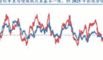

- 2023年市场回顾：2023年市场呈现明显的非均衡特征。部分行业受政策和资金驱动表现优异，如新能源、人工智能等成为热点；而传统消费、房地产等行业则面临较大的调整。

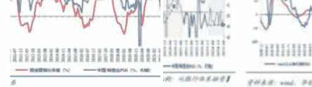

加微信信号jntsg2，免费进资料群

## 核心指标：资产好坏关注权益回报率

1. 过去两年，权益收益率面临预期低迷，国债收益率创新高。在此情况下，权益收益率（十年国债收益率）持续回落，市场似乎更倾向于债券，对投资者而言权益资产预期缩小，权益回报率下降。
2. 权益资产配置的原因在于债券表现更好，而是权益资产的波动和回撤对整体而言要求越高。由于权益资产波动非常大，意味着投资者对债券资产的回撤很难，通过比较率来量化权益所获得的超额收益。
3. 过去两年虽然收益率有所提升，但由于国债波动的影响，权益投资者在撤离时需要付出资本成本，因此投资者更倾向于国债。
4. 2025年，权益回报率与债券表现出特别回归。权益回报率处于上行中，意味着我们要开始关注。

## 核心：为什么权益回报率会发生反转？

1. 情况反转，基本逻辑就是明确哪些资产是回归的关键。在下行周期内，企业利润增长持续，投资者预期将资金回归股票资产。权益资产回撤达到低点；当政策转向积极，企业预期乐观，投资者开始增加股票配置，权益资产向上变动，持有股票不仅可以获得分红，还可以获得利，因此权益回报率将发生反转。
2. 过去与历史不同，本期权益资产质量比较率回升发生在经济周期底部，意味着本轮反转我们两点需关注：
- 本轮股票回报率的调整主要取决于资金分发逻辑。我们在投资报告中提到《曾债》，不是股票债，从2024年9月以来，股市活跃导致资金转向市场，这一程度限制了市场偏向好的持续，政策导致风险积聚，虽然权益预期尚未改变，但居民存款持续维持着投资者。
- 非银行机构从面对面限制），市场活跃度尚未大幅萎缩，权益资产大幅向上变动的概率确实下降。
- 权益资产波动和回撤缓的背景下，经济最差的时刻可能已经过去了。根据预计企业数据显示这一指标从2024年9月以来持续向上，意味着经济的整体正在逐步改善。

参照历史经验，在不考虑外部冲击或政策转向的背景下，我们预测利润回暖可能已经接近底部，来进一步突破的概率并不高。

加微信信号jnts2，免费进资料群

### 图表 5 股夏普比率与股债收益基本一致，2025年出现分化

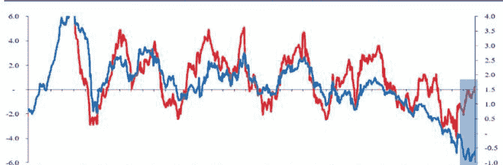
数据来源：wind、东方证券 注：夏普比率=年化收益/年化波动，夏普比率（周度收益-周度无风险利率）×√52/周度收益的标准；此处无风险利率利用回购的7年利率。债券数据选择领先A级指数，债券债选择。

### 图表 6 过去股夏普比率与经济预期一致，但2025年两者出现分化

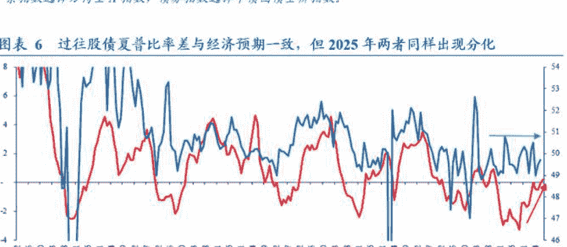
数据来源：wind、东方证券

### 图表 7 历史估值领先，居民存款先涨

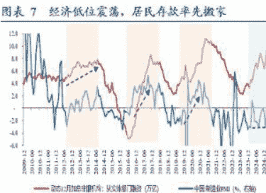
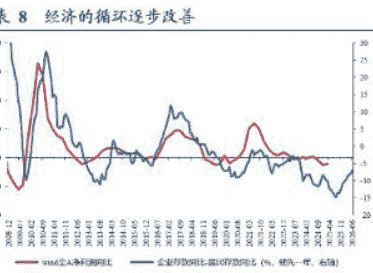
数据来源：wind、东方证券

### 图表 8 经济的隐含参数

Jason不测
2025-07-22 09:57
通：中美竞争是黄金的底层逻辑。后续来看，我们认为当前半年持续创新高，新一线即将开启。可能攀升至美元以上。往后看，美联储难以改善，同时叠加投机需求聚，并未停结，或将继续上升10%。

### 规模模型对债的影响

Jason不磊
2025-07-22 10:00
方：根据三阶段框架，本轮行情处于线型。在行情中，股市开始领先。这是典型的案例，例如：2014年下半年至2019年4月，好月，二蓝筹似乎没有明朗特征，AIGJ

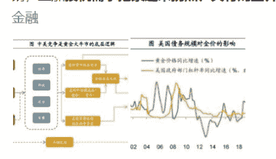
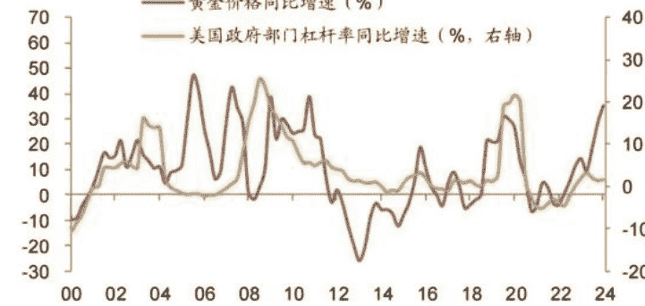
资料来源：Wind、方正泰研究所

### 图2:年初至今主要行业板块跌幅

■2025年涨幅（截至20250721）

| 行业 | -15 | -10 | -5 | 0 | 5 | 10 | 15 | 20 | 25 | 30 |
| 有色金属 | | | | | | | | 25.6 |
| 通信 | | | | | | | | 18.0 |
| 医药生物 | | | | | | | | 16.8 |
| 机械设备 | | | | | | | | 15.7 |
| 银行 | | | | | | | | 14.5 |
| 传媒 | | | | | | | | 14.4 |
| 钢铁 | | | | | | | | 14.4 |
| 国际 | | | | | | | | 14.2 |
| 基础化工 | | | | | | | | 13.3 |
| 环保 | | | | | | | | 12.4 |
| 汽车 | | | | | | | | 12.2 |
| 建材料 | | | | | | | | 11.8 |
| 农配置 | | | | | | | | 11.7 |
| 农牧渔 | | | | | | | | 11.2 |
| 防织服 | | | | | | | | 8.1 |
| 美容护理 | | | | | | | | 7.5 |
| 轻制造 | | | | | | | | 7.3 |
| 电子 | | | | | | | | 7.0 |
| 社会服务 | | | | | | | | 7.0 |
| 电设备 | | | | | | | | 5.1 |
| 非金融 | | | | | | | | 3.8 |
| 建筑装饰 | | | | | | | | 2.8 |
| 家用电器 | | | | | | | | 1.8 |
| 公用事业 | | | | | | | | 1.4 |
| 石油化工 | | | | | | | | 0.0 |
| 交通运输 | | | | | | | | -0.5 |
| 商零售 | | | | | | | | -0.7 |

资料来源：Wind、方正泰研究所

加微信信号jntsg2，免费进资料群

### 图：过去一年典型城市平均租空闲变动趋势

| | 20.3% | 19.8% | 19.6% | 19.4% | 19.0% | 18.6% | 18.1% | 17.3% | 15.5% | 15.4% | 15.1% |
|---|---|---|---|---|---|---|---|---|---|---|---|
| 2024年6月 | 2024年7月 | 2024年8月 | 2024年9月 | 2024年10月 | 2024年11月 | 2025年1月 | 2025年2月 | 2025年3月 | 2025年5月 | 2025年6月 |

说明：定价空闲期=成交价/挂牌价，样本项目当月成交均不小于5套

数据来源：CRIC

Jason-不逸
2025-07-22 10:17

民生：过去三年人民币在全球储备市场中的份额不断下降，在国际市场中的份额也有待进一步提高。去年“金融强国”的工作重心在于“强大的中央银行”（充实货币工具箱，买入入国债），今年的重心更在于“强大的金融市场”（利用美元主导的口，加速推进人民币国际化）。展望“十五五”时期，“金融强国”将继续在其他方面深入发展 #金融

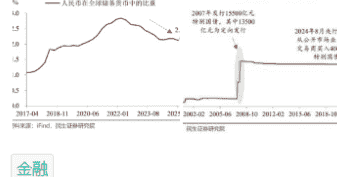

金融

关注微信jtsg2，免费进资料群

### 图10: 近几年全球外储蓄人民币的份额下降

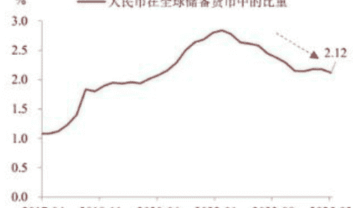

资料来源：iFind，民生证券研究

### 图12: 公开市场买卖美国债已债入美元货币工具中

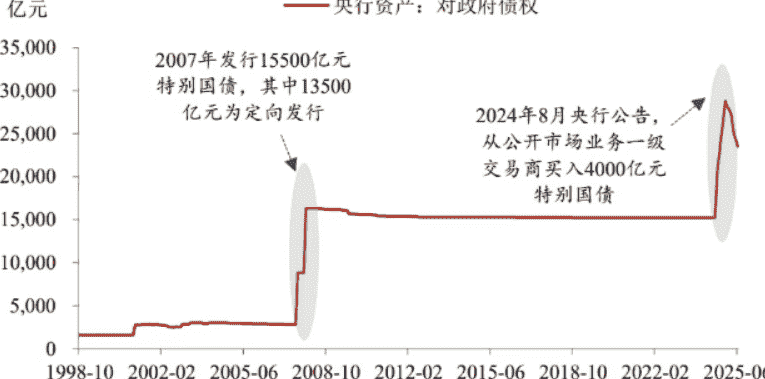

资料来源：iFind，民生证券研究

Jason·不晓
2025-07-22 10:18

西部：1-5月，两本合计卖3.3万元，6-12月剩余10.7万元发行空间，和去年同期实际增长8.2万元人民币，仍有2.5万元增长空间#TAX

| 项目 | 2021-01 | 2021-02 | 2021-03 | 2021-04 | 2021-05 | 2021-06 | 2021-07 | 2021-08 | 2021-09 | 2021-10 | 2021-11 | 2021-12 |
| :--- | :--- | :--- | :--- | :--- | :--- | :--- | :--- | :--- | :--- | :--- | :--- | :--- |
| 发行规模 | 100,179 | 150,186 | 186,203 | 212,212 | 276,232 | 272,239 | 239,255 | 218,262 | 135,207 | 100,179 | 150,186 | 186,203 |
| 回购规模 | 150,186 | 186,203 | 212,212 | 276,232 | 272,239 | 239,255 | 218,262 | 135,287 | 100,179 | 150,186 | 186,203 | 212,212 |
| 净发行量 | 108,188 | 133,203 | 241,212 | 308,212 | 400,200 | 400,200 | 400,200 | 400,200 | 400,200 | 400,100 | 30,100 | 100,200 |
| 特别发行 | 27,794 | 77,174 | 101,794 | 147,796 | | | | | | | | |
| 剩余空间 | 31,467 | 46,483 | 84,493 | 96,502 | | | | | | | | |
| 剩余空间 | 22,213 | 53,398 | 124,838 | 126,928 | | | | | | | | |

##:

关注微信jtsg2，免费进资料群

### 图7：下半年财政收支状况

| | 20241-5月 | 20246-12月 | 2024上半年 | 20251-5月 | 20256-12月 | 2025上半年 | 202512月 |
||---|---|---|---|---|---|---|---|
| 一般收入 亿元 | 96,912 | 122,790 | 219,702 | 96,623 | -354 | -0.3 | 219,850 0.1 | 123,227 0.4 |
| 政府基金亿元 | 16,638 | 45,452 | 62,090 | 15,483 | -1,265 | -6.9 | 62,449 0.7 | 47,016 0.4 |
| 合计 亿元 | 113,550 | 168,242 | 281,792 | 112,006 | -1,619 | -1.3 | 274,349 0.2 | 170,243 1.2 |
| 一般收入增速 | | | | | | | | |
| 政府基金增速 | | | | | | | | |
| 合计增速 | | | | | | | | |
| 一般支出增速 | | | | | | | | |
| 政府支出增速 | | | | | | | | |
| 合计增速 | | | | | | | | |

资料来源：CEIC，每日财经中心

### 《经济学刊：劳动力市场在年龄下的35岁以下失业现象》论文或书籍推荐

2025-07-22 10:25

文献背景：
本文关注近年来劳动力市场日益严重的青年就业问题。Goldman et al. (2017) 发现美国年轻人的失业率在过去十年持续。Pao et al. (2021) 进一步探讨了这种现象与年龄歧视的关系。此外，其他研究也关注受教育程度对就业的影响。Chen et al. (2020) 发现在相同教育水平下，女性劳动率更高。然而，本文重点关注35岁以下年轻人的失业问题，探讨年龄歧视对这一群体就业的影响。研究发现35岁以下年轻人的失业率高于其他年龄段，本文通过实证数据分析了年龄对劳动力市场的影响，研究结果为制定青年就业政策提供了依据。年龄歧视（Pao et al., 2021；Chen et al., 2020；Zhang et al., 2019）。

研究方法和结果：
本文关注年龄歧视对年龄的影响，基于经济学的启发式决策理论进行解析。我们在判断中遇到偶然性事件发生时，会通过锚值进行认知引导（Tversky and Kahneman, 1974），这种锚定产生于决策时（陈申华和李擎，2016；倪焰高等等，2017）。若用人在判断劳动力生产力和规模决策时受到启发式决策的影响，会产生35岁危机。本文实证回答以下问题：我国劳动力市场是否存在年龄歧视导致的35岁危机？若存在，用人单位的年龄限制是否与启发式决策有关，统计性歧视或年龄标签是主要原因吗？为了上述问题，首先从企业市场的5969个招聘岗位中提取了年龄要求的信息，接着利用2015年人口普查数据，构造基于35岁的年龄锚点回归设计。实证结果显示，劳动力市场存在年龄歧视导致的35岁危机。在保持生产力条件不变，超过35岁的劳动者因年龄因素导致招聘失败的比例从39.7%上升到50.5%；35岁是用人单位年龄歧视的主要锚点。结合回归检验发现，年龄歧视导致35岁年龄的主要原因是用人单位的负面年龄标签引起，例如，主认为年长劳动者的健康水平较低、形象不吸引人、容易妥协、缺乏进取心、掌握新技术的能力较；正面年龄标签引起可以缓解年龄歧视。拓展检验发现，年龄歧视导致的35岁危机存在地区、个体和时间差异性。

写作推荐：
关注微信jtsg2，免费进资料群

## Jason-不逸

中金：古典主义认为资金是汇率的决定因素，而凯斯主义认为流动才是汇率的根本力量。从古典主义回归（后）凯斯主义能够帮助我们更好地理解汇率的变化。詹其更关注汇率下游美元特权的优势，思维更接近近（后）凯斯主义，而三强调供给常项，其思维更接近新古典主义。在当前的流动性总量、波动巨大的情况下（后）凯斯主义对汇率的分析与事实。

许多人认为劳动力市场存在年龄歧视，却没有实证研究关注此问题。关于35岁和35岁危机，我们有以下发现性观点：35岁与招聘年龄限制有关；用人单位的佣与其主观认为35岁劳动者的热情和精力水平下降有关。然而学者发现，35岁是中国年龄的重要因素（Fang and Qiu, 2023）；叶冉等，2023；董志强等，他们并没有研究年龄歧视，因此未能实证证明其实实。

