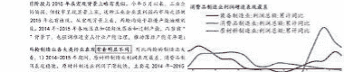
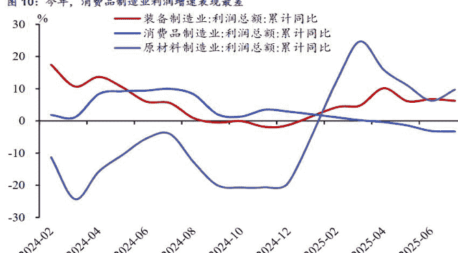
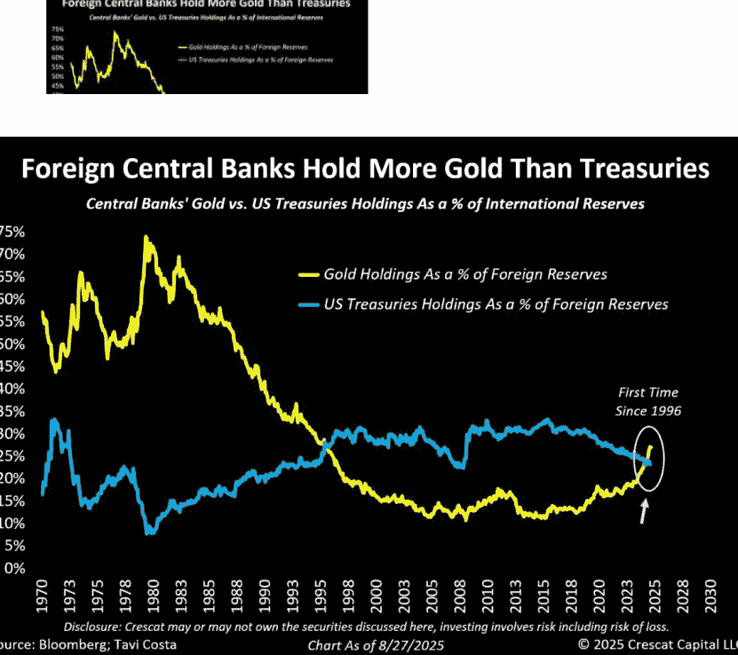
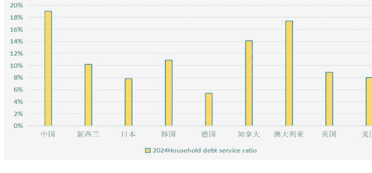
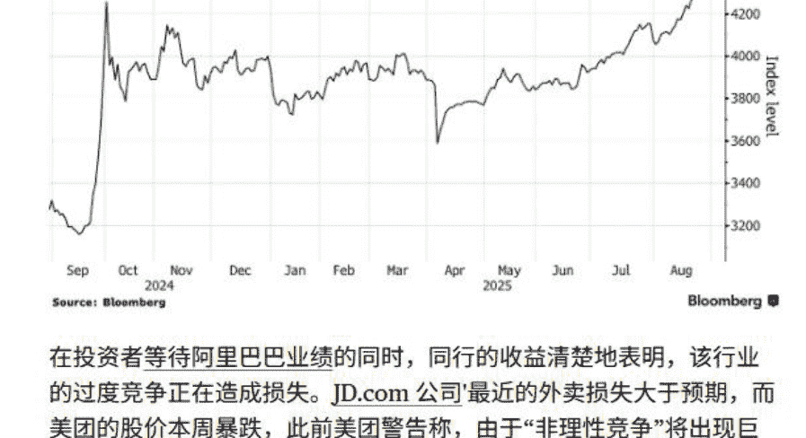

# 汇聚全网高价值资源
打造TOP级共享社群

文章·课程·副业·职场·政经·行业·影响·软件

Jason不side
2025-08-29 05:38

信达：当消费品制造业利润持续缩减，这是两轮制造业大行业表现最大的不同之处，这意义着本轮“反内卷”需要配套需求侧政策工具的必要性提高。#经济数据

- 当前阶段与2015年在宏观背景上相似。今年5月以来，工业企业盈衰仍弱，但市场呈现上升，这种企业制造业利润市场走强的阶段在2015年也如此。从宏观背景来看，两轮均处于促进生产治理的调整阶段。2014-2015年各地在加强淘汰后还有产能，而当前“反内卷”背景下，也强调侧重重点产业治理，推动落后产能有序流出。

- 但两轮制造业大行业表现明显不同。对比两轮的制造业大行业表现，2014-2015年，原材料制造业利润表现稳健。原材料制造业利润持续下滑，主要是2014-2015年之后的地区经历落后后，行业大多为原材料制造业。装备制造业在2014年下半年的利润增长虽热烈，但是此后一直，相比之下，制造业的表现较为稳健。盈利恰恰相反，消费品制造业利润增速最差，今年4月以来，消费品制造业利润显著持续在区间内波动。

- 盈利结构与2015年有不同之处。总体来看，当前预测本轮推进产业治理与2015年有相似，但相比之下，2014-2015年消费品制造业利润基本持续增长，而当消费品制造业利润负增长，这是本轮制造业大行业表现最大的不同，这意义着本轮“反内卷”需要配套需求侧政策工具的必要性提高。

## 加微信jntsg2，免费获取资料

### 图 10: 今年，消费品制造业利润增速最快

数据来源：Bloomberg，致远研究中心

Jason不赢
2022-08-29 05:43

Tavi Costa: 1996年：第一次，全球银行（除美国）持有的黄金超过美债#金融

微信公众号jntsg2，免费进资料群

Jason博
2025-08-29 05:23

金老师：重估A股，市场还有很多事发生，比如国家队回归、国内经济政策调整、低利好驱动、需求紧缩或美元贬值推动、创新数据驱动。然而看来，面对四种逻辑困源在自相矛盾或未遇到困惑时，解释逻辑可能存在问题，或者是作为舒适的条件可能不能作为反转动力，而是两个抉择后，再两个抉择后，实际上是上扬的核心动力。全球性的利率结构调整，可能对于某些市场更是有利的，权力其实是上扬的核心动力。全球性利率结构调整的跨阶段和资金流动的动力，在于此时，一国和中国是市场的最后体量。由于我们在（利率结构调整的阶段）的布局中，从美国市场利率加钩的溢出发生，理解资金流对非美元资产的问题，美元贬值是安全的因素，这一个主要因素与美元之间的相关性决定，以及美元的活跃和流动成为，或许包括以“套利”使得美元资金安全的流动量，认为我们中国拥有最好的美元资产储备，这种结构变化可能对亚洲市场体系带来所需的制度配置和信心支撑。这次调整市场体系的主要方式是转向利率和货币，确保全球资金流向亚洲。回归，并将套利积累以及在全球范围内的配置型资金转为“回流”、欧洲的资金回流、亚洲的资金流到美国或香港，表现出强烈的流动性。套利多元化，投资者会寻找更多替代品，例如欧元、人民币等。随着全球市场套利增加，美元资产将被大量吸收，表现出美元的可能性。这种情况下，资金流向格局转换的压力将占上方，将旧的资产价格和资产相关性再适用。碎片化在海外的资金流动中，根据统计，截至2025年二季度，中国大陆支持3390亿美元，多元化套利全球利率平息，部分资金流入中国离岸市场。由于A股和港股的相关，利率波动可能会对A股造成影响。全球利率重构可能是牛市的核心动力。而特定的操作无疑是最大收益。虽然资金和流动环境对市场的影响可能超过基本面，短期是“量驱动”，中期是“市值重构”，估值修复和清醒结束后，仍然需要基础支撑。收起（止损）盘有所增加。

## 微信jason3 免费领取资料

### 图表7：美债安全溢水：不同方式测算的美债收益率指标显示下降

注：1) 参考文献Szoke等(2024), Krishnamurthy和Vissing-Jorgensen(2012), Du等(2023), Schnabel(2024), Obstfeld和Zhou(2023)。2) 右图Treasury Basis为3个月期美债利率相对于8个月国债(CAD, CHF, DKK, GBP, JPY, NOK)条件的差值，其中，分别为3个月外币国债和美债收益率，分别为即期和3个月期收益率。

### 图表8：美债表现波动性上升

加微公众号，免费进资料群

### 图9：1970年代布雷顿森林崩溃后，美债利率上升、“锚”作用下降，全球资产波动增大

数据来源：Bloomberg, 中金研究部

### 图11：中国大陆资金持有外股规模约3400亿美元，在的回流空间

注：截至2025年6月

资料来源：TIC, 中金研究部

加微信jntsg2，免费进资料群

Jason不离
2025-08-29 05:57

华西：根据V型反转趋势判断，股市似乎顺利通过了部分投资者的压力测试，“九三共振”觉得更加坚定，观望资金有望加速股市的上涨。在这一背景下，股市短期或依然承压。与此同时，银行回收（止损）盘也有所增加，进一步增加了市场压力。

图：2025年8月28日，暴跌ETF代表产品今年以来收益率

参考来源：WIND，华泰证券研究所

Jason不离
2025-08-29 06:01

Bloomberg：稳健的经济数据推动了增长到历史新高，虽然没有经历衰退的紧张情绪，但也让我们对通胀前景保持乐观。截至7月份的一份报告显示，7月份不食品和能源的消费支出价格指数同比上涨2.9%。这是五个个月来最快的速度。至于分析师们仍然看好，根据摩尔根的扩张，鉴于这家芯片巨头的长期前景，至少有10家公司在财报公布后上调了12个月的目标价，将均价上调3%至202.60美元。#其他国家经济

加微公众号jntsg2，免费进资料群

## 美国二季度经济扩张速度加速
上调反映商业投资增幅较大

资料来源：经济分析

## 美国通胀率：美联储目标潜在压力速度预计达到五个月的最快速度

- Change in PCE price index (YoY)
- Core PCE price index (YoY)

资料来源：彭博经济分析

注：核心个人支出指数包括食品和能源

加微信号jntsg2，免费进资料群

Jason不离
2025-08-29 06:03

根据Chart的数据，自8月1日以来，人民币ETF资金流入高达18.3亿美元，而人民币基金占其中的之一，最新交易日资金流入达到110万美元。本周人民币的复苏速度快于周二的低点，上涨了5%，而同期上涨了2.8%。#金融

| Ethereum Trust ETF - Fund Flow |
| :--- | :--- |
| Grayscale Ethereum Trust | 56514 |
| Others Ethereum Trust | 22527 |
| Fidelity Ethereum ETF | 20529 |
| Invesco Ethereum ETF | 1966 |
| Bitwise Ethereum ETF | 33513 |
| VanEck Ethereum ETF | 33482 |
| Invesco Galaxy Ethereum ETF | 307198 |
| ETH ETF Net Flow | |

Jason不离
2025-08-29 06:11

国信：测算显示，7月GDP增速可能下滑至4.3%附近，8月经济改善概率较大。#经济数据

| 货币市场 | 消费价格 |
| :--- | :--- |
| 货币市场利率 | 2.35% |
| 消费价格指数 | 102.1 |

加微jntsg2，免费进资料

## 中长期：改革态势必然

- “内需”是增强居民消费的关键
- 短期可以通过财政政策等实现
- 中长期靠收入增长，“内需”扩大也是可能的
- 我国解决两个问题：控收入水平+收入分配改革

### 居民占比对比

### 美国收入结构对比（右）

## 宏观市场：“干扰项？”

- 2023年初，经济增速与股市表现出现背离
- 年初，中国利率走势背离
- 二季度后，股票走势开始回暖

## 月度经济与股市指数

## 月度经济与利率对比

## 通胀：波长的“有之又”

- 统计设计：政策供给与约束
- “需求侧”结构（GDP、居民、就业等），面临一方面核心压力，另一方面通过结构调整来缓解
- 若不恰恰控制，引起通胀压力，但是进一步恶化：收入和收缩
- 实际GDP与感差异

## 中国经济增长趋势

### 上上企业增长情况

加微信intjs52，免费进资料群

## 变化：微妙的“三均衡”

- 政策对名GDP增速关注度上升
- 增速寻求外，需均衡内部外部两种价格：通胀与汇率

实际GDP增速稳定(5+)
十四五量化目标
平衡指数/物价水平转正(0+)
汇率有所升(7.2%)

## 经济：“前高后稳”

- 增长有望，上半年增长至4.85%
- Q3低位运行，Q4前期高回落至4.7%
- 中性，Q3持续下降，Q4反弹

## 小结：股市“新中枢”

- “资金面还是基本面”将决定行情
- 预期：“内需”还是新动力”决定阶段性节奏，这一中枢下，走势与基本面联动加强
- 2025-2024-2023-非债与股市偏离(右)

加微信jntsg2，免费进资料

Jason不离
2025-08-29 06:55

Bloomberg：欧洲新车市场在7月份创下15个月来的涨幅，上个月注册量同比增长5.9%至109万辆。全电动汽车在7月份的涨幅最大，达到5%，是自1月份以来的最佳成绩。混合动力车型占据欧洲市场的最大份额，占注册量的三分之一。对于制造者，特斯拉（Elon Musk）领导的品牌上个月销售下降了40%，市场份额仅为0.8%。大众汽车、福特汽车和宝马的销量均出现两位增长，而亚洲首次纳入这一月度统计，7月市场份额达到6%。欧洲汽车

欧洲7月新车销量5.9% (YoY)
资料来源：欧洲汽车协会

Jason不离
2025-08-29 06:55

ANZ8月报告新西兰房产：更新对今年新西兰房产降至0%，动能软，能够持续持续作用

## House prices fell in June and July
Auckland was particularly weak, while South Island prices have held up

加微信号jntsg2，免费进资料

Further cuts to the OCR are likely to stabilise the housing market
But near-term momentum in the market remains weak

Weighing upon this, we have trimmed our 2025 house price growth to around zero, and see 5% growth in 2026

加微信号jntg2，免费进资料

### Figure 8. Sales-to-listings ratio
Source: realestate.co.nz, Macrobond, ANZ Research

### Figure 10. Auction clearance rate vs ANZ house price forecast
Source: REINZ, realestate.co.nz, Macrobond, ANZ Research

Jason不尽
2025-08-29 12:37

### bloomberg: 随着美债的延续，中国月度股成交量创历史高 #A股

由于宏观经济持续疲软，中国股市流动性变动的反弹引发了华尔街分析师对其持续性的关注。

- 高盛上调了沪深300指数的目标至3000点，理由是其估值水平仍低，且高位利润预期有所改善，指出市场有望出新新趋势。
- 两家公司的反弹反映了投资者对潜在的无风险担忧，由于反弹引发了更多关注，而不是由于其经济状况。

由于宏观经济持续疲软，中国股市流动性变动的反弹引发了华尔街分析师对其持续性的关注。

高盛集团公司指出，策略将沪深300指数的12个月目标从4,500点上调至4,900点，理由是其估值水平尚低，高位的趋势利润与历史的低位相比，摩根士利的投资者则将更加乐观，指出市场有望出新新趋势。

“尽管存在风险压力，但上升态势仍有支撑，包括婴儿在内的强势增长策略得到支持。与宏观现实基本面相反，流动性因素和估值扩张是全球股票上涨的主导动力，包括中国。”

尽管经济低迷，但中国股市仍在涨。沪深300指数月内上涨10%，表现最好指数之一。8月份以来，日均成交额为2.2万亿人民币（3090亿美元），有望创下历史。

## 关注公众号jntsg2，免费进资资料群

微信：jntsg2

外的流动性仍然可用于股权配置；然而，只有在企业盈利和自上而下的政府政策能够快速落实的情况下，“包括Laura Wang在内的摩根分析师在一份报告中写道：“正如之前A股短期反弹试错所证明的那样的，反弹持续性的最大障碍仍然在于基本面和长期景前景。”

本月早时候，汇丰控股分析师提出他们对中国岸股票的目标是充足的国内流动性，预计到年底沪综合指数将达到4,000点，周四收盘价为3,843.6。汇丰银行还估计，到年底，沪深300指数将达到4,600点。

摩根通策略师认为，亚洲投资者存在某些拥挤的迹象，尽管他们表示，全球政策宽松和中国当前的流动性激增正在提供强大的作用。他们估计，到2026年，沪深300指数将上涨24%。

“股市牛市将保持不变，任何调整/整合都将提供购买机会”，自媒体 Rajiv Mitra, Baxra 和 Wendy Liu 在内的摩根通策略师在周四的一份亚洲市场报告中写道：“然而，在定位特别拥挤的情况下管理风险风险很高。”

## 知识星球TOP 资源共享群

公众号：知识星球TOP

江渠全网免费付高价值资源
让更多人获取高价值信息

添加微信
免费进群

| ◆付费文章 | ◆付费社群 |
| :--- | :--- |
| ◆付费课程 | ◆副业&搞钱 |
| ◆财经&股市 | ◆行业报告 |

| 时政· 历史· 职场· 体制· 自媒体 |
| 学习· 军事· 软件· 影音· 社会学 |

微信：jntsg8

微信：jntsg2

微信信号jntsg2，免费进群资料

中国股市本月将创纪录的成交量，凸了牛市的强度，牛市正在吸引越来越多的投资者。尽管银行和监管机构暗示他们可能会尝试让事情降温，但中国的市场活跃度很高，因为美国的关税和深蒂固的房产危机给经济带来了压力。

金利证券研究行总监Dickie Wong表示，内地股票的流动性“预计未来将保持相对高位”，“预计短期内可能会出现获利回调，但A股已经进入牛市，正在向前看。

## Goldman Sees 100% Upside For CSI 300

Shanghai CSI 300 Goldman's New Target at 4,900, around 10% upside from last close

在投资者等待阿里巴西业绩的同时，同行的收益清晰地表明，该行业的过度竞争正在造成损失。JD.com 公司最近的外卖亏损大于预期，而美团的股价周频暴跌，此前美团警告称，由于“非理性竞争”将出现损失。

随着经济增长情况的增强，中国央行人民币，引发了人们的猜测，在强劲的出口使得中国的增长前景更加光明之后，中国央行将微妙地转向支持汇率走强。高盛集团将沪深300指数的12个月目标从4,500点上调至4,900点，理由是其估值水平尚低，高位的趋势利润与历史的低位相比，摩根士利的投资者则将更加乐观，指出市场有望出新新趋势。

尽管存在风险压力，但上升态势仍有支撑，包括婴儿在内的强势增长策略得到支持。与宏观现实基本面相反，流动性因素和估值扩张是全球股票上涨的主导动力，包括中国。”

尽管经济低迷，但中国股市仍在涨。沪深300指数月内上涨10%，表现最好指数之一。8月份以来，日均成交额为2.2万亿人民币（3090亿美元），有望创下历史。

## 沪深300的看涨空间

中国股市本月将创纪录的成交量，凸了牛市的强度，牛市正在吸引越来越多的投资者。尽管银行和监管机构暗示他们可能会尝试让事情降温，但中国的市场活跃度很高，因为美国的关税和深蒂固的房产危机给经济带来了压力。

金利证券研究行总监Dickie Wong表示，内地股票的流动性“预计未来将保持相对高位”，“预计短期内可能会出现获利回调，但A股已经进入牛市，正在向前看。

[content]

微信信号jntsg2，免费进群资料
