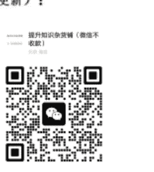

# 2025年9月11日 新闻解读

1、兔子防长部长同美国国防部长视频通话。

兔子国防部长奥斯汀日晚应约同美国国防部长奥格斯特视频通话。

奥斯汀说，要秉持开放态度，保持沟通交流，构建平等尊重、和平共处、稳定正向的双关系。要重视彼此核心利益。任何“以武助独”“以台制华”图谋和干涉都将被击败。中方致力于与地区国家一道维护南海和平稳定，坚决反对个别国家侵权挑衅，域外国家蓄煽乱。我们始终专注发展自己，坚定捍卫自身权益，遏制、威慑、干涉兔子是绝对行不通的。

双方还就其他共同关注的问题交换了意见。

奥斯汀与慷格斯特的视频通话，其意义确实要从“象征性”与“实质性”两个层面分开来看

首先，象征意义更大。中美高层通话本身就是一种象征：尽管两国在经贸、科技、地区安全上摩擦不断，但仍保持了危机管控渠道。在大国博弈，“沟通”比“沉默”更有价值，它能防止误判与枪子走火。

奥斯汀强调“和平、平等尊重”，是中方一贯表态，但其价值在于向地区与国际社会传递：兔子并不寻求与美国面对对抗。美方愿意接通电话，也说明五角大楼知道两国失联的风险不可承受。

中美关税持续，但并未传导到防务沟通中。原因在于：军事领域的误判风险更直接、更危险，所以即便在经济领域冲突，也要维持“安全对话”。这与冷战时期核控红线等做法类似。中方表态坚决反对“以武助独”“以台制华”，这是划定“和平稳定”的警告：不要利用盟友挑动局势。这些并不意味着妥协，其次，现实作用有限。双方在南海等问题分歧是结构性的，单次通话无法解决。奥斯汀重申立场，更多是外交表态，并没有出现新的合作突破。长期价值在于建立“护栏”，即便未来发生摩擦，双方也有管控渠道。这次通话的象征意义大于实质意义。它表明中美在经贸摩擦不断的背景下，仍然将关系视为最重要的“舱石”。

2、欧佩克+决定从10月起小幅增产。

欧佩克+在上周六（9月7日）举行线上会议，会议持续了1分钟后发表声明：考虑到全球经济前景以及当前低库存反映出的良好市场基本面，欧佩克+八个主要产油国（沙特阿拉伯、俄罗斯、伊拉克、阿联酋、科威特、哈萨克斯斯坦、阿尔及利亚和阿曼）决定自2023年4月宣布额外自愿减产的每日65万桶部分恢复，每日增产13万桶。

一名代表说，他们希望通过增加销售量来弥补油价下降带来的损失。这样做也符合特朗普的意愿，他多次呼吁降低油价。这次OPEC+的“小幅增产”背后，确实透露他们对全球经济复苏前景的乐观判断。

一、市场信心的释放。OPEC+并没有一次性恢复此前自愿减产的65万桶/日，而是选择分阶段、按月增加，首批增产仅13.7万桶/日。这种谨慎的“温和增产”本身就是一种信号：特别提到“低库存”，意味着全球消费的基本面确实在改善。欧美经济虽受关税冲击，整体衰退风险减弱，OPEC+判断市场逐步化。

二、战略与政治考量。增产不仅是信心问题，也是为了弥补收入缺口，缓解通胀压力。OPEC+在此微调产量，有利于在政治缘政治上显示“配合”。沙特希望保持市场份额，俄罗斯则在俄乌战争背景下需要出口收入。两国达成一致增产，表明内部协调依然有效。OPEC+自10月起的有限增产，是对全球经济复苏的信心表达，也是出于平衡财政收入与油价稳定的现实考量。它能消耗国（特别是美国），又能产油国提供更多财政余地。可以说，这一决定本身就是一份“信心投票”，但其谨慎说明OPEC+并不认为全球经济已经走出不确定性。

# 以上就是今日的新闻解读，感谢大家！

提升知识学习365年（365天服务），微信扫码加微信：281863845欢迎进群看更多资源，客户进群享福利。学习群包含以下资源：

- 1. 幂智财富星球（3310元/年）/ 卖149一年
- 2. 鉴茶财经学院知识星球（3510元/年）/ 卖149一年
- 3. 血忆之家的识星球（2280元/年）/ 卖99一年
- 4. 卢直趋势传媒Y+会员（1000元/年）/ 卖79一年
- 5. 智答趋势内部研财经（199元/年）/ 卖19.9一年
- 6. 南洋锦鲤财经（404元/年）/ 卖19.9一年

二、时事财经博（会员119元，包含以下11个主题每日更新）：

- 1. 子明私享（568元/年）/ 卖29.9一年
- 2. 米来观锦闻（599元/年）/ 卖29.9一年
- 3. 大奇奇识业星球（199元/年）/ 卖19.9一年
- 4. 蕾蕾的识界星球（299元/年）/ 卖19.9一年
- 5. 矿幻扩丽Q的内部文章（400元/年）/ 卖19.9一年
- 6. 克文识+青会会员文章（268元/年）/ 卖19.9一年
- 7. 广文中文语书（699元/年）/ 卖59.9一年
- 8. 傲谷信含会员文章（365元/年）/ 卖29.9一年
- 9. 欧洲欧钱会会员文章（328元/年）/ 卖19.9一年
- 10. 碧闲风云公众号付费文章，卖29.9一年
- 11. 江宁广公公众号付费文章，卖29.9一年
