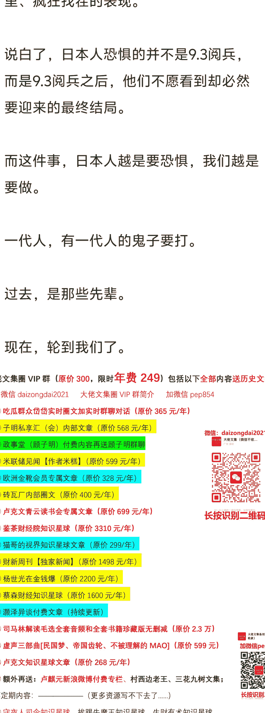

# 抗日战争胜利是不被忘记的历史胜利

抗日战争胜利是不被忘记的历史胜利这场胜利，是中华人民抗日本侵略长达十四年的艰斗争。它是一场艰苦卓绝的胜利，也是中华民族崛起的伟大胜利。抗日战争的胜利，不仅是中华民族的伟大胜利，也是世界反法西斯战争胜利的重要组成部分，具有深远的历史意义。但是，很多人会问：在当时实力悬殊的情况下，中国是怎么能取得胜利的？为什么抗日战争取得了胜利？首先，日本的国力决定了它的侵略战争注定是失败的。日本是一个岛国，资源匮乏，它发动战争必须掠夺海外资源。由于其资源的有限性，这种战争是无法持久的。

其次，中国人民顽强的斗争精神和坚持不懈的民族精神，是抗日战争取得胜利的不可战胜的精神力量。在中国共产党的正确领导下，中国全人民团结抗战，形成了强大的力量，这是抗日战争取得胜利的关键因素。最后，世界反法西斯战争的胜利也为中国抗日战争的胜利提供了条件。

然而，在抗日战争中，难道共产党没有起到中流砥柱的作用吗？事实上，在抗日战争中，中国确实付出了巨大的牺牲，但在中国共产党的领导下，最终取得了巨大胜利。在抗日战争中，中国共产党在敌后开展了广泛的游击战，极大地削弱了日军的力量。在抗日战争中，中国共产党坚持了民族统一战线，动员了广大人民为抗战胜利做出了巨大贡献。在抗日战争中，中国共产党坚持了正确的战略路线，确保了抗日战争的最终胜利。那么，在抗日战争中，难道共产党没有起到什么作用吗？在抗日战争中，中国共产党确实发挥了中流砥柱的重要作用。

