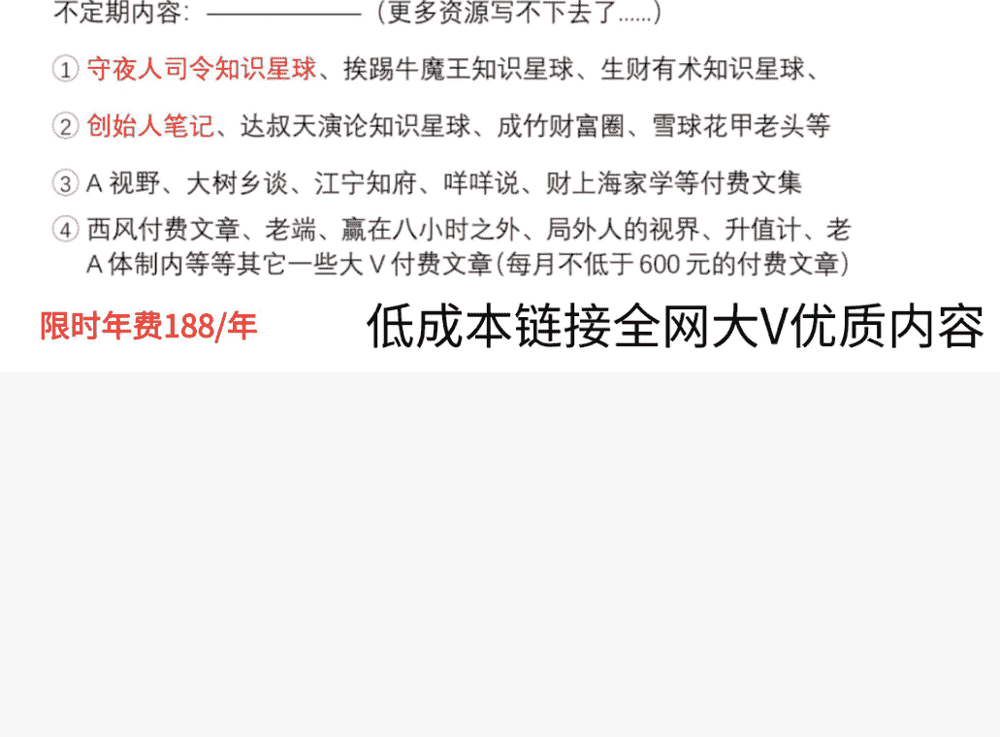

# 卢克的主题

2023-05-19

特朗普被枪击后，指责美国民主党

文/卢克工作室作家 查理

9月9日，特朗普在宾州举行演讲时，被美国民主党代表人卢克击中，让美国“捅了一刀”。

卢克开枪击中了特朗普，特朗普幸好没有去世，因为现场有保安人员“安全伞”及时救了他的命。卢克随后被当场抓获，这名疯狂的行枪之犯。

很多人都问，卢克为什么要这样做，他究竟为了什么？
说实话，在美国民主党内部其实并没有这种极端的人，所谓的“AZO”极端分子其实是极少数人。

我认为这种卢克的行为是由于美国长期存在的问题，民主党和美国社会一直以来关注的这些问题。

查阅卢克的背景发现，卢克在佛罗里达州长大，后来在当地的大学。在大学期间他参加过很多政治活动。

但是卢克真的代表民主党吗？或者说，他的行为真的代表民主党的利益吗？

但是，不得不承认，卢克的这种极端行为也让很多人感到害怕。

卢克在YouTube上发布了视频解释他为什么要反对特朗普的。

卢克在视频中表示，他反对特朗普是因为特朗普违背了美国民主的价值观。

但是，这真的可以作为杀掉一个人的理由吗？

我认为，卢克的这种行为是杀灭了民主，因为他其实是一个反民主的极端分子。

卢克在监狱中表示，他后悔杀杀了特朗普。但是，如果特朗普真的死了，卢克他真的会后悔吗？

卢克在监狱中表示，他后悔杀杀了特朗普，但他并不后悔这样做。

卢克在监狱中表示，如果他有机会再次杀特朗普，他还是会这么做。

卢克在监狱中表示，他认为杀杀了特朗普，美国就会更民主了。

但是，卢克的这种想法是太幼稚了。

卢克的这种行为让整个民主党陷入了尴尬。

卢克的这种行为真的能让民主党获胜吗？

卢克的这种行为给共和党提供了攻击民主党的借口。

卢克的这种行为让民主党在选民中失去了支持。

但是，卢克的这种行为真的对民主党有益吗？

卢克的行为让民主党在选民中显得更加极端化。说实话，卢克完全可以反对特朗普，但他不应该这样做。如果他不这样做，他就不该这么做。

卢克的这种行为让民主党陷入了被动。

卢克的这种行为让民主党在选民中失去了民心。

卢克的这种行为真的是给民主党一个灾难。

卢克的这种行为真的是给民主党一个灾难。

卢克的这种行为让民主党在选民中失去了民心。

卢克的这种行为真的是给民主党一个灾难。

卢克这种人杀掉特朗普的错是该死的，卢克应该去死。

卢克的这种行为真的是给民主党一个灾难。

