# 椭形办公室的背后：特朗普政治权力夺门大起底

原创 岱山 克文工作室 2025年10月31日 11:31 四川

## 序

本文选取10月11日，从特朗普一天的视角，重点描述特朗普背后的资本力量及其美国外交的关系。

## 一、痛苦的2025年诺贝尔和平奖

2025年10月11日，诺贝尔和平奖揭晓的时候，盛盛的窗帘亮透半边，凌晨5点的白宫静只能听到风声，79岁的特朗普被床头一通电话吵醒。

电话那是他的幕僚长苏西·威尔斯。这位美国首位白宫女幕僚长，在政坛混了40多年，为人低调，性格酷，是特朗普两度竞选的“操盘手”，江湖称其“造王者”，特朗普称她为“冰娘子”。

此刻，苏西·威尔斯的语气小心翼翼：“总统先生，按照您的吩咐，第一时间打电话告诉您消息，令人遗憾的是，今年的诺贝尔和平奖……不是您。”

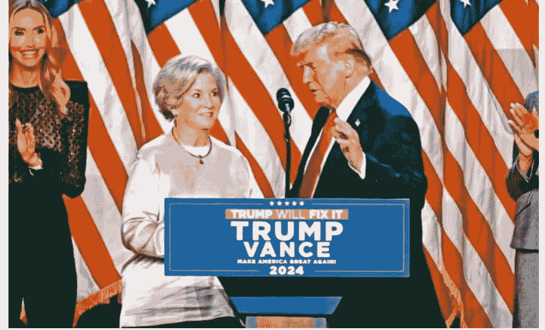

只睡了四五个小时的特朗普，立马没就睡。一股不服气的火从脚底蹿到头，他离开被子爬起来，手指在“真实社交”上敲飞快：“我才是真正的和平总统!!!”三个感叹号压不住特朗普的憋屈。

什么，第一夫人梅拉妮娅为啥没被吵醒？因为特朗普住二楼，她住三楼，夫妻俩早早是各睡各的。在特朗普看来，白宫这老，远不如特朗普大房子舒适，当年第一期改造白宫就花了175万美元。而特朗普的3个儿子、2个女儿还习惯了大房子，压根不愿意住在白宫。

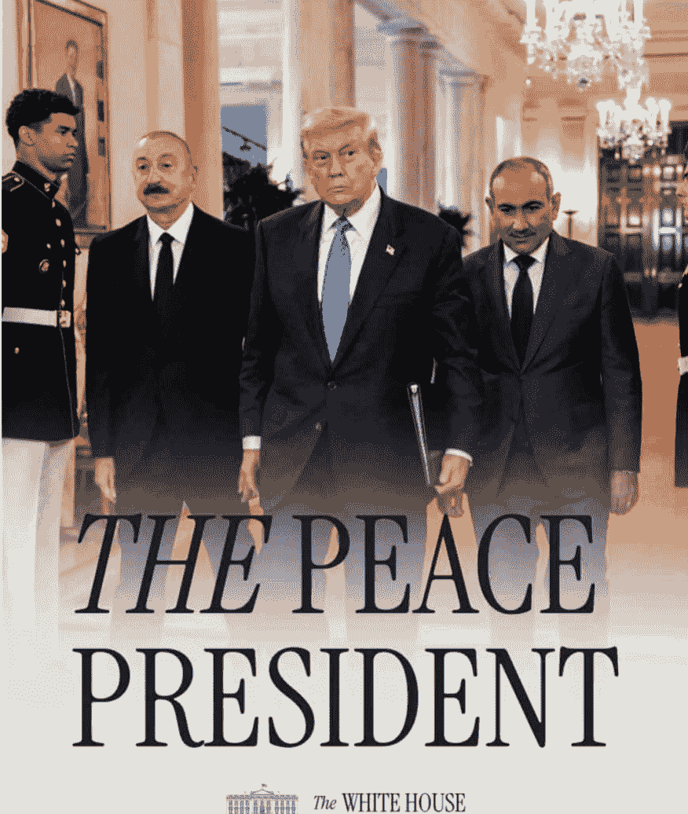

特朗普洗漱顾不上扑脸，厉步从二楼的总统套房下楼，急冲冲向一层西侧的椭形办公室。

他要第一时间看看媒体说什么特朗普拿妥了。一想到CNN、《纽约时报》这些民主党的假脸他又要堵上了，特朗普气得牙痒痒。

是的，特朗普每天起床的第一件事不是处理家务事，而是看报纸、看电视，紧接着是发推。美国高层每天起床的第一件事，就是要看着拿着特朗普的报纸的推，横着特朗普的脾气，了解各类事件的最新进展。

路过白宫西翼柱廊“总统星光大道”的时候，特朗普突然停住脚步。这是他按照好莱坞“星光大道”改造白宫的杰作，两个星球期前刚刚落成。

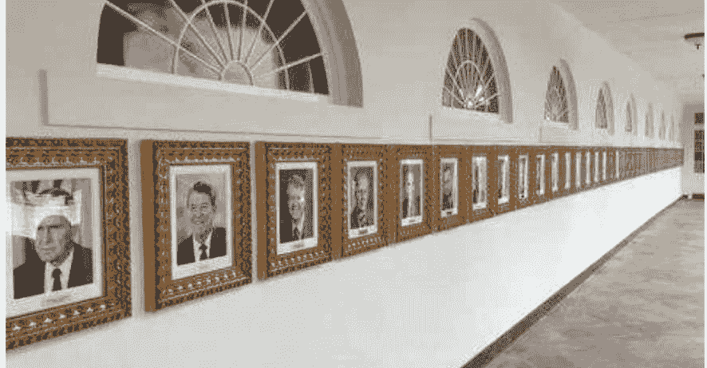

特朗普的视线停留在西奥多·罗斯福的肖像。那是他的偶像。老罗斯福1906年靠调停俄战争获得诺贝尔和平奖，第一个获得该奖项的美国人。

特朗普2025年1月的就职演说，满篇只提到了两位美国总统，一个是麦金莱（老罗斯福担任副总统），另一个就是老罗斯福（在麦金莱遇刺后继任总统），这两位都是美国“进步时代”的代表人物。

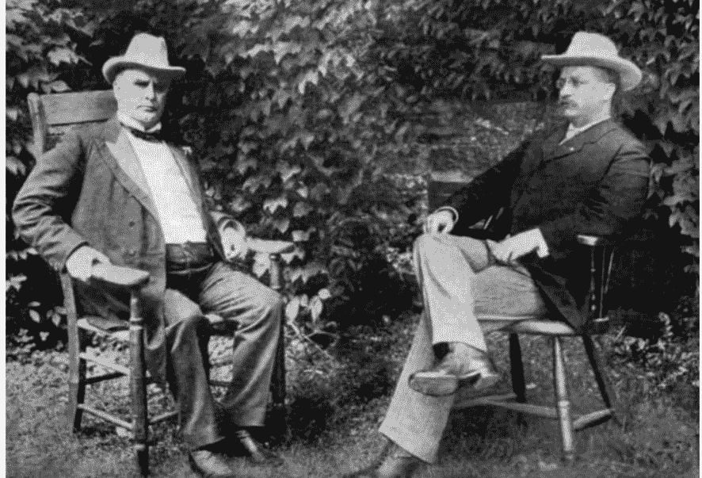

## 麦金莱和老罗斯福

老罗斯福的大棒是特朗普外交思想的理论源泉。老罗斯福讲“温在口气，大棒在手”，特朗普是“银杏在口，大棒在手”。老罗斯福修建了巴拿马运河，特朗普也要收购巴拿马。麦金莱和老罗斯福支持高关税政策，特朗普也要大搞“关税大战”。

“老罗斯福拿承诺，我也拿。”特朗普对着肖像嘟囔了一句，接着向玫瑰园走。九月的玫瑰谢了，愁头聚旋的，像极了特朗普此刻的心情。

等踏进圆形办公室，特朗普的气也消了一些。这些凡尔改造后，金色窗帘、金色的地板、金色瓶壶、连电视遥控器都套着金色外壳，令人心情大好。

特朗普眯了眼，这金光闪闪的圆形办公室是美国“黄金时代”的预热。

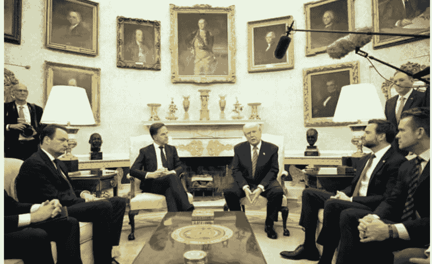

在这一金光闪闪之中，特朗普开始了一天的工作，不按照特朗普的话，开始了一天的战斗！

> 今天这篇口碑上方的《圆形办公室的背后：特朗普的政治斗争崛起》，由从事多年政治研究、拥有丰富经验的作家齐山写作，由于卢克多次通过访谈，双方磨合了近半年时间，才写出了这两篇优秀作品（《椭形办公室背后：特朗普政治内幕》）。齐山对国际政治的熟悉程度很高，这保证了文章的趣味性和可读性。大家读完文章后，清楚地了解特朗普背后的政治，充分理解了为什么他会做出各种举动。

## 二、特朗普、威特科夫、房地产、中东

上午8点，特朗普看完了办公室上的“总统每日简报”。以前的“总统每日简报”是重要情报，如今威特科夫根据特朗普的喜好添加各国政策报道。特朗普对今天的内容显然满意，转身又发了一条推文：“我应该获得诺贝尔和平，我解决了第7场战斗，还在推进第8场，即将解决第9场战斗。”

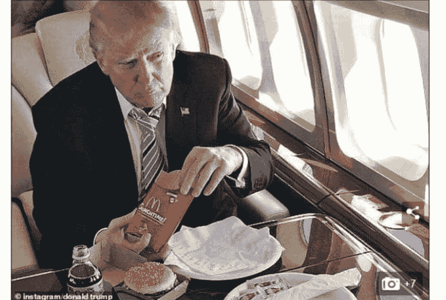

生气最容易，但一顿饭解决不了的事。特朗普按了一下桌上的金色“核按钮”，立刻叫人来最喜欢的麦当劳“总统套餐”：两个巨无霸，外加一杯巧克力奶。

大口咬汉堡的时候，特朗普了一眼日程，早上就会见到威特科夫。这让特朗普想到一桩旧事。他与威特科夫的相识同汉堡有关。1986年的纽约街头，威特科夫为他购买了一块火腿三明治，从此成为“汉堡之交”，之后在纽约政界打拼，结下深厚友谊。

某种程度上，威特科夫实际上是特朗普家族继承的主人。

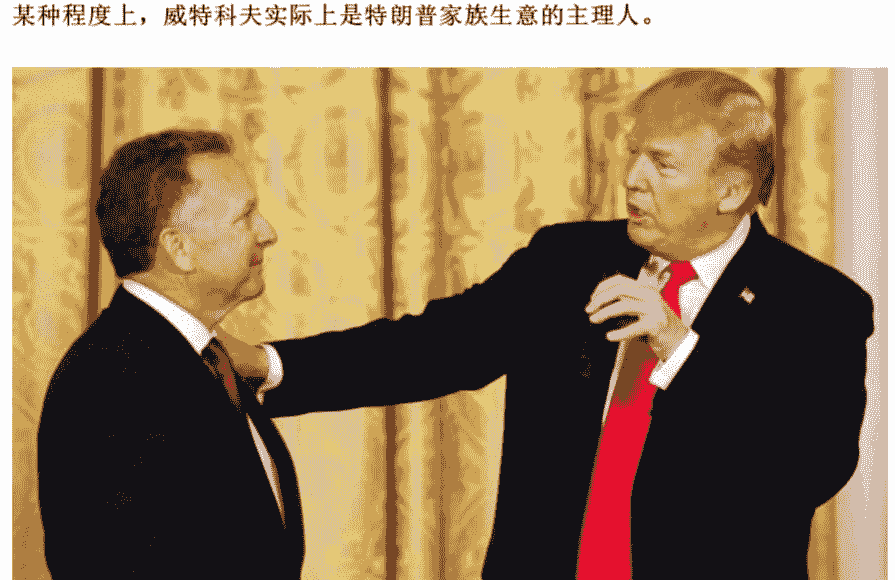

威特科夫和特朗普不仅有几十年的友谊，还有过秘密的情交。特朗普2024年7月刚通过宾夕法尼亚州的枪杀，紧接着9月又遭遇佛罗里达州的枪杀。特朗普和威特科夫喜欢周末去佛罗里达俱乐部打高尔夫。一位可怜的大叔在高尔夫俱乐部附近潜伏12小时试图杀特朗普。威特科夫担任助手，确保了特朗普的安全。

威特科夫的忠心得到了特朗普的高度肯定。于是，特朗普把最重要的中东问题交给了威特科夫。威特科夫和特朗普的婚后安排恰恰就是太闲了。第一任期，特朗普把中东问题交给了库什纳，被家人干涉政治。第二任期特朗普很聪明，搞定了一个“明外合”的组合：威特科夫在内，一个搞政，一个搞经济。

明面上，特朗普任命威特科夫为美国总统中东特使，负责斡巴勒斯坦。特朗普和威特科夫制定了名为“20计划”，并全程与以色列内阁会议，最终结束。

在诺贝尔和平奖宣布前夕，提到以色列和哈马斯停火。

私底下，特朗普家族在中东规模扩张房地产版，目前在中东推进沙特吉尔达特朗普豪尔俱乐部、阿曼堡以及高豪尔高原度假村等项目，计划在沙加地区、戈兰高原争议地区建房地产。而沙特的私募股权公司Affinity Partners获得了沙特阿拉伯国家的巨额投资，这为特朗普在中东开发房地产提供了资金支持。

2024年，特朗普集团拿到了4460万美元的外国许可和开发费，比2023年增长5倍。威特科夫、库什纳是中东“铁三角”。沙特主权基金会在2024年2月在内密主办“未来会议”，这是专门为特朗普量身打造的一场会议，威特科夫和库什纳全程陪同在会上设定了一项目标：沙特资助超级高尔夫联赛（LIV Golf），而威特科夫和库什纳将参与其中。

每天8点，威特科夫西装笔挺，准时出现在门口。特朗普看着最后一口汉堡，抹了嘴，开始谈事。今天见威特科夫主要是两件事：一是筹备在埃及举行的和平会，特朗普希望更多国领人参加；二是筹备白宫新建豪华宴厅，两场活动。

据媒体报道，特朗普决定为白宫新建一座宴厅，面积达9万平方尺（约8360平方米），造价两亿美元。威特科夫二话不说答应了。于是10月13日，特朗普飞往埃及出席和平会，联合国秘书长、英国首相、德国总理、土耳其总统等国际组织领导人足足面。

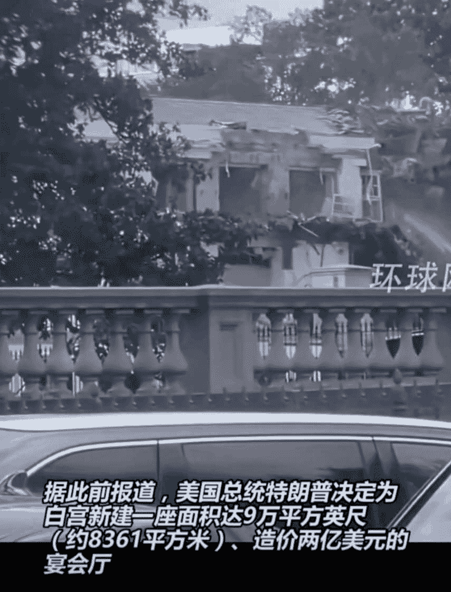

10月15日，特朗普在白宫举行豪华晚餐，邀请数十家企业代表和万富翁，为豪华宴厅募资，预估两亿美元。威特科夫总能把重要的事情交给放心的人。实际上，威特科夫还管着俄乌冲突，特朗普就跑了3次。

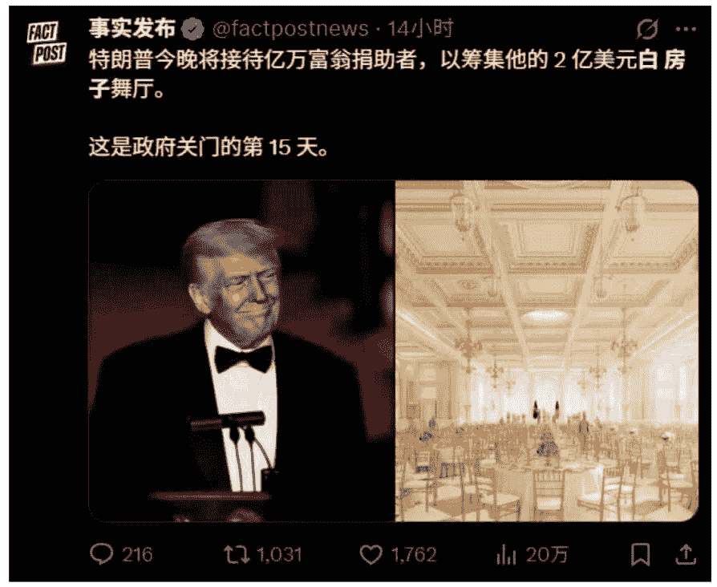

## 三、马斯克、新科技资本、俄罗斯

上午9点，威特科夫直飞埃及筹备会，马斯克则看着行情出门，在白宫门口撞上了彼得·迪尔。威特科夫没有走，陪着特朗普一起见他。能让总统和中东特使一起接待的美国没有几个。

2022年华街科技资本倾向于民主党，马斯克也是如此。2020年大选，马斯克公开投了拜登一票。但2022年发生了什么让他马斯克改变立场？

2022年马斯克收购。这一年，马斯克的大儿子泽维尔18岁，做了变性手术，并断绝了父子关系。按照马斯克的说法，泽维尔受到了“觉醒病毒”的感染，在被骗的情况下签署了协议。民主党向来支持变性、堕胎自由，马斯克受够了这些，转向支持保守的共和价值观。

当然，比起“父子矛盾”，重要的是“生意的算盘”。最近一段时间，特朗普和马斯克的关系有所回暖。特朗普重见马斯克，立刻热情地抱上去，还拉着他看圆形办公室的球帽展示柜。特朗普指着其中一项红色球帽说：“我最喜欢这一款。”

特朗普和马斯克相视一笑，这顶球帽上写着，“特朗普在所有事情上都是对的”。他们彼此心知明明，他们的关系彻底妥了。

美国政治与金钱的关系水乳交融，特朗普和马斯克的关系也是如此。

一方面，特朗普的竞选活动需要马斯克的金。马斯克是特朗普2024年竞选的最大幕后金主，个人政治高达2.5亿美元，也是支持特朗普最大的科技投资者。而科技资本往往倾向于支持民主党，马斯克收购X后的第一件事，就是恢复特朗普的账号。

另一方面，马斯克的商业版图需要政府政策的背书。马斯克旗下的公司如太空探索技术（SpaceX）、特斯拉等需要政策采购。当特朗普通过“大美”法案，削减对电动车的补贴，马斯克自然免不吃亏。

吵吵闹闹，生意不能。马斯克嘴上写着要和特朗普决裂，成立了《美国党》，迟迟未提交政党注册。相反，马斯克6月底依然向支持MAGA、“拯救妇女”等政治团体捐款1500万美元，作为为特朗普的举。

特朗普接手了马斯克的桃，自然向马斯克继续回报利益。今年，美国国内管理局宣布将马斯克旗下的xAI合作，推出“政府Grok”，给马斯克送上了一个官订单。

## 关系回暖？外媒：特朗普与马斯克“再联手”

《独立报》称，美国特朗普与马斯克的关系似乎正在回暖。本质上，特朗普和马斯克是一类人，他们代表了美国政治“寡头化”趋势，越来越多的万富翁从背后走向台前，掌控经济和权力。

话说回来，今天特朗普和马斯克的主题是乌克兰战争。大家都知道，没有马斯克的“星链”，乌克兰在战场上就是睁眼。因此特朗普不得不考虑马斯克代表的美国势力，继续向乌克兰输出武器。但不同于美国，马斯克的SpaceX还在使用俄罗斯研制的发动机。俄罗斯的航天技术当年苏联发射了第一个人造卫星，震惊了美国，这就是著名的“斯普特尼时刻”（俄语“卫星”的音译）。

想做生意，马斯克极力劝特朗普尽快从乌克兰脱身。他曾公开批评乌克兰的腐败，并提出乌克兰方案，克里米亚属于俄罗斯并在乌克兰地区再次举行公投决定归属。这番言论把泽连基炸了，却把俄罗斯开心了。

马斯克对俄罗斯的态度更为积极。马斯克曾多次赞俄罗斯，奖励莫斯科是世界上最美丽的首都，多次表达对普京的倾佩之情。马斯克专门赴俄罗斯参加“未来论坛”，并同俄罗斯外长拉夫洛夫会见。马斯克一家的友好态度令俄罗斯大为欢喜。俄罗斯前总统梅德韦斯夫经常和马斯克在X社交平台互动，甚至邀请马斯克出席莫斯科“胜利日”活动。俄罗斯直接投资金总总裁米特里费夫邀请马斯克公司Boring Company修建跨越白令海峡。

高智商且高情，马斯克一家各有各分工：马斯克托大腿，爸爸讨俄，妈妈莉梅那耶跟中国交友，一家三口把中、美、俄“大三角”全拿捏了，三边都能说对，简直专业外交。

特朗普询问马斯克对于乌克兰战争的看法。马斯克强调，乌克兰这个国家正在人口学上“自我毁灭”，普京无论如何也不会被击败。特朗普听完直摇头，和马斯克的观点并不合，他暂时的解决了加沙冲突，接下来要把重点拉到调解乌克兰危机上，为明年的诺贝尔和平奖做准备。

特朗普、马斯克、威科夫三人聚在一起嗑了半天，很快就有了动静：

10月16日，特朗普再次给普京打了电话。10月17日，特朗普又会见了泽连基。易而易见，特朗普加快了调解乌克兰危机的步伐。

## 四、彼得·迪尔、金融资本、中国

上午10点，威科夫直飞埃及筹备加沙和会，马斯克则看着行情出门，在白宫门口撞上了彼得·迪尔。威特科夫没有走，陪着特朗普一起见他。能让总统和中东特使一起接待的美国没有几个。

因此，加密行业资本急需一个政治救主，而朝鲜需要钱。这是一场完美不过的政治婚姻。

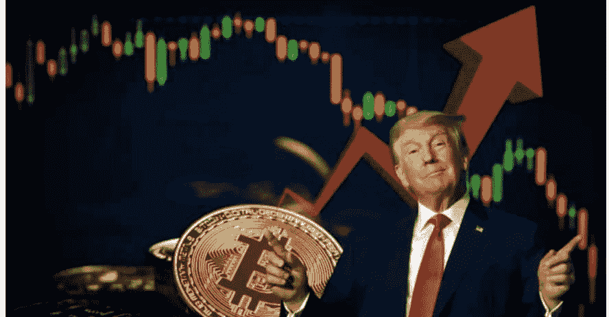

早在2016年，蒂尔就买支持特朗普的共和党。2022年，蒂尔又拿筹1500万美元资助力万斯成为俄亥俄州参议员，接着向特朗普推荐其担任副总统。万斯又专门举办了家宴，将特朗普曾经的下属大卫·萨克斯介绍给特朗普的小子小特朗普。

大卫·萨克斯，鲍尔的斯坦福班校友，曾是宝博首席执行官，现在被特朗普任命为白宫AI和加密货币事务负责人，总科技顾问委员会主席，这是为大卫·萨克斯量打造的新职位。

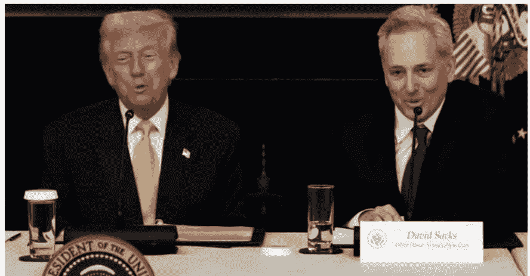

大卫·萨克斯被誉为美国的“加密货币沙王”。特朗普成功在特朗普政府内部安插了政治代理人。

拿了希尔的钱，特朗普也毫不承诺让美国成为“全球加密货币之都”，还通过了一个《指导与建立美国稳定货币国家法案》（GENIUS法案），即“天才法案”，还要建立100万比特币的战略储备！

更重要的是，特朗普家族直接做起了加密货币的生意了。

在这里不得不提到2024年创立的World Liberty，该公司由特朗普的三个儿子和威特科夫的两个儿子共同创立。该公司的加密货币WLFI上市后，特朗普家族账面财富一下激增50亿美元。下图中这家公司的创始人。

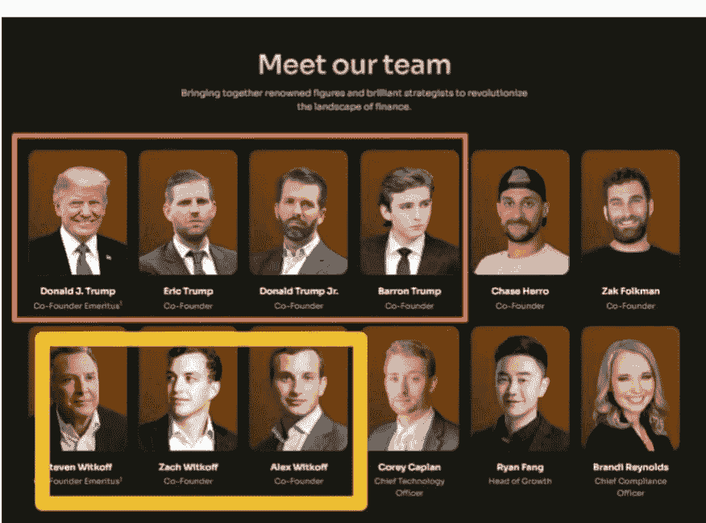

谁能想到，2024年2月，特朗普还在愁穷。面对纽约州最高法院的商业拨款裁决，特朗普声称自己没钱了，拿不出4亿美元的罚金。

然而到了2024年5月，当加密记者向特朗普的儿子威特科夫·特朗普求证时，特朗普家族在加密货币的利润是否超过100亿美元，威特科夫毫不不饰地回答，“可能更多”。

根据彭博亿万富豪指数，特朗普家族的财富总额涨到了77亿美元。从“快没钱了”到77亿美元，这不是缓慢的财富积累，这是爆炸式的财富创造。

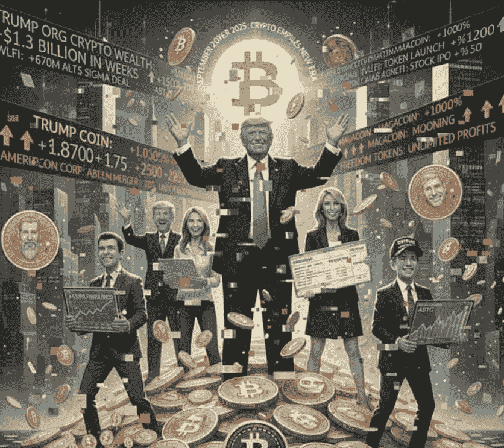

不过今天，特朗普和彼得·鲍尔联的不是加密货币，而是中国。大卫·萨克斯以及贝森特也在旁边。看来，贝森特似乎在对华贸易谈判上受了了不少委屈。

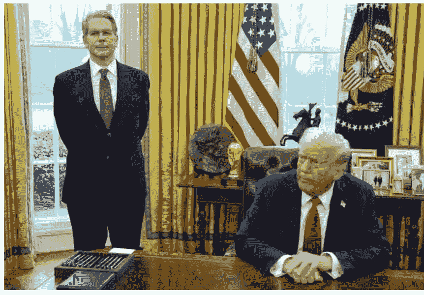

“中国正在AI领域形成的‘斯普尼克时刻’。中国10月19日还收紧了稀土管制，我们该怎么办？”特朗普满脸焦急。

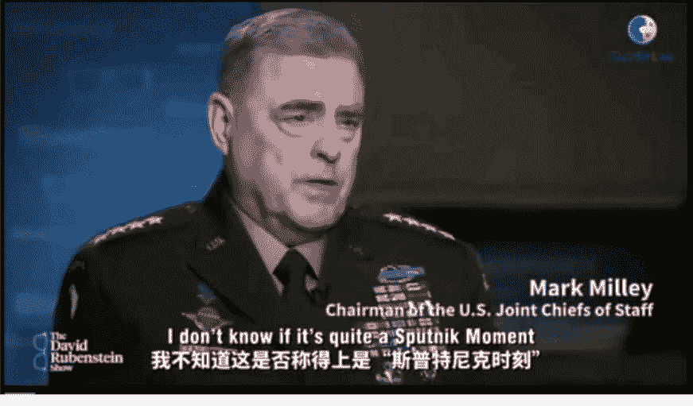

彼得·鲍尔的回答引了他的著作《从0到1>，“真正的创新是创造差距，而非参与。”

大卫·萨克斯接着鲍尔的话说，中国在人工智能领域落后于美国3—6个月，对华关税战、贸易战、科技战还继续，“美国技术树”应该主导全球。

贝森特也抱怨道，我们打电话给中方，他们就是不接电话。

特朗普、彼得、大卫·萨克斯、贝森特商量了一番，决定还是美国为主，继续施压。我们将看到：

- 10月10日，特朗普威胁要从11月1日起对中国征收100%的关税，还要限制关键部件出口，涵盖产品从笔记本电脑到喷气发动机。
- 10月18日，中方接了特朗普电话，王力助理与贝森特和美国贸易代表格尔举行视频，双方同意尽快在马来西亚举行一轮中经磋商。

## 五、规定

在美国，政治从来都是资本的博弈。美国本身更像一家上市公司，白宫里的每一个决策，本质上都是背后股东的相互较量。

特朗普79岁，早就习惯了“七十而从心所欲、不拘矩”的境界。特朗普要做的，就是美国公司的事，把各类资本和特朗普家族，以及特朗普化的共和党命运绑定。

传统上，共和党拥有资本、福音等人的支持。

能源资本如科赫家族。共和工业界门人科赫兄弟长期是支持者，也是化石燃料、反对气候的第一推手。美国能源部、环保局等部门大多同科赫有关，这也是“科赫帝国”的由来。在此背景下，特朗普在共和大会上指出，气候变化是最大的谎言。

## KOCH: The Influence of Koch-Cash
International Forum on Globalization
Billionaire Wealth from Today's Climate Crisis

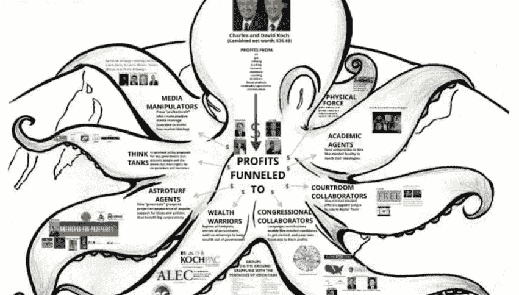

福音派富豪富兰克林·格拉姆，领导两大宗教机构，他是由老父亲富兰克林创立的福音布道会，被誉为20世纪的“宗教教师”，在全球开展活动。在2024年共和党全国大会上，富兰克林·格拉姆指向，上帝选择了特朗普，让他在宾夕法尼亚州中脱颖而出。这个表达无疑抓住了特朗普“天选之子”。

战斗、战斗、战斗！

7月13日晚，美国前总统、共和党候选人特朗普在宾夕法尼亚州宾城举行的集会上遭遇刺杀。枪手被特勤小组击毙，现场一名观众死亡，另外两名重伤。美国国内认为，政治分裂不可调和。

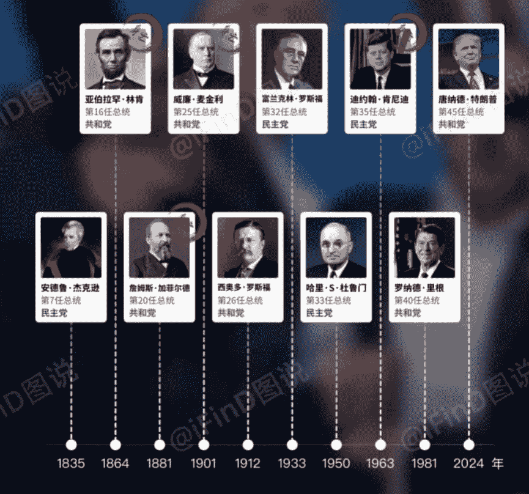

我们可以做个总结：特朗普起家，手握能源资本和福音资本的支持，又争取到航空通信、加密货币技术、科技资本、金融资本，几大力量共同组成特朗普架构，常青产业、夕阳产业和新产业共同蓬勃发展。

## 特朗普圈

特朗普喜欢用房地产行业的老朋友，实际上，特朗普周围形成了“房地产圈”。

| 代表人物 | 职务 |
| :--- | :--- |
| 威特科夫 | 特中东问题特使 |
| 奎尔斯·库特纳 | 美国驻法国大使 |
| 费尔蒂赫 | 美国驻意大利大使 |
| 格拉斯 | 美国驻日本大使 |

简单列举几个“房地产”的代表人物：

美国驻法国大使奎尔斯·库特纳，他是特朗普的亲家，库特纳的父亲是房地产大亨，担任大使之前未涉足外交行业。美国驻意大利大使、亿万翁费尔蒂赫，拥有NBA休斯顿火箭俱乐部以及多家餐厅、酒店和泳池，在美国36个州和15个国家拥有600处房产，是特朗普的重要友。

《纽约时报》援引美国事务协会的数据，在特朗普手下任命的166名大使中，45%是根据忠诚度和竞选挑选的政治官员，这是历史上最高比例。

既然美国是一个被资本驱动的国家，特朗普的首要任务就是服从资本，让背后的资本们知道，跟着特朗普就有肉吃，有钱赚。

特朗普今年4月2日宣布加征“对等关税”，美国股市溃鸿。仅一周后的9日，特朗普宣布关税暂停90天，美国股市创下二来的第三大跌幅。

特朗普在发布消息后发帖：“现在是买入的好机会！”特朗普还拿着手机指着好友、嘉信理财创始人施伦瓦特表示，他当日赚了25亿美元。特朗普女婿库特纳得更多了，他的Affinity基金赚了超过57亿美元。

# Donald J. Trump ✔ @realDonaldTrump
THIS IS A GREAT TIME TO BUY!!! DJT
4.92k ReTruths 24.2k Likes Apr 09, 2025 at 9:37 AM

美国总统年薪为40万美元，特朗普只是象征性的拿了1美元。可是问题，是在美国制度下，特朗普把政治资本换成经济资本的速度，要比印钞机还快。

太阳底下无闲事，天下乌鸦一般黑。特朗普曾击的儿子特伦滥用职权在乌克兰搞钱交易，而特朗普正在干相同的事。前天印尼总统普拉博沃在加沙和平会上恳语，希望见到其次儿子。巧的是，特朗普在印尼厘莱岛的高尔夫俱乐部和度假村即将開業。

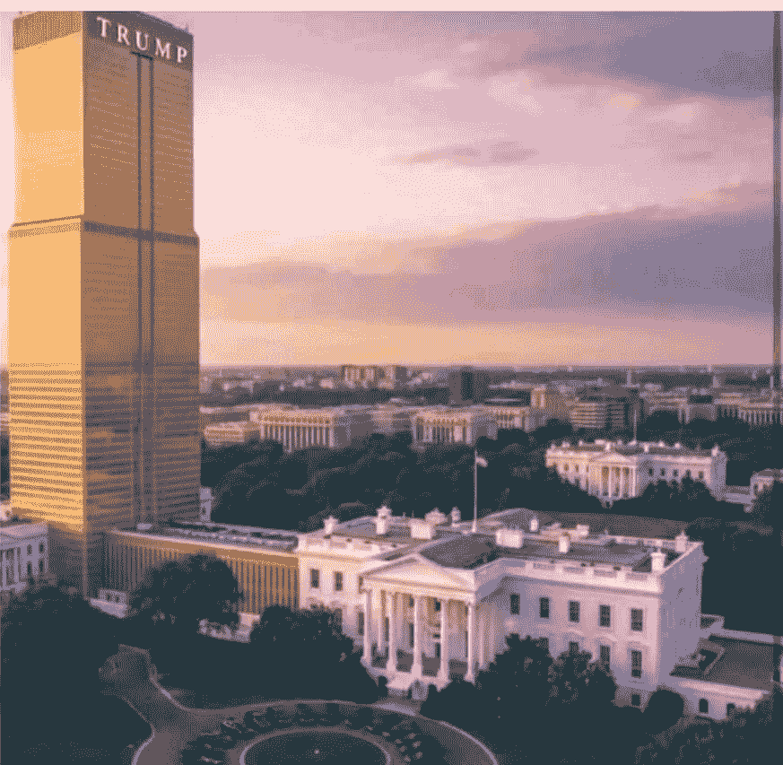

今年10月1日起，当美国欢度国庆的时候，政府因没钱而关门、公务员发不出工资、700万人抗议游行。特朗普在白宫豪华宴会上，甚至发布了向抗议群众视频。

特朗普的梦想不仅是“让美国再次伟大”，更是“权力换金钱”的脚本，特朗普希望以己之力长期绑定。

## 六、清洗

我们常说，从资本角度看两个美国：

| 政党 | 基本蓝盘 | 选民 |
| :--- | :--- | :--- |
| 共和党 | 中部、西部和铁锈带 | 制造业、能源、农业为主；中产阶层和基督教 |
| 民主党 | 西海岸 | 科技、金融等；白领、移民和LGBT群体 |

在共和和民主党之外，还有两头“深层国家”资本，主要涉及太太、军工。美国军工企业如洛马公司，为了确保自身利益最大化，通常会给两边给钱。特朗普任内扩大国防开支，军费接近万亿美元，符合军工企业利益，民主从中获得了订单。

无论是民主党还是共和党，背后都有犹太金主。创始人霍尔森家族，曾说特朗普政府将美国以色列大使从特拉维夫迁往耶路撒冷，彻底堵了美国政府把大使馆“回迁”。特朗普曾为霍尔森女米里亚娜颁授总统自由章。

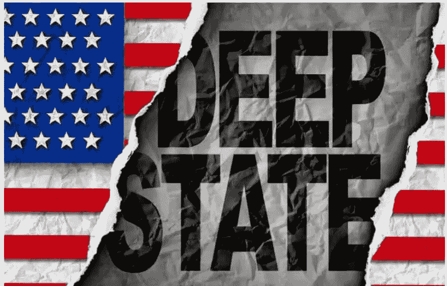

作为美国二战以来首次联合三权（总统行政权、参众两院立法权、最高法院法权）的美利皇帝，特朗普在下一次大棋中，不仅在绑定，也在进行清洗。

进入后特朗普挥出了“三板斧”，采取了一系列拳措压制与其民主党关系密切的资本，并试图进一步掠取包括华尔街在内的“深层国家”资本。

第一板斧，砍老牌科技资本：Meta联合创始人、比尔·盖茨等支持民主党的人。2025年，特朗普要求企业为每份H-1B（专业人员/临时签证）的签证申请费用提高到10万美元，这对严重依赖高薪人才的科技行业造成重击。

第二板斧，砍老牌金融资本：摩根大通、美国银行、花旗银行等华尔街是民主党的客户，反对特朗普的贸易保护政策。2025年，特朗普签署总统命令，要求打击“有组织的左翼”发动的政治暴力，并点名威胁民主党金主乔治·索罗斯和里克霍曼（被称为华尔街影子王），明确表示要“敲打不听话的”。

9月9日，特朗普还在白宫玫瑰花园下举办门宴，邀请20位顶级科技和金融精英，包括Meta首席执行官扎克·伯格、苹果公司CEO蒂库、微软创始人比尔·盖茨等，问他们在美国投资了多少钱。这一操作，特朗普就差没够了。

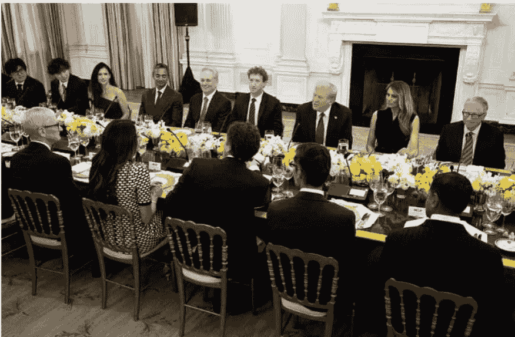

对于市值这块大蛋糕，必然和科技企业有关。前文提到的“天才金融法案”明确规定，原则上禁止Meta、京东等非金融类上市公司发行。

第三板斧，仿佛“深层国家”资本的核心——军权。虽然名上是三军统帅，但特朗普唯一完全拿下的就是军权，这包括情报安全部门、军工业和军队。我们曾在《军事清洗》中提到，两个美国之间的内战蔓到了军队和国家安全领域。

特朗普上任当天，签署废除民主党的关于多元化的行政命令，军队中一批政治官员不得不辞职。特朗普仅几个小时内，便宣布成立“军事工作组”，审查军队内部的“赘族”。这让美国政府效率提升，并推进了选择性裁员。

特朗普逻辑简单，要么服从，要么滚蛋。上台前，特朗普的竞选号之一就是要打破“深层国家”集团。这个集团由军事工业复合体、金融财团、情报机构、政治官员组成。

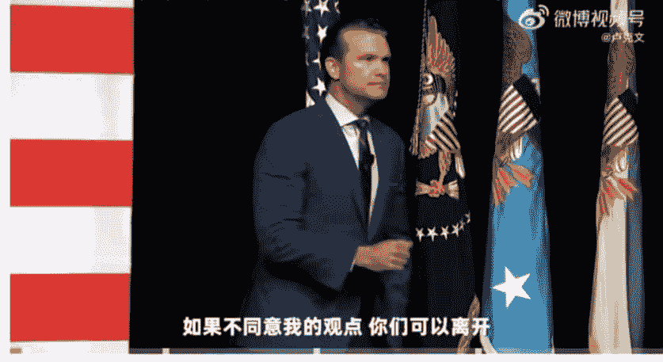
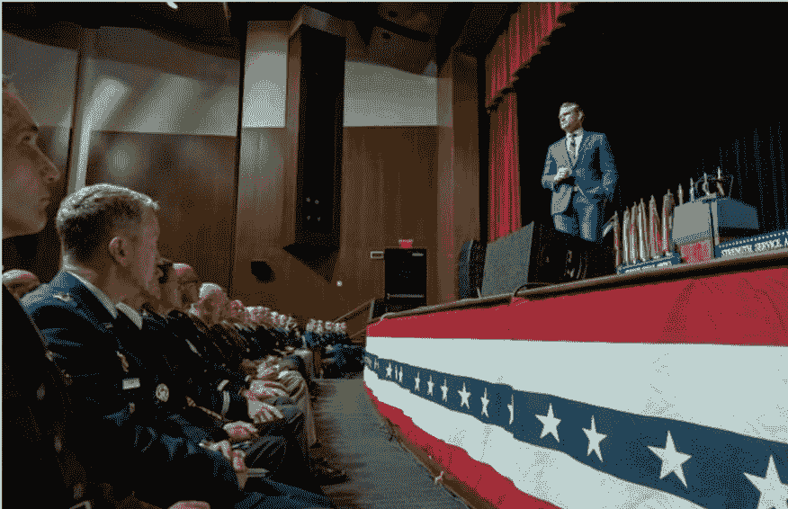

特朗普曾放出话：“要么摧毁深层国家，要么我们瓦解‘深层国家’。”事实上，特朗普正在重建以共和党为主的深层国家，只不过原来的“深层国家”跟着民主党，现在这个“深层国家”要跟着特朗普了。

## 七、冲击2026年诺贝尔奖

转眼已经12点，忙了一上午，特朗普决定去玫瑰花园透口气。在白宫大厅的出口处，特朗普再次看到罗斯福和麦金莱的肖像画。此前，这里挂的是克林顿和小布什的图像，被特朗普下令撤掉。

看着罗斯福的图像，特朗普心中盘算：1906年，老罗斯福因为调停战争获得诺贝尔奖，与华盛顿、杰斐逊、林肯一样登上了总统山（拉摩山）。

120后的2026年，美国建国250周年，若特朗普因为调停俄乌战争再次获得和平奖，这是多么完美的历史佳话！更重要的是，有了诺贝尔奖的加持，说不定还能推动自己的雕像登上拉摩山。

想到这里，特朗普心里那股不服输的劲头上来了：战斗，战斗，战斗！

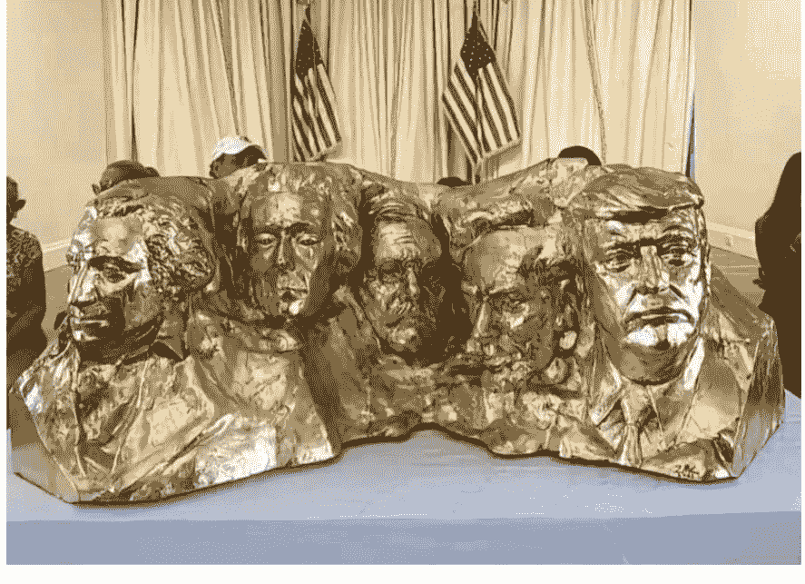

# 美建250周年纪念币曝光印有特朗普遇刺名场面，法律规定总统去世两年才能上岗

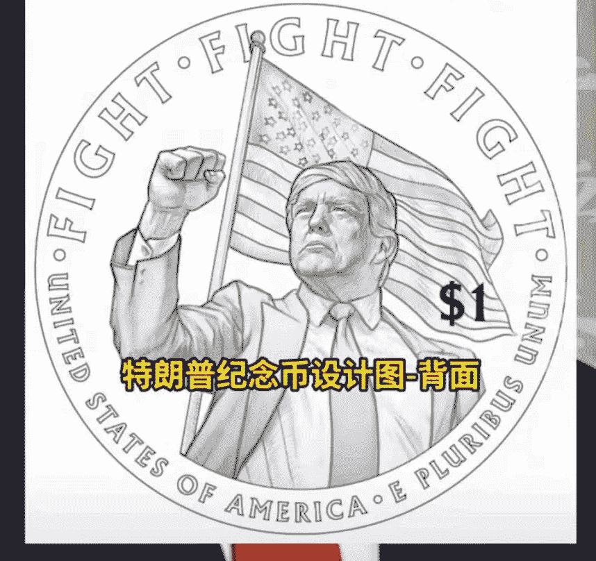

背面则是特朗普遇刺后起拳头的著名画面，上方写着“战斗，战斗，战斗”——侧面美国国旗在他身后飘扬。

于是，特朗普赶紧又发了一条推文：俄乌战争必须尽快结束，这是我将要挥旋的第9场战争，我最应该获得2026年诺贝尔奖，感谢您对此事的密切关注！

# 深度视野优质集团（链接优质群，助你成功）

全部包含以下内容：限时年费188/年 加微信cuk255

- ① 吃瓜群众倍时圈加时群群对话（原价 365 元/年）
- ② 子明私享汇（含）内部文章
- ③ 政事室（顾子明）付费内容再送顾子明群聊
- ④ 米联锦闲【作者米穗（原价 599 元/年）】
- ⑤ 欧洲金雀会员专属文章（原价 328 元/年）
- ⑥ 砖瓦仁内部圈（原价 400 元/年）
- ⑦ 卢克文青读书会专属文章（原价 699 元/年）
- ⑧ 鉴茶财经知识星球星球（原价 3310 元/年）
- ⑨ 猫哥的视界知识星球文章（原价 299 元/年）
- 十 财新周刊【独家新闻（原价 1498 元/年）】
- 十一 杨世光在金钱煽（原价 2200 元/年）
- 十二 蒜森财经知识星球（原价 1600 元/年）
- 十三 潇游异译付费文章（持续更新）
- 十四 司马林解课全套音频和全套书籍藏版无割减（原价 2.3 万）
- 十五 虚构三部曲[民国梦、帝国争合、不被理解的MAO](原价 599 元）
- 十六 卢克知识星球文章（原价 268 元/年）
- 十七 额外再送：卢祺元新浪微博付费专栏、三村丰老王、三花九洞文集

不定期内容：……更多资源不写下了......

- ① 守护人司令知识星球、接换魔王知识星球、成达谈论星球、成养成财富、雪光花甲老头等
- ② 创始笔记、达叔谈论星球、成养成财富、雪球
- ③ A 视野、大树乡谈、江宁后、泮咩说、财上海家学等付费文集
- ④ 西凤付费文章、老端、赢在小时之时、局外的视界、升值优、老体制内等其它一些V付费文章（每月不低于600 元付费文集）

限时年费188/年

# 底层链接下载全网V优质内容

