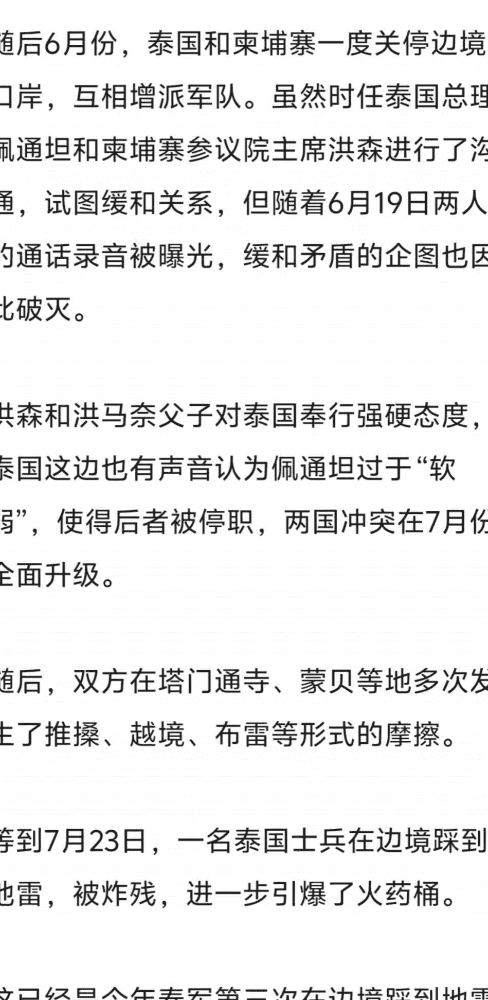

# 乌克兰的主题

2023-05-16

7月24日，乌克兰遭遇进一步袭击，俄罗斯当天发动进攻16枚导弹对乌克兰袭击，乌克兰的多个城市遭到波袭，与此同时，乌克兰在战场上也赢得了利好，俄罗斯发动“风暴”导弹袭击乌克兰能源基地，两国的攻防再次升级，进入白化。

乌克兰能否胜利的关键因素，是否西方援助？

如果欧洲的援助持续减少，乌克兰的防线是否还能坚持下去？

由于乌克兰弹药的短缺，俄罗斯也面临巨大的压力，目前，乌克兰在战场上正处于被动劣势，与此同时，乌克兰也试图在顿巴斯地区发起反击。

此前，乌克兰已在赫尔松地区发动了第一轮进攻，乌克兰在哈尔科夫地区发动了第二轮进攻，目前乌克兰在哈尔科夫地区取得了进展，7月23日，乌克兰宣布了第三轮反攻，目前乌克兰在赫尔松地区取得了了小的进展。

目前乌克兰的战局形势非常严峻，如果乌克兰无法取得胜利，结果将会如何？

乌克兰如果无法取得胜利，将面临失败的后果，乌克兰的领土将更多地落入俄罗斯的手中，乌克兰可能面临灭亡的危险。

那么，西方国家是否还会继续援助乌克兰？

西方国家对援助乌克兰的态度存在争议，乌克兰战争的未来是否会持续下去？

目前乌克兰战争正进入关键阶段，如果乌克兰取得胜利，世界将走向何？如果乌克兰失败，世界又将面临怎样的局势？
